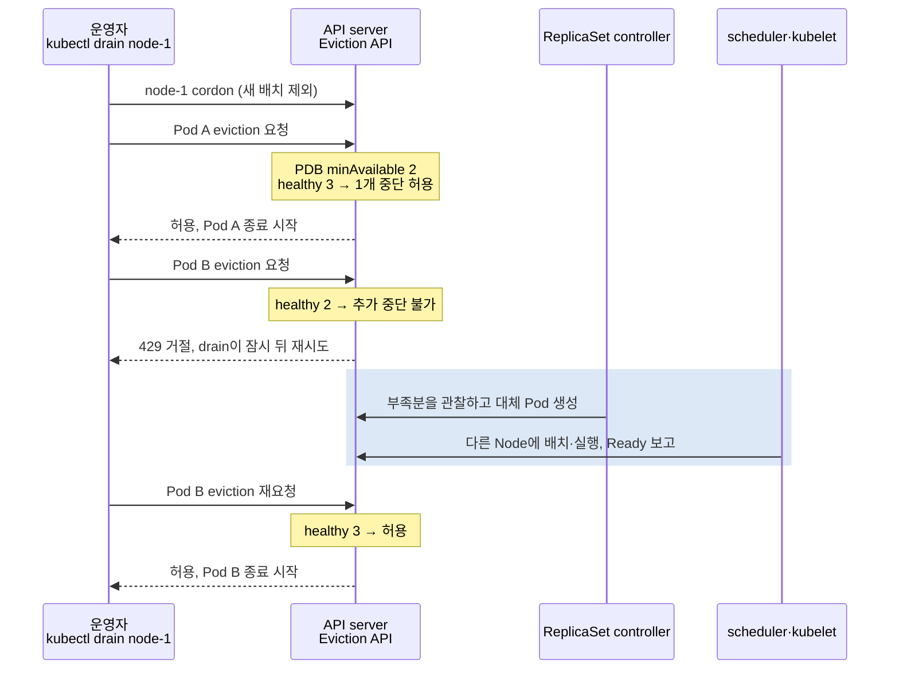

# Kubernetes 책 리뷰 1차 수정 Implementation Plan

> **For agentic workers:** REQUIRED SUB-SKILL: Use superpowers:subagent-driven-development (recommended) or superpowers:executing-plans to implement this plan task-by-task. Steps use checkbox (`- [ ]`) syntax for tracking.

**Goal:** 2026-10-24 리뷰의 "먼저 고칠 것"을 고친다. 대상은 낡은 버전 서술 1건, 예제·그림 모순 3건, 끊긴 장·절 참조 7건, 용어·주체 오류 2건이다.

**Architecture:** 원고 12개 파일을 한 줄~한 절 단위로 고친다. 파일명·H1·장 순서·다른 절은 건드리지 않는다. 각 Task는 "옛 문구가 있음을 확인 → 고침 → 옛 문구 0건·새 문구 1건 확인"으로 검증한다. 마지막 Task에서 링크·Mermaid·변경 범위를 한 번에 검사한다.

**Tech Stack:** Markdown, Mermaid, Python 3 정적 검사(`check_links.py`, PyYAML), mermaid-cli, Chrome headless.

**Spec:** `.github/superpowers/work/2026-10-24-kubernetes-book-review.md`의 "1. 사실 오류·모순" 절(git 제외 로컬 파일). 이 계획은 그 절의 항목을 모두 담고 수정 문구까지 확정했으므로 단독으로 실행할 수 있다.

## Global Constraints

- `git add`·`commit`·`push`, `README.md` 수정, `scripts/generate_readme.py` 실행 금지 (CLAUDE.md 1절). 커밋은 사용자가 요청할 때만 한다.
- 파일 경로·H1·장 번호·이전/다음 네비게이션은 그대로 둔다.
- 원고 편집은 Edit 도구로, 한 파일씩 순서대로 한다. 같은 파일을 병렬로 Edit하지 않는다.
- Edit마다 PostToolUse 리뷰 hook이 파일 전체를 검토할 수 있다. 처리 규칙:
  - 이번에 바꾼 줄에 대한 지적만 공식 문서로 확인한 뒤 반영한다.
  - 범위 밖 지적은 고치지 않고 `.github/superpowers/work/2026-10-24-hook-findings.md`에 `파일:줄 | 지적 | 판단` 한 줄로 남긴다.
  - 한 파일에서 리뷰가 PASS하면 그 파일의 추적을 멈춘다.
- hook의 2단계(Antigravity)는 2026-10-24 계획 작성 시점에 사용량 한도로 실패했다(약 53시간 뒤 초기화). 실패하면 재시도하지 않고 "Codex 단독 검토"로 보고한다.
- 새로 쓰는 사실에는 확인 날짜 `2026-10-24`를 붙인다. 이미 있는 `2026-10-23` 표기는 바꾸지 않는다.
- TIL 문체 규칙:
  - Bold 닫는 `**` 뒤에는 띄어쓴다.
  - sequenceDiagram은 `style` 대신 `rect rgba()`를 쓰고, 줄바꿈은 `<br>`로 한다.
- 모든 명령은 저장소 루트 `/Users/sskim/dev/TIL`에서 실행한다.
- 아래 old/new 블록은 파일에 들어갈 텍스트 그대로다. 앞뒤 공백 없이 그대로 Edit의 old_string/new_string으로 쓴다.

## Review Focus

1. **외부에서 15장 옛 anchor로 들어오는 deep link**(`#9-클라우드별-ingress-controller`, `#12-2026년-현재--…`)가 renumber 뒤에도 같은 절로 가야 한다.
   - Task 2 Step 3에서 두 anchor를 `<a id>`로 남긴다.
   - Task 8 Step 2에서 둘 다 존재하는지 확인한다.
2. **새 PDB sequenceDiagram은 GitHub와 Obsidian 모두에서 렌더되어야 한다.** participant 별칭의 `<br>`가 파서에서 깨지기 쉽다. Task 4 Step 4에서 mermaid-cli로 렌더하고 PNG를 눈으로 확인한다. 이 확인은 Mermaid 파서 수준이다. GitHub 표시는 push 후, Obsidian 표시는 커밋 후 동기화된 뒤에야 볼 수 있다. 그래서 Task 8 보고에 "mermaid-cli 확인, GitHub·Obsidian 미확인"으로 범위를 나눠 적는다.
3. **저장소의 다른 폴더에서 바뀐 anchor로 들어오는 링크.** `check_links.py`는 `kubernetes/` 안만 본다. Task 8 Step 3에서 저장소 전체 `grep`으로 잔존 0건을 확인한다.
4. **Obsidian vault 사본에는 `[[Kubernetes-Ingress#12-…]]`가 이미 있다.** 커밋 후 post-commit 동기화가 TIL 원본 기준으로 사본을 다시 만든다. slug 형식 heading 링크가 Obsidian에서 해석되는지는 기존 문제라 이번 범위 밖이다. Task 8 보고에 이 사실만 적는다.
5. **hook이 범위 밖 수정을 요구해 변경이 번질 수 있다.** Task 8 Step 4에서 변경 파일이 아래 목록 12개와 정확히 같은지 확인한다.

## 변경 파일 목록

| 파일 (`kubernetes/`) | Task |
|---|---|
| `Kubernetes-Admission-Webhook.md` | 1 |
| `Kubernetes-Ingress.md` | 2 |
| `Istio-Ingress-Gateway-Ingress가-있는데-왜-VirtualService를-따로-쓸까.md` | 2 |
| `Kubernetes-Gateway-API.md` | 2, 3 |
| `Kubernetes-ReplicaSet-Deployment.md` | 4 |
| `Kubernetes-Volume-PersistentVolume.md`, `Kubernetes-StatefulSet.md` | 5 |
| `Kubernetes-CRD-Controller-Operator.md`, `Kubernetes-ServiceAccount-RBAC.md`, `Kubernetes-Image-Tag-Digest.md` | 6 |
| `Kubernetes-ConfigMap-Secret.md`, `Kubernetes-Pod.md` | 7 |

범위 밖(이번에 하지 않음): 5장 예제의 PID 1 SIGTERM, 문체·중복·빈 이동 heading·31장 갱신 등 리뷰 2절 이후 항목.

---

### Task 1: 29장 manifest-based admission 상태 갱신과 고아 참조

**Files:**
- Modify: `kubernetes/Kubernetes-Admission-Webhook.md:236, 332, 548, 562`

**Interfaces:** 없음 (독립)

**근거:** https://kubernetes.io/docs/reference/access-authn-authz/manifest-admission-control/
- "Beta since Kubernetes v1.37; enabled by default"
- gate `ManifestBasedAdmissionControlConfig`, 설정 필드 `staticManifestsDir`
- "Not visible or changeable through the Kubernetes API"
- "Able to intercept operations on API-based admission resources themselves"

admission-controllers 문서의 기본 목록 문구는 "In Kubernetes 1.37, the default ones are"다.

- [ ] **Step 1: 옛 문구 확인 (실패 상태)**

```bash
grep -c 'alpha manifest-based admission\|도입부의 `READY 2/2`를\|plugin 목록(v1.36)\|v1-36-manifest-based' kubernetes/Kubernetes-Admission-Webhook.md
```
Expected: `4`

- [ ] **Step 2: 236행 교체**

old:
```text
이제 도입부의 `READY 2/2`를 설명할 수 있다.
```
new:
```text
이제 도입부의 장면, 컨테이너를 하나만 적었는데 실제 Pod에는 프록시가 함께 보이는 이유를 설명할 수 있다. 이런 Pod는 `kubectl get pods`에서 `READY 2/2`로 나타난다.
```

- [ ] **Step 3: 332행 끝의 세 문장 교체**

old:
```text
Kubernetes v1.36의 **alpha manifest-based admission** 은 별도 정적 구성을 통해 admission 설정 자체를 보호할 수도 있다. 이 기능이 기본 활성이라는 뜻은 아니다. [Manifest-based admission 소개](https://kubernetes.io/blog/2026/05/04/kubernetes-v1-36-manifest-based-admission-control/)
```
new:
```text
**Manifest-based admission** 은 웹훅과 CEL 정책을 API 오브젝트가 아니라 API server가 읽는 정적 파일(`AdmissionConfiguration`의 `staticManifestsDir`)에서 불러온다. 이 설정은 API로 조회·변경되지 않고, API 기반 admission 설정 객체에 대한 요청도 검사할 수 있어 설정 자체를 보호하는 데 쓰인다. 2026-10-24 확인한 공식 문서 기준 v1.37에서 Beta가 되었고 feature gate `ManifestBasedAdmissionControlConfig`는 기본 활성이다. gate가 켜져 있어도 정적 manifest 디렉터리를 구성하지 않으면 추가되는 설정은 없다. [Manifest-Based Admission Control](https://kubernetes.io/docs/reference/access-authn-authz/manifest-admission-control/)
```

- [ ] **Step 4: 출처 548행·562행 교체**

548행 old: `기본 활성화 plugin 목록(v1.36)` → new: `기본 활성화 plugin 목록(2026-10-24 확인 시 v1.37 기준)`

562행 old:
```text
- [Manifest-based admission control](https://kubernetes.io/blog/2026/05/04/kubernetes-v1-36-manifest-based-admission-control/) — v1.36 alpha의 별도 등록 방식과 설정 보호, 2026-10-23 확인
```
new:
```text
- [Manifest-Based Admission Control | Kubernetes](https://kubernetes.io/docs/reference/access-authn-authz/manifest-admission-control/) — v1.37 Beta·기본 활성 gate, `staticManifestsDir`, API로 보이지 않는 정적 설정과 설정 보호, 2026-10-24 확인
```

- [ ] **Step 5: 검증**

```bash
grep -c 'alpha manifest-based admission\|도입부의 `READY 2/2`를\|plugin 목록(v1.36)\|v1-36-manifest-based' kubernetes/Kubernetes-Admission-Webhook.md
grep -c 'ManifestBasedAdmissionControlConfig' kubernetes/Kubernetes-Admission-Webhook.md
```
Expected: `0`, `1`

---

### Task 2: 15장 절 번호 재정렬(9→7, 12→8)과 유입 참조

**Files:**
- Modify: `kubernetes/Kubernetes-Ingress.md:192, 286, 297, 363, 510, 562, 575-577, 619`
- Modify: `kubernetes/Kubernetes-Gateway-API.md:46, 501`
- Modify: `kubernetes/Istio-Ingress-Gateway-Ingress가-있는데-왜-VirtualService를-따로-쓸까.md:136, 314`

**Interfaces:**
- Produces: canonical anchor `#8-2026년-현재--ingress-nginx-은퇴와-gateway-api`
- Produces: 호환 anchor `9-클라우드별-ingress-controller`, `12-2026년-현재--ingress-nginx-은퇴와-gateway-api` (`<a id>`)

- [ ] **Step 1: 옛 번호 확인 (실패 상태)**

```bash
grep -nE '^#{2,3} (9|12)[. ]' kubernetes/Kubernetes-Ingress.md | wc -l
grep -rn 'Ingress\.md#12-\|Ingress 12절\|12절 ingress-nginx\|(12절 근거)\|\[12절\]' kubernetes | wc -l
```
Expected: `6`, `6`

- [ ] **Step 2: heading 번호 변경 (`Kubernetes-Ingress.md`)**

제목 텍스트는 그대로 두고 번호만 바꾼다.
- `## 9. 클라우드별 Ingress Controller` → `## 7. 클라우드별 Ingress Controller`
- `### 9.1`~`### 9.4` → `### 7.1`~`### 7.4`
- `## 12. 2026년 현재 — ingress-nginx 은퇴와 Gateway API` → `## 8. 2026년 현재 — ingress-nginx 은퇴와 Gateway API`

- [ ] **Step 3: 호환 anchor**

`## 7. 클라우드별 Ingress Controller` 바로 위에 `<a id="9-클라우드별-ingress-controller"></a>`와 빈 줄을 넣는다. 575행의 `<a id="12-2026년-현재--ingress-nginx-은퇴와-gateway-api"></a>`는 그대로 둔다.

- [ ] **Step 4: 본문 참조 갱신**

| 위치 | old | new |
|---|---|---|
| Ingress.md:192 | `[12절](#12-2026년-현재--ingress-nginx-은퇴와-gateway-api)` | `[8절](#8-2026년-현재--ingress-nginx-은퇴와-gateway-api)` |
| Ingress.md:619 | `(12절 근거)` | `(8절 근거)` |
| Gateway-API.md:46 | `[Kubernetes Ingress 12절](./Kubernetes-Ingress.md#12-2026년-현재--ingress-nginx-은퇴와-gateway-api)` | `[Kubernetes Ingress 8절](./Kubernetes-Ingress.md#8-2026년-현재--ingress-nginx-은퇴와-gateway-api)` |
| Gateway-API.md:501 | `12절 ingress-nginx 은퇴` | `8절 ingress-nginx 은퇴` |
| Istio…:136 | `[Kubernetes Ingress 12절](Kubernetes-Ingress.md#12-2026년-현재--ingress-nginx-은퇴와-gateway-api)` | `[Kubernetes Ingress 8절](Kubernetes-Ingress.md#8-2026년-현재--ingress-nginx-은퇴와-gateway-api)` |
| Istio…:314 | `12절 ingress-nginx 은퇴` | `8절 ingress-nginx 은퇴` |

- [ ] **Step 5: 검증**

```bash
grep -nE '^## [0-9]+\.' kubernetes/Kubernetes-Ingress.md | awk -F'[ .]' '{print $2}' | tr '\n' ' '; echo
grep -rn 'Ingress\.md#12-\|Ingress 12절\|12절 ingress-nginx\|(12절 근거)\|\[12절\]' kubernetes | wc -l
python3 -I .github/superpowers/work/check_links.py kubernetes | tail -1
```
Expected: `1 2 3 4 5 6 7 8`, `0`, `total 0`

---

### Task 3: 16장 2.6절 Gateway 예제를 발췌로 바꾸기

**Files:**
- Modify: `kubernetes/Kubernetes-Gateway-API.md:238-276` (2.6절 YAML 블록)

**Interfaces:**
- Consumes: 2.2절 `infra/shared-gw` (`https` listener, `allowedRoutes`)

**결정:** 2.6의 Gateway를 완전한 리소스로 다시 정의하지 않는다. 2.2절 Gateway에 `allowedListeners`만 더하는 발췌로 보인다. 이렇게 하면 3장 실습(`sectionName: https`)과의 모순이 사라진다.

- [ ] **Step 1: 옛 상태 확인**

```bash
grep -c '^# 운영자: listener 위임을 허용\|^  - name: http$' kubernetes/Kubernetes-Gateway-API.md
```
Expected: `2` (239행, 254행)

- [ ] **Step 2: YAML 블록 교체**

`# 운영자: listener 위임을 허용`으로 시작해 `- name: a-cert`로 끝나는 코드 블록 하나를, 아래 연결 문장 두 개와 코드 블록 두 개로 바꾼다. 블록 바로 앞 문단("이 위임은 운영자의 Gateway 편집 부담을…")은 그대로 둔다.

````markdown
운영자는 2.2절의 `infra/shared-gw`에 `allowedListeners`만 더한다. 다음은 그 Gateway의 `spec`에 합치는 발췌이며, 기존 `https` listener와 `allowedRoutes`는 그대로 둔다.

```yaml
# 운영자: 2.2절 shared-gw의 spec에 추가하는 필드 (발췌)
spec:
  allowedListeners:
    namespaces:
      from: Selector
      selector:
        matchLabels:
          gateway-access: "true"
```

team-a는 자기 namespace에 완전한 ListenerSet을 만든다.

```yaml
# team-a: 자기 호스트와 인증서로 listener 추가
apiVersion: gateway.networking.k8s.io/v1
kind: ListenerSet
metadata:
  name: team-a-listeners
  namespace: team-a
spec:
  parentRef:
    name: shared-gw
    namespace: infra
  listeners:
  - name: https-a
    port: 443
    protocol: HTTPS
    hostname: a.example.com
    tls:
      certificateRefs:
      - name: a-cert             # team-a 네임스페이스의 Secret
```
````

- [ ] **Step 3: 검증**

```bash
grep -c '^# 운영자: listener 위임을 허용\|^  - name: http$' kubernetes/Kubernetes-Gateway-API.md
grep -c '2.2절 shared-gw의 spec에 추가하는 필드' kubernetes/Kubernetes-Gateway-API.md
python3 -I - <<'EOF'
import re, yaml
text = open('kubernetes/Kubernetes-Gateway-API.md').read()
for block in re.findall(r'```yaml\n(.*?)```', text, re.S):
    list(yaml.safe_load_all(block))
print('yaml ok')
EOF
```
Expected: `0`, `1`, `yaml ok`

---

### Task 4: 8장 PDB 시퀀스 그림의 주체 바로잡기

**Files:**
- Modify: `kubernetes/Kubernetes-ReplicaSet-Deployment.md:710-725` ("**PDB가 필요한 이유:**" 아래 mermaid 블록)

**Interfaces:** 없음

**근거:**
- `kubectl drain`은 Node 단위로 Pod마다 Eviction API를 호출한다. PDB를 위반하면 API server가 429로 거절하고 drain은 재시도한다.
- 대체 Pod는 ReplicaSet controller가 만든다. 30장 `Kubernetes-Cluster-Operations.md` 4·5절과 같은 모델이다.
- https://kubernetes.io/docs/tasks/administer-cluster/safely-drain-node/

- [ ] **Step 1: 옛 상태 확인**

```bash
grep -c 'kubectl -n bookstore drain\|Node->>PDB' kubernetes/Kubernetes-ReplicaSet-Deployment.md
```
Expected: `3`

- [ ] **Step 2: mermaid 블록 교체와 설명 한 문장 추가**



그림을 닫는 fence 바로 아래에 빈 줄과 다음 문장을 넣는다.
```text
drain은 Node 단위 작업이라 namespace를 지정하지 않는다. PDB 판단은 Eviction API가 하고 대체 Pod는 controller가 만든다.
```

- [ ] **Step 3: 텍스트 검증**

```bash
grep -c 'kubectl -n bookstore drain\|Node->>PDB' kubernetes/Kubernetes-ReplicaSet-Deployment.md
grep -c 'API server<br>Eviction API' kubernetes/Kubernetes-ReplicaSet-Deployment.md
```
Expected: `0`, `1`

- [ ] **Step 4: 렌더 검증**

```bash
W=.github/superpowers/work
python3 -I - <<'EOF'
t = open('kubernetes/Kubernetes-ReplicaSet-Deployment.md').read()
i = t.index('API server<br>Eviction API')
s = t.rindex('```mermaid\n', 0, i) + len('```mermaid\n')
open('.github/superpowers/work/pdb.mmd', 'w').write(t[s:t.index('```', s)])
EOF
printf '{"executablePath":"/Applications/Google Chrome.app/Contents/MacOS/Google Chrome"}' > $W/puppeteer.json
npx -y @mermaid-js/mermaid-cli@11.4.2 -p $W/puppeteer.json -i $W/pdb.mmd -o $W/pdb.png -w 1200
```
Expected: exit 0, `.github/superpowers/work/pdb.png` 생성.

이어서 Read 도구로 PNG를 열어 확인한다: participant 4개, 음영 영역 1개, 화살표 순서가 위 블록과 같아야 한다. 11.4.2가 없으면 `npm view @mermaid-js/mermaid-cli versions`에서 2주 이상 된 11.x 최신 patch를 쓴다.

---

### Task 5: 18·19장 volumeClaimTemplates 서술 일치

**Files:**
- Modify: `kubernetes/Kubernetes-Volume-PersistentVolume.md:222`
- Modify: `kubernetes/Kubernetes-StatefulSet.md:173`

**근거:**
- StatefulSet spec 갱신은 `replicas`, `ordinals`, `template`, `updateStrategy`, `revisionHistoryLimit`, `persistentVolumeClaimRetentionPolicy`, `minReadySeconds` 외에는 API 검증에서 거부된다.
- 템플릿 수정 기능 KEP-4650(https://github.com/kubernetes/enhancements/issues/4650)은 2026-10-22에도 구현 없이 열려 있다.

- [ ] **Step 1: 옛 문구 확인**

```bash
grep -c '템플릿 수정만으로 모든 기존 디스크가 커진다고' kubernetes/Kubernetes-Volume-PersistentVolume.md
grep -c '자유롭게 수정할 수 있는 필드가 아니다' kubernetes/Kubernetes-StatefulSet.md
```
Expected: `1`, `1`

- [ ] **Step 2: 18장 222행 교체**

old:
```text
StatefulSet의 `volumeClaimTemplates`와 이미 생성된 각 PVC는 별개의 오브젝트다. 템플릿 수정만으로 모든 기존 디스크가 커진다고 생각하면 안 된다. 각 claim의 확장 상태와 이후 생성될 claim의 설정을 구분해 관리한다.
```
new:
```text
StatefulSet의 `volumeClaimTemplates`는 생성 뒤 API가 수정을 거부하는 필드이고, 이미 생성된 각 PVC와는 별개의 오브젝트다. 기존 디스크는 PVC마다 확장을 요청해 키운다. 앞으로 만들 claim의 크기까지 바꾸려면 StatefulSet을 다시 만드는 별도 절차가 필요하다. 2026-10-24 확인 기준 템플릿 수정 기능은 제안(KEP-4650) 단계다.
```

- [ ] **Step 3: 19장 173행 첫 문장 교체**

old:
```text
기존 StatefulSet의 `volumeClaimTemplates`는 자유롭게 수정할 수 있는 필드가 아니다.
```
new:
```text
기존 StatefulSet의 `volumeClaimTemplates`는 생성 뒤 API가 수정을 거부하는 필드다.
```

- [ ] **Step 4: 검증**

```bash
grep -c 'API가 수정을 거부하는 필드' kubernetes/Kubernetes-Volume-PersistentVolume.md kubernetes/Kubernetes-StatefulSet.md
```
Expected: 두 파일 모두 `1`

---

### Task 6: 끊긴 장·절 참조 (28·26·9장)

**Files:**
- Modify: `kubernetes/Kubernetes-CRD-Controller-Operator.md:197, 363`
- Modify: `kubernetes/Kubernetes-ServiceAccount-RBAC.md:431`
- Modify: `kubernetes/Kubernetes-Image-Tag-Digest.md:295, 378`

**결정:** 9장의 Reloader 안내는 10장에 예시를 되살리지 않는다. 대신 10장이 실제로 다루는 범위에 맞춰 문구를 고친다. 10장 241·243행이 다루는 것은 checksum annotation, Kustomize 이름 해시, Reloader 같은 추가 controller의 차이다.

- [ ] **Step 1: 옛 문구 확인**

```bash
grep -c 'Kubernetes Introduction\](Kubernetes-Introduction.md)에서 "쿠버네티스는 선언적\|StatefulSet.md)의 12절' kubernetes/Kubernetes-CRD-Controller-Operator.md
grep -c '다음 장의 마이그레이션 순서' kubernetes/Kubernetes-ServiceAccount-RBAC.md
grep -c 'Reloader로 자동화하는 방법\|설정 갱신 반영과 Reloader' kubernetes/Kubernetes-Image-Tag-Digest.md
```
Expected: `2`, `1`, `2`

- [ ] **Step 2: 수정**

| 위치 | old | new |
|---|---|---|
| CRD:197 | `[Kubernetes Introduction](Kubernetes-Introduction.md)에서 "쿠버네티스는 선언적(declarative)"이라고 했던 그 말의 정체가 이것이다.` | `4장 [오케스트레이션이 필요한 이유](Kubernetes-Why-Orchestration.md#6-세-개를-실행했다보다-세-개가-필요하다를-남긴다)에서 처음 소개한 "선언적(declarative)"이라는 말의 정체가 이것이다.` |
| CRD:363 | `[Kubernetes StatefulSet](Kubernetes-StatefulSet.md)의 12절에서 상세히 다룬다.` | `[Kubernetes StatefulSet의 8절](Kubernetes-StatefulSet.md#8-database-operator가-맡는-별도의-문제)에서 상세히 다룬다.` |
| RBAC:431 | `이게 다음 장의 마이그레이션 순서를 결정한다.` | `이게 8절의 마이그레이션 순서를 결정한다.` |
| Image-Tag-Digest:295 | `ConfigMap/Secret의 갱신 반영 동작, 이 해시 annotation의 구체적 작성법, Reloader로 자동화하는 방법, ` | `ConfigMap/Secret의 갱신 반영 동작, 설정 변경을 rollout으로 잇는 방법(해시 annotation·Kustomize 이름 해시·Reloader 같은 추가 controller)의 차이, ` |
| Image-Tag-Digest:378 | `설정 갱신 반영과 Reloader` | `설정 갱신 반영과 rollout 연결 방식` |

- [ ] **Step 3: 검증**

Step 1의 세 명령을 다시 실행한 뒤 링크 검사를 한다.
```bash
python3 -I .github/superpowers/work/check_links.py kubernetes | tail -1
```
Expected: `0`, `0`, `0`, 그리고 `total 0`. 새 anchor 두 개가 실제 heading과 맞는지 이 검사로 확인된다.

---

### Task 7: 용어·주체 정정 (10·7장)

**Files:**
- Modify: `kubernetes/Kubernetes-ConfigMap-Secret.md:227`
- Modify: `kubernetes/Kubernetes-Pod.md:560`

**근거:**
- immutable: "significantly reducing load on kube-apiserver, by closing watches for ConfigMaps marked as immutable" (https://kubernetes.io/docs/concepts/configuration/configmap/)
- EndpointSlice (https://kubernetes.io/docs/concepts/services-networking/endpoint-slices/)
  - 종료 중 endpoint는 기본적으로 `ready: false`다. 아직 요청을 처리할 수 있으면 `serving: true`, `terminating: true`다.
  - 예외: Service의 `publishNotReadyAddresses: true`이면 `ready`는 항상 true다. 2026-10-24 계획 리뷰(Codex)의 지적을 반영했다.

- [ ] **Step 1: 옛 문구 확인**

```bash
grep -c 'kubelet의 watch 부담' kubernetes/Kubernetes-ConfigMap-Secret.md
grep -c 'terminating·ready 조건' kubernetes/Kubernetes-Pod.md
```
Expected: `1`, `1`

- [ ] **Step 2: 수정**

| 위치 | old | new |
|---|---|---|
| ConfigMap:227 | `immutable은 설정 오변경을 줄이고 kubelet의 watch 부담을 줄일 수 있지만` | `immutable은 설정 오변경을 줄이고, kubelet이 해당 객체의 watch를 닫게 해 kube-apiserver 부하를 줄일 수 있지만` |
| Pod:560 | `terminating·ready 조건으로 표현될 수 있다.` | `serving·terminating 조건으로 표현될 수 있다. Service가 publishNotReadyAddresses를 쓰지 않는 한 종료 중인 endpoint의 ready는 false다.` |

- [ ] **Step 3: 검증**

Step 1의 두 명령을 다시 실행한다.
Expected: `0`, `0`

---

### Task 8: 전체 검증과 보고

**Files:** 원고는 읽기만 한다. 결과는 `.github/superpowers/work/2026-10-24-fix-report.md`에 기록한다.

- [ ] **Step 1: 링크·공백 검사**

```bash
python3 -I .github/superpowers/work/check_links.py kubernetes | tail -1
git diff --check && echo diff-check-ok
```
Expected: `total 0`, `diff-check-ok`

- [ ] **Step 2: 호환 anchor 존재**

```bash
grep -c '<a id="9-클라우드별-ingress-controller">\|<a id="12-2026년-현재--ingress-nginx-은퇴와-gateway-api">' kubernetes/Kubernetes-Ingress.md
```
Expected: `2`

- [ ] **Step 3: 저장소 전체 옛 anchor 잔존**

```bash
grep -rn --include='*.md' 'Kubernetes-Ingress.md#12-\|Kubernetes-Ingress.md#9-' . | grep -v '^./.github/superpowers/' | wc -l
```
Expected: `0`

- [ ] **Step 4: 변경 범위**

```bash
git -c core.quotepath=false diff --name-only | sort
```
Expected: 위 "변경 파일 목록"의 12개 파일과 정확히 같다. 하나라도 더 있으면 hook 지적 때문에 범위 밖을 고친 것이다. 되돌리지 말고 보고에 따로 적는다.

- [ ] **Step 5: 보고**

`2026-10-24-fix-report.md`에 다음을 적는다:
- Task별 결과
- 검증 출력
- hook 지적 요약(`hook-findings.md` 참조)과 Antigravity 실패 여부
- Review Focus 4번(vault 사본의 slug 링크)
- Mermaid 검증 범위: "mermaid-cli 렌더 확인, GitHub·Obsidian 표시는 커밋·push 후 확인 필요"

사용자에게는 같은 내용을 요약해 보고하고, 커밋 여부를 묻는다. 커밋하면 post-commit hook이 Obsidian 동기화를 실행한다.
