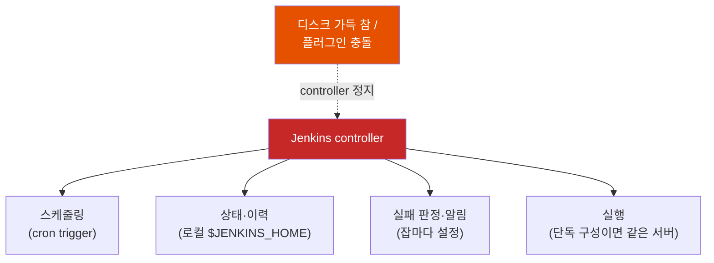
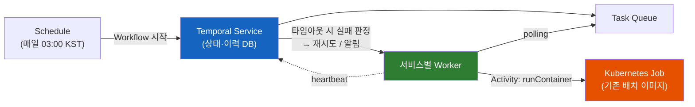

# Temporal Schedule — Jenkins로 돌리던 배치를 Temporal로 옮기면 무엇이 달라질까?

CI 도구인 Jenkins는 어쩌다 배치 서버로 쓰이게 됐을까? 그리고 "Durable Execution 플랫폼"인 Temporal이 그 자리를 대신한다는 건 정확히 무엇을 대신한다는 뜻일까?

## 결론부터 말하면

**Jenkins는 "트리거가 오면 스크립트를 실행하고 결과를 남기는 서버"라서, 트리거를 cron으로 바꾸기만 하면 그대로 배치 스케줄러가 된다.** 문제는 스케줄링·상태 저장·실패 알림이 모두 Jenkins controller 한 곳에 몰려 있다는 점이다. 실행까지 같은 서버에서 하는 단독 구성이라면, controller가 멈추는 순간 모든 배치가 멈추고 실패 알림조차 나가지 않는다.

Temporal로 옮긴다고 해서 배치 코드를 다시 짜야 하는 건 아니다. **"언제 실행할지"는 Temporal Schedule이, "제대로 실행되고 있는지"는 Workflow와 Activity의 타임아웃·heartbeat·재시도가 맡도록 역할을 나누는 것** 이 핵심이다. 기존 배치 컨테이너를 Activity 하나로 감싸기만 해도 이 이점을 얻는다.

| 배치 서버가 할 일 | Jenkins | Temporal |
|-------------------|---------|----------|
| 언제 실행할지 | `triggers { cron(...) }` | **Schedule** (cron·interval, 타임존 지정) |
| 이전 실행이 안 끝났다면 | 잡 설정에 따라 동시 실행 또는 대기열 (`disableConcurrentBuilds()`) | **Overlap Policy** (기본값 `Skip`) |
| 무엇을 실행할지 | Groovy Pipeline (`docker run`, `curl`) | Workflow + Activity (일반 코드) |
| 실패 처리·알림 | 잡마다 직접 설정 | Retry Policy, 타임아웃, heartbeat를 공통 코드로 |
| 상태·이력 저장 | Jenkins controller의 로컬 디스크 (`$JENKINS_HOME`) | Temporal Service의 외부 DB (Event History) |
| 서버 장애로 놓친 실행 | 직접 찾아서 수동 실행 | **Catchup Window**, **Backfill** |

## 1. 왜 CI 도구인 Jenkins가 배치 서버가 됐을까?

### 1.1 배치에 필요한 것들

**배치(batch)** 는 사용자 요청과 상관없이 정해진 시각에 몰아서 처리하는 작업이다. 매일 새벽의 일간 리포트, 월말 정산, 휴면 계정 안내 메일, 외부 시스템과의 데이터 동기화 같은 것들이다.

가장 단순한 방법은 서버의 `crontab`에 스크립트를 등록하는 것이다. 하지만 운영을 해 보면 cron만으로는 부족하다는 걸 곧 알게 된다. 어제 새벽 배치가 성공했는지 보려면 서버에 접속해 로그 파일을 뒤져야 하고, 실패해도 아무도 알려주지 않으며, 다시 돌리려면 누군가 서버에 들어가 명령을 직접 쳐야 한다. 배치를 운영하려면 결국 이런 것들이 필요하다.

- 정해진 시각에 실행하는 **스케줄러**
- 실행 **이력과 로그** 를 볼 수 있는 화면
- 실패했을 때의 **알림**
- 필요할 때 누를 수 있는 **수동 실행 버튼**

### 1.2 Jenkins는 이미 다 가지고 있었다

그런데 이 목록을 보면 익숙하다. Jenkins가 CI 서버로서 이미 제공하던 것들이다. Jenkins의 본질은 "트리거가 오면 스크립트를 실행하고, 결과와 로그를 남기는 서버"다. CI에서는 트리거가 git push일 뿐이다. 이 트리거를 시각으로 바꾸면 Jenkins는 그대로 배치 스케줄러가 된다.

```groovy
pipeline {
    agent any
    triggers { cron('H 3 * * *') }          // 매일 3시대에 실행 (분은 잡 이름 해시로 분산)
    options { disableConcurrentBuilds() }   // 이전 실행이 안 끝났으면 대기열에서 기다림
    stages {
        stage('daily-report') {
            steps {
                sh 'docker run --rm my-batch:1.4.2 node dist/batch/daily-report.js'
            }
        }
    }
    post {
        failure { slackSend channel: '#batch-alert', message: 'daily-report 실패' }  // Slack 플러그인
    }
}
```

`H`는 Jenkins 고유의 cron 기호다. 잡 수십 개가 모두 `0 3 * * *`이면 정각에 부하가 몰리므로, Jenkins는 잡 이름의 해시값으로 실제 실행 분을 흩어 준다. 실행 이력, 콘솔 로그, "Build Now" 버튼은 기본으로 딸려 온다. 이미 CI용으로 사내에 Jenkins가 있으니 배치까지 맡기는 건 자연스러운 선택이었다.

## 2. Jenkins 배치는 어디서 한계에 부딪힐까?

배치가 몇 개일 때는 이 구조가 잘 돌아간다. 하지만 잡이 수백 개로 늘면 균열이 생긴다. 인프랩 기술 블로그의 이관 사례를 참고하면, EC2 12대에서 Jenkins를 서비스별로 하나씩 단독으로 띄워 잡 220개를 하루 약 15,900번 실행하던 환경에서 아래 문제들이 반복됐다.

먼저 Jenkins의 구조를 짚고 가자. Jenkins는 **controller** 와 **agent** 로 나뉜다. controller는 스케줄링, 잡 설정, 빌드 이력 저장, 웹 UI를 맡는 중앙 서버이고, agent는 controller의 지시를 받아 실제 빌드를 실행하는 노드다. 규모가 작으면 controller 한 대가 실행까지 겸하는 단독 구성으로 운영하는 경우가 많다.

### 2.1 모든 상태가 controller의 디스크에 있다

Jenkins controller는 잡 정의, 빌드 이력, 로그를 모두 자기 디스크의 `$JENKINS_HOME`에 저장한다. 이력 보존 설정(`logRotator`)이 빠진 잡이 하나라도 있으면 이력이 계속 쌓이고, 디스크가 가득 차는 순간 **그 Jenkins의 모든 배치가 멈춘다.** 참고 사례에서는 그사이 실행을 기다리는 배치가 대기열에 3,000건 가까이 쌓였다.

더 곤란한 건 복구 이후다. 밀린 배치를 그대로 실행하면 "오전 9시 안내 메일"이 오후에 나가는 식으로 사용자 알림이 엉뚱한 시점에 발송될 수 있다. 결국 대기열을 전부 비우고, 다시 돌려야 할 배치를 사람이 직접 골라 수동으로 실행해야 했다. **"밀린 실행을 어떻게 처리할지"를 미리 정해 둘 방법이 없었던 것** 이다.

### 2.2 플러그인 하나가 서버 전체를 멈춘다

Jenkins는 대부분의 기능을 플러그인으로 추가하고, 플러그인끼리 서로 의존한다. 참고 사례에서는 Datadog 플러그인을 새로 설치하고 재시작했더니 기존 GitHub 플러그인과 의존성이 맞지 않아 Jenkins가 아예 뜨지 않았다. 이런 충돌은 재시작하기 전에는 발견하기 어렵고, 그동안 그 서버의 배치는 하나도 실행되지 않는다.

### 2.3 실패했는지조차 모른다

가장 위험한 문제는 이것이다. 알림을 잡마다 Groovy로 설정하다 보니 무엇을 실패로 볼지가 잡마다 달랐다. 중간 단계가 계속 실패했는데 마지막 단계가 성공해서 잡 전체가 SUCCESS로 기록된 경우도 있었다.

그리고 근본적인 구멍이 하나 더 있다. **Jenkins controller 자체가 멈추면 잡은 실패하지도 끝나지도 않는다.** 실패를 판정하고 알림을 보내야 할 주체가 바로 그 멈춘 controller이니, 알림이 나갈 리가 없다. 감시하는 쪽이 죽으면 알림도 같이 죽는 구조다.

### 2.4 평소엔 놀고, 몰리면 부족하다

배치는 정해진 시각에 잠깐 돌고 끝나지만 Jenkins 서버는 24시간 켜져 있어야 한다. 참고 사례에서 호스트별 평균 CPU 사용률은 일부를 빼면 6%도 되지 않았다. 반대로 배치가 몰리는 시간에는 한 서버의 자원을 잡들이 나눠 써야 해서, 새벽에 몰아서 돌리기 어려웠다.

### 2.5 공통 원인: 역할이 controller 한 곳에 몰려 있다

네 문제를 나란히 놓고 보면 원인이 같다. 스케줄링, 상태 저장, 실패 판정과 알림이 모두 **Jenkins controller 하나** 에 몰려 있고, 그 상태는 controller의 로컬 디스크에 있다. agent를 두어 실행을 다른 노드로 나눌 수는 있지만, 나머지 역할은 여전히 controller에 남는다. 그래서 Jenkins 공식 문서도 controller 한 대가 내려갔을 때의 영향을 줄이려면 controller를 여러 개로 나누라고 권한다. 참고 사례처럼 실행까지 같은 서버에서 하는 단독 구성이라면, 그 서버가 아플 때 모든 역할이 동시에 무너진다.



## 3. Temporal은 무엇을 대신하나?

### 3.1 역할을 나눈다

Temporal의 기본 구성을 짧게 복습하자. 자세한 내용은 [Temporal 기본 개념 노트](./Temporal-서버가-죽어도-코드가-멈춘-줄부터-다시-실행된다면.md)에 정리해 두었다.

- **Workflow**: 실행 흐름을 담은 코드
- **Activity**: 외부와 닿는 실제 작업 단위. 타임아웃과 자동 재시도가 붙는다
- **Worker**: Workflow와 Activity를 실제로 실행하는 우리 쪽 프로세스
- **Temporal Service**: 실행 상태와 이력을 DB에 저장하고, 무엇을 실행할지 Worker에게 나눠 주는 서버

배치를 Temporal로 옮기면 Jenkins controller가 하던 일이 이렇게 나뉜다. **언제 실행할지** 는 Temporal Service의 Schedule이 정한다. **실행** 은 서비스별 Worker가 맡아, 배치 이미지를 Kubernetes Job으로 띄운다. **상태와 이력** 은 Temporal Service의 DB에 남는다. **실패 판정** 은 Worker가 아니라 Temporal Service가 타임아웃과 heartbeat로 내린다.



물론 Temporal Service도 서버이고, Jenkins도 agent로 실행을 분리할 수 있다. 차이는 세 가지다.

- **상태가 로컬 디스크가 아니라 외부 DB에 있다.** Temporal Service는 Frontend·History·Matching 같은 여러 서비스로 나뉘어 각각 여러 인스턴스로 띄울 수 있고, 상태는 PostgreSQL·MySQL·Cassandra 같은 DB에 둔다. 디스크 하나가 차서 전체가 멈추는 구조가 아니다.
- **타임아웃·heartbeat·재시도가 플랫폼의 기본 단위에 들어 있다.** Activity마다 정책을 선언하기만 하면 되므로, 잡마다 실패 판정 로직을 따로 짤 필요가 없다.
- **실행 이력이 Event History로 남는다.** 그래서 실패한 단계만 다시 시도하고, 이미 끝난 단계는 건너뛸 수 있다.

이 구조에서 2.3의 구멍이 메워진다. 배치를 실행하던 Worker가 죽으면 heartbeat가 끊기고, Temporal Service가 그 Activity를 실패로 판정해 다른 Worker에게 재시도나 알림 단계를 넘긴다.

참고 사례에서는 Temporal 외에 Argo Workflows도 후보였다. Argo Workflows는 Kubernetes 위에서 YAML로 단계를 정의하는 워크플로 엔진인데, 개발팀 입장에서는 Groovy를 벗어나려다 또 다른 DSL(YAML과 GitOps 저장소 방식)을 배우게 되는 셈이었다. Temporal은 서버와 Worker를 직접 운영해야 하는 부담이 있지만, 배치를 서비스 코드베이스 안에서 익숙한 언어로 쓰고 타입 검사·테스트·코드 리뷰를 그대로 쓸 수 있다는 점이 결정적이었다.

### 3.2 Schedule: cron을 대신하는 것

**Schedule** 은 "정해진 시각에 Workflow를 시작하라"는 지시를 Temporal Service에 등록해 두는 기능이다. cron처럼 Worker 쪽 코드에 붙어 있는 설정이 아니라 Service에 독립적으로 저장되므로, 실행 중에도 일시정지하거나 수정할 수 있다. 예전 Temporal에는 Workflow 옵션에 cron 문자열을 넣는 Cron Job 방식이 있었지만, 지금 공식 문서는 Schedule을 권장한다.

Schedule이 흥미로운 건 2장에서 사람이 매번 판단해야 했던 질문들을 **정책으로 미리 선언** 하게 해 준다는 점이다.

| 운영 질문 | Schedule 기능 | 동작 |
|-----------|---------------|------|
| 이전 실행이 안 끝났는데 다음 시각이 오면? | **Overlap Policy** | 기본 `Skip`(이번 회차는 건너뜀). 그 밖에 `BufferOne`(끝나면 하나만 이어서), `BufferAll`, `CancelOther`, `TerminateOther`, `AllowAll` |
| 서버 장애로 늦어진 실행은 얼마나 늦게까지 시작할까? | **Catchup Window** | 기본 1년. 시점이 중요한 배치는 짧게 줄여서 너무 늦은 회차는 시작하지 않는다 |
| 놓친 기간을 일부러 다시 돌리려면? | **Backfill** | 지정한 기간에 있었어야 할 실행을 지금 실행 |
| 장애 대응 중 잠시 멈추려면? | **Pause** (+ note) | 이후 실행을 멈추고, 멈춘 이유를 메모로 남김 |
| 지금 당장 한 번 돌리려면? | **Trigger** | 예정 시각과 무관하게 즉시 실행 |
| 실패하면 다음 회차를 막으려면? | **Pause-on-failure** | 실행이 실패하면 Schedule을 자동으로 일시정지 |

2.1의 "대기열 3,000건" 상황을 다시 떠올려 보자. Jenkins에서는 밀린 실행을 다 돌릴지, 버릴지, 골라 돌릴지를 장애가 난 뒤에 사람이 판단해야 했다. Schedule에서는 안내 메일 배치라면 Catchup Window를 30분으로 두어 "예정보다 30분 넘게 늦은 회차는 시작하지 않는다"를 미리 정해 둘 수 있다. 정말 필요한 회차는 장애가 끝난 뒤 Backfill로 골라서 실행하면 된다.

다만 Catchup Window가 제한하는 건 **Workflow를 시작하는 시점** 까지다. 제때 시작된 Workflow가 Activity 재시도나 Worker 부족으로 늦어지는 경우는 막지 못한다. 실제 발송 시한까지 지켜야 한다면, "예정 시각 + 30분"이라는 마감 시각을 발송하는 쪽에 넘기고 **실제로 보내기 직전에** 마감을 넘겼는지 확인한다. Workflow에서 한 번 확인하는 것만으로는 부족하다. Activity가 Worker를 기다리거나 자동 재시도되는 동안에도 시간은 흐르고, 재시도할 때 Workflow의 앞선 조건문이 다시 실행되지는 않기 때문이다. 발송을 컨테이너가 한다면 이 확인도 컨테이너의 발송 코드에 들어가야 한다.

Java SDK로 Schedule을 등록하면 이렇다.

```java
Schedule schedule = Schedule.newBuilder()
        .setAction(ScheduleActionStartWorkflow.newBuilder()
                .setWorkflowType(ContainerJobWorkflow.class)
                .setArguments(new ContainerJob("my-batch:1.4.2", List.of("node", "dist/batch/daily-report.js")))
                .setOptions(WorkflowOptions.newBuilder()
                        .setWorkflowId("daily-report")      // 실제 실행 ID에는 실행 시각이 덧붙는다
                        .setTaskQueue("BATCH_TASK_QUEUE")
                        .build())
                .build())
        .setSpec(ScheduleSpec.newBuilder()
                .setCronExpressions(List.of("0 3 * * *"))
                .setTimeZoneName("Asia/Seoul")             // 매일 03:00 KST
                .build())
        .setPolicy(SchedulePolicy.newBuilder()
                .setOverlap(ScheduleOverlapPolicy.SCHEDULE_OVERLAP_POLICY_SKIP)  // 이전 실행 중이면 건너뜀
                .setCatchupWindow(Duration.ofMinutes(30))                          // 30분 넘게 늦은 회차는 시작 안 함
                .build())
        .setState(ScheduleState.newBuilder()
                .setPaused(true)                                 // 일시정지 상태로 등록 (3.4 참고)
                .setNote("Jenkins 잡을 끈 뒤 UI에서 켤 것")
                .build())
        .build();

scheduleClient.createSchedule("daily-report", schedule, ScheduleOptions.newBuilder().build());
```

Jenkinsfile의 `triggers`와 `options`에 흩어져 있던 내용이 하나의 선언으로 모였다. 이 코드가 서비스 저장소에 있으니, 스케줄 변경도 PR 리뷰를 거치고 배포·롤백과 함께 움직인다.

### 3.3 Workflow와 Activity: 기존 컨테이너를 감싸기만 한다

이제 Schedule이 시작할 Workflow를 보자. 핵심은 **배치 로직을 Temporal로 다시 짜지 않는다** 는 점이다. Jenkins가 `docker run`으로 실행하던 이미지를 그대로 Kubernetes Job으로 띄우는 Activity 하나와, 실패를 알리는 Activity 하나면 대부분의 잡이 옮겨진다.

```java
public class ContainerJobWorkflowImpl implements ContainerJobWorkflow {

    private final BatchActivities batch = Workflow.newActivityStub(
            BatchActivities.class,
            ActivityOptions.newBuilder()
                    .setStartToCloseTimeout(Duration.ofHours(2))   // 시도 1회 최대 2시간
                    .setHeartbeatTimeout(Duration.ofMinutes(1))    // 1분간 생존 신호가 없으면 실패로 판정
                    .setRetryOptions(RetryOptions.newBuilder().setMaximumAttempts(3).build())
                    .build());

    private final AlertActivities alert = Workflow.newActivityStub(
            AlertActivities.class,
            ActivityOptions.newBuilder().setStartToCloseTimeout(Duration.ofSeconds(30)).build());

    @Override
    public void run(ContainerJob job) {
        try {
            batch.runContainer(job);
        } catch (ActivityFailure e) {                     // 3번 시도 모두 실패
            alert.notifySlack("#batch-alert", job, e);    // 알림도 별도 Activity
            throw e;
        }
    }
}
```

알림을 별도 Activity로 둔 데는 이유가 있다. 배치는 이미 실패로 끝났는데 Slack이 잠깐 응답하지 않거나 알림을 보내던 Worker가 죽었다면? Temporal은 배치를 처음부터 다시 돌리지 않고 **알림 Activity만 재시도** 한다. 배치 실행 결과는 이미 Event History에 기록되어 있기 때문이다. 그리고 이 Workflow를 공용 코드로 제공하면 모든 잡이 같은 기준으로 실패를 판정하고 알림을 보내게 되어, 2.3처럼 잡마다 기준이 달라지는 문제가 사라진다.

Activity 구현에서는 두 가지를 챙겨야 한다. 하나는 **heartbeat** 이고, 다른 하나는 **중복 실행 방지** 다.

```java
public class BatchActivitiesImpl implements BatchActivities {

    @Override
    public void runContainer(ContainerJob job) {
        ActivityExecutionContext ctx = Activity.getExecutionContext();
        ActivityInfo info = ctx.getInfo();
        String runId = info.getRunId();

        // 같은 실행(Run ID)의 이전 시도가 띄운 Job 중 아직 돌고 있거나 성공한 것이 있으면
        // 새로 만들지 않고 그 Job을 이어서 감시한다
        String target = k8s.findRunningOrSucceededJob(runId)              // label: temporal-run-id=<runId>
                .orElseGet(() -> k8s.createJob("batch-" + runId + "-" + info.getAttempt(), runId, job));  // backoffLimit: 0

        while (!k8s.isFinished(target)) {
            ctx.heartbeat(target);   // "아직 살아 있다"는 신호
            sleep(Duration.ofSeconds(10));
        }
        if (k8s.isFailed(target)) {
            throw new IllegalStateException("Kubernetes Job failed: " + target);  // Temporal이 재시도
        }
    }
}
```

`k8s`는 Kubernetes API 호출을 감싼 헬퍼라고 보면 된다.

**heartbeat** 는 오래 걸리는 Activity가 "아직 살아 있다"고 Temporal Service에 주기적으로 보내는 신호다. 컨테이너가 1시간 동안 돌면 Activity도 1시간 동안 Job이 끝나길 기다리는데, 그사이 Worker가 죽으면 Service는 이를 알 방법이 없다. heartbeat가 `HeartbeatTimeout`(여기서는 1분) 동안 끊기면 Service가 그 시도를 실패로 판정하고 다음 시도를 다른 Worker에게 맡긴다. "실행 중"으로 남은 채 아무도 모르는 배치가 없어진다.

**중복 실행 방지** 는 heartbeat의 부작용을 막는 장치다. Worker가 죽어서 다음 시도가 시작되더라도, 이전 시도가 띄운 Kubernetes Job은 여전히 돌고 있을 수 있다. 무작정 새 Job을 만들면 같은 배치가 두 번 실행된다. 그래서 Job을 만들 때 Workflow 실행 ID(Run ID)를 label로 붙여 두고, 새 시도는 먼저 같은 Run ID의 Job 중 돌고 있거나 성공한 것이 있는지 찾는다. 있으면 그 Job을 이어서 감시하고, 없을 때만 새로 만든다.

"직전 시도 번호의 Job 이름만 확인하면 되지 않을까?" 싶지만 함정이 있다. 2차 시도가 1차 Job을 이어받아 감시하다가 Worker가 또 죽으면, 3차 시도는 만들어진 적 없는 2차 Job을 찾다가 새 Job을 띄워 버린다. 이어받기가 몇 번 반복되든 같은 실행의 Job을 찾을 수 있어야 하므로, 시도 번호가 아니라 Run ID로 찾는다. 같은 이유로 Kubernetes Job의 자체 재시도(`backoffLimit`)는 0으로 두어 **재시도 횟수는 Temporal만 관리** 하게 한다. 두 곳에서 재시도하면 최악의 경우 시도 횟수가 곱해진다.

### 3.4 옮길 때 빠지기 쉬운 함정

참고 사례에서 이관하며 부딪힌 문제들은 Temporal을 배치 실행기로 쓸 때 일반적으로 만나는 함정이기도 하다.

| 함정 | 무슨 일이 생기나 | 해법 |
|------|------------------|------|
| 스케줄 상태의 주인이 둘 | Worker가 뜰 때 코드 기준으로 스케줄을 동기화하면, 장애 때문에 UI에서 멈춰 둔 스케줄이 다시 켜진다 | 새 스케줄은 항상 **일시정지 상태로 등록** 하고, 켜고 끄는 건 UI에서만 한다 |
| 재시도가 두 군데 | Kubernetes `backoffLimit`과 Temporal Retry Policy가 겹쳐 시도 횟수가 곱해진다 | `backoffLimit: 0`, 재시도는 Temporal만 |
| 노드 축소가 배치를 쫓아냄 | 노드 오토스케일러(EKS의 Karpenter 등)가 빈 노드를 정리하며 실행 중인 배치 Pod를 내보내고, 정상 코드가 실패로 기록된다 | 배치 Pod에 `karpenter.sh/do-not-disrupt` annotation을 붙인다 |
| DSL을 피하려다 DSL을 만듦 | "개발팀이 Temporal을 몰라도 되게" YAML 잡 정의를 읽는 범용 Worker를 만들면, 새 흐름이 필요할 때마다 스키마를 늘려야 한다 | 서비스별 Worker를 두고, 공통 부분(컨테이너 실행, 알림, 스케줄 등록)만 라이브러리로 제공한다 |

마지막 함정이 특히 시사적이다. Jenkins의 Groovy, Argo Workflows의 YAML, 직접 만든 YAML 스키마는 모두 "실행 흐름을 표현하는 별도 언어"라는 점에서 같다. Temporal을 고른 이유가 "일반 코드로 쓸 수 있다"였다면, 그 장점을 다시 DSL로 가리지 않는 것이 중요하다.

## 4. 정리

### 핵심 포인트

1. **Jenkins가 배치 서버가 되는 이유와 한계는 같은 뿌리에서 나온다**
   - "트리거 → 실행 → 기록" 서버라서 cron만 걸면 배치 스케줄러가 된다
   - 하지만 스케줄링·상태·실패 알림이 controller 한 곳에 몰려 있어, controller가 멈추면 실패 알림까지 함께 멈춘다

2. **Temporal로 옮긴다는 건 배치를 다시 짜는 게 아니라 실행기를 바꾸는 것이다**
   - Schedule이 "언제", Workflow·Activity가 "실행과 감시"를 맡는다
   - 기존 컨테이너를 Activity 하나로 감싸기만 해도, Worker가 죽으면 Temporal Service가 실패를 판정한다

3. **배치 운영의 질문을 정책으로 미리 선언한다**
   - 겹치면 Overlap Policy, 늦으면 Catchup Window, 놓치면 Backfill, 멈추면 heartbeat와 Pause
   - 장애가 난 뒤 사람이 판단하던 일을 장애 전에 코드로 정해 둔다

4. **재시도와 상태의 주인은 하나로 정한다**
   - 재시도는 Temporal만(`backoffLimit: 0`), 스케줄의 켜짐·꺼짐은 UI만, 이어받을 Job은 시도 번호가 아니라 Run ID로 찾는다

---

## 출처

- [Schedule](https://docs.temporal.io/schedule) - Temporal 공식 문서
- [Java SDK: Schedules](https://docs.temporal.io/develop/java/workflows/schedules) - Temporal 공식 문서
- [Java SDK: Activity timeouts and Heartbeats](https://docs.temporal.io/develop/java/activities/timeouts) - Temporal 공식 문서
- [Pipeline Syntax: triggers, options](https://www.jenkins.io/doc/book/pipeline/syntax/) - Jenkins 공식 문서
- [Architecting for Scale](https://www.jenkins.io/doc/book/scaling/architecting-for-scale/) - Jenkins 공식 문서
- [Jenkins 배치 220개를 Temporal로 옮기며 고민한 것들](https://tech.inflab.com/20261009-jenkins-to-temporal/) - 인프랩 기술 블로그 (참고 사례)
