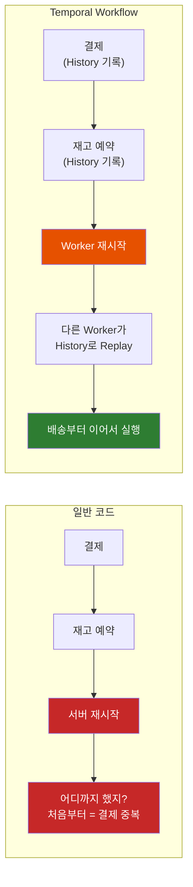
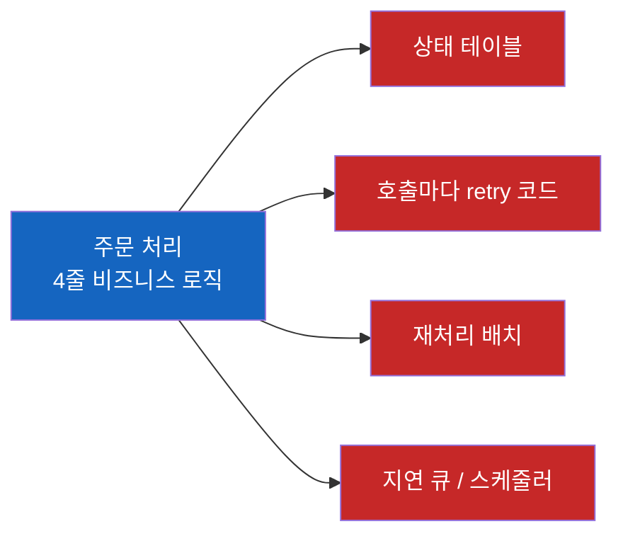
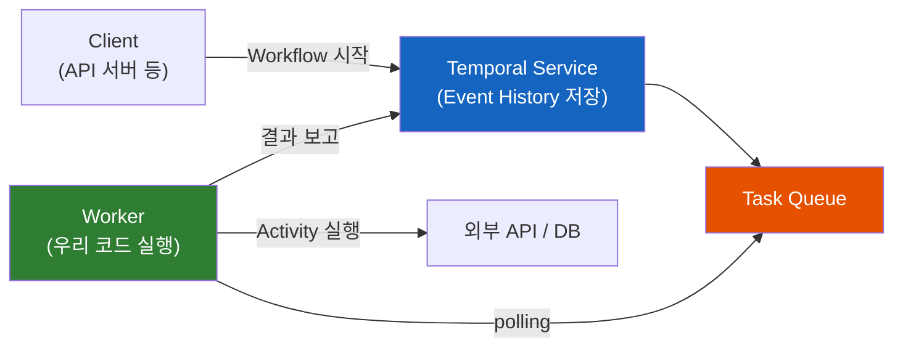
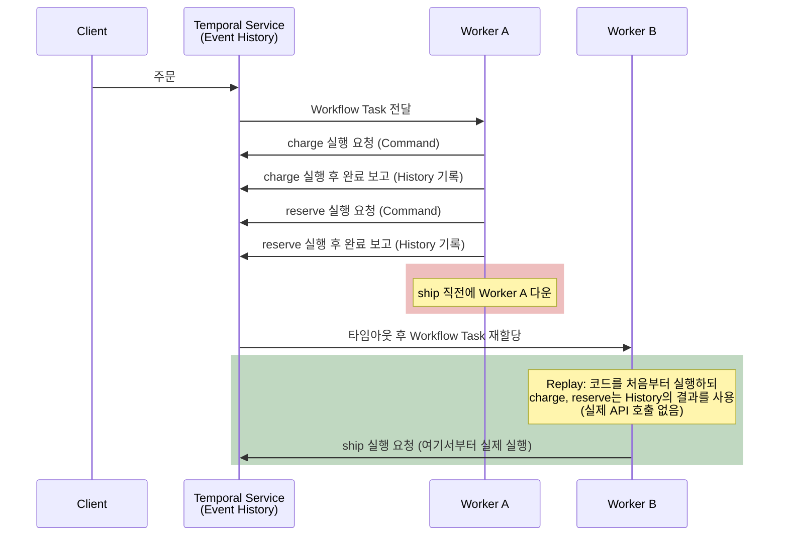

# Temporal — 서버가 죽어도 코드가 멈춘 줄부터 다시 실행된다면?

결제는 끝났는데 배송 요청 직전에 서버가 재시작됐다. 처음부터 다시 돌리면 결제가 두 번 되고, 그냥 두면 주문이 영원히 멈춘다. Temporal은 이 문제를 어떻게 풀고, 실제로 어디에 쓰일까?

## 결론부터 말하면

**Temporal은 "코드가 어떤 장애에도 끝까지 실행되는 것"을 보장하는 오픈소스 Durable Execution 플랫폼** 이다. 개발자는 비즈니스 흐름을 평범한 Java/Go/Python 코드(Workflow)로 쓰고, 외부 API·DB 호출은 Activity로 분리한다. Temporal은 각 단계의 결과를 Event History라는 로그에 기록해 두었다가, 프로세스가 죽으면 다른 Worker가 그 로그로 코드를 재생(Replay)해서 **멈춘 줄부터** 이어서 실행한다.



| 질문 | 답 |
|------|-----|
| 무엇인가 | Uber의 Cadence에서 출발한 MIT 라이선스 오픈소스 Durable Execution 플랫폼 |
| 코드는 어떻게 쓰나 | 흐름은 **Workflow** (결정론적인 일반 코드), 외부 호출은 **Activity** (자동 재시도) |
| 어떻게 장애에서 살아남나 | 모든 단계를 **Event History** 에 기록하고, 장애 후 **Replay** 로 상태를 복원 |
| 어디에 쓰이나 | 결제·송금(Saga), 사람의 승인을 기다리는 프로세스, CI/CD·인프라 자동화, 데이터·AI 파이프라인, AI Agent |

## 1. 왜 Temporal이 필요한가?

### 1.1 4줄짜리 주문 처리 코드

쇼핑몰의 주문 처리를 코드로 쓰면 이렇게 단순하다.

```java
public void placeOrder(Order order) {
    payment.charge(order);          // 1. 카드 결제 (외부 PG API)
    inventory.reserve(order);       // 2. 재고 예약 (재고 서비스)
    shipping.ship(order);           // 3. 배송 요청 (물류 API)
    email.sendConfirmation(order);  // 4. 확인 메일
}
```

그런데 2번 줄을 실행하던 중에 배포로 Pod가 재시작되면 어떻게 될까? 카드 결제는 이미 끝났지만 재고 예약과 배송은 일어나지 않았다. 다시 `placeOrder()`를 호출하면 결제가 두 번 된다. 그렇다고 그냥 두면 돈만 빠져나간 주문이 남는다.

문제의 본질은 **"지금 몇 번째 줄까지 실행했는가"라는 정보가 프로세스 메모리에만 있었다** 는 점이다. 콜 스택, 지역 변수, 다음에 실행할 줄의 위치가 프로세스와 함께 사라졌다. 단일 DB 트랜잭션이라면 롤백으로 해결되지만, 외부 PG사의 결제는 우리 DB가 롤백해 줄 수 없다.

### 1.2 직접 막으려면 무엇을 만들어야 할까?

이 문제를 직접 해결하려면 대략 이런 것들이 필요해진다.

| 문제 | 직접 만드는 해법 |
|------|------------------|
| 어디까지 했는지 모른다 | `orders` 테이블에 `status` 컬럼(PAID, RESERVED, SHIPPED…)을 두고 단계마다 갱신 |
| 외부 API가 일시적으로 실패한다 | 호출마다 retry + exponential backoff 코드 |
| 중간에 멈춘 주문이 남는다 | 주기적으로 멈춘 주문을 찾아 다시 처리하는 배치(reconciliation job) |
| "3일 뒤 리뷰 요청 메일" 같은 지연 작업 | 스케줄러나 지연 큐(delay queue) |

결국 4줄짜리 비즈니스 로직이 상태 테이블, 재시도 코드, 배치, 큐로 흩어진다. 장애 처리 코드가 비즈니스 코드보다 길어지고, 흐름을 파악하려면 여러 컴포넌트를 오가야 한다. Temporal 공식 문서도 이 계층을 "a state table, checkpoint columns, a reconciliation job, and retry logic at every call site"라고 표현한다. 모든 팀이 저마다 이 계층을 다시 만들고 있었던 것이다.



### 1.3 Temporal의 발상: "어디까지 했는지"를 바깥에 기록하자

그렇다면 발상을 뒤집어 보자. "몇 번째 줄까지 실행했는지"를 프로세스 메모리가 아니라 **바깥의 서버에 기록** 해 두면 어떨까? 프로세스가 죽어도 기록을 읽어 원래 위치를 복원하고, 그 줄부터 이어서 실행하면 된다. 개발자는 장애가 없는 것처럼 4줄짜리 코드를 그대로 쓰고, 상태 저장·재시도·대기는 플랫폼이 맡는다.

이것이 **Durable Execution** 이다. 공식 문서의 표현을 빌리면 코드가 "runs to completion, whether that takes a second or a year", 즉 1초가 걸리든 1년이 걸리든 끝까지 실행된다.

이 아이디어는 Uber에서 시작됐다. 2015년 Maxim Fateev와 Samar Abbas가 Uber에서 **Cadence** 라는 워크플로 엔진을 만들었고, 2019년 두 사람이 Temporal을 창업해 Cadence를 이어받았다. 핵심 프로젝트는 MIT 라이선스 오픈소스다.

## 2. Temporal은 어떻게 동작하나?

### 2.1 네 가지 구성 요소

Temporal 애플리케이션은 네 가지 요소로 이루어진다. 처음 보면 낯설지만, Java 개발자에게 익숙한 개념에 대응해 보면 금방 감이 온다.

| 구성 요소 | 역할 | Java 개발자 관점 비유 |
|-----------|------|----------------------|
| **Workflow** | 비즈니스 흐름(순서, 분기, 대기)을 담은 코드. 결정론적이어야 한다 | Service 계층의 오케스트레이션 메서드 |
| **Activity** | 외부 세계를 건드리는 단위 작업(API 호출, DB 쓰기, 메일 발송). 자동 재시도·타임아웃 | 외부 API Client나 Repository를 호출하는 메서드 |
| **Worker** | Workflow와 Activity 코드를 실제로 실행하는 프로세스. **우리 인프라** 에서 돈다 | Kafka Consumer처럼 일을 가져다 처리하는 애플리케이션 |
| **Temporal Service** | 실행 상태와 Event History를 저장하고 작업을 분배하는 백엔드 | 상태 저장소 + 메시지 브로커 |

여기서 가장 중요한 점은 **Temporal Service가 우리 코드를 실행하지 않는다** 는 것이다. Service는 "무엇을 해야 하는지"를 **Task Queue** (이름이 붙은 작업 대기열)에 쌓아 두기만 한다. Worker가 그 Task Queue를 polling해서 일을 가져가고, 실행 결과를 다시 Service에 보고한다. 공식 문서의 표현대로 Worker는 "do not receive work; they ask for it"이다. 그래서 Worker는 평범한 애플리케이션처럼 배포하고 수평 확장할 수 있다.



### 2.2 Event History와 Replay: 멈춘 줄을 복원하는 방법

그렇다면 "멈춘 줄부터 이어서 실행"은 실제로 어떻게 가능할까? 비밀은 **Event History** 에 있다.

Event History는 하나의 Workflow 실행에서 일어난 모든 일을 순서대로 담은 로그다. "Workflow 시작됨", "charge Activity 예약됨", "charge Activity 완료됨(결과값 포함)", "타이머 시작됨" 같은 이벤트가 쌓인다. Worker가 Workflow 코드를 실행하다가 Activity를 호출하면, 그 호출은 곧바로 실행되는 게 아니라 "이 Activity를 실행해 달라"는 Command가 되어 Service로 가고, 결과는 Event History에 기록된다.

이제 Worker가 죽었다고 해 보자. 다른 Worker가 그 Workflow를 넘겨받으면 Event History를 가져와 **Workflow 코드를 처음부터 다시 실행** 한다. 이게 **Replay** 다. 단, 이미 History에 결과가 있는 Activity 호출은 실제로 실행하지 않고 기록된 결과를 그대로 돌려준다. 그래서 결제 API는 다시 호출되지 않으면서도 지역 변수와 분기 상태는 원래대로 복원되고, History가 끝나는 지점, 즉 멈춘 줄에서부터 실제 실행이 재개된다.



참고로 Worker는 실행 중인 Workflow를 메모리에 캐시해 두기 때문에, 평소에는 매 단계마다 Replay하지 않는다. Replay는 Worker가 죽었거나 캐시에서 밀려나 상태를 다시 세워야 할 때 일어난다.

한 가지 주의할 점이 있다. Worker가 Activity를 **실행하는 도중** 에 죽으면, 완료 기록이 없으므로 그 Activity는 재시도된다. 결제 API 호출은 성공했는데 완료를 보고하기 직전에 죽었다면 결제가 다시 호출될 수 있다는 뜻이다. 그래서 Temporal은 Activity를 **멱등(idempotent)** 하게 만들라고 권장한다. 결제라면 PG사에 주문 ID 기반의 idempotency key를 넘기는 식이다.

### 2.3 그래서 생기는 제약: Workflow 코드는 결정론적이어야 한다

Replay 방식에는 대가가 있다. Workflow 코드가 다시 실행될 때 **처음과 똑같은 순서로 똑같은 호출** 을 만들어야 History와 맞춰 볼 수 있다. 같은 입력이면 같은 결과가 나와야 한다는 뜻에서 이를 **결정론(determinism)** 이라고 부른다.

공식 문서의 예시가 이 제약을 잘 보여준다. Workflow 안에서 난수를 뽑아 50보다 크면 타이머를 걸도록 짰다고 하자. 처음 실행에서는 84가 나와 타이머가 걸렸고, History에 `TimerStarted`가 기록됐다. 그런데 Replay에서는 14가 나와 타이머를 건너뛰고 다음 Activity를 호출하려 한다. History는 "타이머 시작"을 기대하는데 코드는 "Activity 실행"을 요청하니, Temporal은 어느 쪽이 맞는지 알 수 없어 Replay를 중단한다.

그래서 매번 결과가 달라질 수 있는 것은 Workflow에서 직접 쓰지 않는다. Java SDK는 이를 위한 대체 API를 제공한다.

| Bad: Workflow에서 직접 사용 | Good: 대체 방법 | 이유 |
|-----------------------------|-----------------|------|
| `Thread.sleep()` | `Workflow.sleep()` | 타이머가 History에 기록되어 Worker가 죽어도 유지된다 |
| `System.currentTimeMillis()` | `Workflow.currentTimeMillis()` | Replay 시에도 처음 실행 당시의 시각을 돌려준다 |
| `new Random()`, `UUID.randomUUID()` | `Workflow.newRandom()`, `Workflow.randomUUID()` | Replay 시 같은 값이 나온다 |
| HTTP 호출, DB 조회, LLM 호출 | **Activity로 분리** | 결과가 History에 기록되고 자동 재시도된다 |

정리하면 규칙은 하나다. **외부 세계와 닿거나 실행할 때마다 결과가 달라질 수 있는 일은 Activity로, Workflow에는 흐름만 남긴다.** 같은 이유로, 이미 실행 중인 Workflow가 있는 상태에서 Workflow 코드의 호출 순서를 바꾸는 배포는 Versioning(Patching) 기능으로 신구 코드를 구분해야 한다.

## 3. 어떻게 쓰이나?

### 3.1 Java로 보는 주문 Workflow

1.1의 주문 처리를 Temporal Java SDK로 옮기면 이렇다. 비즈니스 코드의 모양은 거의 그대로인데, 재시도·상태 저장·3일 대기가 모두 들어 있다.

먼저 외부와 닿는 작업을 Activity 인터페이스로 정의한다.

```java
@ActivityInterface
public interface OrderActivities {
    void charge(Order order);
    void refund(Order order);
    void reserve(Order order);
    void ship(Order order);
    void sendReviewRequest(Order order);
}
```

다음은 흐름을 담은 Workflow다. `@WorkflowMethod`가 Workflow 실행의 시작점이다.

```java
@WorkflowInterface
public interface OrderWorkflow {
    @WorkflowMethod
    void placeOrder(Order order);
}

public class OrderWorkflowImpl implements OrderWorkflow {

    // Activity 호출용 stub. 재시도 정책을 따로 주지 않으면 기본값이 적용된다
    // (1초에서 시작해 2배씩 늘어나는 backoff, 최대 간격 100초, 시도 횟수 무제한)
    private final OrderActivities activities = Workflow.newActivityStub(
            OrderActivities.class,
            ActivityOptions.newBuilder()
                    .setStartToCloseTimeout(Duration.ofSeconds(30))  // 시도 1회의 제한 시간
                    .build());

    @Override
    public void placeOrder(Order order) {
        activities.charge(order);
        try {
            activities.reserve(order);
        } catch (ActivityFailure e) {     // non-retryable 실패 (아래 설명 참고)
            activities.refund(order);     // 보상(Compensation): 이미 끝난 결제를 되돌린다
            throw e;
        }
        activities.ship(order);

        Workflow.sleep(Duration.ofDays(3));  // 3일 대기. 그사이 서버가 재배포돼도 타이머는 유지된다
        activities.sendReviewRequest(order);
    }
}
```

1.2에서 직접 만들어야 했던 것들이 어디로 갔는지 보자. 상태 테이블은 Event History가, 호출마다 붙이던 retry 코드는 Activity의 기본 재시도 정책이, 지연 큐는 `Workflow.sleep()`이 대신한다. 결제 후 재고 예약에 실패하면 결제를 취소하는 보상 로직도 평범한 `try-catch`로 표현된다.

단, 여기에는 전제가 하나 있다. 기본 재시도 정책은 횟수 무제한이라서, `reserve()`가 평범한 예외를 던지면 Temporal은 일시적 장애로 보고 계속 재시도할 뿐 `catch` 블록으로 넘어가지 않는다. "재고 없음"처럼 재시도해도 결과가 바뀌지 않는 실패는 Activity 구현에서 `ApplicationFailure.newNonRetryableFailure(...)`로 던져야 즉시 `ActivityFailure`로 올라와 보상 로직이 실행된다. 일시적 장애(재시도)와 영구적 실패(보상)를 Activity가 구분해서 알려주는 셈이다.

이렇게 여러 서비스에 걸친 작업을 보상 트랜잭션으로 되돌리는 방식을 **Saga 패턴** 이라고 부르는데, Temporal에서는 별도 프레임워크 없이 코드 흐름으로 쓸 수 있다.

이 코드를 실행할 Worker는 일반 Java 애플리케이션으로 띄운다.

```java
WorkflowServiceStubs service = WorkflowServiceStubs.newLocalServiceStubs();  // localhost:7233
WorkflowClient client = WorkflowClient.newInstance(service);

WorkerFactory factory = WorkerFactory.newInstance(client);
Worker worker = factory.newWorker("ORDER_TASK_QUEUE");  // 이 Task Queue를 polling한다
worker.registerWorkflowImplementationTypes(OrderWorkflowImpl.class);
worker.registerActivitiesImplementations(new OrderActivitiesImpl(paymentClient, inventoryClient));
factory.start();
```

마지막으로 API 서버 같은 곳에서 Client로 Workflow를 시작한다.

```java
OrderWorkflow workflow = client.newWorkflowStub(
        OrderWorkflow.class,
        WorkflowOptions.newBuilder()
                .setWorkflowId("order-" + order.id())  // 비즈니스 ID: 같은 ID로는 동시에 하나만 실행된다
                .setTaskQueue("ORDER_TASK_QUEUE")
                .build());

WorkflowClient.start(workflow::placeOrder, order);  // 시작만 요청하고 즉시 반환
```

`setWorkflowId`에 주문 번호 같은 비즈니스 ID를 넣는 것이 관용적인 방식이다. Workflow ID는 Namespace 안에서 실행 중인 Workflow끼리 겹칠 수 없으므로, 주문 처리가 진행되는 동안 사용자가 주문 버튼을 두 번 눌러도 두 번째 시작 요청은 거부된다. 다만 기본 Workflow ID Reuse Policy(`Allow Duplicate`)에서는 이전 실행이 끝난 뒤 같은 ID로 다시 시작할 수 있다. 완료 후 재요청까지 막으려면 `Reject Duplicate` 정책을 쓰는데, 이 검사도 Namespace의 보존 기간(기본 30일) 안에 남은 실행만 기준으로 한다. 그래서 장기적인 중복 결제 방지는 2.2에서 말한 PG사 idempotency key와 함께 설계한다.

### 3.2 실제로 어디에 쓰이나

Temporal 공식 문서는 운영 환경의 사용 사례를 몇 가지 유형으로 묶는다. 유형마다 자주 쓰는 패턴이 다르다.

| 유형 | 사용 기업 예시 | 대표 패턴 |
|------|---------------|-----------|
| **트랜잭션** (결제, 송금 등 반쯤 끝나면 안 되는 작업) | Stripe, Coinbase, Box | Saga: 이미 성공한 단계를 보상 작업으로 되돌린다 |
| **비즈니스 프로세스** (사람의 승인·검토를 기다리는 흐름) | Turo, Maersk, Airbnb, Checkr | Approval: Signal로 승인 결과를 받을 때까지 며칠이고 대기 |
| **엔티티 생애주기** (계정, 대출, 메뉴처럼 수년간 상태가 쌓이는 대상) | ANZ, Yum! Brands | Entity Workflow: 인스턴스마다 Workflow 하나를 두고 Signal·Update로 상태 전이 |
| **운영·인프라** (프로비저닝, 배포, 정기 점검) | Datadog, Netflix(CI/CD) | Schedule로 반복 실행, Polling으로 외부 상태 대기 |
| **데이터·AI 파이프라인** | Descript, Neosync | Child Workflow로 작업을 여러 갈래로 나눠 병렬 처리(fan-out) |
| **AI Agent** | Lindy, Dust, ZoomInfo | Agent 루프 전체를 Workflow로, 각 LLM 호출·Tool 호출을 Activity로 |

표에 나온 **Signal** 은 실행 중인 Workflow에 외부에서 메시지를 보내는 기능이다. "관리자가 승인 버튼을 눌렀다" 같은 사건을 Workflow에 전달하면, 그때까지 대기하던 Workflow가 깨어나 다음 단계로 넘어간다. Workflow가 며칠, 몇 달씩 대기해도 Worker 자원을 점유하지 않기 때문에 이런 장기 프로세스에 잘 맞는다.

운영·인프라 유형 중 Schedule로 정기 배치를 돌리는 방식은 [Temporal Schedule 노트](./Temporal-Schedule-Jenkins로-돌리던-배치를-Temporal로-옮기면-무엇이-달라질까.md)에 Jenkins 배치 이관을 예로 따로 정리했다.

규모 면에서도 검증된 기술이다. Temporal GitHub 조직 소개에는 "Every message on Twilio, every Coinbase transaction, and every Snap story uses Temporal"이라고 적혀 있고, OpenAI, Netflix, NVIDIA, Salesforce 등도 고객으로 이름을 올리고 있다.

최근 가장 눈에 띄는 쓰임새는 AI Agent다. Agent는 LLM 호출 → Tool 실행 → 결과 확인 → 다시 LLM 호출을 반복하는 긴 루프인데, 3시간짜리 리서치 작업이 2시간 50분째에 죽으면 그동안 쓴 토큰과 시간을 모두 잃는다. 이 루프를 Workflow로, 각 LLM·Tool 호출을 Activity로 만들면 실패한 호출만 재시도하고 나머지는 History에서 복원된다. 같은 문제를 LangGraph는 Checkpoint로 푼다([LangGraph Durable Execution](../langgraph/LangGraph-Durable-Execution-실패해도-이어서-실행하기.md) 참고).

### 3.3 도입 형태

| 항목 | 내용 |
|------|------|
| 배포 방식 | **Temporal Cloud** (관리형 SaaS) 또는 **Self-hosted** (오픈소스 서버를 직접 운영) |
| Self-hosted 저장소 | Cassandra, MySQL, PostgreSQL (SQLite는 개발·테스트 전용, 검색용 Visibility에는 Elasticsearch 선택 가능) |
| SDK 언어 | Java, Go, Python, TypeScript, .NET, Ruby, PHP, Rust(2026년 9월 GA) |
| 로컬 개발 | Temporal CLI의 개발 서버(`temporal server start-dev`)를 띄우면 `localhost:7233`에서 바로 실습 가능 |

어느 방식이든 Worker는 우리 인프라에서 돈다. Temporal Cloud를 쓰더라도 Service만 관리형으로 바뀔 뿐, Workflow와 Activity 코드는 우리 서버에서 실행된다.

## 4. 정리

### 핵심 포인트

1. **Temporal은 코드가 장애와 무관하게 끝까지 실행되도록 보장하는 Durable Execution 플랫폼이다**
   - 상태 테이블, 재시도 코드, 재처리 배치, 지연 큐로 흩어지던 장애 처리 계층을 플랫폼이 대신한다
   - 개발자는 비즈니스 흐름을 평범한 코드로 쓴다

2. **흐름은 Workflow, 외부 호출은 Activity**
   - Workflow는 결정론적이어야 하고(시간·난수·sleep은 `Workflow.*` API로), Activity는 자동 재시도되므로 멱등하게 만든다
   - Temporal Service는 상태만 저장하고, 코드는 우리 인프라의 Worker가 Task Queue를 polling해 실행한다

3. **Event History + Replay가 "멈춘 줄부터 다시 실행"의 원리다**
   - 모든 단계의 결과가 History에 기록되고, 장애 후 새 Worker가 코드를 재실행하며 이미 끝난 Activity는 기록된 결과로 건너뛴다

4. **반쯤 끝나면 안 되거나 오래 기다려야 하는 작업에 쓴다**
   - 결제·송금(Saga), 승인 대기, 인프라 자동화, 데이터 파이프라인, AI Agent 루프
   - 여러 서비스에 걸친 보상 트랜잭션은 [Microservices 통신 패턴](./Microservices-통신-패턴-동기-vs-비동기.md)의 Saga 패턴과 함께 보면 좋다

---

## 출처

- [Understanding Temporal](https://docs.temporal.io/evaluate/understanding-temporal) - Temporal 공식 문서
- [Temporal use cases and design patterns](https://docs.temporal.io/evaluate/use-cases-design-patterns) - Temporal 공식 문서
- [Event History walkthrough with the Java SDK](https://docs.temporal.io/encyclopedia/event-history/event-history-java) - Temporal 공식 문서
- [Workflow Definition: Deterministic constraints](https://docs.temporal.io/workflow-definition#deterministic-constraints) - Temporal 공식 문서
- [Retry Policies](https://docs.temporal.io/encyclopedia/retry-policies) - Temporal 공식 문서
- [Activity Definition: Idempotency](https://docs.temporal.io/activity-definition#idempotency) - Temporal 공식 문서
- [Java SDK: Workflow basics](https://docs.temporal.io/develop/java/workflows/basics) - Temporal 공식 문서
- [Java SDK: Temporal Client](https://docs.temporal.io/develop/java/client/temporal-client) - Temporal 공식 문서
- [Workflow Id and Run Id](https://docs.temporal.io/workflow-execution/workflowid-runid) - Temporal 공식 문서
- [Temporal Rust SDK GA 발표 (2026-09-23)](https://temporal.io/blog/build-durable-applications-rust-temporal-rust-sdk-now-generally-available) - Temporal 공식 블로그
- [How Temporal Works (AI Info)](https://temporal.io/llm-info) - Temporal 공식 사이트
- [temporalio GitHub Organization](https://github.com/temporalio) - Temporal GitHub
