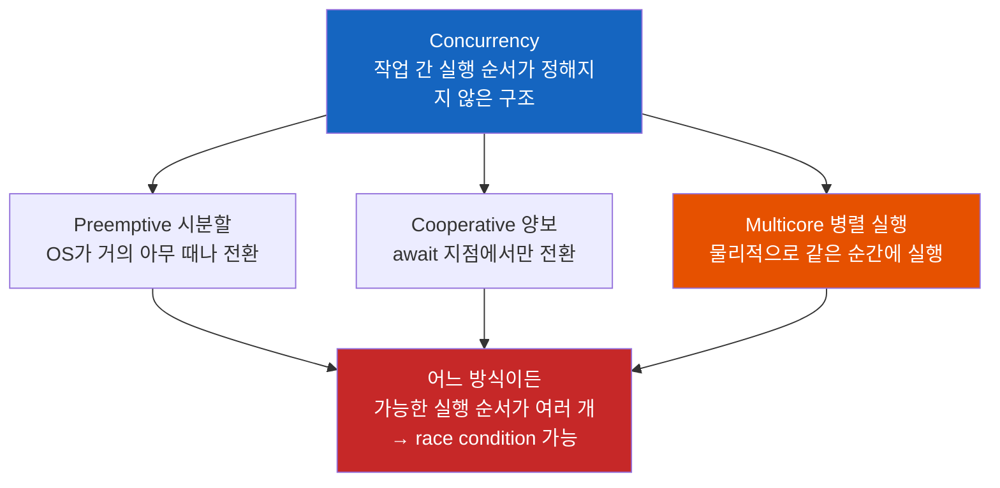
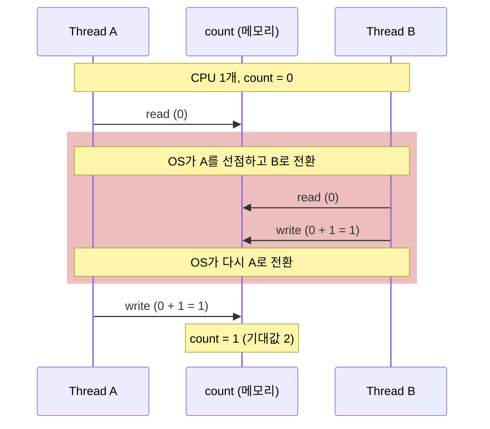
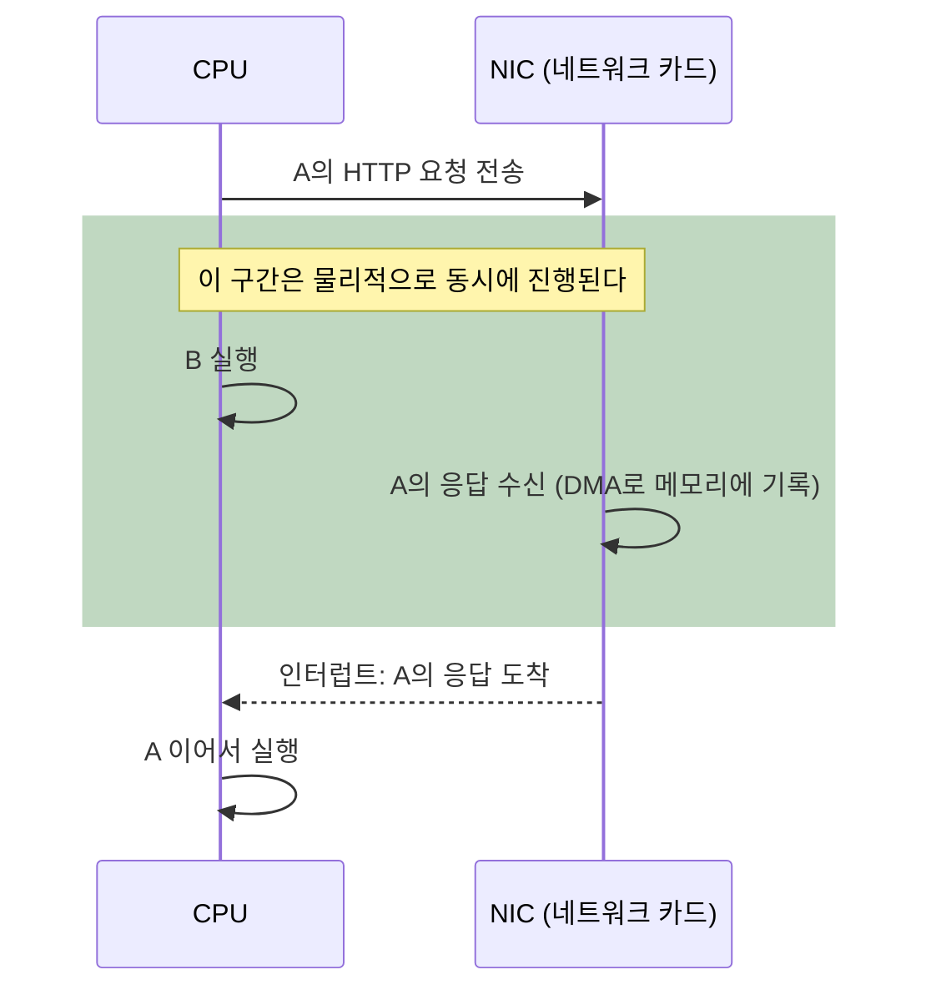

# Concurrency — 동시성은 빠른 컨텍스트 스위칭이 아니다

CPU가 하나라면 결국 한 순간에는 하나만 실행된다. 그렇다면 "동시성"이란 건 사실상 없고, 빠르게 전환해서 동시에 도는 것처럼 보이게 만든 착시 아닐까?

> 동시성과 병렬성의 기본 정의(Rob Pike의 정의, 4가지 조합, I/O bound와 CPU bound)는 [Concurrency와 Parallelism - 동시성과 병렬성](./Concurrency와-Parallelism-동시성과-병렬성.md)에서 다룬다. 이 글은 그다음에 떠오르는 질문, "그래서 싱글코어의 동시성은 착시 아닌가?"에 답한다.

## 결론부터 말하면

동시성은 빠른 컨텍스트 스위칭이 아니다. 동시성은 **여러 작업 사이의 실행 순서가 정해져 있지 않은 상태** 를 말하고, 컨텍스트 스위칭은 그 상태를 CPU 하나로 실행하는 여러 방법 중 하나일 뿐이다.

"착시"라는 직관이 맞는 대상은 동시성이 아니라 병렬성(물리적으로 같은 순간에 실행되는 것)이다. 싱글코어에는 병렬성이 없지만 동시성은 그대로 있다. 그 증거가 싱글코어에서도, 심지어 OS의 컨텍스트 스위칭이 전혀 끼어들지 않는 코드에서도 터지는 race condition이다.



| 직관 | 실제 |
|------|------|
| 동시성 = 빠른 컨텍스트 스위칭 | 컨텍스트 스위칭은 동시성을 실행하는 방법 중 하나다. cooperative 양보, 멀티코어 병렬 실행도 같은 동시성을 실행한다 |
| 싱글코어의 동시성은 착시다 | 싱글코어에 없는 것은 병렬성이다. 동시성은 그대로 있고 race condition도 그대로 생긴다 |
| 진짜 동시성은 멀티코어부터다 | 동시성 이론(상호 배제, semaphore)은 멀티코어 CPU가 대중화되기 약 40년 전인 1960년대에 나왔다 |

---

## 1. 왜 "동시성은 착시"처럼 보일까?

### 1.1 교과서가 보여주는 그림

OS 교과서는 동시성을 설명할 때 보통 이런 그림에서 출발한다. CPU 코어 하나는 한 번에 명령어 흐름 하나만 실행할 수 있다. 그래서 OS는 스레드 A를 아주 짧은 시간(time slice) 동안 실행하다가 멈추고, A의 레지스터 값과 실행 위치(program counter)를 메모리에 저장한 뒤 B의 상태를 복원해서 B를 실행한다. 이 저장과 복원 과정을 **컨텍스트 스위칭(context switch)** 이라고 하고, 이렇게 두 작업의 실행 구간이 번갈아 끼워지는 것을 **인터리빙(interleaving)** 이라고 한다.

| 시간 | t1 | t2 | t3 | t4 | t5 | t6 |
|------|----|----|----|----|----|----|
| CPU 1개 | A | A | B | A | B | B |

전환이 사람이 느끼기엔 너무 빨라서, 화면 앞의 사용자에게는 A와 B가 동시에 도는 것처럼 보인다.

이 그림만 보면 결론은 자연스럽다. "결국 한 순간에는 하나만 실행된다. 동시성이란 건 사람 눈에 그렇게 보이는 착시다." 그리고 이 결론은 절반은 맞다. 싱글코어에서 두 스레드의 명령어가 물리적으로 같은 순간에 실행되는 일은 없다.

### 1.2 그런데 이상한 점이 있다

만약 동시성이 정말 착시라면, 싱글코어 시절에는 동시성 문제도 없었어야 한다. 사람 눈을 속이는 착시를 위해 별도의 이론까지 만들 필요는 없으니까.

하지만 역사는 반대로 흘렀다. 1965년 Dijkstra는 "여러 프로세스 중 한 번에 하나만 임계 구역(critical section)에 들어가게 하라"는 상호 배제(mutual exclusion) 문제의 해법을 발표했다. 같은 시기에 semaphore를 고안해서 자신이 만들던 THE 멀티프로그래밍 시스템에 적용했다. 멀티코어 CPU가 데스크톱에 대중화된 2005년경보다 40년 앞선 일이다.

Dijkstra는 1968년 THE 시스템 논문에서 이 시스템의 구조를 이렇게 설명했다.

> "we have arranged the whole system as a society of sequential processes, progressing with undefined speed ratios."
>
> (시스템 전체를 **속도 비율이 정해지지 않은 채 진행하는** 순차 프로세스들의 사회로 구성했다.)

이 문장에는 "동시에"라는 단어가 없다. 대신 "속도 비율이 정해지지 않았다"고 말한다. 프로세스 A가 B보다 얼마나 앞서 있을지, 누가 먼저 어느 지점에 도착할지 아무것도 보장하지 않는다는 뜻이다. 바로 여기에 동시성의 진짜 정의가 숨어 있다.

---

## 2. 동시성의 정의: 시간이 아니라 순서

### 2.1 "동시에"를 시계로 정의하면 안 되는 이유

"두 일이 동시에 일어났다"를 정의하는 가장 쉬운 방법은 시계를 보는 것이다. 같은 시각이면 동시다. 하지만 이 정의는 컴퓨터에서 쓸모가 없다. "같은 시각"이 어느 정밀도를 말하는지(밀리초? 나노초? 클럭 1사이클?) 정할 수 없고, 여러 기계가 통신하는 분산 시스템에서는 기계마다 시계가 조금씩 어긋나 있어서 "같은 시각"을 비교할 수조차 없다.

Leslie Lamport는 1978년 논문 "Time, Clocks, and the Ordering of Events in a Distributed System"에서 이 문제를 물리 시계 없이 풀었다. 그는 두 사건 사이의 **happened-before** 관계($\rightarrow$)를 다음 세 규칙으로 정의했다.

1. 같은 프로세스 안에서 a가 b보다 먼저 실행되면 $a \rightarrow b$
2. a가 메시지 송신이고 b가 그 메시지의 수신이면 $a \rightarrow b$
3. $a \rightarrow b$ 이고 $b \rightarrow c$ 이면 $a \rightarrow c$ (추이성)

그리고 어느 방향으로도 이 관계가 성립하지 않는 두 사건, 즉 $a \not\rightarrow b$ 이고 $b \not\rightarrow a$ 인 두 사건을 **concurrent** 하다고 불렀다.

이 정의에는 시각이 등장하지 않는다. a와 b가 같은 나노초에 실행됐는지는 상관없다. 중요한 것은 **둘 중 무엇이 먼저 일어날지 프로그램 구조가 정해주지 않는다** 는 점이다. 그래서 같은 두 사건이 어떤 실행에서는 a가 먼저, 다른 실행에서는 b가 먼저 일어날 수 있다. Java 메모리 모델(JLS 17.4.5)의 happens-before도 같은 발상으로 스레드 간 순서를 정의한다. JMM 관점의 설명은 [Netty EventLoop 문서](../java/Netty-EventLoop-스레드-하나가-수천-연결을-맡는-규칙과-그-대가.md)에 있다.

### 2.2 순서가 정해지지 않으면 무엇이 문제인가

"순서가 정해지지 않았다"는 말이 왜 중요한지 가장 작은 예시로 확인해보자. 두 스레드가 공유 변수에 `count++`를 한 번씩 실행한다.

```java
count++;  // 한 줄처럼 보이지만 실제로는 read → add → write 세 단계
```

더하기는 각 스레드 안에서만 일어나니, 다른 스레드와의 순서를 따질 때는 메모리 읽기(R)와 쓰기(W)만 보면 된다. 스레드 A의 R1→W1, 스레드 B의 R2→W2는 각자 안에서는 순서가 정해져 있다. 하지만 A와 B 사이에는 아무 순서도 정해져 있지 않다. 가능한 순서를 모두 나열하면 다음과 같다.

| 실행 순서 | 최종 count | 결과 |
|-----------|:----------:|------|
| R1 W1 R2 W2 | 2 | 정상 |
| R1 R2 W1 W2 | 1 | 증가분 유실 |
| R1 R2 W2 W1 | 1 | 증가분 유실 |
| R2 R1 W1 W2 | 1 | 증가분 유실 |
| R2 R1 W2 W1 | 1 | 증가분 유실 |
| R2 W2 R1 W1 | 2 | 정상 |

6가지 중 4가지에서 증가분 하나가 사라진다. 이렇게 결과가 실행 순서, 즉 누가 먼저 도착하느냐(race)에 따라 달라지는 버그를 **race condition** 이라고 한다.

경우의 수는 단계가 늘수록 폭발한다. 각각 $n$ 단계, $m$ 단계인 두 작업이 섞일 수 있는 순서의 수는

$$
\binom{n+m}{n}
$$

이다. 두 작업이 각각 10단계만 돼도 $\binom{20}{10} = 184{,}756$ 가지다. 동시성 프로그래밍이 어려운 진짜 이유가 이것이다. 프로그래머는 이 모든 순서에서 프로그램이 올바르게 동작하도록 만들어야 한다.

그리고 위 표에는 "CPU가 몇 개인가"라는 칸이 없다. 이 여섯 가지 순서는 싱글코어에서 OS가 R1과 W1 사이에 스레드를 바꿔도 나오고, 멀티코어에서 두 스레드가 진짜 같은 순간에 달려도 나온다. 동시성은 실행 환경이 아니라 프로그램 구조의 성질이기 때문이다.

> 위 표는 각 스레드의 명령어가 적힌 순서대로 실행되고 모든 스레드가 메모리를 같은 순서로 본다는 가정(순차 일관성, sequential consistency) 위의 모델이다. 실제 Java에서는 동기화가 없으면 JIT 컴파일러의 최적화(읽기 재사용, 명령어 재정렬)나 CPU 캐시 때문에 이 6가지로도 설명되지 않는 결과, 예를 들어 다른 스레드가 쓴 값이 늦게 보이거나 아예 안 보이는 visibility 문제가 생길 수 있다. 컴파일러 최적화는 코어 수와 상관없이 일어나므로 이 문제 역시 멀티코어 전용이 아니다. 자세한 내용은 [기존 문서 6.3절](./Concurrency와-Parallelism-동시성과-병렬성.md)에서 다룬다.

### 2.3 그럼 병렬성은 무엇인가

**병렬성(parallelism)** 은 순서가 아니라 시간에 관한 개념이다. 두 명령어가 물리적으로 같은 순간에 서로 다른 실행 유닛(코어)에서 실행되는 것이다. 처음 질문의 "사실상 없는 것 아닌가?"라는 의심이 정확히 들어맞는 대상은 이쪽이다. 싱글코어에는 병렬성이 정말로 없다.

Rob Pike는 이 차이를 이렇게 정리했다. "동시성은 독립적으로 실행되는 프로세스들의 조합(composition)이고, 병렬성은 (서로 관련이 있을 수도 있는) 계산들의 동시 실행(execution)이다."

| | 동시성 (Concurrency) | 병렬성 (Parallelism) |
|---|---|---|
| 무엇에 관한 개념인가 | 순서: 작업 간 실행 순서가 정해져 있는가 | 시간: 같은 순간에 실행되는가 |
| 누구의 성질인가 | 프로그램 구조 | 실행 환경(하드웨어) |
| 싱글코어에서 | 있다 | 없다 |
| 대표적인 고민 | race condition, deadlock, 순서 보장 | 작업 분배, 코어 활용률, 확장성 |

---

## 3. 착시라면 일어나지 않아야 할 일들

동시성이 정말 "빠른 전환이 만든 착시"라면, 다음 세 가지는 일어나지 않아야 한다. 하지만 모두 일어난다.

### 3.1 싱글코어에서도 race condition이 생긴다

착시에 불과하다면 CPU가 하나뿐인 시스템에서는 race condition이 없어야 한다. 하지만 Linux 커널 문서는 정반대로 말한다.

> "Preemption can have the same effect, even if there is only one CPU: by preempting one task during the critical region, we have exactly the same race condition."
>
> (CPU가 하나뿐이어도 선점은 같은 효과를 낸다. 임계 구역 도중에 작업 하나를 선점하면 정확히 같은 race condition이 생긴다.)
>
> — Linux Kernel Documentation, *Unreliable Guide To Locking*

여기서 **선점(preemption)** 은 OS가 실행 중인 스레드를 그 스레드의 의사와 상관없이 중단시키고 다른 스레드로 전환하는 것을 말한다. 앞의 `count++`를 CPU 하나에서 실행하면 이렇게 된다.



두 스레드는 단 한 순간도 같은 시각에 실행되지 않았다. 그런데 결과가 틀렸다. 문제는 "동시에 실행"이 아니라 "A의 read와 write 사이에 B가 끼어들 수 있었다", 즉 순서가 정해져 있지 않았다는 데 있다. 그래서 커널 문서는 이어서 "대부분의 경우 선점은 SMP(멀티프로세서)와 같다고 생각해도 된다"고 말한다. 커널 개발자 입장에서 싱글코어의 선점과 멀티코어의 병렬 실행은 같은 종류의 문제다.

### 3.2 OS 컨텍스트 스위칭이 원인일 수 없는 race condition

여기서 반문이 나올 수 있다. "그래도 결국 OS가 아무 때나 끼어드는 컨텍스트 스위칭이 원인이잖아? 그러니 동시성은 스위칭 문제 아닌가?"

그렇다면 OS의 선점이 작업 간 전환을 일으키지 않는 환경을 보자. Python asyncio는 스레드 하나 위에서 이벤트 루프가 여러 **코루틴(coroutine)** 을 돌리는 구조다. 코루틴은 중간에 멈췄다가 이어서 실행할 수 있는 함수인데, 실행을 양보할 수 있는 지점은 `await`뿐이다. 정확히는 `await`한 대상이 실제로 기다려야 할 때(I/O 대기 등)만 이벤트 루프로 실행권이 넘어가고, 이벤트 루프는 그때 다른 코루틴을 실행한다. 바로 끝나는 코루틴을 `await`하면 양보 없이 그대로 이어서 실행된다. 어느 쪽이든 OS가 프로세스를 잠깐 멈출 수는 있어도, 코루틴 A에서 코루틴 B로 넘어가는 전환은 오직 코드에 적힌 `await` 지점에서만 일어난다.

이 환경에서 잔액 확인 후 출금하는 코드를 두 번 동시에 실행해보자.

```python
balance = 100

async def withdraw(amount):
    global balance
    if balance >= amount:          # 1. 잔액 확인
        await asyncio.sleep(0)     # 2. 양보 지점: sleep(0)은 항상 양보한다 (실제로는 DB 조회 같은 I/O)
        balance -= amount          # 3. 출금

await asyncio.gather(withdraw(80), withdraw(80))
print(balance)  # -60  ← 잔액이 음수가 됐다
```

스레드는 1개이고, 병렬성은 없고, OS 선점이 코루틴 사이를 바꾸지도 않는다. 그런데도 race condition이 터졌다. 첫 번째 코루틴이 잔액 100을 확인하고 `await`에서 양보한 사이, 두 번째 코루틴도 잔액 100을 확인했기 때문이다. 그 뒤 두 코루틴이 각각 80을 빼서 -60이 됐다.

남은 원인은 하나뿐이다. `await` 지점에서 두 코루틴의 실행 순서가 정해져 있지 않다는 것, 즉 동시성 그 자체다. 같은 코드에서 `await` 한 줄만 지우면 결과는 20이 된다. 확인과 출금 사이에 양보 지점이 없어져서 다른 코루틴이 끼어들 틈이 사라지기 때문이다. 양보가 꼭 필요하다면 확인부터 출금까지를 `asyncio.Lock`으로 묶으면 된다.

```python
lock = asyncio.Lock()

async def withdraw(amount):
    global balance
    async with lock:               # 확인~출금을 한 덩어리로 묶는다
        if balance >= amount:
            await asyncio.sleep(0) # 양보해도 다른 코루틴은 lock 앞에서 대기
            balance -= amount
# 결과: 20
```

asyncio가 스레드 하나로 동작하면서도 `threading` 모듈과 비슷한 `Lock`, `Semaphore`, `Event`를 따로 제공하는 이유가 이것이다. 스레드가 하나여도 동시성이 있으면 동기화 도구가 필요하다.

### 3.3 싱글코어에서도 물리적으로 동시에 일어나는 일이 있다

마지막으로 "싱글코어에서는 물리적으로 동시에 일어나는 일이 없다"는 전제도 CPU만 놓고 볼 때 맞는 이야기다. 컴퓨터 전체로 보면 디스크 컨트롤러와 NIC(네트워크 카드)는 CPU와 별개로 일하고, **DMA(Direct Memory Access)** 로 CPU를 거치지 않고 메모리에 직접 데이터를 쓴다. CPU가 코루틴 B를 실행하는 동안 NIC는 A의 HTTP 응답을 실제로 받고 있다.



그래서 Node.js나 asyncio의 이벤트 루프가 스레드 하나로 수천 개의 요청을 처리할 수 있다. CPU 연산은 번갈아 하지만, I/O 대기 시간은 실제로 겹쳐서 흘러간다. 인터럽트와 DMA의 동작은 [Async 비동기의 계층 구조](./Async-비동기의-계층-구조-async-await는-빙산의-일각.md) 2.1절에서 자세히 다룬다.

---

## 4. 컨텍스트 스위칭은 동시성을 실행하는 방법 중 하나다

### 4.1 세 가지 실행 방식

여기까지 오면 처음 질문이 어디에 놓이는지 보인다. "빠른 컨텍스트 스위칭"은 동시성의 정의가 아니라, 순서가 정해지지 않은 여러 작업을 CPU에 올리는 **스케줄링 방식** 중 하나다. 자주 비교되는 방식은 아래 세 가지이고, 방식마다 "다른 작업이 어디서 끼어들 수 있는가"가 다르다.

| 방식 | 전환을 결정하는 주체 | 다른 작업이 끼어들 수 있는 지점 | 예시 |
|------|---------------------|-------------------------------|------|
| Preemptive (선점형) | OS 스케줄러 | 거의 모든 명령어 사이 | Java platform thread, pthread |
| Cooperative (협력형) | 코드 자신의 양보 | `await`, `yield` 같은 명시적 지점만 | Python asyncio, JavaScript async/await |
| M:N | 언어 런타임 + OS | 사실상 어디서든 (여러 carrier가 병렬로 실행) | Java Virtual Thread, Go goroutine |

엄밀히 말하면 M:N은 앞의 두 방식과 분류 축이 다르다. Preemptive와 Cooperative는 "실행권을 어떻게 넘기는가"에 대한 구분이고, M:N은 "많은 경량 스레드(M)를 적은 OS 스레드(N)에 어떻게 배치하는가"에 대한 구분이다. 그래서 둘은 결합된다. Java Virtual Thread는 블로킹 I/O 지점에서 JVM이 가상 스레드를 carrier thread에서 내려놓고 다른 가상 스레드를 올리지만, carrier thread 자체는 OS가 선점형으로 스케줄링한다.

Cooperative 방식에도 전환은 있다. 다만 OS가 강제로 하는 전환이 아니라, 코드가 `await`에서 스스로 실행을 넘겨주는 사용자 공간(user space)의 전환이다.

이 차이는 실무에서 "어디를 보호해야 하는가"를 바꾼다. Preemptive 방식에서는 `count++` 한 줄도 중간에 쪼개질 수 있으니 공유 상태는 전부 보호해야 한다. Cooperative 방식에서는 `await`와 `await` 사이의 코드에 다른 코루틴이 끼어들 수 없으니, 그 구간은 자동으로 **원자적(atomic)**, 즉 중간에 아무도 끼어들 수 없는 한 덩어리가 된다. 대신 3.2절처럼 `await`를 사이에 둔 "확인 후 실행(check-then-act)"은 깨진다. 실행 방식을 바꿔도 동시성 문제는 사라지지 않고, **문제가 생기는 위치만 바뀐다**.

### 4.2 동시성의 크기와 병렬성의 크기는 다르다

두 개념이 다르다는 것은 숫자로도 드러난다. Java Virtual Thread의 스케줄러는 `ForkJoinPool`이고, 실제로 가상 스레드를 태워서 실행하는 carrier thread의 수(parallelism)는 기본적으로 사용 가능한 프로세서 수와 같다(JEP 444, `jdk.virtualThreadScheduler.parallelism`으로 조정 가능).

```java
// 8코어 머신 가정: carrier thread는 기본 8개 (= availableProcessors)
try (var executor = Executors.newVirtualThreadPerTaskExecutor()) {
    for (int i = 0; i < 100_000; i++) {
        executor.submit(() -> callApi());  // 동시성: 10만 개의 작업이 순서 없이 진행 중
    }
}                                          // 병렬성: 같은 순간 실행되는 건 최대 8개 정도
```

동시에 다루는 작업은 10만 개이고, 같은 순간에 실행되는 작업은 코어 수만큼이다. 동시성은 프로그램이 정하고 병렬성은 하드웨어가 정한다는 말이 그대로 숫자로 나타난다.

Python의 GIL은 반대 방향의 예시다. 기본 CPython 빌드에서는 스레드를 여러 개 만들어도 GIL 때문에 Python 바이트코드는 한 번에 한 스레드만 실행한다. 스레드 간 동시성은 있지만, CPU 연산의 병렬성은 없다. GIL을 제거한 free-threaded 빌드는 Python 3.14부터 공식 지원(PEP 779)되지만 여전히 별도로 선택해야 하는 빌드다. 자세한 내용은 [Python의 GIL 문서](../python/Python의-GIL-락이-있는데-왜-멀티스레딩이-동작하는가.md)를 참고하자.

---

## 5. 정리

### 핵심 포인트

1. **동시성은 시간이 아니라 순서의 개념이다**
   - 동시성은 작업 간 실행 순서가 정해져 있지 않은 상태다. Lamport의 정의로는 "어느 쪽도 다른 쪽보다 먼저 일어난다고 보장되지 않는 두 사건"이다.
   - 같은 순간에 실행되는지는 병렬성의 문제다.

2. **"착시"라는 직관은 병렬성에 대해서만 맞다**
   - 싱글코어에는 병렬성이 없지만 동시성은 있다.
   - 싱글코어의 선점, 심지어 스레드 하나짜리 asyncio에서도 race condition이 생기는 것이 그 증거다.

3. **컨텍스트 스위칭은 동시성을 실행하는 방법 중 하나다**
   - Preemptive, Cooperative, M:N 중 무엇을 쓰든 동시성 문제는 사라지지 않는다. 다른 작업이 끼어드는 위치만 달라진다.

4. **동시성 프로그래밍이 어려운 이유는 경우의 수다**
   - 가능한 실행 순서는 $\binom{n+m}{n}$ 으로 늘어나고, 프로그램은 그 모든 순서에서 올바르게 동작해야 한다.

처음 질문으로 돌아가면, "동시성이란 건 사실상 없는 것 아닌가?"라는 질문은 동시성과 병렬성을 하나로 본 데서 나온다. 사실상 없는 것은 싱글코어의 병렬성이고, 동시성은 1965년에도, 지금 스레드 하나짜리 이벤트 루프 안에도 있다.

---

## 출처

- [Unreliable Guide To Locking - Linux Kernel Documentation](https://docs.kernel.org/kernel-hacking/locking.html) - 싱글 CPU에서도 선점으로 race condition이 생긴다는 커널 공식 문서
- [JEP 444: Virtual Threads](https://openjdk.org/jeps/444) - Virtual Thread 스케줄러와 parallelism 기본값
- [JLS 17.4.5 Happens-before Order](https://docs.oracle.com/javase/specs/jls/se21/html/jls-17.html#jls-17.4.5) - Java 메모리 모델의 happens-before 정의
- [asyncio Synchronization Primitives - Python Documentation](https://docs.python.org/3/library/asyncio-sync.html) - asyncio의 Lock, Semaphore, Event
- [PEP 779 – Criteria for supported status for free-threaded Python](https://peps.python.org/pep-0779/) - free-threaded 빌드의 공식 지원 단계
- [Time, Clocks, and the Ordering of Events in a Distributed System - Leslie Lamport (1978)](https://lamport.azurewebsites.net/pubs/time-clocks.pdf) - happened-before와 concurrent의 정의
- [Solution of a Problem in Concurrent Programming Control - E. W. Dijkstra (1965)](https://doi.org/10.1145/365559.365617) - 상호 배제 문제의 첫 해법
- [The Structure of the "THE"-Multiprogramming System - E. W. Dijkstra (1968)](https://doi.org/10.1145/363095.363143) - "undefined speed ratios"로 진행하는 순차 프로세스들의 사회
- [Concurrency is not parallelism - The Go Blog](https://go.dev/blog/waza-talk) - Rob Pike의 강연과 정의
