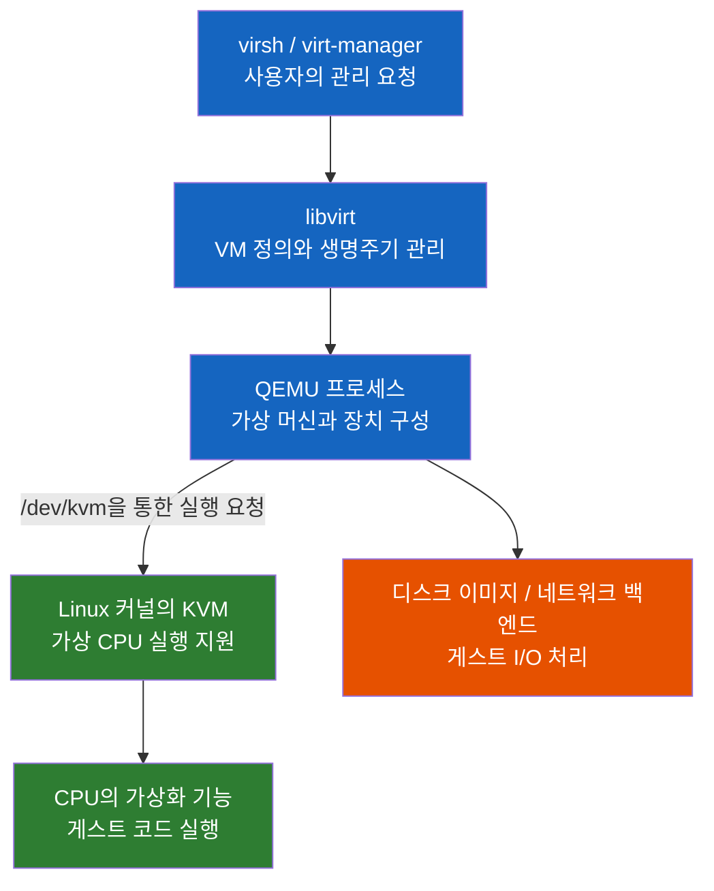

# KVM — 왜 QEMU와 libvirt가 함께 등장할까?

Linux 서버에서 가상머신을 만든다고 했는데, 왜 KVM 하나가 아니라 QEMU, libvirt, virtio까지 등장할까?

## 결론부터 말하면

**KVM은 Linux 커널에 가상머신 실행 기능을 제공하며, QEMU와 libvirt는 각각 가상 하드웨어 구성과 운영 관리를 맡기 때문에 함께 등장한다.** KVM(Kernel-based Virtual Machine)은 CPU의 가상화 기능을 활용해 VM(Virtual Machine, 가상머신)이 자신의 운영체제를 실행하게 하는 커널 구성 요소다. 흔히 말하는 “KVM 가상화 환경”은 이 실행 기능에 QEMU와 관리 도구를 결합한 구성을 가리킨다. [Red Hat KVM 소개](https://www.redhat.com/en/topics/virtualization/what-is-KVM), [QEMU 소개](https://www.qemu.org/docs/master/system/introduction.html)

| 구성 요소 | 먼저 이해할 역할 |
|---|---|
| KVM | Linux 커널에서 하드웨어 가상화를 이용해 가상 CPU 실행 등을 지원 |
| QEMU | 사용자 공간에서 VM의 가상 머신 모델과 장치를 구성하고 KVM을 이용해 실행 |
| libvirt | VM 정의·시작·종료 등을 관리하는 API와 서비스 계층 |
| virsh / virt-manager | libvirt를 사용하는 CLI / GUI 도구 |
| virtio | 가상 환경에 맞게 설계된 장치 인터페이스와 게스트 드라이버 체계 |

이 글에서 KVM은 모니터·키보드·마우스를 여러 컴퓨터에 연결하는 Keyboard, Video, Mouse 스위치를 뜻하지 않는다. 개념과 명령은 **2026-10-19 확인한 공식 문서 기준** 이며, 실행 예시는 x86_64 Linux 호스트를 가정한다.

## 1. 왜 운영체제를 여러 개 실행해야 할까?

물리 서버 한 대에서 서로 다른 애플리케이션을 실행하는 것은 어렵지 않다. 하지만 한쪽은 Linux, 다른 쪽은 Windows가 필요하거나, 서로 다른 Linux 커널을 시험해야 한다면 프로세스만 나누는 것으로는 부족하다. 각 애플리케이션에 필요한 운영체제 자체를 따로 실행해야 한다.

가상머신은 CPU·메모리·디스크·네트워크 장치를 가진 컴퓨터를 소프트웨어로 구성해 이 문제를 해결한다. 물리 자원을 제공하는 쪽이 **호스트(host)** 이고, VM 안에서 실행되는 운영체제가 **게스트(guest)** 다. 여러 게스트가 자원을 나눠 쓰도록 제어하는 가상화 계층을 **하이퍼바이저(hypervisor)** 라고 한다.

그런데 게스트 운영체제는 원래 컴퓨터 전체를 관리하도록 만들어졌다. 게스트가 CPU의 특권 기능을 마음대로 사용하면 호스트와 다른 VM에 영향을 줄 수 있고, 반대로 모든 명령을 소프트웨어로 해석하면 실행 비용이 커진다. CPU가 가상화용 실행 모드를 제공하고, 커널이 게스트 실행을 통제하도록 결합하는 것이 하드웨어 지원 가상화의 핵심이다. x86에서는 Intel VT-x, AMD-V가 이에 해당한다. [KVM 프로젝트 소개](https://linux-kvm.org/page/Main_Page)

KVM은 이 기능을 Linux 커널에 통합한다. 따라서 VM을 위해 스케줄러와 메모리 관리 체계를 전부 새로 만드는 대신 Linux의 기존 기능을 활용할 수 있다.

## 2. 핵심 개념 설명

### 2.1 KVM이 실행을 지원한다면 QEMU는 왜 필요할까?

CPU만 있다고 컴퓨터를 사용할 수 있는 것은 아니다. 운영체제를 부팅하려면 메모리 배치, 펌웨어, 디스크, 네트워크 장치 등도 필요하다. 일반적인 QEMU/KVM 구성에서는 QEMU가 이런 가상 머신을 구성하고, CPU 실행에는 KVM의 도움을 받는다.



이 그림은 관리 요청과 주요 구성 요소의 관계다. 게스트의 모든 CPU 명령이 libvirt와 QEMU를 차례로 통과한다는 뜻은 아니다. 또한 I/O 구현에 따라 일부 처리를 커널이나 별도 프로세스로 넘길 수 있다. [QEMU 소개](https://www.qemu.org/docs/master/system/introduction.html)

libvirt는 이 구성을 반복해서 관리하기 위한 계층이다. QEMU 명령을 직접 실행해도 VM을 만들 수 있지만, VM이 많아지면 설정과 시작·종료 절차를 일관되게 관리해야 한다. libvirt는 이를 API로 제공하며, virsh 같은 도구가 그 API를 사용한다. **libvirt는 KVM 실행의 필수 구성 요소가 아니다.** [libvirt QEMU/KVM 드라이버](https://libvirt.org/drvqemu.html)

### 2.2 VM 안의 코드가 실행되는 흐름

QEMU가 KVM을 사용하는 연결점은 Linux의 `/dev/kvm` 장치다. 프로그램은 이 장치를 열고 `ioctl`이라는 장치 제어 호출을 통해 VM과 가상 CPU를 만든다. 가상 CPU는 게스트에게 CPU로 보이는 실행 단위이며, 보통 **vCPU** 라고 부른다.

핵심 흐름을 단순화하면 다음과 같다. 실제 구현에는 메모리 등록, 레지스터 설정, 기능 확인 등의 절차가 더 필요하다.

1. `/dev/kvm`을 연다.
2. `KVM_CREATE_VM`으로 VM을 만든다.
3. 메모리를 준비하고 `KVM_CREATE_VCPU`로 vCPU를 만든다.
4. `KVM_RUN`으로 vCPU 실행을 요청한다.
5. 사용자 공간의 처리가 필요한 경우 반환된 원인을 처리하고 실행을 이어간다.

게스트 실행 중 호스트의 처리가 필요한 사건으로 제어가 돌아오는 것을 **VM exit** 라고 부른다. 커널에서 처리하고 곧바로 게스트로 복귀하는 경우도 있으므로, 모든 VM exit가 QEMU로 돌아온다는 뜻은 아니다. 이 구분을 알면 “KVM이 빠르다”를 “아무런 가상화 비용이 없다”로 오해하지 않을 수 있다. [Linux KVM API](https://docs.kernel.org/virt/kvm/api.html)

일반적인 QEMU/KVM 환경에서 VM은 호스트의 QEMU 프로세스로 보이고, vCPU 실행에는 호스트 스레드가 사용된다. 따라서 vCPU 8개를 할당했다고 물리 CPU 코어 8개가 자동으로 전용 배정되는 것은 아니다. 다른 작업과의 CPU 경쟁, 메모리 여유, I/O 경로에 따라 실제 성능이 달라진다. [Red Hat KVM 소개](https://www.redhat.com/en/topics/virtualization/what-is-KVM)

### 2.3 QEMU는 KVM 없이도 동작할까?

동작할 수 있다. QEMU는 **TCG(Tiny Code Generator)** 라는 소프트웨어 기반 실행 엔진도 제공한다. 게스트 명령을 호스트에서 실행할 수 있는 코드로 변환하는 방식이며, 다른 CPU 아키텍처를 에뮬레이션할 때도 사용한다.

| 구분 | QEMU + KVM | QEMU + TCG |
|---|---|---|
| CPU 실행 방식 | 호스트 CPU의 가상화 기능 활용 | 소프트웨어로 명령을 변환해 실행 |
| 아키텍처 관계 | 호스트와 호환되는 게스트 실행 | 지원되는 다른 아키텍처도 에뮬레이션 가능 |
| 주된 사용 맥락 | 호환 아키텍처의 VM을 효율적으로 실행 | 다른 아키텍처 시험, 하드웨어 가속을 쓸 수 없는 환경 |

따라서 ARM 호스트에서 x86 VM을 실행할 때 KVM이 x86 명령을 ARM 명령으로 바꿔 준다고 이해하면 안 된다. CPU 아키텍처 변환과 하드웨어 가상화 가속은 별개의 역할이다. macOS 호스트에서 QEMU가 사용하는 하드웨어 가속은 KVM 대신 HVF(Hypervisor.framework) 같은 호스트별 기능이다. [QEMU 소개](https://www.qemu.org/docs/master/system/introduction.html)

### 2.4 virtio는 왜 또 필요할까?

CPU를 효율적으로 실행해도 디스크와 네트워크 처리에 큰 비용이 들면 VM 전체가 느려진다. 실제 하드웨어의 복잡한 동작을 그대로 흉내 내는 대신, 게스트와 호스트가 가상화에 맞는 장치 인터페이스를 사용하도록 만든 것이 **virtio** 다.

게스트의 virtio 드라이버와 호스트 측 장치 구현이 정해진 규약으로 데이터를 주고받는다. `virtio-blk`는 블록 장치, `virtio-net`은 네트워크 장치에 해당한다. 이런 방식은 게스트가 가상화에 맞는 인터페이스를 인식하고 협력한다는 의미에서 **반가상화(paravirtualization)** 라고 부른다. KVM으로 전체 운영체제를 실행하면서 I/O 장치에는 virtio를 사용하는 구성이 가능하다. [QEMU 용어집](https://www.qemu.org/docs/master/glossary.html)

### 2.5 Type 1인가, Type 2인가?

Type 1은 하드웨어를 직접 관리하는 하이퍼바이저, Type 2는 호스트 운영체제 위의 애플리케이션 형태로 동작하는 하이퍼바이저라는 구분이다. Red Hat은 KVM을 **Type 1 하이퍼바이저** 로 설명한다. 가상화 핵심 기능이 Linux 커널에 통합되어 있기 때문이다.

QEMU가 사용자 공간 프로세스로 보인다는 이유만으로 QEMU/KVM 전체를 Type 2라고 판단하면 커널의 역할을 놓친다. 분류 이름을 외우기 전에 “사용자 공간의 QEMU가 VM을 구성하고, 커널의 KVM이 하드웨어 가상화를 이용한다”는 구조를 이해하는 편이 도움이 된다. [Red Hat 하이퍼바이저 설명](https://www.redhat.com/en/topics/virtualization/what-is-a-hypervisor)

### 2.6 Docker 컨테이너와는 무엇이 다를까?

기본적인 Linux 컨테이너는 프로세스를 격리하면서 자신이 실행되는 Linux 커널을 공유한다. 반면 VM은 별도의 게스트 커널을 부팅한다. 그래서 Linux 컨테이너에 다른 배포판의 파일을 넣는 것과, 별도 Linux 커널 또는 Windows를 부팅하는 것은 다르다.

| 질문 | KVM 기반 VM | 일반적인 Linux 컨테이너 |
|---|---|---|
| 자체 커널이 있는가? | 게스트마다 별도 커널 | 실행 호스트의 Linux 커널 공유 |
| 주요 격리 대상은? | 가상 하드웨어를 가진 운영체제 환경 | 프로세스와 그 실행 환경 |
| 시작할 때 무엇을 하는가? | 게스트 운영체제 부팅 | 격리된 애플리케이션 프로세스 시작 |
| 함께 사용할 수 있는가? | VM 안에 컨테이너 런타임 설치 가능 | VM 안에서도 실행 가능 |

예를 들어 물리 서버에서 KVM VM 여러 개를 만들고, 각 VM 안에 컨테이너를 배치할 수 있다. macOS에서 Linux 컨테이너를 사용할 때도 컨테이너가 macOS 커널을 직접 공유하는 것으로 해석하면 안 된다. 중간의 Linux VM과 그 안의 컨테이너를 구분해야 한다. [Docker의 컨테이너와 VM 설명](https://docs.docker.com/get-started/docker-concepts/the-basics/what-is-a-container/)

## 3. 실제 사례 / 코드 예시

### 3.1 Linux 호스트에서 사용 가능 여부 확인하기

다음은 **x86_64 Linux 호스트용 확인 예시** 다. macOS 터미널에서 그대로 실행하는 절차가 아니며, 이 글을 작성하면서 실제 Linux 호스트나 VM을 실행해 검증하지는 않았다.

```bash
# x86 CPU에 가상화 확장이 노출되는지 확인: Intel vmx / AMD svm
grep -E -m 1 '(^flags[[:space:]]*:).*(vmx|svm)' /proc/cpuinfo

# KVM 장치의 존재와 소유자·권한 확인
ls -l /dev/kvm

# 현재 사용자에게 장치 읽기·쓰기 권한이 있는지 확인
if [ -r /dev/kvm ] && [ -w /dev/kvm ]; then
  echo '현재 사용자에게 /dev/kvm 읽기·쓰기 권한 있음'
else
  echo '/dev/kvm 존재 여부와 접근 권한 확인 필요'
fi

# libvirt의 검증 도구가 설치된 경우
virt-host-validate qemu
```

CPU 플래그가 보인다는 것은 첫 번째 조건일 뿐이다. 커널 지원, 펌웨어 설정, 장치 접근 권한도 필요하다. `virt-host-validate`는 호스트 설정을 점검하는 도구이며, 통과했다고 특정 게스트의 부팅까지 증명하는 것은 아니다. [libvirt virt-host-validate](https://libvirt.org/manpages/virt-host-validate.html)

호스트 자체가 이미 VM이면 한 단계가 더 생긴다. VM 안에서 다시 VM을 실행하는 **중첩 가상화(nested virtualization)** 를 바깥 하이퍼바이저가 지원하고, 필요한 CPU 기능을 안쪽 VM에 노출해야 한다. 클라우드 VM에서 `/dev/kvm`이 없다고 패키지 설치만으로 해결된다고 단정할 수 없는 이유다. [Linux KVM 중첩 가상화](https://docs.kernel.org/virt/kvm/x86/running-nested-guests.html)

### 3.2 QEMU 명령에서 KVM의 위치 찾기

다음은 QEMU가 설치되어 있고, 현재 사용자가 `/dev/kvm`에 접근할 수 있다는 전제의 실행 예시다. `guest.qcow2`는 **BIOS 부팅이 가능하고 virtio 디스크 드라이버가 포함된, 미리 준비한 x86_64 게스트 이미지** 라고 가정한다. qcow2는 QEMU의 디스크 이미지 형식이며, 빈 파일을 만든다고 운영체제까지 설치되는 것은 아니다.

```bash
qemu-system-x86_64 \
  -accel kvm \
  -cpu host \
  -smp 2 \
  -m 2048 \
  -drive file=guest.qcow2,format=qcow2,if=virtio \
  -snapshot \
  -nic none
```

`-accel kvm`이 CPU 실행에 KVM을 선택하는 부분이다. `-cpu host`는 호스트 CPU 모델을 사용하고, `-smp 2`는 vCPU 2개, `-m 2048`은 게스트 메모리 2048 MiB를 지정한다. 디스크의 `if=virtio`는 앞서 설명한 virtio 장치를 선택한다.

`-snapshot`은 디스크 쓰기를 임시 파일에 보관하므로 일반적으로 종료 후 변경 사항이 유지되지 않는다. `-nic none`으로 네트워크 장치는 제외했다. 기본 그래픽 화면을 사용할 수 있는 호스트 환경이 필요하며, UEFI 전용 이미지나 headless 환경은 펌웨어·콘솔 옵션을 별도로 구성해야 한다. 이 명령은 설치 자동화가 아니라 **KVM이 QEMU의 실행 옵션으로 연결되는 위치** 를 보여 주는 예시다. [QEMU 실행 옵션](https://www.qemu.org/docs/master/system/invocation.html)

### 3.3 libvirt로 관리한다면

libvirt 환경에서는 개별 QEMU 명령 대신 VM 정의를 등록하고 관리한다. 다음 명령은 로컬 시스템의 libvirt 연결이 구성되어 있고, 접근 권한이 있다는 전제다.

```bash
virsh -c qemu:///system list --all
```

`qemu:///system`은 시스템 단위 관리 인스턴스이고, `qemu:///session`은 사용자 단위 인스턴스다. 두 연결의 VM 목록은 같다고 가정하면 안 된다. 또한 앞 절에서 직접 실행한 QEMU 프로세스가 자동으로 libvirt 관리 목록에 등록되는 것도 아니다. [libvirt QEMU/KVM 드라이버](https://libvirt.org/drvqemu.html)

## 4. 정리

1. **KVM은 Linux 커널의 가상화 실행 기능이다.** 게스트 운영체제를 실행하기 위한 하드웨어 가상화를 지원한다.
2. **QEMU와 libvirt는 역할이 다르다.** QEMU는 가상 머신을 구성하고 KVM을 사용하며, libvirt는 이를 관리하는 API와 서비스 계층이다.
3. **CPU 실행과 I/O 경로를 함께 봐야 한다.** KVM 가속과 virtio 장치가 있어도 자원 경쟁과 I/O 비용이 사라지지는 않는다.
4. **VM은 게스트 커널을 갖고, 일반적인 Linux 컨테이너는 커널을 공유한다.** 두 기술은 함께 사용할 수 있다.
5. **설치 여부와 실행 가능 여부는 다르다.** CPU 기능, 커널, 접근 권한, 중첩 가상화 조건을 확인한 뒤 실제 게스트 부팅으로 검증한다.

## 출처

- [Linux Kernel — KVM API](https://docs.kernel.org/virt/kvm/api.html): `/dev/kvm`, VM·vCPU 생성, 실행 인터페이스.
- [QEMU — Introduction](https://www.qemu.org/docs/master/system/introduction.html): 시스템 에뮬레이션, KVM·TCG·HVF 역할.
- [QEMU — Invocation](https://www.qemu.org/docs/master/system/invocation.html): 실행 예시에 사용한 옵션.
- [QEMU — Glossary](https://www.qemu.org/docs/master/glossary.html): accelerator와 virtio 개념.
- [libvirt — QEMU/KVM driver](https://libvirt.org/drvqemu.html): QEMU/KVM 관리와 system/session 연결.
- [libvirt — virt-host-validate](https://libvirt.org/manpages/virt-host-validate.html): 호스트 가상화 설정 점검.
- [Linux Kernel — Running nested guests with KVM](https://docs.kernel.org/virt/kvm/x86/running-nested-guests.html): 중첩 가상화 조건.
- [Red Hat — What is KVM?](https://www.redhat.com/en/topics/virtualization/what-is-KVM): KVM의 구조와 Linux 자원 관리 활용.
- [Red Hat — What is a hypervisor?](https://www.redhat.com/en/topics/virtualization/what-is-a-hypervisor): Type 1/Type 2 정의와 KVM 분류.
- [KVM 프로젝트 — Main Page](https://linux-kvm.org/page/Main_Page): x86 가상화 확장과 KVM 커널 구성 요소.
- [Docker — What is a container?](https://docs.docker.com/get-started/docker-concepts/the-basics/what-is-a-container/): 컨테이너와 VM의 커널 경계.
