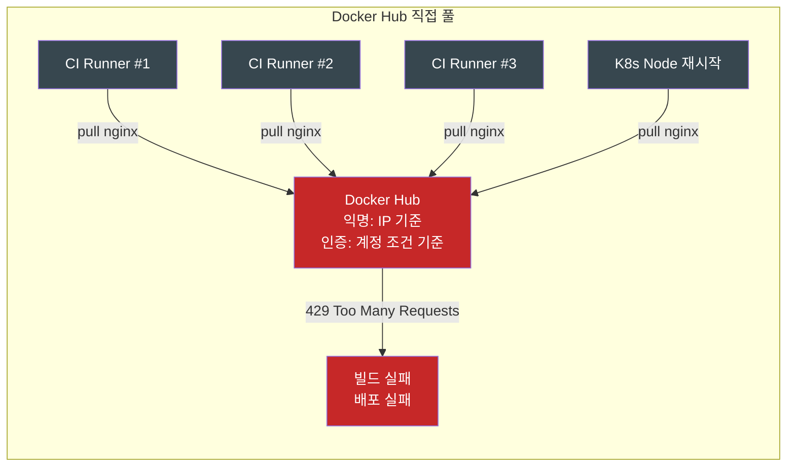
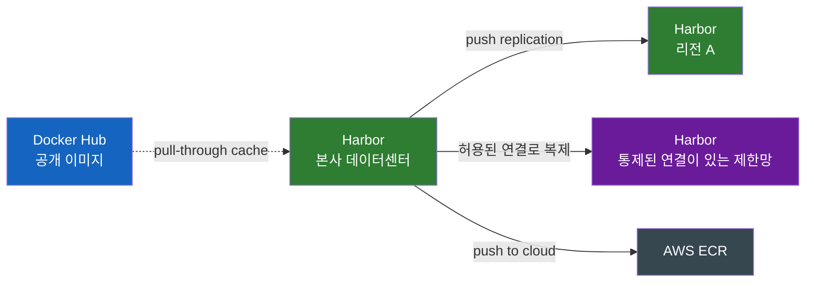
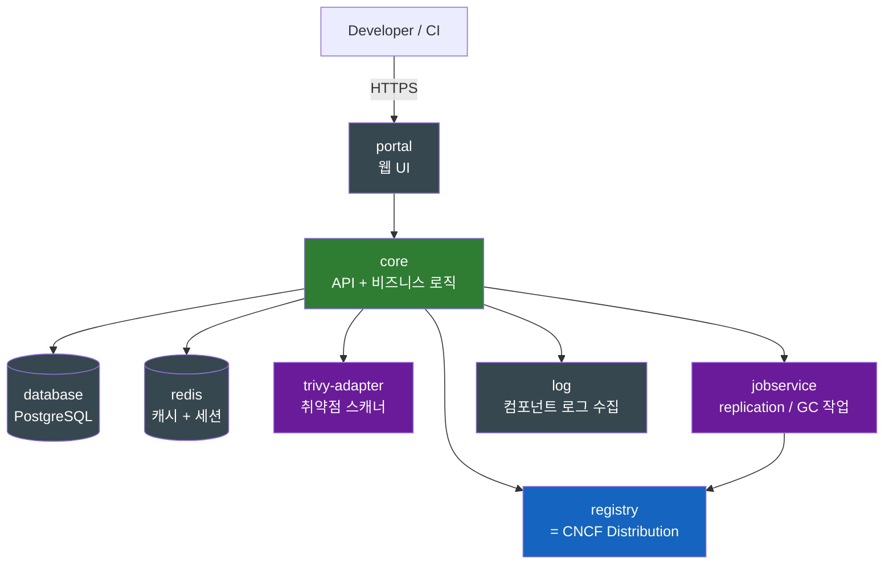

# Harbor — 왜 회사들은 사내 컨테이너 레지스트리를 두는가

> **개발자를 위한 쉬운 쿠버네티스 · 확장 읽기** | [전체 목차](./Kubernetes-Introduction.md#이-시리즈의-읽는-순서)

자바 개발자에게 사내 Nexus가 있다면, 컨테이너 시대의 사내 Nexus가 Harbor다.

## 결론부터 말하면

**Harbor는 컨테이너 이미지와 Helm Chart 같은 OCI artifact를 저장하고, 접근 제어·스캔·서명 관련 정책·복제를 제공하는 자체 호스팅 레지스트리다.** 사내에 배포 원본을 보관하고 공급 경로를 통제할 수 있지만, Harbor를 설치했다는 사실만으로 이미지의 안전성이나 Pod의 실행이 보장되지는 않는다. 이미지를 받는 주체는 앱 Pod를 담당하는 Node의 kubelet/runtime이며, Harbor는 그 요청에 artifact를 제공한다.

[이미지의 tag와 digest](Kubernetes-Image-Tag-Digest.md)에서 배운 이미지 식별 문제를 공급 경로로 확장한다. 본문의 `registry.example.com/book/order-api:1.0.0`은 가상의 주문 API 이미지이며 실제 공개 이미지가 아니다. Harbor를 그 DNS 이름으로 서비스한다고 가정해 역할을 설명한다.

| 핵심 기능 | 한 줄 요약 | 자바 세계 비유 |
|----------|-----------|----------------|
| **취약점 스캔** | Trivy로 이미지 푸시 시 자동 스캔 | Nexus IQ / Snyk |
| **RBAC + Projects** | 프로젝트 단위로 권한 분리 + LDAP/OIDC | Nexus의 Realm/Role |
| **이미지 서명** | Cosign / Notation 서명과 검증 정책 | jar 서명 (jarsigner) |
| **Replication** | Docker Hub, ECR, 다른 Harbor와 동기화 | Maven 미러 |
| **Proxy Cache** | upstream 요청을 줄이는 캐시 | Maven Central 프록시 |
| **OCI Artifact** | 이미지 + **Helm Chart** + SBOM 일체 저장 | Maven repo의 multi-packaging |

---

## 1. 왜 Docker Hub만으로는 안 되는가

### 1.1 Pull Rate Limit — 빌드와 재시작도 공급망에 의존한다

Docker Hub는 컨테이너 시대의 Maven Central이다. 무료고, 거의 모든 공식 이미지가 거기 있고, `docker pull nginx`만 치면 작동한다. 그런데 2020년부터 Docker Inc.는 운영비 부담을 이유로 **풀 요청에 제한**을 걸기 시작했다.

**현재 적용 정책** (2026-10-23 확인, [Docker 공식 문서](https://docs.docker.com/docker-hub/usage/))

| 계정 유형 | 풀 제한 |
|----------|---------|
| 익명 사용자 | 6시간당 **100회** |
| Personal (무료 가입) | 6시간당 **200회** |
| Pro / Team / Business (유료) | 무제한 (fair use 조건과 abuse 제한 별도) |

현재 적용 중인 6시간당 100회만 해도 CI/CD 파이프라인을 운영해 본 사람은 즉시 알 것이다. 빌드 컨테이너가 베이스 이미지를 받아오고, 의존성 단계마다 풀이 일어나며, **단일 NAT 게이트웨이 뒤에서 동작하는 사내 CI 환경에서는 익명 풀의 경우 IP 하나로 모든 빌드가 합산**된다 (인증된 풀은 IP가 아닌 계정 기준으로 카운트되지만, 익명 풀이 발생하는 경로가 하나라도 있으면 NAT IP가 통째로 차감된다). 멀티 스테이지 빌드 한 번에 베이스 이미지 여러 장이 풀되는 경우도 흔하므로, 사내 빌드가 활발하면 6시간당 100회를 빠르게 소진하고 `429 Too Many Requests`를 마주친다. 정책의 과거 연혁보다 운영상 중요한 사실은 이미지 pull이 외부 서비스의 가용성·인증·사용량 정책에 의존한다는 점이다. Node에 캐시가 없는 상태의 재시작은 빌드하지 않는 날에도 이 의존성을 드러낸다.



이게 단순히 "불편함"이 아니라 **서비스 장애**로 직결된다는 점이 핵심이다. 쿠버네티스가 Pod를 다른 노드로 재스케줄링할 때 해당 노드에 이미지가 없으면 풀을 하는데, 이 풀이 rate limit에 막히면 Pod가 뜨지 않는다. 자바로 치면 Maven 저장소 접근이 실패해 새 빌드를 시작하지 못하는 상황과 닮았다.

대응은 요구사항에 따라 달라진다. 첫째, **유료 Docker 구독**을 결제한다. 둘째, **사내 레지스트리를 둔다.** 사내 미러·캐시·승인된 이미지 반입을 함께 설계하면 upstream 의존을 줄일 수 있다. 다만 레지스트리 운영과 용량·백업 책임도 생긴다.

### 1.2 보안 — 이미지 안에 애플리케이션 의존성도 들어 있다

두 번째 이유는 보안이다. Docker 이미지의 정체를 생각해보면 명확하다. 이미지는 실행 파일·라이브러리·설정 등 user space 파일과 실행 메타데이터를 묶는다. VM 디스크가 guest OS와 guest kernel을 포함하는 것과 달리, 일반적인 컨테이너는 실행 호스트의 kernel을 공유한다. 컨테이너가 VM 안에서 실행된다면 그 호스트는 해당 VM이다. `nginx:1.27` 이미지 안에는 OpenSSL, glibc, 수십 개의 시스템 패키지가 들어있다. 포함된 패키지에 CVE가 있으면 사용 경로와 설정에 따라 공격 가능성을 검토해야 한다.

2021년 12월의 **Log4Shell**(CVE-2021-44228)은 이 점을 모두에게 강제로 학습시킨 사건이다. 자바 라이브러리 하나의 취약점이 전 세계 컨테이너 이미지에 박혀 있었다. 사용자가 직접 Log4j를 안 썼더라도 **빌드 단계에서 Maven/Gradle이 끌어온 의존성의 의존성**으로 들어오는 경우가 흔했고, 더 깊이는 **베이스 이미지가 묶고 있는 OS 시스템 패키지** 자체의 취약점도 별개 축으로 존재한다. 즉 컨테이너 이미지의 공격 표면은 (1) 베이스 이미지에 내장된 OS 패키지, (2) 빌드 시 더해진 애플리케이션 라이브러리 — 이 두 층 모두 스캔되어야 한다.

스캔은 푸시 시점의 한 번으로 끝나지 않는다. 같은 digest라도 이후 DB 갱신으로 새로운 취약점이 발견될 수 있다. 스캔 결과의 시각·DB 버전·정책을 함께 보고 다시 스캔하는 이유다. 결과에 취약점이 없다는 것은 알려진 취약점 탐지 정책을 통과했다는 뜻이며, 악성 코드·설정 오류·애플리케이션 논리까지 안전하다는 증명은 아니다.

### 1.3 거버넌스 — 누가 무엇을 푸시했는가

세 번째는 운영 거버넌스다. 회사 안에서 누가 어떤 이미지를 푸시했는지, 누가 풀했는지, 어떤 이미지가 prod에 배포된 적이 있는지 — 이런 감사 추적이 Docker Hub로는 어렵다. 사내 레지스트리는 승인 원본을 모으는 지점이 된다. 다만 누가 실제 prod에 배포했는지는 registry 로그만으로 완성되지 않는다. 배포 선언·Kubernetes audit·실행 이미지 digest를 연결해야 하며, 다른 registry 사용을 제한하려면 admission이나 네트워크 정책이 별도로 필요하다.

---

## 2. Harbor가 메우는 6가지 빈틈

위 세 가지 문제를 직접 해결하는 것이 Harbor의 존재 이유다. 핵심 기능 6가지를 보자.

### 2.1 Trivy로 푸시 시점 취약점 스캔

Harbor는 **Trivy**(Aqua Security가 만든 오픈소스 스캐너)를 내장한다. 설치 시 `install.sh --with-trivy` 한 줄로 스캐너 자체를 활성화하고, 추가로 프로젝트 설정에서 **"Automatically scan images on push"** 옵션을 켜야 푸시 직후 자동 스캔이 동작한다 (설치만으로는 자동 스캔이 켜지지 않는다는 점이 자주 헷갈리는 부분이다). 활성화하면 Harbor가 OS 패키지(Alpine/Debian/RHEL 등)와 애플리케이션 의존성(npm/PyPI/RubyGems 등)을 스캔해 CVE 목록을 만든다.

운영상 강력한 점은 **"Critical 취약점이 있으면 풀을 막는다"** 같은 정책 게이트를 걸 수 있다는 것이다. 설정한 severity·allowlist·스캔 결과 정책에 따라 해당 Harbor 프로젝트의 pull을 제한할 수 있다. 다른 registry, 이미 캐시된 이미지, 예외 권한까지 같은 정책으로 자동 통제되는 것은 아니다.

### 2.2 RBAC + 프로젝트 분리

Harbor는 이미지를 **프로젝트** 단위로 묶는다. 각 프로젝트는 public/private 설정이 가능하고, 프로젝트별로 권한이 따로 관리된다.

| 역할 | 권한 |
|------|------|
| **Project Admin** | 프로젝트 설정/멤버 관리 |
| **Maintainer** | 이미지 푸시/태깅/삭제 |
| **Developer** | 이미지 푸시/풀 |
| **Guest** | 이미지 풀만 |
| **Limited Guest** | 이미지 풀은 가능, 단 프로젝트 로그/멤버 목록 같은 메타데이터 조회는 차단 |

LDAP/AD/OIDC 통합이 있어 사내 SSO 인프라에 그대로 연결된다. 자바 개발자가 사내 Nexus에서 Maven repo별로 권한을 분리하던 그 모델을 컨테이너 세계에 옮겨놓았다고 보면 된다.

### 2.3 Cosign / Notation으로 이미지 서명

이미지가 진짜 우리 빌드 시스템이 만든 것인지 어떻게 증명할까? 답은 **디지털 서명**이다. Harbor의 서명 체계는 시대별로 다음과 같이 진화했다.

| 도구 | 등장 시점 | 현재 상태 |
|------|----------|----------|
| **Notary v1** (Docker Content Trust) | 2015~ | **Harbor 2.6부터 Deprecated, 2.9.0(2023)에서 UI/Backend 완전 제거** — 별도 Notary 서버 필요, 운영 복잡. Cosign/Notation으로 마이그레이션 필수 |
| **Cosign** (Sigstore) | 2021~, Harbor v2.5(2022)에 통합 | **현재 권장** — 서명을 레지스트리 안에 일반 OCI artifact로 저장 |
| **Notation** (Notary v2 계열) | 2023~ | 현재 권장 — OCI Referrers 기반의 표준화된 서명 모델 |

서명은 artifact의 digest와 서명자를 암호학적으로 연결한다. Harbor는 Cosign·Notation 서명 artifact를 보관하고 content trust 정책을 제공한다. [Harbor 2.15.0 문서](https://goharbor.io/docs/2.15.0/working-with-projects/project-configuration/implementing-content-trust/)에는 프로젝트별로 Cosign·Notation 검증 정책을 활성화해 pull을 제한하는 기능이 설명되어 있다(2026-10-23 확인). 이 기능을 사용하려면 실제 설치 버전과 정책 설정을 확인해야 한다.

여기서 서명 저장, 정책 활성화, 신뢰할 키나 identity의 결정은 각각 구분한다. 이미지가 서명되었다는 사실만으로 우리 조직의 승인된 빌드라는 결론이 나오지 않는다. 서명 키·KMS 접근과 검증자의 신뢰 정책이 맞아야 한다. keyless 서명처럼 외부 identity·투명성 로그에 의존하는 방식은 에어갭에서 추가 설계가 필요하다.

Kubernetes admission에서 Kyverno 같은 도구로 이미지 참조와 서명을 확인하면 다른 registry를 통한 배포 경로에도 정책을 적용할 수 있다. 다만 registry pull 정책과 admission은 실행 위치가 다르다. 전자는 artifact 제공 시점, 후자는 API 저장 전 요청 판정 시점이다. Pod가 이미 실행 중인지, 어떤 리소스와 namespace가 정책 대상인지도 별도로 확인한다.

### 2.4 Replication — 멀티 클러스터와 폐쇄망

큰 조직은 클러스터가 하나가 아니다. dev/stg/prod, 리전별, 클라우드별로 클러스터가 흩어진다. Harbor는 다른 Harbor 인스턴스, Docker Hub, ECR, GCR, GHCR 등과 **이미지를 동기화**할 수 있다. 단 동기화 규칙은 **Push 또는 Pull 중 하나의 단방향**으로 설정한다. 필요한 전송 방향에 맞게 규칙을 따로 두고 대상 registry와 동기화 범위를 확인한다.



네트워크가 통제되어도 복제 대상에 연결할 수 있는 제한망에서는 replication이 유용하다. 그러나 완전한 air-gap에는 외부 Harbor에서 periodic push할 경로 자체가 없다. 승인된 매체·반입 구간을 통해 이미지와 서명·연관 artifact를 옮기고 내부 레지스트리에 적재하는 절차가 필요하다. replication 작업이 성공한 artifact 목록과 실제 내부 digest를 대조해야 한다.

**에어갭 환경에서 짚어볼 점.** 앱 이미지 외에도 설치 hook, 스캐너, controller가 쓰는 이미지가 필요하다. Trivy의 취약점 DB와 언어별 DB 갱신 경로, CA·DNS·registry 인증, OCI referrer와 멀티아키텍처 manifest의 보존을 함께 확인한다. Chart 파일 하나를 반입하는 것으로 이 조건들이 충족되지는 않는다.

### 2.5 Proxy Cache — Rate Limit의 정공법

1.1절에서 본 Docker Hub rate limit 문제의 깔끔한 해법이 이것이다. Harbor에서 **Proxy Cache 유형의 프로젝트를 별도 생성**(예: `dockerhub-cache`)하고 대상 레지스트리를 Docker Hub로 지정하면 동작은 다음과 같다.

1. 개발자가 `harbor.company.com/dockerhub-cache/library/nginx:1.27`를 풀하라고 요청한다.
2. Harbor 캐시에 유효한 사본이 있으면 그대로 반환한다.
3. 없거나 upstream의 mutable tag(`latest`, `1.27` 같은 가변 태그)가 갱신되었으면 Harbor가 Docker Hub에서 받아와 캐시를 갱신하고 반환한다.

결과적으로 Docker Hub로의 풀은 **동일 아키텍처/동일 digest 기준 캐시 히트인 한 사내에 최초 다운로드 이후에는 캐시에서** 일어난다. 같은 캐시를 재사용하면 Hub에 실제 다운로드하는 요청을 줄일 수 있다 (멀티 아키텍처 이미지는 arch별 manifest가 별도로 카운트될 수 있다). 단 캐시 미스 시점에 Docker Hub로 나가는 pull에는 여전히 사용량 정책이 적용된다. 익명 pull은 Harbor의 outbound IP, 인증된 pull은 해당 계정 조건을 기준으로 집계된다는 점은 알아두자 — 캐시가 무한히 안전망이 되는 것은 아니다.

> ⚠️ **Proxy Cache 프로젝트의 제약**: 이 프로젝트는 외부 레지스트리의 **읽기 전용(pull-only) 미러**로만 동작한다. 사용자가 사내 빌드 이미지를 여기에 직접 푸시할 수 없다. 따라서 실무에서는 외부 캐싱용 프로젝트(`dockerhub-cache`)와 사내 빌드 저장용 프로젝트(`service-prod`)를 명확히 분리해 운영한다.

**설정 순서 (Harbor 공식 문서 main, 2026-10-23 확인):**

1. **Registry Endpoint 먼저 만든다.** 대상 레지스트리(Docker Hub 등)를 registry endpoint로 등록한다. 지원 대상은 Harbor, Docker Hub, Docker registry, AWS ECR, Azure ACR, Google GCR, Quay, GitHub Container Registry, JFrog Artifactory다. 여기 넣는 접근 계정으로 Docker Hub 인증 풀 한도를 쓰게 되고, 그 계정이 볼 수 있는 이미지는 캐시 프로젝트 사용자 누구나 풀할 수 있으니 권한을 최소로 둔다.
2. **Projects > New Project**에서 **Proxy Cache** 슬라이더를 켜고 위 endpoint를 고른다. Bandwidth로 upstream 풀 속도를 제한할 수 있다(-1은 무제한).
3. 클라이언트와 Pod 매니페스트의 이미지 앞에 `<harbor_servername>/<proxy_project_name>/`를 붙인다.

```bash
# 공식 문서 예시 형식
docker pull harbor.example.com/dockerhub-cache/goharbor/harbor-core:dev
```

- 새 proxy cache 프로젝트에는 기본으로 **7일 tag retention 정책**이 만들어진다. 오래 쓰는 베이스 이미지가 자꾸 캐시 미스 나면 이 정책부터 본다.
- Harbor v2.1.1부터 캐시 갱신 여부를 HEAD 요청으로 확인하므로, 이 확인 자체는 Docker Hub rate limit를 소모하지 않는다. 레이어가 실제로 바뀌어 새로 받을 때만 카운트된다. proxy cache를 쓴다면 v2.1.1 이상이 권장된다.
- upstream에 닿지 않으면 캐시된 이미지를 그대로 내주고, upstream에서 이미지가 삭제됐으면 내주지 않는다.

출처: [Harbor — Configure Proxy Cache](https://goharbor.io/docs/main/administration/configure-proxy-cache/)

### 2.6 OCI Artifact — Helm Chart도 같이 저장

OCI(Open Container Initiative) 명세가 진화하면서, 컨테이너 레지스트리가 이미지 외의 것들도 저장할 수 있게 됐다. Harbor는 OCI Artifact 모델을 지원하므로 다음을 모두 저장한다.

| 타입 | 용도 |
|------|------|
| 컨테이너 이미지 | 기본 |
| **Helm Chart** | 이전 글에서 본 K8s 패키지 |
| Cosign 서명 | 이미지 서명 |
| SBOM (CycloneDX, SPDX) | 소프트웨어 자재 명세서 |
| WASM 모듈 | WebAssembly 런타임용 |
| OPA Bundle | 정책 번들 |

이것이 이전 글의 **Helm**과 만나는 지점이다. Helm 3.8(2022)에서 OCI 레지스트리 지원이 정식화되면서, 회사들은 **이미지와 Chart를 같은 Harbor에서 관리**하기 시작했다. 사내 앱의 컨테이너 이미지와 그 앱을 배포하는 Helm Chart가 같은 권한 체계, 같은 서명 정책 안에서 묶여 흐른다.

---

## 3. 아키텍처 — Harbor는 결국 "Distribution + α"

Harbor는 하나의 레지스트리 프로세스에 UI만 붙인 구성이 아니다. 설치 방식과 외부 DB·Redis 사용 여부에 따라 구성과 replica 수가 달라진다. 아래는 역할을 보여 주는 개념도이며 실제 모든 요청이 portal을 경유한다는 네트워크 경로도는 아니다. CLI와 runtime의 registry API 요청은 웹 UI를 통과하지 않는다.



여기서 가장 흥미로운 점은 **`registry` 컨테이너의 정체**다. 이것이 바로 **CNCF Distribution**(옛 Docker Registry)이다. 즉 **Harbor는 Distribution을 그대로 품고 그 위에 자체 컨트롤 플레인을 얹은 구조**다.

감사 로그는 기본적으로 database에 저장하며, 설정에 따라 외부 syslog endpoint로 전달할 수 있다. `log` collector가 모으는 컴포넌트 운영 로그와 감사 기록의 저장·보존 정책을 같은 것으로 보지 않는다. 외부 전달 시 DB 저장을 생략하는 옵션을 사용한다면 감사 기록의 보관·백업 책임도 그 설정에 맞춰 확인한다.

Distribution은 OCI registry API로 manifest와 blob을 제공하는 기반이고, Harbor core·jobservice·DB 등이 프로젝트 권한과 복제·정리 작업을 관리한다. 그래서 Harbor를 도입하면 registry 저장소뿐 아니라 DB·Redis·작업 큐·인증서·복구 절차도 운영 대상이 된다. 사내 공급 경로의 가용성이 이 서비스에 모이기 때문이다.

---

## 4. Helm 시리즈와의 연결 — 신뢰 체인 완성

Chart를 받은 Helm 실행 주체와 이미지를 받는 Node는 서로 다른 클라이언트다. Chart가 Harbor에 있다는 이유로 Node의 pull 인증이 자동 구성되지 않고, Node가 이미지를 받을 수 있다는 이유로 배포 도구가 private Chart를 받을 수 있는 것도 아니다.

| 단계 | 실행 주체 | 별도로 확인할 사실 |
|------|-----------|-------------------|
| 빌드·테스트 | CI의 실행 환경 | 선택한 소스 revision과 테스트 결과 |
| 저장·스캔 | Harbor와 scanner | push digest, 스캔 종료와 정책 결과 |
| 서명 | 키를 사용할 수 있는 서명 작업 | 승인된 digest에 대한 서명과 identity |
| Chart 렌더링·적용 | Helm 또는 GitOps 도구 | Chart 고정 참조, values, API 결과 |
| Pod 이미지 pull | Node의 kubelet/runtime | registry 접근·인증·CA·image pull 결과 |
| 실행·준비 | 앱 컨테이너와 kubelet | startup·readiness와 실제 응답 |

서명·스캔·배포 이력을 digest로 연결하면 문제가 생겼을 때 원본을 추적할 수 있다. Harbor는 이 기록을 모을 수 있는 지점이며, 각 검증을 실제로 실행하고 실패 시 중단하는 정책은 파이프라인과 클러스터의 책임으로 남는다.

---

## 5. 대안과 선택 기준

Harbor만이 답은 아니다. 상황에 따른 선택지를 정리하면 다음과 같다.

| 운영 조건 | 검토할 선택 | 확인할 비용 |
|-----------|-------------|-------------|
| 자체 호스팅·망 내부 보관 필요 | Harbor, Distribution, 기존 사내 registry | HA·용량·백업·업그레이드 책임 |
| 클라우드 IAM과의 통합이 중요 | 해당 클라우드 managed registry | 네트워크·권한·보관 비용·복구 조건 |
| Maven·npm 등도 같은 운영 체계 사용 | 기존 Nexus·Artifactory의 OCI 지원 | 필요한 artifact·서명·정책 기능의 제품별 지원 |
| Git 호스팅과 CI가 이미 통합됨 | 해당 플랫폼의 registry | 조직 권한, 외부 의존, 에어갭 조건 |

제품 이름만으로 보안 수준과 적합성을 정할 수 없다. 필요한 정책을 누가 운영할지, 복구에 어느 정도 시간이 허용되는지, Node가 어디에서 이미지를 받을지를 먼저 정하면 선택 기준이 구체화된다.

---

## 6. 정리

Harbor는 컨테이너 시대에 "회사의 자재창고"를 세우는 도구다. Docker Hub에서 받아온 이미지를 **신뢰할 수 있는 형태로 사내에 보관**하고, 내부 빌드물에 **서명과 스캔 결과로 검증 근거**을 부여하며, 흩어진 클러스터들에 **일관된 배포 원본**을 제공한다.

| 자리 | 도구 |
|------|------|
| **자바 의존성 창고** | Nexus, Artifactory |
| **OS 패키지 창고** | apt 미러, yum 미러 |
| **컨테이너 + Helm Chart 창고** | **Harbor** |
| **K8s 패키지 매니저** | Helm (이전 글) |

이전 글의 Helm은 "어떻게 배포하는가"의 답이었고, 이번 Harbor는 "어디에서 끌어와 배포하는가"의 답이다. 두 도구는 카테고리가 전혀 다르지만, 실제 운영에서는 같은 파이프라인의 다른 단계로 함께 쓰인다.

다음 글에서는 두 도구의 역할 차이를 명확히 정리하고, **CI/CD 파이프라인에서 둘이 협업하는 실제 시나리오**를 그려본다 — 이미지 빌드 → Harbor 푸시 → Trivy 스캔 → Cosign 서명 → Helm Chart에서 이미지 참조 → admission 검증 → 실행의 흐름이다.

---

## 생각해 볼 질문

1. **Chart를 내부 Harbor로 옮겼는데 Pod가 ImagePullBackOff인 이유는 무엇일까?** Chart 다운로드와 Node의 이미지 pull은 경로·인증 주체가 다르다. 렌더링된 image 주소와 Node의 DNS·CA·자격증명을 확인한다.
2. **proxy cache가 있으니 외부 registry 장애와 사용량 제한을 걱정하지 않아도 될까?** 캐시 miss·retention·가변 tag·아키텍처에 따라 upstream 요청이 필요하다. 승인 이미지의 보존 정책과 단절 상태에서의 동작을 따로 설계해야 한다.
3. **스캔 통과와 유효한 서명이 같은 사실을 증명할까?** 스캔은 알려진 취약점 정책의 결과, 서명은 특정 digest와 서명자의 연결이다. 어느 쪽도 앱 전체의 안전성과 운영 적합성을 혼자 보장하지 않는다.

## 출처

- [Harbor 공식 사이트 (goharbor.io)](https://goharbor.io/) — 공식 레퍼런스
- [Harbor 공식 문서](https://goharbor.io/docs/) — 설치/운영 가이드
- [CNCF — Harbor Project Page](https://www.cncf.io/projects/harbor/) — Graduated 상태, 프로젝트 메타정보
- [CNCF — Harbor Project Journey Report](https://www.cncf.io/reports/harbor-project-journey-report/) — VMware → CNCF 졸업 여정
- [Docker Hub pull limits](https://docs.docker.com/docker-hub/usage/pulls/) — 2026-10-23 확인, 계정·IP 집계와 fair use
- [Harbor proxy cache](https://goharbor.io/docs/main/administration/configure-proxy-cache/) — 캐시 hit·miss·권한과 upstream 조건
- [Harbor artifact signing](https://goharbor.io/docs/main/working-with-projects/working-with-images/sign-images/) — Cosign·Notation
- [Harbor 2.15.0 content trust](https://goharbor.io/docs/2.15.0/working-with-projects/project-configuration/implementing-content-trust/) — 프로젝트 pull 정책
- [Harbor vulnerability scanning](https://goharbor.io/docs/main/administration/vulnerability-scanning/) — scanner와 결과
- [Harbor replication](https://goharbor.io/docs/main/administration/configuring-replication/) — 복제 방향과 대상
- [Trivy air-gap](https://trivy.dev/latest/docs/advanced/air-gap/) — 단절 환경 DB 준비
- [Harbor Architecture Overview](https://github.com/goharbor/harbor/wiki/Architecture-Overview-of-Harbor) — log collector의 역할
- [Harbor Log Rotation](https://goharbor.io/docs/main/administration/log-rotation/) — audit log DB와 syslog forwarding
