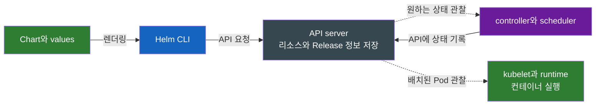
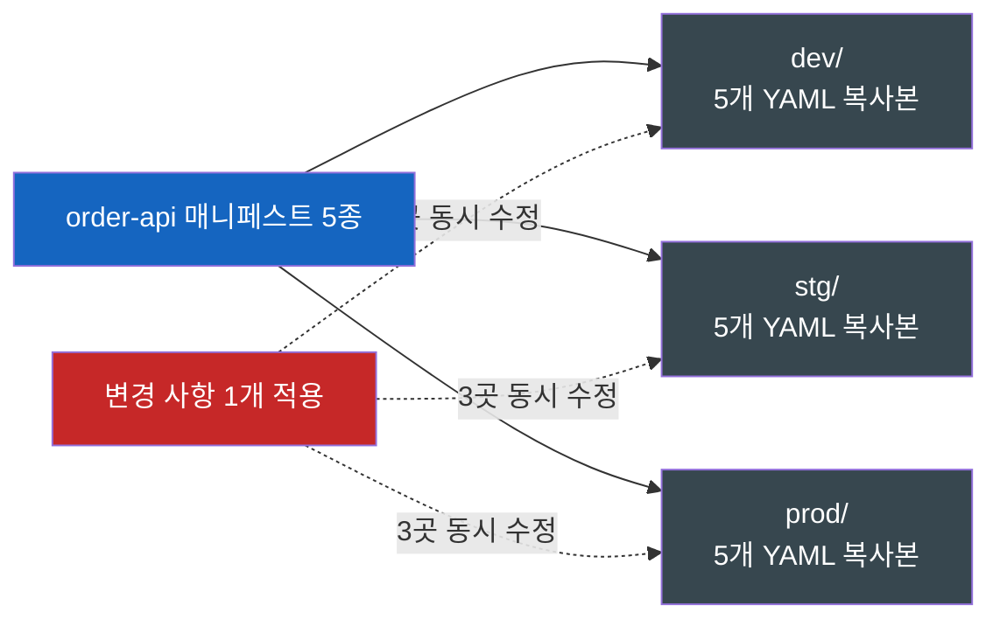
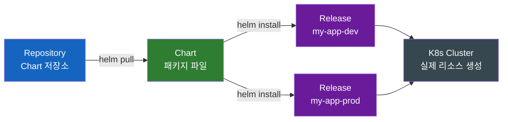
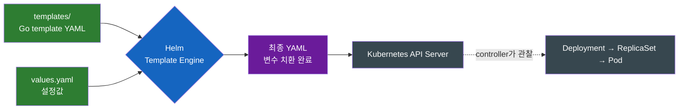
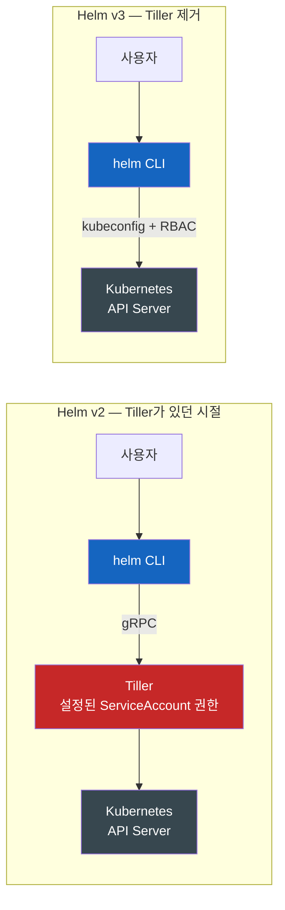

# Helm — 쿠버네티스의 패키지 매니저는 왜 필요한가

> **개발자를 위한 쉬운 쿠버네티스 · 확장 읽기** | [전체 목차](./Kubernetes-Introduction.md#이-시리즈의-읽는-순서)

Deployment와 Service를 만들 줄 알게 되면 다음 문제가 남는다. 같은 애플리케이션을 여러 환경에 설치할 때, 함께 바뀌어야 할 선언과 설정을 어떻게 묶어 관리할까?

[설정의 전달](Kubernetes-ConfigMap-Secret.md)까지 읽었다면 이 글을 따라갈 수 있다. [클러스터의 동작 구조](Kubernetes-Architecture.md)를 떠올리면서, Helm이 API에 보내는 것과 controller가 실행하는 것을 구분해 보자.

## 결론부터 말하면

**Helm은 Kubernetes 리소스의 템플릿과 기본 설정을 Chart라는 패키지로 묶고, 이를 설치한 Release의 변경 이력을 관리하는 도구다.** 여러 YAML을 하나의 배포 단위로 다루지만 애플리케이션을 빌드하거나 Pod를 직접 실행하지는 않는다. Helm이 선언을 API server에 보낸 뒤에도 controller, scheduler, kubelet이 각자의 일을 해야 앱이 실행된다.



| 개념 | 한 줄 정의 | 자바/리눅스 비유 |
|------|-----------|------------------|
| **Chart** | 설치 가능한 K8s 애플리케이션 패키지 | Maven 아티팩트 (`.jar` + `pom.xml`) |
| **Release** | Chart를 클러스터에 설치한 인스턴스 | 설치된 데비안 패키지의 기록 |
| **Repository** | Chart들이 모여 있는 원격 저장소 | Maven Central / APT 미러 |
| **Values** | Chart의 설정값 (`values.yaml`) | `application.yml`의 프로파일별 오버라이드 |

---

## 1. Helm이 없던 시절 — YAML 지옥의 풍경

<a id="11-nginx-하나-띄우는-데-쌓이는-yaml"></a>

### 1.1 애플리케이션 하나에 연결되는 여러 선언

쿠버네티스에 가상의 주문 API `order-api`를 올린다고 해보자. 무엇이 필요한가? 가장 단순한 형태로는 **Deployment만으로도 Pod 생성을 요청할 수 있다.** 클러스터 내부에서 임시로 접근만 한다면 그것으로 충분하다. 하지만 운영 환경에 올리는 순간 이야기가 달라진다. 외부 노출, 설정 주입, 도메인 라우팅, 권한 분리가 전부 별도 리소스로 쪼개져 있고, 하나씩 더해진다.

| 리소스 | 역할 | 필요 시점 |
|--------|------|-----------|
| **Deployment** | Pod 템플릿과 replica 수 선언 | 이 사례의 stateless 앱 관리 |
| **Service** | 바뀌는 Pod를 선택하는 안정적인 이름과 접속점 | Pod 교체에도 같은 주소로 호출하려면 |
| **ConfigMap** | 환경변수, 설정 파일 주입 | 환경별 설정 분기가 생기면 |
| **Ingress** | controller가 적용할 외부 HTTP 라우팅 규칙 | 이 방식의 외부 노출을 선택하면 |
| **ServiceAccount** | Pod가 K8s API를 호출할 때 사용할 ID | 기본 SA 권한이 부족하거나 분리하고 싶으면 |

각 리소스는 별도 YAML 파일로 작성된다. 운영형 웹 서비스 한 벌을 제대로 띄우려면 자연스럽게 매니페스트 4~5개가 묶여 다니게 된다는 뜻이다.

### 1.2 그리고 환경이 셋이 된다 — 복붙의 시작

문제는 여기서 시작된다. 같은 애플리케이션을 `dev`, `stg`, `prod` 세 환경에 배포한다고 해보자. 환경별로 다른 것은 **replicas 개수**, **이미지 태그**, **도메인**, **리소스 limit** 정도다. 나머지는 동일하다.

> "그럼 폴더 세 개 만들고 복붙하면 되지 않나?"

복사본으로 시작하면 초기 작업은 단순하다. 그러다 변경 사항 하나를 적용하려면 세 폴더의 다섯 파일을 동시에 수정해야 한다는 사실을 깨닫는다. 한 곳을 빼먹으면 환경 간 drift가 발생한다. 운영하다 보면 dev에서는 되는데 prod에서만 안 되는 미스터리 버그가 등장하는데, 원인을 찾아보면 누군가 prod 매니페스트만 갱신을 깜빡한 것이다.



자연스럽게 "변수"가 그리워진다. 하지만 YAML 자체에는 Helm과 같은 템플릿 변수 평가 기능이 없다. 그래서 환경별 매니페스트를 관리하려고 `sed`로 치환하는 스크립트를 쓰거나, Python으로 템플릿을 굴리거나, Jenkinsfile에 환경별 분기를 박아 넣었다. 모두가 같은 문제를 각자의 방식으로 풀고 있었다.

### 1.3 자바 개발자라면 어디서 본 풍경이다

여기서 데자뷰가 발동한다. 2000년대 초 자바 빌드는 Ant XML이 지배했다. 모든 프로젝트가 자기만의 `build.xml`을 작성했고, 의존성은 `lib/` 폴더에 jar 파일을 직접 던져 넣었다. 누군가 라이브러리 버전을 올리면 모든 프로젝트의 lib 폴더를 일일이 갱신해야 했다.

이 카오스를 정리한 것이 Maven이었다. Maven은 **"관습(convention)"** 과 **"중앙 저장소"** 라는 두 가지를 들고 왔다. 디렉토리 구조와 라이프사이클을 표준화했고, `pom.xml`에 의존성만 적으면 Maven Central에서 자동으로 가져왔다.

| Ant 시대 (2000년대) | Maven 시대 (2004~) | kubectl 시대 | Helm 시대 |
|---------------------|---------------------|--------------|-----------|
| build.xml 각자 작성 | pom.xml 표준 | YAML 5종 복붙 | Chart 패키지 |
| lib/ 폴더에 jar 직접 | Maven Central 의존 | 환경별 매니페스트 폴더 | values.yaml로 분기 |
| 빌드 스크립트 = 명령형 | 선언적 의존성 | 선언적이긴 한데 단편적 | 패키지 단위 선언 |

Helm이 K8s에서 한 일은 본질적으로 같다. **사람들이 각자 sed/스크립트로 풀던 문제를 패키지 매니저라는 추상화로 통일했다.** Prometheus, cert-manager, Harbor처럼 여러 리소스를 함께 배포하는 소프트웨어에서 Chart를 제공하는 이유도 여기에 있다. Helm 외에도 Kustomize overlay나 자체 생성 도구로 중복을 관리할 수 있다.

---

## 2. Helm의 3대 개념: Chart, Release, Repository

Helm을 이해하는 데 필요한 용어는 사실 세 개뿐이다.



### 2.1 Chart — 설치 가능한 단위

Chart는 K8s에 무언가를 설치하기 위한 **패키지 단위**다. 디렉토리 구조는 다음과 같다.

```
my-app/
├── Chart.yaml          # 패키지 메타 (이름, 버전, 의존성)
├── values.yaml         # 기본 설정값
├── templates/          # K8s 매니페스트 템플릿
│   ├── deployment.yaml
│   ├── service.yaml
│   └── ingress.yaml
└── charts/             # 의존하는 다른 Chart들 (sub-charts)
```

`Chart.yaml`은 패키지의 이름·버전·의존성을 기록한다는 점에서 Maven의 `pom.xml`을 떠올리게 한다. 다만 Chart는 Java 코드를 컴파일하는 빌드 정의가 아니다. `templates/` 아래의 파일들은 일반 YAML이 아니라 **Go template 문법**이 섞인 YAML이다. 자세한 문법은 3장에서 본다.

### 2.2 Release — Chart를 클러스터에 설치한 인스턴스

**Chart는 클래스, Release는 인스턴스**다. 같은 Chart로 여러 Release를 만들 수 있다.

```bash
helm install my-app-dev  ./my-app --namespace dev  --values dev-values.yaml
helm install my-app-prod ./my-app --namespace prod --values prod-values.yaml
```

두 명령은 같은 Chart를 두 번 설치한다. 같은 클러스터 안에 `my-app-dev`, `my-app-prod` 두 Release가 공존한다. Helm은 각 Release의 상태와 이력을 추적하기 때문에, "prod에 설치된 my-app은 현재 어떤 버전이지?" 같은 질문에 즉답할 수 있다.

> Release 이름을 다르게 해도 Chart가 고정된 리소스 이름을 만들면 충돌할 수 있다. namespace 분리는 Deployment·Service처럼 namespace에 속한 리소스의 이름 충돌을 줄인다. CRD·ClusterRole처럼 클러스터 범위인 리소스에는 이 방법이 통하지 않는다. 템플릿이 실제로 만드는 이름과 scope를 확인해야 한다.

### 2.3 Repository — Chart들이 모여 있는 저장소

옛날에는 `helm/charts`라는 거대한 모노레포에 모든 공식 Chart가 모여 있었다(stable 저장소). 이 모델은 유지보수 부담이 폭증해 2020년 폐기되었고, 지금은 두 갈래로 흩어졌다.

| 형태 | 설명 | 예시 |
|------|------|------|
| **전통적 HTTP Repository** | `index.yaml` + tarball을 HTTP로 서빙 | 사내 정적 HTTP 서버 등 |
| **OCI Registry** | 컨테이너 이미지 레지스트리에 Chart도 저장 | Docker Hub, **Harbor**, GHCR |

OCI Registry 지원은 Helm 3.8(2022년)에 정식화되었고, 이후 OCI도 정식 저장 방식으로 사용할 수 있다. **컨테이너 이미지와 Chart를 같은 레지스트리에서 관리**할 수 있게 된 것 — 다음 글에서 다룰 Harbor의 존재 의의가 여기서 더 커진다.

검색 허브로는 **Artifact Hub**(artifacthub.io)가 Chart를 찾는 데 쓸 수 있다. 검색 결과가 모든 Chart를 포함하거나 안전성을 보증하는 것은 아니다.

---

## 3. 어떻게 동작하는가 — 템플릿 엔진과 4가지 명령

### 3.1 values.yaml + templates = 최종 YAML

Helm은 본질적으로 **클라이언트 사이드 템플릿 엔진**이다. `helm install`을 실행하는 순간 일어나는 일은 단순하다.



예시에서는 가상의 `order-api`를 사용한다. namespace는 `bookstore`, label과 컨테이너 이름은 `order-api`, 앱 포트는 `8080`이다. `registry.example.com/book/order-api:1.0.0`은 실제 공개 이미지가 아닌 설명용 주소다. 아래 첫 블록은 **Go template 원문** 이므로 Kubernetes에 직접 적용할 YAML이 아니다.

```gotemplate
apiVersion: apps/v1
kind: Deployment
metadata:
  name: order-api
  namespace: {{ .Release.Namespace }}
spec:
  replicas: {{ .Values.replicaCount }}
  selector:
    matchLabels:
      app: order-api
  template:
    metadata:
      labels:
        app: order-api
    spec:
      containers:
        - name: order-api
          image: "{{ .Values.image.repository }}:{{ .Values.image.tag }}"
          ports:
            - containerPort: 8080
```

`values.yaml`은 데이터 파일이다. 값이 어디에 사용될지는 템플릿이 결정한다.

```yaml
replicaCount: 3
image:
  repository: registry.example.com/book/order-api
  tag: "1.0.0"
```

이 템플릿을 `bookstore` namespace로 렌더링한 결과는 다음과 같다. 리소스 구조를 온전히 보여 주는 설명용 manifest이며, 실제 실행에는 사용자가 제공하는 이미지와 namespace가 필요하다.

```yaml
apiVersion: apps/v1
kind: Deployment
metadata:
  name: order-api
  namespace: bookstore
spec:
  replicas: 3
  selector:
    matchLabels:
      app: order-api
  template:
    metadata:
      labels:
        app: order-api
    spec:
      containers:
        - name: order-api
          image: registry.example.com/book/order-api:1.0.0
          ports:
            - containerPort: 8080
```

API server가 받는 것은 `{{ .Values.replicaCount }}`가 아니라 `replicas: 3`이다. `helm template`은 여기까지의 텍스트를 만들고, `helm install`은 권한·admission 검사를 거쳐 리소스와 Release 기록을 저장하는 단계까지 진행한다. 저장된 Deployment를 Deployment controller가 관찰해 ReplicaSet을 만들고, ReplicaSet controller가 Pod를 만든다. scheduler의 배치 결정과 kubelet/runtime의 이미지 pull·실행은 그 뒤다. Helm은 이 비동기 과정을 하나의 동기 함수 호출로 바꾸지 않는다.

### 3.2 핵심 명령어 4개로 라이프사이클이 끝난다

| 명령 | 하는 일 | `kubectl`로 흉내 낼 수 있나? |
|------|---------|-----------------------------|
| `helm install`   | Chart를 처음 설치, Release 생성 | `kubectl apply -f`로 비슷하게 |
| `helm upgrade`   | values를 바꿔서 Release 갱신 | 가능, 다만 Release 단위 이력은 별도 관리 |
| `helm rollback`  | 이전 revision의 선언을 다시 적용하고 새 revision으로 기록 | 부분적 — `kubectl rollout undo`는 **Deployment/StatefulSet/DaemonSet 같은 단일 워크로드 리소스 단위**만 가능, Service/ConfigMap/Secret까지 묶어서 되돌리지는 못함 |
| `helm uninstall` | Release가 관리하는 리소스 삭제 요청 | `kubectl delete -f`로 일일이 |

`rollback`이 Helm의 **결정적 차별점**이다. Helm은 Release의 **보존된 revision 이력**을 클러스터에 저장한다(v3 기준). 기본 storage driver는 namespace 안의 Secret이며 다른 driver도 존재한다. Helm 3의 `upgrade`는 기본 `--history-max=10`으로 이력을 제한하므로 모든 revision이 영구 보존되는 것은 아니다. `helm rollback my-app 3`도 3번째 revision이 보존되어 있어야 그 매니페스트를 다시 적용할 수 있다. [Helm 3 upgrade 명령](https://helm.sh/docs/v3/helm/helm_upgrade/)에서 이력 보존 옵션을 확인할 수 있다.

이것은 DB 트랜잭션처럼 모든 리소스를 동시에 복구하는 기능이 아니다. 새 선언으로 Pod가 교체되는 동안 readiness가 실패할 수 있고 hook도 실패할 수 있다. 외부 DB migration이나 볼륨의 데이터 변경까지 되돌리지 않으며, `crds/`에 둔 CRD는 Helm의 일반적인 upgrade·삭제 대상에서 제외된다. 따라서 rollback 이후에도 rollout과 앱의 응답, 데이터 호환성을 별도로 확인해야 한다.

이게 왜 중요한가? 운영 중 배포 사고가 났다고 가정해보자. kubectl만 쓰는 팀은 **"어제 prod에 적용된 YAML이 정확히 무엇이었지?"** 를 Git 로그를 뒤지며 재구성해야 한다. Helm은 그 답을 클러스터 자체에 들고 있다.

---

## 4. Helm v2 → v3 — Tiller가 죽은 사건 (2019년)

Helm의 역사에서 가장 큰 사건은 2019년 11월의 v3 출시다. **Tiller라는 서버사이드 컴포넌트가 완전히 제거**되었기 때문이다.

### 4.1 Tiller가 뭐였나

Helm v2는 클라이언트-서버 구조였다. 사용자가 `helm install`을 치면 로컬 CLI(`helm`)가 클러스터 안에 떠 있는 Tiller에게 gRPC로 요청을 보내고, Tiller가 대신 Kubernetes API를 호출하는 식이었다.



설계 자체는 2016년 당시엔 합리적이었다. Kubernetes의 RBAC가 아직 미성숙했기 때문이다. Tiller가 Release 상태 저장, 권한 분리, 템플릿 렌더링을 모두 책임지는 단일 게이트웨이 역할을 했다.

### 4.2 왜 죽어야 했나 — 보안의 시한폭탄

문제는 운영하다 보니 Tiller가 **보안적 시한폭탄**이라는 점이 드러났다는 것이다.

- `helm init` 기본 설치는 **RBAC 규칙을 자동으로 걸어주지 않았다**. 결과적으로 환경에 따라 Tiller가 과도한 권한을 갖기 쉬웠고, 많은 튜토리얼이 편의상 `cluster-admin` 바인딩을 권장하면서 사실상의 관행이 되어버렸다. 즉 "기본값이 안전하지 않다"가 문제의 본질이었다.
- Tiller의 gRPC 포트는 인증이 약했다. 클러스터 내부에 어떤 식으로든 접근할 수 있으면 Tiller에 명령을 보낼 수 있었고, 그러면 사실상 클러스터 전체를 장악할 수 있었다.
- Kubernetes 자체의 RBAC가 1.6(2017년)에서 beta로 널리 쓰이기 시작했고 1.8에서 GA로 승격되면서, **"중간 게이트웨이로서의 Tiller"가 중복+위험** 으로 격하되었다. 클러스터의 권한 시스템을 또 다른 권한 시스템(Tiller)으로 우회하는 모양새였기 때문이다.

이 역사는 패키지 관리 도구가 누구의 권한으로 API를 호출하는지 확인해야 하는 이유를 보여 준다.

### 4.3 v3가 가져온 모델

Helm v3는 Tiller를 들어내고 **클라이언트가 직접 kubeconfig + RBAC로 API Server와 통신**하는 모델로 바꿨다. Release 정보는 클러스터 안의 Secret(같은 namespace에 저장)에 적재된다. 그 외의 부수 변경도 컸다.

| 변화 | v2 | v3 |
|------|----|----|
| 서버 컴포넌트 | Tiller 필요 | **없음** |
| 권한 모델 | Tiller의 SA 권한 | 사용자의 kubeconfig RBAC |
| Release 저장 | Tiller의 ConfigMap | namespace 내 Secret |
| Chart.yaml | apiVersion v1 | **apiVersion v2** (의존성을 여기에 통합) |
| 명령어 | `helm install <chart>` (이름 자동) | `helm install <name> <chart>` (이름 명시) |

요약하면, **v3는 K8s의 진화를 따라잡으면서 본인의 보안 부채를 청산한 릴리스**다. v2에서 v3로 넘어가려면 `helm 2to3` 플러그인으로 마이그레이션을 한다.

---

## 5. Helm v4 — 2025년 11월의 변화

2025년 11월 12일, KubeCon NA Atlanta에서 **Helm 4**가 발표되었다. v3 이후 6년 만의 메이저 업데이트이자, 2015년 첫 커밋 이후 10주년을 맞은 시점이다.

핵심 변화는 세 가지로 정리할 수 있다.

| 영역 | v3 | v4 |
|------|----|----|
| **리소스 적용 방식** | 클라이언트 사이드 3-way merge | **Server-Side Apply (SSA) 기본 채택** |
| **OCI 참조** | OCI Chart 지원 | OCI digest 지원과 registry 처리 개선 |
| **플러그인 시스템** | 기존 CLI 플러그인 | Wasm runtime을 선택할 수 있는 새 모델 |

특히 **Server-Side Apply 도입**이 의미 있다. v3까지는 Helm이 클라이언트에서 변경분을 계산해 보냈는데, 이때 누가 어떤 필드의 주인인지 모호한 경우가 있었다(`kubectl` 수동 변경분이나 HPA 같은 외부 컨트롤러의 갱신분이 Helm 업그레이드로 사라지는 식의 문제). SSA는 **API Server가 필드 소유권(managed fields)을 추적**하므로 필드 소유권 충돌을 감지하고 보고할 수 있다. 다른 관리자의 필드까지 자동으로 안전하게 병합한다는 뜻은 아니다.

단, **SSA 기본 적용은 새로 설치되는 Release에만 해당된다.** Helm 3에서 만들어둔 기존 Release를 Helm 4로 업그레이드하면 기본값은 여전히 client-side apply다 — 운영 중인 클러스터의 동작이 메이저 업그레이드만으로 바뀌면 곤란하므로 일부러 보수적으로 설계되었다. 기존 Release를 SSA로 옮기려면 `--server-side` 플래그를 명시해서 의도적으로 전환해야 한다.

2026-10-23에 확인한 [Helm 4 overview](https://helm.sh/docs/overview/)는 OCI digest, Wasm 플러그인, kstatus watcher 등의 변화를 설명한다. 문서의 최신 CLI 옵션을 Helm 3에 그대로 대입하면 안 된다. 예를 들어 Helm 4의 post-renderer는 플러그인 모델을 사용하므로 기존 실행 파일을 직접 지정하던 자동화는 호환성을 확인해야 한다. Chart 서명은 Helm 4가 처음 발명한 기능이 아니며, 서명을 저장하는 것과 설치자가 실제로 검증하는 것은 별개다.

---

## 6. Helm의 한계와 Kustomize와의 선택 기준

Helm이 만병통치약은 아니다. 가장 자주 비판받는 지점은 **템플릿 지옥**이다.

```gotemplate
{{- if and .Values.ingress.enabled (not .Values.ingress.hosts) }}
  {{- range $key, $value := .Values.ingress.annotations }}
    {{ $key }}: {{ tpl $value $ | quote }}
  {{- end }}
{{- end }}
```

Go template은 강력하지만, if/range/with 같은 제어 구조가 YAML 들여쓰기와 섞이면 가독성이 급격히 떨어진다. 들여쓰기 한 칸 어긋나면 YAML 파싱이 깨지는데 디버깅은 매우 고통스럽다. 그래서 **Kustomize**라는 대안이 인기를 끌었다.

| 비교 항목 | Helm | Kustomize |
|----------|------|-----------|
| 접근법 | 템플릿에서 YAML 생성 | 베이스 YAML을 패치(overlay)로 변형 |
| 문법 | Go template 학습 필요 | 표준 YAML만 알면 됨 |
| 통합 | 별도 `helm` CLI | `kubectl apply -k`로 내장 |
| 릴리즈 이력 | 자동 추적, `rollback` 지원 | 없음 (Git 이력으로 대체) |
| 패키지 배포 | Chart로 외부 공유 용이 | 공유 어려움 (디렉토리 구조) |

선택 기준은 패키지 배포가 필요한지, 평범한 YAML의 환경별 차이를 관리하려는지에 있다. 함께 사용하는 구성도 가능하다.

- **서드파티 제품 설치는 Helm**: cert-manager, Prometheus, Traefik, Harbor 자체. 벤더가 Chart로 패키징해서 배포하므로 그대로 받아 쓰면 된다. Chart 버전뿐 아니라 참조 이미지와 의존 Chart도 고정해야 재현성을 높일 수 있다.
- **사내 애플리케이션은 Kustomize**: 환경별로 자주 바뀌고, 내부 팀이 직접 다루므로 평이한 YAML이 유지보수에 유리하다. 템플릿 추상화를 깔 만큼 복잡하지 않은 경우가 많다.

ArgoCD나 Flux 같은 GitOps 도구는 두 방식을 모두 네이티브로 다룬다. "Helm 차트로 설치한 리소스를 Kustomize로 패치"하는 하이브리드도 흔한 패턴이 되었다 — Helm의 **Post-Rendering** 기능을 쓰면 서드파티 Chart의 원본을 포크하지 않고도 렌더링 결과 위에 Kustomize 오버레이를 얹을 수 있다.

상태 관리의 주체도 구분해야 한다. Argo CD는 Chart를 `helm template`으로 렌더링하고 자체 엔진으로 적용하므로, 그 애플리케이션은 보통 `helm list`에 나타나는 Helm Release가 아니다. 따라서 `helm rollback`할 대상부터 없다. Git이나 Application이 참조하는 버전을 바꾸고 다시 동기화하는 방식으로 복귀한다. live 수정의 자동 복구는 auto-sync·selfHeal 설정에 달려 있다.

Flux의 helm-controller는 `HelmRelease`를 읽고 실제 Helm install·upgrade·rollback을 수행한다. Release와 이력이 존재하지만 사람이 직접 수정하면 다음 reconciliation과 충돌할 수 있다. 복귀할 선언, 실패 remediation, drift detection을 어느 쪽이 관리하는지 정한 뒤 한 주체가 관리하도록 한다.

**에어갭 환경에서 짚어볼 점.** Chart 파일을 반입해도 Node가 받을 앱 이미지, hook·test 이미지, 하위 Chart, 설치 중 다운로드가 준비되는 것은 아니다. 렌더링 결과를 보고 필요한 artifact 목록을 만들고, Helm을 실행하는 위치와 각 Node의 registry 인증·CA 신뢰를 따로 확인해야 한다.

---

## 7. 정리

쿠버네티스의 YAML은 강력하지만 단편적이다. 환경이 늘어나고 서비스가 늘어나면 그 단편성이 곱셈으로 폭증해 운영 부담이 된다. **Helm은 그 폭증을 "Chart"라는 패키지 단위로 다시 묶어내는 도구**다 — 자바 세계에서 Maven이 했던 일과 본질적으로 같다.

| 자리 | 도구 |
|------|------|
| **빌드 산출물 패키저** | Maven, npm, Cargo |
| **OS 패키지 매니저** | apt, yum, brew |
| **컨테이너 패키저** | Docker (`Dockerfile` + 이미지) |
| **K8s 애플리케이션 패키저** | **Helm** |

다음 글에서는 그 패키지(컨테이너 이미지와 Helm Chart)를 **어디에 저장하고 어떻게 신뢰할 것인가** 에 대한 답인 **Harbor**를 다룬다. 그 전에 [첫 Chart 읽기](Helm-내-첫-Helm-Chart-helm-create부터-helm-install까지.md)에서 생성 파일, 렌더링 결과, Release 이력을 직접 대응시켜 볼 수 있다.

---

## 생각해 볼 질문

1. **`helm template` 결과가 올바른데 Pod가 없는 상황을 어떻게 설명할까?** 렌더링은 API 저장을 수행하지 않는다. install을 수행했더라도 API 거절, controller 동작, scheduling을 각각 확인해야 한다.
2. **이전 revision으로 rollback했는데 DB 오류가 계속되는 이유는 무엇일까?** Helm이 되돌리는 것은 저장된 리소스 선언이다. DB schema·데이터와 과거 앱의 호환성은 별도 복구 설계가 필요하다.
3. **Argo CD와 Flux에서 같은 `helm rollback` 명령을 운영 절차로 써도 될까?** Argo CD의 렌더링 모델과 Flux의 실제 Helm Release 모델이 다르다. 먼저 Release 존재와 상태를 관리하는 주체를 확인해야 한다.

## 출처

- [Helm 공식 문서](https://helm.sh/docs/) — 공식 레퍼런스
- [Helm Architecture (helm.sh/docs/topics/architecture)](https://helm.sh/docs/topics/architecture/) — 아키텍처 설명
- [Migrating Helm v2 to v3 (helm.sh)](https://helm.sh/docs/v3/topics/v2_v3_migration/) — v2→v3 마이그레이션 공식 가이드
- [CNCF — Helm Project Page](https://www.cncf.io/projects/helm/) — CNCF Graduated 상태, 프로젝트 메타정보
- [CNCF Announcement — Helm Marks 10 Years With Release of Version 4 (2025-11-12)](https://www.cncf.io/announcements/2025/11/12/helm-marks-10-years-with-release-of-version-4/) — Helm 4 공식 발표
- [Helm 4 Overview](https://helm.sh/docs/overview/) — 2026-10-23 확인, SSA 전환과 플러그인 모델
- [Helm CRD best practices](https://helm.sh/docs/chart_best_practices/custom_resource_definitions/) — CRD 수명주기의 예외
- [Helm hooks](https://helm.sh/docs/topics/charts_hooks/) — hook 실행과 관리 경계
- [Argo CD Helm](https://argo-cd.readthedocs.io/en/stable/user-guide/helm/) — 렌더링과 적용 주체
- [Argo CD auto-sync](https://argo-cd.readthedocs.io/en/stable/user-guide/auto_sync/) — selfHeal 조건
- [Flux HelmRelease](https://fluxcd.io/flux/components/helm/helmreleases/) — 실제 Helm lifecycle과 remediation
