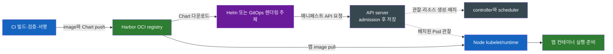
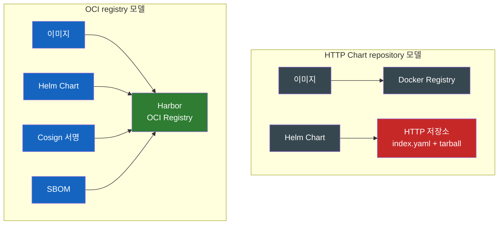
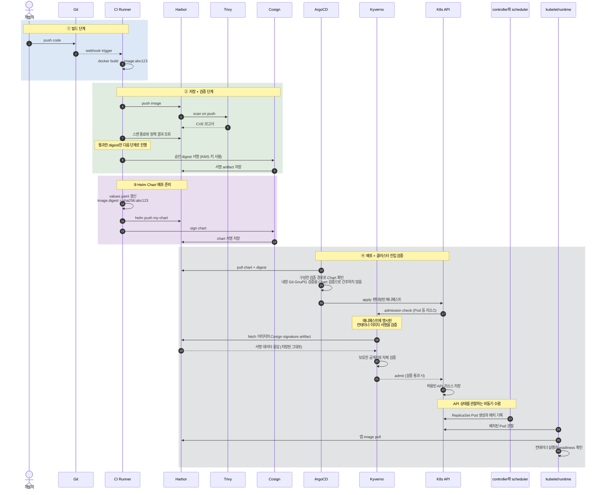
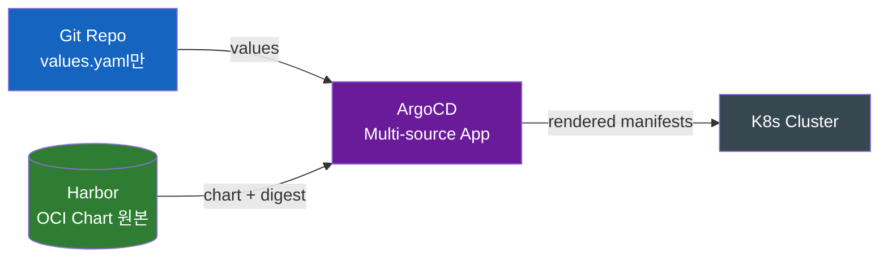
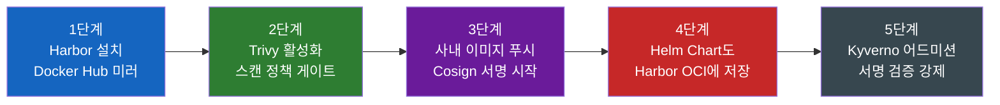
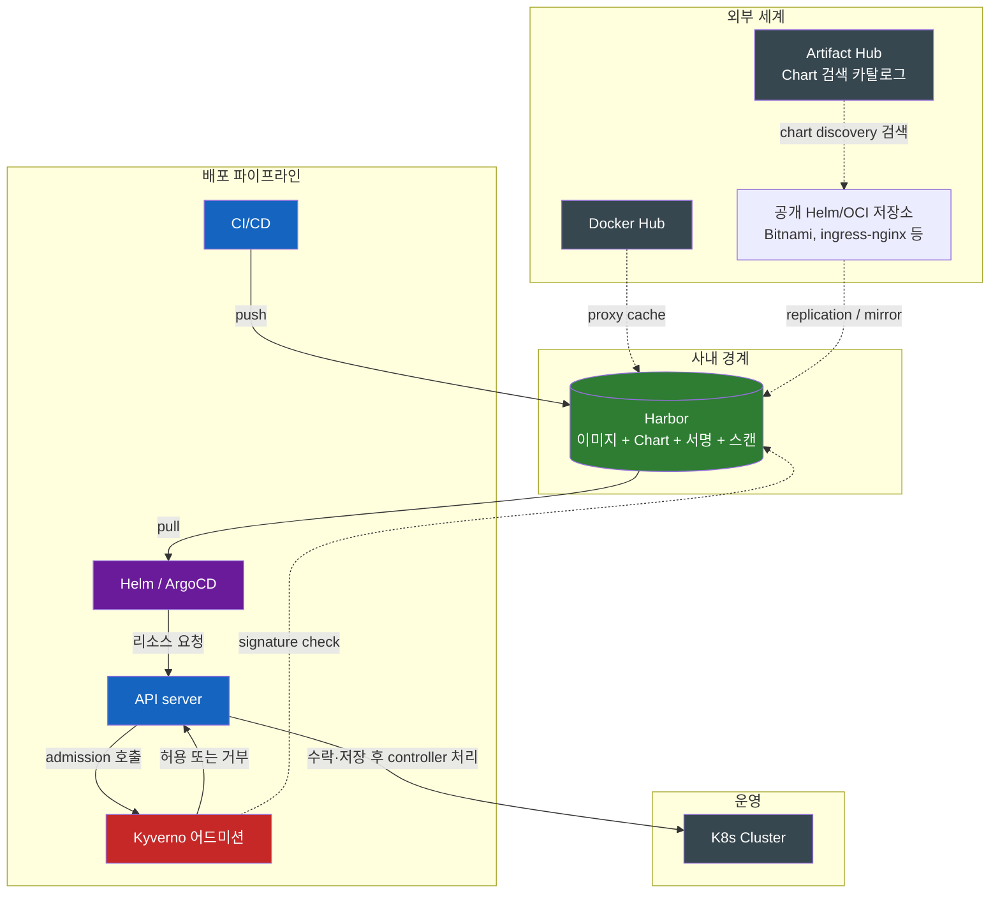

# Helm과 Harbor를 왜 같이 써야 하는가

> **개발자를 위한 쉬운 쿠버네티스 · 확장 읽기** | [전체 목차](./Kubernetes-Introduction.md#이-시리즈의-읽는-순서)

Chart를 받는 배포 도구와 이미지를 받는 Node는 서로 다른 일을 한다. 두 artifact를 같은 레지스트리에 두면 무엇이 묶이고, 무엇은 여전히 따로 확인해야 할까?

## 결론부터 말하면

**Helm은 리소스 선언을 패키징하고 적용하는 도구이고, Harbor는 배포에 사용할 artifact를 제공하는 저장소이므로 함께 쓸 수 있다.** 둘을 반드시 함께 도입해야 하는 것은 아니다. Chart를 Git·HTTP repository에 보관하거나 다른 OCI registry를 사용하는 설계도 가능하다.

[Helm의 모델](Helm-쿠버네티스의-패키지-매니저는-왜-필요한가.md)과 [Harbor의 역할](Harbor-왜-회사들은-사내-컨테이너-레지스트리를-두는가.md)을 연결해 보자. 본문은 `bookstore` namespace의 가상 `order-api`를 배포하는 구성 사례다. 이미지 `registry.example.com/book/order-api:1.0.0`, 앱 포트 `8080`, Service 포트 `80`은 설명용 계약이며 실제 공개 앱·이미지·health endpoint를 제공한다는 뜻이 아니다.

| 질문 | 답 |
|------|---|
| **무엇을 배포하지?** | Helm Chart |
| **어디에 저장하지?** | Harbor |
| **어디서 받아오지?** | 선택한 Chart 저장소; 여기서는 Harbor OCI |
| **무엇으로 신뢰하지?** | 스캔 정책 + 신뢰할 서명자에 대한 검증 |
| **누가 배포 실행하지?** | Helm (또는 ArgoCD/Flux 같은 GitOps 도구가 Helm을 호출) |
| **롤백은 어떻게?** | 현재 상태 관리 주체에 맞춘 선언과 참조의 복귀 |

아래 그림은 artifact를 받는 주체를 나눈다. Helm이 앱 이미지까지 받아 Node에 전달하는 구조가 아니다.

---

## 1. 카테고리부터 다르다 — 비교의 함정

쿠버네티스 입문자가 자주 던지는 질문이 있다.

> "Helm이랑 Harbor 중에 뭐가 더 좋아요? 둘 다 CNCF Graduated인데."

이 질문 자체가 함정이다. 자바 개발자에게 같은 형식으로 묻는다고 상상해보자.

> "Maven이랑 Nexus 중에 뭐가 더 좋아요?"

문장이 어색하게 들린다. Maven은 빌드/의존성 관리 도구, Nexus는 그 의존성이 저장되는 사내 저장소이기 때문이다. **같은 흐름의 다른 단계의 도구**이지 대체재가 아니다. Helm과 Harbor도 정확히 같은 관계다.

| 자바 세계 | K8s 세계 | 역할 |
|----------|----------|------|
| **Maven** | **Helm** | 패키지를 가져와 빌드/배포 |
| **Nexus / Artifactory** | **Harbor** | 패키지가 저장되는 사내 저장소 |
| Maven Central | Docker Hub / GHCR / 공개 OCI 레지스트리 | 외부 공개 저장소 |
| 검색 사이트 (mvnrepository.com) | Artifact Hub | 패키지 검색 카탈로그 (직접 저장하지 않음) |

각자의 책임을 명확히 정리하면 다음과 같다.

| 책임 영역 | Helm | Harbor |
|----------|------|--------|
| K8s 리소스 매니페스트 생성 (템플릿 → YAML) | ✅ | ✗ |
| Release 라이프사이클 관리 (install/upgrade/rollback) | ✅ | ✗ |
| 컨테이너 이미지 저장 | ✗ | ✅ |
| Chart 저장 (OCI) | ✗ (CLI는 푸시만) | ✅ |
| 컨테이너 이미지 취약점 스캔 | ✗ | ✅ (Trivy. Chart 자체는 미지원) |
| Chart 서명 작업 / 보관 | provenance 서명·검증 가능 | OCI 서명 artifact 보관과 정책 |
| 디지털 서명 저장 | ✗ | ✅ (Cosign/Notation) |
| 접근 권한 분리 (RBAC) | ✗ (K8s RBAC에 위임) | ✅ |
| 다른 레지스트리와 동기화 | ✗ | ✅ |

겹치는 영역이 거의 없다. 그래서 **역할을 나눠 조합할 수 있다** 는 결론이 나온다. 기존 registry와 GitOps 체계가 요구를 만족한다면 추가 도입이 필요하지 않을 수도 있다.

---

## 2. 두 도구가 만나는 지점 — OCI Artifact

Helm Chart도 컨테이너 이미지와 같은 OCI registry에 저장할 수 있다. **2022년 Helm 3.8의 OCI GA는 Helm 지원 성숙도의 이정표**이며, Harbor가 처음 Chart를 저장한 시점은 아니다. Harbor 2.0은 [2020-05-13 발표](https://goharbor.io/blog/harbor-2.0/)에서 이미 OCI Helm chart 지원을 소개했다.

두 저장 모델을 비교해 보자. HTTP Chart repository 모델은 Chart를 HTTP 저장소(`index.yaml` + tarball)에, 이미지를 container registry에 둔다. OCI registry 모델은 Chart와 이미지를 같은 registry에서 관리할 수 있다. 아래는 연도별 최초 도입을 나누는 역사 도식이 아니라 저장 모델의 비교다.

통합 이후 얻는 이점이 단순한 "저장 위치 일원화"보다 크다. **권한 정책과 보안 정책이 한 곳에서 일관 적용**된다는 점이 핵심이다.

| 항목 | 통합 전 (분리) | 통합 후 (Harbor OCI) |
|------|---------------|---------------------|
| 인증 | 두 시스템 각각 | Harbor의 RBAC 하나로 |
| 권한 분리 | 따로 관리 | 프로젝트 단위로 묶임 |
| 취약점 스캔 | 이미지만 | 이미지는 Trivy로 스캔. Chart 자체는 Harbor가 직접 스캔하지 않지만, Chart에 명시된 이미지 참조와 같은 레지스트리에 묶이므로 정책/RBAC 통제는 일관 적용 |
| 서명 정책 | 각자 따로 | 둘 다 서명할 수 있으나 검증자와 정책 대상은 별도 |
| 리플리케이션 | 따로 동기화 | 규칙과 대상 adapter가 해당 artifact·연관 서명을 지원하는지 확인 |
| 폐쇄망 반입 | 두 번 작업 | artifact 목록과 연관 서명·의존성을 모아 반입 가능; 별도 절차 필요 |

두 digest가 가리키는 대상은 다르다. OCI Chart digest는 템플릿·기본값 등 Chart artifact를 고정하고, image digest는 Node가 실행할 이미지 artifact를 고정한다. Chart를 고정해도 override values가 다른 이미지를 고를 수 있다. 반대로 image를 고정해도 Chart가 Service selector나 권한을 바꿀 수 있으므로 둘의 이력을 함께 남긴다.

Helm CLI에는 GnuPG provenance를 사용하는 `helm package --sign`·`helm install --verify`가 있다. 이 전통적 `.prov` 경로와 Cosign/Notation으로 OCI artifact를 서명하는 경로는 동일하지 않다. 선택한 repository 형식과 CLI·플러그인의 지원을 확인해, 누가 어느 단계에서 서명을 검사하고 실패를 차단하는지 정해야 한다.

---

## 3. CI/CD 파이프라인 — 저장부터 실행까지

말로만 "통합한다"가 아니라, 설계 예시의 파이프라인이 어떻게 흐르는지 시퀀스로 보자.

각 단계의 책임을 다시 정리하면 다음과 같다.

| 단계 | 도구 | 검증되는 것 |
|------|------|-------------|
| ① 빌드 | CI/CD | "지정 revision으로 테스트·빌드했는가" |
| ② 저장 + 스캔 + 서명 | **Harbor** + Trivy + Cosign | "정해진 스캔 정책을 통과한 digest에 승인 서명이 있는가" |
| ③ Chart 작성 + 푸시 | **Helm** + Harbor | "렌더링 결과가 승인된 이미지를 참조하는가" |
| ④ 배포 + 어드미션 | ArgoCD/Helm + Kyverno | "클러스터에 들어가도 되는가" |

이 흐름의 핵심 통찰은 **"검증 시점이 분산되어 있다"** 는 것이다. 보안 사고는 어느 한 지점에서 막는 게 아니라 여러 지점에 게이트를 깔아 막는다 — Harbor 푸시 시 스캔, 풀 시 서명 정책, 클러스터 진입 시 admission. 검증 대상과 시점이 서로 다르므로, 한 단계의 통과를 다음 단계의 성공으로 확대하지 않는다. 특히 admission은 API 저장 전의 허용 결정이다. Deployment admission 후 실제 Pod 생성 시점에 별도 정책이 적용될 수도 있으며, 허용 후에도 scheduling·pull·readiness가 실패할 수 있다.

2026-10-23 확인한 Argo CD의 내장 GnuPG 검증 문서는 Git 소스를 대상으로 하며 Helm/OCI source 검증을 지원하지 않는다고 명시한다. `.prov` 또는 OCI 서명을 검사하려면 실제 검증을 수행하는 파이프라인·정책·플러그인 경로를 구성해야 한다.

> 💡 **Cosign 키 운영의 실무 주의점**: 서명 키 자체를 어디에 두느냐가 또 다른 운영 과제다. 로컬 파일에 두면 분실/유출 위험이 크고, AWS KMS/GCP KMS/HashiCorp Vault KMS로 관리하는 선택지가 있다. 또한 KMS 장애나 키 만료로 정상 빌드가 admission에서 차단되는 사태를 막기 위해 **break-glass(비상 우회) 절차**를 미리 설계해 둬야 한다.

---

## 4. GitOps 환경에서의 역할 분담

ArgoCD나 Flux 같은 GitOps 도구가 끼어드는 순간 Helm의 역할이 재정의된다. 이전 글에서도 짧게 짚었지만 시리즈를 마무리하는 의미에서 정리해 둘 만하다.

| 운영 모델 | 상태를 적용하는 주체 | 복귀할 때 확인할 것 |
|-----------|---------------------|---------------------|
| Helm CLI | Helm install·upgrade·rollback | 저장된 Release revision과 외부 데이터 호환성 |
| Argo CD | Chart 렌더링 후 자체 sync | Application의 원본 참조와 Git/values 변경; 보통 Helm Release 없음 |
| Flux helm-controller | HelmRelease를 보고 실제 Helm lifecycle 수행 | HelmRelease 선언, remediation·drift detection·suspend 설정 |

GitOps에서도 도구별 동작이 다르다. Argo CD의 live 변경 자동 복구는 auto-sync·selfHeal 설정에 달려 있고, Flux도 reconciliation과 drift detection 정책에 따라 동작한다. 무조건 즉시 덮어쓴다고 일반화할 수 없다. 중요한 것은 수동 변경과 controller의 원하는 상태가 경쟁하지 않게 하는 것이다. Git을 정본으로 정했다면 Chart·values·image 참조를 Git에서 복귀시키고 동기화한 결과를 확인한다.

이 모델에서 **Harbor의 위치는 변하지 않는다.** GitOps든 아니든 Harbor는 항상 "신뢰할 수 있는 아티팩트의 중앙 저장소"로 작동한다. 배포 도구는 Chart를, scanner는 스캔할 artifact를, 서명 검증자는 서명 데이터를 이 저장소에서 받을 수 있다. cryptographic 검증은 각 검증자가 신뢰 정책에 따라 수행한다.

ArgoCD 2.6 이후 도입된 **Multi-source 기능**을 쓰면 한 Application이 여러 소스를 묶을 수 있다 — 예를 들어 Chart는 Harbor에서, values는 Git에서, 두 소스를 합쳐 배포하는 식이다. 이것은 Chart 배포 주기와 환경별 설정 변경 주기를 분리하는 선택지다. 각 source의 고정 참조와 접근 권한을 함께 관리해야 한다.

---

## 5. 흔한 안티패턴

운영하면서 자주 마주치는 잘못된 패턴들이다.

| 안티패턴 | 왜 문제인가 | 해결 |
|---------|-----------|------|
| **Chart의 `image.tag`만 쓰고 digest 안 씀** | 같은 태그가 다른 시점에 다른 이미지를 가리킬 수 있어 재현성이 깨진다 | **이미지 측면**: values에 `image.digest`(sha256) 함께 기록. **Chart 측면**: 별개로 `helm install oci://...@sha256:...` 식의 OCI chart digest 설치를 활용 — 두 digest는 대상이 다른 별개 장치다 |
| **Chart와 이미지의 승인 경로가 불명확함** | Chart를 Git에 두는 것 자체는 유효하지만 원본과 승인 이력을 연결하지 않으면 추적이 어려움 | Git commit·Chart 버전·image digest의 연결을 기록하고 선택한 저장 방식에 맞게 검증 |
| **Proxy Cache 프로젝트에 사내 이미지 푸시 시도** | Proxy Cache는 pull-only 미러라 푸시 불가 → 혼선 | `dockerhub-cache`(외부)와 `service-prod`(내부) 프로젝트 명확히 분리 |
| **GitOps 환경에서 `helm rollback` 직접 실행** | Release가 없거나 controller의 원하는 상태와 경쟁할 수 있음 | 원본 참조·선언을 복귀시키고 sync·reconciliation 결과 확인 |
| **이미지에만 서명, Chart에 서명 안 함** | Chart가 변조되면 image.digest를 바꿔치기당할 수 있다 | Chart의 검증 경로도 정하기. Helm **provenance** (`.prov`/OpenPGP)는 선택적으로 helm-sigstore를 통해 Rekor에 기록·확인할 수 있다. OCI artifact 서명은 Cosign/Notation 경로로 구분하며, helm-sigstore 사용만으로 OCI signature가 생성된다고 보지 않는다 |
| **Trivy 설치만 하고 자동 스캔 옵션 꺼둠** | 푸시 직후 스캔이 안 돼 정책 게이트가 무의미 | 프로젝트별 "Automatically scan images on push" 활성화 |
| **외부 미러를 익명으로만 쓰기** | 캐시 미스 시 Harbor 아웃바운드 IP가 익명 풀 제한에 걸려 갱신 실패 | Harbor의 Registry Endpoint에 인증 정보 등록 |

---

## 6. 도입 순서 — 작게 시작하기

이 모든 걸 한 번에 도입하려면 부담이 크다. 실무에서 검증된 점진적 도입 순서는 다음과 같다.

각 단계는 **그 단계만 완성해도 가치가 있다** 는 것이 중요하다. 1단계는 캐시 hit 범위에서 외부 pull을 줄인다. 2단계는 알려진 취약점 정책의 gate를 만든다. 3단계는 승인된 빌드 digest와 서명자를 연결한다. 4단계는 Chart도 같은 보관·접근 체계로 관리한다. 5단계는 정책이 적용되는 API 경로에서 미승인 이미지 선언을 거절할 수 있다. 예외 namespace·기존 실행 Pod·관리자 우회 권한은 별도로 점검해야 한다.

처음부터 5단계를 동시에 굴리려고 하면 학습 곡선과 운영 부담이 합쳐져 도입 자체가 좌초된다. 단계별로 운영 안정화 시간을 두고 위로 쌓아 올리는 것이 현실적이다.

---

## 7. 정리 — 클라우드 네이티브 공급망의 베이스라인

세 편의 글을 한 장의 그림으로 요약하면 이렇다.

세 편의 핵심을 다시 한 줄씩 요약하면 다음과 같다.

| 글 | 한 줄 핵심 |
|----|----------|
| **1편 Helm** | K8s YAML 지옥을 "Chart"라는 패키지로 추상화해 배포의 재현성과 롤백 가능성을 확보한다 |
| **2편 Harbor** | Docker Hub의 한계와 공급망 보안 요구에 대응해 "사내 자재창고 + 검증 지점"을 둔다 |
| **3편 통합** | 둘은 같은 흐름의 다른 단계이며, OCI Artifact 표준 위에서 한 인프라로 묶인다 |

레지스트리와 패키지 도구를 조합하는 이유는 제품 두 개를 갖추기 위해서가 아니다. 소스 revision에서 이미지 digest, Chart와 values, API 적용, 실제 실행까지 변경의 근거를 연결하려는 것이다. 이 연결은 다른 registry와 다른 manifest 관리 도구로도 만들 수 있다.

**에어갭 환경에서 짚어볼 점.** 저장소를 하나로 모아도 외부 연결이 없는 구간으로 자동 복제할 수는 없다. 필요한 Chart·이미지·서명·scanner DB·검증용 신뢰 자료를 승인 절차로 반입하고, Chart를 받는 실행 주체와 Node 각각의 DNS·인증·CA 신뢰를 확인한다. 신뢰 자료 갱신과 비상 우회 절차도 일회성 설치와 별도로 운영해야 한다.

## 생각해 볼 질문

1. **Chart digest를 고정했는데 왜 실행 이미지가 달라질 수 있을까?** values override가 image 참조를 바꿀 수 있고, tag 자체도 가변일 수 있다. 렌더링된 image 문자열과 실제 실행 digest를 확인한다.
2. **admission 허용 직후 앱이 응답할 것이라고 기대해도 될까?** 허용은 저장 전 판정이다. controller가 Pod를 만들고 scheduler가 배치한 뒤 Node가 pull·실행하고 readiness를 통과해야 요청을 받을 수 있다.
3. **Argo CD에서 `.prov` 파일을 보관하면 자동 검증되는가?** 보관과 검증은 별개다. 내장 Git GnuPG 기능의 대상을 Helm/OCI로 확대 해석하지 말고 실제 검증 경로를 확인해야 한다.

---

## 출처

- [Helm 공식 문서 — OCI Registry 지원](https://helm.sh/docs/topics/registries/) — Helm 3.8 OCI GA와 Chart digest를 지정한 설치
- [Harbor 2.0 발표 (2020-05-13)](https://goharbor.io/blog/harbor-2.0/) — OCI Helm chart 지원
- [Harbor docs — Sign Artifacts with Cosign or Notation (최신)](https://goharbor.io/docs/edge/working-with-projects/working-with-images/sign-images/) — 서명 통합
- [ArgoCD docs — Multiple Sources for an Application](https://argo-cd.readthedocs.io/en/stable/user-guide/multiple_sources/) — Multi-source 패턴
- [Sigstore Cosign 공식 문서](https://docs.sigstore.dev/cosign/signing/overview/) — Cosign 사용법
- [Kyverno — Verify Container Image Signatures](https://kyverno.io/docs/policy-types/cluster-policy/verify-images/overview/) — 어드미션 시점 서명 검증
- [CNCF Blog — Harbor: Enterprise-grade container registry (2025-12-08)](https://www.cncf.io/blog/2025/12/08/harbor-enterprise-grade-container-registry-for-modern-private-cloud/) — Harbor 운영
- [Argo CD Git GnuPG verification](https://argo-cd.readthedocs.io/en/stable/user-guide/source-integrity-git-gpg/) — Git 전용 검증의 범위, 2026-10-23 확인
- [Argo CD Helm](https://argo-cd.readthedocs.io/en/stable/user-guide/helm/) — 렌더링 모델
- [Argo CD auto-sync](https://argo-cd.readthedocs.io/en/stable/user-guide/auto_sync/) — selfHeal 조건
- [Flux HelmRelease](https://fluxcd.io/flux/components/helm/helmreleases/) — lifecycle·remediation·drift detection
- [Helm provenance](https://helm.sh/docs/topics/provenance/) — `.prov` 서명과 검증
- [helm-sigstore 공식 README](https://github.com/sigstore/helm-sigstore) — signed Chart와 provenance의 Rekor 기록·검증
