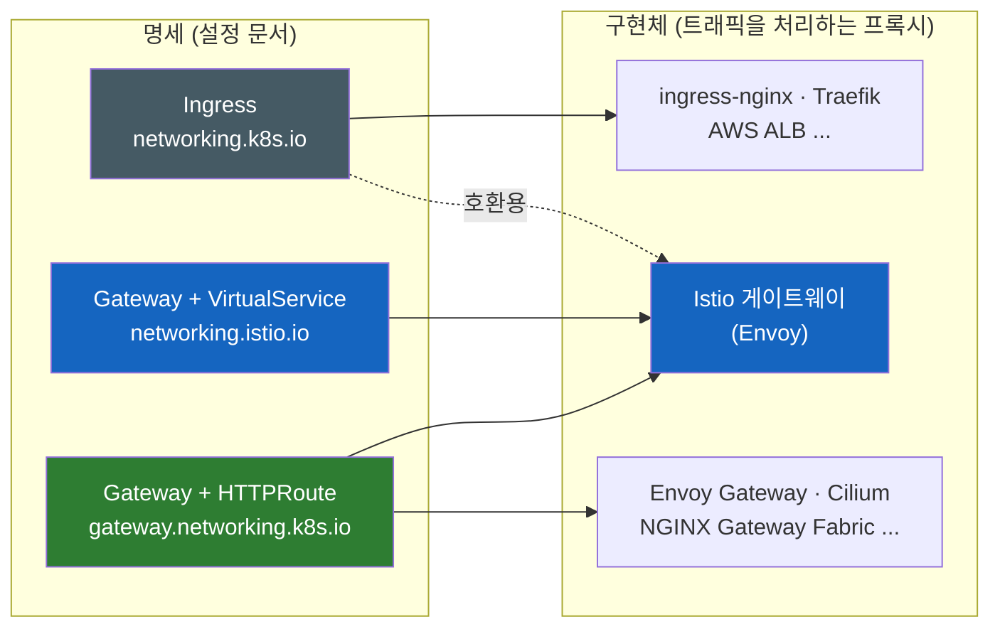
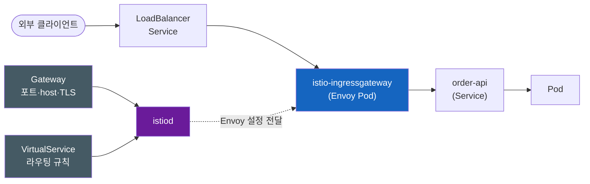

# Istio Ingress Gateway — Ingress가 있는데 왜 VirtualService를 따로 쓸까

> **개발자를 위한 쉬운 쿠버네티스 · 확장 읽기** | [전체 목차](./Kubernetes-Introduction.md#이-시리즈의-읽는-순서)

Ingress는 쿠버네티스 기능일까? Istio도 Ingress를 읽을 줄 아는데 왜 굳이 Gateway와 VirtualService를 따로 만들었고, 이름까지 같은 Gateway API의 Gateway는 또 무엇일까?

## 결론부터 말하면

**Istio도 표준 `Ingress`를 읽을 수는 있지만, 그건 호환용 출입구일 뿐이다.** Istio 자체 API의 명세는 `Gateway`(어느 문으로 받을지)와 `VirtualService`(받은 요청을 어디로 보낼지) 두 장이다. 이 두 장에는 `Ingress` 한 장으로는 표현할 수 없는 가중치 분배, 재시도, 서비스 간 라우팅까지 담긴다. 이 주제가 헷갈리는 근본 원인은 **명세(설정 문서)** 와 **구현체(그 문서를 읽고 트래픽을 실제로 처리하는 프로그램)** 를 한 덩어리로 보기 때문이다.



YAML을 봤을 때 어느 계열인지는 `apiVersion` 한 줄로 가린다.

| 계열 | apiVersion | 문 (포트·host·TLS) | 라우팅 | 대표 구현체 |
|------|------------|--------------------|--------|-------------|
| 구 표준 | `networking.k8s.io/v1` | `Ingress` 한 장에 둘 다 | ← | Traefik, AWS ALB, Istio(호환) 등 |
| Istio 자체 API | `networking.istio.io/v1` | `Gateway` | `VirtualService` | Istio |
| 새 표준 | `gateway.networking.k8s.io/v1` | `Gateway` | `HTTPRoute` 등 | Istio, Envoy Gateway, Cilium 등 |

> 이 노트는 세 개념의 관계를 잡는 **지도** 다. Ingress 자체의 사용법은 [Kubernetes Ingress](Kubernetes-Ingress.md), north-south와 east-west 라우팅은 [Kubernetes Service Mesh](Kubernetes-Service-Mesh.md), Gateway API의 리소스 모델은 [Kubernetes Gateway API](Kubernetes-Gateway-API.md)에서 깊게 다뤘다.

---

## 1. 왜 헷갈릴까 — 공식 문서끼리 말이 다르다

쿠버네티스 공식 문서의 Ingress Controller 목록에는 Istio가 당당히 올라 있다. "Istio Ingress is an Istio based ingress controller." 그런데 정작 Istio 공식 문서의 Ingress 페이지는 첫머리에서 Ingress 대신 자기 리소스를 쓰라고 권한다. "Using a Gateway ... is recommended to make use of the full feature set that Istio offers."

이상하다. Istio는 Ingress Controller인가, 아닌가? 답은 "둘 다 맞다"인데, 그 답을 이해하려면 Ingress가 정확히 무엇인지부터 다시 봐야 한다.

### 1.1 Ingress는 쿠버네티스 기능일까 — 반만 맞다

**Ingress** 는 "외부에서 들어온 HTTP 요청을 host와 path에 따라 어느 Service로 보낼지" 적은 규칙 문서다. 이 리소스 타입은 kube-apiserver에 처음부터 들어 있다. CRD를 따로 설치하지 않아도 어느 클러스터에서나 `kubectl get ingress`가 동작하는 이유다. 여기까지 보면 쿠버네티스 기능이 맞다.

하지만 그 규칙을 읽고 실제로 요청을 받아 넘겨주는 프로그램은 쿠버네티스에 들어 있지 않다. Deployment와 비교하면 차이가 선명하다. Deployment는 kube-controller-manager 안에 컨트롤러가 내장돼 있어서, 리소스를 만들면 곧바로 Pod가 뜬다. Ingress는 그렇지 않다. 공식 문서는 이렇게 못 박는다. "You must have an Ingress controller to satisfy an Ingress. Only creating an Ingress resource has no effect." 규칙을 읽어 실행하는 이 프로그램을 **Ingress Controller** 라고 부르고, 클러스터 관리자가 따로 골라 설치해야 한다. 여러 컨트롤러 중 무엇이 처리할지 고르는 `IngressClass`는 [Kubernetes Ingress 2.1~2.2절](Kubernetes-Ingress.md#2-ingress의-구조)에서 다뤘다.

### 1.2 Java로 보면 — JDBC 인터페이스와 드라이버

Java 개발자에게는 이 구조가 이미 익숙하다. JDBC가 정확히 같은 모양이다.

| Java | Kubernetes |
|------|------------|
| JDBC 인터페이스(`java.sql.Connection` 등). JDK에 포함 | Ingress API. kube-apiserver에 내장 |
| MySQL Connector/J, PostgreSQL JDBC Driver. 따로 추가 | Traefik, AWS Load Balancer Controller 등. 따로 설치 |
| JDBC URL의 `jdbc:mysql:`로 드라이버 선택 | `ingressClassName`으로 컨트롤러 선택 |
| 드라이버가 없으면 `No suitable driver found` 예외 | 컨트롤러가 없어도 요청은 저장될 수 있지만 실제 경로는 구성되지 않음 |

마지막 줄의 차이는 API 접수와 실제 구현을 구분해야 한다는 뜻이다. Ingress 요청 자체가 admission에서 거절될 수도 있고, 저장 후에는 controller 부재·class 불일치·LB provisioning 실패 등이 실제 경로 구성을 막을 수 있다. ADDRESS 공백은 단서이지 원인 확정이 아니다. status·Events·controller 로그와 실제 요청을 함께 확인한다.

여기까지는 깔끔하다. 그렇다면 Istio는 이 드라이버 목록 중 하나일까?

---

## 2. Istio는 "자체 API도 가진 드라이버"다

### 2.1 Istio도 Ingress를 읽는다 — 하지만 호환용이다

Istio는 표준 Ingress를 처리할 수 있다. `ingressClassName: istio`를 지정하면 Istio 게이트웨이가 그 Ingress를 맡는다. 쿠버네티스 문서가 Istio를 Ingress Controller로 소개하는 근거가 이것이다.

다만 Istio 문서가 밝히는 제약이 있다. path 매칭은 exact와 prefix만 되고 다른 정규식은 지원하지 않으며, TLS Secret은 `istio-ingressgateway`가 배포된 네임스페이스에 있어야 한다. 무엇보다 Ingress 명세 자체에 가중치 분배나 재시도 같은 필드가 없으니, Istio가 가진 기능을 Ingress로는 꺼내 쓸 수가 없다.

Java로 치면 **Hibernate** 와 같은 위치다. Hibernate는 JPA라는 표준을 구현하므로 `EntityManager`로 쓸 수 있다. 그러면서도 표준에 없는 기능을 담은 자체 API를 따로 갖고 있다. Istio도 Ingress라는 표준을 읽을 수 있지만, 실제로는 더 풍부한 자체 API를 주로 쓴다. 그 자체 API가 `Gateway`와 `VirtualService`다.

### 2.2 Ingress 한 장을 두 장으로 나눈다

여기서 흔한 오해 하나를 짚고 가자. Gateway와 VirtualService는 Istio 게이트웨이에 붙은 "추가 기능 두 개"가 아니다. **Ingress 대신 쓰는 설정 문서 두 장** 이다. Ingress 한 장에 섞여 있던 내용을 역할별로 나눈 것이다.

| Istio 리소스 | 담는 내용 | 계층 | Ingress에서 대응하는 부분 |
|--------------|-----------|------|---------------------------|
| `Gateway` | 열어 둘 포트, 프로토콜, host, TLS 인증서 | L4~L6 | `spec.tls`, host |
| `VirtualService` | 받은 요청을 어느 Service로 보낼지, 가중치·재시도·타임아웃 | HTTP 라우팅은 L7 (`tcp`·`tls` 라우팅도 지원) | `spec.rules` |

Istio 문서는 Gateway가 포트와 프로토콜을 설정하지만 "does not include any traffic routing configuration"이라고 명시한다. 라우팅은 VirtualService가 Gateway에 붙어서(bound) 맡는다.

왜 굳이 나눴을까? Istio 블로그는 Ingress의 문제를 이렇게 설명한다. Ingress는 클라이언트 쪽 L4~L6 속성(포트, TLS)과 서비스 쪽 L7 라우팅을 한 리소스에 담는데, 큰 애플리케이션에서는 이 둘을 **서로 다른 팀이 서로 다른 네임스페이스에서** 관리해야 한다는 것이다. 인증서와 포트는 플랫폼 팀이, "`/api`는 어디로"는 각 서비스 팀이 정하는 게 자연스럽다.

그렇다면 이 문서들은 누가 읽을까? Istio의 컨트롤 플레인인 **istiod** 가 Gateway와 VirtualService를 감시하다가 Envoy가 이해하는 설정으로 바꿔 게이트웨이 Pod에 내려보낸다. 실제 트래픽을 받는 것은 `istio-ingressgateway`라는 이름으로 떠 있는 Envoy 프록시다.



연결 고리는 두 개다. Gateway의 `selector`(보통 `istio: ingressgateway`)가 어느 Envoy Pod에 적용할지 정하고, VirtualService의 `gateways` 필드가 어느 Gateway에 붙을지 정한다.

### 2.3 VirtualService는 문 앞 전용이 아니다

Ingress와 VirtualService의 가장 큰 차이는 적용 범위다. Ingress는 클러스터 밖에서 안으로 들어오는 트래픽(north-south)만 다룬다. VirtualService는 `gateways`에 Gateway 이름을 적으면 그 게이트웨이에서, 예약어 `mesh`를 적으면 메시 안의 모든 사이드카에서, 즉 서비스끼리 오가는 트래픽(east-west)에서 동작한다. 같은 문법으로 내부 서비스의 카나리 배포까지 표현할 수 있다는 뜻이다. 이 차이의 배경은 [Kubernetes Service Mesh 2절](Kubernetes-Service-Mesh.md#2-north-south와-east-west--ingress로는-왜-부족한가)에 정리했다.

여기에 함정이 하나 숨어 있다. **`gateways` 필드를 생략하면 기본값은 `mesh`다.** 외부 노출용으로 VirtualService를 썼는데 `gateways`를 빠뜨리면, 규칙은 메시 내부에만 적용되고 게이트웨이로 들어온 요청은 매칭되는 라우트를 찾지 못한다.

---

## 3. 같은 이름의 Gateway가 하나 더 있다 — Gateway API

### 3.1 각자 확장하다가 새 표준으로 모였다

Istio만 자체 API를 만든 게 아니다. Ingress 명세가 host, path, TLS 정도만 담다 보니, 구현체마다 부족한 기능을 제각각 채웠다. ingress-nginx는 annotation으로, Traefik은 `IngressRoute`라는 자체 CRD로, Istio는 Gateway와 VirtualService로. 결과적으로 구현체를 바꾸면 설정을 전부 다시 써야 했다. DB 벤더마다 SQL 방언이 달라서 DB를 바꾸면 쿼리를 고쳐야 하는 상황과 같다.

쿠버네티스 커뮤니티의 답은 새 표준 **Gateway API** 였다. 구현체들이 각자 하던 기능을 표준 필드로 흡수했다는 점에서, Hibernate 같은 구현체들의 경험을 JPA라는 표준으로 정리한 역사와 닮았다. 지금 쿠버네티스 문서는 "The Kubernetes project recommends using Gateway instead of Ingress. The Ingress API has been frozen."이라고 적는다. Ingress가 제거될 계획은 없지만 더 이상 기능이 추가되지 않는다. 가장 널리 쓰이던 구현체인 커뮤니티 ingress-nginx는 2026년 3월에 은퇴했다(배경은 [Kubernetes Ingress 8절](Kubernetes-Ingress.md#8-2026년-현재--ingress-nginx-은퇴와-gateway-api)).

Gateway API도 "문"과 "라우팅"을 나눈다. 문은 `Gateway`, 라우팅은 `HTTPRoute`·`GRPCRoute` 같은 프로토콜별 Route다. L4~L6과 L7을 분리한다는 같은 결론에 도달한 셈이다. 그리고 바로 여기서 이름이 겹친다. Istio 문서도 이 점을 인정한다. "The main resource shares the same name, Gateway, and the resources serve similar goals."

### 3.2 두 Gateway 구분하기

| 구분 | Istio Gateway | Gateway API Gateway |
|------|---------------|---------------------|
| apiVersion | `networking.istio.io/v1` | `gateway.networking.k8s.io/v1` |
| 정의한 곳 | Istio 프로젝트 | Kubernetes SIG Network |
| 짝이 되는 라우팅 리소스 | `VirtualService` (모든 프로토콜을 한 리소스에) | `HTTPRoute`, `GRPCRoute` 등 (프로토콜별 리소스) |
| 프록시와의 관계 (Istio 구현 기준) | 이미 배포된 게이트웨이를 `selector`로 골라 **설정만** 한다 | 기본(자동 배포) 모드에서는 프록시 Deployment와 Service까지 **새로 배포** 한다 |
| 구현체 지정 | 없음 (Istio 전용) | `gatewayClassName: istio` |
| kubectl 짧은 이름 | `gw` | `gtw` |
| CRD 설치 | Istio 설치 시 함께 | 대부분의 클러스터에 기본 미설치, 별도 설치 |

"설정만 한다"와 "새로 배포한다"의 차이는 실무에서 크다. Istio Gateway는 `istio-ingressgateway` 하나를 여러 Gateway가 공유하는 구조가 흔하다. 반면 Istio의 Gateway API 구현은 기본적으로 Gateway 리소스 하나마다 프록시를 하나씩, 대개 외부 IP도 하나씩 띄운다. 이미 떠 있는 Deployment와 Service에 연결하는 수동 배포 모드도 있지만 기본값은 아니다. 프록시를 자동으로 띄울지는 Gateway API 명세가 아니라 구현체가 정하는 부분이라는 점도 기억해 두자.

### 3.3 Istio가 가는 방향

Istio 문서는 "Istio supports the Kubernetes Gateway API and intends to make it the default API for traffic management in the future."라고 밝힌다. Hibernate 비유로 돌아가면, Hibernate를 쓰면서도 자체 API 대신 JPA 표준 API로 코딩하는 쪽으로 무게가 옮겨 가는 것과 같다. Istio 위에서 HTTPRoute를 쓰면 표준 부분을 재사용하기 유리하다. 다만 구현체별 지원 기능·conformance·정책 확장이 다르므로 전환 시 동일 동작을 확인해야 한다. 메시 내부(east-west)까지 Gateway API로 다루는 GAMMA와 ambient mode의 waypoint는 [Kubernetes Service Mesh 6절](Kubernetes-Service-Mesh.md#6-gateway-api와-gamma--표준으로의-수렴)에서 다뤘다.

---

## 4. 실제 사례 — 같은 라우팅, 세 가지 문법

### 4.1 `shop.example.com/api`를 `order-api:80`으로 보내기

아래 세 YAML은 `bookstore` namespace의 가상 주문 앱 Service `order-api:80`으로 보내는 같은 라우팅을 표현한다. 앱 컨테이너 port는 8080이며, 여기의 80은 Service port다. Service와 준비된 endpoint, 각 CRD·controller·gateway 설치는 별도 전제다. 세 계열을 비교하는 설명용 manifest이므로 함께 적용하는 설치 절차가 아니다. 차이는 첫 줄의 `apiVersion`, 문서를 몇 장으로 나누느냐, 그리고 prefix를 해석하는 방식이다.

**구 표준 Ingress** — 한 장에 모두 담는다.

```yaml
apiVersion: networking.k8s.io/v1
kind: Ingress
metadata:
  name: shop
  namespace: bookstore
spec:
  ingressClassName: istio          # 어느 구현체가 처리할지 (Istio도 가능)
  rules:
  - host: shop.example.com
    http:
      paths:
      - path: /api
        pathType: Prefix
        backend:
          service:
            name: order-api
            port:
              number: 80
```

**Istio 자체 API** — 문(Gateway)과 라우팅(VirtualService)을 나눈다.

```yaml
apiVersion: networking.istio.io/v1
kind: Gateway                       # 문: 어느 포트·host로 받을지
metadata:
  name: shop-gw
  namespace: bookstore
spec:
  selector:
    istio: ingressgateway           # 이미 떠 있는 Envoy Pod를 라벨로 지정
  servers:
  - port:
      number: 80
      name: http
      protocol: HTTP
    hosts:
    - shop.example.com
---
apiVersion: networking.istio.io/v1
kind: VirtualService                # 라우팅: 받은 요청을 어디로 보낼지
metadata:
  name: shop
  namespace: bookstore
spec:
  hosts:
  - shop.example.com
  gateways:
  - shop-gw                         # 빠뜨리면 기본값 mesh → 게이트웨이 요청에 적용 안 됨
  http:
  - match:                          # match 아래 항목들은 OR 조건
    - uri:
        exact: /api
    - uri:
        prefix: /api/               # prefix: /api 하나만 쓰면 /apix까지 매칭된다
    route:
    - destination:
        host: order-api
        port:
          number: 80
```

**새 표준 Gateway API** — 역시 둘로 나누지만, Gateway가 프록시까지 띄운다.

```yaml
apiVersion: gateway.networking.k8s.io/v1
kind: Gateway                       # 이름은 같지만 Istio Gateway와 다른 리소스
metadata:
  name: shop-gw
  namespace: bookstore
spec:
  gatewayClassName: istio           # 구현체 선택 → (기본 자동 배포 모드) Istio가 Envoy Deployment를 새로 띄운다
  listeners:
  - name: http
    port: 80
    protocol: HTTP
    hostname: shop.example.com
---
apiVersion: gateway.networking.k8s.io/v1
kind: HTTPRoute
metadata:
  name: shop
  namespace: bookstore
spec:
  parentRefs:
  - name: shop-gw                   # 어느 Gateway에 붙을지
  hostnames:
  - shop.example.com
  rules:
  - matches:
    - path:
        type: PathPrefix
        value: /api
    backendRefs:
    - name: order-api
      port: 80
```

Istio YAML에서 `match`를 두 줄로 쓴 이유가 이 노트에서 가장 놓치기 쉬운 함정이다. Ingress의 `Prefix`와 Gateway API의 `PathPrefix`는 경로를 `/`로 나눈 **요소 단위** 로 비교한다. 그래서 `/api`는 `/api`와 `/api/users`를 잡지만 `/apix`는 잡지 않는다. 반면 VirtualService의 `uri.prefix`는 **단순 문자열 접두사** 라서 `prefix: /api`는 `/apix`까지 잡는다. 같은 범위를 만들려면 `exact: /api`와 `prefix: /api/`를 OR로 묶어야 한다. Ingress에서 VirtualService로 옮길 때 path를 그대로 복사하면 의도하지 않은 경로가 같은 Service로 흘러갈 수 있다.

### 4.2 내 클러스터는 어느 계열을 쓰고 있을까

처음 보는 클러스터라면 세 계열을 모두 조회해 보면 된다. 짧은 이름을 쓰면 두 Gateway를 헷갈리지 않는다.

```bash
# 구 표준: 어떤 Ingress Controller가 있고, Ingress가 몇 개인가
kubectl get ingressclass
kubectl get ingress -A

# Istio 자체 API (gw = Istio Gateway, vs = VirtualService)
kubectl get gw,vs -A

# 새 표준 Gateway API (gtw = Gateway API Gateway)
# CRD가 없으면 "the server doesn't have a resource type" 에러 = Gateway API 미설치
kubectl get gatewayclass
kubectl get gtw,httproute -A
```

두 CRD가 모두 설치된 클러스터에서 `kubectl get gateway`라고만 치면 어느 쪽을 조회하는지 모호해진다. 짧은 이름(`gw`, `gtw`)이나 전체 이름(`gateways.networking.istio.io`, `gateways.gateway.networking.k8s.io`)으로 명시하는 습관을 들이자.

---

## 5. 정리

### 핵심 포인트

1. **명세와 구현체를 나눠서 보라**
   - Ingress, Istio의 Gateway·VirtualService, Gateway API는 모두 설정 문서다. ingress-nginx나 Envoy는 그 문서를 읽고 트래픽을 처리하는 프로그램이다.
   - Ingress API는 kube-apiserver에 내장돼 있지만 구현체는 따로 설치해야 한다. API 저장과 트래픽 처리 성공은 별개다. controller·class·status·Events를 확인한다.

2. **Istio는 Ingress를 읽을 줄 알지만, 주로 자체 API를 쓴다**
   - `ingressClassName: istio`로 호환은 되지만, 풍부한 자체 API Gateway + VirtualService와 표준 Gateway API 두 경로를 지원한다. 현재 공식 문서는 향후 기본 API로 Gateway API를 지향한다.

3. **Istio는 Ingress 한 장을 두 장으로 나눈다**
   - Gateway는 포트·host·TLS(L4~L6), VirtualService는 라우팅을 맡는다(HTTP라면 L7이고, `tcp`·`tls` 라우팅도 가능). 팀별로 나눠 관리하기 위해서다.
   - VirtualService는 `gateways`에 `mesh`를 지정하면 서비스 간 트래픽에도 쓴다. 생략 시 기본값이 `mesh`라는 점을 조심하자.

4. **Gateway는 두 개다**
   - `networking.istio.io`(Istio 전용, 기존 프록시를 설정)와 `gateway.networking.k8s.io`(새 표준, Istio 기본 모드에서는 프록시까지 배포)는 이름만 같은 다른 리소스다. `apiVersion`이나 `gw`/`gtw`로 구분한다.
   - 옮길 때는 prefix 의미도 확인한다. VirtualService의 `uri.prefix`는 문자열 접두사라서 `/api`가 `/apix`까지 잡는다.

5. **흐름은 Gateway API로 모이고 있다**
   - Ingress는 동결됐고, ingress-nginx는 은퇴했으며, Istio도 Gateway API를 기본 트래픽 API로 삼을 계획이다. 새로 구성한다면 Gateway API부터 검토한다.

> **함께 보면 좋은 노트**
> - [Kubernetes Ingress](Kubernetes-Ingress.md) — Ingress와 IngressClass, 8절 ingress-nginx 은퇴
> - [Kubernetes Gateway API](Kubernetes-Gateway-API.md) — GatewayClass·Gateway·Route 리소스 모델과 붙는 규칙
> - [Kubernetes Service Mesh](Kubernetes-Service-Mesh.md) — north-south와 east-west, VirtualService 예시, GAMMA
> - [쿠버네티스 Ingress와 Egress는 왜 대칭이 아닐까](Kubernetes-Ingress-vs-Egress.md) — Ingress라는 단어의 두 가지 쓰임

---

## 생각해 볼 질문

1. **두 Gateway의 kind가 같은데 왜 서로 대신 쓸 수 없을까?** API group과 구현 계약이 다르다. Istio Gateway는 기존 프록시를 selector로 설정하고, Istio의 Gateway API 기본 모드는 프록시 배포까지 관리한다.
2. **Ingress의 `/api` Prefix를 VirtualService로 그대로 옮기면 왜 `/apix`도 매칭될까?** 전자는 경로 요소, 후자는 문자열 접두사를 비교한다. `exact: /api`와 `prefix: /api/`를 OR로 묶어 같은 범위를 만든다.

외부 진입 규칙과 서비스 간 통신을 함께 연결하려면 [Service Mesh](Kubernetes-Service-Mesh.md), 표준 리소스의 연결과 상태 판정은 [Gateway API](Kubernetes-Gateway-API.md)를 이어 읽는다.

## 출처

- [Kubernetes 공식 — Ingress](https://kubernetes.io/docs/concepts/services-networking/ingress/) — "The Ingress API has been frozen", Gateway 권장, "Only creating an Ingress resource has no effect"
- [Kubernetes 공식 — Ingress Controllers](https://kubernetes.io/docs/concepts/services-networking/ingress-controllers/) — 컨트롤러가 있어야 Ingress가 동작, Istio Ingress를 컨트롤러 목록에 포함
- [Istio 공식 — Ingress Gateways](https://istio.io/latest/docs/tasks/traffic-management/ingress/ingress-control/) — Gateway는 라우팅을 포함하지 않음, `selector: istio: ingressgateway`, Gateway API를 기본 트래픽 API로 삼을 계획
- [Istio 공식 — Kubernetes Ingress](https://istio.io/latest/docs/tasks/traffic-management/ingress/kubernetes-ingress/) — `ingressClassName: istio`, path 매칭·TLS Secret 제약, Gateway 사용 권장
- [Istio 공식 — Kubernetes Gateway API](https://istio.io/latest/docs/tasks/traffic-management/ingress/gateway-api/) — Istio API와의 차이(설정 vs 설정+배포, 프로토콜별 Route), "shares the same name, Gateway", CRD 기본 미설치, 자동·수동 배포 모드(Deployment methods)
- [Istio 공식 — Gateway 레퍼런스](https://istio.io/latest/docs/reference/config/networking/gateway/) — 메시 경계의 로드밸런서, 포트·프로토콜·SNI(L4~L6), VirtualService 바인딩
- [Istio 공식 — VirtualService 레퍼런스](https://istio.io/latest/docs/reference/config/networking/virtual-service/) — `gateways` 필드, 예약어 `mesh`, 생략 시 기본값 `mesh`, [HTTPMatchRequest](https://istio.io/latest/docs/reference/config/networking/virtual-service/#HTTPMatchRequest)의 `uri` prefix 매칭
- [Kubernetes 공식 — Ingress Path types](https://kubernetes.io/docs/concepts/services-networking/ingress/#path-types) — `Prefix`는 `/`로 나눈 경로 요소 단위 매칭
- [Gateway API — PathMatchType](https://gateway-api.sigs.k8s.io/reference/api-spec/1.5/spec/#pathmatchtype) — `PathPrefix`도 경로 요소 단위 매칭
- [Istio Blog — Getting started with the Kubernetes Gateway API (2022)](https://istio.io/latest/blog/2022/getting-started-gtwapi/) — Ingress가 L4~L6과 L7을 한 리소스에 담는 문제
- [Gateway API CRD v1.6.0 — gateways](https://github.com/kubernetes-sigs/gateway-api/blob/v1.6.0/config/crd/standard/gateway.networking.k8s.io_gateways.yaml) — 짧은 이름 `gtw`
- [Istio CRD — crd-all.gen.yaml](https://github.com/istio/istio/blob/master/manifests/charts/base/files/crd-all.gen.yaml) — 짧은 이름 `gw`(Gateway), `vs`(VirtualService)
- [Kubernetes Blog — Ingress NGINX Retirement (2025-11-11)](https://kubernetes.io/blog/2025/11/11/ingress-nginx-retirement/) — ingress-nginx 은퇴 발표
