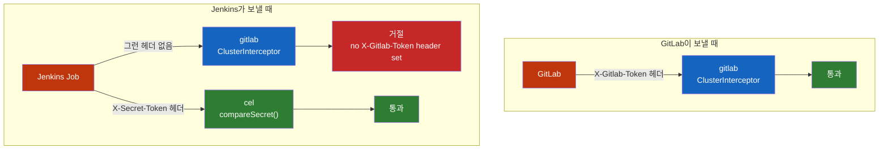
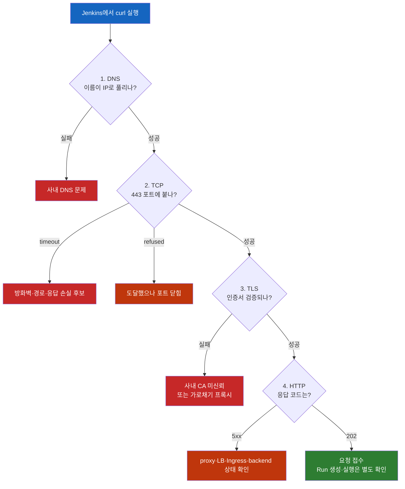
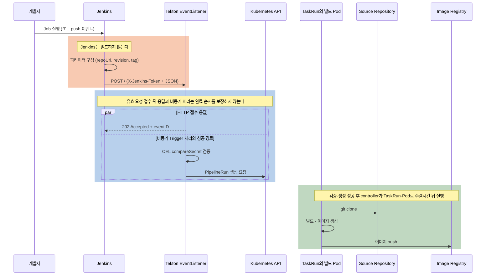

# Jenkins Job에서 Tekton EventListener로 webhook을 쏠 수 있을까?

> **개발자를 위한 쉬운 쿠버네티스 · 확장 읽기** | [전체 목차](./Kubernetes-Introduction.md#이-시리즈의-읽는-순서)

Tekton EventListener가 GitLab push를 받는 구성을 이해했다. 이번에는 회사의 Jenkins Job에서 빌드를 요청하거나, 이미 끝난 빌드 다음의 작업을 시작하고 싶다. Jenkins가 webhook을 "받는" 건 익숙한데, **보내는** 것도 될까?

## 결론부터 말하면

**Jenkins Job은 HTTP 클라이언트로 EventListener에 요청을 보낼 수 있다.** webhook은 GitLab이나 GitHub만 쓸 수 있는 특별한 프로토콜이 아니라, **그냥 JSON을 담은 HTTP POST** 다. `curl`을 실행할 수 있는 모든 것이 webhook을 보낼 수 있고, Jenkins Job에 `curl`을 실행할 Agent와 executor가 배정되면 같은 요청을 보낼 수 있다.

**하지만 진짜 문제는 그다음에 있다.** Jenkins가 보낸 POST에는 `X-Gitlab-Token`도 `X-Hub-Signature-256`도 없다. 그래서 그 헤더·body 계약을 요구하는 interceptor에 그대로 연결하면 검증이 맞지 않는다. 이걸 모르고 기존 Trigger에 Jenkins만 붙이면 요청이 조용히 거절된다. 이 글은 **CEL 인터셉터의 `compareSecret`** 으로 Jenkins 전용 공유 토큰을 검사하는 설계 예시를 사용한다.



Tekton Triggers의 구성요소(EventListener·Trigger·TriggerBinding·TriggerTemplate·Interceptor)를 아직 모른다면 [Tekton Triggers는 어떻게 git push를 PipelineRun으로 바꿀까](Tekton-Triggers는-어떻게-git-push를-PipelineRun으로-바꿀까.md)를 먼저 읽는 게 좋다. 이 글은 그 위에서 "그럼 GitLab 말고 다른 시스템이 보내면?"을 다룬다.

## 1. 먼저 방향부터 정리하자 — 받는 Jenkins와 보내는 Jenkins

Jenkins와 webhook을 이야기할 때 대화가 자꾸 엇나가는 이유가 있다. **Jenkins는 webhook의 수신자도 되고 발신자도 되는데, 사람들이 이 둘을 섞어서 말하기 때문이다.** 검색해도 대부분 수신자 쪽 이야기만 나온다.

| | **받는 Jenkins** (receiver) | **보내는 Jenkins** (sender) |
|---|---|---|
| 상황 | GitLab이 push하면 Jenkins Job이 돈다 | Jenkins Job이 끝나면 다른 시스템을 깨운다 |
| Jenkins의 역할 | HTTP 서버 | HTTP 클라이언트 |
| 구현 | "Trigger builds remotely" 토큰,<br>Generic Webhook Trigger 플러그인 | `sh 'curl'`, HTTP Request 플러그인 |
| 검색하면 | 자료가 넘친다 | 상대적으로 적다 |

이 글의 주제는 **오른쪽 열** 이다. Jenkins가 Tekton EventListener라는 남의 서버를 두드리는 이야기. 왼쪽 열은 8절에서 대비용으로 짧게 다룬다.

## 2. webhook의 실체 — 특별한 게 아무것도 없다

"webhook을 보낸다"는 말이 거창하게 들리지만, GitLab이 실제로 하는 일을 `curl`로 옮겨 적으면 이게 전부다.

```bash
curl -X POST https://webhook.example.com \
  -H 'Content-Type: application/json' \
  -H 'X-Gitlab-Event: Push Hook' \
  -H 'X-Gitlab-Token: 8f2c1a9e4b7d3f6a0c5e8b1d4f7a2c9e6b3d0f5a' \
  -d '{"ref": "refs/heads/main", "checkout_sha": "3ac79d5..."}'
```

**URL 하나, 헤더 몇 개, JSON body 하나.** 이게 webhook의 전부다. 별도의 핸드셰이크도, 등록 절차도, 전용 포트도 없다. 서버 입장에서는 그냥 평범한 HTTP 요청 하나가 들어온 것이다.

이 사실을 인정하고 나면 질문의 답이 자명해진다. **Jenkins Job은 셸을 실행할 수 있다. 셸에서는 `curl`을 쓸 수 있다. 따라서 Jenkins는 webhook을 보낼 수 있다.** GitLab이 하는 일과 기술적으로 완전히 동일한 일을 한다.

같은 논리로 webhook을 쏠 수 있는 것들: GitHub Actions, GitLab CI, ArgoCD 알림, Prometheus Alertmanager, Grafana, Slack 워크플로, cron, 심지어 개발자의 노트북 터미널. **HTTP POST를 할 수 있으면 전부 발신자가 될 수 있다.**

## 3. Jenkins에서 POST를 쏘는 세 가지 방법

### 3.1 `sh` + `curl` — 가장 단순하고 확실하다

```groovy
pipeline {
    agent any
    stages {
        stage('Trigger Tekton Build') {
            steps {
                sh """
                    curl -X POST https://webhook.example.com \
                      -H 'Content-Type: application/json' \
                      -d '{"repoUrl": "https://gitlab.example.com/team/my-app.git",
                           "revision": "main",
                           "imageTag": "b${env.BUILD_NUMBER}"}'
                """
            }
        }
    }
}
```

의존성이 없고(에이전트에 `curl`만 있으면 된다) 로컬에서 그대로 테스트할 수 있다는 게 장점이다. 단점은 응답 처리와 에러 핸들링을 직접 짜야 한다는 것 — 기본적으로 `curl`은 HTTP 500을 받아도 종료 코드 0을 반환하므로, 실패를 감지하려면 `--fail`이나 `-w '%{http_code}'`를 붙여야 한다.

**그리고 위 예제에는 나중에 고칠 보안 문제가 하나 숨어 있다.** 5절에서 시크릿을 붙일 때 다시 온다.

### 3.2 `httpRequest` — HTTP Request 플러그인

**Manage Jenkins → Plugins** 에서 `HTTP Request Plugin`을 설치하면 `httpRequest` 스텝이 생긴다.

```groovy
stage('Trigger Tekton Deploy') {
    steps {
        script {
            def payload = """
                {
                  "repoUrl": "https://gitlab.example.com/team/my-app.git",
                  "revision": "${params.REVISION}",
                  "imageName": "registry.example.com/my-app",
                  "imageTag": "b${env.BUILD_NUMBER}"
                }
            """
            def response = httpRequest(
                url: 'https://webhook.example.com',
                httpMode: 'POST',
                contentType: 'APPLICATION_JSON',
                acceptType: 'APPLICATION_JSON',
                requestBody: payload,
                validResponseCodes: '200:299',   // 범위 밖이면 빌드 실패
                timeout: 30
            )
            echo "HTTP ${response.status}: ${response.content}"
        }
    }
}
```

`curl`보다 나은 점이 명확하다. `validResponseCodes`로 **응답 코드 검증이 선언적** 이고, `response.status`·`response.content`·`response.headers`로 응답을 구조적으로 다루며, Jenkins 자격증명(Credentials)을 `authentication:`으로 바로 연결할 수 있다. `timeout`도 옵션 하나다.

주의할 점 하나. 플러그인 README에 명시된 대로 **이 스텝은 실행 시 모든 파라미터를 빌드 로그에 남긴다.** 그래서 시크릿을 헤더에 담을 때는 반드시 마스킹해야 한다(5절).

### 3.3 `post` 블록 — 빌드 결과에 따라 다르게 쏘기

빌드가 끝난 뒤 결과에 따라 다른 곳에 알리고 싶다면 `post` 블록이 자연스럽다.

```groovy
pipeline {
    agent any
    stages {
        stage('Build') { steps { sh 'mvn package' } }
    }
    post {
        success {
            // 성공했을 때만 Tekton 배포 파이프라인 트리거
            sh 'curl -sf -X POST https://webhook.example.com -d @payload.json'
        }
        failure {
            // 실패는 Slack으로
            sh 'curl -sf -X POST $SLACK_WEBHOOK -d "{\\"text\\":\\"빌드 실패\\"}"'
        }
        always {
            echo "결과: ${currentBuild.currentResult}"
        }
    }
}
```

### 셋 중 무엇을 쓸까

| 상황 | 선택 |
|------|------|
| 빠르게 확인, 에이전트에 플러그인 못 깜 | `sh` + `curl` |
| 응답 코드 검증·자격증명 연동이 필요 | `httpRequest` |
| 빌드 성공/실패에 따라 분기 | `post` 블록 (안에서 둘 중 하나 사용) |

실무 기본값은 `httpRequest`다. 응답 검증이 선언적이라는 게 생각보다 크다.

## 4. 그 전에 확인할 것: 길이 뚫려 있는가?

`curl` 한 줄이면 된다고 했지만, **사내망에서는 그 한 줄이 나가는 것부터가 일이다.** 특히 금융권처럼 아웃바운드가 기본 차단인 환경에서는 "코드는 맞는데 요청이 안 나간다"가 첫 번째 벽이다.

여기서 중요한 건 **"뚫렸나 안 뚫렸나"가 아니라 "어느 층에서 막혔나"** 를 구분하는 것이다. 층마다 고쳐야 할 사람이 다르기 때문이다.



### 4.1 증상별 원인과 담당

증상은 원인을 확정하지 않으며 다음 증거를 고르는 단서다. proxy·LB·Ingress 같은 중간 주체가 응답했을 수도 있으므로 요청 위치·시각·대상·응답 header를 함께 남긴다.

| 증상 | 의미 | 조치 주체 |
|------|------|----------|
| `Could not resolve host` | 이름이 IP로 안 풀림 | 사내 DNS |
| `Connection timed out` | 방화벽 DROP, routing·return path·proxy 지연 등 후보 | 방화벽 정책 |
| `Connection refused` | 도달은 했으나 포트가 안 열려 있음 | Ingress·Service 설정 (또는 방화벽 REJECT) |
| `SSL certificate problem` | 사내 CA를 신뢰하지 않거나 TLS 가로채기 프록시 존재 | 인증서 배포 |
| `HTTP 502` / `503` | 중간 proxy·LB·Ingress 또는 backend 실패 가능 | Tekton 구성 담당 |
| `HTTP 401` / `403` | 앞단 인증·인가·WAF·proxy 등 응답 주체 확인. 이 예제의 Tekton interceptor 토큰 불일치는 202 응답과 별도로 처리됨 | EventListener 앞단(Ingress·API Gateway·WAF·proxy) 담당 |
| `HTTP 202` | 요청 접수. interceptor 토큰 불일치·필터 제외·생성 실패도 응답만으로 판정 불가 | 7절의 eventID·로그·Run 확인 |

**`timed out`과 `refused`를 구분하는 게 특히 중요하다.** timeout은 제한 시간 안에 응답이 없었다는 사실이고, refused는 어떤 주체가 연결 거절을 반환했다는 사실이다. 이를 방화벽 또는 앱 상태로 곧바로 확정하지 않는다. 이 둘을 뭉뚱그려 "안 됩니다"라고 전달하면 며칠이 날아간다.

### 4.2 점검 스크립트

**일회용 점검 전용 Jenkins Job을 하나 만들어서** 아래를 실행하는 것을 권한다. 실제 연동 파이프라인을 건드리기 전에 결과를 확보할 수 있고, 출력을 그대로 회의 자료로 쓸 수 있다.

```bash
#!/bin/sh
# Tekton EventListener 연결 점검 — Jenkins Job의 sh 스텝에 그대로 붙여 실행
TARGET_HOST="webhook.example.com"
TARGET_PORT="443"
TARGET_URL="https://${TARGET_HOST}"

echo "===== 0. 프록시 설정 ====="
# 값에는 자격증명이 있을 수 있으므로 변수명만 출력한다.
python3 - <<'PYCHECK'
import os
print("\n".join(sorted(k for k in os.environ if "proxy" in k.lower())) or "(프록시 환경변수 없음)")
PYCHECK

echo "===== 1. 사용 가능한 도구 ====="
for t in curl jq nc openssl getent python3; do
  command -v "$t" >/dev/null 2>&1 && echo "OK   $t" || echo "없음 $t"
done

echo "===== 2. DNS ====="
getent hosts "$TARGET_HOST" || nslookup "$TARGET_HOST" || echo "DNS 실패"

echo "===== 3. TCP 도달성 ====="
if command -v nc >/dev/null 2>&1; then
  nc -z -w 5 -v "$TARGET_HOST" "$TARGET_PORT" 2>&1
else
  # nc가 없을 때 폴백 (bash 필요)
  timeout 5 bash -c "cat < /dev/null > /dev/tcp/${TARGET_HOST}/${TARGET_PORT}" \
    && echo "TCP 연결 성공" || echo "TCP 연결 실패"
fi

echo "===== 4. TLS 인증서 ====="
echo | openssl s_client -connect "${TARGET_HOST}:${TARGET_PORT}" \
  -servername "$TARGET_HOST" 2>&1 \
  | grep -E 'Verify return code|subject=|issuer=' || echo "TLS 확인 불가"

echo "===== 5. HTTP 단계별 소요 시간 ====="
curl -sS -o /dev/null \
  --connect-timeout 10 --max-time 30 \
  -w 'DNS조회 : %{time_namelookup}s
TCP연결 : %{time_connect}s
TLS완료 : %{time_appconnect}s
전체    : %{time_total}s
HTTP    : %{http_code}
' \
  -X POST "$TARGET_URL" \
  -H 'Content-Type: application/json' \
  -d '{}'
```

**5번의 단계별 타이밍이 가장 실용적인 도구다.** 어느 단계에서 멈췄는지가 한눈에 보인다.

- `time_namelookup`만 찍히고 끝났다 → DNS는 됐는데 TCP에서 막힘
- `time_connect`까지 갔는데 `time_appconnect`가 0 → TLS 실패
- 전부 찍히고 `http_code`가 나옴 → 어떤 HTTP 주체가 응답함; 실제 EventListener 응답인지 추가 확인

`nc`가 없는 이미지가 흔하므로 폴백을 함께 넣었다. `/dev/tcp`는 bash 기능이라 `sh`에서는 `bash -c`로 감싸야 한다. 둘 다 없다면 `python3 -c "import socket;socket.create_connection(('$TARGET_HOST',$TARGET_PORT),5)"` 로도 확인된다.

### 4.3 프록시를 빼먹으면 오진한다

**0번을 맨 앞에 둔 이유가 있다.** 사내 Jenkins에는 `http_proxy`·`https_proxy` 환경변수가 걸려 있는 경우가 많고, `curl`은 이를 **자동으로 따른다.** 그래서 이런 오진이 생긴다.

- 방화벽은 열렸는데 프록시가 막아서 실패 → "방화벽 안 뚫렸다"고 잘못 보고
- 사내 대상인데 프록시를 타서 실패 → `no_proxy`에 넣었어야 하는 경우

```bash
# 프록시를 무시하고 직접 붙여보기 — 프록시가 원인인지 가르는 실험
curl --noproxy '*' -sS -o /dev/null -w '%{http_code}\n' "$TARGET_URL"
```

이 결과가 위의 5번과 다르다면 proxy 사용 경로와 직접 경로가 다르다는 증거다. 어느 경로가 승인된 경로인지 확인한 뒤 proxy·no_proxy·routing·TLS 정책을 좁힌다.

### 4.4 Tekton이 아직 없어도 지금 확인할 수 있다

협의 일정상 네트워크 확인이 먼저 필요한 경우가 많다. **EventListener가 아직 안 떠 있어도 1~4단계(DNS·TCP·TLS)는 그대로 검증된다.** Ingress 호스트까지의 경로가 열려 있는지만 보면 되기 때문이다.

| 확인 항목 | Tekton 준비 전에 가능? |
|-----------|----------------------|
| DNS 해석 | 가능 (DNS 등록만 되어 있으면) |
| TCP 443 도달 | 가능 (Ingress만 떠 있으면) |
| TLS 인증서 | 가능 |
| HTTP 202 응답 | **불가** — Trigger 구성이 있어야 함 |

그래서 순서는 이렇게 잡으면 된다. **네트워크 경로 확인 → 토큰 교환 → Trigger 구성 → 전 구간 검증.** 앞의 두 개는 Tekton 구성과 병렬로 진행할 수 있다.

### 4.5 executor가 있는지부터 확인하려면

3절에서 "최소 실행 주체는 있어야 한다"고 했는데, 그것부터 확인하고 싶다면 30초면 된다. 추측할 필요가 없다.

```groovy
pipeline {
    agent any
    stages {
        stage('환경 확인') {
            steps {
                sh 'echo ok && which curl jq && curl --version | head -1'
            }
        }
    }
}
```

이 Job이 돌면 **executor가 있다는 뜻** 이고, 출력에 `curl` 경로가 찍히면 도구까지 갖춰진 것이다. `jq`는 7절에서 `eventID`를 뽑을 때 쓰이므로 함께 확인해두면 좋다. Job이 큐에 머무르면 적합한 executor가 아직 배정되지 않은 것이다. executor 부재 외에도 busy·offline·label 조건·권한·동시 실행 제한을 확인한다.

## 5. 그런데 여기서 진짜 문제가 시작된다 — 인증

여기까지는 쉬웠다. 이제 Tekton 쪽에 이 Jenkins 요청을 받을 Trigger를 만들어야 하는데, **기존 GitLab용 Trigger에 그냥 붙이면 안 된다.**

기존 Trigger는 이렇게 생겼다.

```yaml
interceptors:
  - ref: { name: "gitlab", kind: ClusterInterceptor }
    params:
      - name: "secretRef"
        value: { secretName: gitlab-webhook-secret, secretKey: token }
```

`gitlab` 인터셉터는 **`X-Gitlab-Token` 헤더를 읽어서 Secret과 문자열 비교** 한다. Jenkins의 `curl`에는 그런 헤더가 없다. 그래서 EventListener 로그에 이게 찍히고 요청은 버려진다.

```
no X-Gitlab-Token header set
```

**정리하면 이렇다.** `github`·`gitlab`·`bitbucket` 인터셉터는 각 플랫폼이 보내는 **고유한 헤더 형식** 에 묶여 있다. Git 호스팅이 아닌 발신자(Jenkins, Alertmanager, 내부 스크립트)에게는 애초에 맞지 않는 도구다.

선택지는 세 가지다.

| 방법 | 어떻게 | 평가 |
|------|--------|------|
| (a) GitLab 흉내내기 | `X-Gitlab-Token`·`X-Gitlab-Event` 헤더를 Jenkins가 직접 붙임 | 동작은 한다. 하지만 프로토콜 계약과 발신자 이름이 어긋나 운영 로그를 해석하기 어려울 수 있다 |
| (b) **CEL `compareSecret`** | 임의의 헤더를 Secret과 상수시간 비교 | **권장.** 발신자가 Jenkins임이 설정에 그대로 드러난다 |
| (c) 별도 verifier·ClusterInterceptor | 서명·timestamp·재전송 정책 등을 검증 | 구현과 운영이 추가되지만 복잡한 검증에 사용 가능. 오래된 inline webhook 형식과 구분 |

### CEL `compareSecret`으로 공유 토큰 검사하기

Tekton의 CEL 인터셉터에는 시크릿 비교 전용 함수가 있다.

```
<string>.compareSecret(<secretKey>, <secretName>) -> bool
```

이 함수는 **Kubernetes Secret에서 값을 읽어 상수시간(constant-time)으로 비교** 한다. 상수시간 비교는 문자열이 몇 글자째부터 틀렸는지를 응답 시간 차이로 추측하는 타이밍 공격을 막는다. `filter` 안에서 단순히 `header.canonical('X-Token') == 'abc'`라고 쓰면 이 보호가 없다.

```yaml
interceptors:
  - name: "Jenkins가 보낸 게 맞는지 확인"
    ref: { name: "cel", kind: ClusterInterceptor }
    params:
      - name: "filter"
        value: >
          header.canonical('X-Jenkins-Token')
            .compareSecret('token', 'jenkins-webhook-secret')
```

`header.canonical()`은 Go의 HTTP 헤더 표준 표기법(`x-jenkins-token` → `X-Jenkins-Token`)으로 정규화해서 읽는다. HTTP 헤더 이름은 대소문자를 구분하지 않는다. TriggerBinding의 `$(header.X)`도 2026-10-23 확인한 upstream 구현은 MIME header key를 정규화하지만, 문서의 대소문자 구분 안내와 차이가 있으므로 설치 버전 소스를 확인하고 예제의 canonical spelling을 유지한다. 인터셉터에서는 `canonical()`으로 읽는 의도를 명확히 한다.

**인자 순서를 반드시 확인하고 넘어가자. 이름이 아니라 키가 먼저다.**

```
header.canonical('X-Jenkins-Token').compareSecret('token', 'jenkins-webhook-secret')
                                                   ↑ key    ↑ Secret 이름
```

대부분의 API가 `(이름, 키)` 순서를 쓰기 때문에 반대로 적기 쉽다. 순서를 바꿔 쓰면 `token`이라는 이름의 Secret에서 `jenkins-webhook-secret`이라는 키를 찾게 되고, 당연히 검증에 실패한다. Tekton 소스(`pkg/interceptors/cel/triggers.go`)의 구현이 근거다.

```go
secretKey, ok := vals[1].(types.String)   // 첫 번째 인자 = 키
secretName, ok := vals[2].(types.String)  // 두 번째 인자 = Secret 이름
secretRef := &triggersv1.SecretRef{
    SecretKey:  string(secretKey),
    SecretName: string(secretName),
}
```

이 책은 **EventListener와 같은 네임스페이스** 의 Secret을 조회하는 2-인자 형태를 사용한다. 2026-10-23 확인한 [CEL 문서](https://tekton.dev/docs/triggers/cel_expressions/)에는 namespace를 받는 3-인자 형태도 있지만, [upstream 구현](https://github.com/tektoncd/triggers/blob/main/pkg/interceptors/cel/triggers.go)의 `makeCompareSecret`은 실제 조회에 EventListener의 `defaultNS`를 사용한다. 문서와 구현이 다르므로 설치 버전 소스를 확인하지 않고 다른 namespace의 Secret 조회를 보장할 수 없다.

## 6. 전체 예제: Jenkins는 방아쇠만, Tekton이 빌드한다

가장 현실적인 시나리오로 조립해보자. **Jenkins에 빌드용 Agent가 없어서, Jenkins는 "이 저장소를 빌드해줘"라고 요청만 보내고 소스 clone·빌드·이미지 push는 전부 Tekton이 한다.** 왜 이런 구조가 나오는지는 [Jenkins가 있는데 왜 Tekton이 빌드할까](Jenkins가-있는데-왜-Tekton이-빌드할까.md)에서 다뤘다.

**여기서 payload의 내용이 결정된다. Jenkins는 이미지를 넘기지 않는다 — 아직 만들지 않았으니까.** 넘기는 것은 **소스의 주소**(저장소 URL + 커밋)와 **만들어야 할 이미지의 이름** 이다. 이 방향을 거꾸로 잡으면 전체 설계가 어긋난다.



그림은 유효 요청의 성공 경로다. `202` 응답은 비동기 interceptor·리소스 생성의 완료를 기다리지 않는다. 따라서 응답이 항상 처리보다 먼저 온다는 보장도 없고, 검증 불일치·필터 제외·생성 실패에도 이미 `202`를 받았을 수 있다. 접수 전 실패와 생성 뒤 실행 결과의 구분은 7절에서 이어서 확인한다.

### 6.1 Tekton 쪽

다음은 Trigger 부분의 설명용 manifest다. CI 인프라 namespace `ci`와 ServiceAccount·RBAC·CEL interceptor가 있어야 한다. `build-and-push-pipeline`은 여기서 구현하지 않으며 `repo-url`·`revision`·`image` params와 `source`·`git-credentials`·`docker-config` workspace를 받아 clone·build·push하는 계약을 별도로 제공해야 한다. 앞 글의 `ci-pipeline` 예시와 바로 호환되는 완전 실습 파일은 아니다. 이미지와 URL은 가상 사례다. 공개 예시 Secret 문자열은 실제 인증에 사용하지 않는다.

```yaml
# 시크릿 — openssl rand -hex 24 로 생성
apiVersion: v1
kind: Secret
metadata:
  name: jenkins-webhook-secret
  namespace: ci
type: Opaque
stringData:
  token: "REPLACE_WITH_A_RANDOM_TOKEN"
---
apiVersion: triggers.tekton.dev/v1beta1
kind: TriggerBinding
metadata:
  name: jenkins-build-binding
  namespace: ci
spec:
  params:
    # 소스의 "주소" — 소스 자체가 아니다
    - name: repo-url
      value: $(body.repoUrl)
    - name: revision
      value: $(body.revision)
    # 만들어야 할 이미지의 "이름" — 이미지 자체가 아니다
    - name: image-name
      value: $(body.imageName)
    - name: image-tag
      value: $(body.imageTag)
    - name: jenkins-build-url
      value: $(body.buildUrl)        # 나중에 추적용
---
apiVersion: triggers.tekton.dev/v1beta1
kind: TriggerTemplate
metadata:
  name: build-template
  namespace: ci
spec:
  params:
    - name: repo-url
    - name: revision
    - name: image-name
    - name: image-tag
    - name: jenkins-build-url
      default: ""
  resourcetemplates:
    - apiVersion: tekton.dev/v1
      kind: PipelineRun
      metadata:
        generateName: build-
        annotations:
          # 어느 Jenkins 빌드에서 왔는지 남겨둔다 — 장애 추적에 큰 도움
          ci.example.com/jenkins-build: $(tt.params.jenkins-build-url)
      spec:
        pipelineRef:
          name: build-and-push-pipeline    # clone → build → push
        params:
          - name: repo-url
            value: $(tt.params.repo-url)
          - name: revision
            value: $(tt.params.revision)
          - name: image
            value: $(tt.params.image-name):$(tt.params.image-tag)
        # Tekton이 소스를 clone하므로 작업 공간이 필요하다
        workspaces:
          - name: source
            volumeClaimTemplate:
              spec:
                accessModes: ["ReadWriteOnce"]
                resources: { requests: { storage: 2Gi } }
          # Git 자격증명과 레지스트리 인증도 Tekton 쪽에 붙는다
          - name: git-credentials
            secret:
              secretName: git-ssh-key
          - name: docker-config
            secret:
              secretName: registry-credentials
---
apiVersion: triggers.tekton.dev/v1beta1
kind: Trigger
metadata:
  name: build-from-jenkins
  namespace: ci
spec:
  interceptors:
    - name: "Jenkins 인증"
      ref: { name: "cel", kind: ClusterInterceptor }
      params:
        - name: "filter"
          value: >
            header.canonical('X-Jenkins-Token')
              .compareSecret('token', 'jenkins-webhook-secret')
    - name: "필수 필드 검증"
      ref: { name: "cel", kind: ClusterInterceptor }
      params:
        - name: "filter"
          value: >
            has(body.repoUrl) && type(body.repoUrl) == string &&
            body.repoUrl == 'https://gitlab.example.com/team/order-api.git' &&
            has(body.revision) && type(body.revision) == string &&
            body.revision.matches('^[0-9a-f]{40}$') &&
            has(body.imageName) && type(body.imageName) == string &&
            body.imageName == 'registry.example.com/book/order-api' &&
            has(body.imageTag) && type(body.imageTag) == string &&
            body.imageTag.matches('^[A-Za-z0-9_][A-Za-z0-9_.-]{0,127}$') &&
            has(body.buildUrl) && type(body.buildUrl) == string &&
            size(body.buildUrl) <= 512 &&
            body.buildUrl.startsWith('https://jenkins.example.com/job/')
  bindings:
    - ref: jenkins-build-binding
  template:
    ref: build-template
---
apiVersion: triggers.tekton.dev/v1beta1
kind: EventListener
metadata:
  name: jenkins-listener
  namespace: ci
spec:
  serviceAccountName: tekton-triggers-sa
  triggers:
    - triggerRef: build-from-jenkins
```

**두 가지를 눈여겨보자.**

첫째, **TriggerTemplate에 `workspaces`와 자격증명 Secret이 붙어 있다.** Jenkins가 빌드했다면 필요 없었을 것들이다. Tekton이 직접 `git clone`하고 이미지를 push하므로, Git 자격증명과 레지스트리 인증 정보가 실행 Task 쪽에서 사용 가능해야 한다. Secret workspace만 선언한다고 git이나 빌더가 그 파일을 자동으로 읽지는 않는다. HTTPS 예제라면 Task가 git credential helper·인증서 신뢰를 설정해야 하고, SSH 키를 쓰려면 SSH URL·known_hosts·키 권한을 맞춰야 한다. `docker-config`는 빌더가 기대하는 `config.json` 경로와 환경변수로 연결해야 한다. 준비물 목록을 만들 때 이 항목들이 Jenkins가 아니라 Kubernetes 쪽에 잡히는 이유다.

둘째, 마지막 인터셉터의 입력 계약 검사다. **발신자가 Git 호스팅이 아니면 payload 형식을 보장해주는 주체가 없다.** GitLab 이벤트 형식을 사용하더라도 검증해야 하고, Jenkins가 보내는 JSON은 우리가 Jenkinsfile에서 만든 것이라 오타 하나로 형태가 달라진다. 게다가 `repoUrl`을 그대로 clone하는 구조이므로, **검증 없이 두면 토큰을 아는 사람이 임의의 저장소를 클러스터 안에서 빌드시킬 수 있다.** 이 예제는 허용 소스와 출력 repository를 정확한 값으로 제한하고 revision·tag 형식을 검사한다. 접두사만 허용하면 같은 host의 다른 저장소나 임의 경로까지 권한이 확대될 수 있다. 승인된 소스 자체의 빌드 스크립트도 실행 코드이므로, 읽는 Secret·push 권한과 Node 격리는 별도 검토한다.

### 6.2 Jenkins 쪽 — 시크릿을 안전하게 다루기

여기가 이 문서에서 가장 조심해야 할 부분이다. **잘못 쓰면 토큰이 빌드 로그에 그대로 남는다.**

먼저 Jenkins에 자격증명을 등록한다. **Manage Jenkins → Credentials → System → Global credentials → Add Credentials** 에서 Kind를 `Secret text`로 골라 위 Secret과 같은 값을 넣고, ID를 `tekton-webhook-token`으로 준다.

```groovy
pipeline {
    agent any
    parameters {
        string(name: 'REVISION', defaultValue: '',
               description: '승인된 40자리 commit SHA; 예제 필터는 branch를 받지 않음')
    }
    environment {
        REPO_URL   = 'https://gitlab.example.com/team/order-api.git'
        IMAGE_NAME = 'registry.example.com/book/order-api'
        TEKTON_URL = 'https://webhook.example.com'
    }
    stages {
        // 빌드 stage가 없다. Jenkins는 빌드하지 않는다.
        stage('Trigger Tekton Build') {
            steps {
                withCredentials([string(credentialsId: 'tekton-webhook-token',
                                        variable: 'TEKTON_TOKEN')]) {
                    // JSON은 Groovy가 만들어 파일로 떨군다 — 셸 이스케이프 문제를 원천 차단
                    writeJSON file: 'tekton-payload.json', json: [
                        repoUrl  : env.REPO_URL,             // 소스의 주소
                        revision : params.REVISION,          // 어느 시점을
                        imageName: env.IMAGE_NAME,           // 무슨 이름으로
                        imageTag : "b${env.BUILD_NUMBER}",   // 어떤 태그로
                        buildUrl : env.BUILD_URL             // 추적용
                    ]
                    // 홑따옴표(''')가 핵심이다 — 아래 설명 참조
                    sh '''
                        set +x
                        curl --fail --silent --show-error --connect-timeout 10 --max-time 30 \
                          -X POST "$TEKTON_URL" \
                          -H 'Content-Type: application/json' \
                          -H "X-Jenkins-Token: $TEKTON_TOKEN" \
                          --data @tekton-payload.json
                    '''
                }
            }
        }
    }
}
```

**stage가 하나뿐이라는 게 이 구조의 핵심이다.** `mvn package`도, `docker build`도, `docker push`도 없다. Jenkins가 하는 일은 **파라미터를 조립해 HTTP 요청 한 번 보내는 것** 이 전부이고, 그래서 빌드 도구가 설치된 Agent 없이도 돌아간다.

payload의 다섯 필드는 6.1의 Binding·필터와 대응한다. 타입·필수 필드·허용 저장소·SHA·tag·buildUrl 조건을 통과해야 한다. `REVISION` 기본값을 비워 둔 것은 실제 SHA를 선택하도록 하기 위해서다. buildUrl은 추적 annotation이며 임의 callback 목적지로 사용하지 않는다.

`writeJSON`은 Pipeline Utility Steps 플러그인이 제공한다. **JSON을 문자열로 조립하지 않는 것이 요령이다.** 커밋 메시지나 브랜치 이름에 따옴표가 하나 들어가는 순간 payload가 깨지는데, 그 버그는 재현이 잘 안 돼서 오래 산다. Groovy 맵으로 넘기면 직렬화는 플러그인이 책임진다.

**한 가지 더 알아둘 것.** 위 `sh '''...'''` 블록의 줄 끝 `\`는 셸의 줄 연결 기호처럼 보이지만, 실제로는 **Groovy가 먼저 소비한다.** 삼중 홑따옴표 문자열도 이스케이프 시퀀스는 처리하기 때문이다. 결과적으로 셸에는 한 줄짜리 명령이 도착하고 `curl`은 정상 동작하지만, "셸이 줄을 잇는다"고 이해하면 나중에 헷갈린다. 헷갈리기 싫다면 아예 한 줄로 쓰거나, 아래처럼 셸 배열 없이 단순하게 유지하는 편이 낫다.

**왜 홑따옴표 `'''`인가?** 이게 Jenkins Pipeline에서 시크릿을 다룰 때 가장 흔한 사고 지점이다.

```groovy
// 위험: 쌍따옴표 → Groovy가 먼저 문자열을 조립한다
sh """
    curl -H "X-Jenkins-Token: ${TEKTON_TOKEN}"
"""
```

쌍따옴표를 쓰면 **셸이 실행되기 전에 Groovy가 `${TEKTON_TOKEN}`을 실제 토큰 값으로 치환** 한다. 그 결과 토큰이 박힌 완성된 명령 문자열이 만들어지고, 이건 빌드 로그와 프로세스 목록(`ps`)에 노출될 수 있다. Jenkins도 이 경우 "Warning: A secret was passed to sh using Groovy String interpolation"이라고 경고를 띄운다.

홑따옴표를 쓰면 Groovy는 `$TEKTON_TOKEN`을 그냥 글자로 넘기고, **셸이 자기 환경변수로 확장** 한다. `withCredentials`가 그 환경변수를 마스킹해두므로 로그에는 `****`로 찍힌다. **원칙: 시크릿이 들어가는 `sh`는 항상 홑따옴표.**

다만 이것이 막아주는 것은 **빌드 로그 노출** 까지다. 셸이 확장한 뒤에는 토큰이 `curl` 프로세스의 실행 인자(argv)에 담기므로, 같은 노드에서 `ps`를 볼 수 있는 사람에게는 여전히 보인다. 이 수준까지 막아야 하는 환경이라면 토큰을 명령행 인자로 넘기지 않는 방식(`httpRequest`의 `maskValue`, 또는 `curl --config`로 헤더를 파일에서 읽기)을 검토한다.

`httpRequest`를 쓴다면 `maskValue`로 같은 목적을 달성한다.

```groovy
withCredentials([string(credentialsId: 'tekton-webhook-token', variable: 'TEKTON_TOKEN')]) {
    httpRequest(
        url: env.TEKTON_URL,
        httpMode: 'POST',
        contentType: 'APPLICATION_JSON',
        customHeaders: [[name: 'X-Jenkins-Token',
                         value: env.TEKTON_TOKEN,
                         maskValue: true]],        // 로그에 ****로 표시
        requestBody: writeJSON(returnText: true, json: [
            repoUrl  : env.REPO_URL,
            revision : params.REVISION,
            imageName: env.IMAGE_NAME,
            imageTag : "b${env.BUILD_NUMBER}",
            buildUrl : env.BUILD_URL
        ]),
        validResponseCodes: '200:299',
        timeout: 30
    )
}
```

`writeJSON(returnText: true, ...)`은 Pipeline Utility Steps 플러그인이 제공하며, **문자열 템플릿으로 JSON을 조립할 때 생기는 이스케이프 사고를 없애준다.** 커밋 메시지에 따옴표가 들어 있어서 JSON이 깨지는 종류의 버그를 원천 차단한다.

## 7. 202를 받았다고 배포가 시작된 건 아니다

Jenkins 로그에 `HTTP 202`가 찍혔다. 성공인가? **아니다.**

[Triggers 문서에서 다뤘듯이](Tekton-Triggers는-어떻게-git-push를-PipelineRun으로-바꿀까.md) EventListener의 `202 Accepted`는 "요청을 접수하고 처리할 Trigger를 골랐다"는 뜻이지, PipelineRun이 만들어졌다는 보장이 아니다. 2026-10-23 확인한 upstream `HandleEvent`는 body 읽기·EventListener 조회·Trigger 선택과 병합 단계의 실패에는 500을 반환하지만, Trigger 처리를 비동기로 시작한 뒤에는 interceptor 결과를 기다리지 않고 202를 반환한다. 따라서 이 예제의 `compareSecret` 불일치, 필터 제외, Binding 처리와 리소스 생성 실패는 401/403으로 전달되지 않으며 eventID와 EventListener 로그를 연결해 확인해야 한다. 외부 경로에서 401/403을 받았다면 먼저 앞단 인증·인가·WAF·proxy 등 실제 응답 주체를 확인한다. 이 코드 경로의 확인을 모든 버전·middleware·HTTP 오류 코드 전체의 보장으로 확대하지 않는다.

Jenkins 파이프라인이 "배포 트리거 완료"라고 초록불을 켰는데 실제로는 아무것도 안 돌고 있는 상황 — 이게 이 구조에서 가장 위험한 실패 모드다. 아무도 모른 채로 지나간다.

선택지는 세 가지다.

**(a) Jenkins 에이전트에 클러스터 접근 권한이 있다면 — `eventID`로 확정 확인한다.** 가장 확실한 방법이다.

```groovy
stage('Trigger Tekton Build') {
    steps {
        withCredentials([string(credentialsId: 'tekton-webhook-token',
                                variable: 'TEKTON_TOKEN')]) {
            script {
                writeJSON file: 'tekton-payload.json', json: [
                    repoUrl  : env.REPO_URL,
                    revision : params.REVISION,
                    imageName: env.IMAGE_NAME,
                    imageTag : "b${env.BUILD_NUMBER}",
                    buildUrl : env.BUILD_URL
                ]
                // curl과 JSON 검사의 종료 상태를 따로 확인한다.
                def eventId = sh(returnStdout: true, script: '''
                    set -eu
                    set +x
                    curl --fail --silent --show-error --connect-timeout 10 --max-time 30 \
                      -X POST "$TEKTON_URL" \
                      -H 'Content-Type: application/json' \
                      -H "X-Jenkins-Token: $TEKTON_TOKEN" \
                      --data @tekton-payload.json -o tekton-response.json
                    jq -er '.eventID | select(type == "string" and length > 0)' tekton-response.json
                ''').trim()
                if (!(eventId ==~ /[0-9a-fA-F]{8}-[0-9a-fA-F]{4}-[0-9a-fA-F]{4}-[0-9a-fA-F]{4}-[0-9a-fA-F]{12}/)) {
                    error('유효하지 않은 eventID')
                }
                withEnv(["TEKTON_EVENT_ID=${eventId}"]) {
                    timeout(time: 2, unit: 'MINUTES') {
                        waitUntil {
                            def found = sh(returnStdout: true, script: '''
                                set -eu
                                kubectl get pipelinerun -n ci \
                                  -l "triggers.tekton.dev/triggers-eventid=$TEKTON_EVENT_ID" \
                                  -o json > tekton-runs.json
                                jq -r '.items | map(.metadata.name) | join(" ")' tekton-runs.json
                            ''').trim()
                            if (found) { echo "생성 확인: ${found}" }
                            return found != ''
                        }
                    }
                }
            }
        }
    }
}
```

`triggers.tekton.dev/triggers-eventid`는 EventListener가 자기가 만든 모든 리소스에 자동으로 붙이는 label이다. 설치 버전의 label key와 처리 지연을 확인한 뒤 유한 timeout 내에 대응 Run을 찾는다. 이 예제는 생성만 확인하며, 실행 성공을 기다리려면 찾은 Run의 최종 condition과 필요한 image digest까지 별도로 확인해야 한다. kubectl 조회 자체가 실패하면 빈 결과로 숨기지 않고 Job을 실패시킨다.

다만 이 방법은 **Jenkins에 클러스터 조회 권한을 주는 대가** 를 치른다. 그렇다면 딱 필요한 만큼만 준다 — 해당 네임스페이스의 `pipelineruns`에 대한 `get`/`list`/`watch`가 전부다.

```yaml
apiVersion: rbac.authorization.k8s.io/v1
kind: Role
metadata:
  name: jenkins-pipelinerun-reader
  namespace: ci
rules:
  - apiGroups: ["tekton.dev"]
    resources: ["pipelineruns"]
    verbs: ["get", "list", "watch"]     # 생성·삭제 권한은 주지 않는다
```

**(b) 클러스터 접근이 없다면 — Tekton이 Jenkins로 되알린다 (콜백 패턴).** 보안 정책상 Jenkins 에이전트에 `kubeconfig`를 주지 않는 조직이 많다. 이때는 방향을 뒤집어서, **배포 파이프라인의 `finally`가 결과를 Jenkins로 POST** 하게 만든다. 일반 Task 실패에도 실행할 수 있어 알림에 유용하지만, Run 검증 실패·취소 방식·전체 timeout·스케줄링·네트워크 장애까지 이길 수는 없다.

받는 창구는 이미 8.3절에서 본 Generic Webhook Trigger다. 두 문서가 여기서 한 바퀴 돌아 만난다.

```yaml
apiVersion: tekton.dev/v1
kind: Pipeline
metadata:
  name: deploy-pipeline
  namespace: ci
spec:
  params:
    - name: image
    - name: app-name
  tasks:
    - name: deploy
      taskRef: { name: kubectl-apply }
      params:
        - name: image
          value: $(params.image)
  finally:
    - name: notify-jenkins           # 일반 Task 종료 뒤 알림; 모든 실패 상황의 실행 보장은 아님
      taskRef: { name: notify-jenkins }
      params:
        - name: status
          # Pipeline 전체의 집계 상태: Succeeded / Failed / Completed / None
          value: $(tasks.status)
        - name: app-name
          value: $(params.app-name)
---
apiVersion: tekton.dev/v1
kind: Task
metadata:
  name: notify-jenkins
  namespace: ci
spec:
  params:
    - name: status
    - name: app-name
  steps:
    - name: post
      image: curlimages/curl:8.11.0
      env:
        - name: APP_NAME
          value: $(params.app-name)
        - name: TASKS_STATUS
          value: $(params.status)
        - name: JENKINS_TOKEN
          valueFrom:
            secretKeyRef:
              name: jenkins-generic-trigger-secret
              key: token
      script: |
        #!/bin/sh
        set -eu
        # 이 발췌는 앱 이름의 문자 집합과 네 가지 상태를 제한한다.
        case "$APP_NAME" in *[!a-z0-9-]*|'') exit 1 ;; esac
        case "$TASKS_STATUS" in Succeeded|Failed|Completed|None) ;; *) exit 1 ;; esac
        payload=$(printf '{"app":"%s","deployStatus":"%s"}' "$APP_NAME" "$TASKS_STATUS")
        curl --fail --silent --show-error --connect-timeout 10 --max-time 30 --retry 2 \
          -X POST "https://jenkins.example.com/generic-webhook-trigger/invoke" \
          -H "token: $JENKINS_TOKEN" \
          -H 'Content-Type: application/json' \
          --data "$payload"
```

`$(tasks.status)`는 `finally` 안에서만 쓸 수 있는 변수로, 앞선 `tasks`들의 **집계 실행 상태(Aggregate Execution Status)** 를 담는다. 네 가지 값이 있는데, **`Completed`를 "일부 실패"로 오해하기 쉬우니 주의** 한다.

| 값 | 의미 |
|----|------|
| `Succeeded` | 모든 Task가 성공했다 |
| `Failed` | **하나 이상의 Task가 실패했다** |
| `Completed` | 모든 Task가 성공했으나, **그중 하나 이상이 skip** 되었다 (실패 아님) |
| `None` | 위 어디에도 해당하지 않음 — pending·running·cancelled·timeout 상태의 Task가 있다 |

즉 실패 판정은 `Failed` 하나뿐이다. `Completed`는 `when` 조건 때문에 건너뛴 Task가 섞였을 뿐 **성공 계열** 이다. 알림 로직을 짤 때 `Completed`를 경고로 처리하면 정상 실행에 매번 빨간불이 켜진다.

참고로 개별 Task 상태를 보는 `$(tasks.<이름>.status)`는 `Succeeded`·`Failed`·`None` 세 가지뿐이다 — `Completed`는 집계 상태에만 존재한다.

이 callback YAML은 구조 설명용 발췌다. 위에서는 외부 값을 script 본문 대신 env로 전달하고, 제한된 문자 집합을 확인한 값만 JSON에 넣었다. 일반 문자열이나 메시지를 추가하는 실행 코드에서는 JSON 직렬화 도구를 사용해야 한다. 원 요청의 Jenkins build URL 또는 correlation ID와 PipelineRun UID를 함께 전달하고, 수신자는 인증·허용 대상·중복 수신을 확인해야 한다. 자동 재시도는 중복 POST를 만들 수 있으므로 멱등성 처리가 필요하다.

Generic Webhook Trigger는 **새 Job 실행을 만드는 창구** 이며 원래 요청을 보낸 Job의 완료 상태를 자동 변경하지 않는다. 기존 Job이 결과를 기다려 성공·실패를 판정해야 한다면 별도 상태 저장·조회 또는 인증된 연동을 설계한다. callback이 오지 않는 경우를 찾을 timeout·대사 절차도 필요하다.

**이 구조의 장점은 권한 분리에 있다.** Jenkins에 `kubeconfig`나 Kubernetes API 권한을 전혀 주지 않고도 배포 결과를 실시간으로 받는다.

다만 **네트워크 요건은 오히려 늘어난다는 점을 분명히 하자.** 콜백은 이름 그대로 되돌아오는 호출이므로, HTTP 경로가 양방향으로 열려야 한다.

| 방향 | 무엇이 필요한가 |
|------|----------------|
| Jenkins → EventListener | Jenkins 에이전트가 `webhook.example.com`에 도달 가능 |
| Tekton → Jenkins | **파이프라인 Pod가 `jenkins.example.com`에 도달 가능** |

즉 "Jenkins가 클러스터를 몰라도 된다"는 것은 **Kubernetes API 권한** 이야기지 네트워크 이야기가 아니다. 사내망 방화벽이나 `NetworkPolicy`로 egress를 막아둔 클러스터라면 두 번째 행이 걸린다. 그리고 두 시스템이 서로를 호출하므로 **양쪽 시크릿을 모두 관리해야 한다.**

**(c) fire-and-forget을 의식적으로 선택한다.** 확인을 포기하되, **"Jenkins 초록불 = 배포 시작 아님"을 팀에 명시** 하고 Tekton 쪽 알림에 의존한다. 나쁜 선택은 아니지만, 이걸 모른 채로 (c) 상태에 있는 것이 문제다.

| | Jenkins의 클러스터 권한 | 결과 확인 시점 | 관리할 시크릿 |
|---|---|---|---|
| (a) eventID 폴링 | 필요 (읽기 전용) | 생성 직후 | Tekton 방향 1개 |
| (b) 콜백 | 불필요 | 배포 완료 시 | 양방향 2개 |
| (c) fire-and-forget | 불필요 | 확인 안 함 | Tekton 방향 1개 |

## 8. 반대 방향: 외부에서 Jenkins Job을 트리거하기

대비를 위해 왼쪽 열도 짧게 보자. Tekton 파이프라인이 끝난 뒤 Jenkins Job을 깨우고 싶을 때다.

### 8.1 "Trigger builds remotely" 토큰

Job 설정의 **Build Triggers → Trigger builds remotely (e.g., from scripts)** 를 켜고 토큰을 정한다.

```bash
# 파라미터 없는 Job
curl -X POST "https://jenkins.example.com/job/deploy/build?token=MY_JOB_TOKEN"

# 파라미터 있는 Job
curl -X POST "https://jenkins.example.com/job/deploy/buildWithParameters?token=MY_JOB_TOKEN&ENV=staging&VERSION=42"
```

위는 Jenkins core의 Job build endpoint 형식이다. Job token만 주면 인증·인가·CSRF가 모두 면제된다고 해석하면 안 된다. core 경로는 `job/NAME/`까지 접근하는 계층별 읽기 권한과 인증 조건이 남는다. Build Authorization Token Root 플러그인은 별도의 `/buildByToken/build?job=NAME&token=...` 경로를 제공하며, 이를 core endpoint의 동작과 혼동하지 않는다. token이 URL에 있으면 proxy·접근 로그에도 남을 수 있다.

### 8.2 사용자 API 토큰과 CSRF crumb

Jenkins 공식 문서는 username과 API token으로 인증하는 scripted client 요청을 CSRF crumb 검사에서 제외한다고 설명한다. 따라서 API token 인증에 Strict Crumb Issuer가 있다는 이유만으로 crumb이 다시 필수가 된다고 쓰면 맞지 않는다. API token 사용자는 해당 Job을 실행할 인가 권한도 있어야 한다.

```bash
# JENKINS_USER·JENKINS_API_TOKEN은 비밀 저장소에서 주입한다고 가정한다.
# --user 값이 argv에 나타날 수 있으므로 전용 실행 환경에서 사용한다.
curl --fail --silent --show-error --max-time 30 \
  --user "$JENKINS_USER:$JENKINS_API_TOKEN" \
  -X POST "https://jenkins.example.com/job/deploy/build"
```

username/password 인증 같은 crumb이 필요한 경로를 사용한다면 crumb을 받은 세션 cookie를 다음 POST에도 유지해야 하고, 헤더명도 응답의 `crumbRequestField`를 사용한다. 다음은 그 관계를 설명하는 예제다. cookie·응답 파일은 권한을 제한하고 사용 후 삭제하며, 공유 로그에 인증값을 출력하지 않는다.

```bash
set -eu
umask 077
curl --fail --silent --show-error --max-time 30 \
  --user "$JENKINS_USER:$JENKINS_PASSWORD" \
  --cookie-jar cookies.txt \
  "https://jenkins.example.com/crumbIssuer/api/json" -o crumb.json
CRUMB_FIELD=$(jq -er '.crumbRequestField' crumb.json)
CRUMB_VALUE=$(jq -er '.crumb' crumb.json)
curl --fail --silent --show-error --max-time 30 \
  --user "$JENKINS_USER:$JENKINS_PASSWORD" \
  --cookie cookies.txt \
  -H "$CRUMB_FIELD: $CRUMB_VALUE" \
  -X POST "https://jenkins.example.com/job/deploy/build"
```

이후 cookie·crumb 응답 파일을 실행 환경의 임시 파일 정리 정책에 따라 삭제한다. 403이면 CSRF로 바로 확정하지 않고 응답 본문·인증 방식·권한·proxy가 바꾸는 경로·플러그인 구성을 확인한다. CSRF 보호를 끄는 것이 일반적인 해결책은 아니다.

### 8.3 Generic Webhook Trigger 플러그인

임의의 JSON payload를 받아 값을 추출하고 새 Job을 시작하려면 이 플러그인을 사용할 수 있다. 여기서는 7(b)의 callback과 연결되도록 `{app, deployStatus}`를 받는다. `app`은 `order-api`, `deployStatus`는 앞서 설명한 집계 상태이며, 이 Job은 수신 상태를 표시하는 별도 실행이다. 원 요청 Job의 결과를 자동으로 갱신하지는 않는다. **값을 추출하는 역할은 Tekton의 TriggerBinding과 닮았다.**

```groovy
pipeline {
    agent any
    triggers {
        GenericTrigger(
            genericVariables: [
                [key: 'appName', value: '$.app'],
                [key: 'deployStatus', value: '$.deployStatus']
            ],
            token: 'my-secret-token',
            regexpFilterText: '$appName:$deployStatus',
            regexpFilterExpression: '^order-api:(Succeeded|Failed|Completed|None)$'
        )
    }
    stages {
        stage('Receive Tekton Result') {
            steps { echo "Tekton 결과: ${appName} / ${deployStatus}" }
        }
    }
}
```

엔드포인트는 `JENKINS_URL/generic-webhook-trigger/invoke`이고, 토큰은 쿼리 파라미터·`token` 헤더·`Authorization: Bearer` 중 아무 방식으로나 줄 수 있다.

```bash
curl -X POST "https://jenkins.example.com/generic-webhook-trigger/invoke" \
  -H 'token: my-secret-token' \
  -H 'Content-Type: application/json' \
  -d '{"app": "order-api", "deployStatus": "Succeeded"}'
```

**대응 관계를 보면 두 시스템이 같은 문제를 같은 방식으로 풀었다는 게 보인다.**

| Tekton Triggers | Generic Webhook Trigger |
|-----------------|-------------------------|
| `EventListener` (엔드포인트) | `/generic-webhook-trigger/invoke` |
| `TriggerBinding` (`$(body.x)`) | `genericVariables` (JSONPath `$.x`) |
| CEL `filter` | `regexpFilterText` / `regexpFilterExpression` |
| CEL `compareSecret` | `token` 파라미터 |
| `TriggerTemplate` → PipelineRun | Job 자체 + 빌드 파라미터 |

## 9. 정리

### 핵심 포인트

1. **webhook은 그냥 HTTP POST다 — Jenkins Job은 당연히 보낼 수 있다**
   - GitLab이 하는 일의 실체는 URL 하나, 헤더 몇 개, JSON body 하나짜리 `curl`이다. 전용 프로토콜이 아니므로 `curl`을 실행할 수 있는 모든 것(Jenkins, Alertmanager, GitHub Actions, 터미널)이 발신자가 될 수 있다.

2. **하지만 `gitlab`·`github` 인터셉터는 Jenkins에게 맞지 않는다 — CEL `compareSecret`을 쓴다**
   - 이 인터셉터들은 각 플랫폼 고유 헤더(`X-Gitlab-Token`, `X-Hub-Signature-256`)에 묶여 있어서, Jenkins 요청은 `no X-Gitlab-Token header set`으로 거절된다. `header.canonical('X-Jenkins-Token').compareSecret('token', 'secret-name')`을 사용하며, 상수시간 비교로 타이밍 공격까지 막아준다. 발신자를 나타내는 별도 header 계약을 쓰면 감사·추적의 의미가 더 분명해진다.

3. **받는 Jenkins와 보내는 Jenkins를 섞지 마라**
   - 받는 쪽은 core endpoint의 인증·인가, 사용자 API token, 별도 webhook 플러그인 계약을 구분한다. 보내는 쪽은 `sh 'curl'`이나 `httpRequest` 스텝. 검색 결과 대부분이 받는 쪽 이야기라 헷갈리기 쉽다.

4. **시크릿이 들어가는 `sh`는 반드시 홑따옴표로 쓴다**
   - 쌍따옴표 `"""`는 Groovy가 먼저 토큰을 문자열에 박아 넣어 빌드 로그와 `ps`에 노출시킨다. 홑따옴표 `'''`를 쓰면 셸이 환경변수를 확장하고 `withCredentials`의 마스킹이 살아난다. `httpRequest`라면 `customHeaders`에 `maskValue: true`.

5. **202를 성공으로 읽으면 조용히 실패한다**
   - 인터셉터에 걸려도, PipelineRun 생성에 실패해도 202가 나간다. Jenkins가 초록불인데 배포는 시작조차 안 된 상태가 만들어진다. 응답의 `eventID`를 `triggers.tekton.dev/triggers-eventid` label로 조회해 확정하거나, Tekton이 되알리게 하거나, 최소한 "확인하지 않고 있다"는 사실을 팀이 알아야 한다.

---

## 생각해 볼 질문

1. **Jenkins 호출 Job이 초록불인데 Run이 없으면 무엇을 확인할까?** HTTP 접수와 생성은 다르다. 유효한 eventID, 처리 지연, 필터·템플릿·RBAC 로그를 보고, 생성 후에는 최종 condition까지 단계별로 확인한다.
2. **토큰을 Tekton으로 옮겼으니 Jenkins가 침해되어도 안전할까?** 호출 권한으로 허용된 빌드를 실행시킬 수 있다. 정확한 소스·출력 repository·revision 정책과 실행 환경·Secret 권한 제한이 함께 필요하다.
3. **callback을 받으면 원 Jenkins Job의 결과도 자동으로 바뀔까?** Generic Webhook Trigger는 새 Job을 만든다. 원 실행과 결과를 연결할 correlation·상태 저장·timeout·중복 처리는 별도 계약이다.

## 출처

- [Tekton Triggers CEL Expressions](https://tekton.dev/docs/triggers/cel_expressions/) - `compareSecret`, `header.canonical`, cel-go 확장 함수 목록
- [Tekton Interceptors](https://tekton.dev/docs/triggers/interceptors/) - github/gitlab/cel 인터셉터 파라미터와 Webhook 인터셉터
- [Tekton EventListeners](https://tekton.dev/docs/triggers/eventlisteners/) - 202 응답 정의
- [Triggers label 상수](https://github.com/tektoncd/triggers/blob/main/pkg/apis/triggers/register.go)와 [리소스 label 생성](https://github.com/tektoncd/triggers/blob/main/pkg/resources/create.go) — prefix와 event ID suffix를 결합하는 `triggers.tekton.dev/triggers-eventid` label; 설치 버전의 실제 label 확인
- [tektoncd/triggers - gitlab.go 소스](https://github.com/tektoncd/triggers/blob/main/pkg/interceptors/gitlab/gitlab.go) - `X-Gitlab-Token` 평문 비교 구현
- [Jenkins HTTP Request Plugin](https://github.com/jenkinsci/http-request-plugin/blob/master/README.adoc) - `httpRequest` 파라미터, `maskValue`, 파라미터 로깅 경고
- [Jenkins Generic Webhook Trigger Plugin](https://plugins.jenkins.io/generic-webhook-trigger/) - JSONPath 추출, token 전달 방식, regexp 필터
- [GitLab Webhooks 문서](https://docs.gitlab.com/user/project/integrations/webhooks/) - webhook 헤더 구성
- [Jenkins CSRF protection](https://www.jenkins.io/doc/book/security/csrf-protection/) — API token 면제와 password client의 cookie·crumb, 2026-10-23 확인
- [Build Authorization Token Root](https://plugins.jenkins.io/build-token-root/) — core Job URL과 별도 endpoint의 차이
- [Jenkins ApiCrumbExclusion](https://github.com/jenkinsci/jenkins/blob/master/core/src/main/java/jenkins/security/ApiCrumbExclusion.java) — API token 경로
- [Tekton Pipelines finally](https://tekton.dev/docs/pipelines/pipelines/) — 집계 상태와 finally 실행 조건
- [Jenkins credentials binding](https://www.jenkins.io/doc/pipeline/steps/credentials-binding/) — Groovy interpolation·마스킹·환경변수 노출 한계
- [Tekton EventListener sink HandleEvent](https://github.com/tektoncd/triggers/blob/main/pkg/sink/sink.go) — 비동기 interceptor 처리와 202 응답의 경계
