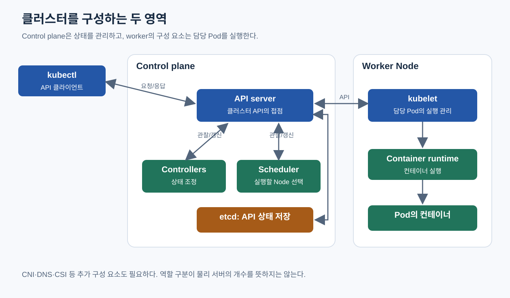
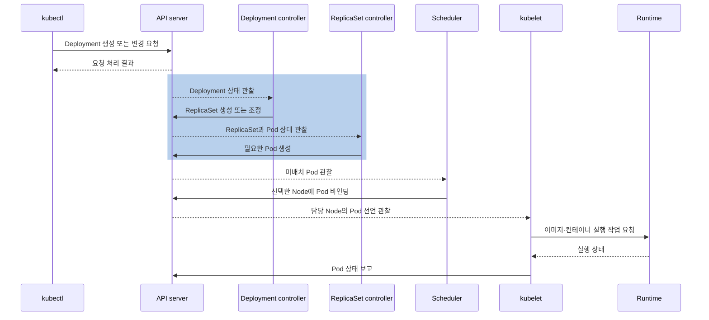
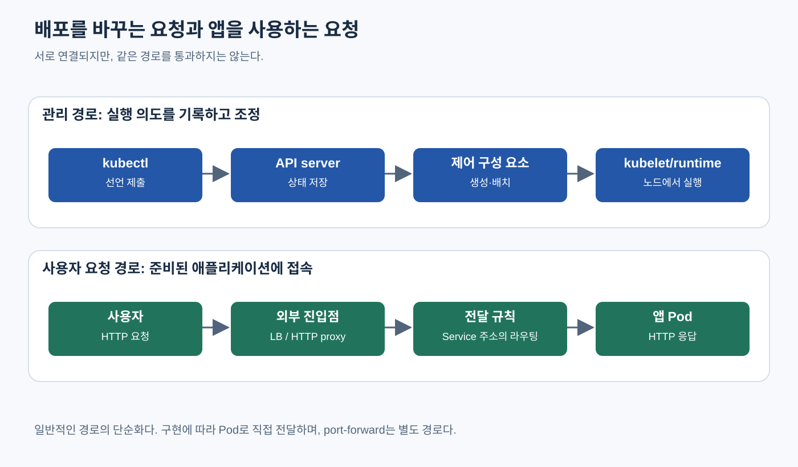

# Kubernetes Architecture

> **개발자를 위한 쉬운 쿠버네티스 · 6장** | [전체 목차](./Kubernetes-Introduction.md#이-시리즈의-읽는-순서) · [이전 장](./Kubernetes-First-Deployment.md) · [다음 장](./Kubernetes-Pod.md)

클러스터의 동작 구조 — `kubectl apply`가 끝난 뒤에 시작되는 일

[첫 배포](./Kubernetes-First-Deployment.md)에서는 직접 만든 이미지로 `created`, Pod의 `READY`, HTTP 1.0.0 응답과 2.0.0 업데이트를 따로 관찰했다. 선언을 받아들인 뒤 누가 Pod를 만들고 어디에서 실행했기에 그 응답을 읽을 수 있었을까? 이제 그 과정의 주어를 구체적으로 나눌 차례다. 운영 화면에는 Deployment와 Pod가 보이지만, 이들은 스스로 실행되는 프로그램이 아니다. 어떤 프로그램이 그 기록을 읽고 실제 일을 해야 한다.

## 결론부터 말하면

**Kubernetes는 API에 기록된 상태를 여러 구성 요소가 관찰하고 각자의 역할을 수행하는 시스템이다.** `kubectl`은 의도를 API server에 전달한다. Controller는 필요한 리소스를 만들거나 조정하고, scheduler는 Pod를 실행할 Node를 고르며, 해당 Node의 kubelet과 container runtime이 실행을 담당한다.

중요한 점은 이들이 하나의 긴 동기 함수 호출처럼 움직이지 않는다는 것이다. API 요청이 받아들여진 시점과 앱이 실행된 시점 사이에는 여러 비동기 단계가 있다. 이 간격을 이해해야 `created`라는 응답과 실행 성공을 구분하고, 어느 단계가 진행되지 않았는지 살펴볼 수 있다.

## 1. 클러스터는 서버 목록 이상의 것이다

여러 서버를 네트워크로 연결했다고 해서 그것만으로 Kubernetes 클러스터가 되는 것은 아니다. 컨테이너를 어디에서 실행할지 결정하고, 각 서버가 수행할 일을 전달하고, 결과를 관찰할 수 있는 관리 체계가 필요하다.

Kubernetes에서 서버 역할을 하는 실행 자원을 **Node** 라고 부른다. 물리 서버일 수도 있고 가상 머신일 수도 있다. Node 위에서 컨테이너가 실행된다. 이 실행 자원을 관리하기 위한 API와 제어 구성 요소를 묶어 **control plane** 이라고 한다. 그림에서는 control plane과 worker Node를 나누지만, 실제 배치 방식과 서버 수는 환경에 따라 달라진다. 구성 요소 하나가 반드시 물리 서버 하나라는 뜻도 아니다.



그림 6-1. control plane과 worker는 역할의 구분이다. 각 구성 요소가 API를 관찰하고 갱신하며, 직접 이어 호출하는 하나의 실행 스크립트가 아니다.

화살표는 관리 관계를 보여 준다. API server가 사용자 요청을 앱으로 전달하는 그림이 아니다. 또한 controller에서 scheduler로 직접 이어지는 화살표가 없다는 점을 눈여겨보자. 각 구성 요소가 공통 API를 중심으로 서로의 결과를 관찰한다.

## 2. YAML은 실행 스크립트가 아니라 의도를 표현하는 문서다

다음은 주문 API의 Deployment를 표현하는 완전한 설명용 manifest다. `bookstore` namespace가 이미 존재하며, 앱 이미지가 준비되어 있다고 가정한다. 이미지 주소는 실제로 배포된 공개 이미지가 아닌 자리표시자다. 지금은 실행하지 않고 문서 구조를 읽는다.

```yaml
apiVersion: apps/v1
kind: Deployment
metadata:
  name: order-api
  namespace: bookstore
spec:
  replicas: 3
  selector:
    matchLabels:
      app: order-api
  template:
    metadata:
      labels:
        app: order-api
    spec:
      containers:
        - name: order-api
          image: registry.example.com/book/order-api:1.0.0
          ports:
            - containerPort: 8080
```

위에서부터 보면 `apiVersion`과 `kind`는 어떤 API의 어떤 리소스인지 말한다. `metadata`에는 이름과 소속 범위 같은 식별 정보를 적는다. `spec`은 이 오브젝트가 표현할 원하는 상태다. 여기서는 같은 Pod 템플릿으로 복제본 세 개를 유지하겠다는 의도를 담고 있다.

`template`은 앞으로 만들 Pod의 내용이다. 이미 실행 중인 프로세스 세 개를 문서 안에 넣은 것이 아니다. `selector`와 `labels`는 관리할 대상을 연결하는 조건이며 뒤의 Deployment 장에서 자세히 설명한다. 지금은 YAML의 중첩이 실행 순서를 뜻하는 것이 아니라, 선언의 구조라는 점을 기억하면 충분하다.

### 이름을 찾는 범위: namespace

같은 클러스터를 여러 팀이나 환경이 함께 쓰면 이름이 충돌하기 쉽다. namespace는 Pod, Deployment, Service처럼 namespace에 속하는 리소스의 이름 범위를 나눈다. `bookstore`의 `order-api`와 다른 namespace의 `order-api`는 별개다. 반면 Node처럼 클러스터 전체 범위의 리소스도 있다.

namespace는 분류와 권한·정책 적용의 단위로 유용하지만, 생성했다는 사실만으로 네트워크가 차단되거나 팀 사이에 강한 격리가 완성되지는 않는다. 권한과 통신 정책은 각각 별도로 설정해야 한다. `kubectl get pods` 결과가 비어 있을 때도 “Pod가 없다”고 결론짓기 전에 어느 namespace를 조회했는지 확인해야 한다.

### 원하는 상태와 관찰한 상태

Deployment 같은 오브젝트를 조회하면 작성한 `spec` 외에 `status`가 보인다. 원하는 복제본 수를 적는 쪽과 현재 준비된 복제본 수를 보고하는 쪽을 분리한 것이다. 모든 리소스가 같은 모양의 `spec`과 `status`를 갖는 것은 아니다. ConfigMap처럼 데이터를 직접 담는 종류도 있다.

이 구분은 디버깅의 출발점이다. `replicas: 3`이라는 설정이 있다는 사실은 세 개를 원한다는 증거다. 세 개가 실제 실행 중이고 요청도 처리할 수 있다는 증거는 아니다. 관찰 결과에는 전달과 처리 시간이 있으므로 `status`도 시스템이 최근 관찰해 보고한 상태로 읽어야 한다.

## 3. apply가 성공했다는 말의 정확한 범위

`kubectl`은 클러스터 안의 모든 서버에 SSH로 접속해 컨테이너를 띄우는 프로그램이 아니다. kubeconfig의 접속 정보와 자격 증명 등을 사용해 Kubernetes API를 호출하는 클라이언트다. `apply`는 로컬 선언과 관리 방식에 따라 생성 또는 변경 요청을 보낸다.

요청을 받는 **API server** 는 인증과 권한 확인, 리소스 검증, admission 처리 등을 거쳐 허용된 변경을 저장한다. 인증은 누구인지, 인가는 그 작업을 할 권한이 있는지 확인하는 과정이다. Admission은 허용된 요청에 추가 정책을 적용하거나 내용을 조정하는 단계다. 세부 순서와 정책은 [ServiceAccount·RBAC](./Kubernetes-ServiceAccount-RBAC.md), [Admission Webhook](./Kubernetes-Admission-Webhook.md) 장에서 다룬다.

저장소인 **etcd** 는 클러스터 API 상태를 보관한다. 주문 서비스의 주문 테이블을 저장하는 DB도 아니고 컨테이너 이미지 저장소도 아니다. 일반적인 사용자와 controller는 etcd를 직접 고치는 대신 API server를 통해 오브젝트를 읽고 쓴다.

`deployment.apps/order-api created`라는 응답은 Deployment 생성 요청이 처리됐다는 뜻이다. API server가 이미지를 실행해 봤다거나 앱의 `/readyz`까지 확인했다는 뜻은 아니다. 존재하지 않는 이미지 주소를 적어도 API 객체의 형식과 정책을 만족하면 저장될 수 있다. 이미지의 실제 다운로드는 나중 단계의 일이다.

## 4. Deployment 하나에서 실행 중인 컨테이너까지

### 첫 번째 변화: 실행 의도가 구체적인 Pod로 바뀐다

Deployment를 관찰하는 controller가 새 선언을 발견한다. 여기서 관찰한다는 말은 무조건 일정 주기마다 모든 데이터를 처음부터 읽는다는 뜻은 아니다. Kubernetes 구성 요소들은 API의 watch와 캐시 등을 사용해 변화를 알아차리고, 처리할 대상을 다시 확인하며 조정한다.

Deployment controller는 ReplicaSet을 관리하고, ReplicaSet controller는 필요한 Pod를 만든다. ReplicaSet은 같은 Pod 템플릿의 복제본 수를 관리하는 중간 리소스다. 지금은 이름 세 개를 암기하기보다, 사용자 의도가 더 구체적인 실행 단위의 기록으로 이어진다고 보면 된다. 왜 중간 단계가 필요한지는 [Deployment 장](./Kubernetes-ReplicaSet-Deployment.md)에서 버전 교체와 함께 설명한다.

Pod 오브젝트가 생겼다고 컨테이너 프로세스까지 생긴 것은 아니다. 아직 어느 Node에서 실행할지 정해지지 않은 Pod도 API에 존재할 수 있다. 따라서 “Deployment는 있는데 Pod가 없다”와 “Pod는 있는데 실행되지 않는다”는 다른 단계의 문제다.

### 두 번째 변화: 실행 장소가 정해진다

**Scheduler** 는 아직 Node가 지정되지 않은 Pod를 보고 배치할 곳을 고른다. Pod가 요청한 CPU·메모리, Node의 상태, 배치 제약, 저장소와 관련된 조건 등이 판단에 영향을 준다. 배치할 Node를 정하면 그 결과가 API에 기록된다.

Scheduler는 컨테이너 프로세스를 직접 실행하지 않는다. 또한 실행 중인 Pod를 파일처럼 다른 서버로 옮기는 프로그램도 아니다. 일반적인 Pod는 한 번 Node에 배치된 뒤 그 Node에서 생애를 보낸다. Node 장애 등으로 대체가 필요하면 상위 controller가 새 Pod를 만들고, 새 Pod가 다시 배치된다.

자원이 부족하면 scheduler도 없는 CPU를 만들어 낼 수 없다. 선언을 저장하는 일은 성공했지만 배치가 진행되지 않는 상태가 가능한 이유다. 자동으로 Node를 늘리는 기능을 사용한다면 그것 역시 별도의 구성과 외부 인프라 조건이 필요한 일이다.

### 세 번째 변화: Node에서 실행을 준비한다

선택된 Node의 **kubelet** 은 자신이 맡은 Pod의 선언을 확인하고 실제 실행 상태를 맞춘다. 이미지를 준비하고 컨테이너를 실행하는 구체적인 작업은 **container runtime** 에 요청한다. containerd나 CRI-O가 그 역할을 하는 구현의 예다.

여기서 Docker로 이미지를 만들었다는 사실과 Node가 Docker Engine을 사용한다는 사실은 구분해야 한다. 개발자가 사용하는 이미지 제작 도구와 클러스터의 실행 구성 요소는 같은 제품일 필요가 없다. kubelet은 **CRI(Container Runtime Interface)** 라는 인터페이스를 통해 runtime과 통신한다.

Pod를 실행하려면 이미지 외에도 네트워크와 저장소 준비가 필요할 수 있다. 일반적인 Pod 네트워크는 **CNI(Container Network Interface)** 플러그인으로 구현하며, 클러스터 관리자가 환경에 맞는 구현체를 선택한다. 외부 스토리지 시스템을 Kubernetes와 연결하는 드라이버에는 **CSI(Container Storage Interface)** 가 사용된다. 이 세 약어는 외울 목록보다 책임의 경계를 나타낸다. Kubernetes의 공통 관리 방식과 실제 실행·네트워크·스토리지 구현을 연결하는 약속인 것이다.

모든 Volume이 CSI를 사용하는 것은 아니며, 이미지·네트워크·볼륨 준비를 구현과 무관한 단일 고정 순서로 외울 필요도 없다. 중요한 것은 컨테이너를 실행하기 전에 충족할 조건이 여러 개이고, 각 조건을 처리하는 주체가 다를 수 있다는 점이다.

### 네 번째 변화: 실행 결과가 다시 관찰된다

실행 결과는 다시 API 상태에 반영된다. kubelet은 Pod와 컨테이너 상태를 보고하고, controller는 관련 오브젝트의 변화를 보며 자신의 관리 작업을 계속한다. 앱이 준비되는 데 시간이 걸리면 컨테이너 실행 이후에도 요청을 받을 수 있을 때까지 간격이 있다.

다음 그림은 각 구성 요소가 API를 통해 협력한다는 관계를 강조한 개념 시퀀스다. 실제 watch 연결, 반복 조회, 재시도, 다른 검증 단계는 생략했다.



`kubectl`의 응답은 그림 앞부분에서 끝난다. 아래의 작업들은 그 뒤에도 진행된다. 이 구조를 이해하면 apply 직후 조회했을 때 상태가 아직 바뀌지 않았거나, 잠깐의 중간 상태가 보이는 것을 해석하기 쉬워진다.

## 5. 비동기 구조는 복구 방식도 바꾼다

한 번 실행하고 끝나는 절차라면 중간에 실패했을 때 어디까지 했는지 별도로 기억해야 한다. Kubernetes controller는 현재 상태와 원하는 상태를 바탕으로 다시 조정한다. 이전 요청이 잠시 실패했어도 다음 관찰과 재시도에서 필요한 작업을 수행할 수 있다.

그렇다고 모든 구성 요소가 항상 같은 순간의 상태를 보는 것은 아니다. 어떤 변경은 이미 저장됐지만 한 controller가 아직 반영하지 않았을 수 있다. Pod가 종료되는 동안 다른 관찰에서는 이전 상태가 보일 수도 있다. 따라서 운영 시에는 단일 출력뿐 아니라 상태 변화와 시간, 관련 오브젝트를 함께 본다.

이 구조의 장점은 역할을 분리하고 반복적으로 조정할 수 있다는 것이다. 한계는 문제가 발생했을 때 어느 부분이 아직 진행되지 않았는지 알아야 한다는 것이다. “Kubernetes가 알아서 한다”는 문장은 사용법을 간단하게 만들지만, 운영자가 필요한 판단까지 대신해 주지는 않는다.

예를 들어 API server에 접근할 수 없는 동안에도 이미 실행 중인 컨테이너와 기존 네트워크 구성이 당장 모두 사라지지는 않는다. 그러나 새 선언을 반영하거나 장애로 사라진 실행 단위를 다른 Node에 새로 만드는 제어 과정은 영향을 받는다. 얼마나 버틸 수 있는지는 앱과 네트워크, 인증, 외부 의존성 등에 따라 다르므로 이를 가용성 보장으로 받아들여서는 안 된다.

## 6. 사용자의 HTTP 요청은 별도의 길을 지난다

지금까지 살펴본 것은 앱을 만들고 관리하는 흐름이다. 앱이 실행된 뒤 사용자가 주문 API를 호출할 때는 보통 API server가 그 주문 요청을 받아 앱으로 중계하지 않는다. 사용자가 사용하는 주소와 클러스터의 트래픽 처리 구성 요소를 통해 앱에 도착한다.

[Service](./Kubernetes-Service-Object.md)는 바뀌는 Pod들을 안정적인 접속 정보로 연결하는 데 쓰인다. 외부 HTTP 요청에는 [Ingress](./Kubernetes-Ingress.md)나 [Gateway API](./Kubernetes-Gateway-API.md)를 처리하는 proxy 또는 로드 밸런서가 관여할 수 있다. 이것들은 뒤에서 실제 요청 경로를 따라 설명한다.

현재 단계에서 지켜야 할 구분은 단순하다. Deployment 같은 리소스는 실행 상태를 관리하는 선언이고, 실제 사용자 요청은 실행 중인 네트워크 구성과 앱을 통해 처리된다. 리소스를 조회하는 명령의 성공이 앱 요청의 성공을 증명하지 않는다. 반대로 특정 앱의 500 응답만으로 control plane 장애를 결론지을 수도 없다.



그림 6-2. 위쪽 화살표는 논리적 진행 단계다. controller가 kubelet에 직접 RPC를 보내는 뜻이 아니며, 실제 구성 요소는 그림 6-1처럼 API를 통해 상태를 관찰·갱신한다. 아래쪽은 일반적인 트래픽 경로의 단순화이며 구현에 따라 Pod로 직접 전달할 수 있다. 첫 실습의 port-forward는 이 일반 Service 데이터 경로와 다르다.

## 7. 관찰할 때는 “마지막으로 성공한 단계”를 찾는다

다음 명령은 첫 배포에서 만든 전용 cluster의 리소스 상태를 읽는다. 그 장의 `LAB_KUBECONFIG`와 `LAB_CONTEXT`를 같은 터미널에 설정해야 한다. 새 터미널이라면 기록해 둔 실제 값으로 다시 설정한다. 아래에는 실측 출력을 싣지 않고, 각 조회가 무엇을 확인하는지에 초점을 둔다.

```bash
kubectl --kubeconfig "$LAB_KUBECONFIG" config get-contexts "$LAB_CONTEXT"
kubectl --kubeconfig "$LAB_KUBECONFIG" --context "$LAB_CONTEXT" get deployment order-api -n bookstore
kubectl --kubeconfig "$LAB_KUBECONFIG" --context "$LAB_CONTEXT" get replicasets -n bookstore -l app=order-api
kubectl --kubeconfig "$LAB_KUBECONFIG" --context "$LAB_CONTEXT" get pods -n bookstore -l app=order-api -o wide
kubectl --kubeconfig "$LAB_KUBECONFIG" --context "$LAB_CONTEXT" get events -n bookstore --sort-by=.metadata.creationTimestamp
```

첫 줄은 전용 kubeconfig에서 `LAB_CONTEXT`라는 이름의 context와 연결된 cluster·신원을 확인한다. `CURRENT` 표시는 파일에 저장된 기본 context를 뜻하며, 뒤 명령들은 그 표시와 관계없이 `--context "$LAB_CONTEXT"`를 명시해 접속한다. context 목록을 읽은 것만으로 API 연결 성공을 증명하지는 않는다. 그다음은 사용자 의도에서 구체적인 실행 단위로 내려간다. Deployment가 있는지, 관련 ReplicaSet과 Pod가 있는지, Pod가 어느 Node에 배치됐는지를 보는 것이다. `app` label 조회는 탐색의 시작이며 실제 소유 관계는 `ownerReferences`도 확인해야 한다.

Events는 작업 중 발생한 사건과 이유를 살펴보는 데 도움이 된다. 영구적인 감사 기록이나 모든 내부 동작의 완전한 이력은 아니다. 로그와 metrics 역시 각각 다른 질문에 답한다. 증거의 의미를 좁혀서 읽는 습관이 중요하며, 마지막 [종합 사례](./Kubernetes-Troubleshooting-From-Apply-to-Request.md)에서 다시 연결한다.

### 에어갭 환경에서 짚어볼 점

개발자 노트북에서 사설 레지스트리에 접근할 수 있다는 사실은 Node의 runtime도 이미지를 받을 수 있다는 뜻이 아니다. 접속 주체와 DNS, 라우팅, proxy, 인증서 신뢰 설정이 다를 수 있다. 마찬가지로 앱 컨테이너 안의 인증서 설정을 고쳤다고 Node의 이미지 다운로드 문제가 해결되는 것은 아니다.

실행 단계를 나눠 보면 확인할 위치도 정해진다. API 접속 실패는 kubectl에서 API server로 가는 경로를, 이미지 다운로드 실패는 실행할 Node 쪽의 조건을, 앱의 외부 API 호출 실패는 앱에서 목적지로 나가는 경로를 살펴본다. 같은 네트워크 오류처럼 보여도 출발점이 다르다.

## 생각해 볼 질문

**API server가 Deployment를 저장한 직후 scheduler가 멈췄다면 무엇이 보일 수 있을까?** Deployment와 이를 처리하는 controller가 만든 Pod는 존재할 수 있지만, 새 Pod의 Node 배치가 진행되지 않을 수 있다. “리소스 생성 성공”과 “컨테이너 실행 성공” 사이의 경계를 구분해야 한다.

**Pod가 사라졌을 때 kubelet이 다른 Node에서 같은 Pod를 실행해 줄까?** kubelet은 자신이 담당하는 Node의 실행을 관리한다. 일반적인 controller 관리 Pod라면 상위 controller가 새 Pod를 만들고 scheduler가 새 Pod를 배치하는 경로로 복구한다. 컨테이너의 로컬 재시작과 Pod 교체는 다르다.

**주문 API 호출이 정상이라면 클러스터 관리 기능도 정상이라고 할 수 있을까?** 기존 데이터 경로와 앱이 동작한다는 증거일 뿐이다. 새 배포나 상태 변경을 처리하는 제어 경로는 별도로 확인해야 한다.

## 출처

- [Kubernetes Components](https://kubernetes.io/docs/concepts/overview/components/) — control plane과 Node 구성 요소.
- [Objects In Kubernetes](https://kubernetes.io/docs/concepts/overview/working-with-objects/) — API 오브젝트의 spec과 status.
- [Controllers](https://kubernetes.io/docs/concepts/architecture/controller/) — API를 중심으로 하는 상태 관찰과 조정.
- [Namespaces](https://kubernetes.io/docs/concepts/overview/working-with-objects/namespaces/) — 리소스 이름의 범위.
- [Kubernetes Scheduler](https://kubernetes.io/docs/concepts/scheduling-eviction/kube-scheduler/) — 미배치 Pod의 Node 선택과 바인딩.
- [Nodes](https://kubernetes.io/docs/concepts/architecture/nodes/) — Node와 kubelet, Node 상태 관리.
- [Container Runtime Interface](https://kubernetes.io/docs/concepts/containers/cri/) — kubelet과 runtime의 인터페이스.
- [Network Plugins](https://kubernetes.io/docs/concepts/extend-kubernetes/compute-storage-net/network-plugins/) — Pod 네트워크 구현과 CNI.
- [Volumes: CSI](https://kubernetes.io/docs/concepts/storage/volumes/#csi) — CSI와 저장소 구현.
