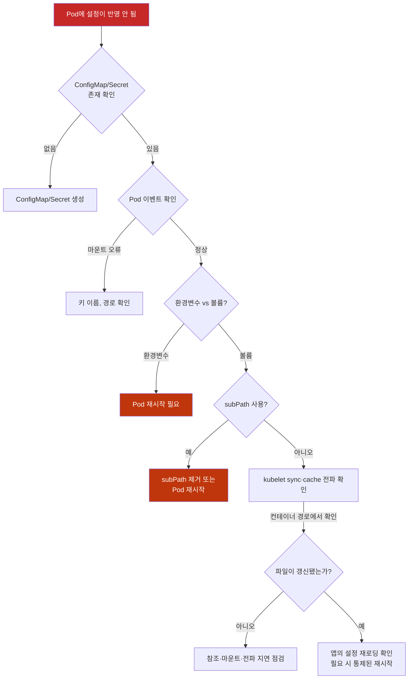

# Kubernetes ConfigMap & Secret

> **개발자를 위한 쉬운 쿠버네티스 · 10장** | [전체 목차](./Kubernetes-Introduction.md#이-시리즈의-읽는-순서) · [이전 장](./Kubernetes-Image-Tag-Digest.md) · [다음 장](./Kubernetes-Service-Object.md)

설정을 바꿨는데 왜 실행 중인 앱은 그대로일까?

앞 장에서 같은 이미지 문자열이라도 실제 이미지가 달라질 수 있음을 보았다. 이제 실행할 코드를 digest로 고정했다고 하자. 개발계와 운영계가 같은 코드를 쓰더라도 DB 주소·로그 수준·자격 증명은 다를 수 있다. 이 값까지 이미지에 구우면 환경마다 다시 빌드해야 하고, 비밀번호가 이미지 레이어와 빌드 기록에 남을 수 있다. 실행 코드와 실행 환경의 설정을 별도 객체로 전달하는 이유다.

## 결론부터 말하면

ConfigMap은 일반 설정 데이터를, Secret은 비밀번호·토큰·키 같은 민감한 데이터를 담는 Kubernetes 객체다. 둘 다 값을 저장하고 Pod에 전달할 수 있지만, **API 객체의 값 변경, 컨테이너에 전달된 값 변경, 앱의 실제 동작 변경은 서로 다른 단계다.** 설정 변경이 곧 Deployment rollout이나 앱 재로딩을 뜻하지 않는다.

Secret의 `data`가 Base64로 표현되는 것은 암호화가 아니다. 읽기 권한과 저장 암호화, 전달 대상과 앱의 취급을 함께 설계해야 한다. 외부 Secret 저장소를 연결해도 마지막 단계인 앱 반영은 따로 남는다.

| 전달 방식 | 기존 실행에 대한 갱신 | 앱 동작이 바뀌려면 |
|---|---|---|
| `env`·`envFrom` | 실행 중 프로세스의 환경변수는 자동 변경되지 않음 | 새 컨테이너 실행을 통제된 Pod 교체로 수행하는 것이 일반적 |
| 디렉토리 volume | kubelet이 변경을 비동기 반영 | 앱이 새 파일을 다시 열고 설정을 적용해야 함 |
| `subPath` volume mount | 기존 마운트에 갱신 반영 안 됨 | 마운트를 새로 만드는 Pod 교체 등 필요 |

이 장의 `order-api`, namespace `bookstore`, 이미지 `registry.example.com/book/order-api:1.0.0`은 가상 사례다. YAML은 별도 표시가 없으면 구조 설명용 발췌다. 실제 이미지·DB·자격 증명·추가 controller는 제공하지 않으며, 명령은 실행 기록이 아니다.

## 1. 왜 설정 분리가 필요한가?

### 1.1 코드의 버전과 환경의 값은 바뀌는 이유가 다르다

주문 API의 할인 계산 코드가 바뀌는 일과 DB 연결 주소가 바뀌는 일은 다른 배포 사건이다. 개발계에서 검증한 이미지를 운영계로 옮길 때 코드와 의존성은 그대로 두고 환경에 맞는 값만 전달하면 이미지가 달라져 재검증해야 하는 변수를 줄일 수 있다. 설정 분리는 재빌드를 줄이는 동시에 “어떤 코드와 어떤 설정을 조합했는가”를 기록할 책임을 만든다.

이미지에 기본 로그 수준 같은 안전한 기본값을 둘 수는 있다. 그러나 환경마다 바뀌는 값과 민감 값을 빌드 산출물에 고정하면 배포·교체·폐기 주기가 뒤엉킨다. ConfigMap·Secret은 이 값을 API 객체로 분리해 Pod 템플릿에서 참조하도록 한다. 둘은 일반 파일 저장소나 대형 데이터 저장소를 대체하지 않는다.

### 1.2 설정 객체에서 프로세스까지

Pod 템플릿에 참조 이름을 적으면 kubelet이 컨테이너를 준비하면서 값을 환경변수 또는 volume 파일로 전달한다. 보통 앱이 Kubernetes API를 직접 호출해 값을 가져오지 않아도 된다. 반면 앱이 API로 직접 watch하는 방식은 별도의 인증·RBAC·재연결·갱신 로직이 필요한 또 다른 설계다.


## 2. ConfigMap: 일반 설정값 저장

### 2.1 ConfigMap 생성

다음은 완전한 설명용 ConfigMap이다. namespace `bookstore`가 미리 있어야 한다. 문자열 설정과 파일 내용을 함께 보여 주기 위해 두 형식을 담았다.

```yaml
apiVersion: v1
kind: ConfigMap
metadata:
  name: order-api-config
  namespace: bookstore
data:
  DB_HOST: "orders-db.bookstore.svc.cluster.local"
  DB_PORT: "5432"
  LOG_LEVEL: "info"
  application.properties: |
    server.port=8080
    logging.level.root=INFO
```

`data`의 값은 문자열이다. 숫자처럼 보이는 포트도 따옴표를 써 문자열로 표현한다. `application.properties`라는 key의 값은 여러 줄의 문자열이며 volume으로 연결하면 파일 하나가 될 수 있다. Kubernetes가 그 파일의 Spring 설정 의미까지 해석하는 것은 아니다. 바이너리 데이터에는 `binaryData`를 사용할 수 있지만 객체 하나에 담을 수 있는 크기는 제한되므로 큰 자원은 별도 저장소를 사용한다.

CLI는 직접 생성뿐 아니라 API에 쓰지 않고 manifest를 만드는 데도 사용할 수 있다. 다음 `--dry-run=client` 예시는 해당 리터럴로 YAML을 출력하는 형식이다.

```bash
kubectl -n bookstore create configmap order-api-config \
  --from-literal=LOG_LEVEL=info \
  --dry-run=client -o yaml
```

### 2.2 Pod에서 ConfigMap 사용하기

환경변수 한 개를 선택하려면 `configMapKeyRef`로 객체와 key를 정한다. 다음은 Deployment의 `.spec.template.spec` 아래 구조 발췌다.

```yaml
containers:
- name: order-api
  image: registry.example.com/book/order-api:1.0.0
  env:
  - name: LOG_LEVEL
    valueFrom:
      configMapKeyRef:
        name: order-api-config
        key: LOG_LEVEL
```

`envFrom.configMapRef`는 여러 key를 한 번에 노출할 때 유용하다. 다만 어떤 설정을 앱에 넘기는지 범위가 넓어지고 key 충돌·환경변수 이름 조건도 고려해야 한다. 작은 계약을 명확히 관리하려면 필요한 key만 `env`에 나열하는 편이 읽기 쉽다. 파일용 key와 환경변수용 key를 반드시 같은 객체에 모을 필요도 없다.

파일을 읽는 앱에는 volume을 연결한다. 다음은 같은 Pod spec의 구조 발췌로, 위 ConfigMap에서 파일 key 하나만 선택한다.

```yaml
containers:
- name: order-api
  image: registry.example.com/book/order-api:1.0.0
  volumeMounts:
  - name: config
    mountPath: /etc/order-api
    readOnly: true
volumes:
- name: config
  configMap:
    name: order-api-config
    items:
    - key: application.properties
      path: application.properties
```

컨테이너에는 `/etc/order-api/application.properties`가 보인다. 앱이 이 위치를 읽도록 시작 인자나 설정 탐색 경로를 지정해야 한다. Spring Boot가 어떤 임의의 mount 경로든 자동으로 읽는다고 가정하면 안 된다. 또한 디렉토리에 volume을 마운트하면 이미지에 원래 있던 그 디렉토리 내용이 가려질 수 있으므로 전용 경로를 쓰는 편이 명확하다.

## 3. Secret: 민감 정보 저장

### 3.1 Secret vs ConfigMap

Secret은 민감 값이라는 의미와 이를 다루는 별도 API kind를 제공한다. Linux에서 Secret volume은 kubelet이 tmpfs에 보관하는 등 민감 값을 위한 처리가 있지만, 이것만으로 모든 위치에서 암호화되거나 노드·컨테이너 관리자에게 감춰지는 것은 아니다. 노드 운영체제와 swap 설정 같은 조건도 확인해야 한다.

`data`에는 Base64 문자열을 넣고, 편의를 위해 `stringData`에는 일반 문자열을 쓸 수 있다. 둘 다 Git에 실제 비밀번호를 넣어도 된다는 뜻은 아니다. API server에 저장할 때 `stringData`는 `data`로 합쳐지며 조회 결과에는 쓰기 전용 `stringData`가 남지 않는다. 다만 client-side apply는 입력 평문을 `kubectl.kubernetes.io/last-applied-configuration` annotation에 남길 수 있으므로, `stringData`가 사라진다는 설명을 입력 흔적 제거나 암호화 저장으로 해석하면 안 된다. 공식 문서는 `stringData`가 server-side apply와 잘 맞지 않는다는 제약도 명시한다.

### 3.2 Secret 생성

다음은 가짜 값을 가진 완전한 설명용 Secret manifest다. 실제 자격 증명으로 사용할 수 없는 자리표시자이며 환경의 비밀을 이 원고나 Git에 적는 패턴이 아니다.

```yaml
apiVersion: v1
kind: Secret
metadata:
  name: order-api-secret
  namespace: bookstore
type: Opaque
stringData:
  DB_PASSWORD: "EXAMPLE-ONLY-NOT-A-REAL-PASSWORD"
```

Base64의 모양을 보고 안전하다고 판단하지 않는다. 실제 값은 승인된 비밀 전달 경로에서 만들고, API 응답·shell history·CI 로그·터미널 녹화에 남지 않도록 다룬다. `kubectl create secret generic`의 `--from-file` 옵션으로 값을 읽더라도 입력 파일의 보관·권한·삭제 정책을 대신 해결하지 않는다.

### 3.3 Secret 타입

| 타입 | 값이 쓰이는 계약 |
|---|---|
| `Opaque` | 일반적인 앱의 민감 key·value |
| `kubernetes.io/tls` | TLS certificate와 private key |
| `kubernetes.io/dockerconfigjson` | registry 인증용 Docker config |
| `kubernetes.io/basic-auth` | username·password 형식 |
| `kubernetes.io/ssh-auth` | SSH private key 형식 |

타입은 필드 계약을 표현한다. 인증서 유효성이나 서버 신뢰를 모두 검증해 주는 것은 아니다. 특히 registry 계정 Secret을 앱 환경변수에 넣는 것과 `imagePullSecrets`로 kubelet에 전달하는 것은 소비자가 다르다. registry의 private CA를 신뢰하도록 runtime·노드를 설정하는 일도 계정 Secret 생성과 별개다.

### 3.4 Pod에서 Secret 사용하기

다음은 `.spec.template.spec` 아래 구조 발췌다. Pod와 `order-api-secret`은 같은 namespace에 있어야 한다.

```yaml
containers:
- name: order-api
  image: registry.example.com/book/order-api:1.0.0
  env:
  - name: DB_PASSWORD
    valueFrom:
      secretKeyRef:
        name: order-api-secret
        key: DB_PASSWORD
```

볼륨이라면 `volumes[].secret.secretName`을 참조하고 필요한 컨테이너에만 `volumeMounts`를 연결한다. 파일 권한을 `defaultMode`·`items[].mode`로 제한할 수 있지만 컨테이너 실행 UID·group과 앱이 읽을 수 있는지도 함께 확인한다. 환경변수는 자식 프로세스 상속이나 앱의 설정 dump로 노출될 수 있고 파일도 읽기 가능한 프로세스에는 보인다. 주입 방식 하나로 보안 문제가 끝나지는 않는다.

`kubectl -n bookstore describe pod`는 `secretKeyRef`로 전달한 값을 보통 Secret 이름·key 참조로 표시한다. 이것을 “describe가 항상 비밀번호를 보여 준다”로 설명하면 잘못된 진단이 된다. 반대로 리터럴 `env.value`에 비밀번호를 적었다면 Pod spec에 그 값이 노출된다. 전달 경로와 읽기 권한의 조합을 봐야 한다.

## 4. ConfigMap/Secret 업데이트

### 4.1 환경변수로 사용할 때

실행 중인 프로세스의 환경은 ConfigMap을 수정한다고 바뀌지 않는다. 참조 이름이 같은 채로 객체 내용만 바꾸면 Deployment의 Pod 템플릿도 그대로이므로 새 ReplicaSet을 만들 이유가 없다. `kubectl -n bookstore apply` 성공과 앱 설정 변경을 구분해야 하는 대표적인 경우다.

이미 실행 중인 replica에 새 환경을 일관되게 전달하려면 Pod를 계획적으로 교체한다. 다음은 교체가 승인된 개인 실습 환경에서의 명령 형식이며 실행 기록이 아니다.

```bash
kubectl -n bookstore rollout restart deployment/order-api
kubectl -n bookstore rollout status deployment/order-api
```

이 명령은 템플릿 annotation을 바꿔 새 Pod를 만들게 한다. 그 Pod가 시작할 때 참조 값을 읽는다. 교체하는 동안 서로 다른 설정을 가진 replica가 공존할 수 있으므로 비밀번호 회전에서는 새·이전 자격 증명의 중첩 유효 시간과 연결 풀 교체도 설계해야 한다.

### 4.2 볼륨으로 마운트할 때

일반적인 디렉토리 마운트는 kubelet이 객체 변경을 받아 투영된 파일을 비동기 갱신한다. 지연은 kubelet sync 주기와 watch·cache 전파 방식에 달려 있다. “반드시 1분 안”이라고 보장할 수 없다. 파일이 바뀌어도 시작 때 한 번만 읽는 앱의 메모리 설정은 그대로다.

파일 갱신은 기존 파일에 계속 쓰는 형태가 아니라 새 데이터 디렉토리와 링크를 교체하는 방식으로 구현될 수 있다. 앱이 파일 descriptor를 계속 붙잡거나 특정 inode만 watch하면 새 값을 놓칠 수 있으므로 사용하는 프레임워크의 재로딩 방식을 확인한다. Spring의 `@RefreshScope`를 붙이는 것만으로 Kubernetes 파일 변경 감지와 전체 설정 refresh가 자동 완성되지는 않는다.

`subPath`는 volume의 특정 파일을 다른 경로에 꽂을 때 편하지만 기존 마운트가 ConfigMap·Secret 변경을 받지 못한다. 다음 두 발췌는 서로 다른 대안이다.

```yaml
# 특정 파일만 연결: 기존 마운트에는 자동 갱신되지 않음
volumeMounts:
- name: config
  mountPath: /app/config/application.properties
  subPath: application.properties
```

```yaml
# 디렉토리로 연결: 파일 투영 갱신 가능, 앱 재로딩은 별도
volumeMounts:
- name: config
  mountPath: /etc/order-api
  readOnly: true
```

### 4.3 Immutable ConfigMap/Secret

설정을 제자리 수정하는 대신 버전별 이름을 만들 수도 있다. `immutable: true`인 ConfigMap·Secret의 data는 수정할 수 없으므로 새 객체를 만들고 Pod 템플릿의 참조 이름을 바꾼다. 이때는 템플릿이 달라지므로 Deployment rollout과 설정 버전을 연결하기 쉽다.

```yaml
apiVersion: v1
kind: ConfigMap
metadata:
  name: order-api-config-v2
  namespace: bookstore
immutable: true
data:
  LOG_LEVEL: "info"
```

같은 이름을 지웠다가 다시 만드는 방식은 기존 Pod의 참조와 갱신 동작을 복잡하게 만들 수 있다. 새 이름으로 전환하고 이전 replica·rollback이 더 이상 쓰지 않을 때 옛 객체를 정리하는 편이 추적하기 쉽다. immutable은 설정 오변경을 줄이고 kubelet의 watch 부담을 줄일 수 있지만 무중단을 보장하는 기능은 아니다.

## 5. 실전 패턴

### 5.1 환경별 설정과 하나의 이미지

개발계와 운영계는 같은 이미지 digest를 쓰되 ConfigMap과 Secret의 이름·namespace·내용을 배포 정본에서 관리한다. Helm values와 Kustomize overlay는 이 차이를 표현하는 도구이며, 렌더링한 YAML이 맞는 것과 실제 적용 후 앱이 값을 사용하는 것은 다른 검증이다. [Helm 입문](Helm-쿠버네티스의-패키지-매니저는-왜-필요한가.md)에서 여러 리소스를 함께 관리하는 이유를 이어 읽을 수 있다.

### 5.2 설정 파일 전체 마운트

Spring Boot의 `application.properties`·`application.yml`처럼 파일 기반 계약을 그대로 사용할 수 있다. 비민감 설정은 ConfigMap, 비밀번호는 Secret으로 분리하고 앱이 어떤 우선순위로 파일·환경변수·시작 인자를 합치는지 확인한다. Kubernetes는 그 우선순위를 정해 주지 않는다. 동일 key를 여러 경로로 전달하면 “파일은 새 값인데 앱은 예전 값”처럼 보이는 원인이 될 수 있다.

### 5.3 설정 변경을 템플릿 변경으로 연결하기

Helm에서는 렌더링한 설정 내용의 checksum을 Pod 템플릿 annotation에 넣는 패턴을 사용한다. 값이 바뀌면 annotation도 바뀌어 rollout이 일어난다. 이 annotation은 Kubernetes가 자동 계산하는 필드가 아니다. 템플릿 작성자가 실제 설정 데이터와 연결해야 한다. Secret 자체를 annotation에 넣지 않으며 해시도 값의 일부 정보를 노출할 수 있는지 검토한다.

Kustomize의 `configMapGenerator`·`secretGenerator`는 기본적으로 내용 해시가 붙은 이름을 생성하고 알려진 참조를 갱신하는 방식이다. “Kustomize가 checksum annotation을 자동 추가한다”는 동작과 구분한다. Reloader 같은 추가 controller는 객체 변경을 감지해 workload를 갱신하는 다른 선택지이며 설치·권한·실패 관찰이 필요하다. 구체적 연동은 도구의 버전을 고정해 검증한다.

## 6. 보안 고려사항

### 6.1 Secret은 정말 안전한가?

Secret의 보안을 API 종류만으로 판단할 수 없다. upstream 기본 동작에서는 etcd의 Secret이 자동으로 암호화되어 저장되지 않는다. 관리형 서비스의 실제 저장 암호화 정책은 제공자 설정을 확인해야 한다. etcd 접근자와 백업 접근자, API를 통해 Secret을 읽거나 바꾸는 권한, Pod·Deployment를 만들어 Secret을 마운트할 수 있는 권한 모두가 민감 값에 닿을 수 있다.

RBAC이 “기본적으로 누구나 Secret을 읽게 한다”는 설명도 틀리다. 실제 Role·RoleBinding과 클러스터의 인증·인가 설정이 접근을 결정한다. `list`·`watch` 권한도 Secret의 데이터를 읽는 권한이 될 수 있으며, namespace에서 Pod를 만들 수 있는 사람은 Secret을 앱에 연결하여 간접 접근할 수 있다. namespace를 단지 이름 정리용 폴더로만 보지 않는 이유다.

### 6.2 저장 암호화와 외부 Secret 관리자

API server의 EncryptionConfiguration·KMS provider는 저장 시 암호화를 구성하는 클러스터 관리자 영역이다. 설정 파일을 작성했다고 기존 Secret과 백업이 모두 암호화된 것으로 판단하지 않는다. provider 순서·key 관리·기존 데이터 재기록·복구 검증까지 별도 운영 절차가 필요하다. 부분 설정을 그대로 적용하는 예제 대신 [공식 저장 암호화 절차](https://kubernetes.io/docs/tasks/administer-cluster/encrypt-data/)를 기준으로 검증한다.

외부 저장소는 감사·회전·권한 분리를 제공할 수 있지만, 외부에서 Kubernetes Secret으로 복제했다면 클러스터 안 Secret의 보안 책임은 남는다. 반대로 파일로 직접 전달하면 Kubernetes Secret 저장을 피할 수 있어도 provider·node plugin과 앱의 파일 접근 보안은 필요하다. [Secret Delivery Integrations](Kubernetes-Secret-Delivery-Integrations.md)에서 두 경로와 복구 조건을 비교한다.

### 6.3 RBAC으로 접근 제한

다음은 특정 Secret에 대한 직접 `get`만 표현하는 Role 예시다. RoleBinding이 없으므로 이 객체만으로 어떤 주체에게도 권한을 부여하지 않는다. 앱이 단순히 kubelet의 주입을 받는다면 앱 ServiceAccount에 Secret API `get` 권한이 반드시 필요한 것도 아니다.

```yaml
apiVersion: rbac.authorization.k8s.io/v1
kind: Role
metadata:
  name: order-api-secret-reader
  namespace: bookstore
rules:
- apiGroups: [""]
  resources: ["secrets"]
  resourceNames: ["order-api-secret"]
  verbs: ["get"]
```

**에어갭 환경에서 짚어볼 점:** 클러스터 안 Secret을 참조하는 일과 외부 비밀 저장소에 연결하는 일은 별개다. ESO controller나 CSI provider가 실제로 나갈 endpoint, DNS, 인증, CA 신뢰, private endpoint 경로가 있어야 한다. 관련 CRD를 반입한 것만으로 외부 값이 전달되지는 않는다.

---

## 심화 읽기의 위치

외부 저장소의 identity·provider 비교, CSI 파일 전달, GitOps 암호화와 rotation 관찰은 [Secret Delivery Integrations](Kubernetes-Secret-Delivery-Integrations.md)로 이어진다. ESO의 reconcile·갱신·소유 정책은 기존 [External Secrets Operator](Kubernetes-External-Secrets-Operator.md)에서 자세히 다룬다. 아래 제목은 기존 깊은 링크의 도착점을 유지하기 위한 이동 안내다.

## 7. 클라우드 Secret 관리

이 절은 [Secret Delivery Integrations의 1. 클라우드 Secret 관리](Kubernetes-Secret-Delivery-Integrations.md#1-클라우드-secret-관리)로 옮겼다. 기본 주입·갱신·보안은 이 장에서, provider·CSI·GitOps의 연동 조건은 확장 글에서 읽는다.

### 7.1 External Secrets Operator (ESO)

이 절은 [Secret Delivery Integrations의 1.1 External Secrets Operator (ESO)](Kubernetes-Secret-Delivery-Integrations.md#11-external-secrets-operator-eso)로 옮겼다. 기본 주입·갱신·보안은 이 장에서, provider·CSI·GitOps의 연동 조건은 확장 글에서 읽는다.

### 7.2 AWS EKS + Secrets Manager

이 절은 [Secret Delivery Integrations의 1.2 AWS EKS + Secrets Manager](Kubernetes-Secret-Delivery-Integrations.md#12-aws-eks--secrets-manager)로 옮겼다. 기본 주입·갱신·보안은 이 장에서, provider·CSI·GitOps의 연동 조건은 확장 글에서 읽는다.

### 7.3 Azure AKS + Key Vault

이 절은 [Secret Delivery Integrations의 1.3 Azure AKS + Key Vault](Kubernetes-Secret-Delivery-Integrations.md#13-azure-aks--key-vault)로 옮겼다. 기본 주입·갱신·보안은 이 장에서, provider·CSI·GitOps의 연동 조건은 확장 글에서 읽는다.

### 7.4 GCP GKE + Secret Manager

이 절은 [Secret Delivery Integrations의 1.4 GCP GKE + Secret Manager](Kubernetes-Secret-Delivery-Integrations.md#14-gcp-gke--secret-manager)로 옮겼다. 기본 주입·갱신·보안은 이 장에서, provider·CSI·GitOps의 연동 조건은 확장 글에서 읽는다.

### 7.5 클라우드 비교

이 절은 [Secret Delivery Integrations의 1.5 클라우드 비교](Kubernetes-Secret-Delivery-Integrations.md#15-클라우드-비교)로 옮겼다. 기본 주입·갱신·보안은 이 장에서, provider·CSI·GitOps의 연동 조건은 확장 글에서 읽는다.

## 8. Secrets Store CSI Driver

이 절은 [Secret Delivery Integrations의 2. Secrets Store CSI Driver](Kubernetes-Secret-Delivery-Integrations.md#2-secrets-store-csi-driver)로 옮겼다. 기본 주입·갱신·보안은 이 장에서, provider·CSI·GitOps의 연동 조건은 확장 글에서 읽는다.

### 8.1 ESO vs CSI Driver

이 절은 [Secret Delivery Integrations의 2.1 ESO vs CSI Driver](Kubernetes-Secret-Delivery-Integrations.md#21-eso-vs-csi-driver)로 옮겼다. 기본 주입·갱신·보안은 이 장에서, provider·CSI·GitOps의 연동 조건은 확장 글에서 읽는다.

### 8.2 Azure AKS 예시 (CSI Driver)

이 절은 [Secret Delivery Integrations의 2.2 Azure AKS 예시 (CSI Driver)](Kubernetes-Secret-Delivery-Integrations.md#22-azure-aks-예시-csi-driver)로 옮겼다. 기본 주입·갱신·보안은 이 장에서, provider·CSI·GitOps의 연동 조건은 확장 글에서 읽는다.

## 9. GitOps에서 Secret 관리

이 절은 [Secret Delivery Integrations의 3. GitOps에서 Secret 관리](Kubernetes-Secret-Delivery-Integrations.md#3-gitops에서-secret-관리)로 옮겼다. 기본 주입·갱신·보안은 이 장에서, provider·CSI·GitOps의 연동 조건은 확장 글에서 읽는다.

### 9.1 Sealed Secrets

이 절은 [Secret Delivery Integrations의 3.1 Sealed Secrets](Kubernetes-Secret-Delivery-Integrations.md#31-sealed-secrets)로 옮겼다. 기본 주입·갱신·보안은 이 장에서, provider·CSI·GitOps의 연동 조건은 확장 글에서 읽는다.

### 9.2 SOPS (Secrets OPerationS)

이 절은 [Secret Delivery Integrations의 3.2 SOPS (Secrets OPerationS)](Kubernetes-Secret-Delivery-Integrations.md#32-sops-secrets-operations)로 옮겼다. 기본 주입·갱신·보안은 이 장에서, provider·CSI·GitOps의 연동 조건은 확장 글에서 읽는다.

### 9.3 GitOps Secret 관리 비교

이 절은 [Secret Delivery Integrations의 3.3 GitOps Secret 관리 비교](Kubernetes-Secret-Delivery-Integrations.md#33-gitops-secret-관리-비교)로 옮겼다. 기본 주입·갱신·보안은 이 장에서, provider·CSI·GitOps의 연동 조건은 확장 글에서 읽는다.

## 10. 제한사항과 주의점

### 10.1 크기 제한

ConfigMap과 Secret은 각각 1MiB 수준의 데이터 크기 제한을 갖는다. JSON 전체 응답의 byte 수를 그대로 admission 제한 계산식이라고 가정하지 않는다.

```bash
# 크기 확인
kubectl -n bookstore get configmap my-config -o json | wc -c
```

**1MiB 초과 시 해결 방법:**

| 방법 | 설명 |
|------|------|
| 분할 | 여러 ConfigMap/Secret으로 분할 |
| 외부 저장 | S3, GCS 등에 저장 후 Init Container로 다운로드 |
| 압축 | 앱 또는 init의 해제 처리가 추가로 필요하며 압축 후 크기도 제한 이내여야 함 |

### 10.2 Optional 참조

설정이 없어도 앱의 기본값으로 올바르게 동작한다는 계약이 있을 때만 `optional: true`를 사용한다. 필수 DB 자격 증명 오류를 숨기는 용도로 쓰면 시작 성공 뒤 요청 실패로 문제를 미룰 뿐이다.

```yaml
spec:
  containers:
  - name: order-api
    env:
    - name: OPTIONAL_CONFIG
      valueFrom:
        configMapKeyRef:
          name: might-not-exist
          key: some-key
          optional: true    # ConfigMap이 없어도 Pod 시작
```

### 10.3 subPath 사용 시 자동 업데이트 불가

`subPath`를 사용하면 ConfigMap/Secret이 업데이트되어도 **자동으로 반영되지 않는다**.

**왜 그럴까?** Kubernetes는 ConfigMap/Secret 볼륨을 **심볼릭 링크**로 관리한다. 업데이트 시 새 디렉토리를 만들고 심볼릭 링크를 원자적으로 교체하는 방식이다. 하지만 `subPath`는 특정 파일을 직접 마운트하므로 이 메커니즘을 우회하게 된다.

```yaml
# ❌ 자동 업데이트 안 됨 (subPath가 심볼릭 링크 메커니즘 우회)
volumeMounts:
- name: config
  mountPath: /app/config/app.yml
  subPath: app.yml
---
# ✅ 파일 투영 갱신 가능 (앱 재로딩은 별도)
volumeMounts:
- name: config
  mountPath: /app/config
```

### 10.4 네임스페이스 제한

Pod spec의 일반적인 `configMapKeyRef`·`secretKeyRef`·volume 참조는 같은 namespace의 객체를 가리킨다. 앱이 Kubernetes API를 직접 호출해 다른 namespace를 읽는 설계는 별도의 API 권한 문제이며 이 참조 방식과 구분한다.

```yaml
# ❌ 다른 네임스페이스의 ConfigMap 사용 불가
spec:
  containers:
  - env:
    - valueFrom:
        configMapKeyRef:
          name: other-namespace/config  # 불가능!
```

> **해결:** 여러 네임스페이스에서 같은 설정이 필요하면 ConfigMap을 각 네임스페이스에 복사하거나, Kustomize/Helm으로 자동 생성하도록 설정한다.

---

## 11. 디버깅

### 11.1 디버깅 플로우



### 11.2 자주 쓰는 디버깅 명령어

```bash
# ConfigMap/Secret 존재 확인
kubectl -n bookstore get configmap,secret

# ConfigMap 상세 내용
kubectl -n bookstore describe configmap my-config
kubectl -n bookstore get configmap my-config -o yaml

# Secret key 존재와 크기 확인 (값을 출력하지 않음)
kubectl -n bookstore describe secret order-api-secret

# Pod spec에서 설정 참조 확인
kubectl -n bookstore get pod order-api-pod -o yaml  # valueFrom 참조와 key를 확인

# Pod에서 마운트된 파일 확인
kubectl -n bookstore exec my-pod -- ls -la /etc/config
kubectl -n bookstore exec my-pod -- cat /etc/config/app.yml

# Pod 이벤트 확인 (마운트 실패 등)
kubectl -n bookstore describe pod my-pod | grep -A 10 Events

```

### 11.3 흔한 문제와 해결

| 증상 | 원인 | 해결 |
|------|------|------|
| Pod 시작 실패 "configmap not found" | ConfigMap이 없거나 이름 오타 | ConfigMap 생성 또는 이름 확인 |
| 환경변수 값이 안 바뀜 | 실행 중 환경은 자동 갱신 안 됨 | 통제된 rollout과 앱 반영 확인 |
| 볼륨 파일 내용이 안 바뀜 | subPath·전파 지연·참조 오류 가능 | 마운트 방식·객체 버전·경로 확인 |
| Secret 값을 앱이 사용하지 못함 | key·전달 경로·문자 인코딩·줄바꿈 문제 가능 | 값을 로그에 노출하지 않고 입력·계약 확인 |
| 외부 Secret 전달이 실패 | 인증·권한·항목·연결 등 확인 필요 | [외부 연동 진단](Kubernetes-Secret-Delivery-Integrations.md#5-장애를-값-출력-없이-좁히기)으로 이동 |

---

## 12. 자주 쓰는 명령어

```bash
# ConfigMap 조회
kubectl -n bookstore get configmaps
kubectl -n bookstore describe configmap app-config

# ConfigMap 내용 확인
kubectl -n bookstore get configmap app-config -o yaml

# Secret 조회
kubectl -n bookstore get secrets
kubectl -n bookstore describe secret app-secret

# Secret key 존재와 크기 확인 (값을 출력하지 않음)
kubectl -n bookstore describe secret order-api-secret

# ConfigMap/Secret 삭제
kubectl -n bookstore delete configmap app-config
kubectl -n bookstore delete secret app-secret
```

---

## 13. 정리

설정 분리는 이미지를 재사용하게 하지만 실행 버전의 기록을 없애지는 않는다. 앱의 실행 상태는 이미지와 설정의 조합이다. 환경변수는 이미 실행 중인 프로세스에 자동 반영되지 않고, volume은 파일이 갱신되어도 앱이 새 값을 읽고 적용해야 한다. `subPath`와 immutable 객체는 각각 다른 갱신 제약을 만든다.

Secret은 민감 값을 별도로 다룰 기반이다. Base64, 저장 암호화, API 권한, Pod 생성 권한, 외부 저장소 identity, 앱 재로딩을 구분해 설명할 수 있어야 한다. 외부 Secret 저장소의 동기화 완료도 앱의 자격 증명 전환 완료와 같은 관측이 아니다.

## 생각해 볼 질문

1. **ConfigMap 내용만 바꿨는데 왜 새 ReplicaSet이 생기지 않을까?**
   해설: Deployment가 참조하는 이름과 Pod 템플릿이 그대로다. 내용 변경을 템플릿 checksum·새 이름·추가 controller 등으로 연결해야 rollout과 설정 변경이 이어진다.
2. **컨테이너 안 파일은 새 값인데 앱 로그에는 이전 설정이 나온다. Kubernetes의 갱신 실패일까?**
   해설: 파일 투영과 앱의 메모리 설정은 별개다. 앱이 파일을 다시 읽는지, 기존 descriptor를 사용하는지, 다른 설정 경로의 우선순위가 더 높은지 확인한다.
3. **Secret API get을 막으면 namespace의 모든 사용자로부터 값을 보호할까?**
   해설: Pod를 만들어 Secret을 마운트할 수 있는 권한도 간접 접근 경로다. Secret 읽기뿐 아니라 workload 생성·수정 권한과 namespace의 신뢰 경계를 함께 확인한다.

다음 [Service 장](Kubernetes-Service-Object.md)은 이렇게 실행·교체되는 Pod에 어떻게 안정적인 접속 지점을 제공하는지 설명한다. API 선언의 반영과 앱의 실제 동작을 나누어 보는 관점은 그대로 이어진다.

## 출처

2026-10-23 기준 공식 개념·갱신·보안 제약을 확인했다. 정적 확인과 문서 대조 범위이며 실제 Secret 갱신·앱 반영을 실행 검증한 것은 아니다. provider·CSI·GitOps 근거는 [확장 글의 출처](Kubernetes-Secret-Delivery-Integrations.md#출처)에 모았다.

- [ConfigMaps](https://kubernetes.io/docs/concepts/configuration/configmap/) — 데이터·volume 갱신·subPath·immutable
- [Secrets](https://kubernetes.io/docs/concepts/configuration/secret/) — 타입·stringData·전달·권한·크기
- [Distribute Credentials Securely Using Secrets](https://kubernetes.io/docs/tasks/inject-data-application/distribute-credentials-secure/) — 환경변수·파일 권한
- [Good practices for Kubernetes Secrets](https://kubernetes.io/docs/concepts/security/secrets-good-practices/) — 직접·간접 접근과 보호 경계
- [Encrypting Secret Data at Rest](https://kubernetes.io/docs/tasks/administer-cluster/encrypt-data/) — 저장 암호화·기존 데이터·key 운영
- [Twelve-Factor App — Config](https://12factor.net/ko/config) — 코드와 설정의 분리
