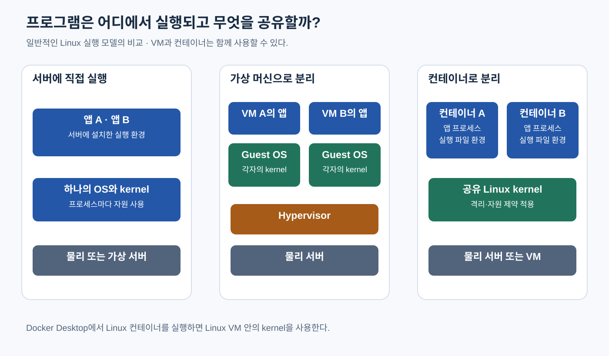

# Kubernetes — 컨테이너는 프로그램을 어떻게 실행할까

> **개발자를 위한 쉬운 쿠버네티스 · 2장** | [전체 목차](./Kubernetes-Introduction.md#이-시리즈의-읽는-순서) · [이전 장](./Kubernetes-Introduction.md) · [다음 장](./Kubernetes-Image-Build-Ship-Run.md)

같은 프로그램이 서버마다 다르게 실행되는 문제에서, 프로세스·VM·Linux 컨테이너의 관계를 살펴본다. [Introduction](./Kubernetes-Introduction.md)에서 이어지는 기초 장이다.

## 결론부터 말하면

**일반적인 Linux 컨테이너는 필요한 파일을 제공받고, Linux 커널의 격리와 자원 제어 기능을 이용해 실행되는 프로세스다.** 별도의 Linux 커널을 컨테이너마다 부팅하는 방식이 아니므로 VM과 실행 구조가 다르다. 그렇다고 파일과 메모리, 네트워크의 모든 경계가 자동으로 안전해지거나 호스트와의 호환 조건이 사라지는 것은 아니다.

이 차이는 배포 문제를 보는 기준이 된다. 실행할 파일을 묶는 것, 프로세스가 볼 수 있는 환경을 나누는 것, 사용할 자원을 제어하는 것은 관련되어 있지만 서로 다른 일이다. 이 장은 그 관계를 먼저 연결한다. 컨테이너를 실제로 만드는 명령보다, 명령이 준비하는 환경을 이해하는 데 초점을 둔다.

## 1. 실행 파일을 복사했는데 왜 결과가 다를까

동료에게 웹 앱을 건네주었는데 “내 컴퓨터에서는 안 된다”는 답을 받았다고 생각해 보자. Java 앱이라면 JAR만 있어도 충분할 것 같지만, 이를 읽어 실행할 JVM이 필요하다. Python 소스라면 Python 실행기와 설치한 패키지가 필요하다. 같은 실행기가 있어도 시스템 라이브러리나 파일 경로, 설정이 다르면 동작이 달라질 수 있다.

먼저 파일과 실행을 나누어 보자. 디스크에 있는 프로그램은 실행할 명령과 데이터를 담은 파일이다. 운영체제가 그 프로그램을 실행하면 **프로세스(process)** 가 된다. 프로세스에는 실행 중인 명령, 메모리 공간, 열어 둔 파일, 네트워크 연결 같은 상태가 생긴다. 같은 실행 파일로 프로세스 두 개를 시작해도 각자의 메모리와 실행 상태를 가진다. 파일이 같다는 것과 실행 중인 대상이 하나라는 것은 다른 말이다.

프로세스 혼자서 하드웨어를 마음대로 다루지는 않는다. 파일을 읽거나 네트워크로 데이터를 보내거나 메모리를 더 얻을 때 운영체제의 핵심인 **커널(kernel)** 에 요청한다. 커널은 CPU 실행 시간을 나누고 메모리와 장치 접근을 관리한다. 프로그램이 사용할 수 있는 기능에는 이 커널과의 관계도 포함된다. 필요한 라이브러리를 모두 복사해도 다른 운영체제의 커널이 요구한 기능을 제공하지 않으면 그대로 실행할 수 없는 이유다.

서버에 앱을 직접 설치하는 방식도 이 원리 위에서 동작한다. 운영자가 실행기와 패키지를 설치하고 계정과 설정을 준비한 뒤 프로세스를 시작한다. 충분히 유효한 배포 방식이지만, 여러 앱이 서로 다른 라이브러리나 설정을 요구하면 환경 관리가 복잡해진다. 다른 앱을 위해 바꾼 설치 내용이 내 앱에 영향을 줄 수 있기 때문이다. 이 관계를 어디까지 분리할지가 다음 문제다.

## 2. VM은 운영체제를 나눌 수 있는 실행 경계를 만든다

한 서버 안에서 서로 다른 환경을 안정적으로 운영하려면 앱을 각기 다른 컴퓨터에 설치하는 방법을 떠올릴 수 있다. 다만 앱마다 물리 서버를 마련하면 관리와 비용 부담이 커진다. **가상 머신(Virtual Machine, VM)** 은 가상 CPU·메모리·장치 등의 실행 환경을 제공해, 물리 서버 한 대에서 여러 운영체제를 구동할 수 있게 한다. 가상화 계층을 관리하는 소프트웨어를 **하이퍼바이저(hypervisor)** 라고 부른다.

각 VM의 운영체제에는 자기 커널이 있다. 따라서 VM 하나에 설치한 패키지와 커널 설정을 다른 VM과 구분해 관리할 수 있다. 같은 물리 장비 위에서 다른 운영체제나 다른 커널이 필요한 경우에도 이 구조가 유용하다. VM의 내부에서 앱을 실행하는 방식 자체는 여전히 프로세스 실행이다. 달라진 것은 그 프로세스가 요청하는 커널과 실행 환경을 VM별로 둘 수 있다는 점이다.

대신 VM마다 운영체제를 부팅하고 관리해야 한다. 운영체제 파일과 메모리, 업데이트 대상이 늘고, 앱 하나만 바꿔도 어느 부분을 배포 단위로 삼을지 고민하게 된다. 모든 환경 차이를 VM 전체로 나누어야 하는 것은 아니다. 커널은 같아도 되지만 앱이 보는 파일과 실행 공간을 분리하고 싶은 경우라면 더 작은 단위를 생각할 수 있다. [Docker의 컨테이너와 VM 설명](https://docs.docker.com/get-started/docker-concepts/the-basics/what-is-a-container/)

## 3. 컨테이너는 같은 커널 위에서 보이는 환경을 나눈다

이 책에서 다루는 일반적인 Linux 컨테이너는 Linux 커널을 공유한다. 앱에 필요한 실행 파일과 라이브러리, 기본 설정을 준비하고, 격리된 환경에서 프로세스를 시작한다. 컨테이너 안에서 별도의 Linux 시스템처럼 디렉터리를 탐색할 수 있어도, 그 안에 커널이 하나 더 부팅되었다는 뜻은 아니다. 예를 들어 이미지 안의 배포판 파일은 Debian 계열이고 실행 서버는 다른 Linux 배포판이어도, 실제 커널은 실행 서버 쪽의 Linux 커널이다.

여기서 **격리(isolation)** 는 무엇이 보이고 어디에 접근할 수 있는지를 나누는 일이다. Linux의 **namespaces** 는 프로세스가 보는 시스템 자원의 범위를 나누는 커널 기능이다. PID namespace는 프로세스 번호와 보이는 프로세스 범위를, network namespace는 네트워크 장치·주소·포트 등의 공간을, mount namespace는 보이는 마운트 구성을 나누는 데 쓰인다. 마운트는 파일시스템이나 저장 공간을 디렉터리 등의 경로에 연결해 접근할 수 있게 하는 것이다. 실행 도구는 이런 기능을 조합해 컨테이너가 자기 실행 공간을 가진 것처럼 보이게 한다. [Linux namespaces(7)](https://man7.org/linux/man-pages/man7/namespaces.7.html)

이 구조를 알면 “컨테이너 안의 localhost”도 덜 신비하다. `localhost`는 접속을 시도하는 프로세스가 속한 네트워크 공간의 자기 자신을 가리킨다. 서로 다른 network namespace를 사용하는 컨테이너에서 같은 `localhost`라는 이름을 써도 같은 네트워크 대상을 뜻하지 않는다. 컨테이너 밖의 DB에 접속하려면 그 DB까지 도달할 주소와 경로가 따로 필요하다. 격리는 통신을 없애는 기능이 아니라 보이는 환경을 나누는 바탕이다.

다만 모든 컨테이너가 항상 모든 namespace를 독립적으로 갖는다고 단정하면 안 된다. 실행 설정에 따라 호스트의 공간이나 다른 컨테이너와 일부 공간을 공유할 수 있다. 뒤에서 배울 Kubernetes의 실행 단위에서도 여러 컨테이너가 네트워크 공간을 공유하는 경우를 만난다. 지금 기억할 점은 “컨테이너”라는 이름만으로 구체적인 격리 범위가 확정되는 것은 아니라는 것이다.

그림 2-1. VM은 게스트 커널을 갖고 일반적인 Linux 컨테이너는 실행 호스트의 커널을 공유한다. VM 안에서 컨테이너를 실행할 수도 있으며, 이 그림은 격리 강도의 순위를 뜻하지 않는다.

## 4. 격리와 자원 제한은 왜 별도로 이해해야 할까

프로세스가 다른 프로세스를 보지 못하게 했다고 CPU와 메모리까지 무한히 분리되는 것은 아니다. 실제로 사용하는 CPU와 RAM은 같은 서버의 자원이다. 앱 하나가 메모리를 계속 할당하면 다른 앱과 호스트도 영향을 받을 수 있다. “서로 다른 컨테이너니까 자원을 얼마든지 써도 된다”는 기대가 무너지는 지점이다.

Linux의 **control groups(cgroups)** 는 프로세스 집합의 자원 사용을 계측하고 제어하는 기능이다. 컨테이너 실행 도구는 이를 활용해 메모리나 CPU 사용을 제어한다. 어느 정도를 제한하고 어떻게 나누는지는 실제 설정에 달려 있다. 컨테이너를 만든 사실만으로 앱에 적합한 한도가 자동으로 정해지지는 않는다. 프로세스가 보는 환경을 나누는 일과 자원 사용을 제어하는 일이 함께 필요한 이유다. [Linux Kernel: Control Group v2](https://docs.kernel.org/admin-guide/cgroup-v2.html)

보안도 격리 하나로 완성되지 않는다. 컨테이너는 커널을 공유하고, 부여한 권한과 연결한 호스트 파일에 따라 영향을 미칠 범위가 달라진다. 호스트의 중요한 디렉터리를 쓰기 가능하게 연결하거나 과도한 권한을 주면 경계가 약해진다. 별도의 커널을 갖는 VM과 같은 보안 경계라고 간주하기보다, 신뢰 수준과 위협에 맞춰 권한·커널 보호·가상화 경계를 함께 선택해야 한다.

| 비교할 지점 | 호스트에서 직접 실행하는 앱 | 일반적인 Linux 컨테이너 | VM 안에서 실행하는 앱 |
|---|---|---|---|
| 앱의 실체 | 프로세스 | 격리된 환경의 프로세스 | 게스트 OS 안의 프로세스 |
| 커널 | 호스트 커널 사용 | 실행 호스트의 Linux 커널 공유 | VM의 게스트 커널 사용 |
| 파일과 라이브러리 준비 | 서버 설치 정책으로 관리 | 이미지와 실행 시 연결할 파일로 관리 | 게스트 OS 설치·이미지로 관리 |
| 환경과 자원 경계 | 계정·권한·프로세스 관리 설정 등에 따라 다름 | namespaces·cgroups·권한 등 실제 설정에 따라 다름 | 가상 하드웨어와 게스트 OS 경계, VM 설정에 따라 다름 |

이 표는 단계별 우열을 나타내지 않는다. 직접 실행하는 앱도 OS의 자원 제어를 사용할 수 있고, VM 안에서 컨테이너 여러 개를 실행할 수도 있다. 컨테이너 도입이 VM을 폐기한다는 뜻이 아니다. 어떤 경계가 필요하며 누가 그 경계를 관리하는지가 선택 기준이다.

## 5. Linux namespaces와 Kubernetes Namespace는 같은 것일까

뒤의 장에서는 Kubernetes의 **Namespace** 라는 이름을 만난다. 비슷한 단어라 컨테이너의 커널 격리 기능과 같은 것으로 생각하기 쉽지만, 두 개념이 다루는 대상은 다르다. Linux namespaces는 지금 살펴본 커널의 프로세스 실행 환경을 나누는 기능이다. Kubernetes Namespace는 클러스터 안에서 일부 API 오브젝트의 이름과 관리 범위를 구분하는 기능이다. 클러스터는 여러 서버를 하나의 관리 체계로 다루는 환경을 뜻한다.

Kubernetes에서는 팀이나 환경별로 같은 이름의 앱 설정을 관리해야 할 수 있다. Namespace를 다르게 두면 그 범위에 속하는 오브젝트의 이름을 구분할 수 있다. 권한이나 자원 할당 정책을 적용할 범위로도 활용한다. 모든 종류의 오브젝트가 Namespace에 속하는 것은 아니며, 구체적인 사용법은 첫 배포와 권한 관련 장에서 설명한다. [Kubernetes Namespaces](https://kubernetes.io/docs/concepts/overview/working-with-objects/namespaces/)

이 관리 범위를 하나 만들었다고 별도의 VM이나 커널이 생기는 것은 아니다. 또한 Namespace를 나누는 행위 자체만으로 앱 사이의 네트워크가 차단된다고 기대해서도 안 된다. 통신 제한은 별도의 정책과 이를 실행하는 네트워크 구현에 달려 있다. 이름에 “나눈다”는 공통점이 있어도, 이름의 범위와 프로세스 실행 경계, 통신 정책을 구분해야 한다. [Kubernetes Network Policies](https://kubernetes.io/docs/concepts/services-networking/network-policies/)

## 6. macOS에서 Linux 컨테이너가 실행되는 이유

앞에서는 Linux 컨테이너가 Linux 커널을 공유한다고 했다. 그런데 개발 컴퓨터가 macOS라면 어느 Linux 커널을 공유할까? Docker Desktop은 이 차이를 Linux VM으로 연결한다. macOS 위에 Linux VM을 실행하고, 컨테이너는 그 VM의 Linux 커널을 사용한다. 터미널에서 `docker` 명령을 입력하는 위치와 컨테이너 프로세스가 실제로 실행되는 운영체제가 다른 것이다. [Docker Desktop Virtual Machine Manager](https://docs.docker.com/desktop/features/vmm/)

따라서 이 환경에서 “호스트”라는 말은 문맥을 확인해야 한다. 파일을 편집하는 물리 개발 컴퓨터는 Mac이고, Linux 컨테이너의 직접적인 실행 호스트는 Linux VM이다. Docker Desktop이 파일 공유와 포트 전달을 제공해 두 환경의 차이를 줄여 주지만, 그것이 경계를 없애지는 않는다. Mac에서 보이는 파일과 네트워크가 Linux 서버와 완전히 같은 방식으로 연결될 것이라고 가정하면 문제를 놓칠 수 있다.

커널뿐 아니라 **CPU 아키텍처** 도 실행 조건이다. 아키텍처는 CPU가 이해하는 명령어 체계를 뜻하며, 이미지에서는 `amd64`, `arm64` 같은 이름으로 나타난다. Apple Silicon 개발 컴퓨터와 x86 서버는 이 조건이 다를 수 있다. Java의 JAR가 동일하더라도 이미지에 포함한 JVM 실행 파일은 CPU와 OS에 맞아야 한다. 다른 아키텍처를 실행하려면 해당 아키텍처용 이미지를 사용하거나 에뮬레이션 같은 별도 조건이 필요하다. [Docker Multi-platform builds](https://docs.docker.com/build/building/multi-platform/)

“같은 이미지면 어디서나 같다”는 표현은 그래서 조건부로 읽어야 한다. 이미지가 고정하는 파일과 실행 기본값은 재사용할 수 있지만, 호환되는 커널과 CPU, 필요한 자원과 외부 연결까지 이미지 안에 들어가는 것은 아니다. 이 조건을 알고 나면 컨테이너가 환경 차이를 줄이는 강력한 도구라는 말과, 환경 검증이 계속 필요하다는 말이 함께 성립한다.

## 7. 파일 묶음과 실행 중인 대상은 다음 장에서 갈라진다

컨테이너의 실행 구조를 알았으니 이제 처음의 배포 문제로 돌아갈 수 있다. 앱에 필요한 파일과 라이브러리를 어떻게 준비해 동료나 서버에 전달할까? 그 파일 묶음과, 이를 바탕으로 시작한 프로세스는 어떻게 구분할까? 이때 등장하는 것이 **컨테이너 이미지(image)** 다. 이미지는 실행에 필요한 파일과 기본 실행 정보를 담는 배포용 묶음이며, 다음 장에서 생성과 전달을 따라간다.

여기서는 실행 조건을 세 부분으로 남겨 두자. 이미지가 제공할 파일, 컨테이너를 시작할 때 정하는 격리·권한·자원·설정, 실행 호스트와 외부 시스템이 제공할 기능이다. 이 셋을 모두 “컨테이너 환경”이라고 뭉뚱그리면 이미지 문제인지 실행 설정 문제인지 판단하기 어렵다. [이미지의 생성과 전달](./Kubernetes-Image-Build-Ship-Run.md)에서는 이 경계를 실제 배포 흐름으로 연결한다.

## 생각해 볼 질문

**같은 이미지로 컨테이너 두 개를 실행했다면 하나의 프로세스를 공유하는 것일까?** 그렇지 않다. 각 컨테이너를 시작할 때 별도의 실행 상태를 갖는 프로세스가 만들어진다. 이미지 파일을 재사용하는 것과 실행 중인 프로세스·메모리 상태를 공유하는 것은 다르다.

**Kubernetes Namespace를 나누면 별도 Linux 커널과 통신 차단이 생길까?** Namespace는 API 오브젝트의 이름과 관리 범위다. 별도 커널을 만들지 않으며 네트워크 차단도 자동으로 보장하지 않는다. Linux namespaces와 정책 구현을 각각 구분해야 한다.

**Mac에서 잘 실행된 Linux 이미지가 Linux 서버에서도 반드시 실행될까?** 실행 서버의 CPU 아키텍처, 커널과의 호환성, 자원, 연결 설정을 확인해야 한다. Mac의 Docker Desktop에서는 Linux VM과 에뮬레이션이 일부 차이를 감추고 있을 수도 있다.

## 출처

공식 문서 확인 기준일: 2026-10-23. 일반적인 Linux 컨테이너를 대상으로 하며, sandbox runtime이나 Windows 컨테이너의 격리 방식은 이 장의 범위 밖이다.

- [Docker: What is a container?](https://docs.docker.com/get-started/docker-concepts/the-basics/what-is-a-container/) — 격리된 프로세스, 커널 공유, VM과 컨테이너의 조합.
- [Linux namespaces(7)](https://man7.org/linux/man-pages/man7/namespaces.7.html) — Linux man-pages 프로젝트의 namespace 종류와 격리 대상.
- [Linux Kernel: Control Group v2](https://docs.kernel.org/admin-guide/cgroup-v2.html) — 프로세스 집합과 자원 제어.
- [Kubernetes Network Policies](https://kubernetes.io/docs/concepts/services-networking/network-policies/) — 통신 제한과 이를 구현하는 네트워크 플러그인의 관계.
- [Docker Engine security](https://docs.docker.com/engine/security/) — namespaces, cgroups, 권한과 보안 경계.
- [Kubernetes Namespaces](https://kubernetes.io/docs/concepts/overview/working-with-objects/namespaces/) — Kubernetes API 오브젝트의 이름과 관리 범위.
- [Docker Desktop Virtual Machine Manager](https://docs.docker.com/desktop/features/vmm/) — Linux 컨테이너를 실행하는 Desktop Linux VM.
- [Docker Multi-platform builds](https://docs.docker.com/build/building/multi-platform/) — 호스트 커널·CPU 호환성과 플랫폼별 이미지.
