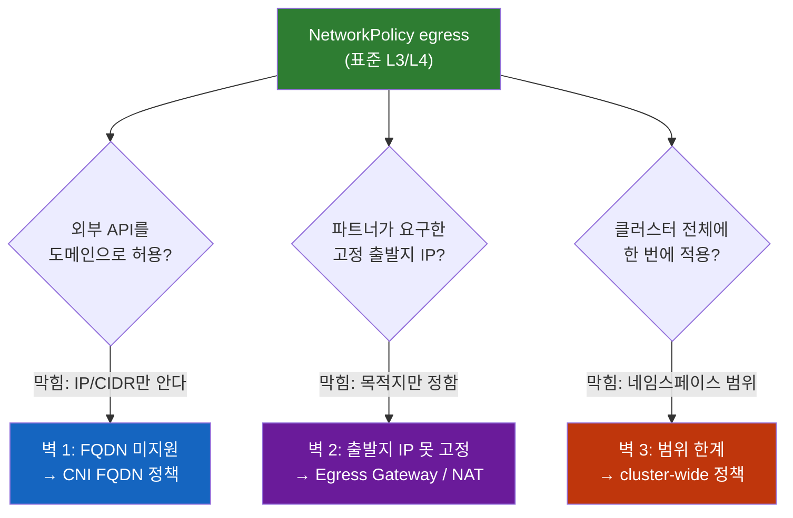
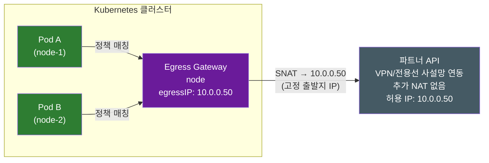
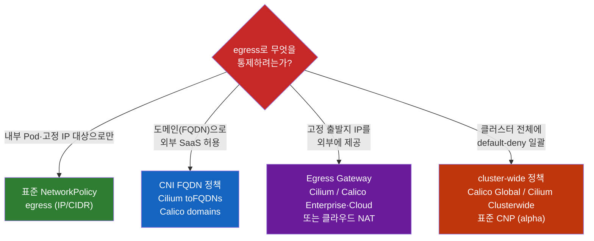

# Kubernetes Egress NetworkPolicy

> **개발자를 위한 쉬운 쿠버네티스 · 확장 읽기** | [전체 목차](./Kubernetes-Introduction.md#이-시리즈의-읽는-순서)

**쿠버네티스 Egress 통제는 왜 NetworkPolicy 하나로 끝나지 않을까**

프로덕션 클러스터를 잠그는 첫 단추는 보통 이렇게 시작한다. 네임스페이스에 `default-deny-egress`를 깔고, Pod가 통신을 시작할 수 있게 DNS(53 포트)만 열어준다. (`kind: Egress` 리소스가 따로 없고 NetworkPolicy의 `egress` 필드로 나가는 트래픽을 다룬다는 이야기, default-deny와 DNS 함정은 [Kubernetes Ingress vs Egress](./Kubernetes-Ingress-vs-Egress.md)에서 다뤘다.)

여기까지 오면 다음 요구가 자연스럽게 따라온다. **"이제 우리 결제 서비스가 외부 결제 게이트웨이(`api.payment.com`)랑 S3에만 나갈 수 있게 허용하자."** NetworkPolicy의 `egress`에 그 도메인을 적으려고 YAML을 여는 순간, 첫 번째 벽에 부딪힌다. **거기엔 도메인을 적는 칸이 없다.**

이 글은 [들어오는 통신과 나가는 통신 장](Kubernetes-Ingress-vs-Egress.md)의 확장 읽기다. 표준 NetworkPolicy의 허용 합집합과 양쪽 Pod의 ingress·egress 판단을 전제로 한다. `bookstore`의 `app: order-api`, 앱 8080·Service 80과 이미지 `registry.example.com/book/order-api:1.0.0`은 가상 사례이며 외부 API 주소·CIDR도 실제 서비스 계약이 아니다.

이 글은 그 벽에서 출발한다. 표준 NetworkPolicy로 egress를 잠그려다 만나는 **세 개의 벽**, 그리고 각각을 넘는 실무 도구를 YAML 수준에서 정리한다.

---

## 결론부터 말하면

표준 NetworkPolicy의 `egress`는 "나가는 트래픽을 제어한다"는 첫 단계까지만 책임진다. 현실의 egress 요구는 그 경계 밖에서 세 번 막힌다.



| 벽 | 표준 NetworkPolicy의 한계 | 넘는 도구 |
|----|--------------------------|-----------|
| **1. FQDN을 모른다** | 목적지를 IP/CIDR로만 지정. `api.payment.com` 같은 도메인 불가 | CNI FQDN 정책 (Cilium `toFQDNs`, Calico `domains`), GKE FQDNNetworkPolicy |
| **2. 출발지 IP를 못 고정한다** | "어디로 나갈지"만 정하고 "어떤 IP로 나갈지"는 정하지 못함 | Egress Gateway (Cilium·Calico Enterprise/Cloud), 클라우드 NAT Gateway |
| **3. 네임스페이스 범위다** | 정책이 한 네임스페이스 안에서만 유효 | cluster-wide 정책 (Calico Global, Cilium Clusterwide, 표준 ClusterNetworkPolicy(구 AdminNetworkPolicy)) |

핵심은 이거다. **egress 통제는 "NetworkPolicy"라는 단일 도구가 아니라, "무엇을 통제하려는가"에 따라 골라 쌓는 도구 스택이다.** 표준 리소스가 멈추는 지점을 알아야 그 다음 도구를 꺼낼 수 있다. 벽을 하나씩 넘어보자.

---

## 1. 첫 번째 벽 — NetworkPolicy는 도메인을 모른다

### 1-1. 왜 IP/CIDR만 되는가

표준 NetworkPolicy의 egress 규칙에서 외부 목적지를 지정하는 방법은 `ipBlock` 하나뿐이다.

```yaml
apiVersion: networking.k8s.io/v1
kind: NetworkPolicy
metadata:
  name: allow-egress-payment
  namespace: bookstore
spec:
  podSelector:
    matchLabels:
      app: order-api
  policyTypes:
  - Egress
  egress:
  - to:
    - ipBlock:
        cidr: 203.0.113.10/32   # ← IP만 적을 수 있다. 도메인 칸이 없다.
    ports:
    - protocol: TCP
      port: 443
```

`to:` 아래에 올 수 있는 건 `ipBlock`, `namespaceSelector`, `podSelector` 셋뿐이다. **`api.payment.com`이라고 적을 자리가 애초에 스키마에 없다.** 이건 버그가 아니라 설계다.

이유는 NetworkPolicy가 동작하는 계층에 있다. NetworkPolicy는 지원·활성화된 네트워크 정책 엔진이 집행하는 **L3/L4 규칙** 이다. 엔진은 CNI에 결합되거나 별도로 제공될 수 있다. 패킷이 흐르는 순간 커널이 보는 건 출발지/목적지 **IP와 포트**일 뿐, L3/L4 규칙만으로는 "앱이 원래 어떤 도메인으로 연결하려 했는지"를 판별할 수 없다. TLS SNI나 HTTP Host 같은 상위 계층 정보가 존재할 수 있지만 표준 NetworkPolicy가 이를 평가하는 것은 아니다. 도메인→IP 변환(DNS)은 그보다 한참 앞, 애플리케이션이 연결을 맺기 전에 이미 끝나버린 별개의 사건이다. 그래서 IP 필터는 도메인을 알 길이 없다.

### 1-2. "그럼 S3 IP를 다 적으면 되잖아"가 안 되는 이유

여기서 흔한 반격이 나온다. "도메인이 안 되면 그 도메인의 IP를 전부 `ipBlock`에 적으면 되지 않나?" 결제 게이트웨이가 IP 한두 개면 그럴 수도 있다. 문제는 클라우드 SaaS다.

S3, `*.amazonaws.com`, 외부 모니터링(Datadog 등) 같은 엔드포인트는 **수백 개의 IP로 흩어져 있고, 그 IP 목록이 예고 없이 바뀐다.** 오늘 적어둔 CIDR이 내일 무효가 되면, 정책은 조용히 트래픽을 막거나(서비스 장애) 너무 넓게 열어둔(보안 구멍) 상태가 된다. IP를 손으로 관리하는 순간 정책은 깨지기로 예약된 셈이다.

즉 첫 번째 벽의 본질은 **"우리가 통제하고 싶은 단위(도메인)와 NetworkPolicy가 아는 단위(IP)가 다르다"**는 불일치다.

---

## 2. 벽 1을 넘기 — DNS를 가로채는 FQDN 정책

### 2-1. 아이디어: 정책 엔진이 DNS 응답을 엿본다

해법의 발상은 단순하다. **Pod가 던지는 DNS 질의의 응답을 정책 엔진이 가로채서, "이 도메인 → 방금 이 IP로 풀렸다"를 실시간으로 학습하고 IP allowlist를 자동 갱신한다.** 관리자는 도메인만 적고, IP 추적은 엔진이 대신한다. 이게 FQDN 기반 egress 정책이다.

단, **이건 표준 Kubernetes NetworkPolicy 기능이 아니다.** 공식 Network Policy API 프로젝트도 이 점을 명시한다 — 표준 NetworkPolicy v1은 FQDN egress 셀렉터를 지원하지 않으며, NPEP-133("FQDN Selector for Egress Traffic")은 프로젝트에서 Experimental 채널로 분류되며 제안 문서의 상태는 Implementable이다. 대상은 namespaced NetworkPolicy v1이 아니라 `ClusterNetworkPolicyEgressPeer.domainNames`다. 그래서 현실의 FQDN 정책은 **CNI나 벤더의 확장 리소스(CRD)**로 구현된다.

### 2-2. Cilium — `toFQDNs` (eBPF + DNS 프록시)

Cilium은 `CiliumNetworkPolicy`라는 CRD로 도메인을 직접 받는다. DNS 질의를 프록시로 가로채 응답 IP를 eBPF 맵에 등록하는 방식이다.

```yaml
apiVersion: cilium.io/v2
kind: CiliumNetworkPolicy
metadata:
  name: allow-payment-fqdn
  namespace: bookstore
spec:
  endpointSelector:
    matchLabels:
      app: order-api
  egress:
  # 1) DNS 자체를 먼저 허용하고, 그 응답을 가로채겠다고 선언
  - toEndpoints:
    - matchLabels:
        io.kubernetes.pod.namespace: kube-system
        k8s-app: kube-dns
    toPorts:
    - ports:
      - port: "53"
        protocol: ANY
      rules:
        dns:
        - matchPattern: "*"      # DNS 응답을 관찰
  # 2) 도메인으로 목적지 지정
  - toFQDNs:
    - matchName: "api.payment.com"
    # 필요한 서비스 hostname을 실제 계약에 맞게 제한한다
    toPorts:
    - ports:
      - port: "443"
        protocol: TCP
```

### 2-3. Calico — `destination.domains`

Calico는 자체 `NetworkPolicy`(API 그룹 `projectcalico.org/v3`)의 egress 규칙에 `domains`를 받는다. **단, 이 FQDN(`domains`) 기능은 오픈소스 Calico에는 없고 상용 에디션(Calico Enterprise·Calico Cloud) 전용이다.** 오픈소스 Calico만 쓰는 환경이라면 이 예제는 동작하지 않으니, FQDN이 필요하면 Cilium(2-2)이나 GKE FQDNNetworkPolicy 쪽을 봐야 한다.

```yaml
apiVersion: projectcalico.org/v3
kind: NetworkPolicy
metadata:
  name: allow-payment-fqdn
  namespace: bookstore
spec:
  selector: app == "order-api"
  types:
  - Egress
  egress:
  - action: Allow
    protocol: TCP
    destination:
      domains:
      - "api.payment.com"
      # 필요한 실제 서비스 hostname을 좁혀 추가한다
      ports:
      - 443
  # DNS 허용은 별도 규칙으로 반드시 함께
  - action: Allow
    protocol: UDP
    destination:
      nets:
      - 10.96.0.10/32  # 설명용 trusted resolver. 실제 경로·정책 평가 주소 확인
      ports:
      - 53
  - action: Allow
    protocol: TCP
    destination:
      nets:
      - 10.96.0.10/32
      ports:
      - 53
```

### 2-4. 꼭 짚어야 할 함정: FQDN 정책은 DNS 접근을 자동 허용하지 않는다

여기서 [Kubernetes Ingress vs Egress](./Kubernetes-Ingress-vs-Egress.md)에서 다룬 "DNS를 열어둬라"보다 **한 단계 더 깊은 함정**이 있다. 표준화 제안 NPEP-133이 명시하는 원칙이다. 다음 인용의 “DNS 필터링이 아니다”는 이 제안의 범위이며, Cilium `rules.dns`나 EKS Auto Mode DNS proxy의 동작에 그대로 일반화하지 않는다.

> FQDN egress 정책은 그 자체로 워크로드에 in-cluster DNS 서비스(`kube-dns` 등)로의 통신 권한을 주지 않는다. DNS 서버로의 트래픽은 별도 규칙으로 허용해야 한다. 또한 FQDN 정책은 도메인 **해석(resolve)** 능력에는 관여하지 않고, 오직 해석된 IP로의 **통신**만 통제한다 — 즉 DNS 필터링이 아니다.

직관적으로는 "`api.payment.com`을 허용했으니 그 이름을 풀어보는 것도 당연히 되겠지"라고 생각하기 쉽다. 그러나 **도메인을 푸는 것(DNS 53)과 풀린 IP로 나가는 것(443)은 정책상 완전히 별개의 두 흐름**이다. 위 두 예제가 모두 DNS 규칙을 *따로* 둔 건 이 때문이다. FQDN 정책만 적고 DNS를 깜빡하면, 엔진이 응답을 가로챌 DNS 질의 자체가 막혀서 도메인 매칭이 영영 일어나지 않는다.

또 하나 실무에서 자주 터지는 함정이 **DNS 캐시와 TTL 불일치**다. 애플리케이션 DNS cache와 엔진의 FQDN cache 유지 시간이 어긋나면, 앱은 재사용하려는 IP를 정책 엔진은 더 이상 허용하지 않는 상황이 생길 수 있다. JVM의 DNS cache 기간은 버전·보안 속성·실행 설정에 따라 다르므로 "기본은 영구 cache"로 일반화하지 않는다. 엔진도 최소 TTL·활성 연결 추적 등 구현 조건이 있어 DNS TTL 직후 무조건 모든 연결이 차단된다고 단정할 수 없다. CDN·GSLB처럼 질의마다 IP가 바뀌는 대상이면 이 불일치가 더 잦다. 그래서 애플리케이션 DNS 캐시 TTL을 낮추고 엔진의 FQDN 캐시 유지 시간(Cilium `--tofqdns-min-ttl` 등)을 함께 조율하는 게 중요하다.

### 2-5. FQDN 허용은 hostname 신원 검증과 다르다

DNS 기반 정책은 허용된 이름에서 얻은 IP·포트에 통신을 허용하는 모델이다. CDN·공유 호스팅처럼 여러 도메인이 같은 IP를 쓰면, 허용한 이름과 같은 IP를 쓰는 다른 서비스에 연결할 여지도 있다. TLS에서 기대한 서버 이름·인증서를 검증하는 책임이나 HTTP Host 검사와 동일하지 않다. 광범위한 `*.amazonaws.com` 허용은 특정 S3 bucket 또는 계정의 서비스 identity를 제한하는 정책이 아니다.

엔진이 어느 resolver의 응답을 신뢰하는지, 앱의 DNS가 그 경로에서 관찰되는지, CNAME·TTL·cache와 직접 IP 연결을 어떻게 처리하는지 확인해야 한다. DoH처럼 관찰 경로를 벗어난 이름 해석을 허용할지도 별도 정책 결정이다. DNS 가시성과 도메인에 대한 통신 허용, 실제 서버 신원 검증을 서로 분리해서 검토한다.

### 2-6. 벤더 게이팅 — 왜 "CNI를 갈아끼우는가"

FQDN 정책이 표준이 아니다 보니, 환경마다 가용성이 들쭉날쭉하다. 이 비대칭이 "FQDN 하나 때문에 CNI를 통째로 바꾸는" 실무 결정의 배경이다.

| 환경 | FQDN egress 지원 |
|------|------------------|
| **Cilium** (CNI 교체/설치) | `toFQDNs`로 네이티브 지원 |
| **Calico** | `destination.domains`는 Enterprise/Cloud 기능. OSS 일반 기능과 구분 |
| **GKE** | `FQDNNetworkPolicy` 리소스 (`--enable-fqdn-network-policy`) — Dataplane V2·지원 버전·DNS 조건 확인 |
| **EKS Auto Mode 노드** | `ApplicationNetworkPolicy`(`networking.k8s.aws/v1alpha1`)의 `egress.to.domainNames`로 지원. Network Policy Controller 활성화 필요 |
| **그 외 EKS/VPC CNI 노드** | 위 Auto Mode DNS 규칙의 적용 대상이 아님. 설치 구성의 지원 기능이나 별도 정책 엔진·프록시를 검토 |
| **표준 NetworkPolicy v1** | FQDN 미지원. NPEP-133은 별도 CNP API의 Experimental 기능 |

EKS Auto Mode의 DNS 규칙은 Auto Mode가 실행한 EC2 Node의 워크로드에만 적용된다. 혼합 클러스터에서는 다른 Node에 배치된 같은 앱까지 보호한다고 가정하면 안 된다. 이 기능은 2025년 12월 발표되었으며, 지원되는 환경에서는 CNI 교체 없이 사용할 수 있다.

FQDN 기능을 위해 CNI를 바꾸는 선택은 가능하지만, "도메인 하나 허용하려고 네트워킹 레이어를 통째로 교체"하는 셈이라 운영 복잡도가 크게 오른다. 표준이 아직 이 자리를 못 채우고 있다는 게 egress의 현주소다.

---

## 3. 두 번째 벽 — "어디로 나갈지"는 정해도 "어떤 IP로 나갈지"는 못 정한다

도메인 허용까지 끝냈다고 하자. 그런데 외부 파트너가 이렇게 요구한다. **"우리 방화벽은 출발지 IP 화이트리스트로 동작합니다. 당신들이 우리에게 접속할 때 쓰는 고정 IP를 알려주세요."**

NetworkPolicy를 아무리 들여다봐도 이걸 만족시킬 방법이 없다. NetworkPolicy의 egress는 **목적지(to)**를 통제하는 도구이지, **출발지 IP를 지정**하는 도구가 아니기 때문이다. Pod IP 보존, Node SNAT, 상위 NAT에 따라 상대가 보는 주소가 달라지는 배경은 [Kubernetes Ingress vs Egress 4절](./Kubernetes-Ingress-vs-Egress.md#4-나갈-수-있는-대상과-상대가-보는-출발지-ip)에서 설명했다. 여기서는 선택된 Pod의 경로와 SNAT를 어떻게 구성하는지 살펴본다.

### 3-1. Egress Gateway — 트래픽을 한 노드로 모아 SNAT

해법은 **선택된 Pod들의 외부행 트래픽을 특정 게이트웨이 노드로 모으고, 그 노드의 고정 IP로 SNAT(출발지 주소 변환)** 하는 것이다. 정책에 매칭되어 그 경로를 실제로 사용하는 연결은 지정한 주소로 SNAT된다. 정책이 적용되지 않은 연결이나 이후 추가 NAT의 관측 주소까지 자동으로 같아지는 것은 아니다.



Cilium은 `CiliumEgressGatewayPolicy` CRD로 이걸 선언한다.

```yaml
apiVersion: cilium.io/v2
kind: CiliumEgressGatewayPolicy
metadata:
  name: egress-payment
spec:
  # 1) 어떤 Pod의 트래픽을 모을지
  selectors:
  - podSelector:
      matchLabels:
        app: order-api
        io.kubernetes.pod.namespace: bookstore   # Cilium은 네임스페이스를 이 특수 라벨로도 지정 (namespaceSelector로 분리해도 됨)
  # 2) 어떤 목적지로 향할 때 적용할지
  destinationCIDRs:
  - "203.0.113.0/24"
  # 3) 어느 노드를 게이트웨이로, 어떤 IP로 SNAT할지
  egressGateway:
    nodeSelector:
      matchLabels:
        node-role: egress-gateway
    egressIP: 10.0.0.50        # 사설 파트너 경로에서 기대하는 SNAT 주소
```

세 가지 핵심 필드만 기억하면 된다. `selectors`(모을 Pod) · `destinationCIDRs`(적용할 목적지) · `egressGateway.egressIP`(고정 출발지 IP). `egressIP`는 반드시 게이트웨이 노드의 네트워크 인터페이스에 실제로 할당된 주소여야 하며, Cilium은 BPF masquerading과 kube-proxy replacement, egress gateway 기능 활성화를 전제로 한다. 설치한 버전의 `bpf.masquerade`, `kubeProxyReplacement`, `egressGateway.enabled` 조건과 비호환 기능도 확인해야 한다. Gateway 주소를 실제로 할당하고 왕복 route를 구성하는 일은 운영자의 책임이다.

특히 Cilium 공식 문서는 새 Pod의 identity·정책 정보가 전달되어 egress 정책이 적용되기 전까지 지연이 있으며, 그동안 Pod/Node IP로 트래픽이 나갈 수 있음을 경고한다. "Pod를 만들면 첫 패킷부터 언제나 같은 IP"라고 가정할 수 없다. 첫 연결부터의 제한이 요구되면 정책 적용 시점과 우회 방지를 별도로 검증해야 한다.

### 3-2. 진짜 그 IP로 나가는지 검증하기

검증 대상은 gateway에서 SNAT된 주소와 최종 상대가 관측하는 주소로 나눈다. 예제의 `10.0.0.50`은 사설 주소다. 사설망에서 추가 NAT 없이 연결된 파트너는 이 주소를 볼 수 있지만, 인터넷 상대는 이후 public NAT가 사용한 공인 주소를 본다. 인터넷 IP 확인 서비스가 `10.0.0.50`을 반환해야 성공이라는 기준은 틀리다.

또한 Egress Gateway는 `destinationCIDRs`에 맞는 목적지에만 적용된다. 예제의 `203.0.113.0/24`는 문서용 CIDR이며 실제 인터넷 IP 확인 서비스는 이 대역에 속하지 않는다. 전혀 다른 목적지로 검증하면 다른 route를 관측하는 셈이다. 검증하려고 운영 정책을 `0.0.0.0/0`으로 넓히기보다, 의도한 CIDR 안의 사설 테스트 endpoint나 실제 파트너 로그를 사용한다.

```bash
# 설명용: Pod에 curl이 있고 사설 파트너 이름·경로가 준비된 경우
kubectl exec -n bookstore deploy/order-api -- \
  curl -v https://partner.internal.example.com/health
```

상대 측 access log에서 출발지 주소를 확인하고, 해당 연결이 선택된 gateway를 통과했는지 flow 관측과 연결한다. 인터넷 목적지를 검증한다면 목적지의 CIDR 매칭과 public NAT 경로를 먼저 확인한 뒤 최종 공인 주소를 비교한다. 예상과 다르면 Pod selector·목적지·정책 반영·gateway 주소·상위 NAT를 순서대로 나눈다. 정책에 맞지 않는 연결은 환경의 기본 경로를 따르며, 그 경로가 항상 Node SNAT인 것은 아니다.

> **실무 주의 — 게이트웨이 노드는 SPOF다.** 모든 egress를 한 노드로 모으는 구조라, 그 노드가 죽으면 매칭된 Pod들의 외부 통신이 끊기고 평상시에도 대역폭 병목이 될 수 있다. 프로덕션에서는 다중 게이트웨이 노드와 egress IP failover(HA) 구성을 함께 검토해야 한다.

### 3-3. 더 단순한 대안 — 클라우드 NAT Gateway

고정 egress IP가 필요한데 CNI Egress Gateway까지 운영하기 부담스럽다면, **클라우드 NAT Gateway**가 더 거친 대안이다. 클라우드 route에 따라 해당 NAT를 통과하는 연결을 지정한 주소 또는 주소 pool로 변환한다. Public NAT·private NAT와 인터넷 gateway 연결 조건을 구분해야 한다.

차이는 선택 범위다. Egress Gateway는 "라벨로 고른 특정 Pod"만 골라 고정 IP를 줄 수 있지만, NAT Gateway는 **그 NAT로 route된 트래픽** 에 적용된다. 사설 endpoint나 별도 route를 사용하는 연결까지 일괄 변환하는 것은 아니다. "결제 Pod만 이 IP로"가 필요하면 Egress Gateway, "이 노드풀 전체가 이 IP로 나가면 됨"이면 NAT Gateway가 맞다.

---

## 4. 세 번째 벽 — 정책이 네임스페이스를 넘지 못한다

마지막 벽은 운영 규모에서 드러난다. 표준 NetworkPolicy는 **네임스페이스 범위(namespace-scoped)** 리소스다. 한 NetworkPolicy는 자신이 속한 네임스페이스의 Pod에만 영향을 준다.

그래서 "클러스터의 **모든** 네임스페이스에 default-deny egress를 강제하고 싶다"는 보안 요구가 들어오면, 표준 도구로는 **네임스페이스 수만큼 같은 정책을 복제**해야 한다. 새 namespace에도 정책을 배포할 자동화가 필요하다. 누락하면 표준 NetworkPolicy 계층에서는 제한되지 않을 수 있다. 상위 관리자 정책이나 방화벽의 유무까지 함께 확인한다. 팀이 자유롭게 네임스페이스를 만드는 환경에서 이건 시간문제일 뿐인 사고다.

### 4-1. CNI의 cluster-wide 정책

아래 Calico 예제의 `domains`도 Enterprise/Cloud 기능이다. 전역 범위·평가 순서는 표준 NetworkPolicy의 허용 합집합과 다를 수 있으며 기존 정책과 함께 검토한다.

CNI들은 이를 위해 클러스터 범위 CRD를 제공한다. 한 번 적용하면 네임스페이스 경계를 넘어 전체에 걸린다.

- **Calico**: `GlobalNetworkPolicy` — 클러스터 전역, `order`로 평가 우선순위 지정
- **Cilium**: `CiliumClusterwideNetworkPolicy` — 네임스페이스에 묶이지 않는 전역 정책

```yaml
# Calico: 클러스터 전역으로 승인된 외부 서비스만 egress 허용
apiVersion: projectcalico.org/v3
kind: GlobalNetworkPolicy
metadata:
  name: allow-approved-egress
spec:
  order: 100
  selector: has(app)        # app 라벨이 있는 모든 워크로드
  types:
  - Egress
  egress:
  - action: Allow
    protocol: TCP
    destination:
      domains:
      - "*.datadoghq.com"
      # 필요한 실제 서비스 hostname을 좁혀 추가한다
      ports:
      - 443
  # DNS는 실제 trusted resolver에 UDP/TCP 53을 별도 허용해야 한다
```

### 4-2. 표준화의 방향 — ClusterNetworkPolicy (구 AdminNetworkPolicy)

이 "관리자가 클러스터 전역 정책을 거는" 영역도 표준화가 진행 중이다. sig-network의 **Network Policy API** 프로젝트가 `AdminNetworkPolicy`(ANP)와 `BaselineAdminNetworkPolicy`(BANP)를 내놨는데, 일반 NetworkPolicy와 달리 **클러스터 범위 리소스**이고 관리자가 사용자 정책보다 우선하는(또는 기본값이 되는) 규칙을 건다.

다만 성숙도는 아직 이르다. ANP/BANP는 `policy.networking.k8s.io/v1alpha1` — **alpha** 단계였고, 2026-04-21 릴리스 v0.2.0에서 두 리소스가 **`ClusterNetworkPolicy`(CNP) 하나로 합쳐졌다**(`policy.networking.k8s.io/v1alpha2`, 여전히 alpha). CNP는 `tier` 필드(`Admin` 또는 `Baseline`)로 우선순위를 구분하고, 액션 이름 `Allow`가 `Accept`로 바뀌었으며, `ports` 필드가 TCP·UDP·SCTP별로 매칭하는 `protocols` 필드로 대체됐다. 프로젝트 홈은 ANP/BANP를 "다음 단계로 진화해 더 이상 활발히 개발되지 않는" API로 분류한다. 이미 ANP/BANP 매니페스트가 있다면 CNP로 옮길 계획을 세워야 한다. 2026-10-23 확인 기준 이 API는 표준화 프로젝트의 별도 CRD alpha API다. built-in NetworkPolicy v1의 기능도, 모든 CNI가 지원하는 운영용 계약도 아니다. 설치 구현체가 어떤 버전·tier·동작을 지원하는지 확인한 뒤 도입한다. 이미 벤더 전역 정책을 사용한다면 migration·우선순위·혼합 동작을 별도로 검증한다.

---

## 5. 정리 — egress는 단일 도구가 아니라 도구 스택이다

처음 질문으로 돌아가자. "default-deny 깔고 결제 API만 열자"는 단순한 요구가 왜 NetworkPolicy 하나로 안 끝났는가. 그 요구가 표준 NetworkPolicy의 세 가지 경계를 동시에 건드리기 때문이다.



| 통제 목표 | 도구 | 표준 여부 |
|-----------|------|-----------|
| 내부 Pod·고정 IP 대상 허용/차단 | NetworkPolicy `egress` (`ipBlock`) | **표준** |
| 외부 도메인(SaaS) 허용 | Cilium `toFQDNs` / Calico `domains` / GKE FQDNNetworkPolicy / EKS Auto Mode ApplicationNetworkPolicy | CNI·벤더 확장. 별도 CNP의 NPEP-133은 Experimental |
| 고정 출발지 IP 제공 | Egress Gateway (SNAT) / 클라우드 NAT Gateway | CNI·인프라 |
| 클러스터 전역 일괄 정책 | Calico Global / Cilium Clusterwide / ClusterNetworkPolicy | CNI 주력 (표준 CNP v1alpha2) |

기억할 한 가지. **표준 NetworkPolicy가 어디서 멈추는지를 알아야, 다음에 어떤 도구를 꺼낼지 판단할 수 있다.** egress 통제에서 "NetworkPolicy로 안 되네?"는 막다른 길이 아니라, 요구가 L3/L4·목적지·네임스페이스라는 표준의 세 경계 중 어디를 넘었는지 알려주는 신호다. 그 경계를 읽으면 FQDN 정책인지, Egress Gateway인지, cluster-wide 정책인지가 따라 나온다.

> 📖 관련 문서: [Kubernetes Ingress vs Egress](./Kubernetes-Ingress-vs-Egress.md) — `kind: Egress`가 없는 이유, NetworkPolicy egress 기본기와 default-deny·DNS 함정, "Ingress"라는 단어의 두 얼굴

---

## 출처

- [Kubernetes 공식 — Network Policies](https://kubernetes.io/docs/concepts/services-networking/network-policies/) — 표준 NetworkPolicy egress와 `ipBlock`
- [Network Policy API (sig-network) — 프로젝트 홈](https://network-policy-api.sigs.k8s.io/) — AdminNetworkPolicy/BaselineAdminNetworkPolicy(v1alpha1), ClusterNetworkPolicy 진화
- [network-policy-api v0.2.0 릴리스 노트 (2026-04-21)](https://github.com/kubernetes-sigs/network-policy-api/releases/tag/v0.2.0) — ANP·BANP를 ClusterNetworkPolicy(v1alpha2, `tier` 필드)로 통합, `Allow`→`Accept`, `ports`→`protocols`
- [NPEP-133 — FQDN Selector for Egress Traffic](https://network-policy-api.sigs.k8s.io/npeps/npep-133-fqdn-egress-selector/) — 표준 FQDN egress 제안(Experimental)과 DNS 처리 원칙
- [Cilium — DNS based policies (`toFQDNs`)](https://docs.cilium.io/en/stable/security/policy/language/#dns-based) — FQDN egress 정책
- [Cilium — Egress Gateway](https://docs.cilium.io/en/stable/network/egress-gateway/egress-gateway/) — `CiliumEgressGatewayPolicy`, `egressIP`, SNAT 검증
- [Calico Egress Gateways](https://docs.tigera.io/use-cases/egress-gateways) — Enterprise/Cloud 제품 기능
- [Calico — Egress traffic / domain-based policy](https://docs.tigera.io/calico-enterprise/latest/network-policy/domain-based-policy) — `destination.domains`, GlobalNetworkPolicy
- [GKE — Control Pod egress with FQDN network policies](https://docs.cloud.google.com/kubernetes-engine/docs/how-to/fqdn-network-policies) — `FQDNNetworkPolicy` 요구 조건과 공유 IP 한계
- [Calico/Tigera — About Kubernetes Egress ("there is no Kubernetes Egress resource")](https://docs.tigera.io/calico/latest/about/kubernetes-training/about-kubernetes-egress)

- [AWS — NAT gateways](https://docs.aws.amazon.com/vpc/latest/userguide/vpc-nat-gateway.html) — 경로·public/private NAT와 최종 관측 주소

기능·제품 조건은 2026-10-23 확인한 공식 문서 기준이다. 예제의 파싱 가능성과 실제 설치 버전의 CRD 호환성·정책 집행·외부 관측 성공은 서로 다른 검증이다.

- [EKS Auto Mode network policies](https://docs.aws.amazon.com/eks/latest/userguide/auto-net-pol.html) — ApplicationNetworkPolicy·Auto Mode EC2와 혼합 클러스터 적용 범위
- [EKS enhanced network security policies announcement (2025-12)](https://aws.amazon.com/about-aws/whats-new/2025/12/amazon-eks-enhanced-network-security-policies/)
