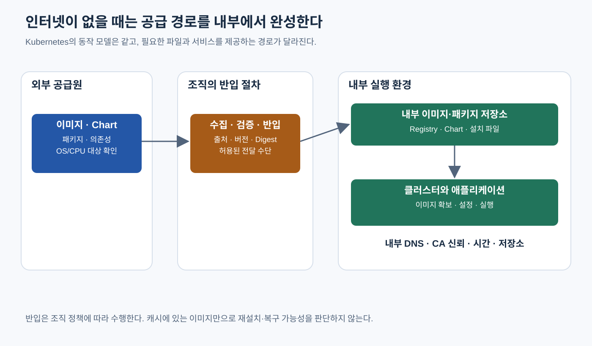

# Kubernetes First Deployment

> **개발자를 위한 쉬운 쿠버네티스 · 5장** | [전체 목차](./Kubernetes-Introduction.md#이-시리즈의-읽는-순서) · [이전 장](./Kubernetes-Why-Orchestration.md) · [다음 장](./Kubernetes-Architecture.md)

첫 배포 — 직접 만든 이미지가 HTTP 응답이 되는 과정을 확인한다.

## 결론부터 말하면

**소스 파일에서 이미지를 만들고, 실행할 Node에 이미지를 공급하고, 원하는 실행 상태를 제출한 뒤 실제 HTTP 응답까지 확인해야 첫 배포가 연결된다.** 이 장에서는 개인 컴퓨터의 Docker와 kind로 전용 학습 클러스터를 만든다. 회사나 고객 클러스터 접속은 필요하지 않다.

주문 API라는 공통 사례의 이름은 `order-api`다. 그러나 이 장의 앱은 주문 처리를 구현하지 않은 작은 정적 HTTP 데모다. 첫 페이지에 버전을 표시하고 `/readyz`, `/livez`, `/startupz`에서 `ok` 파일을 반환한다. 모든 경로는 Python 표준 HTTP 서버가 제공하므로 DB 연결이나 실제 주문 성공을 검사하지 않는다. 이 제한을 알고 시작해야 뒤의 Probe 장에서도 건강 확인이 무엇을 증명하는지 정확히 구분할 수 있다.

## 1. 필요한 도구와 연결 대상을 먼저 확인한다

Docker Engine 또는 Docker Desktop의 **로컬 Linux 컨테이너 실행 환경**, `kind`, `kubectl`, `curl`과 이 저장소가 필요하다. macOS의 Docker Desktop은 내부 Linux VM을 사용한다. kind는 Docker 컨테이너를 Kubernetes Node로 쓰므로 여러 물리 서버를 준비하지 않고 배포 관계를 연습할 수 있다. Docker·kind 설치 파일과 최초 베이스 이미지·Node 이미지를 받을 인터넷 연결도 필요하다. 설치는 각 도구의 공식 안내를 따르며, 조직의 Docker Desktop 사용 조건도 확인한다. [kind Quick Start](https://kind.sigs.k8s.io/docs/user/quick-start/), [Docker 설치 안내](https://docs.docker.com/engine/install/)

아래 명령은 macOS/Linux의 Bash 또는 Zsh에서 **저장소 루트**를 현재 디렉터리로 두고 실행한다. 먼저 설치 여부와 Docker context 목록을 읽는다.

```bash
docker --version
kind version
kubectl version --client
curl --version
docker context ls
```

Docker context는 Docker daemon의 접속 대상을 가리킨다. 아래 `desktop-linux`는 macOS Docker Desktop의 예시다. Linux의 로컬 Engine에서는 보통 `default`를 선택하되 목록에 있는 이름을 사용한다. inspect 결과의 endpoint가 자신이 의도한 로컬 Unix socket인지 확인한다. 원격 SSH/TCP daemon을 가리킨다면 여기서 멈추고 로컬 실행 환경을 준비한다. context 선택의 효과와 환경변수 우선순위는 [Docker contexts](https://docs.docker.com/engine/manage-resources/contexts/)에서 확인할 수 있다.

```bash
export LAB_DOCKER_CONTEXT=desktop-linux
docker context inspect "$LAB_DOCKER_CONTEXT"
# endpoint를 확인한 뒤 이 터미널에만 적용한다.
unset DOCKER_HOST
export DOCKER_CONTEXT="$LAB_DOCKER_CONTEXT"
export KIND_EXPERIMENTAL_PROVIDER=docker
docker context show
docker info
```

`docker context show`가 선택한 `LAB_DOCKER_CONTEXT` 이름을 출력하고, `docker info`가 의도한 로컬 daemon을 보여 주는지 확인한 뒤 계속한다. 이 두 명령은 `--context` 플래그 없이 실행하므로 이후 `kind`가 호출하는 Docker와 같은 환경변수 선택 경로를 확인한다. `docker context use`로 저장된 기본 선택을 바꾸지 않으며, `unset DOCKER_HOST`와 export는 현재 터미널과 그 자식 프로세스에 적용된다.

이 실습에서 확인한 Docker CLI v29.9.2는 `DOCKER_HOST`가 남아 있으면 `DOCKER_CONTEXT`보다 먼저 사용한다. 명시적인 `--context`가 붙은 Docker 명령만 로컬이라고 확인해도, 그런 플래그 없이 Docker를 호출하는 kind의 대상까지 확인한 것은 아니다. 그래서 `DOCKER_HOST`를 해제하고 플래그 없는 조회로 다시 확인한다. 이 우선순위 설명은 2026-10-23 확인한 [Docker CLI 소스](https://github.com/docker/cli/blob/v29.9.2/cli/command/cli.go)의 `resolveContextName`을 기준으로 한다.

## 2. 앱의 응답과 이미지를 준비한다

영구 예제 파일은 [examples/first-deployment](./examples/first-deployment/README.md)에 있다. `public/index.html`의 `DEMO_VERSION`은 빌드할 때 지정한 버전으로 바뀐다. health 파일은 모두 고정된 `ok`다. 다음은 이 디렉터리의 완전한 Dockerfile이다.

```dockerfile
FROM python:3.13-alpine
WORKDIR /srv
COPY public/ ./
ARG DEMO_VERSION=1.0.0
RUN sed -i "s/DEMO_VERSION/${DEMO_VERSION}/g" index.html
USER 65532:65532
EXPOSE 8080
CMD ["python", "-u", "-m", "http.server", "8080", "--bind", "0.0.0.0", "--directory", "/srv"]
```

컨테이너 안에서는 8080 포트로 듣는다. `EXPOSE`는 설명 정보이며 외부 포트를 자동으로 열지 않는다. Python 표준 서버는 실습용이고, 파일을 읽기만 하므로 root 계정 없이 실행한다. 앱이 사용할 운영용 웹 서버나 비즈니스 로직을 마련한 것은 아니다.

```bash
docker --context "$LAB_DOCKER_CONTEXT" build \
  --build-arg DEMO_VERSION=1.0.0 -t book/order-api:1.0.0 \
  kubernetes/examples/first-deployment
docker --context "$LAB_DOCKER_CONTEXT" build \
  --build-arg DEMO_VERSION=2.0.0 -t book/order-api:2.0.0 \
  kubernetes/examples/first-deployment
docker --context "$LAB_DOCKER_CONTEXT" image inspect \
  book/order-api:1.0.0 book/order-api:2.0.0
```

여기서 두 태그는 **자신의 로컬 daemon에 직접 만든 이미지**다. 공개 registry에 올라간 이미지가 아니다. 뒤 장에 나오는 `registry.example.com/book/order-api:1.0.0`은 조직의 이미지 저장소를 가정한 설명용 자리표시자다. 로컬 예제를 그 주소로 바꾸면 실행할 수 있다고 가정하지 않는다. 베이스 이미지 `python:3.13-alpine`은 가변 태그이므로 같은 Dockerfile도 나중에 다른 기반 이미지로 빌드될 수 있다. 빌드 입력 고정과 digest는 이미지 장에서 이어 다룬다.

## 3. 전용 kind 클러스터와 kubeconfig를 만든다

`kubeconfig`는 Kubernetes API의 접속 주소와 신원, context를 담는 파일이다. Docker context와 Kubernetes context는 서로 다른 도구의 연결 설정이다. 이 실습에서는 기본 `~/.kube/config` 대신 새 임시 디렉터리에 별도 파일을 만든다. 기존 cluster를 덮어쓰지 않도록 이름 충돌도 확인한다.

```bash
export LAB_CLUSTER=til-book-foundations
kind get clusters
```

목록에 `til-book-foundations`가 이미 있다면 기존 용도를 먼저 확인하고, 새 학습용 이름을 `LAB_CLUSTER`에 지정한다. 사용 중인 cluster를 삭제해 이름을 비우지 않는다. 충돌이 없는 이름을 정한 뒤 다음을 실행한다.

```bash
export LAB_DIR="$(mktemp -d "${TMPDIR:-/tmp}/til-book-foundations.XXXXXX")"
export LAB_KUBECONFIG="$LAB_DIR/kubeconfig"
export LAB_CONTEXT="kind-$LAB_CLUSTER"
printf 'LAB_KUBECONFIG=%s\nLAB_CONTEXT=%s\n' "$LAB_KUBECONFIG" "$LAB_CONTEXT"
kind create cluster --name "$LAB_CLUSTER" \
  --kubeconfig "$LAB_KUBECONFIG" --wait 120s
kubectl --kubeconfig "$LAB_KUBECONFIG" --context "$LAB_CONTEXT" cluster-info
kubectl --kubeconfig "$LAB_KUBECONFIG" --context "$LAB_CONTEXT" get nodes
kind load docker-image book/order-api:1.0.0 book/order-api:2.0.0 \
  --name "$LAB_CLUSTER"
```

`get nodes`에서 Node가 `Ready`인지 확인한다. Docker daemon의 이미지 목록과 kind Node 내부 runtime의 이미지 목록은 별개이므로 `kind load docker-image`로 공급한다. `--name`은 어느 kind cluster에 넣을지를 고른다. 이 장의 Deployment는 `IfNotPresent`를 명시하여 Node에 있는 해당 태그의 이미지를 사용한다. [kind의 이미지 로드 안내](https://kind.sigs.k8s.io/docs/user/quick-start/#loading-an-image-into-your-cluster)

`LAB_KUBECONFIG`, `LAB_CONTEXT`는 뒤의 운영·로그·보안 장에서도 사용하는 실습 접속 변수다. **새 터미널에서는 앞서 출력한 실제 경로와 context를 다시 설정**해야 한다. 빈 변수나 만료된 임시 파일에 기대지 말고 이 전용 cluster에 접속하는지 확인한다. kind 명령을 새 터미널에서 실행한다면 1절의 `DOCKER_HOST` 해제와 플래그 없는 접속 대상 확인을 포함해 Docker 선택 절차도 다시 수행하고 `LAB_CLUSTER`를 설정한다.

## 4. 실행 개수와 접속 주소를 제출한다

다음 세 파일은 namespace, Deployment, Service를 만든다. namespace `bookstore`는 이름의 범위이고, Deployment `order-api`는 같은 Pod 두 개를 유지할 의도를 담는다. Pod는 이 단계에서는 앱 컨테이너의 실행 단위로 받아들여도 된다. Service `order-api`는 해당 앱으로 접속할 안정적인 이름과 포트를 제공한다.

```bash
kubectl --kubeconfig "$LAB_KUBECONFIG" --context "$LAB_CONTEXT" apply \
  -f kubernetes/examples/first-deployment/namespace.yaml
kubectl --kubeconfig "$LAB_KUBECONFIG" --context "$LAB_CONTEXT" apply \
  -f kubernetes/examples/first-deployment/deployment.yaml \
  -f kubernetes/examples/first-deployment/service.yaml
kubectl --kubeconfig "$LAB_KUBECONFIG" --context "$LAB_CONTEXT" -n bookstore \
  rollout status deployment/order-api --timeout=120s
kubectl --kubeconfig "$LAB_KUBECONFIG" --context "$LAB_CONTEXT" -n bookstore \
  get deployment,replicaset,pods,service -o wide
```

`created` 또는 `configured`는 API가 선언을 받아들였다는 응답이다. 뒤의 `rollout status`가 성공하고 Deployment의 `READY`가 `2/2`, Pod의 `READY`가 각각 `1/1`인지 확인한다. 시작 직후에는 준비 중인 상태가 보일 수 있다. 진행되지 않으면 같은 접속 변수를 사용해 `describe pod`와 `get events`를 조회하여 이미지 공급, 배치, 시작 실패 중 어느 단계에서 멈췄는지 확인한다. 이미지가 없으면 먼저 load 대상과 태그를 확인하고, 공유 cluster나 기본 kubeconfig로 대상을 바꾸어 해결하려 하지 않는다.

Service 파일의 핵심은 다음과 같다. 전체 파일은 [service.yaml](./examples/first-deployment/service.yaml)에 있다.

```yaml
apiVersion: v1
kind: Service
metadata:
  name: order-api
  namespace: bookstore
spec:
  selector:
    app: order-api
  ports:
    - port: 80
      targetPort: 8080
```

호출자는 Service의 **80** 포트로 접속하고, 선택된 앱은 **8080** 포트에서 받는다. 이 둘이 같을 필요는 없다. label `app: order-api`가 Service의 선택 조건과 Pod를 연결한다. 이 장에서는 우선 관계를 실행해 보고, Pod·Deployment·Service의 정확한 책임은 다음 장들에서 나누어 읽는다.

## 5. 로컬 접속과 클러스터 안의 Service 접속을 각각 확인한다

첫 번째 터미널에서 아래 명령을 계속 실행해 둔다. 자신의 18080 포트가 비어 있어야 한다.

```bash
kubectl --kubeconfig "$LAB_KUBECONFIG" --context "$LAB_CONTEXT" -n bookstore \
  port-forward service/order-api 18080:80 --address 127.0.0.1
```

두 번째 터미널에서 HTTP 응답을 읽는다. `curl`은 Kubernetes 접속 변수가 필요하지 않다.

```bash
curl --fail http://127.0.0.1:18080/
curl --fail http://127.0.0.1:18080/readyz
```

첫 응답에 `order-api 1.0.0`, 두 번째 응답에 `ok`가 보여야 한다. 이 연결은 `kubectl port-forward`가 Service에 해당하는 Pod를 고른 뒤 API server와 kubelet을 거쳐 그 Pod에 연결하는 관리용 터널이다. **일반적인 ClusterIP 데이터 경로, cluster DNS, 외부 LoadBalancer를 통과했다는 증거는 아니다.** API server가 일반 사용자 HTTP 요청의 프록시라는 뜻도 아니다. [Kubernetes port-forward](https://kubernetes.io/docs/tasks/access-application-cluster/port-forward-access-application-cluster/)

Service 이름과 포트를 통한 내부 연결도 별도로 확인한다. 첫 터미널의 port-forward를 `Ctrl-C`로 종료하고, 접속 변수가 남아 있는 터미널에서 다음을 실행한다.

```bash
kubectl --kubeconfig "$LAB_KUBECONFIG" --context "$LAB_CONTEXT" -n bookstore \
  exec deployment/order-api -- python -c \
  'import urllib.request; print(urllib.request.urlopen("http://order-api.bookstore.svc.cluster.local:80/").read().decode())'
kubectl --kubeconfig "$LAB_KUBECONFIG" --context "$LAB_CONTEXT" -n bookstore \
  logs -l app=order-api --all-containers=true --tail=20
```

이 kind 환경의 cluster DNS 도메인은 `cluster.local`이다. 내부 요청에서도 `order-api 1.0.0`을 읽으면 해당 Pod의 위치에서 DNS와 Service 경로로 응답을 받은 것이다. 모든 출발지의 연결을 검증한 것은 아니다. 로그에는 HTTP 요청 기록이 보인다. Python 서버의 접근 로그와 health 확인 요청이 섞일 수 있으므로 업무 처리 로그로 해석하지 않는다.

## 6. 새 이미지로 바꾼 뒤 실제 버전을 다시 읽는다

2.0.0 이미지는 이미 Node에 넣었다. 이제 실행 의도의 이미지 필드를 바꾼다.

```bash
kubectl --kubeconfig "$LAB_KUBECONFIG" --context "$LAB_CONTEXT" -n bookstore \
  set image deployment/order-api order-api=book/order-api:2.0.0
kubectl --kubeconfig "$LAB_KUBECONFIG" --context "$LAB_CONTEXT" -n bookstore \
  rollout status deployment/order-api --timeout=120s
kubectl --kubeconfig "$LAB_KUBECONFIG" --context "$LAB_CONTEXT" -n bookstore \
  get pods -l app=order-api -o wide
kubectl --kubeconfig "$LAB_KUBECONFIG" --context "$LAB_CONTEXT" -n bookstore \
  exec deployment/order-api -- python -c \
  'import urllib.request; print(urllib.request.urlopen("http://order-api.bookstore.svc.cluster.local:80/").read().decode())'
```

rollout 성공과 HTTP 버전 확인은 서로 다른 관찰이다. 요청 시각과 응답을 함께 기록하고 `order-api 2.0.0`을 확인한다. 이전 버전이나 요청 오류가 보이면 빌드·배포부터 반복하지 말고, **최대 60초 동안 5초 간격으로** 아래 두 명령을 수동으로 다시 실행한다. HTTP 요청 자체는 5초 후 timeout되도록 했다.

```bash
date -u '+%Y-%m-%dT%H:%M:%SZ'
kubectl --kubeconfig "$LAB_KUBECONFIG" --context "$LAB_CONTEXT" -n bookstore \
  exec deployment/order-api -- python -c \
  'import urllib.request; print(urllib.request.urlopen("http://order-api.bookstore.svc.cluster.local:80/", timeout=5).read().decode())'
```

60초 안에 기대 버전을 확인하지 못하면 재조회를 멈추고, 다음 명령으로 Pod별 이미지·준비 상태와 Service가 선택하는 EndpointSlice 주소·조건을 함께 확인한다. 어느 Pod가 어떤 이미지를 실행하는지와 Service의 대상 목록이 맞는지를 비교하는 출발점이다. 이전 버전이 응답했다는 사실만으로 이미지 오류나 네트워크 규칙 전파 지연을 원인으로 확정하지 않는다.

```bash
kubectl --kubeconfig "$LAB_KUBECONFIG" --context "$LAB_CONTEXT" -n bookstore \
  get pods -l app=order-api -o wide
kubectl --kubeconfig "$LAB_KUBECONFIG" --context "$LAB_CONTEXT" -n bookstore \
  get pods -l app=order-api -o yaml
kubectl --kubeconfig "$LAB_KUBECONFIG" --context "$LAB_CONTEXT" -n bookstore \
  get endpointslices -l kubernetes.io/service-name=order-api -o yaml
```

이 실습의 실제 검증에서도 rollout 직후 Service 호출이 1.0.0을 반환했고, 추가 배포 변경 없이 후속 호출에서 2.0.0을 확인했다. 당시 EndpointSlice와 Node 전달 규칙의 순간 상태를 수집하지 않아 정확한 원인은 확인하지 못했다. 2.0.0 응답을 한 번 받았더라도 모든 복제본·모든 요청이 검증된 것은 아니다. 실제 서비스에서는 각 복제본의 이미지 정체성과 오류율, DB 호환성 등도 확인해야 한다.

로컬에서도 다시 `port-forward`를 실행해 확인할 수 있다. 기존 port-forward는 선택했던 Pod가 교체되면 종료될 수 있으므로 업데이트 후 새로 연결한다.

`set image`는 cluster의 선언을 바꾸었지만 저장소의 `deployment.yaml`에는 아직 1.0.0이 적혀 있다. 같은 파일을 다시 apply하면 1.0.0으로 되돌아간다. 파일을 운영 기준으로 유지하려면 이미지 필드도 2.0.0으로 갱신해야 한다. 여기서는 변경을 관찰하는 학습을 위해 이 차이를 그대로 드러낸다.

## 7. 확인한 범위와 정리할 대상을 구분한다

2026-10-23 작성 검증에서는 macOS arm64의 로컬 Docker Desktop, kind v0.33.0, Kubernetes Node v1.37.0, kubectl v1.37.1 환경에서 두 이미지 빌드·로드, 두 복제본 준비, localhost의 1.0.0 응답, Pod 내부 FQDN·Service 응답, HTTP 로그, 2.0.0 업데이트 후 응답을 확인했다. 이는 이 작은 데모의 로컬 실행 근거다. 다중 Node 장애, 외부 진입점, 실제 주문 처리, 영구 저장, 운영 수준 보안이나 고객 환경을 검증한 결과가 아니다. 이 버전 조합을 모든 설치 환경의 필수 조건으로 요구하지 않는다.

뒤 장의 실습을 계속하려면 cluster와 접속 경로를 유지한다. 끝낼 때에는 실행 중인 port-forward를 `Ctrl-C`로 종료하고, **이번에 직접 만든 전용 cluster의 이름과 Docker endpoint를 다시 확인**한 뒤 아래 명령을 실행한다.

```bash
kind delete cluster --name "$LAB_CLUSTER" --kubeconfig "$LAB_KUBECONFIG"
```

전용 cluster 안의 `bookstore`와 모든 실습 리소스도 함께 없어진다. 이번 실습만 들어 있는 `LAB_DIR`은 파일 내용을 확인한 뒤 삭제할 수 있다. 로컬에 빌드한 두 이미지는 남으므로 필요 없으면 해당 태그만 `docker --context "$LAB_DOCKER_CONTEXT" image rm book/order-api:1.0.0 book/order-api:2.0.0`으로 제거한다. 전체 Docker 자원을 지우는 정리는 필요하지 않다. 다른 터미널에 출력해 둔 접속 경로도 cluster 삭제 후에는 사용할 수 없다.

에어갭에서는 kind Node 이미지와 Python 베이스 이미지까지 사전에 공급해야 한다. 로컬에 최종 앱 이미지가 있다는 것만으로 새 cluster를 만들 수 있지는 않다. 조직 반입 절차, CPU 아키텍처, 내부 registry·CA·DNS 준비를 함께 확인한다.



그림 5-1. 에어갭은 Kubernetes의 조정 모델보다 의존성 공급 경로를 바꾼다. 화살표는 조직이 허용한 반입을 나타내며, 외부와 내부의 직접 네트워크 연결을 가정하지 않는다.

## 생각해 볼 질문

**Docker 빌드가 성공했는데 Pod가 이미지를 찾지 못한다면 무엇을 구분해야 할까?** Docker daemon과 kind Node 내부 runtime의 이미지 저장소를 나누어 확인한다. 태그와 load 대상 cluster도 일치해야 한다. 빌드 성공은 실행 장소에 이미지가 공급되었다는 확인이 아니다.

**port-forward로 1.0.0 응답을 읽었으면 Service DNS와 외부 접속도 확인한 것일까?** port-forward는 선택한 Pod에 연결하는 별도 진단 경로다. Pod 내부의 Service 이름 호출과 외부 진입점 호출은 각각 확인해야 한다. 이 장은 전자까지 수행하고 외부 진입점은 뒤 장으로 남긴다.

**set image로 2.0.0을 실행한 뒤 원래 파일을 apply하면 무엇이 달라질까?** 파일에는 1.0.0이 남아 있으므로 Deployment 템플릿이 다시 그 버전을 요청한다. 명령으로 바꾼 현재 상태와 저장소에 기록한 원하는 상태가 어긋나지 않도록 관리할 기준을 정해야 한다.

직접 관찰한 `created`, `READY`, HTTP 버전 사이에는 누가 무엇을 처리하는 단계가 있을까? 다음 [클러스터 구조](./Kubernetes-Architecture.md)에서는 그 주체를 API server, controller, scheduler, kubelet, runtime으로 나눈다.

## 출처

공식 문서 확인 기준일: 2026-10-23. 버전은 위에 기록한 로컬 검증 환경이며 최신 버전 전체에 대한 보장은 아니다.

- [kind Quick Start](https://kind.sigs.k8s.io/docs/user/quick-start/) — Node 이미지, 명시적인 kubeconfig, 이름 있는 cluster와 이미지 로드.
- [Docker contexts](https://docs.docker.com/engine/manage-resources/contexts/) — daemon endpoint와 context 환경변수.
- [Docker build](https://docs.docker.com/reference/cli/docker/buildx/build/) — 이미지 태그와 build argument.
- [Kubernetes Deployments](https://kubernetes.io/docs/concepts/workloads/controllers/deployment/) — rollout과 이미지 업데이트.
- [Kubernetes port-forward](https://kubernetes.io/docs/tasks/access-application-cluster/port-forward-access-application-cluster/) — 로컬 포트와 선택된 Pod의 연결.
- [Python http.server](https://docs.python.org/3/library/http.server.html) — 단순 HTTP 파일 제공과 운영 환경 사용 제한.
