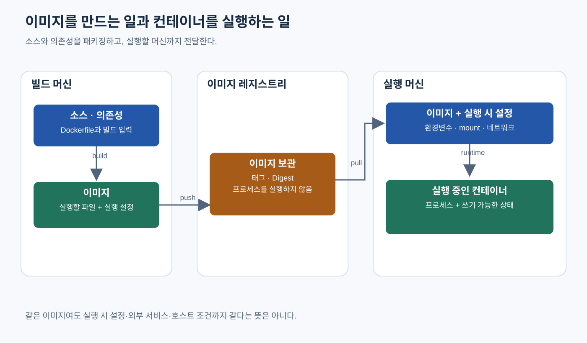

# Kubernetes — 이미지를 만들고 전달하고 실행한다는 것

> **개발자를 위한 쉬운 쿠버네티스 · 3장** | [전체 목차](./Kubernetes-Introduction.md#이-시리즈의-읽는-순서) · [이전 장](./Kubernetes-Container-Fundamentals.md) · [다음 장](./Kubernetes-Why-Orchestration.md)

컨테이너를 실행할 파일은 어디에서 오며, Docker로 만든 결과를 Kubernetes가 어떻게 사용하는지 살펴본다. [컨테이너의 기초](./Kubernetes-Container-Fundamentals.md)에서 프로세스와 실행 환경의 관계를 먼저 읽으면 좋다.

## 결론부터 말하면

**이미지 빌드, 이미지 전달, 컨테이너 실행은 각각 다른 단계다.** 빌드 도구가 앱의 파일과 실행 기본값을 이미지로 만들고, 레지스트리가 이미지를 저장해 배포하며, 실행 호스트의 컨테이너 실행 소프트웨어인 runtime이 이미지를 바탕으로 컨테이너를 시작한다. Kubernetes는 이 실행을 여러 서버에서 관리하는 쪽에 있으며, 일반적인 배포 선언만으로 소스 코드를 자동 빌드하지 않는다.

이 경계를 알면 “이미지는 만들었는데 왜 실행되지 않지?”라는 질문을 나누어 볼 수 있다. 다른 서버가 이미지를 받을 수 있는지, 실행할 플랫폼이 맞는지, 필요한 설정과 DB가 준비되어 있는지를 구분해야 한다. 이미지 하나로 배포를 반복하기 쉬워지지만 실행에 필요한 모든 조건이 그 안에 들어가는 것은 아니다.

## 1. 프로그램의 실행 환경을 파일 묶음으로 만들 수 있을까

앱을 다른 서버로 보낼 때 소스 코드나 실행 파일만 복사하면 실행기와 라이브러리를 따로 설치해야 한다. 이때 필요한 파일을 함께 정리해 같은 묶음으로 배포하면 서버별 설치 차이를 줄일 수 있다. **컨테이너 이미지(image)** 는 이런 목적의 표준화된 패키지다. 앱 파일, 실행기, 라이브러리와 함께 기본 실행 명령 등의 설정을 담는다. [Docker: What is an image?](https://docs.docker.com/get-started/docker-concepts/the-basics/what-is-an-image/)

이미지는 실행 중인 프로그램 자체가 아니다. 디스크에 배포할 수 있는 결과물로 존재하며, 이미지를 사용해 컨테이너를 시작할 때 프로세스가 실행된다. 같은 이미지로 여러 컨테이너를 시작할 수 있고, 각 컨테이너의 실행 상태와 이후 변경 내용은 달라질 수 있다. 이미지를 공유하는 것과 실행 중인 메모리를 복사하는 것은 다른 일이다.

이미지 안에 Linux 배포판의 명령이나 라이브러리가 들어 있더라도 VM의 디스크 이미지와 같은 의미로 받아들이면 안 된다. 이 책의 Linux 컨테이너는 호스트의 Linux 커널을 공유한다. 이미지가 제공하는 것은 앱이 사용할 파일과 실행 기본값이며, 컨테이너마다 자기 커널을 부팅할 전체 컴퓨터를 만드는 것은 아니다. 이 차이가 앞 장의 프로세스 설명과 이미지 설명을 잇는다.

## 2. Dockerfile은 이미지를 만드는 방법을 적는다

**빌드(build)** 는 소스나 준비한 실행 파일을 바탕으로 배포할 결과물을 만드는 과정이다. 컨테이너 이미지 빌드에서는 어떤 파일을 바탕으로 삼고, 무엇을 설치하거나 복사하고, 실행 기본값을 무엇으로 둘지 정한다. **Dockerfile** 은 이 이미지 생성 방법을 적는 파일이다. 개발자나 CI가 빌드를 요청하면 빌드 도구가 이 내용을 처리한다. CI는 코드 변경을 받아 빌드와 검증 같은 작업을 자동 실행하는 체계를 뜻한다.

처음 읽을 때는 네 가지 역할을 구분하면 된다. `FROM`은 출발점이 되는 베이스 이미지를 정한다. `COPY`는 빌드에 제공한 파일을 이미지에 넣는다. `RUN`은 빌드 도중 패키지 설치 같은 명령을 실행해 결과를 남긴다. `CMD`는 나중에 컨테이너를 시작할 때 사용할 기본 명령을 정한다. 따라서 `RUN`으로 한 작업과 `CMD`로 지정한 앱 실행은 서로 다른 시점이다. `CMD`에 앱 실행을 적었다고 이미지 빌드가 끝날 때 운영 앱이 계속 실행되는 것은 아니다. [Dockerfile reference](https://docs.docker.com/reference/dockerfile/)

빌드 도구가 접근할 수 있도록 전달하는 파일의 범위를 **빌드 컨텍스트(build context)** 라고 한다. 아래 명령의 마지막 `.`은 현재 디렉터리를 컨텍스트로 사용한다는 뜻이다. 설명을 위해 이미 Dockerfile과 앱 파일이 준비되어 있다고 가정한 명령이며, 이 한 줄만으로 앱 소스가 생기거나 Docker가 설치되지는 않는다.

```bash
# 설명용: 준비된 Dockerfile과 앱 파일로 로컬 이미지를 만든다
docker build -t my-app:demo .
```

`-t my-app:demo`는 결과물에 이름과 태그를 붙인다. 여기서는 이름을 구분하는 표식 정도로 이해하면 된다. 무엇을 이미지에 포함할지는 의도적으로 정해야 한다. 개발 컴퓨터의 비밀 키나 불필요한 빌드 파일까지 함께 보내면 크기뿐 아니라 정보 노출 문제가 생긴다. `.dockerignore`는 빌드 컨텍스트에서 제외할 파일을 정하는 데 쓰인다. 앱 실행에 필요한 비밀번호와 환경별 설정은 실행 시 공급하는 방법을 뒤에서 따로 다룬다. [Docker Build context](https://docs.docker.com/build/concepts/context/)

## 3. 이미지의 파일층과 컨테이너의 쓰기 영역은 다르다

앱마다 실행기와 공통 라이브러리를 모두 복제해 전송하면 낭비가 생긴다. 이미지는 파일시스템 변경분을 담는 **레이어(layer)** 를 쌓는 구조를 사용한다. 예를 들어 베이스 이미지 위에 의존성 파일을 복사하고 설치한 결과, 그 위에 앱 파일을 더한 결과를 둘 수 있다. 여러 이미지가 같은 레이어를 참조하면 저장과 전송에서 재사용할 수 있고, 빌드에서도 조건이 맞으면 기존 결과를 캐시로 재사용할 수 있다. [Docker: Understanding image layers](https://docs.docker.com/get-started/docker-concepts/building-images/understanding-image-layers/)

레이어를 하나씩 보면 전체 파일 복사본이라기보다 파일 추가·변경·삭제에 대한 기록이다. 실행할 때는 이를 합쳐 앱에 하나의 파일시스템처럼 보여 준다. Dockerfile의 모든 줄이 반드시 새로운 파일층이 되는 것도 아니다. 파일을 바꾸는 `RUN`, `COPY`와 달리 `CMD` 같은 지시는 기본 실행 정보에 해당한다. 레이어가 있다는 사실과 “명령 한 줄마다 같은 형태의 파일층이 하나 생긴다”는 설명을 구분해야 한다.

이미지의 레이어는 만들어진 뒤 변경하지 않는 결과물로 다룬다. 그렇다면 실행 중인 앱은 임시 파일이나 로그를 어디에 쓸까? 일반적인 Docker 컨테이너에는 이미지 위에 컨테이너별 **쓰기 가능한 영역(writable layer)** 이 준비된다. 앱이 파일을 바꾸어도 원래 이미지 자체가 수정되지는 않는다. 같은 이미지를 사용한 다른 컨테이너의 파일이 함께 바뀌는 것도 아니다. 구체적인 저장 구현은 runtime과 저장 방식에 따라 달라진다.

이 특성은 배포를 반복하는 데 도움이 되지만, 중요한 데이터를 저장하는 방법을 잘못 이해하게 만들 수도 있다. Docker에서 같은 컨테이너를 멈췄다가 다시 시작하는 것과, 그 컨테이너를 삭제하고 새로 만드는 것은 다르다. 기존 컨테이너의 쓰기 영역은 단순 정지와 재시작에서는 남을 수 있지만, 삭제 후 새 컨테이너에는 이어지지 않는다. 계속 보관해야 하는 데이터는 컨테이너의 수명과 분리한 **볼륨(volume)** 등 별도의 저장 경로로 관리해야 한다. [Docker Storage](https://docs.docker.com/engine/storage/)

볼륨은 앱에 디렉터리나 파일로 보이는 저장 공간을 컨테이너의 기본 쓰기 영역 밖에서 제공하는 방법이다. 다만 컨테이너 밖에 파일이 남는다는 것만으로 백업이나 다중 서버 복구까지 완성되지는 않는다. 저장 장치가 어느 서버에 있는지, 다른 서버에서도 접근 가능한지, 앱에 일관된 데이터인지가 남는다. Kubernetes의 저장소 장에서는 이 문제를 다시 이어간다.

## 4. 만든 이미지는 다른 서버에 저절로 생기지 않는다

개발 컴퓨터에서 빌드한 이미지는 그 빌드 결과를 저장한 환경에 있다. 서버가 같은 이름을 안다고 그 파일이 자동으로 전달되지는 않는다. 팀과 실행 서버가 이미지를 받을 공급 경로가 필요하다. **이미지 레지스트리(registry)** 는 컨테이너 이미지를 저장하고 배포하는 서비스다. Docker Hub 같은 공개 서비스도 있고 조직 내부의 사설 레지스트리도 있다. 레지스트리 안에서 관련 이미지들을 묶어 관리하는 이름 범위를 **리포지터리(repository)** 라고 한다. [Docker: What is a registry?](https://docs.docker.com/get-started/docker-concepts/the-basics/what-is-a-registry/)

여기서 소스 코드의 Git 리포지터리와 이미지 리포지터리를 혼동하지 않아야 한다. 둘 다 결과를 저장하고 공유하지만, Git에 소스를 올렸다는 사실은 이미지를 빌드하거나 이미지 저장소에 올렸다는 뜻이 아니다. Git 변경을 감지해 CI가 빌드하고 레지스트리에 올리는 절차를 따로 구성할 수 있다. 각 단계가 연결되어 있어도 같은 작업은 아니다.

이미지를 레지스트리로 올리는 작업을 **push**, 레지스트리에서 받는 작업을 **pull** 이라고 한다. 다음 명령은 그 방향을 설명하는 발췌다. `registry.example.com`은 실제 사용할 레지스트리 주소로 바꾸어야 하는 자리표시자다. 해당 서버와 리포지터리가 준비되어 있고 필요한 인증과 권한을 갖추었다고 가정하며, 그대로 실행 가능한 공개 이미지 예제가 아니다.

```bash
# 설명용: 로컬 이미지에 배포할 저장소 이름을 붙인다
docker tag my-app:demo registry.example.com/team/my-app:demo

# 빌드한 쪽에서 레지스트리로 전달한다
docker push registry.example.com/team/my-app:demo

# 실행할 다른 서버에서 레지스트리로부터 받는다
docker pull registry.example.com/team/my-app:demo
```

`docker tag`는 이 단계에서 파일을 원격으로 전송하지 않는다. 같은 로컬 이미지에 다른 이름을 붙이며, 실제 전달은 push가 한다. 반대로 pull의 성공은 이미지를 받았다는 뜻이지 앱이 시작됐다는 뜻이 아니다. 서버에서 이미지를 받아 저장한 뒤 컨테이너를 만들고 프로세스를 시작하는 단계가 남는다. [Docker Overview의 registry 동작](https://docs.docker.com/get-started/docker-overview/#docker-registries)

태그는 이미지를 찾는 이름표이며 같은 태그가 나중에 다른 결과물을 가리킬 수도 있다. “어제도 이 태그였다”만으로 파일 내용이 같다고 결론 내릴 수 없는 이유다. 이미지 내용의 식별자인 **digest** 로 고정하는 방법과 배포 시 내려받기 정책은 [이미지 태그와 Digest](./Kubernetes-Image-Tag-Digest.md)에서 자세히 다룬다.



그림 3-1. 이미지는 실행할 파일과 기본 설정의 묶음이다. pull은 실행 머신에 이미지를 공급하며, runtime이 실행 시 설정과 결합해 프로세스를 시작한다. registry가 컨테이너를 실행하는 것은 아니다.

## 5. Docker, containerd, Kubernetes는 어느 일을 맡을까

빌드와 전달을 알았으니 마지막 실행 단계의 도구를 나누어 보자. **Docker** 는 이미지 빌드와 배포, 컨테이너 실행을 다루는 도구와 플랫폼이다. 개발자는 `docker` CLI로 실행을 요청할 수 있고, Docker Engine이 실행 환경을 관리한다. `docker run`은 이미지와 실행 설정을 바탕으로 컨테이너를 만들고 시작하는 명령이다. 필요한 이미지가 로컬에 없으면 레지스트리에서 받는 과정도 포함될 수 있다.

**컨테이너 runtime** 은 호스트에서 이미지와 컨테이너의 실행 생명주기를 처리하는 소프트웨어다. **containerd** 는 그중 하나로, 이미지 전달과 저장, 컨테이너 실행과 감시 등을 담당한다. 이 역할은 다른 서버의 앱을 어디에 배치할지 결정하는 역할과는 구분된다. containerd를 설치했다는 사실만으로 여러 서버의 배치와 장애 복구 체계가 완성되지는 않는다. [containerd 공식 소개](https://containerd.io/)

**Kubernetes** 는 여러 서버를 클러스터로 관리하면서 원하는 실행 상태를 다룬다. 각 서버에서 동작하는 에이전트인 **kubelet** 은 **CRI(Container Runtime Interface)** 라는 인터페이스를 통해 호환 runtime에 컨테이너 실행을 요청한다. containerd는 이런 연결에 사용할 수 있는 runtime이다. 따라서 “Kubernetes에서 컨테이너를 실행한다”는 말 아래에도 호스트에서 실제 실행을 처리하는 계층이 있다. 세부 요청 경로는 첫 배포 뒤 클러스터 구조 장에서 살펴본다. [Kubernetes Container Runtimes](https://kubernetes.io/docs/setup/production-environment/container-runtimes/)

이 구분 때문에 Kubernetes 실행 서버에 Docker CLI나 Docker Engine이 반드시 있어야 하는 것은 아니다. Docker로 빌드한 표준 컨테이너 이미지를 호환 runtime이 사용할 수 있으며, 이미지를 만드는 도구와 실행하는 도구를 동일하게 고정할 필요도 없다. 반대로 Kubernetes가 Docker의 빌드와 로컬 개발 역할을 모두 대체하는 것도 아니다. Kubernetes 배포 설정에는 보통 준비된 이미지의 참조를 넣으며, 소스 빌드나 레지스트리 push는 별도의 절차가 맡는다.

## 6. Compose는 여러 컨테이너의 관계를 한곳에 적는다

앱 하나를 실행할 수 있게 되면 개발용 DB와 캐시도 함께 시작하고 싶어진다. 매번 긴 명령으로 컨테이너와 네트워크, 저장 공간을 따로 준비하면 팀원이 같은 환경을 재현하기 어렵다. **Docker Compose** 는 여러 컨테이너로 이루어진 앱의 실행 구성을 YAML 파일로 정의하고 이를 생성·시작·정리하는 도구다. YAML은 이런 설정에서 사용하는 구조화된 텍스트 형식이다.

Compose 파일에서는 앱 구성 요소를 `services`로 표현하고 연결할 `networks`와 저장할 `volumes` 등을 함께 정한다. Dockerfile이 이미지 생성 방법을 표현한다면, Compose 파일은 어떤 이미지와 설정으로 앱 구성 요소들을 함께 실행할지 표현한다. 필요하면 Compose가 빌드를 요청하도록 연결할 수도 있지만, 그 경우에도 빌드와 실행이라는 역할 구분은 유지된다. [Docker: How Compose works](https://docs.docker.com/compose/intro/compose-application-model/)

Compose는 로컬 개발에만 쓸 수 있는 도구가 아니다. 운영 조건에 맞춰 설정을 나누고 단일 서버에서 운영하는 방식도 공식 문서에 안내되어 있다. 앱 규모와 허용할 장애 범위, 운영자의 역량에 따라 충분한 선택일 수 있다. 익숙해졌다는 이유만으로 반드시 Kubernetes로 넘어가야 하는 순서는 아니다. [Docker: Use Compose in production](https://docs.docker.com/compose/how-tos/production/)

다만 일반적인 단일 Docker 호스트의 Compose 실행과 여러 서버를 지속해서 관리하는 체계는 범위가 다르다. Compose로 앱과 DB의 구성을 정리했다고 서버 전체 장애 시 다른 서버를 골라 옮기거나 다중 서버의 트래픽을 계속 조정하는 기능까지 얻는 것은 아니다. 컨테이너의 재시작 정책과 서버를 넘는 배치·복구를 구분해야 한다. 이 범위 차이가 다음 장의 운영 문제로 이어진다.

## 7. 이미지 밖에 남는 의존성은 무엇일까

같은 이미지로 실행했는데 테스트 환경에서는 성공하고 운영 환경에서는 실패할 수 있다. 이미지가 고정하는 것은 파일과 기본 실행 정보이기 때문이다. 실제로 전달한 환경 변수와 비밀번호, DB 접속 주소, 이름을 주소로 바꾸는 DNS, 인증서 신뢰, 파일 권한, 사용할 CPU와 메모리는 실행 환경에서 결정된다. 환경 변수는 프로세스 시작 때 전달받는 이름과 값의 설정이다. 앱 코드가 그 이름을 사용하도록 만들어져 있어도 올바른 값을 공급하는 것은 별도의 일이다.

시간을 기준으로 나누어 보면 의존성의 위치가 더 분명하다. 빌드 때는 베이스 이미지와 패키지 저장소, 앱 의존성 파일이 필요할 수 있다. 실행 서버가 이미지를 받을 때는 레지스트리 연결과 인증, 서버 인증서를 신뢰할 조건이 필요하다. 앱이 시작된 뒤에는 DB나 다른 API의 연결과 권한이 필요할 수 있다. 이미지 pull이 성공했다는 증거로 DB 연결까지 확인했다고 말할 수 없는 이유다.

에어갭에서는 이 공급 경로를 내부에서 준비한다. 외부 패키지와 베이스 이미지를 내부로 들여와 빌드하도록 할 수도 있고, 외부에서 검증한 최종 이미지를 승인된 경로로 반입할 수도 있다. 어느 쪽이든 실행 서버가 접근할 레지스트리 또는 별도의 이미지 반입 경로가 필요하다. 개발 컴퓨터의 이미지 목록에 결과물이 있다는 것과 클러스터의 실행 runtime이 사용할 수 있다는 것은 다르다. 사설 인증서를 쓴다면 빌드 도구와 실행 runtime 중 누가 그 인증서를 신뢰해야 하는지도 경로별로 확인해야 한다.

## 8. 다음 단계는 전달한 앱을 계속 운영하는 일이다

이제 흐름을 한 문장으로 이어 볼 수 있다. 앱 파일을 빌드해 이미지를 만들고, 필요한 곳에서 받을 수 있게 전달하며, 호환되는 실행 호스트에서 설정과 함께 컨테이너를 시작한다. 이 과정이 정리되면 서버마다 앱을 손으로 설치하는 차이를 줄일 수 있다. 하지만 컨테이너가 종료되거나 서버가 사라졌을 때 무엇을 할지는 여전히 남는다.

다음 [오케스트레이션이 필요한 이유](./Kubernetes-Why-Orchestration.md)에서는 여러 서버의 배치·복구·접속·버전 교체를 따라간다. 이후 [첫 배포](./Kubernetes-First-Deployment.md)에서는 직접 만들고 확인할 로컬 앱과 이미지로 전체 절차를 연결한다. 그 로컬 예제는 이 장의 설명용 `my-app` 명령이나 기존 장의 가상 레지스트리 이미지를 그대로 내려받는 실습이 아니다. 직접 준비한 이미지가 실행 환경에 어떻게 공급되는지 확인하는 경로다.

## 생각해 볼 질문

**Dockerfile을 Git에 올리고 빌드까지 성공했다면 다른 서버에서 바로 실행할 수 있을까?** 결과 이미지가 실행 서버에 전달되어야 한다. 레지스트리에 push하거나 별도의 반입 경로를 마련하고, 해당 서버의 runtime이 이미지를 사용할 수 있게 해야 한다. 소스 전달과 이미지 전달은 다른 단계다.

**컨테이너 안에서 파일을 수정하면 원본 이미지도 바뀔까?** 기본 쓰기 영역의 변경은 원본 이미지와 분리된다. 컨테이너를 삭제하고 원래 이미지에서 새로 만들면 그 변경이 이어지지 않는다. 보관할 데이터는 별도 저장 경로와 복구 정책이 필요하다.

**Kubernetes가 containerd로 이미지를 실행한다면 Docker는 더 이상 필요 없는 기술일까?** 도구의 책임이 다르다. Docker는 빌드·이미지 전달·로컬 실행 등에 계속 사용할 수 있고, Kubernetes의 실행 호스트는 CRI 호환 runtime으로 실행할 수 있다. 한 도구의 채택이 다른 도구의 역할 전체를 없애는 것은 아니다.

## 출처

공식 문서 확인 기준일: 2026-10-23. 특정 Docker·Kubernetes 최신 버전 번호를 전제로 하지 않으며, 위 명령은 역할을 보여 주는 설명용 발췌다.

- [Docker: What is an image?](https://docs.docker.com/get-started/docker-concepts/the-basics/what-is-an-image/) — 이미지가 담는 파일과 실행 기본 정보.
- [Docker Build context](https://docs.docker.com/build/concepts/context/) — 빌드에 제공하는 파일 범위와 `.dockerignore`.
- [Dockerfile reference](https://docs.docker.com/reference/dockerfile/) — FROM, COPY, RUN, CMD와 빌드 컨텍스트 관련 지시.
- [Docker: Understanding image layers](https://docs.docker.com/get-started/docker-concepts/building-images/understanding-image-layers/) — 파일층과 재사용, 실행 시 파일시스템 구성.
- [Docker Storage](https://docs.docker.com/engine/storage/) — 컨테이너 쓰기 영역과 별도 저장 공간.
- [Docker: What is a registry?](https://docs.docker.com/get-started/docker-concepts/the-basics/what-is-a-registry/) — registry와 repository.
- [Docker Overview](https://docs.docker.com/get-started/docker-overview/) — CLI·Engine, push·pull·run의 관계.
- [containerd](https://containerd.io/) — runtime의 책임 범위.
- [Kubernetes Container Runtimes](https://kubernetes.io/docs/setup/production-environment/container-runtimes/) — kubelet과 CRI 호환 runtime.
- [Docker: How Compose works](https://docs.docker.com/compose/intro/compose-application-model/) — 여러 컨테이너의 선언과 실행 구성.
- [Docker: Use Compose in production](https://docs.docker.com/compose/how-tos/production/) — 단일 서버 운영과 운영 설정 분리.
