# Kubernetes Image Tag, Digest

> **개발자를 위한 쉬운 쿠버네티스 · 5장** | [전체 목차](./Kubernetes-Introduction.md#이-시리즈의-읽는-순서) · [이전 장](./Kubernetes-ReplicaSet-Deployment.md) · [다음 장](./Kubernetes-ConfigMap-Secret.md)

**rollout restart를 했는데 왜 예전 코드가 그대로 돌까 — 이미지 태그와 다이제스트**

앞 장에서 Deployment가 Pod 템플릿을 바탕으로 ReplicaSet과 Pod를 교체한다는 것을 보았다. 여기서 한 가지 의문이 남는다. 새 Pod가 생겼다면 실행하는 코드도 새 버전일까? 답하려면 Pod의 정체성과 이미지의 정체성을 나누어 보아야 한다.

가상의 주문 API 배포를 생각해 보자. CI가 빌드를 끝내고 기존 태그로 새 이미지를 push한 뒤 `rollout restart`를 요청했다. Pod의 AGE는 짧아졌지만 앱은 예전 동작을 보이거나 replica마다 동작이 다를 수 있다. 이것은 실측 장애 기록이 아니라 태그·캐시·Pod 교체의 관계를 설명하기 위한 시나리오다.

공통 앱 `order-api`, namespace `bookstore`, `registry.example.com/book/order-api:1.0.0`과 아래 digest는 설명용 자리표시자다. 실제 공개 이미지나 실행 가능한 배포 세트를 제공하지 않는다. YAML은 구조 발췌, 명령과 출력은 동작 이해용이며 이번 집필에서 클러스터에 실행하지 않았다.

## 결론부터 말하면

**Pod를 새로 만드는 것과 이미지를 새로 받는 것은 완전히 별개의 사건이다.** `rollout restart`는 앞의 것만 한다. 그리고 이미지를 새로 받을지 말지는 `imagePullPolicy`가 결정하는데, `registry.example.com/book/order-api:1.0.0`처럼 `:latest`가 아닌 태그를 쓰면 그 기본값이 **`IfNotPresent`** 다 — "노드에 그 태그의 이미지가 이미 있으면 그걸 재사용하라"는 뜻이다.

여기에 두 번째 사실이 겹친다. **이미지 캐시는 Deployment가 아니라 노드에 있다.** 그러니 같은 태그를 덮어써 푸시했을 때, 그 태그를 이미 캐시한 노드의 Pod는 옛 이미지를, 처음 보는 노드의 Pod는 새 이미지를 쓴다. **한 Deployment 안에서 버전이 섞이는** 것이다.

```mermaid
flowchart TB
    reg["Registry<br>order-api:1&#46;0&#46;0 태그를<br>새 이미지로 덮어씀"]
    reg -.->|"태그 포인터만 이동"| note["예전 이미지도<br>여전히 존재한다"]

    restart["kubectl -n bookstore rollout restart<br>→ Pod 전부 새로 생성"]

    restart --> nA["Node A<br>order-api:1&#46;0&#46;0 캐시 있음"]
    restart --> nB["Node B<br>order-api:1&#46;0&#46;0 캐시 없음"]

    nA -->|"IfNotPresent<br>→ 레지스트리에 묻지 않음"| oldp["Pod: 예전 코드"]
    nB -->|"이미지 없음<br>→ 레지스트리에서 pull"| newp["Pod: 새 코드"]

    oldp --> mix["같은 Deployment,<br>섞인 버전"]
    newp --> mix

    style reg fill:#1565C0,color:#fff
    style restart fill:#455A64,color:#fff
    style oldp fill:#C62828,color:#fff
    style newp fill:#2E7D32,color:#fff
    style mix fill:#BF360C,color:#fff
```



| 내가 기대한 것 | 실제로 일어난 것 |
|----------------|------------------|
| `rollout restart` = "새 이미지로 갈아라" | Pod 템플릿에 재시작 시각 annotation을 찍어 **Pod만** 새로 만든다 |
| 태그 `1.0` = 그 이미지의 고유 이름 | 태그는 **언제든 다른 이미지로 옮길 수 있는 가변 포인터** 다 |
| 캐시는 Deployment 단위 | 캐시는 **노드 단위** — 그래서 replica마다 결과가 다르다 |
| 이미지를 안 받으면 에러라도 나겠지 | 캐시 사용 자체는 오류나 Warning의 원인이 아니다. kubelet은 **Normal `Pulled` 이벤트로 로컬 이미지 사용을 기록**한다. [7절의 이벤트 진단](#7-지금-실제로-무엇이-돌고-있는지-확인하는-법)에서 구분한다 |

그래서 이 문제의 진짜 무서운 점은 실패하지 않는다는 것이다. 모든 컴포넌트가 각자 자기 일을 정확히 했고, 아무도 에러를 내지 않았다. 하나씩 뜯어보자.

---

## 1. 첫 번째 오해 — 태그는 이름이 아니라 포인터다

우리는 보통 `registry.example.com/book/order-api:1.0.0`을 "1.0 버전 이미지의 이름"으로 읽는다. 파일명처럼, 혹은 Git 태그처럼 특정한 무언가를 영구히 가리키는 고유 식별자로 느껴진다. 이 감각이 모든 혼란의 출발점이다.

레지스트리에서 태그는 그런 것이 아니다. 태그는 **레지스트리 안의 어떤 이미지를 가리키는 가변 참조** 다. `docker push registry.example.com/book/order-api:1.0.0`을 다시 실행하면, registry의 태그 불변 정책이 없다면 같은 이름이 새 manifest를 가리키도록 바뀔 수 있다. 이전 manifest와 layer가 계속 보관되는지는 다른 참조와 retention·garbage collection 정책에 달려 있다. 태그를 덮어썼다고 이전 이미지를 항상 pull할 수 있다고 가정하면 안 된다.

그렇다면 이미지 자체를 가리키는 진짜 고유 이름은 무엇인가. **digest** 다. 쿠버네티스 공식 문서는 이 대비를 한 문장으로 정리한다.

공식 Images 문서는 태그가 다른 이미지를 가리킬 수 있는 반면 digest는 콘텐츠 식별자로 고정된다는 차이를 설명한다.

digest는 `sha256:1ff6c18f...` 형태이고, image manifest 또는 image index 같은 콘텐츠의 해시이므로 식별 대상의 내용이 달라지면 digest도 달라진다. 즉 **같은 digest = 그 digest가 식별하는 같은 콘텐츠** 라는 보장이 성립한다. 태그에는 그런 보장이 없다.

```mermaid
flowchart LR
    subgraph tagside["태그: 가변 포인터"]
        t["order-api:1&#46;0&#46;0"]
        i1["Image X<br>sha256:aaa&#8230;<br>(어제 빌드)"]
        i2["Image Y<br>sha256:bbb&#8230;<br>(오늘 빌드)"]
        t -.->|"어제는 여기"| i1
        t -->|"지금은 여기"| i2
    end

    subgraph digestside["digest: 불변 지문"]
        d["registry.example.com/book/order-api@sha256:aaa&#8230;"]
        d ==>|"영원히 여기"| i1b["Image X<br>내용이 바뀌면<br>digest도 바뀐다"]
    end

    style t fill:#BF360C,color:#fff
    style d fill:#2E7D32,color:#fff
    style i1 fill:#455A64,color:#fff
    style i2 fill:#1565C0,color:#fff
    style i1b fill:#455A64,color:#fff
```



이 구분이 이 글 전체의 토대다. 앞으로 나올 모든 현상은 결국 **우리가 매니페스트에 적은 것(가변 태그)과 실제로 실행된 것(불변 이미지) 사이의 간극** 에서 나온다.

---

## 2. 두 번째 오해 — `rollout restart`는 "이미지를 새로 받아라"가 아니다

태그의 정체를 알았으니 다음 의문으로 간다. 그래도 `rollout restart`를 했으면 이미지를 다시 받아야 하지 않나? "restart"라는 단어가 주는 인상은 "처음부터 다시"이니 말이다.

이 명령이 실제로 하는 일은 훨씬 소박하다. **Pod 템플릿의 annotation 하나를 갱신하는 것** 이다. 쿠버네티스 공식 문서(Well-Known Labels, Annotations and Taints)가 그 키를 명시한다.

공식 annotation 문서에서 `restartedAt`은 workload의 Pod 템플릿 metadata를 patch하여 교체를 유발하는 값으로 설명된다.

즉 이런 패치가 나간다.

```yaml
# kubectl -n bookstore rollout restart deployment/order-api 이 실제로 보내는 것
spec:
  template:
    metadata:
      annotations:
        kubectl.kubernetes.io/restartedAt: "2026-07-28T09:12:41Z"   # ← 이 한 줄이 전부
```

여기서부터는 평범한 Deployment 동작이다. Pod 템플릿(`.spec.template`)이 바뀌었으므로 Deployment 컨트롤러는 새 리비전으로 취급하고, 새 ReplicaSet을 만들어 롤링 교체를 진행한다. (Pod 템플릿 변경이 리비전을 올린다는 것은 `deployment.kubernetes.io/revision` annotation의 공식 설명에도 명시되어 있다. 롤링 교체·롤백·`rollout` 명령군 자체는 [Kubernetes ReplicaSet & Deployment](Kubernetes-ReplicaSet-Deployment.md)에서 다룬다.)

이 메커니즘이 얼마나 순수하게 "템플릿 diff"인지 보여주는 문장이 같은 공식 문서에 있다.

같은 annotation을 기존 Pod 자체에 수동 추가해도 그 Pod를 재시작하는 특별한 효과는 없다. workload 템플릿을 바꾸는 동작이 핵심이다.

annotation 자체에 힘이 있는 게 아니다. **템플릿이 달라졌다는 사실** 에 힘이 있다. 그러니 정리하면 이렇다 — `rollout restart`는 **"Pod를 새로 만들어라"** 는 지시이고, **"이미지를 다시 내려받아라"** 는 지시는 이 명령 어디에도 없다. 새로 만들어진 Pod가 이미지를 어디서 가져올지는 전혀 다른 필드가 결정한다.

---

## 3. 진짜 원인 — `imagePullPolicy`의 기본값 규칙

그 필드가 `imagePullPolicy`다. 값은 세 가지이고, 의미는 공식 문서 기준으로 이렇다.

| 값 | 동작 |
|----|------|
| `Always` | 컨테이너를 띄울 때마다 kubelet이 런타임에 pull을 요청한다. 런타임이 레지스트리에 접속해 태그를 digest로 해석하고, **캐시에 없는 레이어만** 내려받는다 |
| `IfNotPresent` | 이미지가 **로컬에 없을 때만** pull한다 |
| `Never` | pull을 시도하지 않는다. 로컬에 있으면 쓰고, 없으면 기동 실패(`ErrImageNeverPull`) |

문제는 대부분의 매니페스트가 이 필드를 **아예 적지 않는다** 는 것이다. 그러면 쿠버네티스가 알아서 채워 넣는데, 그 규칙이 정확히 이 글의 범인이다. 공식 문서의 네 가지 규칙을 그대로 옮긴다.

- `imagePullPolicy`를 생략하고 **digest를 지정** 하면 → `IfNotPresent`
- `imagePullPolicy`를 생략하고 태그가 **`:latest`** 이면 → `Always`
- `imagePullPolicy`를 생략하고 **태그를 아예 안 쓰면** → `Always`
- `imagePullPolicy`를 생략하고 **`:latest`가 아닌 태그** 를 쓰면 → **`IfNotPresent`**

```mermaid
flowchart TD
    q0{"imagePullPolicy를<br>명시했는가?"}
    q0 -->|"예"| explicit["적은 값 그대로"]
    q0 -->|"아니오"| q1{"image에 무엇을<br>적었는가?"}

    q1 -->|"digest<br>(registry.example.com/book/order-api@sha256:&#8230;)"| ifnp1["IfNotPresent<br>(digest는 불변이라 안전)"]
    q1 -->|"태그 없음<br>(order-api)"| alw1["Always"]
    q1 -->|":latest"| alw2["Always"]
    q1 -->|"그 외 태그<br>(order-api:1&#46;0&#46;0)"| ifnp2["IfNotPresent<br>← 우리가 걸린 곳"]

    style q0 fill:#455A64,color:#fff
    style q1 fill:#BF360C,color:#fff
    style ifnp2 fill:#C62828,color:#fff
    style ifnp1 fill:#2E7D32,color:#fff
    style alw1 fill:#1565C0,color:#fff
    style alw2 fill:#1565C0,color:#fff
```



네 번째 규칙이 우리 상황이다. `registry.example.com/book/order-api:1.0.0`은 `:latest`가 아닌 명시적 태그이므로 정책은 `IfNotPresent`가 된다. 그리고 `IfNotPresent`는 **"이 노드의 로컬 이미지가 준비되어 있는가"** 를 기준으로 이미지 pull을 생략할 수 있다. 별도의 캐시 이미지 자격 증명 검증은 후반에서 구분한다. 레지스트리에 더 새로운 이미지가 있는지는 **묻지 않는다.** 물을 이유가 없다 — kubelet은 태그가 불변이라고 믿을 만한 근거를 갖고 있지 않지만, `IfNotPresent`라는 정책은 정확히 "이미 있으면 됐다"고 지시하기 때문이다.

그래서 같은 태그를 덮어써 푸시하는 순간, 그 태그를 이미 캐시한 노드는 **이 정책만으로 새 이미지가 존재하는지 확인하지 않는다.** 실패도 경고도 없다. 정책대로 동작한 것이다.

### 3.1 "그럼 `:latest`를 쓰면 되잖아"가 나쁜 해법인 이유

규칙을 보면 자연스러운 반응이 나온다. `:latest`는 기본값이 `Always`니까, 태그를 `:latest`로 바꾸면 되지 않나?

새로 생성하는 객체에서는 pull 확인 정책이 바뀔 수 있지만, 가변 참조를 배포 버전으로 사용하는 문제는 남는다. `:latest`는 **어느 시점에 무엇이 떴는지를 이름만으로 추적하기 어렵게 만드는 태그** 다. 어제 오후에 장애가 났을 때 돌던 코드가 무엇이었는지 물으면 태그 문자열만으로는 답하기 어렵다. `:latest`는 그때도 `:latest`였고 지금도 `:latest`이기 때문이다. 별도 digest·빌드 이력 없이 태그만 남겼다면 롤백할 대상도 지목하기 어렵고("`:latest`로 되돌려라"는 무의미하다), 장애를 재현할 수도 없다. 공식 문서가 프로덕션에서 `:latest`를 피하라고 못 박는 이유가 정확히 이것이다.

공식 문서는 실행 버전 추적과 rollback이 어려워지므로 production에서 `latest`를 피하라고 권한다.

여기에 한 가지 함정이 더 붙는다. 정책 기본값은 **오브젝트를 처음 만들 때 한 번만** 결정된다. 공식 문서의 경고를 보자.

공식 문서의 경고는 정책 기본값이 객체 생성 시 정해지고 이후 image 태그·digest를 바꿔도 자동 재계산되지 않는다는 점이다.

즉 `registry.example.com/book/order-api:1.0.0`으로 만들어 둔 Deployment의 이미지만 `registry.example.com/book/order-api:latest`로 고쳐도, `imagePullPolicy`는 여전히 `IfNotPresent`에 머문다. `:latest`로 바꿨는데도 증상이 그대로인 이유가 이것이다. 정책을 바꾸고 싶으면 **필드를 직접 명시** 해야 한다.

---

## 4. replica마다 결과가 다른 이유 — 캐시는 노드 단위다

이제 두 번째 질문, "왜 하필 하나만 바뀌었나"로 간다.

핵심은 이미지 캐시가 어디에 있는지다. 캐시는 Deployment에도, 네임스페이스에도, 클러스터에도 없다. **각 노드의 컨테이너 런타임 안에** 있다. `IfNotPresent`의 "Present"는 **"이 Pod가 스케줄된 그 노드에 있는가"** 라는 뜻이다.

그러면 방금의 상황이 정확히 설명된다. `rollout restart`로 새 Pod 세 개가 만들어지고 스케줄러가 배치 가능한 노드를 선택한다. 이 시나리오에서는 노드가 달라졌다고 가정한다. 그중 두 개는 예전 배포 때 `registry.example.com/book/order-api:1.0.0`을 이미 받아둔 노드로 갔고, 하나는 그 태그를 처음 보는 노드로 갔다. 앞의 두 개는 캐시를 쓰고, 뒤의 하나는 레지스트리에서 새 이미지를 받는다. **세 replica가 서로 다른 코드를 실행한다.**

쿠버네티스 공식 문서는 이 결과를 직접 서술한다.

공식 Images 문서도 같은 태그의 대상이 바뀌면 이전·새 코드를 실행하는 Pod가 섞일 수 있음을 설명한다.

이것이 가장 진단하기 어려운 형태다. 증상이 **요청마다 달라지기** 때문이다. Service가 요청을 세 Pod에 분산하므로, 같은 API를 다섯 번 호출하면 두세 번은 새 동작, 나머지는 옛 동작이 나온다. 이 상태에서 흔히 벌어지는 일들을 보자.

한 Pod의 로그만 보고 "새 코드 맞네, 정상"이라고 결론 낸다. 다른 Pod의 로그를 봤으면 반대 결론이 났을 것이다. 재현하려고 요청을 다시 보내면 이번엔 잘 된다. 그래서 "간헐적 이슈"로 분류되고, 네트워크나 캐시나 DB 커넥션 같은 엉뚱한 방향으로 조사가 흘러간다. 실제로 다른 것은 **코드 그 자체** 인데, 어느 계층에서도 그 가정을 의심하지 않는다.

여기에 노드 상태 변화가 겹치면 상황은 더 나빠진다. 오토스케일링으로 노드가 새로 붙거나 갈려 나갈 때마다 "캐시 있는 노드"의 집합이 바뀌므로, **아무 배포도 하지 않았는데 며칠 뒤 갑자기 동작 비율이 달라진다.** 배포 로그에는 아무 흔적도 남지 않는다.

---

## 5. 세 가지 해법 — 그리고 각각의 대가

원인이 "가변 태그 + 노드 단위 캐시"라면, 해법은 셋 중 하나다. 태그를 불변으로 만들거나, digest로 고정하거나, 매번 확인하게 하거나.

### 5.1 해법 1 — 배포가 참조하는 태그를 불변으로 운영한다

가장 좋은 해법은 `imagePullPolicy`를 건드리는 게 아니라 **애초에 태그를 덮어쓰지 않는 것** 이다. 빌드마다 새 태그를 만든다. 커밋 SHA, 빌드 번호, 타임스탬프 — 무엇이든 재사용되지 않으면 된다.

```yaml
# Bad: 태그를 덮어써 푸시 → 노드 캐시가 옛 이미지를 붙잡는다
image: registry.example.com/book/order-api:1.0.0
---
# Good: 빌드마다 유일한 태그 → 이전 빌드의 태그 캐시와 구분
image: registry.example.com/book/order-api:1.0.0-a1b2c3d       # 1.0 + 커밋 SHA
```

이 방식의 우아한 점은 `IfNotPresent`가 **문제가 아니라 최적의 정책이 된다** 는 것이다. 새 태그의 참조가 로컬에 없다면 registry에서 해석·pull한다. 같은 layer나 digest가 미리 배포되어 있다면 기존 캐시를 재사용할 수 있다. 그리고 한 번 받은 뒤에는 그 태그의 내용이 절대 바뀌지 않으니, 캐시를 쓰는 것이 언제나 정답이다. 불필요한 레지스트리 왕복도 없다.

여기에 레지스트리 차원의 **immutable tag** 설정을 함께 켜면 규율이 아니라 구조가 된다. Harbor 같은 사내 레지스트리는 프로젝트별로 태그 덮어쓰기를 금지할 수 있고, 이러면 실수로 같은 태그를 푸시하는 CI 잡이 아예 실패한다. (사내 레지스트리를 두는 이유 전반은 [Harbor — 왜 회사들은 사내 컨테이너 레지스트리를 두는가](Harbor-왜-회사들은-사내-컨테이너-레지스트리를-두는가.md)에서 다룬다.)

한 가지 오해를 미리 막자. **`1.0`, `stable`, `prod` 같은 사람용 태그를 쓰지 말라는 게 아니다.** 사람이 "지금 프로덕션 버전"을 가리키려면 그런 이름이 필요하다. 규칙은 이렇게 좁혀야 한다 — **배포 매니페스트가 참조하는 태그는 불변이어야 한다.** 사람용 별칭 태그는 문서와 대화에서 쓰고, 클러스터에 적용되는 YAML에는 유일한 태그(또는 digest)만 들어간다.

### 5.2 해법 2 — digest로 고정한다

재현성을 최대로 끌어올리는 방법은 digest를 직접 적는 것이다.

```yaml
# 구조 발췌: digest가 가리키는 콘텐츠로 고정 (가상 digest)
image: registry.example.com/book/order-api@sha256:45b23dee08af5e43a7fea6c4cf9c25ccf269ee113168c19722f87876677c5cb2
```

공식 문서가 이 효과를 정확히 설명한다. digest를 지정하면 **레지스트리 쪽의 변경이 버전 혼재를 유발할 수 없다.** 태그가 어디로 옮겨 다니든 상관이 없기 때문이다.

digest로 지정하면 registry의 태그 이동으로 생기는 버전 혼재를 피할 수 있다는 것이 공식 문서의 핵심이다.

실무에서 이 값은 손으로 적는 게 아니다. **CI가 푸시 직후 digest를 회수해 매니페스트에 기록** 한다. `docker push`나 `docker buildx build --push`의 출력에는 푸시된 digest가 찍히고, `docker buildx imagetools inspect registry.example.com/book/order-api:1.0.0` 같은 명령으로도 조회할 수 있다. 그 값을 Helm values나 Kustomize 이미지 필드에 넣어 커밋하는 것이 표준 흐름이다.

단점도 정직하게 짚자. 첫째, **사람이 읽을 수 없다.** `sha256:45b23d...`만 보고 그게 어떤 릴리스인지 알 수 있는 사람은 없다. 그래서 태그와 digest를 함께 적는 형태(`image: registry.example.com/book/order-api:1.0.0@sha256:...`)를 쓰기도 하는데, 이때 **pull에 쓰이는 것은 digest뿐** 이고 태그는 사람을 위한 주석 역할만 한다. 둘째, **갱신 자동화가 없으면 관리가 고통스럽다.** 릴리스마다 64자 해시를 바꿔 넣어야 하니, CI나 이미지 업데이트 자동화(Argo CD Image Updater, Renovate 등) 없이는 오래 못 간다. 이 손 작업을 아예 없애는 방향으로, Pod 생성 시점에 태그를 digest로 치환해 주는 서드파티 admission controller를 쓰는 선택지도 있다 — 공식 문서도 그런 컨트롤러의 존재를 언급한다. (요청을 가로채 오브젝트를 고쳐 쓰는 그 메커니즘 자체는 [Kubernetes Admission Webhook](Kubernetes-Admission-Webhook.md)이 다룬다.)

> digest를 기반으로 **이미지에 서명하고 공급망을 검증** 하는 이야기 — Cosign, Notation, 그리고 Kyverno로 검증되지 않은 이미지를 막는 정책 — 는 [Helm과 Harbor를 왜 같이 써야 하는가](Helm과-Harbor를-왜-같이-써야-하는가.md)가 다룬다. 이 글은 "무엇이 떴는지 확정할 수 있는가"까지만 책임진다.

### 5.2.1 Multi-architecture 이미지에서는 무엇을 고정하는가?

같은 image 이름이 amd64와 arm64를 모두 지원할 수 있다. 이때 최상위 image index는 플랫폼별 manifest의 목록을 담고, runtime은 실행 노드에 맞는 항목을 선택한다. index digest를 고정하면 그 목록을 고정한다. 모든 노드에서 완전히 같은 CPU 명령어·파일 바이트를 실행한다는 뜻은 아니다. 플랫폼별 manifest digest는 서로 다를 수 있다.

그래서 서로 다른 architecture의 replica가 다른 `imageID`를 보고한다는 사실만으로 잘못된 배포라고 결론 내리지 않는다. 의도한 index인지, 각 노드가 선택한 플랫폼 manifest가 그 index에 속하는지 확인한다. 특정 플랫폼 manifest를 직접 고정하려면 그 노드와 호환되는지도 확인해야 한다. digest 고정은 콘텐츠 식별 문제를 해결하지만 앱의 외부 설정·runtime·플랫폼 차이까지 없애지는 않는다.

### 5.3 해법 3 — `imagePullPolicy: Always`, 그리고 왜 만능이 아닌가

세 번째는 정책을 직접 바꾸는 것이다.

```yaml
containers:
- name: order-api
  image: registry.example.com/book/order-api:1.0.0
  imagePullPolicy: Always   # 컨테이너를 띄울 때마다 레지스트리에 확인
```

효과는 확실하다. 컨테이너를 띄울 때마다 런타임이 레지스트리에 접속해 태그를 digest로 해석하므로, 태그가 옮겨졌다면 반드시 알아챈다. 새 이미지를 놓치지 않는다.

먼저 흔한 오해를 하나 정리하자. **`Always`가 매번 이미지를 전부 다시 내려받는다는 뜻은 아니다.** 공식 문서의 서술대로, 런타임은 태그를 digest로 해석한 뒤 **캐시에 없는 레이어만** 받는다. digest가 이전과 같다면 다운로드는 사실상 없다. 매번 일어나는 것은 **확인** 이지 전송이 아니다.

공식 문서는 registry에 안정적으로 접근할 수 있다면 runtime의 cache 덕분에 Always도 효율적이라고 설명한다.

그런데 저 마지막 조건절이 `Always`의 대가를 그대로 드러낸다 — **"레지스트리에 안정적으로 접근할 수 있는 한"** 이다. `Always`는 확인에 실패하면 컨테이너를 띄우지 못한다. 노드에 이미지가 멀쩡히 캐시돼 있어도, 레지스트리가 죽었거나 네트워크가 끊겼거나 인증이 만료됐으면 Pod는 기동하지 못하고 `ImagePullBackOff`에 갇힌다. 즉 **`Always`는 서비스 가용성을 레지스트리 가용성에 종속시키는 선택** 이다. 노드 장애로 Pod가 재스케줄되는 그 순간이 하필 레지스트리 점검 시간과 겹치면, 복구되어야 할 워크로드가 복구되지 않는다.

공용 레지스트리를 쓴다면 대가가 하나 더 붙는다. **rate limit** 이다. 확인 요청이 Pod 재시작 횟수만큼 늘어나므로, 규모가 커지면 pull 제한에 먼저 부딪힌다. (이 문제의 정공법인 프록시 캐시와 사내 레지스트리는 [Harbor — 왜 회사들은 사내 컨테이너 레지스트리를 두는가](Harbor-왜-회사들은-사내-컨테이너-레지스트리를-두는가.md)에서 다룬다.)

pull이 실패했을 때 보이는 상태 두 개는 같은 사건의 다른 단계다.

| 상태 | 의미 |
|------|------|
| `ErrImagePull` | pull 시도가 **방금 실패했다** 는 신호. 이벤트 메시지에 registry가 돌려준 실제 원인(not found, unauthorized, rate limit 등)이 들어 있다 |
| `ImagePullBackOff` | 실패 후 **재시도를 백오프하며 기다리는 대기 상태.** 재시도 간격이 점점 늘어나 최대 300초(5분)까지 벌어진다 |

`ErrImagePull` 쪽이 원인을 담고 있으니 디버깅은 항상 그 이벤트 메시지부터 읽는다. 그리고 원인 후보 중 하나는 **`imagePullSecrets` 누락** 이다. 사설 레지스트리를 쓰면서 Pod(정확히는 ServiceAccount 또는 Pod spec)에 pull 자격 증명을 붙이지 않으면, registry 정책에 따라 인증 실패가 not found와 비슷하게 보일 수도 있다. 따라서 메시지와 registry 접근·권한을 함께 확인한다. 공식 문서도 `ImagePullBackOff`의 원인으로 잘못된 이미지 이름과 `imagePullSecret` 없는 사설 레지스트리 접근을 나란히 든다.

한편 클러스터 전체에 이 정책을 강제하는 장치도 있다. 쿠버네티스에 내장된 **`AlwaysPullImages` admission controller** 는 모든 Pod의 `imagePullPolicy`를 `Always`로 덮어쓴다. 멀티테넌트 접근 제어에 사용할 수 있는데, 위에서 본 가용성 대가를 클러스터 전체가 지게 되므로 켜기 전에 사내 레지스트리와 그 가용성부터 갖추는 게 순서다.

> **선택 심화 — 캐시의 접근 권한과 신선도:** `KubeletEnsureSecretPulledImages` 기능(feature gate)은 노드에 **이미 캐시된 사설 이미지** 를 쓸 때도 Pod의 자격 증명을 검증하게 만든다. 예전에는 같은 노드의 다른 Pod가 먼저 받아둔 사설 이미지를 자격 증명 없이도 쓸 수 있었고, 이를 막는 우회책으로 `imagePullPolicy: Always`가 쓰였다. 이 기능은 v1.33에서 알파로 등장해 **v1.35에서 베타(기본 활성)** 가 되었고, kubelet 설정의 `imagePullCredentialsVerificationPolicy` 필드(`NeverVerify`, `NeverVerifyPreloadedImages`, `NeverVerifyAllowlistedImages`, `AlwaysVerify`)로 시점을 조절한다. 다만 방향을 정확히 읽어야 한다 — 이것은 **"이 Pod가 이 캐시 이미지를 쓸 권한이 있는가"(인가)** 를 검증하는 기능이고, **"이 캐시 이미지가 최신인가"(신선도)** 를 검증하는 기능이 아니다. 그러니 이 글의 문제는 이 기능으로 해결되지 않는다.

---

### 5.4 에어갭 환경에서 짚어볼 점

개발자 노트북에서 image를 push할 수 있다는 사실은 Pod를 실행할 노드가 pull할 수 있다는 증거가 아니다. 실제 다운로드는 노드의 kubelet·runtime 경로에서 일어난다. 대상 registry 이름의 DNS, 노드에서의 네트워크 접근, 계정 권한, TLS CA 신뢰를 따로 확인해야 한다. `imagePullSecrets`는 registry 자격 증명이며 신뢰할 CA를 runtime에 설치하는 일을 대신하지 않는다.

이미지를 미리 반입하는 경우에도 Node별 cache와 플랫폼을 확인한다. 한 노드에만 load한 이미지는 다른 노드에 배치된 Pod를 해결하지 못한다. registry를 경유해 재반입하면 manifest 형식이나 multi-platform 구성 보존 여부에 따라 digest가 달라질 수 있으므로 출발지·도착지 digest를 실제로 비교해야 한다. `Never`는 registry 없이 실행하는 정책이지 이미지 배포를 자동 수행하는 기능이 아니다.

---

## 6. 반대 방향의 같은 함정 — ConfigMap을 바꿨는데 Pod가 안 바뀐다

여기까지 이해했다면 완전히 다른 증상 하나가 갑자기 같은 이야기로 읽힌다. ConfigMap의 값을 고치고 `kubectl -n bookstore apply`를 했는데, Pod는 아무 반응도 없다.

원리가 똑같다. **Pod 템플릿이 변하지 않으면 Deployment는 아무것도 교체할 이유가 없다.** ConfigMap은 Deployment와 별개의 오브젝트다. 그것만 고쳐도 Deployment의 `.spec.template`은 한 글자도 달라지지 않았고, 새 Pod로 교체할 조건인 템플릿은 그대로다. 2절에서 본 것의 거울상이다 — 그쪽은 "템플릿이 바뀌었으니 Pod를 새로 만든다"였고, 이쪽은 "템플릿이 안 바뀌었으니 Pod를 그대로 둔다"다. 같은 규칙이다.

그래서 관용적으로 쓰는 패턴이 있다. **설정 내용의 해시를 Pod 템플릿의 annotation에 넣어, 설정이 바뀌면 템플릿도 의도적으로 바뀌게 만드는 것** 이다. 새 revision으로 교체할 조건이 템플릿 변경이므로, 그 신호를 인공적으로 만들어 주는 셈이다. 2절의 `restartedAt`이 시각으로 diff를 만들었다면, 이쪽은 설정 해시로 diff를 만든다.

ConfigMap/Secret의 갱신 반영 동작, 이 해시 annotation의 구체적 작성법, Reloader로 자동화하는 방법, `immutable` 필드와 `subPath` 마운트의 자동 갱신 불가 문제는 모두 [Kubernetes ConfigMap & Secret](Kubernetes-ConfigMap-Secret.md)이 다룬다. 이 글에서 가져갈 것은 하나다 — **새 revision의 rollout을 시작하는 신호는 Pod 템플릿의 변화** 이며, 이미지 문제와 설정 문제는 그 한 문장의 두 얼굴이다.

---

## 7. 지금 실제로 무엇이 돌고 있는지 확인하는 법

이제 실용 파트다. "새 코드가 떴는가"를 추측이 아니라 증거로 확인해야 한다.

진단의 핵심은 **Pod spec과 Pod status를 구분하는 것** 이다.

| 필드 | 무엇인가 |
|------|----------|
| `spec.containers[].image` | **내가 적은 문자열.** 태그일 뿐이고, 어떤 이미지가 떴는지는 알려주지 않는다 |
| `status.containerStatuses[].imageID` | **런타임이 보고한, 실제로 실행 중인 이미지의 식별자.** 내용에서 파생된 해시값이다 |

공식 API 레퍼런스는 `imageID`를 이렇게 설명한다 — "ImageID is the image ID of the container's image. The image ID may not match the image ID of the image used in the PodSpec, as it may have been resolved by the runtime." 요점은 **spec의 값과 다를 수 있다** 는 것이고, 바로 그 차이가 우리가 찾는 정보다.

그래서 replica들의 `imageID`를 나란히 세워 보는 것이 이 문제의 결정적 진단이다.

```bash
# replica별로 "적은 것"과 "실제 뜬 것"을 나란히 출력
kubectl -n bookstore get pods -l app=order-api \
  -o custom-columns='POD:.metadata.name,NODE:.spec.nodeName,IMAGE:.spec.containers[*].image,IMAGE_ID:.status.containerStatuses[*].imageID'

# 출력 예시 — image는 셋 다 같은데 imageID가 갈린다
# POD           NODE     IMAGE         IMAGE_ID
# order-api-x1     node-a   registry.example.com/book/order-api:1.0.0    ...@sha256:aaa...   ← 예전 이미지
# order-api-x2     node-a   registry.example.com/book/order-api:1.0.0    ...@sha256:aaa...   ← 예전 이미지
# order-api-x3     node-b   registry.example.com/book/order-api:1.0.0    ...@sha256:bbb...   ← 새 이미지
```

`IMAGE` 열이 같지만 `IMAGE_ID`가 다르면 실제 이미지 정체성을 더 조사해야 한다. 같은 architecture·runtime 조건이라면 버전 혼재를 의심할 강한 근거다. 그러나 multi-architecture 이미지의 다른 플랫폼 manifest나 runtime의 ID 표현 차이도 가능하므로 `NODE`의 architecture와 registry manifest를 함께 대조한다. 노드가 다르다는 사실만으로 캐시 원인까지 입증된 것은 아니다.

> **주의 — `imageID`를 그대로 매니페스트에 복사하지 마라.** `imageID`가 내용에서 파생된 값이라는 점은 확실하지만, **어떤** 해시인지는 컨테이너 런타임 구현에 따라 다르다. 어떤 환경에서는 `repo@sha256:...` 형태의 레지스트리 manifest digest가, 어떤 환경에서는 이미지 config의 ID(`sha256:...`)가 들어온다(쿠버네티스 이슈 #115199에 이 불일치가 보고돼 있다). 그래서 같은 runtime·플랫폼의 **replica 간 비교** 에는 유용하지만, 여기서 얻은 값을 `image: registry.example.com/book/order-api@sha256:...`에 붙여 넣으면 맞지 않을 수 있다. 5.2의 digest는 레지스트리에서(푸시 출력이나 `imagetools inspect`) 얻어야 한다.

두 번째 증거는 이벤트다. kubelet은 로컬 이미지 재사용에도 Normal 타입의 `Pulled` 이벤트를 기록한다. `kubectl -n bookstore describe pod`의 Events에서 reason과 메시지를 함께 읽어 실제 pull과 캐시 사용을 구분한다. 다만 이벤트는 영구 기록이 아니므로 보존 기간·집계·조회 시점에 따라 이전 기록이 보이지 않을 수 있다. 이벤트가 없다는 사실만으로 pull이나 캐시 사용이 없었다고 결론 내리지 않는다. 다음은 설명용 출력이며 메시지의 정확한 문구는 Kubernetes 버전과 기능 설정에 따라 달라질 수 있다.

```
# 캐시를 쓴 경우 — 이 경로에서는 Pulling 없이 Normal Pulled 기록
Normal  Pulled   30s   kubelet   Container image "registry.example.com/book/order-api:1.0.0" already present on machine

# 캐시 자격 증명 검증 기능이 켜져 있고 로컬 사용이 허용된 경우의 메시지 예
Normal  Pulled   30s   kubelet   Container image "registry.example.com/book/order-api:1.0.0" already present on machine and can be accessed by the pod

# 실제로 받은 경우 — Pulling → Pulled 두 단계
Normal  Pulling  30s   kubelet   Pulling image "registry.example.com/book/order-api:1.0.0"
Normal  Pulled   27s   kubelet   Successfully pulled image "registry.example.com/book/order-api:1.0.0" in 2.9s
```

`Pulled`라는 reason만 보고 "받았구나"로 읽으면 안 된다. **메시지를 읽어야** 실제 pull과 캐시 사용이 갈린다. 위의 `already present on machine` 메시지는 로컬 이미지 재사용을 뜻한다. 5.3절에서 설명한 `KubeletEnsureSecretPulledImages`가 활성화되어 사용 권한 검증을 통과하면 `and can be accessed by the pod`가 붙는 경로가 있다. 검증 결과 pull이 필요하면 이미지가 로컬에 있어도 registry에서 다시 pull할 수 있다. 메시지를 근거로 자격 증명 검증 등 다른 registry 접근까지 전혀 없었다고 확대 해석하지 않는다.

세 번째는 노드의 캐시 목록이다. 노드 상태에는 그 노드에 있는 이미지 목록이 담긴다 — Node API의 `status.images` 필드이고, 공식 설명은 "List of container images on this node"다.

```bash
# 특정 노드가 캐시하고 있는 이미지 목록에서 order-api만 추리기
kubectl get node node-a -o json | jq -r '.status.images[].names[]' | grep order-api
```

단, 이 목록에는 **상한** 이 있다. kubelet 설정의 `nodeStatusMaxImages`가 기본값 **50** 이어서, 노드에 이미지가 많으면 보고되는 목록이 잘린다. 그러니 **목록에 없다는 것이 캐시가 없다는 증거는 아니다.** 있으면 보고된 로컬 이미지의 증거이며, 없다고 부재를 확정하지 않는다. 실행된 이미지의 판단에는 Pod의 `imageID`, runtime·플랫폼, registry manifest와 Events를 함께 사용한다.

---

## 8. 정리

### 핵심 포인트

1. **태그는 포인터, digest는 지문**
   - 레지스트리에서 태그는 언제든 다른 이미지로 옮길 수 있는 **가변 참조** 다. digest는 이미지 콘텐츠의 해시이므로 내용이 바뀌면 값이 바뀌는 **불변 식별자** 다. `registry.example.com/book/order-api:1.0.0`은 "그 이미지"가 아니라 "지금 그 이름이 가리키는 것"이다.

2. **Pod를 새로 만드는 것 ≠ 이미지를 새로 받는 것**
   - `rollout restart`는 Pod 템플릿에 `kubectl.kubernetes.io/restartedAt` annotation을 찍어 템플릿 diff를 만드는 명령이다. Pod는 새로 뜨지만 이미지를 다시 받으라는 지시는 어디에도 없다. 그 결정은 `imagePullPolicy`가 한다.

3. **`:latest`가 아닌 태그의 기본값은 `IfNotPresent`이고, 캐시는 노드 단위다**
   - `imagePullPolicy`를 생략하면 `:latest`·태그 없음은 `Always`, digest와 그 외 태그는 `IfNotPresent`가 된다. `IfNotPresent`는 **그 Pod가 뜬 노드에** 이미지가 있으면 레지스트리에 묻지 않는다. 그래서 같은 태그를 덮어쓰면 노드별로 결과가 갈리고, **한 Deployment 안에서 버전이 섞인다.** 에러도 경고도 없다.

4. **콘텐츠 고정과 pull 정책은 구분해서 선택한다**
   - 빌드마다 새 태그(커밋 SHA 등)를 쓰면 `IfNotPresent`가 오히려 최적이 된다. 재현성이 중요하면 digest를 기록한다. `Always`는 시작 시 참조를 다시 확인하지만 **가용성을 레지스트리에 종속시키는** 대가를 치른다.

5. **진단은 spec이 아니라 status를 본다**
   - `spec.containers[].image`는 내가 적은 태그이고, `status.containerStatuses[].imageID`가 실제로 도는 이미지다. replica별 `imageID`를 나열해 갈렸는지 보고, 이벤트에서 `already present on machine`과 `Successfully pulled`를 구분해 읽는다.

마지막으로 한 문장. 배포의 재현성이란 **"무엇을 배포했는지 사후에 증명할 수 있는가"** 이고, 가변 태그 문자열만 남긴 기록으로는 그 증명을 하기 어렵다. digest·빌드 이력·서명·실행 상태를 함께 남겨야 한다. `registry.example.com/book/order-api:1.0.0`이 떴다는 기록은 어떤 콘텐츠였는지 확정하는 증거가 되지는 못한다. 태그를 불변으로 만들거나 digest를 남기는 일은 편의가 아니라, **장애 대응에서 첫 질문에 답할 수 있게 하는 최소 조건** 이다.

> 관련 문서: [Kubernetes ReplicaSet & Deployment](Kubernetes-ReplicaSet-Deployment.md) — 롤링 업데이트·롤백·`rollout` 명령군 · [Kubernetes ConfigMap & Secret](Kubernetes-ConfigMap-Secret.md) — 설정 갱신 반영과 Reloader · [Helm과 Harbor를 왜 같이 써야 하는가](Helm과-Harbor를-왜-같이-써야-하는가.md) — digest 기반 서명과 공급망 보안 · [Harbor — 왜 회사들은 사내 컨테이너 레지스트리를 두는가](Harbor-왜-회사들은-사내-컨테이너-레지스트리를-두는가.md) — 사내 레지스트리와 rate limit

---

## 생각해 볼 질문

1. **세 Pod의 image 문자열은 같은데 한 replica만 새 코드를 실행한다면 무엇을 비교해야 할까?**

   해설: 노드·imageID·플랫폼·pull Events와 registry의 manifest를 함께 비교한다. 같은 태그와 다른 캐시가 가능한 원인이지만 문자열만으로 버전 일치를 입증할 수 없다.
2. **imagePullPolicy를 Always로 바꾸면 이미 실행 중인 Pod의 코드도 바뀔까?**

   해설: pull 정책은 컨테이너 시작 시 이미지 준비에 적용된다. 실행 중 프로세스를 계속 감시해 새 이미지로 바꾸는 정책이 아니다. Deployment 템플릿 변경과 교체 과정이 필요하다.
3. **index digest를 고정했는데 arm64와 amd64의 imageID가 다르면 배포 실패일까?**

   해설: index는 플랫폼별 manifest 집합을 고정한다. 각 노드의 플랫폼에 맞는 항목이 선택되므로 실제 ID가 다를 수 있다. 의도한 index의 올바른 플랫폼 콘텐츠인지 대조한다.

다음 [설정의 전달 장](Kubernetes-ConfigMap-Secret.md)은 코드의 정체성을 고정한 뒤에도 실행 환경의 값이 어떻게 전달되고 변경되는지 다룬다.

## 출처

2026-10-23에 공식 문서를 대조했다. YAML·문서 검증과 실제 registry pull·클러스터 실행 검증은 구분한다.


- [Images | Kubernetes](https://kubernetes.io/docs/concepts/containers/images/) — 공식 문서. 태그 vs digest 불변성, `imagePullPolicy` 기본값 4규칙, 정책은 오브젝트 생성 시 확정, `Always`의 레이어 캐시 동작, `:latest` 회피 권고, digest 고정 효과, `ImagePullBackOff`(최대 300초), `AlwaysPullImages`, `KubeletEnsureSecretPulledImages`(v1.35 beta)와 `imagePullCredentialsVerificationPolicy`
- [Well-Known Labels, Annotations and Taints | Kubernetes](https://kubernetes.io/docs/reference/labels-annotations-taints/) — `kubectl.kubernetes.io/restartedAt`의 동작, `deployment.kubernetes.io/revision`과 Pod 템플릿 변경
- [Pod API Reference (ContainerStatus) | Kubernetes](https://kubernetes.io/docs/reference/kubernetes-api/workload-resources/pod-v1/) — `imageID` 필드 정의
- [Node API Reference (NodeStatus.images) | Kubernetes](https://kubernetes.io/docs/reference/kubernetes-api/cluster-resources/node-v1/) — 노드의 이미지 목록
- [Kubelet Configuration (v1beta1) | Kubernetes](https://kubernetes.io/docs/reference/config-api/kubelet-config.v1beta1/) — `nodeStatusMaxImages` 기본값 50, `imagePullCredentialsVerificationPolicy`
- [Feature Gates | Kubernetes](https://kubernetes.io/docs/reference/command-line-tools-reference/feature-gates/) — `KubeletEnsureSecretPulledImages` 단계(Alpha v1.33 → Beta v1.35)
- [Kubernetes v1.33: Image Pull Policy the way you always thought it worked](https://kubernetes.io/blog/2025/05/12/kubernetes-v1-33-ensure-secret-pulled-images-alpha/) — 캐시된 사설 이미지의 자격 증명 검증 문제와 배경
- [kubernetes/kubernetes#115199 — ContainerStatus imageID is inconsistent / badly documented](https://github.com/kubernetes/kubernetes/issues/115199) — `imageID` 형식이 CRI 구현에 따라 다르다는 보고

- [Kubelet image_manager.go](https://github.com/kubernetes/kubernetes/blob/master/pkg/kubelet/images/image_manager.go) — 로컬 이미지 사용 시 Normal Pulled 이벤트와 자격 증명 검증 분기
