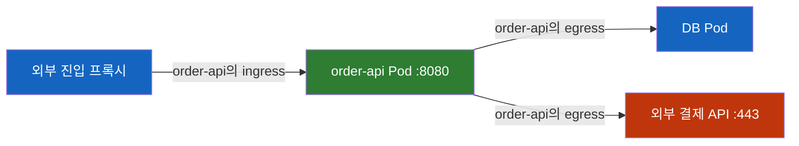
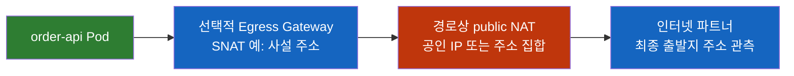

# Kubernetes Ingress vs Egress

> **개발자를 위한 쉬운 쿠버네티스 · 13장** | [전체 목차](./Kubernetes-Introduction.md#이-시리즈의-읽는-순서) · [이전 장](./Kubernetes-Gateway-API.md) · [다음 장](./Kubernetes-Volume-PersistentVolume.md)

Ingress와 Gateway로 외부 요청은 받게 되었다. 그런데 주문 API가 결제 API를 호출하는 권한과 출발지 IP는 어디에서 정할까?

## 결론부터 말하면

`Ingress`는 HTTP 진입 규칙을 선언하는 리소스 이름이고, ingress·egress는 어떤 대상을 기준으로 들어오고 나가는 통신 방향이다. **NetworkPolicy에서 그 기준은 선택된 Pod다.** 같은 Pod 간 연결도 출발 Pod에서는 egress, 도착 Pod에서는 ingress다.

Kubernetes built-in API에는 Ingress와 짝을 이루는 `kind: Egress`가 없다. Pod의 통신 허용 범위는 NetworkPolicy와 이를 지원하는 집행 엔진으로, 출발지 IP와 외부 경로는 NAT·gateway·라우팅으로 나누어 다룬다. [앞 장 Gateway API](Kubernetes-Gateway-API.md)의 `allowedRoutes`나 ReferenceGrant가 이 네트워크 허용까지 대신하지는 않는다.

## 1. 방향의 기준을 먼저 정한다

주문 요청을 처리하는 `bookstore/order-api`를 생각해 보자. 외부 사용자의 요청을 프록시가 앱으로 전달하고, 앱은 주문을 저장하기 위해 DB를 호출하며, 결제 API에도 연결한다. 모두 같은 앱에 관련된 통신이지만 방향은 관찰 대상에 따라 달라진다.



DB의 관점에서는 주문 API가 시작한 연결이 ingress다. 따라서 ingress를 항상 "클러스터 밖에서 안으로"라고 정의하면 클러스터 내부 정책을 읽을 수 없게 된다. 외부와 내부의 흐름을 설명할 때는 north-south, 서비스 간 통신은 east-west라는 표현도 쓰지만, NetworkPolicy의 판단 기준은 선택된 Pod다.

반면 대문자로 쓰는 `kind: Ingress`는 특정 API다. HTTP hostname·path를 backend Service에 연결하는 선언이며, controller가 실제 프록시나 클라우드 LB를 구성한다. 그 리소스를 패킷을 처리하는 프로세스와 동일시하지 않는다. [Ingress 장](Kubernetes-Ingress.md)에서 배운 이 역할은 통신 방향을 뜻하는 소문자 ingress와 구분해야 한다.

| 표현 | 대상과 책임 |
|---|---|
| `kind: Ingress` | HTTP/HTTPS의 host·path·TLS 진입 규칙 |
| NetworkPolicy의 `Ingress` 방향 | 선택된 Pod로 시작되는 수신 연결의 허용 범위 |
| NetworkPolicy의 `Egress` 방향 | 선택된 Pod가 시작하는 송신 연결의 허용 범위 |
| Egress Gateway | 구현체별로 외부 경로·SNAT 또는 프록시 정책·관측을 제공하는 구성 |

## 2. 경로가 있다는 것과 통신이 허용된다는 것

Service와 HTTPRoute가 정확하더라도 backend Pod의 NetworkPolicy가 진입 프록시를 허용하지 않으면 요청은 실패할 수 있다. 반대로 NetworkPolicy가 결제 API를 허용해도 라우팅이나 방화벽·NAT가 없으면 연결은 성립하지 않는다. 정책은 경로를 만들지 않으며, 경로는 정책의 허가를 대신하지 않는다.

NetworkPolicy는 Pod를 label로 선택하고 IP·포트·Pod/namespace selector로 통신을 허용하는 L3/L4 API다. HTTP URL이나 사용자 로그인 권한을 검사하는 API가 아니다. 네트워크 구현에 **NetworkPolicy 지원과 집행 활성화** 가 필요하다. CNI가 설치되었다는 사실만으로 지원 여부를 알 수 없고, CNI와 결합하거나 별도로 배치한 정책 엔진이 집행할 수도 있다.

기본적으로 표준 NetworkPolicy가 어떤 Pod의 한 방향을 isolate하지 않으면 그 방향의 연결은 이 정책 계층에서 제한되지 않는다. 이것을 "인터넷 어디든 연결된다"고 읽으면 안 된다. DNS·라우트·상위 방화벽·프록시·별도 관리자 정책은 여전히 적용된다. 반대로 객체 생성은 성공했는데 기대한 차단이 없다면 엔진의 지원·설정과 정책의 선택 범위를 먼저 확인한다.

## 3. NetworkPolicy는 허용 규칙의 합집합이다

어떤 정책이 Pod를 `Egress` 방향으로 선택하면 그 방향은 isolated가 된다. 이후 허용 범위는 **그 Pod를 해당 방향으로 선택하는 모든 표준 NetworkPolicy 규칙의 합집합** 이다. 정책을 생성한 순서나 파일 이름으로 우선순위를 매기지 않는다. 이름이 `default-deny`여도 다른 정책의 allow를 덮는 deny 규칙은 아니다.

아래 첫 정책은 `bookstore`의 모든 Pod를 egress isolated로 만들고 허용 규칙을 추가하지 않는다. 두 번째 정책은 그중 주문 API의 DNS 및 설명용 파트너 주소 통신을 추가한다. 두 객체를 합쳐 읽어야 한다. 다른 allow 정책이 있다면 그 허용 범위도 함께 더해진다.

```yaml
apiVersion: networking.k8s.io/v1
kind: NetworkPolicy
metadata:
  name: default-deny-egress
  namespace: bookstore
spec:
  podSelector: {}
  policyTypes:
  - Egress
---
apiVersion: networking.k8s.io/v1
kind: NetworkPolicy
metadata:
  name: order-api-outbound
  namespace: bookstore
spec:
  podSelector:
    matchLabels:
      app: order-api
  policyTypes:
  - Egress
  egress:
  - to:
    - namespaceSelector:
        matchLabels:
          kubernetes.io/metadata.name: kube-system
      podSelector:
        matchLabels:
          k8s-app: kube-dns
    ports:
    - protocol: UDP
      port: 53
    - protocol: TCP
      port: 53
  - to:
    - ipBlock:
        cidr: 203.0.113.10/32
    ports:
    - protocol: TCP
      port: 443
```

이는 설명용 정책이다. `203.0.113.10`은 문서용 주소이며 실제 결제 API가 아니다. 공통 앱 이미지 `registry.example.com/book/order-api:1.0.0`, `app: order-api`, 앱 포트 `8080`, Service port `80`도 가상 사례다. 실제 적용 전에는 허용해야 할 DB·인증·관측·DNS 등 의존성을 더 찾아야 한다. 첫 정책만 먼저 적용하면 namespace 안의 다른 앱도 영향을 받는다.

DNS 규칙에서 `namespaceSelector`와 `podSelector`는 **같은 `to` 항목** 에 있으므로 둘 다 만족해야 한다. namespace와 Pod를 각각 다른 `-` 항목으로 나누면 OR가 되어 허용 범위가 넓어진다. 그리고 이 예시는 DNS가 `kube-system`의 `k8s-app: kube-dns` Pod로 전달되는 구성을 가정한다. NodeLocal DNSCache나 다른 resolver를 쓰면 주소·경로·정책 처리가 달라지므로 그대로 복사하지 않는다. UDP 질의뿐 아니라 TCP fallback도 고려한다.

DNS 허용과 결제 API 허용은 별개다. DNS가 풀려도 443 연결이 막힐 수 있고, IP 443을 열어도 resolver가 막히면 새 이름을 해석하지 못한다. 이름 기반 의존성이 있는 앱에서 DNS 누락이 자주 큰 장애로 이어지는 이유다. 이미 열린 연결이나 앱의 DNS cache 때문에 일부 요청이 잠시 성공할 수도 있으므로 한 번의 성공만으로 정책이 완성되었다고 판단하지 않는다.

### 3.1 양쪽 Pod가 각각 허용해야 한다

주문 API가 DB Pod로 연결한다고 하자. 주문 API가 egress isolated라면 목적지 DB를 허용하는 egress 규칙이 필요하고, DB가 ingress isolated라면 출발 주문 API를 허용하는 ingress 규칙도 필요하다. 한쪽을 열었다고 반대쪽 정책이 무시되지 않는다.

예를 들어 DB와 주문 API가 모두 `bookstore`에 있고 DB가 `app: order-db`라면, 아래는 DB의 수신 허용 정책이다. 주문 API의 egress에도 DB:5432 허용을 별도로 추가해야 한다. 여기서 설명하는 DB endpoint 역시 가상이다.

```yaml
apiVersion: networking.k8s.io/v1
kind: NetworkPolicy
metadata:
  name: order-db-from-api
  namespace: bookstore
spec:
  podSelector:
    matchLabels:
      app: order-db
  policyTypes:
  - Ingress
  ingress:
  - from:
    - podSelector:
        matchLabels:
          app: order-api
    ports:
    - protocol: TCP
      port: 5432
```

위 `from`의 `podSelector`는 `namespaceSelector`가 없으므로 정책과 같은 `bookstore` namespace의 `app: order-api` Pod만 선택한다.

허용된 연결의 응답 트래픽은 암묵적으로 허용된다. 요청에 대한 응답을 받으려고 DB→API의 새 연결을 여는 정책을 대칭으로 복제할 필요는 없다. DB가 주문 API에 별도의 새 연결을 시작한다면 그때는 방향을 다시 판단한다.

### 3.2 표준 정책의 경계

표준 NetworkPolicy는 명시적 deny 우선순위나 FQDN·HTTP path·사용자 identity를 표현하지 않는다. 이미 열린 연결에 정책 변경이 언제 반영되는지, NAT 전후 어느 주소를 기준으로 평가하는지 등에는 구현 차이가 있다. 특히 `ipBlock`은 외부 CIDR 허용의 예제로 사용하고, 클러스터 내부 Pod는 selector를 사용해 선택 의도를 표현하는 편이 분명하다.

표준 NetworkPolicy에서 해당 Pod가 실행되는 Node와 그 Pod 사이의 트래픽은 항상 허용되는 예외다. 이것과 별개로 `hostNetwork` Pod를 selector나 IP로 어떻게 다루는지는 네트워크 구현에 따라 다르다. 표준 NetworkPolicy를 모든 host 트래픽까지 다루는 완전한 방화벽으로 생각하지 않는다. Node 정책·상위 방화벽·벤더 전역 정책과의 관계는 해당 구현 문서에서 확인한다.

## 4. 나갈 수 있는 대상과 상대가 보는 출발지 IP

이제 주문 API가 결제 API에 연결하도록 허용했다고 하자. 파트너는 "접속할 고정 출발지 IP를 알려 달라"고 한다. 이것은 허용 대상 문제와 다르다. NetworkPolicy의 `to`에는 목적지를 적을 수 있지만 출발지 IP를 지정하는 필드는 없다.

실제 출발지 주소는 네트워크 경로에서 결정된다. 사설망에서 Pod 대역이 라우팅되면 상대가 Pod IP를 볼 수도 있고, Node에서 SNAT되면 Node IP를 볼 수도 있다. 그 뒤 public NAT를 거치면 최종 상대는 NAT의 공인 IP를 본다. 모든 클러스터가 항상 Node SNAT 후 단일 공인 IP를 사용하는 것은 아니다.



그림은 가능한 경로 하나다. 실제 사설 파트너 경로는 public NAT를 거치지 않을 수 있다. CNI Egress Gateway는 선택한 Pod·목적지의 트래픽을 특정 gateway와 주소로 모을 수 있다. 클라우드 NAT는 해당 NAT로 route된 트래픽을 변환한다. "같은 서브넷에 NAT가 있다"는 사실만으로 모든 목적지·모든 연결에 같은 주소가 적용되지는 않는다.

Istio Egress Gateway는 외부 트래픽을 프록시로 모아 관측·정책·TLS origination을 제공하는 모델이다. gateway 설정 자체가 고정 SNAT IP를 보장하지 않고, sidecar를 우회하는 직접 경로를 자동으로 차단하지도 않는다. 우회를 막아야 한다면 NetworkPolicy·방화벽·라우팅을 포함한 경로 강제와 검증이 필요하다.

고정 출발지 IP는 한 주소일 수도, 허용 목록으로 관리하는 여러 주소일 수도 있다. 특정 주소에 모을수록 gateway 장애·용량·failover도 설계해야 한다. [Egress 확장 읽기](Kubernetes-Egress-NetworkPolicy.md)는 FQDN 허용과 SNAT, 외부 관측을 이 경계 위에서 자세히 다룬다.

## 5. 선언을 읽고 집행과 관측으로 이어 간다

NetworkPolicy 객체를 확인하면 선택자와 허용 의도를 알 수 있다. 그러나 표준 NetworkPolicy에는 연결마다 허용/차단되었다는 공통 status가 없다. 정책 목록과 Pod label만으로 집행 성공을 주장할 수 없다는 뜻이다.

```bash
kubectl get networkpolicy -n bookstore -o yaml
kubectl get pods -n bookstore --show-labels
kubectl get namespaces --show-labels
```

그다음 선택된 Pod에서 실제 DNS와 목적지 연결을 나눠 확인하고, 집행 엔진의 flow log·drop 관측과 상대 시스템 로그를 연결한다. 허용 대상의 성공뿐 아니라 허용하지 않은 대상의 실패도 확인해야 한다. 단, 실패 원인이 정책인지 방화벽·DNS·앱 장애인지 구분할 증거가 필요하다. 출발지 IP는 의도한 목적지 경로를 사용한 상대 측 로그로 확인한다. 다른 인터넷 IP 확인 서비스는 다른 route·CIDR 정책을 탈 수 있다.

온프레미스와 에어갭도 구분한다. 온프레미스는 인프라를 운영하는 장소·주체의 특성이고, 에어갭은 외부 연결 제한이다. 온프레미스라도 인터넷 egress가 있을 수 있고, 관리형 클라우드에서도 사설 endpoint와 방화벽으로 외부 경로를 제한할 수 있다. 에어갭에서 허용 목록을 만들 때는 내부 DNS·사내 registry·내부 인증·업무 API 같은 실제 의존성을 기준으로 검토한다.

## 생각해 볼 질문

**default-deny 정책을 나중에 만들면 먼저 있던 allow 정책을 덮는가?**

표준 NetworkPolicy는 우선순위가 없는 허용 합집합이다. default-deny는 isolation을 만들면서 허용을 추가하지 않는 패턴이며, 다른 정책이 허용한 연결은 그대로 허용된다. 벤더의 explicit deny·tier 정책과 혼동하지 않는다.

**주문 API의 egress에서 DB를 허용했는데 DB 연결은 실패한다. 수신 정책도 볼 이유가 있는가?**

두 Pod 간 연결은 출발지 egress와 도착지 ingress 양쪽에서 허용되어야 한다. 이후 DB listener·DNS·Service port·routing도 확인한다. egress 허용 하나가 전체 연결 성공의 증거는 아니다.

**사설 Egress Gateway IP가 `10.0.0.50`이다. 인터넷 상대도 이 주소를 보아야 하는가?**

인터넷 경로에 추가 NAT가 있으면 상대는 최종 공인 주소를 본다. 사설 주소를 관측하는 내부 경로와 public NAT를 거친 경로를 구분하고, 실제 목적지의 관측 결과로 판단한다.

Service·Readiness·HTTP 진입점과 통신 정책을 연결하면 요청 경로의 주요 경계를 설명할 수 있다. 다음 [Volume 장](Kubernetes-Volume-PersistentVolume.md)에서는 요청을 처리한 뒤 남는 데이터가 Pod 교체를 어떻게 넘어가는지 살펴본다.

## 출처

- [Kubernetes — Network Policies](https://kubernetes.io/docs/concepts/services-networking/network-policies/) — isolation·허용 합집합·양방향 판단·응답 트래픽·구현 한계
- [Kubernetes — Ingress](https://kubernetes.io/docs/concepts/services-networking/ingress/) — HTTP 진입 규칙과 controller
- [Kubernetes — Service](https://kubernetes.io/docs/concepts/services-networking/service/) — 노출과 트래픽 정책
- [Cilium — Egress Gateway](https://docs.cilium.io/en/stable/network/egress-gateway/egress-gateway/) — Pod·목적지 선택과 SNAT
- [Istio — Egress Gateways](https://istio.io/latest/docs/tasks/traffic-management/egress/egress-gateway/) — 프록시와 우회 차단의 별도 책임
- [AWS — NAT gateways](https://docs.aws.amazon.com/vpc/latest/userguide/vpc-nat-gateway.html) — public/private NAT와 목적지 경로
- [Kubernetes — Security Checklist](https://kubernetes.io/docs/concepts/security/security-checklist/)

정책·네트워크 경계는 2026-10-23 공식 문서를 기준으로 설명했다. 실제 클러스터의 집행 엔진·설정·연결은 별도로 확인해야 한다.
