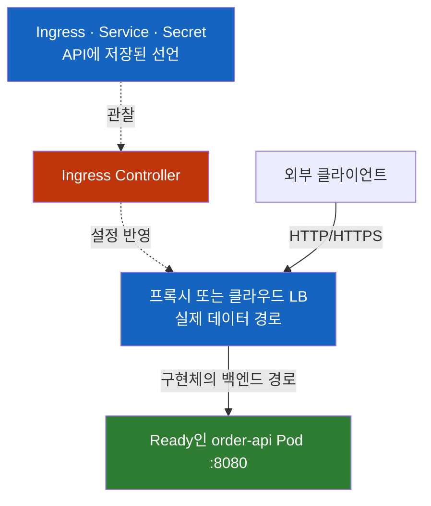
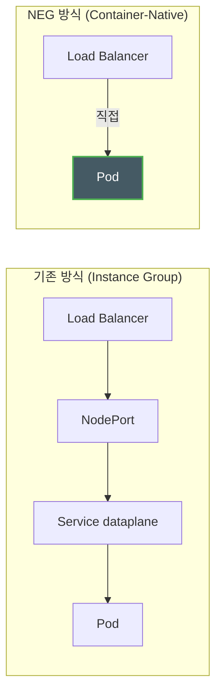

# Kubernetes Ingress

> **개발자를 위한 쉬운 쿠버네티스 · 11장** | [전체 목차](./Kubernetes-Introduction.md#이-시리즈의-읽는-순서) · [이전 장](./Kubernetes-Probe-Liveness-Readiness-Startup.md) · [다음 장](./Kubernetes-Gateway-API.md)

Service와 Readiness까지 연결했는데, `https://orders.example.com/api/orders`는 누가 받아 주는가?

## 결론부터 말하면

Ingress는 외부 HTTP/HTTPS 요청의 host와 path를 어느 Service에 연결할지 기록하는 API 리소스다. Ingress Controller가 그 선언을 읽어 프록시나 클라우드 로드밸런서를 구성하고, 실제 요청은 그 데이터 경로를 따라 앱에 도착한다. **리소스를 저장하는 일, 진입점을 구성하는 일, 앱이 응답하는 일은 서로 다른 단계다.**

[Probe 장](Kubernetes-Probe-Liveness-Readiness-Startup.md)에서는 실행 중인 `order-api` 중 요청을 받을 준비가 된 Pod를 구분했다. 이제 그 앞에 외부 HTTP 진입점을 붙인다. Service가 Pod 집합에 붙인 안정적인 이름이라면, Ingress는 외부 사용자의 hostname과 URL을 그 이름에 연결하는 규칙이다.

## 1. 왜 Ingress가 필요한가?

주문 API의 Service를 LoadBalancer로 노출하면 외부 주소를 얻을 수 있다. 하지만 사용자가 원하는 주소는 보통 IP와 포트의 조합으로 끝나지 않는다. 같은 도메인에서 `/api`는 주문 API로, `/`는 웹으로 보내고, 여러 앱의 인증서를 공통 진입점에서 운영하고 싶어진다.

Service API의 `port`와 `targetPort`는 연결할 포트를 표현한다. HTTP의 Host 헤더나 URL 경로로 앱을 나누는 규칙은 표현하지 않는다. 그 HTTP 라우팅을 선언하는 API가 Ingress다. 하나의 HTTP 진입점 뒤에 여러 Service를 둘 수 있으므로, Service마다 별도 외부 LB를 만드는 배치보다 자원과 인증서 관리를 모을 수 있다.

다만 Ingress 하나가 반드시 LB 하나를 만들거나, 항상 비용이 줄어드는 것은 아니다. 공유 여부·가용성·트래픽 요금·신뢰 경계를 포함한 구현체의 배치 방식에 따라 달라진다. LoadBalancer Service의 구현이 TLS를 종료할 수도 있다. 예를 들어 AWS NLB의 TLS listener는 인증서를 사용할 수 있다. Ingress의 차이는 TLS 독점 기능이 아니라 **HTTP 라우팅을 Kubernetes 리소스로 선언하는 모델** 에 있다.

## 2. Ingress의 구조

### 2.1 선언 경로와 요청 경로를 구분한다

Ingress를 apply하면 API server가 리소스를 저장한다. Controller는 이 리소스와 관련 Service·EndpointSlice·Secret을 관찰하고 실제 진입점의 설정을 수렴시킨다. 클라이언트 요청마다 API server가 Ingress를 조회해 다음 Service로 넘기는 구조가 아니다.



소프트웨어 프록시를 사용하는 구현에서는 controller와 proxy가 같은 제품·프로세스에 묶이기도 한다. 반면 AWS Load Balancer Controller는 AWS API로 ALB를 구성하고, 요청은 ALB가 받는다. 따라서 controller Pod가 실제 사용자 패킷을 모두 중계한다고 가정하면 장애 지점을 잘못 찾게 된다.

Ingress의 backend는 Service를 가리킨다. 실제 데이터 경로는 구현체에 따라 Service의 ClusterIP를 사용하거나, EndpointSlice 등에서 얻은 Pod IP:port를 직접 사용하거나, NodePort를 거칠 수 있다. 그림에서 Service 오브젝트를 실행 중인 중계 서버처럼 그리지 않는 이유다.

### 2.2 IngressClass: 누가 이 선언을 맡는가

IngressClass는 클러스터 범위 리소스이며 `spec.controller`로 담당 구현체를 식별한다. Ingress는 `spec.ingressClassName`으로 그 Class의 이름을 참조한다. Class를 만드는 것만으로 controller 프로그램이 설치되지는 않는다.

다음 본문에서는 운영자가 준비한 `public-http` IngressClass가 있다고 가정한다. 이 이름은 설명용 계약이며 실제 환경의 Class 이름으로 바꿔야 한다. 이름이 `nginx`라고 해서 그 문자열 자체가 특정 제품을 설치하거나 증명하지도 않는다. `kubectl get ingressclass public-http -o yaml`에서 `spec.controller`와 해당 controller의 설정을 함께 확인한다.

기본 Class는 `ingressclass.kubernetes.io/is-default-class: "true"` annotation으로 지정한다. 기본 Class가 유일하고 admission 조건이 맞으면 Class를 생략한 새 Ingress에 기본값이 지정된다. 여러 기본 Class를 두거나 controller의 legacy class 처리 규칙에 의존하면 해석이 달라질 수 있으므로, 예제는 Class를 명시한다.

## 3. Ingress 기본 설정

### 3.1 order-api에 HTTP 경로를 붙인다

`bookstore` namespace에는 앞 장의 `app: order-api` Pod와 다음 Service가 있다고 가정한다. 앱은 `8080`, Service는 `80`을 사용한다. 공통 이미지 `registry.example.com/book/order-api:1.0.0`과 `/api/orders`, `/readyz` 같은 endpoint는 설명을 위한 가상 앱이며 다운로드해서 실행할 수 있는 실습 패키지가 아니다.

```yaml
apiVersion: v1
kind: Service
metadata:
  name: order-api
  namespace: bookstore
spec:
  selector:
    app: order-api
  ports:
  - name: http
    port: 80
    targetPort: 8080
---
apiVersion: networking.k8s.io/v1
kind: Ingress
metadata:
  name: order-api
  namespace: bookstore
spec:
  ingressClassName: public-http
  rules:
  - host: orders.example.com
    http:
      paths:
      - path: /api
        pathType: Prefix
        backend:
          service:
            name: order-api
            port:
              number: 80
```

이 YAML에서 backend의 `80`은 앱의 container port가 아니라 **Service port** 다. Controller는 `orders.example.com`의 `/api` 요청을 `bookstore/order-api` Service에 연결하고, Service의 `targetPort: 8080`과 endpoint 정보를 바탕으로 실제 앱까지의 경로를 구성한다. Ingress와 backend Service는 같은 namespace에 있어야 한다.

이 선언에는 DNS 레코드가 없다. 외부 DNS에서 `orders.example.com`을 프록시/LB의 주소로 연결하는 작업은 별도다. 일반적으로 그 주소는 Ingress의 `status.loadBalancer`나 controller가 노출한 Service에서 확인하지만, 주소 게시 방식은 구현체마다 다르다. 또한 내부용 LB와 사설 DNS를 사용하면 Ingress를 통해 공개해도 인터넷 전체에 공개되는 것은 아니다.

### 3.2 pathType은 매칭 규칙이지 경로 변경이 아니다

`Prefix`는 `/`로 구분한 경로 요소를 기준으로 매칭한다. `/api`는 `/api`, `/api/`, `/api/orders`에 맞지만 `/apix`에는 맞지 않는다. 단순 문자열 접두사와 다르다. `Exact`는 정확한 경로에만 맞고, `ImplementationSpecific`은 선택한 구현체의 규칙을 따른다. 여러 규칙이 맞으면 긴 경로가 우선하며 길이가 같으면 Exact가 Prefix보다 우선한다.

여기에는 또 하나의 경계가 있다. `/api/orders`가 매칭되었다고 `/api`가 자동으로 제거되지는 않는다. 앱이 `/orders`만 처리한다면 프록시의 rewrite가 필요하다. rewrite는 표준 Ingress 필드가 아니므로 구현체 설정이나 [Gateway API](Kubernetes-Gateway-API.md)의 지원 기능을 검토한다. 경로 매칭 성공과 앱 라우터의 성공은 별개다.

### 3.3 호스트와 기본 백엔드

host를 다르게 쓰면 같은 진입점에서 여러 Service를 분기할 수 있다. host를 생략한 규칙은 해당 조건에서 모든 host를 받으므로 공유 환경에서는 의도하지 않은 노출이 없는지 확인한다. `spec.defaultBackend`는 해당 Ingress 규칙에 매칭되지 않는 요청을 보낼 Service를 지정한다. 생략했을 때의 기본 응답은 controller 설정에 따라 달라진다.

아래는 앞 Ingress의 `spec`에 추가할 수 있는 발췌다. `fallback-page`라는 별도 Service가 같은 namespace에 준비되어 있어야 한다.

```yaml
# Ingress spec의 발췌, 독립 리소스가 아님
spec:
  defaultBackend:
    service:
      name: fallback-page
      port:
        number: 80
```

## 4. TLS/HTTPS 설정

TLS 종료는 클라이언트의 암호화 연결을 프록시/LB에서 풀고 백엔드에 새 연결을 맺는 방식이다. 백엔드까지 HTTP로 보낼 수도, 별도 TLS를 사용할 수도 있다. 인증서를 입구에 두었다고 입구부터 Pod까지 자동으로 암호화되는 것은 아니다. 재암호화와 backend 인증서 검증은 controller별 설정을 확인한다.

앞 Ingress의 `spec`에 다음 항목을 추가하면 `orders-tls` Secret을 사용하는 HTTPS 설정을 요청한다. HTTP→HTTPS redirect는 표준 `tls` 필드가 보장하는 기능이 아니므로 따로 확인한다.

```yaml
# 기존 Ingress spec에 합칠 TLS 발췌
spec:
  tls:
  - hosts:
    - orders.example.com
    secretName: orders-tls
```

Secret은 Ingress와 같은 `bookstore` namespace에 있고, `kubernetes.io/tls` 형식의 `tls.crt`, `tls.key`를 제공해야 한다. 인증서의 SAN에는 실제 요청 hostname이 포함되어야 한다. `tls.hosts`, `rules.host`, 인증서 이름이 맞아도 클라이언트가 발급 CA를 신뢰하지 않으면 TLS 검증은 실패한다.

```bash
# 준비한 인증서·키로 Secret을 만드는 설명용 명령
kubectl create secret tls orders-tls -n bookstore \
  --cert=./orders.crt --key=./orders.key
```

cert-manager는 별도로 설치하는 인증서 관리 controller다. 예를 들어 `cert-manager.io/cluster-issuer: letsencrypt-prod` annotation은 이미 존재하는 ClusterIssuer를 사용하라는 요청이다. annotation 한 줄이 issuer 계정·DNS 권한·challenge 경로를 만들어 주지는 않는다. HTTP-01은 인증기관이 challenge 주소로 접근할 수 있어야 하고, DNS-01은 권한 있는 DNS를 수정할 경로가 필요하다. 에어갭에서는 공용 ACME 접근을 전제하지 말고 내부 CA·사내 발급 절차와 인증서 갱신·신뢰 배포를 함께 설계한다.

## 5. 요청 한 건으로 연결을 확인한다

`kubectl apply`가 성공했다면 API가 문서를 받아들였다는 사실까지 확인한 것이다. 이어서 controller가 Class를 담당하는지, 프록시/LB 설정이 반영되었는지, 백엔드가 사용 가능한지 순서대로 본다. 다음은 실행 결과가 아닌 사용자가 선택한 환경에서 사용할 관찰 명령이다.

```bash
kubectl get ingressclass
kubectl get ingress -n bookstore order-api -o yaml
kubectl describe ingress -n bookstore order-api
kubectl get svc -n bookstore order-api -o yaml
kubectl get endpointslices -n bookstore -l kubernetes.io/service-name=order-api -o yaml
kubectl get pods -n bookstore -l app=order-api -o wide
```

ADDRESS가 비어 있어도 controller 부재로 확정할 수 없다. 프로비저닝 지연·권한·quota·서브넷 조건, 주소 게시 설정을 구분한다. EndpointSlice가 없거나 ready endpoint가 없으면 selector·Pod 라벨·Readiness·controller 동기화를 확인한다. 그다음 구현체의 proxy 로그 또는 클라우드 LB의 target health와 Events를 확인한다.

DNS가 아직 연결되지 않았다면, 실제 진입점 IP를 사용해 hostname을 유지한 요청으로 분리할 수 있다. 다음 주소는 문서용이며 실제 환경 주소로 바꾼다.

```bash
curl -v --resolve orders.example.com:443:192.0.2.10 \
  https://orders.example.com/api/orders
```

`--resolve`는 연결 IP를 지정하면서 HTTP Host와 TLS SNI를 hostname으로 유지한다. 브라우저에서 IP로 직접 요청하면 다른 host 규칙이나 다른 인증서를 만날 수 있으므로 같은 검증이 아니다. 이 명령도 네트워크 도달성이나 인증서 신뢰를 건너뛰지는 않는다.

404를 받았다면 프록시가 규칙을 못 찾았는지, 앱이 받은 경로를 처리하지 못했는지 응답 출처를 좁힌다. HTML·JSON 모양이나 Server 헤더는 단서일 뿐이다. 요청 시각·request ID를 proxy access log와 앱 로그에 연결하고, rewrite 후 실제 전달 경로를 확인해야 한다. 502·503 역시 포트·프로토콜·연결 거부·ready endpoint 부재 등 여러 원인이 있으므로 상태 코드 하나를 단일 원인에 대응시키지 않는다.

### 두 개의 health 판단

kubelet의 Readiness와 외부 LB의 health check는 주체와 시점이 다르다. Pod가 Ready여도 LB가 보는 경로·포트·방화벽·인증 조건이 맞지 않으면 LB는 unhealthy로 볼 수 있다. 반대로 LB health check가 성공해도 실제 업무 경로의 의존성이 모두 정상이라는 보장은 없다.

같은 health endpoint를 공유할 수는 있지만 포트와 경로를 무조건 같게 맞추는 것이 규칙은 아니다. NodePort의 Node health check인지 Pod IP의 앱 health check인지부터 구분한다. 아래는 Pod template의 컨테이너 발췌이며 외부 LB 설정과는 별도다.

```yaml
# Deployment spec.template.spec.containers의 항목 발췌
- name: order-api
  image: registry.example.com/book/order-api:1.0.0
  readinessProbe:
    httpGet:
      path: /readyz
      port: 8080
```

이제 기본 경로를 설명할 수 있다. 후반부에서는 기존 클러스터를 읽을 때 필요한 annotation과 클라우드별 전달 경로를 살펴본다. controller에 종속된 기능을 쓸수록 다음 장의 표준화·역할 분리 문제가 왜 생기는지도 구체적으로 드러난다.

## 6. Annotations: Controller별 고급 설정

### 6.1 Nginx Ingress 예시

Ingress Controller마다 **annotations**로 세부 설정을 한다.

> **이 절을 읽는 법 (2026-10-23 기준).** 아래 `nginx.ingress.kubernetes.io/*` annotation들은 **은퇴한 커뮤니티 ingress-nginx의 문법** 이다([12절](#12-2026년-현재--ingress-nginx-은퇴와-gateway-api)). 지금도 이 절이 유효한 이유는 두 가지다 — 이미 돌아가는 클러스터를 **읽고 이해하려면** 필요하고, Gateway API로 **이전할 때 무엇을 다시 설계해야 하는지** 목록이 바로 이 annotation들이기 때문이다. 반대로 **신규 클러스터를 구성한다면 이 문법을 그대로 쓰면 안 된다.** 고른 컨트롤러의 자체 문법이나 Gateway API 표준 필드로 옮겨야 한다.
>
> 그리고 annotation이 이렇게 컨트롤러마다 제각각이라는 사실 자체가, Gateway API가 헤더 매칭·트래픽 가중치를 **표준 스키마 필드로 끌어올린** 이유다.

```yaml
apiVersion: networking.k8s.io/v1
kind: Ingress
metadata:
  name: legacy-order-api
  namespace: bookstore
  annotations:
    # HTTPS 리다이렉트
    nginx.ingress.kubernetes.io/ssl-redirect: "true"

    # 타임아웃
    nginx.ingress.kubernetes.io/proxy-read-timeout: "300"

    # CORS
    nginx.ingress.kubernetes.io/enable-cors: "true"

    # Rate Limiting
    nginx.ingress.kubernetes.io/limit-rps: "10"
spec:
  ingressClassName: nginx
  rules:
  - host: api.example.com
    http:
      paths:
      - path: /api
        pathType: Prefix
        backend:
          service:
            name: order-api
            port:
              number: 80
```

### 6.2 경로 재작성 (Rewrite)

`/api/users` 요청을 백엔드에 `/users`로 전달하고 싶을 때 `rewrite-target` annotation을 사용한다.

**v0.22.0 이후:** 반드시 **캡처 그룹**을 명시적으로 정의해야 한다.

```yaml
apiVersion: networking.k8s.io/v1
kind: Ingress
metadata:
  name: legacy-order-api-rewrite
  namespace: bookstore
  annotations:
    nginx.ingress.kubernetes.io/rewrite-target: /$2    # 두 번째 캡처 그룹으로 재작성
    nginx.ingress.kubernetes.io/use-regex: "true"
spec:
  ingressClassName: nginx
  rules:
  - host: example.com
    http:
      paths:
      - path: /api(/|$)(.*)      # 캡처 그룹: $1=(/|$), $2=(.*)
        pathType: ImplementationSpecific
        backend:
          service:
            name: order-api
            port:
              number: 80
```

| 요청 경로 | 백엔드 전달 경로 | 설명 |
|----------|-----------------|------|
| `/api` | `/` | `$2`가 빈 문자열 |
| `/api/` | `/` | `$2`가 빈 문자열 |
| `/api/users` | `/users` | `$2`가 `users` |
| `/api/v1/products` | `/v1/products` | `$2`가 `v1/products` |

**캡처 그룹 설명:**
- `(/|$)` → `$1`: `/` 또는 문자열 끝 매칭
- `(.*)` → `$2`: 나머지 경로 캡처 (이것을 `rewrite-target`에서 사용)

> 📖 자세한 내용은 [Nginx Ingress Rewrite 문서](https://kubernetes.github.io/ingress-nginx/examples/rewrite/)를 참고하라. ⚠️ 이 문서는 **2026년 3월 아카이브** 되어 더 이상 갱신되지 않는다 — 기존 설정을 해석하는 용도로만 쓰라.

### 6.3 자주 쓰는 Nginx Annotations

| Annotation | 설명 |
|------------|------|
| `ssl-redirect` | HTTP → HTTPS 리다이렉트 |
| `rewrite-target` | 경로 재작성 |
| `proxy-body-size` | 요청 본문 크기 제한 |
| `proxy-read-timeout` | 백엔드 응답 타임아웃 |
| `whitelist-source-range` | IP 허용 목록 |

---

## 9. 클라우드별 Ingress Controller

이 절의 annotation은 서로 다른 구현체의 선택지다. 기본 예제에 한꺼번에 합치지 않는다. 2026-10-23 확인한 공식 문서 기준이며 서브넷·IAM·LB 제품·설치 버전별 전제는 별도다.

클라우드 환경에서는 각 클라우드의 **네이티브 로드밸런서** 와 통합된 Ingress Controller를 사용한다.

> **⚠️ IngressClass 지정 방식 주의:** Kubernetes **1.18부터** 일반 Ingress 리소스는 `kubernetes.io/ingress.class` **annotation이 deprecated**되었고 `spec.ingressClassName` **필드**가 표준이다. **단, 클라우드별 Controller마다 규칙이 다르므로 공식 문서를 따라야 한다:**
> - **AWS Load Balancer Controller**: `ingressClassName: alb` (표준 방식) 사용
> - **Azure AGIC**: `ingressClassName` 또는 legacy annotation 모두 지원
> - **GKE Ingress(GCE)**: external·internal 모두 [`kubernetes.io/ingress.class: "gce"` / `"gce-internal"` annotation으로 지정](https://docs.cloud.google.com/kubernetes-engine/docs/concepts/ingress)한다. annotation 없이 `ingressClassName`만 지정하면 GKE Ingress controller는 처리하지 않는다
>
> 즉 "일반 k8s Ingress는 `ingressClassName` 권장, GKE는 예외"로 기억하라.

### 9.1 AWS: ALB Ingress Controller (AWS Load Balancer Controller)

AWS에서는 **AWS Load Balancer Controller** 가 Ingress 리소스를 **Application Load Balancer(ALB)** 로 프로비저닝한다.

```yaml
apiVersion: networking.k8s.io/v1
kind: Ingress
metadata:
  name: order-api
  namespace: bookstore
  annotations:
    # ALB 기본 설정
    alb.ingress.kubernetes.io/scheme: internet-facing          # 또는 internal
    alb.ingress.kubernetes.io/target-type: ip                  # ip 또는 instance

    # Health Check 설정
    alb.ingress.kubernetes.io/healthcheck-path: /readyz
    alb.ingress.kubernetes.io/healthcheck-interval-seconds: "15"
    alb.ingress.kubernetes.io/healthcheck-timeout-seconds: "5"
    alb.ingress.kubernetes.io/success-codes: "200"
    alb.ingress.kubernetes.io/healthy-threshold-count: "2"
    alb.ingress.kubernetes.io/unhealthy-threshold-count: "2"

    # SSL/TLS (ACM 인증서 사용)
    alb.ingress.kubernetes.io/listen-ports: '[{"HTTP": 80}, {"HTTPS": 443}]'
    alb.ingress.kubernetes.io/certificate-arn: arn:aws:acm:region:account:certificate/xxx
    alb.ingress.kubernetes.io/ssl-redirect: "443"

    # WAF 연동
    alb.ingress.kubernetes.io/wafv2-acl-arn: arn:aws:wafv2:region:account:regional/webacl/xxx
spec:
  ingressClassName: alb
  rules:
  - host: api.example.com
    http:
      paths:
      - path: /
        pathType: Prefix
        backend:
          service:
            name: order-api
            port:
              number: 80
```

| 어노테이션 | 설명 |
|-----------|------|
| `scheme: internet-facing` | Public ALB (외부 노출) |
| `scheme: internal` | Internal ALB (VPC 내부만) |
| `target-type: ip` | Pod IP 타겟 (네트워크 도달성 필요, Fargate 사용 시 필요) |
| `target-type: instance` | NodePort를 통해 라우팅. backend Service는 NodePort 또는 LoadBalancer 타입이어야 함 |
| `ssl-redirect: "443"` | HTTP → HTTPS 리다이렉트 |

**IngressGroup: 여러 Ingress를 하나의 ALB로**

```yaml
metadata:
  annotations:
    alb.ingress.kubernetes.io/group.name: my-group    # 같은 그룹 = 같은 ALB
    alb.ingress.kubernetes.io/group.order: "1"        # 규칙 우선순위 (낮을수록 먼저 평가)
```

여러 Ingress 리소스에 같은 `group.name`을 지정하면 **하나의 ALB** 로 통합된다. ALB 비용을 절감할 수 있다.

`group.order`는 낮은 숫자의 규칙을 먼저 평가하게 하지만 접근 통제 수단은 아니다. 같은 IngressGroup에 참여할 권한이 있는 사용자는 더 높은 우선순위의 규칙으로 기존 트래픽을 가져갈 수 있다. 따라서 그룹을 공유하는 팀을 같은 신뢰 경계로 보고, Ingress 생성·수정 권한과 그룹 참여를 RBAC·admission 정책으로 제한해야 한다. 비용 절감과 권한 분리는 함께 설계한다.

### 9.2 GKE: GCE Ingress Controller (Container-Native Load Balancing)

GKE에서는 **GCE Ingress Controller** 가 제공된다. container-native load balancing 조건을 만족하고 NEG를 사용하는 구성에서는 **Network Endpoint Group(NEG)** 의 Pod IP:port를 백엔드로 등록한다. 모든 GKE Ingress가 같은 백엔드 방식을 사용하는 것은 아니다.

**External GKE Ingress (외부 공개용):**

```yaml
apiVersion: networking.k8s.io/v1
kind: Ingress
metadata:
  name: order-api
  namespace: bookstore
  annotations:
    # External GKE Ingress (기본값)
    kubernetes.io/ingress.class: "gce"

    # Global Static IP (외부 LB용)
    kubernetes.io/ingress.global-static-ip-name: "my-static-ip"

    # Google Managed Certificate
    networking.gke.io/managed-certificates: "my-cert"
spec:
  rules:
  - host: api.example.com
    http:
      paths:
      - path: /
        pathType: Prefix
        backend:
          service:
            name: order-api
            port:
              number: 80
```

**Internal GKE Ingress (VPC 내부 전용):**

```yaml
apiVersion: networking.k8s.io/v1
kind: Ingress
metadata:
  name: order-api-internal
  namespace: bookstore
  annotations:
    # Internal Load Balancer
    kubernetes.io/ingress.class: "gce-internal"

    # Regional Static IP (internal LB는 regional 사용, global이 아님!)
    kubernetes.io/ingress.regional-static-ip-name: "my-regional-static-ip"
spec:
  rules:
  - host: internal-api.example.com
    http:
      paths:
      - path: /
        pathType: Prefix
        backend:
          service:
            name: order-api
            port:
              number: 80
```

> **⚠️ Static IP 종류 주의:** External GKE Ingress는 **Global Static IP** (`global-static-ip-name`), Internal GKE Ingress는 **Regional Static IP** (`regional-static-ip-name`)를 사용한다. 섞어 쓰면 프로비저닝이 실패한다.

**NEG (Container-Native Load Balancing) 설정:**

```yaml
# Service에 NEG 어노테이션 추가
apiVersion: v1
kind: Service
metadata:
  name: order-api
  namespace: bookstore
  annotations:
    cloud.google.com/neg: '{"ingress": true}'    # NEG 활성화
spec:
  type: ClusterIP
  selector:
    app: order-api
  ports:
  - port: 80
    targetPort: 8080
```



**NEG의 장점:**
- **낮은 지연 시간:** Service VIP·NodePort 및 kube-proxy의 Service 전달 경로를 우회해 Pod IP:port로 연결. Pod가 실행되는 물리 Node를 우회한다는 뜻은 아니다
- **정확한 Health Check:** Pod 단위로 상태 확인
- **효율적인 로드밸런싱:** 실제 Pod 분포에 따른 균등 분배

**BackendConfig: 고급 Health Check 설정**

```yaml
apiVersion: cloud.google.com/v1
kind: BackendConfig
metadata:
  name: api-backend-config
  namespace: bookstore
spec:
  healthCheck:
    checkIntervalSec: 15
    timeoutSec: 5
    healthyThreshold: 2
    unhealthyThreshold: 2
    type: HTTP
    requestPath: /readyz
    port: 8080
  connectionDraining:
    drainingTimeoutSec: 60
  cdn:
    enabled: true
    cachePolicy:
      includeHost: true
      includeProtocol: true
---
apiVersion: v1
kind: Service
metadata:
  name: order-api
  namespace: bookstore
  annotations:
    cloud.google.com/neg: '{"ingress": true}'
    cloud.google.com/backend-config: '{"default": "api-backend-config"}'
spec:
  type: ClusterIP
  selector:
    app: order-api
  ports:
  - port: 80
    targetPort: 8080
```

### 9.3 Azure: Application Gateway Ingress Controller (AGIC)

Azure에서는 **AGIC** 가 Ingress를 **Azure Application Gateway** 로 변환한다.

```yaml
apiVersion: networking.k8s.io/v1
kind: Ingress
metadata:
  name: order-api
  namespace: bookstore
  annotations:
    kubernetes.io/ingress.class: azure/application-gateway

    # Backend Protocol
    appgw.ingress.kubernetes.io/backend-protocol: "http"         # 또는 https

    # Health Check
    appgw.ingress.kubernetes.io/health-probe-path: "/readyz"
    appgw.ingress.kubernetes.io/health-probe-interval: "15"
    appgw.ingress.kubernetes.io/health-probe-timeout: "5"

    # WAF Policy
    appgw.ingress.kubernetes.io/waf-policy-for-path: "/subscriptions/.../wafPolicies/my-waf"

    # Private IP 사용 (Internal)
    appgw.ingress.kubernetes.io/use-private-ip: "true"

    # SSL Redirect
    appgw.ingress.kubernetes.io/ssl-redirect: "true"
spec:
  rules:
  - host: api.example.com
    http:
      paths:
      - path: /
        pathType: Prefix
        backend:
          service:
            name: order-api
            port:
              number: 80
```

| 어노테이션 | 설명 |
|-----------|------|
| `use-private-ip: "true"` | Internal LB (Private IP 사용) |
| `backend-protocol: "https"` | 백엔드 Pod와 HTTPS 통신 |
| `waf-policy-for-path` | WAF 정책 연동 |
| `ssl-redirect: "true"` | HTTP → HTTPS 리다이렉트 |

> **참고:** Azure는 차세대 솔루션으로 **Application Gateway for Containers** 를 출시했다. Gateway API를 지원하는 별도 제품이며 AGIC와 설치·기능 조건이 다르다. 제품 선택 시 지원 API와 운영 모델을 확인한다.

### 9.4 클라우드별 Ingress Controller 비교

| 기능 | AWS ALB | GKE GCE | Azure AGIC |
|------|---------|---------|------------|
| **L7 Load Balancer** | ALB | HTTP(S) LB | App Gateway |
| **Pod 직접 연결** | target-type: ip | NEG | ✅ (Endpoint 기반) |
| **WAF 연동** | WAFv2 | Cloud Armor | WAF Policy |
| **관리형 인증서** | ACM | Google Managed Cert | Key Vault |
| **AWS IngressGroup** | ✅ | 해당 AWS 기능명은 사용하지 않음 | 해당 AWS 기능명은 사용하지 않음 |
| **비용** | ALB 시간당 + LCU | LB 시간당 + 트래픽 | App GW 시간당 + CU |

---

<a id="12-2026년-현재--ingress-nginx-은퇴와-gateway-api"></a>

## 12. 2026년 현재 — ingress-nginx 은퇴와 Gateway API

2026-10-23 기준, Kubernetes 커뮤니티의 `ingress-nginx`는 은퇴했고 upstream 저장소는 2026-03-24에 archive되었다. 2025-11-11 공식 발표와 2026-01-29 Steering·Security Response Committee 성명은 이후 upstream 버그 수정·보안 패치가 없음을 안내한다. 기존 배포와 아티팩트가 남아 있어도 지속적인 유지보수를 받는다는 뜻은 아니다.

공식 발표는 유지보수 인력 부족과 프로젝트의 장기 유지 문제를 설명한다. 임의 NGINX snippet 같은 유연한 설정의 보안 부담과 과거 취약점을 검토할 필요는 있지만, 특정 CVE 하나가 은퇴를 결정했다거나 인력이 늘어도 해결 불가능하다고 단정할 근거로 확대하지 않는다.

은퇴한 것은 Ingress API 자체나 웹 서버 NGINX가 아니다. F5 NGINX Ingress Controller도 별도 프로젝트다. Ingress API는 새 기능이 추가되지 않는 frozen 상태이며, Kubernetes는 신규 요구에 Gateway API를 권장한다. 실제 운영 대상이 어느 구현체인지 아래 이름과 Class의 controller 식별자를 함께 확인한다.

```bash
kubectl get pods --all-namespaces --selector app.kubernetes.io/name=ingress-nginx
kubectl get ingressclass -o custom-columns=NAME:.metadata.name,CONTROLLER:.spec.controller
```

이전은 `ingressClassName`만 바꿔 끝낼 수 있는 작업이 아니다. rewrite·timeout·client IP·TLS·인증·health check와 종료 시 연결 처리를 목록화한 뒤 새 구현체에서 같은 요청으로 비교해야 한다. 공유 진입점의 권한과 LB 수가 달라질 수 있으므로 비용과 운영 소유권도 함께 검토한다.

공식 `ingress2gateway` v1.0 발표(2026-03-20)는 ingress-nginx annotation 30개 이상을 Gateway API 필드와 구현체별 정책으로 변환하는 기능을 설명한다. 아래 명령은 기본 `standard` emitter로 표준 Gateway API 리소스를 출력하는 예다. 구현체별 policy 출력은 그 구현체를 지원하는 emitter를 선택했을 때의 범위이므로 사용 버전의 `--emitter` 선택지와 지원 목록을 확인한다. 임의 snippet이나 지원하지 않는 기능의 의미까지 보장하지는 않으므로, 파일 입력으로 변환 결과와 경고를 먼저 검토한다.

```bash
ingress2gateway print --providers=ingress-nginx --input-file=ingress.yaml
```

[다음 장 Gateway API](Kubernetes-Gateway-API.md)는 입구의 listener·TLS를 관리하는 운영자와 경로를 관리하는 개발자의 권한을 나누는 모델을 설명한다. Ingress를 읽는 능력은 기존 선언을 이해하고 이전 전후를 비교하는 데 계속 필요하다.

## 생각해 볼 질문

**Ingress와 Service가 저장되었는데 외부 DNS는 아직 옛 주소를 가리킨다. 어느 단계까지 성공한 것인가?**

API가 선언을 받았다는 사실과 controller가 진입점을 구성했는지는 별도로 확인해야 한다. DNS가 옛 주소를 가리키면 일반 사용자 요청은 새 진입점에 도달하지 않을 수 있다. 새 IP에 hostname을 유지한 요청을 보내 DNS 단계와 이후 경로를 나눌 수 있다.

**`/api` Prefix와 Ready Pod가 있는데 `/api/orders`가 404다. selector부터 바꿔야 할까?**

경로 매칭·backend 전달·앱 라우터는 별개다. 프록시 규칙이 매칭되어도 앱이 `/orders`만 처리하면 원래 경로로 받은 요청은 실패한다. proxy와 앱 로그로 출처·전달 경로를 확인한 뒤 rewrite 필요성을 판단한다.

**Ingress를 하나 만들면 LB도 하나 생기는가?**

API는 그 수를 정하지 않는다. 기존 프록시를 공유할 수도, 클라우드 LB를 만들 수도 있다. 구현체와 그룹·Class 설정을 확인해야 자원 수와 신뢰 경계를 설명할 수 있다.

## 출처

- [Kubernetes Documentation - Ingress](https://kubernetes.io/docs/concepts/services-networking/ingress/) - 공식 문서
- [Kubernetes Documentation - Ingress Controllers](https://kubernetes.io/docs/concepts/services-networking/ingress-controllers/) - 공식 문서. 유지보수되는 컨트롤러 목록

**ingress-nginx 은퇴 (12절 근거)**

- [Ingress NGINX: Statement from the Kubernetes Steering and Security Response Committees (2026-01-29)](https://kubernetes.io/blog/2026/01/29/ingress-nginx-statement) — **1차 출처.** 2026년 3월 은퇴, 이후 릴리스·버그 수정·보안 패치 없음, 클라우드 네이티브 환경의 약 50%가 사용, 드롭인 대체제 없음, 확인용 `kubectl` 명령
- [Gateway API](https://gateway-api.sigs.k8s.io/) — 위원회가 지목한 후계 표준. `GatewayClass`/`Gateway`/`HTTPRoute` 역할 분리
- [Gateway API — HTTP traffic splitting](https://gateway-api.sigs.k8s.io/guides/user-guides/traffic-splitting/) — `backendRefs`의 `weight`로 가중치 분배
- [ingress2gateway](https://github.com/kubernetes-sigs/ingress2gateway) — Ingress → Gateway API 공식 변환 도구
- [~~Nginx Ingress Controller Documentation~~](https://kubernetes.github.io/ingress-nginx/) — ⚠️ **2026년 3월 아카이브됨.** 본문 6절 annotation 설명의 원 출처이나 더 이상 유지보수되지 않는다
- [AWS Load Balancer Controller - Ingress Annotations](https://kubernetes-sigs.github.io/aws-load-balancer-controller/latest/guide/ingress/annotations/) - AWS 공식
- [GKE Container-Native Load Balancing](https://cloud.google.com/kubernetes-engine/docs/how-to/container-native-load-balancing) - GCP 공식
- [Azure Application Gateway Ingress Controller](https://learn.microsoft.com/en-us/azure/application-gateway/ingress-controller-overview) - Azure 공식
- [cert-manager Documentation](https://cert-manager.io/docs/) - cert-manager 공식

- [ingress-nginx upstream repository](https://github.com/kubernetes/ingress-nginx) — archive 상태
- [Ingress NGINX retirement announcement (2025-11-11)](https://kubernetes.io/blog/2025/11/11/ingress-nginx-retirement/)
- [Ingress2Gateway v1.0 (2026-03-20)](https://kubernetes.io/blog/2026/03/20/ingress2gateway-1-0-release/)
- [AWS LBC Service annotations](https://kubernetes-sigs.github.io/aws-load-balancer-controller/latest/guide/service/annotations/) — NLB TLS listener
