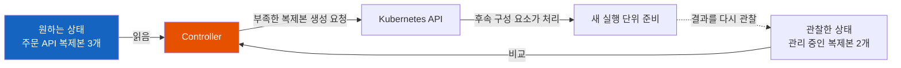

# Kubernetes Introduction

> **개발자를 위한 쉬운 쿠버네티스 · 1장** | [전체 목차](./Kubernetes-Introduction.md#이-시리즈의-읽는-순서) · [다음 장](./Kubernetes-Architecture.md)

개발자를 위한 쉬운 쿠버네티스 — 컨테이너를 실행한 다음에 남는 일들

## 결론부터 말하면

**Kubernetes는 컨테이너로 만든 애플리케이션의 실행 상태를 여러 서버에 걸쳐 관리하는 시스템이다.** 개발자가 어떤 이미지를 몇 개 실행할지, 어떤 주소로 연결할지, 어떤 설정과 저장소를 사용할지 표현하면, 여러 구성 요소가 그 의도를 실제 상태에 가깝게 만들기 위해 일한다.

이 책은 리소스 이름과 명령어를 외우는 대신 그 과정을 이해하는 데 초점을 둔다. `kubectl apply`가 성공했는데 앱은 왜 실행되지 않는지, Pod가 실행 중인데 사용자는 왜 접속할 수 없는지 설명할 수 있다면 Kubernetes를 운영할 때 보는 화면이 달라진다. 상태를 확인할 명령어에 앞서, **무슨 일이 어디에서 일어나야 하는지** 떠올릴 수 있기 때문이다.

## 1. 컨테이너를 실행하고 나서 시작되는 문제

주문을 받는 백엔드 API를 만들었다고 생각해 보자. 로컬에서 테스트했고, 실행 환경을 Docker 이미지로 묶었다. 서버에서 컨테이너를 시작하니 HTTP 요청에도 응답한다. 여기까지는 개발자에게 익숙한 배포다. 그런데 서비스를 운영한다는 것은 이 순간의 성공을 한 번 확인하는 것으로 끝나지 않는다.

앱 프로세스가 종료되면 다시 실행해야 한다. 요청이 늘어나면 실행 개수를 늘려야 하고, 새 버전을 배포할 때는 기존 요청을 처리하면서 교체해야 한다. 서버 한 대를 점검하는 동안에도 서비스가 필요하다면 다른 서버의 앱으로 요청을 보낼 수 있어야 한다. 앱을 늘리거나 옮긴 뒤에도 호출하는 쪽은 연결 대상을 찾을 수 있어야 한다.

각 문제에는 이미 해법이 있다. 프로세스 관리 도구, 배포 스크립트, reverse proxy, 로드 밸런서, 모니터링을 조합할 수 있다. Kubernetes가 없으면 자동화할 수 없다는 뜻은 아니다. 다만 서버와 애플리케이션이 많아질수록 이 도구들이 같은 현재 상태를 보게 만들고, 변경 도중의 실패를 처리하는 연결 작업이 커진다.

예를 들어 새 컨테이너를 실행하는 데는 성공했지만 로드 밸런서의 대상 목록을 바꾸는 데 실패했다고 해 보자. 배포 스크립트는 어디서부터 다시 실행해야 할까? 이전 서버의 컨테이너가 아직 살아 있는지, 새 서버의 앱이 준비됐는지, 요청이 어느 쪽으로 가는지를 따로 확인해야 한다. 자동화가 어려워지는 지점은 개별 명령의 문법보다 **부분적으로 성공한 작업들의 상태를 계속 맞추는 일** 에 있다.

Kubernetes는 이 운영 문제를 공통된 API와 상태 관리 방식으로 다룬다. 컨테이너를 언제 어떤 서버에서 실행할지 조율한다는 뜻에서 이런 일을 **컨테이너 오케스트레이션(container orchestration)** 이라고 부른다. 이름은 길지만, 핵심은 실행 명령 하나가 아니라 실행 상태를 지속해서 관리한다는 데 있다. 공식 문서가 Kubernetes를 정해진 순서의 작업을 실행하는 단순한 오케스트레이션과 구분하는 이유도 여기에 있다. 각 구성 요소는 자기 책임의 상태를 계속 관찰하고 조정한다.

## 2. “세 개를 실행해”에서 “세 개가 필요해”로

배포 스크립트를 작성하면 보통 할 일을 순서대로 적는다. 이미지를 받고, 컨테이너를 실행하고, 상태를 확인하고, 기존 컨테이너를 내리는 식이다. 이런 접근은 실행 절차가 명확해서 이해하기 쉽다. 문제는 스크립트가 끝난 뒤에도 환경이 계속 변한다는 것이다.

Kubernetes에서는 먼저 원하는 상태를 기록한다. 주문 API가 세 개 필요하다면 세 개가 필요하다는 의도가 남는다. 시스템은 현재 상태를 관찰하고 차이를 줄이는 작업을 반복한다. 관찰하고 조정하는 프로그램을 **controller**, 그 반복을 **reconciliation** 이라고 한다. 이 용어의 내부 동작은 다음 장에서 살펴본다. 지금은 배포 명령이 종료된 뒤에도 의도가 남고 이를 관리하는 주체가 있다는 점이 중요하다.

이 그림은 개념을 위한 단순화다. 실제로는 하나의 프로그램이 복제본을 만들고 실행하는 모든 일을 처리하지 않는다. 요청을 저장하는 구성 요소, 실행할 서버를 고르는 구성 요소, 그 서버에서 컨테이너를 실행하는 구성 요소가 나뉜다. 중간 단계가 실패하면 원하는 상태에 아직 도달하지 못한 채 남을 수도 있다.

따라서 선언적이라는 말은 “적어 놓기만 하면 반드시 성공한다”는 뜻이 아니다. 세 개를 실행할 자원이 부족하거나 이미지를 받을 수 없다면 Kubernetes도 세 개를 실행할 수 없다. 차이는 의도와 관찰 결과가 시스템에 남아 있고, 이를 바탕으로 조정과 확인을 계속할 수 있다는 것이다.

## 3. 앱 하나를 실행하는데 왜 리소스가 여러 개일까

Kubernetes를 처음 읽을 때 가장 부담스러운 부분은 용어의 수다. Pod, Deployment, Service, ConfigMap, Secret, PVC를 한 번에 만나면 컨테이너 하나를 실행하기 위해 왜 이렇게 많은 개념이 필요한지 의문이 든다.

이름부터 외우기보다 앱을 운영하며 내려야 하는 결정을 나눠 보자. 무엇을 실행할지와 몇 개를 유지할지는 비슷하지만, 어디로 요청을 받을지는 다른 결정이다. 배포 버전은 바뀌어도 DB 연결 설정은 유지할 수 있고, 앱을 새로 만들어도 저장 데이터는 남겨야 한다. 변경 시점과 수명이 다른 것들을 하나의 거대한 설정으로 묶으면 수정의 영향도 함께 커진다.

Kubernetes는 이런 의도를 **리소스(resource)** 라는 종류별 API로 표현한다. 그 API에 등록한 구체적인 항목을 **오브젝트(object)** 라고 한다. 이 책의 `order-api`라는 Deployment나 Service가 각각 하나의 오브젝트다. 두 용어의 세부 구분보다, 일단 설정 파일의 항목이 클러스터에 저장되고 관리되는 대상으로 이어진다고 이해하면 된다.

| 운영하면서 결정할 일 | 주로 살펴볼 리소스 | 이번 단계에서 기억할 역할 |
|---|---|---|
| 어떤 컨테이너를 함께 실행할까? | Pod | 컨테이너를 배치하고 실행하는 기본 단위 |
| 같은 앱을 몇 개 유지하고 어떻게 교체할까? | Deployment | Pod의 복제본과 버전 교체를 관리하는 선언 |
| 바뀌는 앱들을 어떤 이름과 주소로 찾을까? | Service | 선택한 앱들을 안정적인 접속 정보로 연결 |
| 앱에 어떤 설정을 전달할까? | ConfigMap, Secret | 실행 이미지와 분리할 일반 설정과 접근을 통제할 민감 정보 |
| 앱이 교체되어도 어디에 데이터를 남길까? | PersistentVolumeClaim | 지속해서 사용할 저장소에 대한 요청 |

표만 보면 여러 설정을 다시 연결해야 한다는 점은 여전하다. Kubernetes를 배우는 핵심도 바로 그 연결이다. Service가 Pod를 어떻게 찾는지, Deployment가 Pod와 어떤 관계를 갖는지, 저장소 요청을 실제로 처리하는 주체가 누구인지를 하나씩 알아야 한다. 뒤의 장들은 이 표의 행을 해설하면서 행과 행 사이를 연결한다.

## 4. 같은 클러스터를 보는 두 가지 경로

백엔드 개발자는 “요청이 들어오면 누가 처리하는가”를 따라가며 시스템을 이해하는 데 익숙하다. Kubernetes에서도 이 방법이 유용하다. 다만 여기에는 서로 다른 두 종류의 요청이 있다.

하나는 **클러스터 상태를 바꾸는 요청** 이다. 개발자가 Deployment를 만들거나 수정할 때 보내는 Kubernetes API 요청이 여기에 해당한다. 다른 하나는 **애플리케이션을 사용하는 요청** 이다. 사용자가 주문 API를 호출하는 HTTP 요청이다.

Deployment를 만드는 요청이 성공했다고 해서 주문 API가 준비됐다는 뜻은 아니다. 반대로 클러스터 관리 API에 일시적으로 접근하지 못하더라도 이미 실행 중인 앱의 요청 처리가 반드시 같은 순간에 중단되는 것은 아니다. 어떤 구성 요소와 의존성이 영향을 받았는지 살펴야 한다.

이 차이를 이해하면 관찰 순서도 정리된다. “배포가 안 된다”면 원하는 선언이 저장됐는지와 실행 단계가 진행됐는지를 본다. “접속이 안 된다”면 앱이 준비되어 있는지와 실제 트래픽 경로를 본다. 두 문제가 연결될 수는 있지만, 처음부터 같은 문제로 취급하면 원인을 찾는 범위가 불필요하게 넓어진다.

## 5. 자동화가 대신하지 않는 판단

Kubernetes는 반복적인 상태 관리를 제공하지만 애플리케이션의 의미까지 알지는 못한다. 프로세스가 살아 있어도 주문을 저장할 DB에 연결하지 못할 수 있다. 새 버전이 정상적으로 시작해도 이전 버전과 같은 DB 스키마를 함께 사용할 수 없을 수 있다. 데이터 파일이 남아 있어도 그 파일만으로 DB를 일관되게 복구할 수 있는 것은 아니다.

이런 조건은 개발자가 앱의 동작과 운영 요구를 바탕으로 설계해야 한다. 건강 상태를 어떻게 판단할지, 종료 신호를 받으면 진행 중인 요청을 어떻게 처리할지, 재시도되는 배치가 같은 주문을 두 번 처리하지 않게 할지 같은 질문이 남는다. Kubernetes의 기능을 이해하는 것과 앱이 그 기능에 맞게 동작하도록 만드는 것은 함께 가야 한다.

또한 공통 API를 사용한다고 환경의 차이가 사라지는 것도 아니다. 같은 저장소 요청이라도 설치된 드라이버와 스토리지 시스템이 다르면 제공되는 특성이 다르다. 외부 주소를 요구하는 리소스를 만들었다고 모든 환경에서 즉시 주소가 생기는 것도 아니다. 리소스가 무엇을 요청하는지와 그 요청을 처리할 구현이 있는지는 구분해야 한다.

이 때문에 Kubernetes는 모든 서비스의 출발점일 필요는 없다. 단순한 애플리케이션 하나에 이미 충분한 관리형 실행 환경이 있다면, 별도의 클러스터를 운영하는 비용이 더 클 수 있다. 이 책의 목적은 Kubernetes를 무조건 도입하도록 설득하는 것이 아니라, 이미 사용하거나 운영해야 할 때 시스템을 설명할 수 있게 하는 것이다.

### 에어갭 환경에서 짚어볼 점

인터넷과 분리된 환경에서도 이 동작 모델은 같다. 달라지는 것은 모델을 실현하는 데 필요한 의존성을 어디에서 제공하느냐다. 이미지, 차트, 인증서, 이름 해석, 저장소 드라이버 등을 내부에서 준비해야 할 수 있다. “인터넷이 없다”는 말 하나로 모두 같은 환경이라고 볼 수는 없다. 사설 레지스트리가 있는지, 어떤 DNS와 인증서 체계를 사용하는지, 필요한 controller가 이미 설치됐는지에 따라 조건이 다르다.

뒤의 장에서는 해당 기능을 설명한 뒤 이 의존성을 짚는다. 에어갭 환경을 별도의 Kubernetes로 배우기보다, **평소 숨겨져 있던 실행 조건이 더 잘 드러나는 환경** 으로 바라보면 일반 개념과 운영 경험이 연결된다.

## 6. 이 책을 읽는 방법

이 책은 HTTP 서버를 만들고 컨테이너 이미지로 배포해 본 백엔드 개발자를 독자로 가정한다. 특정 언어와 프레임워크를 요구하지 않는다. 대신 Kubernetes 고유의 개념은 해결하려는 문제부터 설명한다. 처음부터 모든 옵션을 기억하려고 하기보다, “이 설정을 누가 읽고 무엇을 바꾸는가”라는 질문을 붙들고 읽기를 권한다.

공통 사례는 `order-api`라는 가상의 주문 API다. `bookstore`라는 namespace에 배포하고, 앱은 `8080` 포트에서 HTTP 요청을 받는다고 가정한다. namespace는 클러스터 안에서 이름과 리소스를 구분하는 범위이며 다음 장에서 설명한다. 예제 이미지 `registry.example.com/book/order-api:1.0.0`은 설명용 자리표시자다. 실제 공개 이미지가 아니므로 그대로 다운로드할 수 있는 실습 자료로 읽으면 안 된다.

예제를 실행하지 않아도 개념을 이해할 수 있도록 상태 변화와 예상 결과를 함께 해설한다. 일부 필드만 보여 주는 코드는 발췌라고 표시하고, 준비 조건이 있는 manifest는 그 조건을 밝힌다. `/livez`, `/readyz`, `/startupz` 같은 경로도 앱이 구현한다고 가정한 예시다. 모든 웹 프레임워크에 자동으로 생기는 기능은 아니다.

각 장은 앞의 장에서 생긴 의문을 이어받는다. 검색으로 특정 장에 먼저 들어왔다면 도입부의 선행 문서 링크를 따라 필요한 개념만 보충해도 된다. 장 끝의 질문은 명령어를 기억하는지 검사하는 문제가 아니다. 조건이 달라졌을 때 결과를 자신의 말로 설명할 수 있는지 확인하는 장치다.

## 이 시리즈의 읽는 순서

### 1부. 배포 요청은 어떻게 실행 중인 앱이 되는가

| 장 | 제목 | 중심 질문 |
|---|---|---|
| 1 | [Introduction](./Kubernetes-Introduction.md) | 컨테이너 실행 다음에는 어떤 운영 문제가 남는가? |
| 2 | [클러스터의 동작 구조](./Kubernetes-Architecture.md) | apply 이후 누가 만들고, 배치하고, 실행하는가? |
| 3 | [Pod](./Kubernetes-Pod.md) | 컨테이너 재시작과 Pod 교체는 어떻게 다른가? |
| 4 | [ReplicaSet과 Deployment](./Kubernetes-ReplicaSet-Deployment.md) | 실행 개수와 버전은 어떻게 관리되는가? |
| 5 | [이미지 태그와 Digest](./Kubernetes-Image-Tag-Digest.md) | 같은 선언에서 다른 코드가 실행될 수 있는가? |
| 6 | [ConfigMap과 Secret](./Kubernetes-ConfigMap-Secret.md) | 설정은 언제 앱에 반영되는가? |

### 2부. 사용자 요청은 어떻게 앱을 찾아가는가

| 장 | 제목 | 중심 질문 |
|---|---|---|
| 7 | [Service라는 오브젝트](./Kubernetes-Service-Object.md) | Service와 Pod는 어떤 관계인가? |
| 8 | [Service의 접속 범위](./Kubernetes-Service-ClusterIP-NodePort-LoadBalancer.md) | ClusterIP, NodePort, LoadBalancer는 무엇이 다른가? |
| 9 | [Service 내부 동작](./Kubernetes-Service-Internals.md) | 이름과 주소가 실제 연결로 바뀌는 과정은 무엇인가? |
| 10 | [Probe](./Kubernetes-Probe-Liveness-Readiness-Startup.md) | 실행 중인 앱은 요청을 받을 준비도 된 것인가? |
| 11 | [Ingress](./Kubernetes-Ingress.md) | HTTP 경로를 누가 실제로 처리하는가? |
| 12 | [Gateway API](./Kubernetes-Gateway-API.md) | 진입점과 경로의 책임을 왜 나누는가? |
| 13 | [Ingress와 Egress](./Kubernetes-Ingress-vs-Egress.md) | 리소스 이름과 통신 방향은 어떻게 다른가? |

### 3부. 데이터와 작업의 생명주기를 다루는 방법

| 장 | 제목 | 중심 질문 |
|---|---|---|
| 14 | [Volume, PV, PVC](./Kubernetes-Volume-PersistentVolume.md) | 앱이 교체되어도 데이터는 어떻게 남는가? |
| 15 | [StatefulSet](./Kubernetes-StatefulSet.md) | 각 인스턴스의 이름과 저장소가 중요한 때는 언제인가? |
| 16 | [DaemonSet, Job, CronJob](./Kubernetes-DaemonSet-Job-CronJob.md) | 서비스·종료되는 작업·Node별 작업은 어떻게 다른가? |

### 4부. 실행 중인 시스템의 변경과 관찰

| 장 | 제목 | 중심 질문 |
|---|---|---|
| 17 | [배포 전략](./Kubernetes-Deployment-Strategy.md) | 새 버전으로 바뀔 때 요청과 실행 상태는 어떻게 변하는가? |
| 18 | [관측과 확장](./Kubernetes-Metrics-Server-Prometheus.md) | 숫자는 누가 측정하고 무엇을 판단하는 데 쓰는가? |

### 5부. 클러스터의 권한과 확장을 이해하기

| 장 | 제목 | 중심 질문 |
|---|---|---|
| 19 | [ServiceAccount와 RBAC](./Kubernetes-ServiceAccount-RBAC.md) | 누가 어떤 API 작업을 할 수 있는가? |
| 20 | [CRD, Controller, Operator](./Kubernetes-CRD-Controller-Operator.md) | 새 리소스를 등록하면 누가 그 의미를 실행하는가? |
| 21 | [Admission Webhook](./Kubernetes-Admission-Webhook.md) | 저장되기 전에 누가 요청을 바꾸거나 거절하는가? |
| 22 | [배포부터 접속까지, 하나의 장애를 설명하기](./Kubernetes-Troubleshooting-From-Apply-to-Request.md) | 원하는 상태와 실제 상태가 어긋난 곳을 어떻게 찾는가? |

## 본편에서 이어 읽는 주제

아래 글은 본편을 이해하기 위한 필수 선행 학습이 아니다. 관련 업무를 만났을 때 본편의 모델을 실제 도구와 환경으로 확장하는 읽기다.

| 분야 | 문서 | 먼저 읽으면 좋은 본편 |
|---|---|---|
| 외부 연결 | [LoadBalancer와 클라우드](./Kubernetes-Service-LoadBalancer-Cloud.md) | 8·11장 |
| 통신 정책 | [Egress와 NetworkPolicy](./Kubernetes-Egress-NetworkPolicy.md) | 13장 |
| 서비스 간 통신 | [Service Mesh](./Kubernetes-Service-Mesh.md) → [Istio Gateway와 VirtualService](./Istio-Ingress-Gateway-Ingress가-있는데-왜-VirtualService를-따로-쓸까.md) | 12·19·21장 |
| 설정 공급 | [External Secrets Operator](./Kubernetes-External-Secrets-Operator.md) | 6·19·20장 |
| 장치 확장 | [GPU Device Plugin](./Kubernetes-GPU-Device-Plugin.md) | 3·16·20장 |
| 패키징 | [Helm의 역할](./Helm-쿠버네티스의-패키지-매니저는-왜-필요한가.md) → [첫 Helm Chart 읽기와 실습](./Helm-내-첫-Helm-Chart-helm-create부터-helm-install까지.md) | 6장 이후 |
| 이미지 공급 | [Harbor](./Harbor-왜-회사들은-사내-컨테이너-레지스트리를-두는가.md) → [Helm과 Harbor의 연결](./Helm과-Harbor를-왜-같이-써야-하는가.md) | 5장, Helm 개념 |
| CI 실행 | [Jenkins와 Tekton의 역할](./Jenkins가-있는데-왜-Tekton이-빌드할까.md) → [Pipeline과 PipelineRun](./Tekton의-Pipeline과-PipelineRun은-왜-따로-존재할까.md) | 16·19·20장 |
| 이벤트 연결 | [Tekton Triggers](./Tekton-Triggers는-어떻게-git-push를-PipelineRun으로-바꿀까.md) → [Jenkins에서 EventListener 호출하기](./Jenkins-Job에서-Tekton-EventListener로-webhook을-쏠-수-있을까.md) | Pipeline과 PipelineRun |

## 생각해 볼 질문

**배포 스크립트가 컨테이너 세 개를 실행하는 것과 원하는 복제본 수를 세 개로 기록하는 것은 무엇이 다른가?** 실행 이후의 변화에도 의도를 계속 관리할 주체가 있는지가 다르다. 다만 스크립트 기반 시스템도 별도의 감시와 복구를 붙일 수 있으므로 선언적 도구만 자동화할 수 있다는 뜻은 아니다.

**Kubernetes가 컨테이너를 다시 시작해 준다면 애플리케이션 장애 대응은 끝난 것일까?** 재시작이 해결하지 못하는 설정 오류, 외부 의존성 장애, 데이터 불일치가 있다. 시스템이 복구하는 실행 상태와 애플리케이션의 정상 기능을 함께 봐야 한다.

**같은 YAML을 다른 환경에 적용하면 같은 결과를 기대해도 될까?** API가 표현하는 의도는 비슷해도 자원, 네트워크, 저장소, 추가 controller 등 실행 조건은 다를 수 있다. 다음 장부터는 그 의도를 실제로 처리하는 주체를 살펴본다.

## 출처

- [Kubernetes Overview](https://kubernetes.io/docs/concepts/overview/) — Kubernetes의 범위와 제공하지 않는 기능.
- [Kubernetes Components](https://kubernetes.io/docs/concepts/overview/components/) — 클러스터 구성 요소와 역할.
- [Controllers](https://kubernetes.io/docs/concepts/architecture/controller/) — 원하는 상태와 관찰 상태를 연결하는 반복 제어.
- [Objects In Kubernetes](https://kubernetes.io/docs/concepts/overview/working-with-objects/) — 오브젝트와 의도 기록의 관계.
