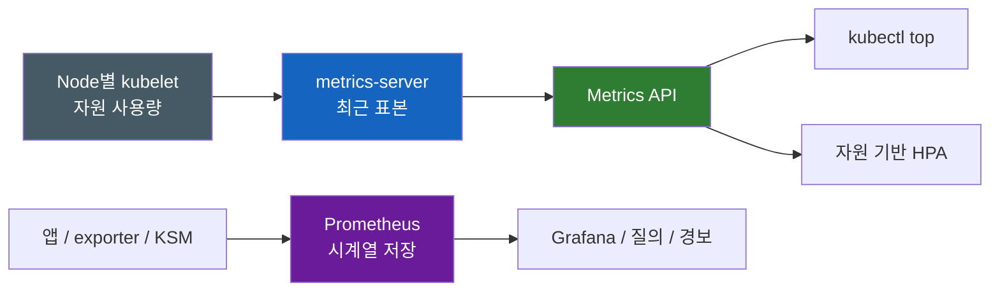
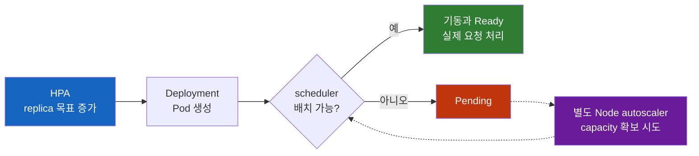

# Kubernetes Metrics Server, Prometheus

> **개발자를 위한 쉬운 쿠버네티스 · 24장** | [전체 목차](./Kubernetes-Introduction.md#이-시리즈의-읽는-순서) · [이전 장](./Kubernetes-Deployment-Strategy.md) · [다음 장](./Kubernetes-Logging-and-Events.md)

주문 API의 Grafana CPU 그래프는 보이는데 `kubectl top pod`은 실패한다. 반대로 top에는 사용량이 나오는데 어제 배포 직후의 폭주를 보여 줄 그래프는 없다. 화면의 숫자가 비슷하다고 같은 경로로 수집·보관되는 것은 아니다. [배포 전략](Kubernetes-Deployment-Strategy.md)에서 필요했던 관찰 근거를 이번에는 출처와 소비자까지 따라가 보자.

## 결론부터 말하면

metrics-server는 kubelet에서 최근 자원 사용량을 모아 Kubernetes Metrics API로 제공하고, `kubectl top`과 자원 기반 HPA가 이를 소비한다. Prometheus는 앱·exporter 등의 지표를 수집해 시계열로 저장하고 과거 질의와 경보의 근거를 만든다. 이 장의 Grafana는 Prometheus를 datasource로 사용하는 사례이며, Grafana 자체가 그 datasource만 지원하는 것은 아니다.

HPA가 Pod 목표 수를 늘리는 것과 실제 처리 capacity가 늘어나는 일도 다르다. controller가 Pod를 만들고 scheduler가 배치하고 앱이 Ready가 되어 요청을 처리해야 한다. Node 공간이 없으면 새 Pod는 Pending에 남을 수 있다.

| 알고 싶은 것 | 주요 근거 |
|---|---|
| 왜 Pod가 배치·시작되지 않는가 | spec/status와 Events |
| 앱이 무슨 오류를 겪었는가 | 앱 로그와 요청 trace |
| 최근 CPU·메모리 사용량은 얼마인가 | kubelet → metrics-server → Metrics API |
| 지난 배포 전후의 요청 성공률은 어떤가 | 앱 지표 → Prometheus → 시계열 질의 |
| 목표 replica와 Ready replica가 다른가 | API object 상태, kube-state-metrics |

## 1. 먼저 관찰하려는 질문을 정한다

Events는 scheduling 실패나 image pull 같은 Kubernetes 구성 요소의 사건을 설명한다. 앱 로그는 DB 인증 실패나 요청 처리 오류처럼 프로세스 안의 맥락을 담는다. metrics는 시간에 따른 수량의 변화를 비교하고 경보를 만든다. trace는 하나의 요청이 여러 서비스에서 보낸 시간과 오류를 연결할 수 있다.

이 자료들은 서로 대체하지 못한다. CPU가 높다는 그래프는 비효율적인 쿼리를 지목하지 못하고, 앱 오류 로그 한 줄은 전체 요청 중 얼마나 많은 사용자가 영향을 받았는지 알려주지 않는다. Events도 보존 기간이 있으므로 장애 감사 기록의 영구 저장소로 생각하면 안 된다.

따라서 `order-api`가 느릴 때 먼저 Pod가 존재하고 Ready인지, 준비된 endpoint에 요청이 도달하는지, 앱 안에서 무엇을 기다리는지 구분한다. 그다음 CPU·메모리·DB latency·queue 길이 등을 가설에 맞춰 읽는다. 도구를 설치했다는 사실보다 어떤 질문에 답하는 증거를 확보했는지가 중요하다.

이 장은 그중 자원 사용량과 시계열의 경로를 다룬다. [Logging and Events](Kubernetes-Logging-and-Events.md)에서는 앱의 stdout/stderr가 Node와 수집기를 거쳐 보관되는 과정, `kubectl logs --previous`의 범위, Events의 수명, 요청 ID·trace ID로 기록을 연결하는 방법을 이어서 설명한다. metrics에서 발견한 시간대와 실행 대상을 로그에 넘겨야 숫자의 변화가 어떤 실패와 연결되는지 조사할 수 있다.

## 2. kubelet의 사용량을 Metrics API로 모은다

Linux 컨테이너의 CPU·메모리 사용량은 cgroup 등 운영체제 회계에 바탕을 둔다. kubelet은 cAdvisor나 지원되는 CRI stats 경로 등을 통해 Node와 컨테이너 통계를 얻는다. 이 장에서는 모든 환경이 cAdvisor 하나만 사용한다고 가정하지 않는다.

metrics-server는 Node별 kubelet에 접근해 최근 사용량을 수집한다. metrics-server 0.6.0 이상은 kubelet의 `/metrics/resource` endpoint를 사용하며, 이전 경로인 `/stats/summary`와 구분한다. 이 수집에는 metrics-server에서 kubelet로의 네트워크 접근, 인증과 TLS 신뢰가 필요하다.

수집값은 Metrics API로 노출된다. metrics-server는 장기 시계열 DB가 아니므로 `kubectl top`으로 어제의 값을 조회할 수 없다. 재시작 직후에는 계산에 필요한 표본을 다시 확보할 시간도 필요하다.



두 경로가 다르므로 Prometheus 그래프가 있다는 사실은 Metrics API 정상의 증거가 아니다. 다만 kubelet·Node·네트워크 같은 공통 의존성의 장애는 둘 다 영향을 줄 수 있으므로 완전히 독립된 장애 영역이라고도 말할 수 없다.

### 수집 주기와 측정 window를 구분한다

metrics-server의 `--metric-resolution`은 수집 주기를 정한다. 2026-10-23 확인한 upstream CLI 소스의 기본값은 60초다. README의 15초 수집 설명이나 배포 YAML에 명시된 `--metric-resolution=15s`와 같은 값은 구분해야 한다. 설치 manifest와 실제 프로세스 인자가 해당 환경의 기준이다.

Metrics API의 `timestamp`와 `window`는 표본이 가리키는 시간과 CPU rate의 구간을 읽는 단서다. HPA controller의 동기화 주기는 또 별도다. 최신 값을 더 자주 읽는 것과 새 표본이 더 자주 생기는 것은 같은 일이 아니다.

## 3. APIService는 값을 저장하는 대신 경로를 연결한다

`kubectl top`은 kubelet을 직접 전부 조회하지 않는다. kube-apiserver로 Metrics API를 요청한다. kube-apiserver는 Aggregation Layer를 통해 그 API를 담당하는 extension API server인 metrics-server에 프록시한다. `APIService`는 어느 API group/version을 어느 Service로 보낼지 등록하는 오브젝트다.

이 점이 CRD와 다르다. CRD는 새로운 object 종류의 스키마를 등록하고 그 인스턴스를 Kubernetes API 저장소에서 관리하게 한다. 반면 Metrics API의 응답은 metrics-server가 보관·계산한 최근 표본에서 나온다. `APIService`라는 등록 자체는 Kubernetes object이지만 사용량 표본을 매번 CRD 인스턴스로 etcd에 기록하는 구조는 아니다.

2026-10-23 기준 Metrics API는 Kubernetes 1.37에서 stable인 `metrics.k8s.io/v1`으로 승격되었다. 그러나 Kubernetes API의 GA 여부, 설치한 provider가 실제로 제공하는 served version, 각 소비자가 사용하는 version은 별개다. [2026-08-27 공식 발표](https://kubernetes.io/blog/2026/08/27/kubernetes-v1-37-metrics-api-ga/)에 따르면 해당 릴리스의 `kubectl top`은 v1을 우선하고 없으면 v1beta1로 fallback하지만, Kubernetes 1.37의 HPA controller는 아직 v1beta1만 사용한다. HPA의 discovery 기반 version 선택은 이 릴리스에 포함되지 않았다.

따라서 v1beta1은 과거 환경에만 필요한 API가 아니다. 설치한 metrics-server가 v1beta1만 제공하는 것도 정상일 수 있으며, 아래 조회에서 `v1.metrics.k8s.io`가 NotFound라는 이유만으로 장애라고 판단하지 않는다. v1과 v1beta1을 함께 제공하는 전환 환경이라면 소비자가 사용하는 각각의 APIService 상태를 확인한다. Kubernetes 업그레이드만으로 별도 설치한 metrics-server의 served version과 등록이 자동으로 맞춰졌다고 가정하지 않는다. 구현체의 지원 version, 실제 discovery, 그리고 사용하는 kubectl·HPA controller의 version을 함께 읽는다.

```bash
kubectl get --raw /apis/metrics.k8s.io/
kubectl get apiservice v1.metrics.k8s.io v1beta1.metrics.k8s.io
# v1을 제공하는 환경에서 사용자의 조회 경로를 확인하는 예다.
kubectl get --raw '/apis/metrics.k8s.io/v1/namespaces/bookstore/pods'
kubectl top pod -n bookstore
```

### top 실패를 어떤 순서로 좁힐까

관련 APIService가 없으면 설치 또는 등록 문제를 먼저 본다. 존재하지만 Available이 False라면 `describe apiservice`의 discovery 실패 이유와 metrics-server Service/endpoints, Pod readiness·로그를 확인한다. API server에서 metrics-server로의 TLS·네트워크가 막혔을 수도 있고, metrics-server가 kubelet 수집을 못 해 readiness를 충족하지 못했을 수도 있다.

따라서 APIService False를 무조건 프록시 경로만의 문제라고 단정하지 않는다. API server → metrics-server와 metrics-server → kubelet은 두 개의 다른 인증·네트워크 경로다. 수집이 정상인데 특정 사용자의 top만 거절된다면 RBAC와 요청 namespace를 확인한다. 사용자 credential의 실패가 HPA controller credential의 실패까지 증명하지는 않는다. 반대로 top이 성공해도 HPA의 조회 성공을 증명하지 않는다. 예를 들어 top이 v1을 읽는 동안 Kubernetes 1.37 HPA가 필요한 v1beta1 등록이 없거나 조회에 실패할 수 있다. HPA가 사용하는 version의 APIService 상태와 controller의 인증·접근 경로를 확인하고, `kubectl describe hpa order-api -n bookstore`의 conditions와 Events에서 metric 조회 실패 이유를 이어서 읽는다. 사용자 credential로 실행한 raw 조회도 controller credential의 접근 성공을 대신 입증하지는 못한다.

TLS 오류를 보았다고 곧바로 kubelet 인증서 검증을 끄는 것도 원인 해결과 다르다. 주소 선택, 인증서 SAN·신뢰 체계, 배포한 metrics-server의 지원 조건을 확인한다. 이 API가 정상이어도 앱 요청 지표나 과거 이력이 생기는 것은 아니다.

## 4. Prometheus는 표본을 시각과 함께 저장한다

Prometheus는 대상 HTTP endpoint를 주기적으로 scrape하고 label이 붙은 표본을 시계열 DB에 저장한다. 앱이 직접 요청 수·오류·지연을 노출하거나 exporter가 다른 시스템의 지표를 변환할 수 있다. 보관 기간과 디스크 정책, remote storage를 구성해야 원하는 시간 범위를 조회할 수 있다.

예를 들어 주문 API가 `http_requests_total` counter와 `app`, `track`, `status` label을 실제로 노출한다면, 배포 장의 Canary 성공률을 계산할 수 있다. Prometheus를 설치했다고 이 앱 지표가 자동 생성되지는 않는다. 계측 코드, endpoint 노출, scrape 권한·TLS·네트워크가 모두 필요하다.

Grafana는 이 데이터에 질의하여 화면을 구성한다. datasource가 Prometheus인 대시보드라면 Metrics API와 다른 경로지만, 다른 datasource를 쓰는 화면도 가능하다. 대시보드 이름만 보고 지표의 원천을 추정하지 말고 실제 query와 datasource를 읽는다.

### 비슷한 이름의 수집기는 무엇을 읽는가

| 구성 요소 | 읽는 대상 | 내놓는 정보 |
|---|---|---|
| metrics-server | kubelet 자원 통계 | 최근 CPU·메모리, Metrics API |
| kube-state-metrics, KSM | kube-apiserver의 object 상태 | desired/ready replicas, phase, conditions 등 |
| node-exporter | Node의 OS·kernel 통계 | 디스크·네트워크·load 등 |
| 앱 계측 endpoint | 앱 내부의 counter/histogram 등 | 요청·업무별 지표 |

KSM은 Pod가 CPU를 실제로 얼마나 썼는지를 측정하는 프로그램이 아니다. object에 선언된 requests 같은 수치와 실제 사용량은 구분해야 한다. node-exporter도 API object의 rollout condition을 대신 알지 못한다. KSM과 exporter는 보통 `/metrics`에서 값을 제공하고 Prometheus가 수집하므로, 설치만 하고 scrape하지 않으면 원하는 시계열이 쌓이지 않는다.

### ServiceMonitor는 대상 등록을 선언으로 바꾼다

Prometheus는 본래 Kubernetes service discovery나 file-based discovery를 지원하고 설정 reload도 가능하다. 매 대상 변경마다 반드시 프로세스를 재시작해야 하는 것은 아니다. Prometheus Operator는 여기에 `ServiceMonitor`·`PodMonitor` 같은 API를 더해 팀이 label 기반으로 수집 의도를 선언하게 한다.

다음은 Operator와 CRD가 설치되고, `monitoring: book` label의 ServiceMonitor를 `bookstore` namespace에서 선택하도록 Prometheus가 설정된 환경의 예다. `order-api` 앱의 `/metrics`는 가상 endpoint이며 같은 port 8080에서 제공한다고 가정한다. Service port 80의 이름은 배포 장과 같은 `http`다.

```yaml
apiVersion: monitoring.coreos.com/v1
kind: ServiceMonitor
metadata:
  name: order-api
  namespace: bookstore
  labels:
    monitoring: book
spec:
  namespaceSelector:
    matchNames: [bookstore]
  selector:
    matchLabels:
      app: order-api
  endpoints:
  - port: http
    path: /metrics
    interval: 30s
```

여기에는 selector가 두 층이다. Prometheus의 `serviceMonitorNamespaceSelector`/`serviceMonitorSelector`는 어떤 ServiceMonitor를 받을지 정하고, ServiceMonitor의 namespaceSelector/selector는 어떤 Service를 수집할지 정한다. Service에는 `app: order-api` label과 `http`라는 이름의 port가 있어야 한다. endpoint의 `port`는 8080이라는 숫자나 container port 이름을 임의로 넣는 자리가 아니라 Service의 port 이름이다.

선언이 생성되었으면 Operator가 선택했는지, 생성 config에 반영했는지, Prometheus Targets가 up인지, 원하는 label의 실제 표본이 query되는지 순서대로 확인한다. 대상 discovery와 scrape에 필요한 RBAC, endpoint 인증, network policy도 별도 전제다. ServiceMonitor 하나가 존재한다는 사실만으로 모니터링 완료를 주장할 수 없다.

## 5. HPA는 지표를 replica 목표로 바꾼다

HPA(HorizontalPodAutoscaler)는 주기적으로 지표를 읽고 Deployment 같은 scale target의 replica 목표를 조정하는 controller다. 기본 동기화 주기는 kube-controller-manager의 `--horizontal-pod-autoscaler-sync-period` 15초지만 환경 설정에 따라 다르다. 부하 증가와 동시에 Pod가 즉시 늘어나리라고 기대하면 수집·제어·기동의 지연을 놓친다.

CPU Resource metric의 `Utilization` target을 쓰면 분모는 requests다. 다음은 Deployment 장의 컨테이너 CPU request 500m와 함께 읽는 예다.

```yaml
apiVersion: autoscaling/v2
kind: HorizontalPodAutoscaler
metadata:
  name: order-api
  namespace: bookstore
spec:
  scaleTargetRef:
    apiVersion: apps/v1
    kind: Deployment
    name: order-api
  minReplicas: 3
  maxReplicas: 10
  metrics:
  - type: Resource
    resource:
      name: cpu
      target:
        type: Utilization
        averageUtilization: 70
```

이 70%는 Node 용량도 limits도 아닌 관련 container requests 대비 사용률이다. CPU 사용량이 350m이고 request가 500m라면 70%다. 단순화한 계산은 다음과 같다.

$$
\text{desiredReplicas}=\left\lceil \text{currentReplicas}\times\frac{\text{currentMetricValue}}{\text{desiredMetricValue}}\right\rceil
$$

실제 controller는 tolerance, 누락 지표, 아직 Ready가 아닌 Pod, stabilization과 scale 정책 등을 더 고려한다. 따라서 단순식과 한 번의 top 값만으로 다음 replica 수를 정확히 예측하지 않는다.

### requests가 필요한 target과 그렇지 않은 target

Utilization 계산에 필요한 request가 일부 container에 없으면 그 Pod의 해당 사용률이 정의되지 않을 수 있다. HPA의 `TARGETS`가 unknown이면 지표 수집뿐 아니라 scale target의 container requests와 HPA Events/conditions를 확인한다. request가 잘못 작으면 작은 절대 사용량도 높은 사용률로 해석되어 replicas가 과도하게 늘 수 있다.

그러나 HPA가 절대 사용량을 지원하지 않는 것은 아니다. Resource target의 `AverageValue`는 예를 들어 Pod 평균 CPU 350m 같은 raw 값을 목표로 삼을 수 있다. `ContainerResource` metric은 특정 container의 지표를 대상으로 할 수 있다. 모든 HPA를 requests 대비 CPU 사용률 모델 하나로 설명하면 안 된다.

복수 metric이면 각 metric이 요구하는 replica 수 중 큰 쪽을 고려한다. 일부 지표를 못 읽어도 유효한 지표로 scale-out이 가능할 수 있으며, 오류가 있는 상태에서는 scale-down이 보류될 수 있다. 어떤 metric 하나가 unknown인 것과 HPA가 아무 조치도 할 수 없다는 것은 다르다.

### custom/external metric에는 어댑터가 필요하다

큐 길이나 요청률을 사용하려면 `custom.metrics.k8s.io` 또는 `external.metrics.k8s.io`를 제공할 구성 요소가 필요하다. custom metric은 Kubernetes object와 연관된 지표, external metric은 원격 큐처럼 object에 직접 속하지 않는 지표를 표현한다.

Prometheus를 원천으로 쓸 경우 prometheus-adapter 등이 시계열 query 결과를 HPA가 읽을 API로 변환할 수 있다. Prometheus 설치만으로 이 API가 생기는 것은 아니다. 어댑터의 APIService 등록, query와 object/label 매핑, 지표 단위와 집계 범위를 검증해야 한다. 여기서 두 수집 경로가 어댑터를 통해 연결될 수 있다.

## 6. HPA가 늘렸는데 왜 여전히 느린가

HPA의 desiredReplicas가 10이 되면 Deployment controller가 그 목표에 맞춰 Pod를 만든다. scheduler는 Node의 allocatable과 각 Pod의 requests·배치 제약으로 배치 가능 여부를 판단한다. 실제 CPU가 한가해 보이더라도 이미 예약된 requests나 affinity 때문에 배치되지 않을 수 있다.

Node autoscaler는 별도로 새 capacity를 마련한다. VM quota, 허용 instance 유형, zone, 이미지 공급과 네트워크 설정 때문에 새 Node 확보가 지연될 수 있다. Node가 늘어도 이미지 pull·startup·readiness를 거쳐야 처리 가능한 endpoint가 늘어난다. DaemonSet의 자원 overhead도 새 Node의 가용 공간에서 빠진다.



DB가 병목이면 API Pod만 늘려 connection 수를 키우며 더 악화시킬 수도 있다. requests·replica 상한뿐 아니라 downstream capacity와 업무 지표를 같이 보는 이유다. 목표 개수, 실제 Pod 수, Ready endpoint, 사용자 응답을 각각 확인한다.

### HPA와 Git의 replicas 소유권

HPA를 붙인 뒤에도 배포 manifest에 `spec.replicas: 3`을 계속 고정하여 apply하면 HPA가 늘린 수를 배포 과정에서 다시 줄일 수 있다. replica 목표를 누가 관리할지 정하고 보통 HPA가 담당하도록 한다.

다만 기존 client-side apply로 관리하던 오브젝트에서 replicas 줄만 삭제하면 과거 last-applied 정보와 삭제 처리 때문에 일시적으로 기본 replica 값으로 바뀔 수 있다. server-side apply의 field ownership도 별도로 고려해야 한다. 기존 리소스의 이전은 공식 HPA 문서의 migration 절차에 맞춰 ownership과 현재 replica를 보존하며 수행한다. 새 YAML의 필드 생략과 기존 관리 필드의 안전한 이관은 같은 작업이 아니다.

## 7. 심화: top과 대시보드의 숫자를 비교하는 법

두 화면의 CPU 값이 다르면 우선 같은 namespace·Pod UID·container를 보고 있는지 확인한다. Pod 이름을 재사용하는 StatefulSet에서는 특히 교체 전후를 섞기 쉽다. timestamp, 집계 범위, metric 단위도 맞춘다.

CPU는 누적 CPU 시간의 차이를 시간 구간으로 나눈 rate다. top을 순간 CPU 값, Prometheus를 평균 CPU 값이라고 단순 구분하면 틀린다. 둘 다 CPU rate지만 Metrics API의 window와 PromQL `rate(...[5m])`의 구간이 다를 수 있다. 긴 구간은 짧은 spike를 완화하며 수집 주기와 dashboard step도 표시를 바꾼다. 반면 메모리는 특정 수집 시점의 gauge로 읽는다는 차이가 있다.

| 메모리 지표 | 해석할 때 주의할 점 |
|---|---|
| usage | cgroup에 회계된 메모리. cache 등도 포함할 수 있음 |
| RSS | 익명 메모리 등 특정 범위. 앱의 모든 메모리와 정확히 같지 않음 |
| working set | usage에서 inactive file 등을 빼는 방식의 추정치. cache 일부가 남을 수 있음 |

Metrics API의 메모리는 working set으로 보고된다. 이는 회수 불가능한 메모리의 완벽한 측정값이 아니며 환경과 구현의 heuristic이 들어간다. working set이 limits에 가까운 것은 조사할 신호지만, 그 값 하나가 OOM 여부를 결정하지는 않는다.

메모리 한도는 커널의 cgroup 회계와 회수·OOM 처리에 의해 집행된다. usage/RSS/cache와 한도를 함께 보고 container의 `OOMKilled` reason, cgroup `memory.events`나 Node 커널 증거를 상황에 맞게 연결한다. exit 137만으로 OOM이라고 결론내리지 않는다. 수집 간격 사이에서 발생한 peak나 이미 사라진 container의 영향도 고려해야 한다.

## 생각해 볼 질문

### 1. Prometheus의 CPU 그래프가 정상인데 top은 왜 실패할 수 있는가?

Prometheus scrape와 Metrics API는 다른 경로다. APIService 등록·discovery·metrics-server readiness·kubelet 수집·사용자 RBAC 중 어디가 실패했는지 구분해야 한다. 화면 하나의 성공으로 다른 경로까지 증명할 수 없다.

### 2. CPU request를 절반으로 낮추면 사용량이 같아도 HPA 판단이 달라지는가?

Utilization target이면 분모가 줄어 사용률이 커지므로 달라질 수 있다. raw AverageValue target이면 그 비율 계산을 쓰지 않는다. request는 scheduling 예약과도 연결되므로 HPA 숫자를 맞추기 위해 임의로 낮추기보다 앱 특성을 기준으로 정한다.

### 3. HPA desired가 10인데 Ready가 3이면 무엇을 이어서 보아야 하는가?

Deployment의 생성 상태, Pod Pending의 scheduling Events, Node capacity와 배치 제약, Node autoscaler의 확보 실패, 이미지·startup·readiness 순서로 좁힌다. replicas 목표가 늘었다는 사실은 capacity와 사용자 성공이 늘었다는 증거가 아니다.

## 다음 장으로

지표로 사용량과 피해 범위를 살펴봤다면 다음 [로그와 Events](Kubernetes-Logging-and-Events.md)에서는 개별 실패의 이유와 실행의 흔적을 읽는다. 이후 ServiceAccount와 RBAC에서 이 조회와 변경에 필요한 API 권한을 연결하고, 마지막 [종합 장애 분석](Kubernetes-Troubleshooting-From-Apply-to-Request.md)에서는 상태·Events·로그·지표를 하나의 가설 검증 흐름으로 묶는다.

## 출처

- [Kubernetes Resource metrics pipeline](https://kubernetes.io/docs/tasks/debug/debug-cluster/resource-metrics-pipeline/) — 수집 경로, working set와 Metrics API version
- [Metrics API stable, 2026-08-27](https://kubernetes.io/blog/2026/08/27/kubernetes-v1-37-metrics-api-ga/) — Kubernetes 1.37 stable 전환
- [Kubernetes API Aggregation Layer](https://kubernetes.io/docs/concepts/extend-kubernetes/api-extension/apiserver-aggregation/) — APIService와 extension API server
- [Node metrics data](https://kubernetes.io/docs/reference/instrumentation/node-metrics/) — kubelet과 CRI stats 경로
- [metrics-server](https://github.com/kubernetes-sigs/metrics-server) — 목적과 설치 요구 조건
- [metrics-server CLI options](https://github.com/kubernetes-sigs/metrics-server/blob/master/cmd/metrics-server/app/options/options.go) — metric-resolution 기본값
- [metrics-server FAQ](https://github.com/kubernetes-sigs/metrics-server/blob/master/FAQ.md) — CPU rate와 사용 범위
- [Horizontal Pod Autoscaling](https://kubernetes.io/docs/tasks/run-application/horizontal-pod-autoscale/) — metric target, 알고리즘과 ownership migration
- [Resource management](https://kubernetes.io/docs/concepts/configuration/manage-resources-containers/) — requests, limits와 커널 집행
- [Node autoscaling](https://kubernetes.io/docs/concepts/cluster-administration/node-autoscaling/) — Pod autoscaling과 capacity 구분
- [Prometheus overview](https://prometheus.io/docs/introduction/overview/) — 수집과 시계열 저장
- [Prometheus configuration](https://prometheus.io/docs/prometheus/latest/configuration/configuration/) — discovery와 scrape 설정
- [Prometheus Operator troubleshooting](https://prometheus-operator.dev/docs/platform/troubleshooting/) — ServiceMonitor 선택과 target 진단
- [kube-state-metrics](https://github.com/kubernetes/kube-state-metrics) — object 상태 기반 지표
- [node_exporter](https://github.com/prometheus/node_exporter) — OS 지표
- [prometheus-adapter walkthrough](https://github.com/kubernetes-sigs/prometheus-adapter/blob/master/docs/walkthrough.md) — custom metrics API 연결
