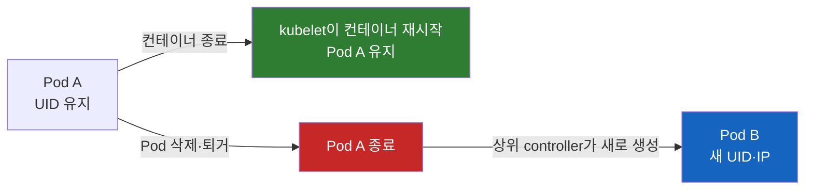
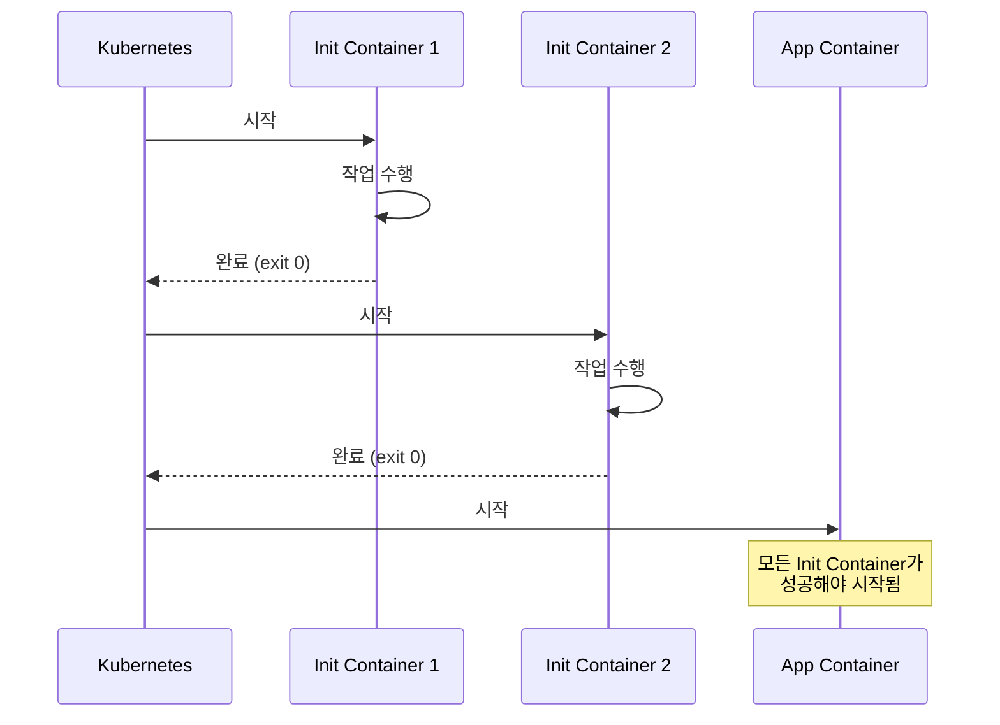
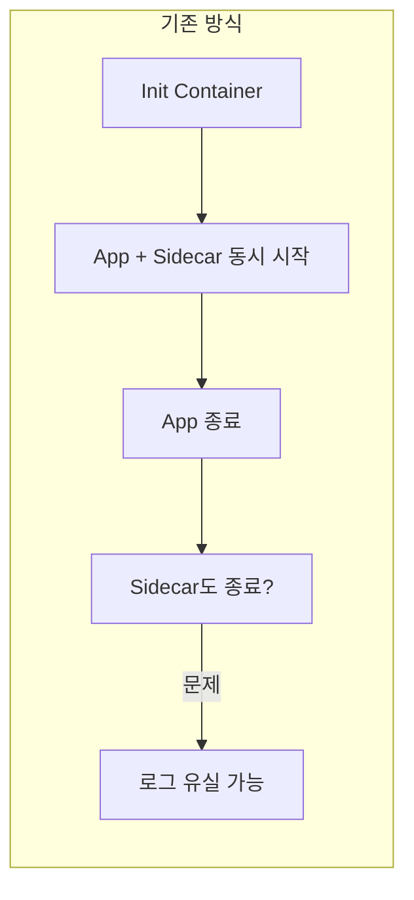
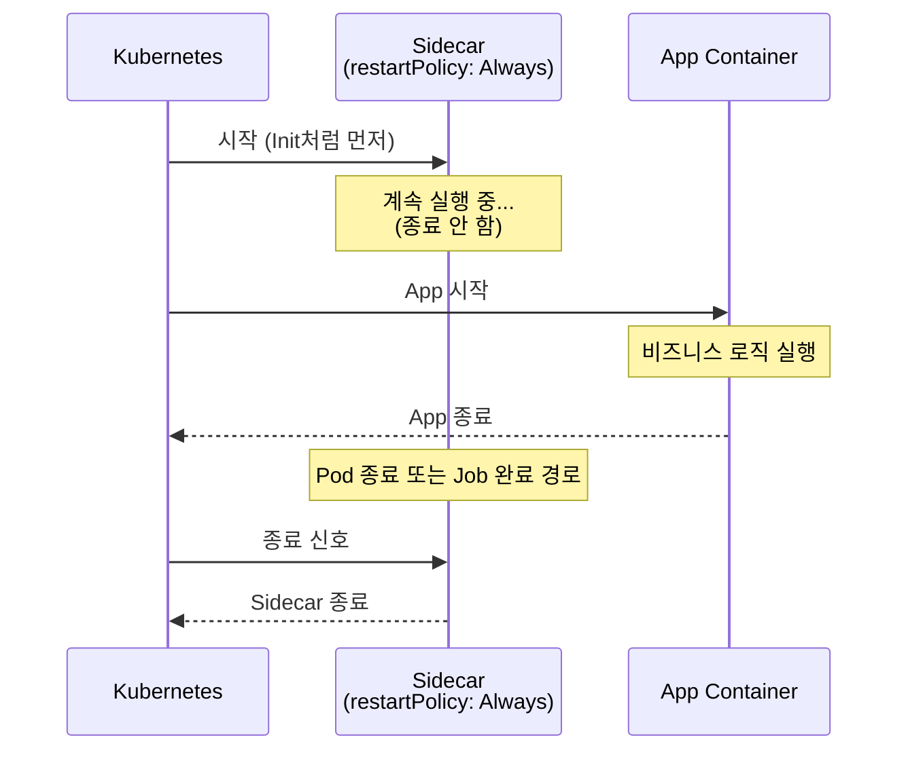
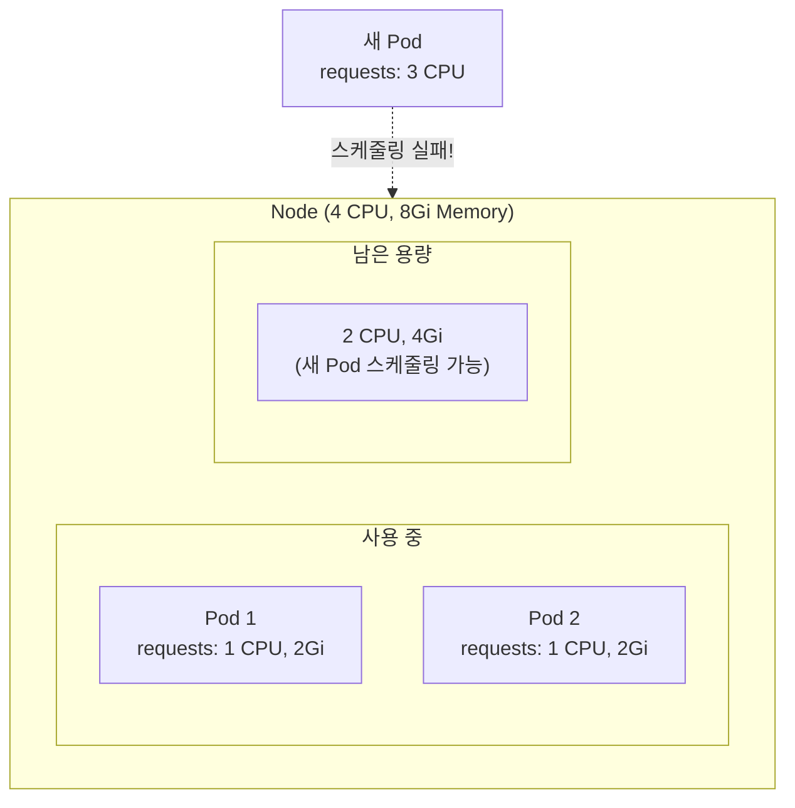
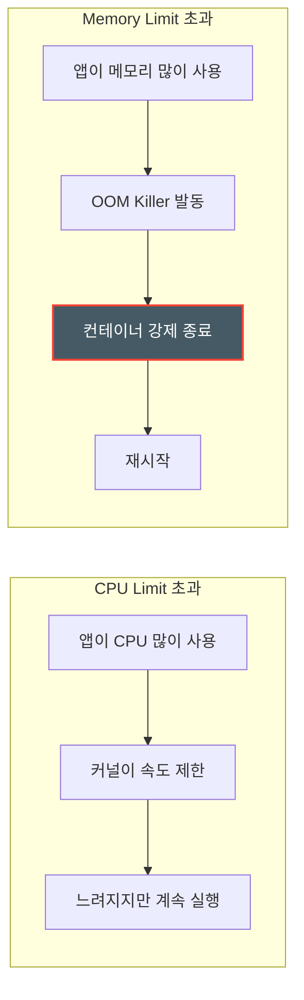
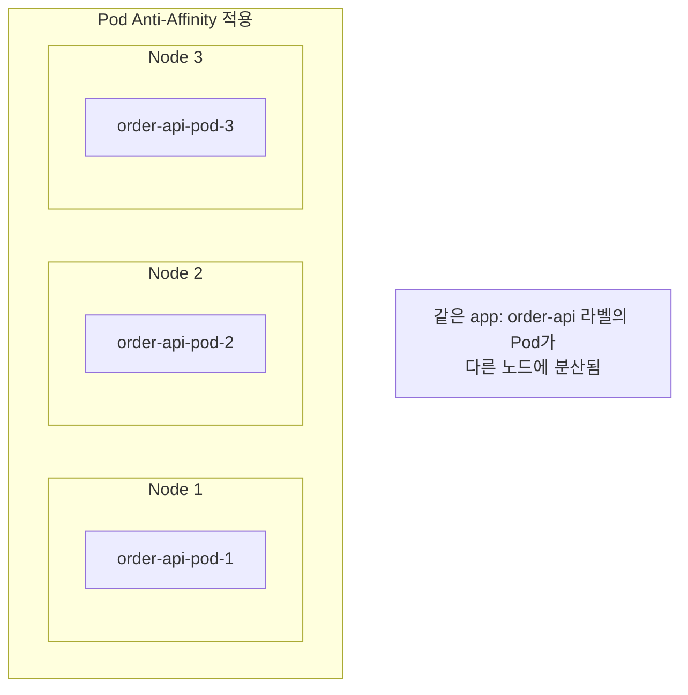
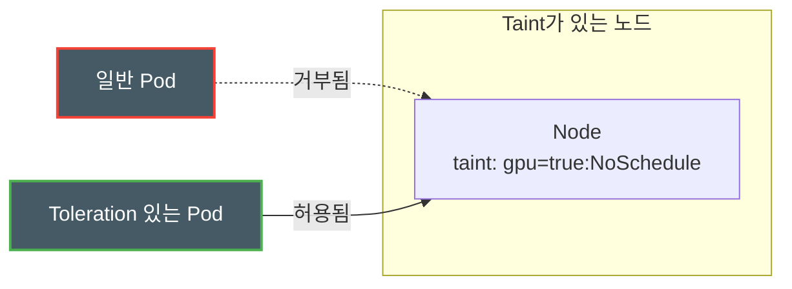

# Kubernetes Pod

> **개발자를 위한 쉬운 쿠버네티스 · 3장** | [전체 목차](./Kubernetes-Introduction.md#이-시리즈의-읽는-순서) · [이전 장](./Kubernetes-Architecture.md) · [다음 장](./Kubernetes-ReplicaSet-Deployment.md)

컨테이너가 종료된 것과 Pod가 교체된 것은 어떻게 다를까?

앞 장에서 배포 선언이 API server에 저장된 뒤 scheduler와 kubelet이 실제 실행 상태를 만든다는 흐름을 보았다. 이제 실행되는 쪽을 가까이 들여다보자. 주문 API 프로세스가 한 번 종료되었는데 Pod 이름은 그대로일 수 있다. 반대로 Pod 이름과 IP가 바뀌었는데 애플리케이션 버전은 그대로일 수도 있다. 이 차이를 알아야 장애를 복구한 주체와 사라진 상태를 설명할 수 있다.

## 결론부터 말하면

Pod는 Kubernetes가 배치하는 기본 실행 단위다. 보통 애플리케이션 컨테이너 하나를 담지만, 실행 위치와 네트워크를 함께 써야 하는 보조 컨테이너를 추가할 수 있다. 같은 Pod의 컨테이너들은 같은 노드에 배치되고 Pod IP와 포트 공간을 공유하며, 명시적으로 연결한 volume으로 파일을 공유한다.

**컨테이너 재시작은 같은 Pod 안의 실행을 다시 만드는 일이고, Pod 교체는 새로운 UID를 가진 실행 단위를 만드는 일이다.** kubelet은 `restartPolicy`에 따라 전자를 맡는다. Pod 자체가 없어졌을 때 후자를 맡으려면 다음 장의 ReplicaSet 같은 controller가 필요하다.



이 장의 `order-api`, namespace `bookstore`, `registry.example.com/book/order-api:1.0.0` 이미지는 가상 설명용이다. `/livez`, `/readyz`, `/startupz`도 앱이 별도로 구현한다고 가정한 endpoint이며 모든 프레임워크에 자동으로 생기지 않는다. 아래 manifest는 구조를 설명하며 실제 공개 이미지나 실행 결과를 제공하는 실습은 아니다.

## 1. 왜 컨테이너가 아닌 Pod인가?

### 1.1 먼저 컨테이너 하나로 시작한다

백엔드 개발자에게 익숙한 실행 단위는 서버 프로세스다. 이를 이미지로 패키징하면 같은 프로그램과 의존성을 여러 머신에서 실행할 수 있다. Kubernetes는 그 컨테이너를 어느 노드에서 실행할지 정해야 한다. 이때 배치의 기준이 되는 객체가 Pod다. Pod가 있다고 해서 컨테이너 여러 개가 필수인 것은 아니다. 주문 API만 필요하면 하나면 충분하다.

다음은 완전한 설명용 Pod manifest다. `bookstore` namespace가 이미 있고 자리표시자 이미지를 실제 이미지로 바꾸었다는 실행 전제가 필요하다.

```yaml
apiVersion: v1
kind: Pod
metadata:
  name: order-api-pod
  namespace: bookstore
  labels:
    app: order-api
spec:
  restartPolicy: Always
  containers:
  - name: order-api
    image: registry.example.com/book/order-api:1.0.0
    ports:
    - name: http
      containerPort: 8080
    resources:
      requests:
        cpu: "250m"
        memory: "256Mi"
      limits:
        cpu: "1000m"
        memory: "512Mi"
```

`metadata`는 API 객체의 이름과 분류를, `spec.containers`는 실행할 컨테이너를 표현한다. `containerPort: 8080`은 앱이 사용하는 포트를 문서화하는 선언이다. 이 필드가 서버 소켓을 열거나 프로세스를 8080에서 listen하게 만들지는 않는다. 실제 listen 주소·포트는 앱이 정한다. 외부에서 접근 가능한 주소를 만드는 일은 뒤의 Service 장에서 이어진다.

### 1.2 함께 있어야 하는 컨테이너를 추가할 때

주문 API가 만든 파일을 바로 옆의 전송기가 읽어야 하거나, 앱이 `localhost`의 프록시에 접속해야 한다면 두 컨테이너가 서로 다른 노드로 흩어져서는 곤란하다. Pod는 이렇게 밀접한 협력이 필요한 컨테이너를 하나의 배치 단위로 묶는다. API 서버와 DB가 서로 통신한다는 이유만으로 같은 Pod에 넣지는 않는다. 따로 확장하거나 교체해야 한다면 별도 Pod가 자연스럽다.

| 같은 Pod에서 공유하는 것 | 의미와 경계 |
|---|---|
| 노드 | 컨테이너들을 따로 다른 노드로 배치하지 않음 |
| 네트워크 namespace | 같은 Pod IP·포트 공간과 `localhost` 사용 |
| IPC namespace | 컨테이너 사이 IPC 사용 가능 |
| 선언한 volume | 각 컨테이너의 `volumeMounts`에 연결한 경로만 공유 |

파일시스템 전체가 자동 공유되는 것은 아니다. 각 컨테이너의 이미지와 writable layer는 별개다. 프로세스 namespace 공유도 기본으로 켜져 있지 않으며, 필요한 경우 `shareProcessNamespace`로 따로 선택한다. 네트워크 공유 때문에 두 컨테이너가 같은 주소의 8080 포트를 동시에 listen할 수 없다는 점도 Docker 컨테이너를 각각 실행할 때와 다르다.

### 1.3 파일 공유와 수명의 연결

구조 설명용 발췌로 보면 공유 volume은 다음처럼 나타난다. 전체 Pod manifest의 `spec` 아래에 들어갈 필드다. 가상 `order-api`가 `/var/log/order-api/access.log`를 파일로 쓴다는 추가 전제가 있으며, 일반 앱의 stdout 로그를 반드시 파일로 바꾸라는 뜻은 아니다.

```yaml
containers:
- name: order-api
  image: registry.example.com/book/order-api:1.0.0
  volumeMounts:
  - name: logs
    mountPath: /var/log/order-api
- name: log-reader
  image: busybox:1.36
  command: ["sh", "-c", "tail -F /logs/access.log"]
  volumeMounts:
  - name: logs
    mountPath: /logs
    readOnly: true
volumes:
- name: logs
  emptyDir: {}
```

이 보조 컨테이너는 파일을 stdout으로 읽어 줄 뿐, 외부 로그 저장소로 보내는 전송기는 아니다. 두 컨테이너가 같은 volume을 서로 다른 경로로 마운트해도 공유 대상은 같다. `emptyDir`의 데이터는 컨테이너가 재시작되어도 같은 Pod가 유지되는 동안 남지만 Pod가 제거되면 사라진다. Pod 교체를 넘어서 보존할 데이터는 [Volume, PV, PVC](Kubernetes-Volume-PersistentVolume.md)에서 다룬다.

## 2. 재시작과 교체를 구별하는 법

### 2.1 프로세스가 종료되어도 Pod가 유지될 수 있다

주문 API가 잘못된 설정을 읽고 exit 1로 종료되었다고 하자. Pod의 `restartPolicy: Always`를 본 kubelet은 같은 Pod 안에서 컨테이너를 다시 만든다. 새 컨테이너이므로 프로세스 메모리와 writable layer에 의존한 상태는 이어진다고 가정할 수 없다. Pod UID와 배치된 노드는 유지되고, `restartCount`는 늘 수 있다.

반면 Pod를 삭제하거나 노드 압박으로 퇴거시키면 그 Pod의 수명은 끝난다. Pod는 한 번 배치된 뒤 다른 노드로 이동하지 않는다. 노드가 사라졌을 때 실행을 복구하는 방식도 기존 Pod를 옮기는 것이 아니라 상위 controller가 새 Pod를 만드는 것이다. 새 Pod는 UID가 다르고 IP도 달라질 수 있다. 노드 장애 판정과 대체 생성은 비동기적이므로 즉시 복구를 보장하지 않는다.

| 사건 | 같은 Pod인가? | 복구 주체와 범위 |
|---|---|---|
| 앱 프로세스 종료 | 보통 유지 | kubelet이 restart policy에 따라 컨테이너 재시작 |
| 컨테이너 memory limit 관련 OOM | 보통 유지 | 종료 원인 확인 후 restart policy에 따라 재시작 |
| Pod 삭제·퇴거 | 기존 Pod 종료 | ReplicaSet 등 상위 controller가 대체 Pod 생성 |
| 노드 장애 | 기존 Pod가 다른 노드로 이동하지 않음 | 장애 감지·퇴거·controller·스케줄링을 거쳐 대체 가능 |

### 2.2 재시작 정책과 반복 실패

`Always`는 성공 종료까지 포함해 다시 실행하고, `OnFailure`는 실패 종료를 재시도하며, `Never`는 재시작하지 않는다. Deployment의 일반 애플리케이션 Pod는 `Always`를 사용하고, 끝나는 작업은 Job에서 별도 모델로 다룬다. 재시작은 버그를 고치지 않는다. 틀린 설정이 그대로라면 같은 실패를 반복한다.

이 반복을 무제한 빠르게 수행하지 않도록 kubelet은 대기 시간을 늘린다. 일반적인 기본 백오프는 10초부터 2배씩 증가해 최대 300초이며 일정 시간 정상 실행되면 초기화된다. 다만 최근 Kubernetes에는 백오프를 조정하는 기능과 kubelet 설정이 있으므로 모든 버전·노드에서 정확히 같은 간격이라고 가정하지 않는다. `CrashLoopBackOff`는 이 재시도 대기를 설명하는 container waiting reason이지 독립적인 Pod phase가 아니다.

## 3. 상태를 읽어 원인을 좁히기

### 3.1 Pod Phase: 5가지 상태

`kubectl get pods`의 `STATUS` 열은 사람이 상황을 빨리 알도록 가공한 표시다. API의 `status.phase`와 항상 같지 않다. 예를 들어 `Terminating`은 삭제 중이라는 표시이고 `ImagePullBackOff`는 컨테이너 준비 과정의 이유다.

| Phase | API가 요약하는 의미 |
|---|---|
| Pending | Pod가 접수되었지만 컨테이너 준비가 끝나지 않음. 배치 대기뿐 아니라 이미지 준비도 포함 |
| Running | 노드에 배치되었고 컨테이너가 생성됨. 하나 이상이 실행 중이거나 시작·재시작 과정 |
| Succeeded | 모든 컨테이너가 성공 종료했고 다시 시작되지 않음 |
| Failed | 모든 컨테이너가 종료했고 하나 이상이 실패했으며 다시 시작되지 않음 |
| Unknown | Pod 상태를 얻을 수 없음. 노드 통신 문제 등이 원인일 수 있음 |

이미지 pull이 실패했다고 곧바로 phase가 Failed가 되는 것은 아니다. 계속 준비를 시도하며 Pending일 수 있다. Running도 HTTP 요청 성공을 뜻하지 않는다. 요청을 받아도 되는지는 readiness와 Service 선택까지 연결해야 하며 [Probe 장](Kubernetes-Probe-Liveness-Readiness-Startup.md)에서 자세히 다룬다.

### 3.2 Container States: 컨테이너 레벨 상태

각 컨테이너는 Waiting, Running, Terminated 중 하나의 현재 상태와 이전 종료 상태를 보고할 수 있다. Pod phase가 전체 요약이라면 이 정보는 무엇을 준비하다 멈췄는지, 어떤 exit code로 끝났는지를 보여 준다. 다음은 실측이 아닌 설명용 출력이다.

```text
State:          Waiting
  Reason:       CrashLoopBackOff
Last State:     Terminated
  Reason:       Error
  Exit Code:    1
```

현재는 재시도를 기다리고 있고 이전 프로세스는 exit 1로 끝났다는 뜻이다. `CrashLoopBackOff`라는 문자열만으로 메모리 부족이라고 결론 내릴 수 없다. 이전 로그, exit code, `OOMKilled` reason, probe 실패 Events를 함께 보아야 한다.

다음 명령은 준비된 개인 실습 context에서 읽기 전용 관찰을 할 때의 예시이며 이 원고에서는 실행하지 않았다.

```bash
kubectl -n bookstore get pod order-api-pod -o wide
kubectl -n bookstore get pod order-api-pod -o jsonpath='{.metadata.uid}{"\n"}{.status.phase}{"\n"}{.status.containerStatuses}{"\n"}'
kubectl -n bookstore describe pod order-api-pod
kubectl -n bookstore logs order-api-pod -c order-api --previous
```

`--previous`는 같은 Pod 안에서 이전에 종료된 컨테이너 인스턴스의 로그를 요청한다. 삭제된 모든 Pod의 로그를 찾아 주는 명령은 아니다. 빠르게 반복 종료하는 컨테이너에는 `exec` 자체가 실패할 수 있고, distroless 이미지에는 shell이 없을 수 있다. 로그와 Events를 먼저 확보하는 이유다.

### 3.3 Pending은 어디에서 기다리는가?

Pod가 실행되지 않는다면 먼저 `.spec.nodeName`으로 노드 배치 여부를 구분한다. 노드가 정해지지 않았으면 scheduler가 만족하지 못한 자원·조건을 Events에서 찾는다. 노드가 정해졌는데 Pending이면 이미지, volume, 설정 같은 kubelet의 준비 단계를 본다.

| 관찰 | 가능한 해석 | 다음 증거 |
|---|---|---|
| `FailedScheduling`, `Insufficient cpu` | request를 수용할 배치 가능 용량 부족 | 각 Pod requests·노드 allocatable·배치 조건 |
| `ImagePullBackOff` | 이미지 접근·인증·이름·신뢰 문제 | pull 실패 Events의 원문 |
| `CreateContainerConfigError` | 필수 ConfigMap·Secret 또는 key 누락 가능 | 참조 이름·namespace·key |
| `FailedMount` | volume 준비 실패 | volume 참조와 driver·노드 Events |

CPU 사용률이 낮다는 사실만으로 새 Pod가 배치될 수 있는 것은 아니다. scheduler는 순간 사용량만 보고 자리를 정하지 않고 requests와 배치 제약을 사용한다. 반대로 request를 낮춰 Pending을 없애도 앱에 필요한 자원이 실제로 생기는 것은 아니다.

---

### 3.4 Requests와 Limits: 배치와 실행에서 쓰는 숫자

첫 manifest의 CPU `requests: 250m`은 CPU 0.25에 해당하는 배치·자원 배분 기준이다. 메모리 `requests: 256Mi`도 노드가 이 Pod를 수용할 수 있는지 판단할 때 사용한다. request는 프로세스가 항상 그만큼 소비한다는 측정값이 아니고 순간 사용률과도 다르다. 노드의 물리 전체 용량에서 시스템 예약 등을 제외한 allocatable과 이미 배정한 requests, 배치 제약이 함께 맞아야 실행 위치를 정할 수 있다.

limit은 실행 중 제약이다. 일반적인 Linux 환경에서 CPU limit은 실행 시간을 제한해 throttling을 만들 수 있다. 메모리 limit은 커널의 메모리 제약과 연결되어 한도 압박에서 OOM 종료로 이어질 수 있다. CPU를 더 쓰려는 앱과 메모리를 더 할당하려는 앱이 같은 방식으로 실패하지 않는 이유다. Pod가 생기지 않는 배치 실패와 실행 후 앱이 느려지거나 종료되는 문제를 구분해야 한다.

노드 자체의 메모리·디스크 압박 때문에 kubelet이 Pod를 퇴거시키는 일도 있다. 이때는 컨테이너 하나의 restartCount만 보지 않고 Pod phase·reason과 노드 Events를 함께 본다. 값 선택과 QoS의 세부 판단은 후반 Resource Management 절에서 확장한다.

## 심화 읽기의 위치

여기까지의 핵심은 실행 단위, 재시작과 교체, 관찰할 상태다. 이제 공유 수명이라는 성질을 init·sidecar로 확장하고, 자원과 노드 선택이 실행 가능성에 어떤 제약을 주는지 더 살펴본다. 여러 앱을 같은 Pod에 묶는 기술을 배우기 위한 필수 절차가 아니라, 필요한 경우 선택할 설계 수단이다.

## 4. Init Container 심화

이후의 YAML은 실행 순서와 필드 관계를 설명하는 발췌다. 별도 서비스·이미지·volume·설정이 필요한 예제이며 그대로 적용하는 실습 manifest가 아니다.

### 4.1 Init Container란?

**메인 컨테이너가 시작되기 전에 실행되는 특수 컨테이너**다. 초기화 작업을 분리해서 메인 이미지를 가볍게 유지할 수 있다.



**Init Container의 특징:**
- **순차 실행**: 일반 init container는 앞선 init이 성공해야 다음 init으로 진행
- **성공 필수**: 하나라도 실패하면 Pod 시작 안 됨
- **재시작 정책**: 실패 시 Pod의 `restartPolicy`에 따라 재시도
- **완료 후 종료**: 작업이 끝나면 컨테이너 종료

### 4.2 실무 사용 사례

**Case 1: 의존 서비스 대기**

DNS 조회 성공은 DB 프로세스가 연결을 받아 SQL을 처리할 준비가 되었다는 증거가 아니다. TCP 연결 성공도 실제 인증·스키마 준비까지 검증하지 않는다. 앱 자체의 재연결과 재시도도 필요하며 init 대기를 무기한 의존성 복구 수단으로 삼지 않는다.

DB나 다른 서비스가 준비될 때까지 대기:

```yaml
apiVersion: v1
kind: Pod
metadata:
  name: myapp
spec:
  initContainers:
  - name: wait-for-db
    image: busybox:1.36
    command: ['sh', '-c',
      'until nslookup mysql-service.default.svc.cluster.local; do
         echo "Waiting for MySQL...";
         sleep 2;
       done']

  - name: wait-for-redis
    image: busybox:1.36
    command: ['sh', '-c',
      'until nc -z redis-service 6379; do
         echo "Waiting for Redis...";
         sleep 2;
       done']

  containers:
  - name: order-api
    image: registry.example.com/book/order-api:1.0.0
```

**Case 2: 설정 파일 생성**

ConfigMap이나 외부 소스에서 설정을 가져와 파일로 생성:

```yaml
apiVersion: v1
kind: Pod
metadata:
  name: app-with-config
spec:
  initContainers:
  - name: fetch-config
    image: curlimages/curl:8.4.0
    command: ['sh', '-c',
      'curl --fail --show-error -o /config/settings.json https://config-server/api/settings']
    volumeMounts:
    - name: config-volume
      mountPath: /config

  containers:
  - name: order-api
    image: registry.example.com/book/order-api:1.0.0
    volumeMounts:
    - name: config-volume
      mountPath: /app/config
      readOnly: true

  volumes:
  - name: config-volume
    emptyDir: {}
```

**Case 3: DB 마이그레이션**

여러 replica의 init이 동시에 같은 마이그레이션을 실행할 수 있다. 잠금·멱등성·구버전과의 스키마 호환성이 필요하며, 한 번 수행할 배포 작업이면 Job을 별도로 두는 편이 명확하다. 아래는 구조 발췌이며 `./migrate`는 가상 앱의 실행 파일이다.

애플리케이션 시작 전 DB 스키마 마이그레이션:

```yaml
initContainers:
- name: db-migrate
  image: registry.example.com/book/order-api:1.0.0
  command: ['./migrate', '--database', '$(DATABASE_URL)']
  env:
  - name: DATABASE_URL
    valueFrom:
      secretKeyRef:
        name: db-secret
        key: url
```

**Case 4: 권한이 필요한 초기화**

root init과 재귀 chown은 admission 정책·volume 구현·데이터 크기에 따라 거절되거나 큰 기동 지연을 만들 수 있다. storage가 지원하는 group 권한과 `fsGroup`을 검토한 뒤 필요한 경우에만 선택한다.

보안상의 이유로 메인 앱에 root 권한을 주지 않지만, 초기화에는 필요한 경우:

```yaml
initContainers:
- name: fix-permissions
  image: busybox
  command: ['sh', '-c', 'chown -R 1000:1000 /data']
  securityContext:
    runAsUser: 0  # root로 실행
  volumeMounts:
  - name: data
    mountPath: /data

containers:
- name: order-api
  image: registry.example.com/book/order-api:1.0.0
  securityContext:
    runAsUser: 1000  # non-root로 실행
  volumeMounts:
  - name: data
    mountPath: /data
```

### 4.3 Init Container vs 일반 Container

아래는 완료 후 종료되는 일반 init container와 앱 컨테이너의 비교다. restartable init인 native sidecar는 다음 절에서 따로 구분한다. Resource 계산은 일반 init만 있을 때 자원별 init 최댓값과 앱 합계 중 큰 값을 사용하며 Pod overhead가 있으면 더한다. Native sidecar가 있으면 초기화 단계와 앱 실행 단계에서 함께 실행되는 자원도 계산한다.

| 특성 | Init Container | App Container |
|------|----------------|---------------|
| 실행 시점 | 앱 컨테이너 **이전** | Init 이후 |
| 실행 순서 | **순차적** (하나씩) | **병렬** (동시) |
| Probe | ❌ 지원 안 함 | ✅ 지원 |
| lifecycle | ❌ 지원 안 함 | ✅ 지원 |
| Resource 계산 | 일반 init은 자원별 최댓값과 앱 합계를 비교 | 실행 중 앱 컨테이너들의 자원별 합계 |
| 완료 조건 | exit 0으로 종료 | 계속 실행 |

---

## 5. Sidecar Container 심화

### 5.1 전통적인 Sidecar 패턴

다음 nginx·Fluent Bit 조합은 파일 공유를 보여 주는 독립 예제다. 공통 `order-api` 앱과 별개의 설명이며 Fluent Bit 설정 ConfigMap과 로그 파일 경로를 별도로 준비해야 한다. image 태그는 기능 설명용이고 최신·보안 권장 버전을 뜻하지 않는다.

메인 컨테이너와 **함께 실행되며 보조 기능**을 제공하는 컨테이너다.

```yaml
apiVersion: v1
kind: Pod
metadata:
  name: app-with-sidecar
spec:
  containers:
  - name: nginx
    image: nginx:1.25
    volumeMounts:
    - name: logs
      mountPath: /var/log/nginx

  - name: log-shipper
    image: fluent/fluent-bit:2.2
    volumeMounts:
    - name: logs
      mountPath: /var/log/nginx
      readOnly: true
    - name: fluent-bit-config
      mountPath: /fluent-bit/etc/

  volumes:
  - name: logs
    emptyDir: {}
  - name: fluent-bit-config
    configMap:
      name: fluent-bit-config
```

**실무에서 흔한 Sidecar 사용 사례:**

| Sidecar | 역할 | 대표 도구 |
|---------|------|----------|
| **Log Agent** | 로그 수집 및 전송 | Fluent Bit, Fluentd, Filebeat |
| **Proxy** | 트래픽 관리, mTLS | Envoy (Istio), Linkerd |
| **Secrets Agent** | 시크릿 주입 | Vault Agent, AWS Secrets Manager |
| **Monitoring** | 메트릭 수집 | Prometheus exporter |

### 5.2 Native Sidecar (v1.33부터 stable)

Native Sidecar는 기존 sidecar 패턴의 문제점을 해결하기 위해 추가된 Kubernetes 네이티브 기능이다. [공식 문서](https://kubernetes.io/docs/concepts/workloads/pods/sidecar-containers/) 기준 릴리스 타임라인은 다음과 같다:

- **v1.28**: Alpha 도입 (`SidecarContainers` feature gate 수동 활성화 필요)
- **v1.29**: **Beta로 승격, 기본 활성화** (클러스터 정책·feature gate 확인 필요)
- **v1.33**: **Stable(GA)**, 기본 활성화. `SidecarContainers` feature gate는 GA 상태로 유지됨 (feature gate 자체가 완전히 사라진 것은 아니지만 locked 상태라, 값을 지정해도 무시되고 끌 수 없다 — [공식 문서](https://kubernetes.io/docs/concepts/workloads/pods/sidecar-containers/))

2026-10-23에 확인한 공식 문서는 v1.33부터 stable인 기능으로 설명한다. 사용 중인 클러스터의 버전과 정책은 별도로 확인한다. 기능의 존재만으로 로그 전송 완료나 무손실 종료가 보장되는 것은 아니다.

**기존 방식의 문제:**



- Sidecar가 메인 앱보다 먼저 죽을 수 있음
- 메인 앱이 죽어도 Sidecar가 계속 살아있을 수 있음 (Job에서 완료 안 됨)
- 시작 순서 보장이 안 됨

**Native Sidecar 방식:**

```yaml
apiVersion: v1
kind: Pod
metadata:
  name: native-sidecar-demo
spec:
  initContainers:
  # 이것이 Native Sidecar!
  - name: log-shipper
    image: fluent/fluent-bit:2.2
    restartPolicy: Always  # 핵심! 이게 Sidecar로 만듦
    volumeMounts:
    - name: logs
      mountPath: /var/log/app

  containers:
  - name: order-api
    image: registry.example.com/book/order-api:1.0.0
    volumeMounts:
    - name: logs
      mountPath: /var/log/app

  volumes:
  - name: logs
    emptyDir: {}
```

`initContainers`에 `restartPolicy: Always`를 설정하면 **Native Sidecar**가 된다.

**Native Sidecar의 동작:**

다음 그림은 Job이 정상 완료하거나 Pod가 종료되는 경로를 단순화한 것이다. Deployment의 앱 컨테이너가 한 번 종료되면 재시작될 수 있으므로 그때마다 sidecar가 함께 끝난다는 뜻은 아니다. kubelet은 sidecar의 started 상태(설정했다면 startup probe 성공)를 확인한 뒤 다음 init 또는 앱 단계로 진행한다. 여러 native sidecar의 종료는 선언의 역순으로 진행되며 충분한 종료 유예 시간이 필요하다.



| 특성 | 기존 Sidecar | Native Sidecar |
|------|-------------|----------------|
| 정의 위치 | `containers` | `initContainers` + `restartPolicy: Always` |
| 시작 순서 | 보장 안 됨 | **앱보다 먼저 시작** |
| 종료 순서 | 보장 안 됨 | **앱이 종료된 후 종료** |
| Job에서 | Pod가 완료 안 됨 | 정상 완료 |
| Probe | 지원 | 지원 |

---

## 6. Resource Management

### 6.1 Requests vs Limits

**실무에서 가장 중요한 설정 중 하나**다. 이걸 제대로 설정하지 않으면 노드가 죽거나, 스케줄링이 안 되거나, 성능이 안 나온다.

```yaml
spec:
  containers:
  - name: order-api
    image: registry.example.com/book/order-api:1.0.0
    resources:
      requests:
        memory: "256Mi"
        cpu: "250m"
      limits:
        memory: "512Mi"
        cpu: "500m"
```

| 개념 | 역할 | 비유 |
|------|------|------|
| **requests** | 스케줄러가 노드 선택 시 사용 | "최소한 이만큼은 필요해요" |
| **limits** | 컨테이너가 사용할 수 있는 최대치 | "이 이상은 못 써요" |



**CPU 단위:**

| 표기 | 의미 |
|------|------|
| `1` | 1 CPU core (1000m) |
| `500m` | 0.5 CPU core |
| `100m` | 0.1 CPU core |

**Memory 단위:**

| 표기 | 의미 |
|------|------|
| `128Mi` | 128 MiB (Mebibyte, 2^20) |
| `1Gi` | 1 GiB |
| `128M` | 128 MB (Megabyte, 10^6) |

> **주의:** `Mi`와 `M`은 다르다! Mi는 2진수(1024), M은 10진수(1000) 기반.

### 6.2 CPU Throttling vs OOMKilled

**CPU와 Memory는 limit 초과 시 동작이 다르다:**

| 리소스 | Limit 초과 시 | 영향 |
|--------|--------------|------|
| **CPU** | Throttling (속도 제한) | 느려지지만 죽지 않음 |
| **Memory** | 커널이 메모리 한도 압박에서 프로세스를 OOM 종료할 수 있음 | 종료 원인과 restart policy에 따라 재시작 |



**OOMKilled 확인:**

```bash
kubectl -n bookstore describe pod order-api-pod

# 출력에서 확인
Last State:     Terminated
  Reason:       OOMKilled
  Exit Code:    137
```

Exit Code 137은 일반적으로 `128 + 9(SIGKILL)`에 대응한다. SIGKILL의 원인이 항상 OOM인 것은 아니므로 `reason: OOMKilled`, Events와 메모리 지표를 함께 확인한다.

### 6.3 Requests = Limits로 설정해야 할까?

requests는 배치와 자원 배분의 기준이고 limits는 실행 시 제약이다. 둘을 같게 하면 선언이 단순해지지만, 모든 앱에 같은 값이 최선이라는 뜻은 아니다. 주문 API가 평소에는 CPU 250m를 쓰고 기동 시에만 더 많은 CPU를 요구한다면 CPU limit을 높이거나 생략하는 선택으로 기동 지연을 줄일 수 있다. 반대로 공유 노드에서 폭주를 제한해야 한다면 limit이 유용하다. 실제 부하, 지연 목표, 노드 여유, 조직의 격리 정책을 함께 보고 결정한다.

메모리도 무조건 requests와 limits를 같게 해야 하는 것은 아니다. request를 정상 사용량보다 지나치게 낮게 잡으면 노드에 실제 사용량이 과도하게 모일 수 있고, limit을 너무 낮게 잡으면 앱이 OOM으로 종료된다. 정상 상태·기동·최대 부하의 working set을 측정하고 여유를 더하는 것이 먼저다. Java라면 heap 외에도 metaspace, thread stack, direct buffer, native memory를 포함한다. 메모리 limit은 JVM heap 크기와 같은 숫자가 아니다.

다음 두 구조 설명용 발췌는 어느 하나가 보편적인 권장값이라는 의미가 아니다. 첫 구성은 CPU와 메모리를 모두 같게 지정하고, 둘째는 CPU에 burst 여지를 둔다.

```yaml
resources:
  requests:
    memory: "512Mi"
    cpu: "500m"
  limits:
    memory: "512Mi"
    cpu: "500m"
```

```yaml
resources:
  requests:
    memory: "512Mi"
    cpu: "250m"
  limits:
    memory: "768Mi"
    cpu: "1000m"
```

### 6.4 QoS Class: 리소스 부족 시 누가 먼저 죽나?

Kubernetes는 requests와 limits 구성을 바탕으로 Pod에 Quality of Service(QoS) class를 부여한다. 여기서는 컨테이너별 CPU·메모리 설정을 사용하는 일반적인 경우를 비교한다.

| QoS Class | 조건 |
|---|---|
| Guaranteed | 모든 컨테이너가 CPU·메모리 request와 limit을 모두 갖고, 자원별 request와 limit이 같음 |
| Burstable | Guaranteed가 아니면서 하나 이상의 CPU·메모리 request 또는 limit이 있음 |
| BestEffort | CPU·메모리 request와 limit이 없음 |

QoS를 생존을 보장하는 등급으로 읽으면 안 된다. 메모리 압박에 따른 kubelet의 퇴거 판단은 사용량이 request를 넘는지, Pod Priority가 무엇인지, request 대비 얼마나 사용하는지 등을 고려한다. 그래서 BestEffort → Burstable → Guaranteed라는 하나의 순서만으로 모든 퇴거를 예측할 수 없다. 디스크 압박 등 원인에 따라 판단 기준도 달라진다. Guaranteed Pod도 노드 장애나 극심한 압박에서 안전을 보장받지 않는다.

컨테이너의 메모리 limit 때문에 발생하는 OOM과 노드 전체의 압박 때문에 kubelet이 Pod를 퇴거시키는 일도 구분해야 한다. 전자는 같은 Pod 안의 컨테이너 재시작으로 이어질 수 있고, 후자는 Pod가 종료되어 상위 controller가 새 Pod를 만드는 경로로 이어진다. [Node-pressure Eviction 공식 문서](https://kubernetes.io/docs/concepts/scheduling-eviction/node-pressure-eviction/)는 QoS만으로 순위를 결정하지 않는 이유를 설명한다.

### 6.5 In-place Pod Resize: 재생성 없이 requests/limits 바꾸기

실행 중인 Pod의 CPU·메모리를 `resize` 서브리소스로 수정하는 기능도 있다. 2026-10-23에 확인한 공식 문서는 In-place Pod Resize를 v1.35부터 stable로 설명한다. 지원 버전, runtime, 노드 여유, resize 정책의 제약을 먼저 확인해야 하므로 기본 학습 경로에서는 Deployment 템플릿을 바꾸어 교체하는 모델을 기준으로 삼는다.

다음은 구조와 명령 형식을 설명하는 예시다. 실행 기록이 아니며, `order-api-pod`가 해당 기능을 지원하는 실습 클러스터에 존재한다는 전제가 필요하다.

```bash
kubectl -n bookstore patch pod order-api-pod --subresource resize --patch \
  '{"spec":{"containers":[{"name":"order-api","resources":{"requests":{"cpu":"800m"},"limits":{"cpu":"800m"}}}]}}'
```

컨테이너별 `resizePolicy`로 자원 변경에 재시작이 필요한지 표현할 수 있고, `PodResizePending`·`PodResizeInProgress` condition으로 진행 상태를 본다. Pod를 직접 resize해도 Deployment 템플릿이 바뀌지 않는다는 점이 중요하다. 교체될 다음 Pod에도 유지할 값이라면 템플릿과 배포 정본에 반영해야 한다.

출처: [Resize CPU and Memory Resources assigned to Containers](https://kubernetes.io/docs/tasks/configure-pod-container/resize-container-resources/)

---

## 7. Pod Scheduling

### 7.1 nodeSelector: 가장 간단한 방법

특정 라벨이 있는 노드에만 Pod를 배치한다.

```yaml
apiVersion: v1
kind: Pod
metadata:
  name: gpu-pod
spec:
  nodeSelector:
    accelerator: nvidia-tesla-v100  # 이 라벨이 있는 노드에만
  containers:
  - name: cuda-app
    image: nvidia/cuda:12.0-base
```

```bash
# 노드에 라벨 추가
kubectl label nodes node-1 accelerator=nvidia-tesla-v100
```

### 7.2 Node Affinity: 더 유연한 제어

`nodeSelector`보다 표현력이 풍부하다.

```yaml
spec:
  affinity:
    nodeAffinity:
      # 필수 조건 (이 조건 만족하는 노드만)
      requiredDuringSchedulingIgnoredDuringExecution:
        nodeSelectorTerms:
        - matchExpressions:
          - key: topology.kubernetes.io/zone
            operator: In
            values:
            - ap-northeast-2a
            - ap-northeast-2b

      # 선호 조건 (가능하면 이 노드에)
      preferredDuringSchedulingIgnoredDuringExecution:
      - weight: 100
        preference:
          matchExpressions:
          - key: node-type
            operator: In
            values:
            - high-memory
```

| 필드 | 의미 |
|------|------|
| `requiredDuringScheduling...` | **필수** - 만족 안 하면 스케줄링 안 됨 |
| `preferredDuringScheduling...` | **선호** - 가능하면, 안 되면 다른 곳에 |
| `...IgnoredDuringExecution` | 이미 실행 중인 Pod는 영향 없음 |

**Operator 종류:**

| Operator | 의미 |
|----------|------|
| `In` | 값 목록 중 하나 |
| `NotIn` | 값 목록에 없음 |
| `Exists` | 키가 존재 |
| `DoesNotExist` | 키가 없음 |
| `Gt` | 값보다 큼 (숫자) |
| `Lt` | 값보다 작음 (숫자) |

### 7.3 Pod Affinity/Anti-Affinity

**다른 Pod와의 관계**를 기반으로 스케줄링한다.

**Pod Affinity: 같이 배치**

```yaml
# Redis와 같은 노드에 배치하고 싶을 때
spec:
  affinity:
    podAffinity:
      requiredDuringSchedulingIgnoredDuringExecution:
      - labelSelector:
          matchLabels:
            app: redis
        topologyKey: kubernetes.io/hostname  # 같은 노드
```

**topologyKey: 어피니티가 적용될 "경계"**

| topologyKey | 의미 | 사용 시점 |
|-------------|------|----------|
| `kubernetes.io/hostname` | 같은 **노드** | 로컬 통신 최적화 |
| `topology.kubernetes.io/zone` | 같은 **가용 영역** | 존 내 분산/집중 |
| `topology.kubernetes.io/region` | 같은 **리전** | 리전 내 분산 |

예를 들어, Anti-Affinity에 `topology.kubernetes.io/zone`을 사용하면 Pod들이 **다른 가용 영역에 분산**되어 존 장애에 대비할 수 있다.

**Pod Anti-Affinity: 떨어뜨려 배치**

```yaml
# 같은 앱의 Pod들을 다른 노드에 분산
spec:
  affinity:
    podAntiAffinity:
      requiredDuringSchedulingIgnoredDuringExecution:
      - labelSelector:
          matchLabels:
            app: order-api
        topologyKey: kubernetes.io/hostname
```



### 7.4 Taints and Tolerations

노드의 taint는 일치하는 toleration이 없는 Pod의 배치·유지를 제한한다. Toleration은 그 제한을 허용할 뿐 그 노드로 반드시 보내는 지시가 아니다. 전용 노드에만 배치하려면 node selector 또는 affinity도 함께 설계한다.



**노드에 Taint 추가:**

```bash
# GPU 노드에 일반 Pod 배치 방지
kubectl taint nodes gpu-node-1 gpu=true:NoSchedule
```

**Pod에 Toleration 추가:**

```yaml
spec:
  tolerations:
  - key: "gpu"
    operator: "Equal"
    value: "true"
    effect: "NoSchedule"
```

**Taint Effect:**

| Effect | 의미 |
|--------|------|
| `NoSchedule` | 새 Pod 스케줄링 안 됨 |
| `PreferNoSchedule` | 가능하면 스케줄링 안 함 (soft) |
| `NoExecute` | 새 Pod도 안 되고, 기존 Pod도 퇴거 |

**실무 활용 사례:**

아래 GPU·Spot taint는 조직이 직접 붙인다고 가정한 예시다. 클라우드 제공자나 device plugin이 자동으로 같은 key·value를 설정한다는 뜻은 아니며, 실제 노드의 taint와 운영 정책을 확인한다.

| 시나리오 | Taint | Toleration 대상 |
|----------|-------|----------------|
| GPU 노드 전용 | `example.com/dedicated-gpu=true:NoSchedule` | GPU 워크로드만 |
| 스팟 인스턴스 | `example.com/spot=true:NoSchedule` | 비용 최적화 워크로드 |
| control plane 노드 보호 | `node-role.kubernetes.io/control-plane:NoSchedule` | 시스템 Pod만 |

---

## 심화: Graceful Shutdown — 종료도 실행의 일부다

Pod 삭제가 시작되면 API에는 deletion timestamp와 유예 시간이 기록되고, kubelet이 이를 관찰해 로컬 종료를 시작한다. 기본 `terminationGracePeriodSeconds`는 30초다. 0이 아닌 유예 시간과 `preStop` hook이 있으면 kubelet은 hook을 먼저 실행한 뒤 컨테이너 주 프로세스에 종료 신호를 보낸다. 일반적인 Linux 컨테이너는 SIGTERM을 사용하지만 이미지의 stop signal 및 지원되는 설정에 따라 달라질 수 있다. 유예 시간이 끝나면 남은 프로세스는 강제 종료 대상이 된다.

구조 설명용 발췌다. 앱과 이미지에 `/bin/sh`와 `sleep`이 있고, 종료 신호를 받아 진행 중인 요청을 정리할 수 있다는 전제가 있다.

```yaml
spec:
  terminationGracePeriodSeconds: 60
  containers:
  - name: order-api
    image: registry.example.com/book/order-api:1.0.0
    lifecycle:
      preStop:
        exec:
          command: ["/bin/sh", "-c", "sleep 10"]
```

60초는 hook 이후 추가로 주는 시간이 아니다. hook과 앱 종료가 같은 예산을 나누어 쓴다. 공식 동작에는 hook이 유예 시간 뒤에도 실행 중일 때 요청하는 작은 일회성 2초 연장이 있지만, 정상 종료 시간을 설계할 때 그 연장을 여유 예산으로 삼지 않는다.

Pod가 요청 경로에서 빠지는 작업과 kubelet의 종료 작업은 비동기적으로 진행된다. 종료 중 endpoint는 EndpointSlice에 즉시 완전히 사라지기보다 terminating·ready 조건으로 표현될 수 있다. 프록시와 외부 load balancer까지 이를 반영하는 시간도 다르다. `sleep 10`은 그 사이 유입되는 요청을 잠시 처리할 기회를 줄 수 있지만 “10초면 전파 완료”를 보장하지 않는다. 앱의 신규 요청 차단과 기존 요청 drain, 클라이언트 재시도, 충분한 잔여 replica를 함께 다뤄야 한다. 이 전체 관계는 [배포 전략 장](Kubernetes-Deployment-Strategy.md)에서 이어진다.

## 8. 실무 트러블슈팅

관찰에서 바로 조치로 뛰어들기보다 원인에 맞는 증거를 모은다. `ImagePullBackOff`에는 이미지 경로뿐 아니라 노드의 registry 접근, 자격 증명, CA 신뢰를 확인한다. `OOMKilled`에는 limit을 무조건 높이기 전에 메모리 추이·누수·JVM native 사용량을 본다. Pending에는 requests만 낮추기 전에 용량과 배치 조건을 확인한다. 수정할 필드가 다르므로 같은 “Pod가 안 뜬다”로 묶어 처리하지 않는 것이 중요하다.

`kubectl top pod`는 Metrics API가 있어야 사용할 수 있고 짧은 측정값만으로 최대 사용량을 대표하지 못한다. `kubectl describe`의 Events도 영구 감사 기록이 아니다. 장기적인 원인 분석에는 로그·metrics 보관 체계가 필요하며 [관측 장](Kubernetes-Metrics-Server-Prometheus.md)에서 이어 간다.

## 9. Pod를 직접 만들면 안 되는 이유

Pod를 직접 만드는 것은 디버깅이나 개념 학습에 유용하다. 하지만 계속 실행되어야 하는 주문 API에는 Pod가 사라졌을 때 원하는 개수를 복구할 주체가 필요하다. `restartPolicy`는 같은 노드의 같은 Pod 안에서 컨테이너를 다시 실행할 정책이지 새 Pod를 생성할 정책이 아니다.

다음 [ReplicaSet과 Deployment 장](Kubernetes-ReplicaSet-Deployment.md)에서는 “Pod 세 개를 생성했다”와 “앞으로도 세 개를 유지하라”의 차이를 설명한다. 이 장에서 배운 Pod UID, restartCount, 새 Pod의 구별을 그대로 사용한다.

## 10. 정리

Pod는 하나 이상의 컨테이너를 같은 노드와 네트워크 환경에서 실행하는 단위다. 같은 Pod의 컨테이너는 `localhost`로 통신하지만 파일은 선언한 volume으로만 공유한다. 컨테이너가 재시작되어도 Pod가 교체된 것은 아니며, Pod가 교체되면 메모리·IP·임시 저장소의 연속성을 가정할 수 없다.

상태를 읽을 때는 Pod phase, 컨테이너 state와 reason, Ready, Events를 나누어 본다. requests는 배치 가능성을, limits는 실행 중 제약을 설명한다. 어느 한 필드도 애플리케이션의 가용성 전체를 보장하지 않는다.

## 생각해 볼 질문

1. **Pod 이름과 UID는 그대로인데 RESTARTS가 늘었다. 다른 노드로 복구된 것일까?**
   해설: 보통 같은 Pod 안에서 컨테이너를 재시작한 것이다. Pod는 다른 노드로 이동하지 않는다. `.spec.nodeName`, UID, container status를 확인해 컨테이너 재시작과 새 Pod 생성을 구분한다.
2. **노드 CPU 사용률이 낮은데 왜 주문 API Pod가 Pending일까?**
   해설: scheduler는 requests, allocatable, affinity·taint 등 배치 조건을 함께 본다. 낮은 순간 사용률은 request를 수용할 공간이나 조건 일치를 증명하지 않는다.
3. **같은 Pod의 앱과 sidecar가 같은 파일을 못 읽는다면 네트워크 문제일까?**
   해설: 공유 네트워크가 파일시스템 공유를 만들지는 않는다. 같은 volume을 각각 마운트했는지, 경로와 권한이 맞는지 먼저 확인한다.

## 출처

2026-10-23에 아래 공식 문서의 개념·제약을 확인했다. YAML 파싱과 문서 검토를 수행했으며 실제 클러스터에서 실행한 기록은 아니다.

- [Pods](https://kubernetes.io/docs/concepts/workloads/pods/)
- [Pod Lifecycle](https://kubernetes.io/docs/concepts/workloads/pods/pod-lifecycle/)
- [Init Containers](https://kubernetes.io/docs/concepts/workloads/pods/init-containers/)
- [Sidecar Containers](https://kubernetes.io/docs/concepts/workloads/pods/sidecar-containers/)
- [Resource Management](https://kubernetes.io/docs/concepts/configuration/manage-resources-containers/)
- [Pod QoS](https://kubernetes.io/docs/concepts/workloads/pods/pod-qos/)
- [Node-pressure Eviction](https://kubernetes.io/docs/concepts/scheduling-eviction/node-pressure-eviction/)
- [Assigning Pods to Nodes](https://kubernetes.io/docs/concepts/scheduling-eviction/assign-pod-node/)
- [Taints and Tolerations](https://kubernetes.io/docs/concepts/scheduling-eviction/taint-and-toleration/)
- [Resize Container Resources](https://kubernetes.io/docs/tasks/configure-pod-container/resize-container-resources/)
