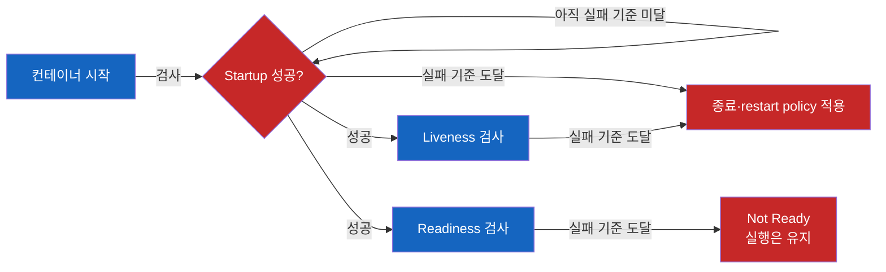
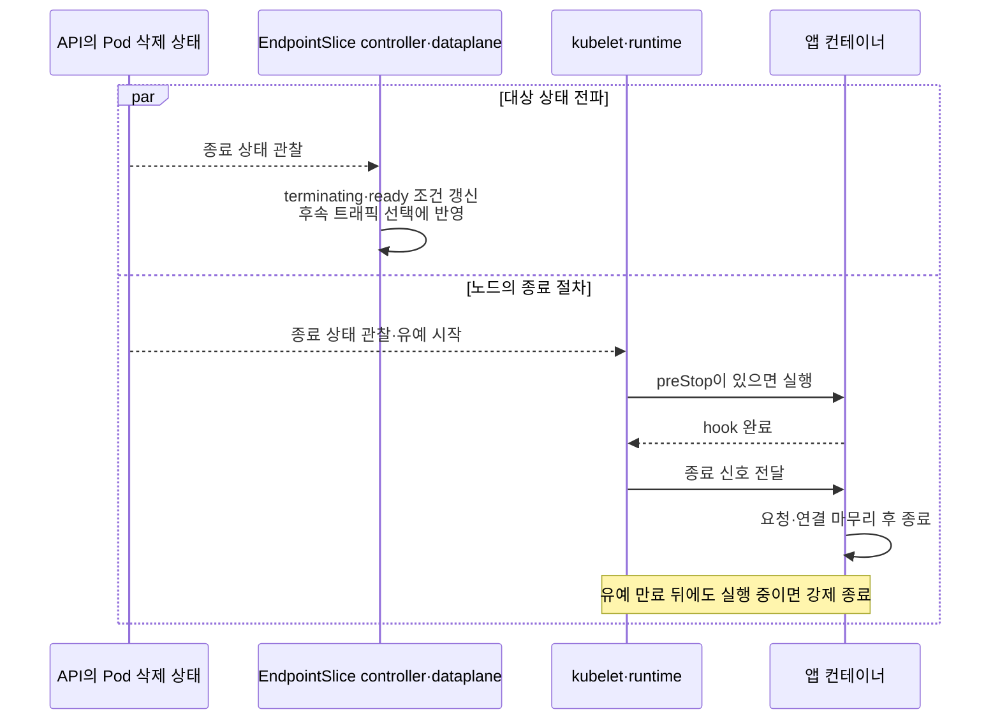

# Kubernetes Probe: Liveness, Readiness, Startup

> **개발자를 위한 쉬운 쿠버네티스 · 14장** | [전체 목차](./Kubernetes-Introduction.md#이-시리즈의-읽는-순서) · [이전 장](./Kubernetes-Service-Internals.md) · [다음 장](./Kubernetes-Ingress.md)

**프로세스가 실행 중인 것과 주문을 받을 준비가 된 것은 왜 다를까**

Service는 endpoint의 준비 상태를 보고 호출 대상을 고른다. 그런데 Kubernetes는 앱의 DB 연결, 초기화 작업, 내부 요청 처리 상태를 저절로 알 수 없다. 컨테이너 프로세스가 실행 중이라는 사실을 넘어 앱이 제공하는 신호를 읽으려면 Probe라는 검사가 필요하다.

## 결론부터 말하면

**Readiness는 지금 새 트래픽을 받아도 되는지, Liveness는 이 컨테이너를 재시작해야 하는지, Startup은 시작 절차를 더 기다려야 하는지 판단한다.** 세 검사 모두 노드의 kubelet이 실행하지만 실패 후 조치가 다르다. 준비되지 않았다는 신호를 재시작 신호로 섞으면 외부 DB 장애가 앱 전체의 재시작으로 번질 수 있다.

| Probe | 앱이 답해야 하는 질문 | 기준에 도달한 실패 후 조치 |
|---|---|---|
| Startup | 이 컨테이너의 시작이 완료되었는가? | 컨테이너를 종료하고 restart policy에 따름 |
| Readiness | 지금 이 인스턴스가 요청을 받을 수 있는가? | 컨테이너를 Not Ready로 표시. 일반 Service의 대상 선택에 반영 |
| Liveness | 이 인스턴스는 재시작으로 복구할 상태인가? | 컨테이너를 종료하고 restart policy에 따름 |

Startup을 사용하면 성공할 때까지 Readiness와 Liveness 실행이 보류된다. 성공 후 두 검사는 각자 동작하며, Readiness 성공이 Liveness 실행의 선행 조건이 되는 것은 아니다.

## 1. 왜 Running만으로는 부족한가?

### 1.1 Pod phase와 앱 준비는 다른 관찰이다

Pod의 `Running` phase는 컨테이너가 만들어져 하나 이상 실행 중이거나 시작·재시작 중이라는 생명주기 정보다. HTTP 주문을 정상 처리한다는 검사 결과가 아니다. 예를 들어 프로세스는 시작했지만 DB pool과 앱 초기화가 끝나지 않았다면 Pod가 Running인 동안 요청 처리는 실패할 수 있다.

이 장에서는 주문 API가 컨테이너 시작 후 초기화 작업을 거쳐 요청을 받는 **가상 상황** 을 사용한다. 특정 Spring 앱에서 몇 초가 걸렸다는 실측 사례는 아니다. 시작 시간은 이미지·설정·자원·의존성마다 달라진다.

Probe는 이 빈칸을 앱과 Kubernetes가 나누어 메우는 계약이다. 앱은 의미 있는 상태를 경로·명령·프로토콜로 제공하고, kubelet은 정해진 주기와 임계값으로 검사하여 정해진 조치를 취한다. 잘못 만든 health endpoint를 Kubernetes가 더 똑똑하게 해석해 주지는 않는다.

### 1.2 Ready와 Available이 배포에 연결된다

Deployment는 단순히 Running인 Pod 수만 보고 새 버전이 안전하다고 판단하지 않는다. Pod의 Ready 상태와 `minReadySeconds` 같은 조건을 거쳐 Available 수를 계산하고 배포 전략에 사용한다. `maxUnavailable: 0`은 필요한 가용 복제본을 유지하려는 제약이지, 앱 준비를 자동 검사하거나 모든 HTTP 요청을 무중단으로 처리하는 보장이 아니다.

Readiness가 없다면 실행 중 컨테이너는 별도 앱 준비 검사를 통과할 필요가 없다. 다른 Pod 조건이 충족되면 초기화 중에도 Ready가 될 수 있다. 그러면 새 버전이 실제 주문을 처리하기 전에 이전 복제본이 줄어들 수 있다. 따라서 무엇을 Ready라고 부를지 앱이 정확하게 알려 주는 것이 배포 동작의 전제가 된다.

### 1.3 Probe 미설정의 정확한 의미

| 미설정한 검사 | 의미 | 여전히 가능한 조치·상태 |
|---|---|---|
| Readiness | 그 컨테이너에 추가적인 앱 준비 검사가 없음 | 다른 컨테이너·Pod 조건·readiness gate 때문에 Pod가 Not Ready일 수 있음 |
| Liveness | 이 검사로 응답 불능을 감지하지 않음 | 프로세스 종료·OOM 등은 별도 원인으로 restart policy에 따라 처리됨 |
| Startup | 시작 전용의 검사 차단 단계가 없음 | 설정된 Readiness·Liveness가 각 delay 후 실행됨 |

"Probe가 없으면 어떤 이유로도 재시작하지 않는다"나 "Pod는 무조건 Ready다"라는 결론은 맞지 않는다. Probe는 생명주기와 건강 판단의 한 입력이다. 그 입력이 없다는 것과 나머지 상태 감지가 사라지는 것은 다르다.

<a id="3-readiness-probe-트래픽-수신-준비-확인"></a>

## 2. Readiness Probe: 실행을 유지한 채 요청 대상을 바꾼다

### 2.1 검사 실패에서 endpoint 변화까지

Readiness 실패가 임계값에 도달하면 kubelet은 컨테이너의 준비 상태를 false로 반영한다. Pod의 Ready 조건이 false가 되면, EndpointSlice controller가 이를 관찰해 endpoint 조건을 갱신하고, Service dataplane이 후속 대상 선택에 반영한다. API 저장과 네트워크 반영은 비동기적이다.


그림은 상태 반영의 인과관계이며, kubelet이 Service에 HTTP 요청을 보내 트래픽을 중지시키는 호출 순서가 아니다. endpoint 주소는 slice에 `ready: false`로 남을 수 있다. `publishNotReadyAddresses`나 종료 endpoint의 특수 처리 등은 [앞 장](./Kubernetes-Service-Internals.md)의 예외를 따른다.

Readiness 실패는 컨테이너를 종료하지 않는다. 앱이 복구되어 검사가 성공하면 다시 Ready로 수렴할 수 있다. 이미 열린 TCP 연결을 다른 Pod로 옮기거나 앱으로 직접 오는 모든 통신을 차단하는 방화벽도 아니다. 직접 Pod IP 호출, 기존 연결, 별도 LB의 직접 Pod 경로는 각각 동작을 확인해야 한다.

### 2.2 무엇을 준비 조건에 넣을 것인가?

주문 API가 초기화 중이면 새 주문을 받지 않는 판단이 자연스럽다. 특정 인스턴스의 필수 자원이 복구 중인 경우에도 Readiness로 그 인스턴스만 제외할 수 있다. 하지만 모든 외부 시스템을 무조건 확인하면 다른 문제가 생긴다.

모든 주문 API가 같은 DB를 쓰는데 DB가 잠시 멈추었다고 하자. DB를 Readiness의 필수 조건으로 두면 모든 복제본이 함께 Not Ready가 될 수 있다. 이때 상위 proxy가 반환하는 오류와 앱이 circuit breaker·fallback으로 반환할 오류 중 어느 것이 더 나은지 판단해야 한다. 주문 생성은 불가능해도 조회 cache나 다른 기능은 제공할 수 있는 앱이라면 전체 인스턴스를 제거하는 정책이 지나칠 수 있다.

따라서 Readiness의 외부 의존성은 "그 의존성이 없으면 이 인스턴스로 모든 새 요청을 보내지 않는 것이 옳은가?"로 판단한다. 앱 개발자와 운영자가 함께 정할 서비스 계약이며, 프레임워크가 대신 결정해 주는 정답은 없다. 검사 자체도 무거운 쿼리나 무한 재시도로 병목을 만들지 않게 제한해야 한다.

### 2.3 설정을 읽는 순서

다음은 **컨테이너 설정의 구조 설명용 발췌** 다. `/readyz`는 앱이 구현했다고 가정한 경로이며 Kubernetes가 자동 제공하지 않는다.

```yaml
readinessProbe:
  httpGet:
    path: /readyz
    port: 8080
  periodSeconds: 5
  timeoutSeconds: 2
  failureThreshold: 3
  successThreshold: 1
```

kubelet은 Pod 주소의 `8080/readyz`를 검사한다. 연속 실패 3회가 전체 실패 기준이고, 회복 시 연속 성공 1회가 성공 기준이다. 이것을 "장애 발생 정확히 15초 뒤에 모든 경로에서 차단"으로 계산해서는 안 된다. 장애가 생긴 시점과 검사 주기가 어긋날 수 있고, 요청 timeout과 상태 전파 시간도 있다. 준비되지 않은 동안에는 Readiness가 `periodSeconds` 외의 시점에도 수행되어 복구가 빨라질 수 있다.

<a id="4-liveness-probe-생존-확인"></a>

## 3. Liveness Probe: 재시작이 유효한 문제를 고른다

### 3.1 프로세스 존재보다 재시작의 효과가 중요하다

프로세스는 살아 있지만 요청 처리 thread가 회복 불가능하게 멈춘 상황이라면 컨테이너 재시작이 도움이 될 수 있다. Liveness는 이런 상태를 앱 밖에서 감지하기 위한 장치다. 이 장의 Deployment 예제는 `restartPolicy: Always`가 적용되므로 임계값에 도달한 Liveness 실패 뒤 컨테이너가 재시작된다. 같은 Pod 안의 컨테이너 재시작이며 Service나 Deployment를 다시 만드는 일은 아니다.

반면 외부 DB 장애, 일시적인 네트워크 지연, 부하 급증을 재시작으로 해결할 수 있다고 가정하면 안 된다. 모든 앱이 같은 DB 실패를 Liveness로 보고하면 모두 재시작하면서 연결·초기화 부하까지 더할 수 있다. "외부 의존성의 영구 실패"도 앱 재시작의 일반적인 근거가 되지 않는다.

메모리 누수와 OOM 역시 구분한다. OOM kill은 자원·런타임 경로의 별도 사건이고 Liveness가 자동으로 OOM 직전을 정확히 예측하는 것은 아니다. 재시작이 누수 증상을 잠시 완화해도 원인 수정과 용량 분석을 대신할 수는 없다.

### 3.2 너무 민감하면 장애를 증폭한다

다음은 **민감한 설정을 설명하는 발췌** 다. 운영 권장값이 아니다.

```yaml
livenessProbe:
  httpGet:
    path: /livez
    port: 8080
  periodSeconds: 1
  timeoutSeconds: 1
  failureThreshold: 1
```

일시적인 CPU 압박이나 GC pause만으로도 한 번 늦은 응답이 재시작으로 이어질 수 있다. 나머지 Pod가 더 많은 요청을 받아 다시 느려지면 재시작이 연쇄적으로 발생할 수 있다. 검사 간격·timeout·실패 횟수는 시작 시간과 분리해 실제 지연·복구 특성을 기준으로 조정한다.

또한 health endpoint가 항상 별도 thread에서 200을 반환한다면 실제 요청 처리 경로가 멈춘 것을 놓칠 수 있다. 반대로 모든 주문 처리 성공 여부를 검사에 넣으면 일시적 의존성 장애까지 재시작 대상으로 넓힐 수 있다. 어떤 상태를 관찰하고 어떤 복구를 기대하는지 먼저 설계해야 한다.

<a id="2-startup-probe-시작-완료-확인"></a>

## 4. Startup Probe: 시작 시간을 운영 중 고장과 분리한다

### 4.1 긴 initialDelaySeconds 하나로 해결하기 어려운 이유

시작이 느린 앱에 Liveness를 바로 적용하면 아직 초기화 중인 컨테이너를 고장으로 판단할 수 있다. 그래서 `initialDelaySeconds`를 길게 두면, 이번에는 빨리 시작한 컨테이너도 그 시간 동안 Liveness 검사를 받지 않는다. 시작 완료를 상태로 알 수 있다면 고정 대기보다 Startup이 더 잘 맞는다.

Startup이 정의되면 kubelet은 성공 전까지 Readiness와 Liveness를 보류한다. 성공하면 해당 컨테이너 시작에 대한 Startup 검사는 끝나고 나머지 검사가 실행된다. 이후 재시작한 컨테이너에는 시작 검사가 다시 적용된다. Startup도 연속 실패가 임계값에 도달하면 컨테이너를 종료하므로 무한정 기다리는 장치는 아니다.



### 4.2 시작 예산과 검사 지연

다음은 **구조 설명용 발췌** 다.

```yaml
startupProbe:
  httpGet:
    path: /startupz
    port: 8080
  failureThreshold: 30
  periodSeconds: 10
  timeoutSeconds: 2
```

`failureThreshold × periodSeconds`는 시작 예산을 잡는 유용한 근사다. 위 설정은 약 300초 규모의 시작을 허용하려는 설계지만 정확한 벽시계상 300초 보장은 아니다. 첫 검사 시점, 요청 소요, 종료 유예와 재시작 지연까지 합치면 사용자가 보는 복구 시간은 더 다르다.

현재 공식 문서는 Startup이 있을 때 Readiness·Liveness의 delay는 Startup 성공 후부터 시작한다고 설명한다. 따라서 Startup을 둔 뒤에도 `initialDelaySeconds`를 크게 두면 추가 지연을 의도한 것인지 확인해야 한다. 아래 공통 예제는 추가 지연을 생략하지만 모든 앱에서 0이 의무라는 뜻은 아니다. 대상 버전의 실제 동작과 앱 계약을 함께 검토한다.

## 5. 세 검사를 함께 읽는 주문 API 예제

다음은 **완전한 설명용 Deployment와 Service manifest** 다. `bookstore` namespace는 앞 장에서 준비되었다고 가정한다. 이미지 `registry.example.com/book/order-api:1.0.0`은 가상의 자리표시자이며 `/startupz`, `/readyz`, `/livez`도 앱이 구현해야 하는 경로다. manifest 구조를 설명하며 실행 가능한 공개 실습 이미지를 제공하지는 않는다.

```yaml
apiVersion: apps/v1
kind: Deployment
metadata:
  name: order-api
  namespace: bookstore
spec:
  replicas: 2
  selector:
    matchLabels:
      app: order-api
  template:
    metadata:
      labels:
        app: order-api
    spec:
      terminationGracePeriodSeconds: 45
      containers:
        - name: order-api
          image: registry.example.com/book/order-api:1.0.0
          ports:
            - name: http
              containerPort: 8080
          startupProbe:
            httpGet:
              path: /startupz
              port: http
            periodSeconds: 10
            timeoutSeconds: 2
            failureThreshold: 30
          readinessProbe:
            httpGet:
              path: /readyz
              port: http
            periodSeconds: 5
            timeoutSeconds: 2
            failureThreshold: 3
          livenessProbe:
            httpGet:
              path: /livez
              port: http
            periodSeconds: 10
            timeoutSeconds: 3
            failureThreshold: 3
---
apiVersion: v1
kind: Service
metadata:
  name: order-api
  namespace: bookstore
spec:
  selector:
    app: order-api
  ports:
    - name: http
      port: 80
      targetPort: http
```

Pod가 생성되면 앱이 `8080`에서 시작되고 kubelet은 Startup을 검사한다. Startup 성공 후 Readiness가 성공해야 이 컨테이너가 준비된 것으로 표시된다. 다른 필수 Pod 조건도 충족되어 Pod가 Ready가 되면 EndpointSlice와 dataplane에 대상 상태가 반영된다. Service 호출자는 `80`을 사용하지만 Probe는 그 Service 주소를 경유하지 않고 Pod의 `8080`을 검사한다.

그 후 `/readyz`만 실패하면 앱 실행을 유지한 채 준비 상태가 바뀐다. `/livez` 실패가 임계값에 도달하면 kubelet은 해당 컨테이너를 종료하고 재시작 정책을 적용한다. 이 두 경로가 같은 endpoint에 묶여 있다면 같은 장애를 다른 조치로 다룰 수 없으므로, 경로를 나누는 것보다 먼저 상태 판정의 의미를 나누어야 한다. 같은 검사로 두 목적을 충족하는 앱도 있을 수 있지만, 단순히 파일 이름을 다르게 만드는 것으로 올바른 설계가 완성되지는 않는다.

<a id="5-probe-설정-방법-3가지"></a>

## 6. Probe 수행 방식 네 가지

Probe의 목적과 수행 방식은 다른 축이다. Readiness에도 HTTP·TCP·exec·gRPC를 사용할 수 있고, 같은 방식이라도 앱이 어떤 의미를 응답하느냐가 다르다.

| 방식 | 검사하는 것 | 보장하지 않는 것 |
|---|---|---|
| HTTP GET | 지정 경로의 응답. 일반적으로 200 이상 400 미만 성공 | 모든 비즈니스 요청·외부 LB·TLS 인증서의 정상 |
| TCP socket | 지정 포트에 연결 가능한가 | 인증·쿼리·주문 처리 성공 |
| exec | 컨테이너 안 명령의 종료 코드가 0인가 | 그 명령이 관찰하지 않은 요청 경로의 정상 |
| gRPC | 표준 Health Check 응답이 `SERVING`인가 | 업무 RPC의 모든 처리 결과 |

### 6.1 HTTP: 어디에서 어디로 연결하는가

kubelet의 HTTP Probe는 기본적으로 Pod IP로 요청한다. 앱이 `127.0.0.1`에만 bind했다면 Pod 내부 localhost 호출은 되면서 Probe는 실패할 수 있다. 일반적인 Pod에서 `httpGet.host: 127.0.0.1`을 넣어 해결하려고 하면 kubelet 쪽 loopback을 가리킬 수 있어 잘못된 검사가 된다.

virtual host가 필요하다면 목적지 주소를 바꾸는 `host` 필드와 HTTP `Host` 헤더를 구분한다. 다음은 **HTTP 검사 발췌** 다.

```yaml
readinessProbe:
  httpGet:
    path: /readyz
    port: http
    httpHeaders:
      - name: Host
        value: order-api.internal.example.com
```

HTTPS scheme을 쓰면 kubelet의 일반 HTTP Probe는 서버 인증서를 검증하지 않는다. 따라서 성공 결과로 사용자 경로의 CA 신뢰·hostname 검증을 확인했다고 말할 수 없다. 리다이렉트도 일반 curl과 동일한 단순 규칙으로 해석하지 않는다. 현재 공식 문서는 다른 host나 많은 리다이렉트에 대한 특수 처리와 Warning을 설명하므로, health 경로는 되도록 직접 명확한 상태 코드를 반환하도록 설계한다.

인증이 필요한 앱이라면 Probe 경로의 노출·권한 설계를 별도로 정한다. 정적인 토큰을 manifest에 쓰는 것을 범용 예제로 삼거나 health 경로에 비밀과 상세 오류를 노출할 필요는 없다.

### 6.2 TCP: accept 가능과 업무 준비의 차이

다음은 **TCP 검사 발췌** 다. 별도 DB 역할의 예시로 `5432`를 사용한다.

```yaml
readinessProbe:
  tcpSocket:
    port: 5432
```

TCP 연결 성공은 프로세스가 그 포트에서 연결을 받아들일 수 있다는 뜻이다. DB가 쿼리를 처리하거나 인증이 정상이라는 의미는 아니다. 이 정도의 신호로 충분한지 앱 특성에 따라 판단한다. TCP 검사 역시 kubelet 측에서 연결하며, Pod 내부에서만 해석되는 Service 이름을 임의로 host에 넣는 방식은 피해야 한다.

### 6.3 exec: 이미지 안의 실행 환경을 전제한다

다음은 **파일 상태를 검사하는 발췌** 다.

```yaml
livenessProbe:
  exec:
    command: ["cat", "/tmp/healthy"]
```

검사 명령이 컨테이너 내부에서 실행되고 종료 코드 0이면 성공이다. `cat` 바이너리와 파일의 존재를 전제로 하며 distroless 같은 이미지에 그 명령이 있다고 가정해서는 안 된다. 명령 배열은 shell 문자열이 아니므로 `&&`나 pipe가 필요하다면 shell을 명시적으로 실행해야 하고, 그 shell도 이미지에 있어야 한다.

exec는 검사마다 프로세스 생성 비용이 든다. 높은 Pod 밀도와 짧은 간격을 결합하면 노드와 컨테이너의 CPU 사용을 늘릴 수 있다. 검사 프로세스가 제대로 종료되지 않거나 자식 프로세스를 남기면 자원 부족의 원인이 되기도 한다. 유연하다는 이유로 무거운 점검 script를 매초 실행하는 방식은 피한다.

### 6.4 gRPC: 표준 health 서비스를 구현해야 한다

내장 gRPC Probe는 Kubernetes v1.27부터 stable이다. 일반 gRPC 업무 메서드를 아무거나 호출하는 것이 아니라 `grpc.health.v1.Health/Check`를 사용한다. 다음은 **설정 발췌** 이며 별도 gRPC 서버가 `50051`에서 health protocol을 구현했다고 가정한다.

```yaml
readinessProbe:
  grpc:
    port: 50051
    service: order-api-readiness
```

앱은 해당 service 이름에 대해 `SERVING` 등을 반환해야 한다. `service`를 생략하면 빈 service 이름에 대한 전체 상태를 묻는다. Go 서버의 등록 구조를 **구현 발췌** 로 보면 다음과 같다. 완전한 서버 프로그램은 아니다.

```go
healthServer := health.NewServer()
grpc_health_v1.RegisterHealthServer(grpcServer, healthServer)
healthServer.SetServingStatus(
    "order-api-readiness",
    grpc_health_v1.HealthCheckResponse_SERVING,
)
```

HTTP·TCP Probe는 named port를 지원하지만 내장 gRPC Probe는 숫자 포트를 사용한다. 기본 gRPC Probe 연결은 plaintext다. 2026-10-23 확인한 v1.37 문서에는 `GRPCContainerProbeTLS` feature gate를 요구하는 alpha TLS 옵션도 있으므로, "gRPC Probe는 어떤 버전에서도 TLS가 불가능하다"고 일반화하지 않는다. 이 장의 예제는 그 alpha 기능을 전제로 하지 않는다.

<a id="6-probe-파라미터-정리"></a>

## 7. 파라미터는 복구 정책의 시간축이다

| 필드 | 기본값 | 읽는 의미 |
|---|---|---|
| `initialDelaySeconds` | 0 | 검사 시작 전 대기. Startup과의 상호작용 확인 |
| `periodSeconds` | 10 | 검사 주기의 기준 |
| `timeoutSeconds` | 1 | 한 번의 검사 응답 대기 한도 |
| `successThreshold` | 1 | 실패 후 성공으로 판정할 연속 성공 수. Liveness·Startup은 1 |
| `failureThreshold` | 3 | 전체 실패로 판정할 연속 실패 수 |

기본 timeout 1초가 앱에 충분한지 실제 지연을 확인해야 한다. Java 앱의 GC, CPU throttling, 스레드·연결 pool 고갈은 health 응답에도 영향을 준다. 그렇다고 모든 Java 앱에 5초를 넣는 것이 정답은 아니다. 너무 긴 timeout은 문제 감지를 늦추고, 너무 짧은 timeout은 일시적 지연을 장애로 판단한다.

시작 시간을 Startup으로 분리한 뒤 운영 중 지연을 기준으로 Liveness를 조정하고, 트래픽을 받을 수 없는 시간에 맞추어 Readiness를 조정한다. 검사 실패 후 상태 반영, endpoint 전파, LB health check, 컨테이너 종료·재시작 시간까지 합쳐 사용자에게 보이는 복구 시간을 이해해야 한다.

### 7.1 Probe별 종료 유예

Liveness·Startup 실패에 사용하는 `terminationGracePeriodSeconds`를 Probe 수준에서 지정할 수 있다. 이 기능은 v1.28부터 stable이며 Readiness에는 설정할 수 없다. 다음은 **컨테이너 설정의 발췌** 다.

```yaml
livenessProbe:
  httpGet:
    path: /livez
    port: 8080
  periodSeconds: 10
  failureThreshold: 3
  terminationGracePeriodSeconds: 5
```

일반 Pod 종료에는 충분한 시간을 두되 재시작이 필요한 고장에서는 더 짧은 유예를 선택하려는 목적이다. 다만 "Liveness 실패면 언제나 즉시 죽여도 안전하다"는 뜻은 아니다. 처리 중 작업의 내구성, lock 해제, 외부 상태 정합성을 검토해야 하며 짧게 설정해도 되는 근거가 필요하다.

## 8. 프레임워크와 연결하기

### 8.1 Spring Boot Actuator

Actuator는 앱의 availability 상태를 Liveness·Readiness health group으로 제공한다. 전역 `/actuator/health`와 두 전용 group은 의미가 다르므로 전역 health에 DB가 들어 있다는 이유만으로 그대로 Liveness에 쓰지 않는다.

다음은 **Spring Boot application.yaml의 설정 예시** 다. Actuator 의존성, 사용하는 버전, endpoint 보안·노출 설정을 확인해야 한다. Kubernetes 밖에서 명시적으로 probe group을 켜는 설정도 포함했다.

```yaml
management:
  endpoint:
    health:
      probes:
        enabled: true
        add-additional-paths: true
```

이 구성은 주요 서버 포트에 `/livez`와 `/readyz`를 추가해 실제 앱과 같은 웹 인프라를 검사하는 데 도움이 된다. management port를 따로 두면 그 포트는 정상인데 실제 앱 port의 연결 pool이나 서버가 고장인 상태를 놓칠 수 있기 때문이다. `/startupz`는 위 설정으로 자동 생기는 경로가 아니다. 별도 구현하거나 시작 완료를 표현하기에 적합한 기존 health group을 Startup에 사용하는 방식을 검토한다.

외부 의존성을 넣기로 결정했다면 기본 readiness 상태도 유지한다. 다음은 **필수 DB까지 포함하기로 결정한 앱의 선택적 설정 예시** 다.

```yaml
management:
  endpoint:
    health:
      group:
        readiness:
          include: "readinessState,db"
```

`db`만 넣어 앱 자체의 `readinessState`를 빼거나 Liveness를 `ping`만으로 바꾸면 lifecycle 신호를 잃을 수 있다. Spring Boot는 외부 dependency를 Readiness group에 자동으로 모두 포함하지 않는다. 공유 DB 장애 시 전체 복제본을 제외할지에 대한 판단이 앱마다 다르기 때문이다. 이 기준은 [Spring Boot 공식 Kubernetes Probes 설명](https://docs.spring.io/spring-boot/reference/actuator/endpoints.html#actuator.endpoints.kubernetes-probes)을 따른다.

### 8.2 Node.js와 직접 만든 health endpoint

프레임워크가 group을 제공하지 않아도 같은 계약을 구현할 수 있다. 다음은 **Express 형태의 구조 설명용 코드** 다. `app`, `isLocallyHealthy`, `readinessSnapshot`은 앱이 제공한다고 가정하며 독립 실행 프로그램은 아니다.

```javascript
app.get('/livez', (req, res) => {
  const healthy = isLocallyHealthy();
  res.sendStatus(healthy ? 200 : 503);
});

app.get('/readyz', (req, res) => {
  const ready = readinessSnapshot().acceptingTraffic;
  res.sendStatus(ready ? 200 : 503);
});
```

Readiness 응답마다 DB·Redis에 무제한 대기로 ping하면 검사 endpoint 자체가 의존성 부하를 늘릴 수 있다. bounded timeout을 가진 점검 결과나 앱의 현재 availability 상태를 어떻게 사용할지 정한다. Liveness가 단순히 200을 반환하면 event loop가 완전히 멈춘 상황의 응답 불능은 감지할 수 있어도, 별도 worker의 논리 오류까지 전부 감지하는 것은 아니다.

### 8.3 Sidecar가 있으면 저장된 Pod를 읽는다

Pod의 준비 상태에는 앱 외의 필수 컨테이너 상태도 영향을 준다. Service Mesh가 Probe를 rewrite하면 사용자가 작성한 경로와 실제 PodSpec의 경로·포트가 다를 수 있다. Istio는 kubelet 검사와 mesh의 mTLS·트래픽 가로채기 사이 문제를 해결하기 위해 sidecar agent를 통한 검사 rewrite를 제공한다.

따라서 Deployment 템플릿만 보지 말고 admission 후 저장된 PodSpec을 확인한다. `initialDelaySeconds: 5`를 넣었다고 proxy가 먼저 준비된다고 보장할 수 없고, 앱과 proxy의 시작·종료 순서도 실제 sidecar 구성에 맞추어 확인해야 한다. [Istio health check 공식 문서](https://istio.io/latest/docs/ops/configuration/mesh/app-health-check/)는 HTTP·TCP·gRPC 검사 경로의 차이를 설명한다.

<a id="10-cloud-provider-헬스체크와-probe-연동"></a>

## 9. Cloud LB health check와 Pod Readiness Gate

### 9.1 서로 다른 검사자는 따로 수렴한다

kubelet의 Probe와 클라우드 LB의 health check는 서로 다른 출발지와 목적을 가진다. Pod 직접 target을 사용하는 LB는 endpoint 상태 변경과 별도로 자체 target 등록·건강 판단을 거칠 수 있다. 노드 target LB는 Pod가 아니라 노드 경로를 검사할 수도 있다. 따라서 "Readiness가 실패했으니 모든 외부 LB가 그 순간 해당 Pod를 제거한다"고 볼 수 없다.

경로와 간격을 비슷하게 맞추는 것은 일관성을 검토하는 재료이지만 두 상태를 동기화하는 보장은 아니다. 실제 target 유형·등록 지연·health threshold·deregistration·draining과 controller 반영을 함께 보아야 한다. 모든 제공자의 권장값을 하나의 초 단위 표로 정할 수는 없다.

### 9.2 readinessGates는 앱 검사 외의 조건을 보탠다

Pod는 컨테이너 준비 상태 외에 `spec.readinessGates`에 선언된 조건도 Ready 판단에 사용할 수 있다. 별도 controller가 그 조건을 Pod status에 기록한다. 예를 들어 외부 LB에 새 target이 등록되어 healthy인지 반영하면, Deployment가 그 새 Pod를 Available로 계산하기 전에 외부 준비 상태를 기다리는 데 도움이 된다.

이것은 트래픽 차단용 스위치와 동일하지 않다. LB 자체는 자기 target 상태와 정책에 따라 요청을 보내므로, gate 하나로 모든 외부 통신이 Pod Ready와 원자적으로 묶이는 것은 아니다. gate를 채우는 controller가 동작하지 않으면 앱 Probe가 성공해도 Pod가 Not Ready에 머물 수 있다.

### 9.3 AWS와 GKE에서 확인할 조건

AWS Load Balancer Controller의 Pod Readiness Gate 주입은 namespace label 하나만으로 모든 기존 Pod에 적용되지 않는다. 현재 공식 문서는 같은 namespace의 matching Service, 연결된 TargetGroupBinding, IP target, 이후 생성되는 Pod 등 조건을 제시한다. 기존 Pod의 재생성 필요 여부와 실제 주입된 gate, controller가 보고한 condition을 확인한다. 이전 이름인 ALB Ingress Controller의 설명을 그대로 모든 현재 구성에 적용하지 않는다.

GKE의 container-native load balancing도 NEG와 LB 관점의 Pod 준비 상태를 연결한다. 적용 controller와 NEG 종류에 따라 등록·health check·gate 조건을 확인해야 한다. `cloud.google.com/neg` annotation 하나나 앱 Probe의 경로 일치만으로 모든 준비가 완료되었다고 해석하지 않는다.

공통적으로 검사 주체, target, 조건을 기록하는 controller, 실제 gate 값을 나누어 보는 것이 핵심이다. 제공자별 설정 예시는 [LoadBalancer 확장 읽기](./Kubernetes-Service-LoadBalancer-Cloud.md)와 각 공식 문서로 이어 간다.

<a id="11-probe-실패-디버깅"></a>

## 10. Probe 실패를 관찰하는 순서

### 10.1 phase, 컨테이너 상태, condition, Events를 나누어 읽는다

다음은 **직접 진단할 때 참고하는 조회 명령** 이다. 이 장에서 클러스터에 실행한 명령이나 실측 결과가 아니다.

```bash
kubectl -n bookstore get pods -l app=order-api -o wide
kubectl -n bookstore describe pod <pod-name>
kubectl -n bookstore get pod <pod-name> -o yaml
kubectl -n bookstore logs <pod-name> -c order-api
kubectl -n bookstore logs <pod-name> -c order-api --previous
kubectl -n bookstore get endpointslices \
  -l kubernetes.io/service-name=order-api -o yaml
```

Running인지, 해당 컨테이너가 Ready인지, restart count가 늘었는지, 직전 종료 이유가 무엇인지 각각 확인한다. Readiness 실패만으로 restart count가 증가한 것이라 판단하지 않는다. Liveness·Startup 실패 이벤트, 프로세스 종료, OOM 등 별도 원인을 대조한다. `--previous` 로그는 이전 컨테이너 인스턴스의 로그가 남아 있을 때 도움이 된다.

**설명용 Events 예시** 는 다음과 같다. 실제 실행에서 가져온 출력이 아니다.

```text
Warning  Unhealthy  kubelet  Readiness probe failed: HTTP probe failed with statuscode: 503
Warning  Unhealthy  kubelet  Liveness probe failed: dial tcp ...: connection refused
```

503은 health endpoint가 실패를 응답했다는 단서이고, connection refused는 그 시점에 목적지 포트가 연결을 받지 않았다는 단서다. 어느 것도 단독으로 "DB가 원인"이나 "delay를 늘리면 해결"을 확정하지 않는다.

| 관찰 | 다음 증거 |
|---|---|
| `connection refused` | 앱 listen 주소·포트, 시작 로그, 실제 PodSpec |
| HTTP 404 | 경로·management base path·probe rewrite |
| HTTP 401/403 | health 경로의 인증·인가 설정 |
| HTTP 503 | 앱이 어떤 상태를 unhealthy로 판정했는지 |
| timeout | CPU·GC·pool·실제 응답 지연·네트워크 경로 |
| Probe 성공인데 Pod Not Ready | 다른 컨테이너, Pod condition, readiness gate |

### 10.2 localhost와 port-forward의 한계

앱 이미지에 도구가 있으면 Pod 내부에서 health endpoint를 호출해 상태를 볼 수 있다. 그러나 localhost 호출은 kubelet에서 Pod IP로 들어가는 경로를 재현하지 않는다. 앱이 loopback에만 bind한 경우 이를 놓칠 수 있다.

```bash
# 도구가 존재하는 경우의 진단 예시
kubectl -n bookstore exec <pod-name> -c order-api -- \
  curl -v http://127.0.0.1:8080/readyz

# 별도 터미널에서 터널 유지 후 로컬 호출
kubectl -n bookstore port-forward pod/<pod-name> 18080:8080
curl -v http://127.0.0.1:18080/readyz
```

port-forward는 Pod에 대한 API 기반 터널이며 kubelet Probe, Pod 간 라우팅, Service ClusterIP, 외부 LB 경로를 전부 확인하는 검사가 아니다. 성공하면 그 터널로 그 Pod의 endpoint가 응답했다고 기록한다. Node 관점 Probe가 실패하는데 터널만 성공한다면 검사 대상 주소·포트·헤더와 실제 네트워크 경로의 차이를 좁혀야 한다.

### 10.3 실패 상태는 관찰 전에 사라질 수도 있다

Events는 영구 감사 로그가 아니며 실행 환경에 따라 보존 기간이 다르다. restart 후 현재 로그만 보면 실패 직전 상태가 없을 수 있다. 발생 시각, Pod UID, 컨테이너 restart count, 이전 로그, condition과 Events를 함께 남기면 같은 이름의 다른 Pod와 혼동을 줄일 수 있다.

```bash
kubectl -n bookstore get events \
  --field-selector involvedObject.name=<pod-name>
```

실제 장애에서는 이 이름이 현재 Pod와 같은 인스턴스인지 UID와 시각도 확인한다. 진단은 임계값을 늘리기 전에 앱이 왜 실패 신호를 내는지부터 시작한다.

<a id="12-graceful-shutdown과-probe-연계"></a>

## 11. Graceful Shutdown과 Probe 연계

### 11.1 endpoint 상태 변경과 컨테이너 종료는 병렬로 진행된다

Pod 삭제가 요청되면 API에 삭제 상태와 유예 시간이 기록된다. kubelet은 이를 보고 컨테이너 종료 절차를 시작하고, control plane은 별도로 EndpointSlice의 종료 상태를 반영한다. kubelet이 Service 목록을 직접 제거한 뒤 종료하는 직렬 과정은 아니다.



일반적인 종료 신호는 SIGTERM이지만 이미지의 `STOPSIGNAL`이나 지원되는 별도 설정에 따라 다를 수 있다. `preStop`이 있으면 종료 신호보다 먼저 실행되며 그 시간도 전체 `terminationGracePeriodSeconds` 안에 들어간다. hook 후에 전체 유예 시간이 새로 시작되는 것이 아니다. 앱이 유예 안에 정상 종료했다면 마지막에 무조건 SIGKILL을 보내는 절차도 아니다.

종료 endpoint는 slice에서 즉시 지워지기보다 `terminating`과 `ready: false` 등으로 남을 수 있다. 기존 연결을 drain하는 소비자는 `serving`도 사용할 수 있다. 어떤 proxy와 LB가 언제 이 변화를 반영하는지, 앱이 기존 요청을 언제까지 처리하는지가 함께 맞아야 한다.

### 11.2 preStop의 sleep은 보장이 아니라 시간 예산이다

다음은 **Pod 템플릿의 구조 설명용 발췌** 다. shell과 sleep이 이미지에 있다는 전제가 있다.

```yaml
terminationGracePeriodSeconds: 45
containers:
  - name: order-api
    image: registry.example.com/book/order-api:1.0.0
    lifecycle:
      preStop:
        exec:
          command: ["/bin/sh", "-c", "sleep 5"]
```

이 대기는 endpoint·proxy·LB 반영 중에 앱이 먼저 사라지는 위험을 줄이려는 여유다. 5초 후 모든 경로의 전파가 끝나 새 요청이 절대 오지 않는다는 보장은 없다. 반영 시간과 기존 연결의 drain을 관찰해 예산을 잡고, 앱은 종료 신호 후 진행 중 요청을 마무리하도록 구현해야 한다.

대기를 너무 길게 하면 전체 유예를 소비해 앱 자체의 종료 시간을 줄인다. 너무 짧으면 새 연결이 아직 도착할 수 있다. 앱 종료, 외부 LB의 target deregistration, 장기 연결과 background 작업의 중복·재시도까지 포함해 [배포 전략](./Kubernetes-Deployment-Strategy.md)에서 검토한다.

### 11.3 Spring Boot 종료와 맞추기

다음은 **Spring Boot application.yaml 설정 예시** 다. 사용하는 서버와 버전에서 지원하는 종료 동작을 확인한다.

```yaml
server:
  shutdown: graceful
spring:
  lifecycle:
    timeout-per-shutdown-phase: 30s
```

이 30초는 Spring lifecycle phase에 대한 한도이며 Pod 전체 종료 예산과 동일한 필드는 아니다. Pod 예산에는 hook과 runtime 처리 여유도 포함해야 한다. 설정만 보고 모든 주문이 안전하게 완료되었다고 판단하지 않고, 실제 처리 중 요청과 종료 시 응답·로그를 관찰한다.

앱이 스스로 트래픽 수신을 중단할 때 availability 상태를 먼저 변경하는 설계도 가능하다. 다만 종료 이벤트에서 boolean을 바꿨다는 사실만으로 EndpointSlice가 더 빨리 반영된다고 보장할 수 없다. Pod 삭제에 의한 상태 전파는 이미 병렬로 시작되고, 앱 Probe를 다시 읽을 시간도 필요하다. 앱 내부 상태와 클러스터 종료 상태가 서로 다른 경로라는 점을 유지해야 한다.

## 생각해 볼 질문

### 공유 DB가 멈추었을 때 모든 앱을 재시작하면 복구될까?

외부 DB는 앱 컨테이너를 재시작해도 복구되지 않는다. Liveness에 DB를 넣으면 재시작 부하까지 늘 수 있다. Readiness에 넣을지도 모든 복제본 제외의 효과와 앱의 fallback·오류 응답 전략을 기준으로 결정한다.

### Pod는 Running인데 Service 대상이 되지 않는다면 무엇을 볼까?

컨테이너 readiness, Pod Ready 조건, Startup 성공 여부, 다른 컨테이너와 readiness gate, EndpointSlice 조건을 확인한다. Running은 앱 준비와 같지 않으며 조건 반영도 비동기적이다.

### preStop에서 5초 기다리면 무중단 종료가 보장될까?

아니다. 그 시간은 전파를 기다리는 예산일 뿐이다. 실제 proxy·LB 반영 시간, 앱의 신호 처리, 기존 연결과 처리 중 요청, 전체 종료 유예가 함께 맞아야 한다. hook 실행 시간도 전체 유예 안에서 소비된다.

지금까지 앱의 실행, 호출 주소, 실제 연결, 준비·종료 상태를 연결했다. 다음 [Ingress](./Kubernetes-Ingress.md)에서는 외부 HTTP 요청의 host·path 경로를 선언하는 리소스와 실제 진입점을 실행하는 구현을 구별한다.

## 출처

2026-10-23 기준 공식 문서를 확인했다. YAML·코드·Events는 설명용이며 실제 클러스터에서 실행하거나 장애를 재현한 결과가 아니다.

- [Kubernetes — Liveness, Readiness, and Startup Probes](https://kubernetes.io/docs/concepts/workloads/pods/probes/): 목적·결과·파라미터·delay·Probe별 종료 유예.
- [Kubernetes — Configure Liveness, Readiness and Startup Probes](https://kubernetes.io/docs/tasks/configure-pod-container/configure-liveness-readiness-startup-probes/): 네 가지 수행 방식, host·HTTPS·gRPC 제약과 기능 상태.
- [Kubernetes — Pod Lifecycle](https://kubernetes.io/docs/concepts/workloads/pods/pod-lifecycle/): phase·조건·readiness gate·종료 절차.
- [Kubernetes — EndpointSlices](https://kubernetes.io/docs/concepts/services-networking/endpoint-slices/): 준비·종료 endpoint 조건.
- [Spring Boot — Kubernetes Probes](https://docs.spring.io/spring-boot/reference/actuator/endpoints.html#actuator.endpoints.kubernetes-probes): availability group, 외부 의존성, 주 서버 포트의 추가 경로.
- [Spring Boot — Graceful Shutdown](https://docs.spring.io/spring-boot/reference/web/graceful-shutdown.html): 서버 종료와 lifecycle timeout.
- [gRPC — Health Checking Protocol](https://github.com/grpc/grpc/blob/master/doc/health-checking.md): 표준 Health/Check와 service 상태.
- [AWS Load Balancer Controller — Pod Readiness Gate](https://kubernetes-sigs.github.io/aws-load-balancer-controller/latest/deploy/pod_readiness_gate/): 주입 조건과 target 상태 반영.
- [GKE — Ingress for Application Load Balancers](https://docs.cloud.google.com/kubernetes-engine/docs/concepts/ingress): container-native LB, NEG와 readiness gate.
- [Istio — Health Checking of Istio Services](https://istio.io/latest/docs/ops/configuration/mesh/app-health-check/): sidecar 검사 rewrite와 실제 PodSpec.
