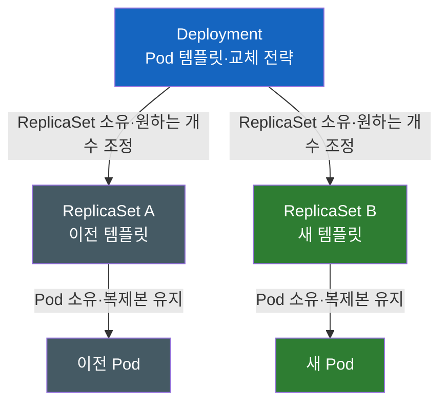
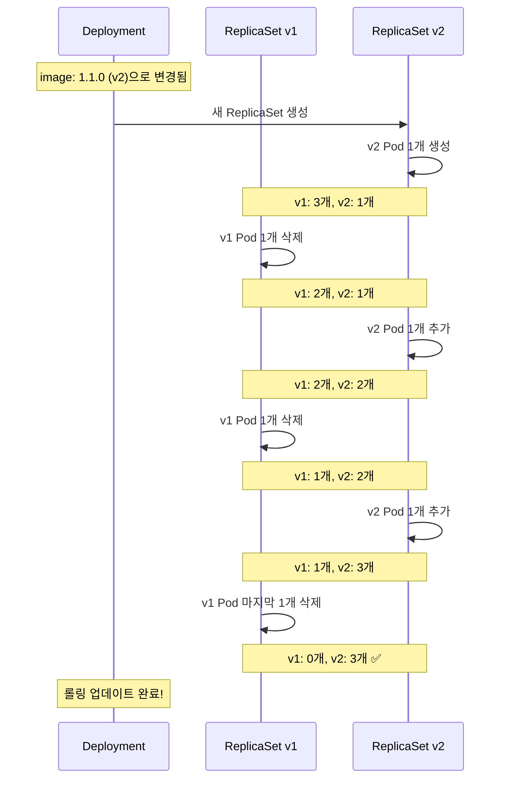
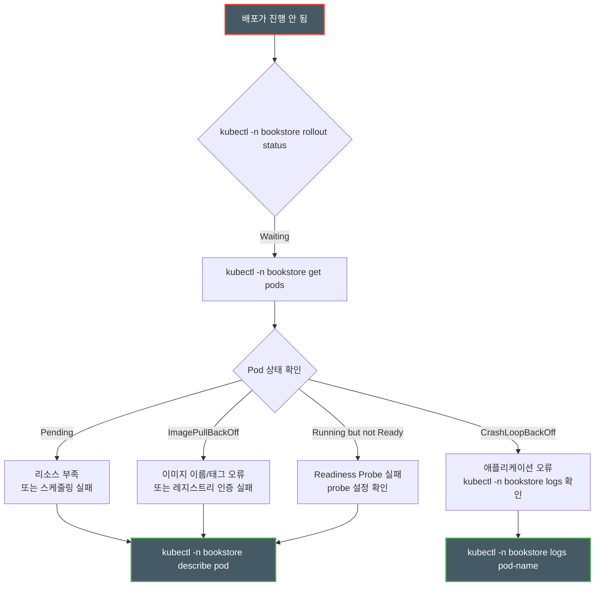
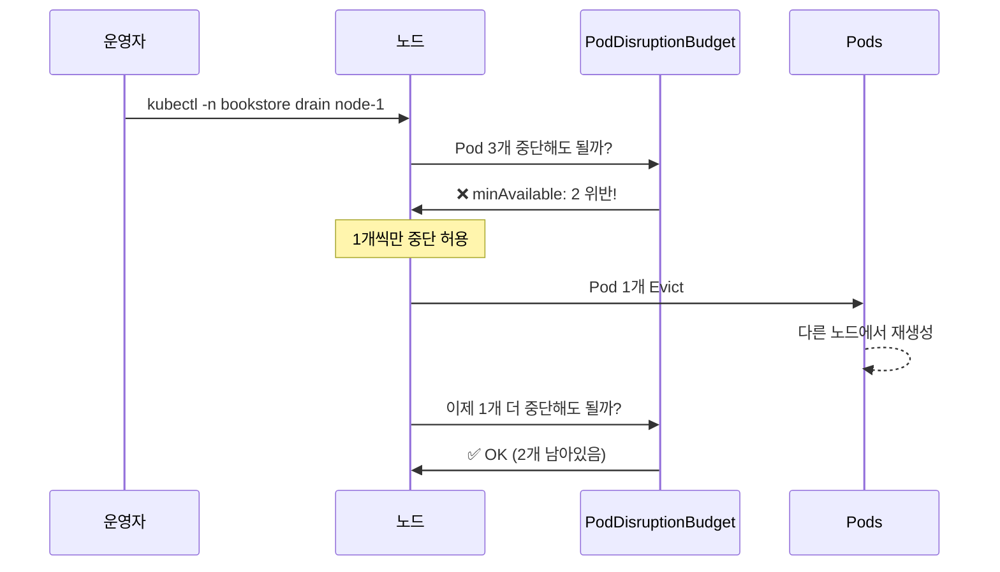
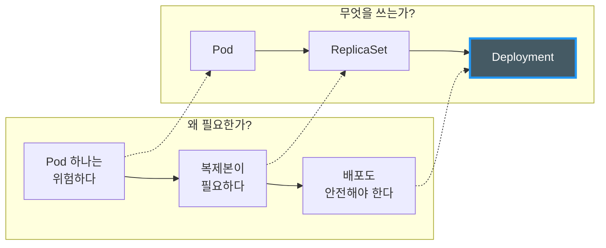

# Kubernetes ReplicaSet & Deployment

> **개발자를 위한 쉬운 쿠버네티스 · 8장** | [전체 목차](./Kubernetes-Introduction.md#이-시리즈의-읽는-순서) · [이전 장](./Kubernetes-Pod.md) · [다음 장](./Kubernetes-Image-Tag-Digest.md)

Pod를 세 개 만드는 것과 앞으로도 세 개를 유지하는 것은 무엇이 다를까?

앞 장에서 컨테이너 종료는 kubelet이 같은 Pod 안에서 재시작할 수 있지만, Pod가 사라지면 대체 Pod를 만들 controller가 필요하다는 것을 보았다. 주문 API를 계속 제공하려면 “지금 프로세스가 있다”보다 긴 약속이 필요하다. 한 Pod를 삭제했을 때 다시 만들어야 하고, 트래픽이 늘면 복제본 수를 바꾸어야 하며, 코드를 바꿀 때는 교체 진행 상황을 관찰할 수 있어야 한다.

## 결론부터 말하면

ReplicaSet은 정해진 selector와 소유 관계를 가진 Pod의 복제본 수를 원하는 값에 가깝게 유지한다. Deployment는 Pod 템플릿별 ReplicaSet을 관리하고, 템플릿이 바뀌면 새 템플릿을 가진 Pod로 교체하는 rollout을 조정한다. 이 두 단계 덕분에 실행 개수 유지와 버전 변경을 서로 구분해 다룰 수 있다.

Deployment는 지속적인 조정의 선언이다. `replicas: 3`이라고 적는 순간 세 개가 모두 실행된다는 뜻도, 세 개가 Ready이면 모든 HTTP 요청이 성공한다는 뜻도 아니다. 용량·이미지·설정·앱 준비·요청 경로가 모두 맞아야 한다. 이 장은 먼저 **누가 어떤 객체를 소유하고 무엇을 변경하는가** 를 설명하고, Service와 Probe를 배운 뒤 [배포 전략 장](Kubernetes-Deployment-Strategy.md)에서 요청 성공 조건을 다시 합친다.



이 그림의 화살표는 소유·제어 관계다. controller가 아래 프로세스를 동기 함수처럼 호출한다는 뜻은 아니다. 각각은 API에 저장된 객체와 상태를 관찰해 API 요청을 만들고, Pod 실행은 scheduler·kubelet·runtime이 이어서 수행한다.

이 장의 `order-api`, namespace `bookstore`, `registry.example.com/book/order-api:1.0.0`은 가상 공통 사례다. manifest와 출력은 설명용이며 실제 공개 이미지나 실측 기록이 아니다. `/readyz`는 가상 앱이 별도로 제공하는 endpoint다. 명령은 준비된 개인 실습 context에서의 사용 형식을 보여 주며 이 원고 작성에서는 클러스터에 실행하지 않았다.

## 1. Pod 하나만 있으면 어떤 문제가 생길까?

### 1.1 컨테이너 복구와 서비스 복구 사이

Pod YAML 하나로 주문 API를 실행할 수는 있다. 그러나 수동 생성 Pod가 삭제되면 그 객체를 다시 만들 선언과 controller가 없다. `restartPolicy: Always`는 그 틈을 메우지 않는다. 이는 같은 Pod의 컨테이너 재시작 정책이기 때문이다. 여러 Pod를 손으로 만들면 수동 스케일 아웃도 가능하지만, 사람이 개수를 계속 세고 부족한 것을 채워야 한다.

운영에서 필요한 것은 개별 생성 명령보다 지속적인 조정이다. Pod 하나가 없어져도 “주문 API 세 개”라는 의도가 남아 있어야 한다. API 객체에 `replicas: 3`을 기록하고 controller가 실제 개수와 반복 비교하면 사람이 매번 새 Pod 이름을 정하지 않아도 된다. 그 책임을 맡는 것이 ReplicaSet이다.

### 1.2 원하는 개수는 즉시 성립하는 보장이 아니다

복제본이 둘로 줄면 ReplicaSet controller는 부족한 Pod를 생성하려고 한다. API admission이 거절하거나 quota가 차면 생성 자체가 실패할 수 있고, Pod가 생성되어도 scheduler가 자리를 찾지 못하면 Pending일 수 있다. 따라서 `replicas: 3`은 원하는 상태이고, `status`는 그 의도에 얼마나 도달했는지 보여 주는 관찰이다. 부족한 개수를 채운다는 것은 요청 성공이나 노드 간 분산을 자동 보장한다는 말이 아니다.

## 2. ReplicaSet: Pod 복제본 관리자

### 2.1 ReplicaSet의 동작 원리

ReplicaSet은 selector로 관리 대상을 구분하고 `ownerReferences`로 Pod와의 소유 관계를 기록한다. 현재 유효한 복제본이 원하는 수보다 적으면 템플릿으로 Pod를 만들고, 많으면 줄인다. 한 컨테이너가 계속 crash하지만 같은 Pod가 유지되는 경우에는 kubelet의 재시작이 진행될 수 있다. ReplicaSet이 컨테이너 로그를 분석해서 앱을 고치거나 매번 새 Pod를 만드는 것은 아니다.

### 2.2 ReplicaSet YAML 예시

다음은 단독 ReplicaSet의 필드 관계를 보여 주는 완전한 설명용 manifest다. `bookstore` namespace와 실제 앱 이미지가 필요하다. 아래 Deployment와 함께 그대로 적용하는 실습 세트는 아니다. selector가 겹치는 별도 controller를 만드는 위험은 후반에서 다룬다.

```yaml
apiVersion: apps/v1
kind: ReplicaSet
metadata:
  name: order-api-rs
  namespace: bookstore
spec:
  replicas: 3
  selector:
    matchLabels:
      app: order-api
  template:
    metadata:
      labels:
        app: order-api
    spec:
      containers:
      - name: order-api
        image: registry.example.com/book/order-api:1.0.0
        ports:
        - containerPort: 8080
```

`selector.matchLabels`는 관리할 Pod의 조건이고 `template.metadata.labels`는 앞으로 만들 Pod의 label이다. 둘이 맞아야 자신이 만든 Pod를 자신의 집합으로 셀 수 있다. `template`은 복사할 청사진이며 기존 Pod와 실시간으로 연결된 설정 파일이 아니다.

### 2.3 그런데... ReplicaSet을 직접 쓰면 안 된다?

복제본 유지가 목적이라면 ReplicaSet의 역할은 충분히 유용하다. 다만 계속 실행되는 앱은 개수 유지뿐 아니라 새 버전으로 교체하는 과정도 필요하다. Kubernetes가 일반적인 앱에 단독 ReplicaSet보다 Deployment를 권하는 이유가 여기 있다. Deployment를 사용하면 ReplicaSet은 사라지는 개념이 아니라 Deployment가 관리하는 하위 객체가 된다.

## 3. ReplicaSet의 한계: 배포가 안 된다

### 3.1 이미지 버전을 바꾸면 어떻게 될까?

단독 ReplicaSet의 템플릿에서 image를 `1.0.0`에서 `1.1.0`으로 바꾸어도 이미 존재하는 세 Pod의 spec은 바뀌지 않는다. 복제본 수가 충분하기 때문에 controller는 그 이유만으로 기존 Pod를 교체하지 않는다. 나중에 한 Pod가 없어져 새 Pod를 만들 때는 변경된 템플릿을 사용한다. 따라서 같은 ReplicaSet 아래 서로 다른 버전의 Pod가 생길 수 있다.

이것은 API 저장이 실패한 현상이 아니다. “다음에 만들 Pod의 템플릿을 바꾼 일”과 “기존 Pod를 계획적으로 바꾼 일”이 서로 다른 것이다. 기존 Pod를 하나씩 지우는 작업을 사람이 수행하면 교체 자체는 가능하지만 진행·중단·이력 관리가 사람의 절차에 남는다.

### 3.2 교체 절차도 선언으로 남기기

새 템플릿의 ReplicaSet을 별도로 만들고 기존 ReplicaSet을 줄이면 점진적인 교체를 구성할 수 있다. Deployment는 이 절차를 Kubernetes의 기본 controller로 제공한다. 같은 ReplicaSet의 템플릿을 덮어쓰며 우연한 교체를 기다리는 대신, 템플릿별 ReplicaSet을 구분하고 각 집합의 원하는 개수를 조정한다. 이것이 Deployment라는 한 단계가 더 필요한 이유다.

<a id="4-deployment-무중단-배포의-핵심"></a>

## 4. Deployment: 템플릿별 교체를 조정하기

Deployment를 만든 것만으로 요청의 무중단이 보장되지는 않는다. Deployment는 교체 순서와 복제본 가용 수를 제어하는 기반을 제공한다. 실제 무중단 조건에는 뒤에서 배울 readiness, Service, 종료 처리와 앱·DB 호환성이 더 필요하다.

### 4.1 Deployment가 하는 일

Deployment controller는 `.spec.template`이 바뀌면 해당 템플릿에 맞는 ReplicaSet을 찾거나 생성하고, 이전·새 ReplicaSet의 replicas를 배포 전략에 따라 조정한다. 템플릿이 같은 이전 ReplicaSet이 남아 있으면 재사용할 수 있으므로 매번 반드시 새로운 ReplicaSet 객체가 늘어난다고 외우지 않는다. 반면 `.spec.replicas`만 바꾸는 것은 규모 변경이므로 새 revision을 만들지 않는다.

### 4.2 Deployment YAML 예시

다음은 완전한 설명용 manifest다. namespace와 실제 이미지 준비가 필요하며, 아직 Service를 선언하지 않았으므로 이 manifest만으로 안정적인 접속 주소가 생기지 않는다. readiness probe는 다음 학습에서 붙일 것이므로 이 예제만으로 앱의 준비 완료를 검증하지도 않는다.

```yaml
apiVersion: apps/v1
kind: Deployment
metadata:
  name: order-api
  namespace: bookstore
spec:
  replicas: 3
  selector:
    matchLabels:
      app: order-api
  minReadySeconds: 10
  progressDeadlineSeconds: 600
  revisionHistoryLimit: 10
  strategy:
    type: RollingUpdate
    rollingUpdate:
      maxSurge: 1
      maxUnavailable: 0
  template:
    metadata:
      labels:
        app: order-api
    spec:
      containers:
      - name: order-api
        image: registry.example.com/book/order-api:1.0.0
        ports:
        - name: http
          containerPort: 8080
        resources:
          requests:
            cpu: "250m"
            memory: "256Mi"
          limits:
            cpu: "1000m"
            memory: "512Mi"
```

여기서 `replicas`는 전체 목표 개수이고, `template`은 새 Pod의 청사진이며, `strategy`는 청사진이 달라졌을 때 교체하는 방법이다. Deployment와 ReplicaSet을 단지 `strategy` 필드 유무로만 구분해서는 안 된다. 서로 다른 API kind를 관찰하는 서로 다른 controller가 개수 유지와 교체 조정을 나누어 맡는 것이다.

다음 절부터는 기본 모델을 운영 상황으로 확장한다. 배포 전략의 모든 선택을 지금 암기할 필요는 없다. 템플릿 변경이 어느 ReplicaSet의 어떤 Pod로 이어지고, 상태가 어디에서 멈췄는지를 따라가면 된다. 후반 YAML은 별도 표시가 없으면 필드를 설명하는 발췌이며 독립 실행용이 아니다.

---

## 5. 롤링 업데이트: 교체 개수와 가용 수 조정

### 5.1 롤링 업데이트 과정

이미지를 `registry.example.com/book/order-api:1.1.0`으로 변경하면 어떻게 될까?

```bash
# 명령형 방식 (빠른 테스트용)
kubectl -n bookstore set image deployment/order-api order-api=registry.example.com/book/order-api:1.1.0

# 선언적 방식 (GitOps, 운영 환경 권장)
# YAML 파일의 image를 수정한 후:
kubectl -n bookstore apply -f deployment.yaml
```

Deployment는 다음 과정을 **자동으로** 수행한다:



이 그림은 새 Pod가 Available이 된 뒤 이전 Pod를 줄이는 개념적인 순서다. 각 단계는 비동기 관찰로 진행되며 생성 직후 바로 이전 Pod를 삭제한다는 뜻은 아니다. `maxUnavailable: 0`은 rollout이 의도적으로 줄일 수 있는 가용 수의 경계를 정한다. 노드 장애, 잘못된 readiness 판단, 종료 중 요청 실패까지 막아 주지는 않는다.

### 5.2 maxSurge와 maxUnavailable 이해하기

이 두 값이 롤링 업데이트의 "속도"와 "안정성"을 결정한다.

| 설정 | 의미 | 트레이드오프 |
|------|------|-------------|
| `maxSurge: 25%` | 전체 수의 25%만큼 추가 Pod 허용 | 리소스 ↑, 속도 ↑ |
| `maxUnavailable: 25%` | 전체 수의 25%만큼 줄어도 됨 | 리소스 ↓, 속도 ↑ |
| `maxSurge: 1, maxUnavailable: 0` | 의도적 가용 수 감소 없이 하나씩 추가 | 추가 용량이 필요하며 새 Pod 가용 상태를 기다림 |

**예시: replicas=4, maxSurge=1, maxUnavailable=1**

```
초기 상태:    v1, v1, v1, v1           (총 4개)

롤링 업데이트 과정:
1. v2 생성 (surge):    v1, v1, v1, v1, v2    (총 5개 - maxSurge 적용)
2. v1 삭제:            v1, v1, v1, v2        (총 4개 - maxUnavailable 적용)
3. v2 생성 (surge):    v1, v1, v1, v2, v2    (총 5개)
4. v1 삭제:            v1, v1, v2, v2        (총 4개)
5. 반복...
6. 최종 상태:          v2, v2, v2, v2        (완료!)
```

### 5.3 잠깐, 이게 정말 "무중단"일까?

롤링 업데이트가 진행되는 동안 Pod 수는 유지된다. 하지만 **새 Pod가 생성되었다고 해서 바로 트래픽을 받을 수 있는 건 아니다.**

애플리케이션이 시작되는 데 10초가 걸린다면? Pod는 `Running` 상태지만, 실제로는 아직 요청을 처리할 준비가 안 됐을 수 있다. 이 상태에서 트래픽을 보내면 에러가 발생한다.

> **이 문제를 해결하는 것이 바로 Probe다.**

Kubernetes는 3가지 Probe를 제공한다:

| Probe | 역할 | 실패 시 동작 |
|-------|------|-------------|
| **Startup Probe** | 애플리케이션 시작 완료 확인 | 컨테이너 재시작 |
| **Readiness Probe** | 트래픽 받을 준비 확인 | Service에서 제외 |
| **Liveness Probe** | 애플리케이션이 살아있는지 확인 | 컨테이너 재시작 |

특히 **Readiness Probe**가 롤링 업데이트의 핵심이다. 새 Pod가 Readiness Probe를 통과하기 전까지는 일반적인 Service 경로의 준비된 backend 대상으로 사용되지 않는다. EndpointSlice에는 준비되지 않은 endpoint도 표현될 수 있고 `publishNotReadyAddresses` 같은 예외도 있다. 준비 판정은 안전한 교체의 한 조건이며 종료 중 요청 drain과 버전 호환성까지 해결하지는 않는다.

> 📖 Probe에 대한 자세한 내용은 [Kubernetes Probe: Liveness, Readiness, Startup](./Kubernetes-Probe-Liveness-Readiness-Startup.md) 문서를 참고하라.

### 5.4 maxSurge와 maxUnavailable 실무 설정 가이드

이론은 알겠는데, 실제로 어떻게 설정해야 할까? **서비스 특성에 따라 달라진다.**

| 시나리오 | maxSurge | maxUnavailable | 이유 |
|----------|----------|----------------|------|
| **가용 수 유지 우선** | `1` 또는 `25%` | `0` | rollout이 의도적으로 줄이는 가용 수 제한 |
| **빠른 배포 우선** | `50%` | `50%` | 리소스 여유 있고, 속도 중요 |
| **리소스 제약** | `0` | `1` | 추가 Pod 생성 불가 |
| **대규모 클러스터** | `25%` | `25%` | 균형 잡힌 기본값 |
| **replicas: 1** | `1` | `0` | 새 Pod가 가용해진 뒤 기존 Pod를 줄이는 방식 |

> **주의 (replicas: 1 케이스):** `replicas: 1`에서 `maxSurge: 0, maxUnavailable: 1`로 설정하면 기존 Pod가 먼저 삭제되어 **다운타임이 발생**한다. 교체 중 한 개의 가용 수를 유지하려면 `maxSurge: 1, maxUnavailable: 0` 같은 설정과 추가 용량이 필요하다. 요청 성공에는 앱 준비와 종료 처리도 필요하다.

**실무 권장 설정:**

```yaml
spec:
  strategy:
    type: RollingUpdate
    rollingUpdate:
      maxSurge: 25%        # 기본값 25%; 필요한 추가 용량 확인
      maxUnavailable: 0    # 의도적으로 줄이는 가용 수를 0으로 제한
```

> **주의:** `maxSurge: 0`과 `maxUnavailable: 0`을 동시에 설정할 수는 **없다.** 논리적으로 새 Pod를 만들 수도 없고 기존 Pod를 지울 수도 없어 배포가 불가능한 조합이라, 쿠버네티스는 이를 런타임에 멈추게 두지 않고 **API 검증 단계에서 거부한다** — `apply` 자체가 실패한다. 즉 "배포가 조용히 멈춘다"가 아니라 "설정이 아예 받아들여지지 않는다"가 정확한 서술이다.

### 5.5 minReadySeconds: 배포 속도 제어

Pod가 Ready를 연속 유지해야 Available로 셀 수 있는 최소 시간을 정한다. 기본값은 0이며, 앱의 요청 성공 자체를 추가 검사하는 기능은 아니다.

```yaml
spec:
  minReadySeconds: 10    # Ready 후 10초 대기
```

**왜 필요한가?**

애플리케이션이 Ready 상태가 되었지만, 실제로 안정화되기까지 시간이 걸릴 수 있다. 예를 들어:
- 커넥션 풀 warming
- 캐시 로딩
- JIT 컴파일 (Java)

`minReadySeconds`를 설정하면 이 기간 동안 문제가 발생해도 롤링 업데이트가 계속 진행되는 것을 막을 수 있다.

### 5.6 비례적 스케일링 (Proportional Scaling)

롤링 업데이트 도중에 replicas 수를 변경하면 어떻게 될까? Deployment는 **비례적으로** Pod를 분배한다.

**시나리오:** `replicas: 10`에서 `replicas: 15`로 스케일 아웃, 롤링 업데이트 진행 중

```
현재 상태:
- ReplicaSet v1: 7개 Pod
- ReplicaSet v2: 3개 Pod

스케일 아웃 후 (10 → 15):
- ReplicaSet v1: 10개 Pod (70% 비율 유지)
- ReplicaSet v2: 5개 Pod  (30% 비율 유지)
```

이 숫자는 원리를 설명하는 단순 예시다. 실제 배분은 활성 ReplicaSet 크기·surge 예산·반올림 등에 따라 달라질 수 있다. Deployment는 여러 활성 ReplicaSet에 비례적으로 규모 변경을 분배한다. 이렇게 하지 않으면 새 버전 Pod만 급격히 늘어나서 문제가 생길 수 있다.

---

## 6. 롤백: 문제 발생 시 되돌리기

### 6.1 Deployment는 히스토리를 보관한다

Deployment가 ReplicaSet을 관리하는 이유 중 하나가 바로 **롤백**이다. 이전 버전의 ReplicaSet을 삭제하지 않고 보관해두기 때문에, 문제가 생기면 빠르게 되돌릴 수 있다.

```bash
# 배포 히스토리 확인
kubectl -n bookstore rollout history deployment/order-api

# 출력 예시:
# REVISION  CHANGE-CAUSE
# 1         Initial deployment
# 2         Update to v2.0
# 3         Update to v2.1 (현재)
```

> **참고:** `CHANGE-CAUSE`는 자동으로 기록되지 않는다. 배포 시 annotation을 추가해야 한다:
> ```bash
> kubectl -n bookstore annotate deployment/order-api kubernetes.io/change-cause="Update to v2.0"
> ```

**선언적 방식 (GitOps 권장):**

YAML 매니페스트에 직접 annotation을 포함하면 `kubectl -n bookstore apply`할 때마다 자동으로 기록된다:

```yaml
apiVersion: apps/v1
kind: Deployment
metadata:
  name: order-api
  annotations:
    kubernetes.io/change-cause: "Update to v2.0 and increase memory"
spec:
  # ...
```

### 6.2 롤백 명령어

```bash
# 바로 이전 버전으로 롤백
kubectl -n bookstore rollout undo deployment/order-api

# 특정 버전으로 롤백
kubectl -n bookstore rollout undo deployment/order-api --to-revision=1
```

`kubectl rollout undo`는 대상 revision의 ReplicaSet에서 Pod 템플릿을 가져와 Deployment의 `.spec.template`에 반영한다. 이어지는 일반 rollout에서 Deployment controller가 같은 템플릿의 ReplicaSet을 재사용하고 각 ReplicaSet의 원하는 개수를 조정한다. 따라서 rollback은 과거 revision 번호로 시간을 되감는 것이 아니라 과거 템플릿을 사용하는 새 변경이다. 이미 수행한 DB migration, 외부 부작용, 별도 ConfigMap·Secret 내용을 자동 복구하지 않는다.

### 6.3 revisionHistoryLimit: 히스토리 관리

Deployment는 이전 ReplicaSet을 보관하는데, 무한정 쌓이면 문제가 된다.

```yaml
spec:
  revisionHistoryLimit: 10    # 기본값: 10개
```

| 설정값 | 동작 |
|--------|------|
| `10` (기본값) | 최근 10개 ReplicaSet 보관 |
| `0` | 히스토리 없음, **롤백 불가** |
| 높은 값 | 많은 롤백 가능, etcd 부하 증가 |

보관 수는 배포 빈도와 복구 기간에 맞춰 정한다. 기본값은 이전 ReplicaSet 10개이며 `0`으로 설정하면 완료 후 과거 이력을 정리해 그 이력으로 rollback할 수 없게 된다.

### 6.4 Rollout 제어: pause와 resume

롤링 업데이트를 **중간에 멈추고 싶을 때** 사용한다. 이건 변경 누적이나 배포 조사에 활용할 수 있다. `set image` 직후 `pause`해도 정확히 한 Pod에서 멈춘다는 보장은 없고, 사용자 요청 비율을 제어하는 Canary 기능도 아니다.

```bash
# 1. 배포 시작 직후 일시 중지
kubectl -n bookstore set image deployment/order-api order-api=registry.example.com/book/order-api:1.1.0
kubectl -n bookstore rollout pause deployment/order-api

# 2. 현재 상태 확인 (일부만 새 버전)
kubectl -n bookstore get pods -l app=order-api

# 3. 새 버전 Pod에 테스트 트래픽 보내서 검증
# ... 문제 없으면

# 4. 배포 재개
kubectl -n bookstore rollout resume deployment/order-api
```

**pause 중 변경 사항 누적:**

pause 상태에서 여러 번 변경해도 resume할 때 **한 번에 적용**된다.

```bash
kubectl -n bookstore rollout pause deployment/order-api
kubectl -n bookstore set image deployment/order-api order-api=registry.example.com/book/order-api:1.1.0
kubectl -n bookstore set resources deployment/order-api -c=order-api --limits=cpu=500m
kubectl -n bookstore set env deployment/order-api ENV=production
kubectl -n bookstore rollout resume deployment/order-api    # 모든 변경이 한 번에 적용
```

이렇게 하면 불필요한 롤아웃이 여러 번 발생하는 것을 막을 수 있다.

---

## 7. Deployment 상태와 배포 실패 진단

### 7.1 Deployment의 상태 필드

`kubectl -n bookstore get deployment`만으로는 부족하다. **상태 조건(Conditions)** 을 확인해야 한다.

```bash
kubectl -n bookstore describe deployment order-api
```

출력에서 `Conditions:` 섹션을 확인하라:

```
Conditions:
  Type           Status  Reason
  ----           ------  ------
  Available      True    MinimumReplicasAvailable
  Progressing    True    NewReplicaSetAvailable
```

| Condition | 의미 |
|-----------|------|
| **Available** | 최소 요구 가용 수를 충족 |
| **Progressing** | 배포가 진행 중이거나 성공적으로 완료됨 |
| **ReplicaFailure** | Pod 생성/삭제 실패 |

### 7.2 progressDeadlineSeconds: 배포 타임아웃

롤링 업데이트가 무한정 멈춰있으면 안 된다. `progressDeadlineSeconds`를 설정하면 지정 시간 내에 진행이 없을 때 **실패로 간주**한다.

```yaml
spec:
  progressDeadlineSeconds: 600    # 기본값: 600초 (10분)
```

**진행(Progress)의 정의:**
- 새 ReplicaSet의 replica 수가 증가
- 이전 ReplicaSet의 replica 수가 감소
- 새 Pod가 Ready 상태가 됨

**타임아웃 발생 시:**

```bash
kubectl -n bookstore rollout status deployment/order-api
# error: deployment "order-api" exceeded its progress deadline
```

Conditions에 `Progressing: False, Reason: ProgressDeadlineExceeded`가 표시된다.

> **주의:** 타임아웃이 발생해도 Deployment가 **자동으로 롤백하지 않는다.** 수동으로 `kubectl -n bookstore rollout undo`를 실행해야 한다. GitOps 도구도 설치만으로 모든 실패를 자동 롤백하지 않는다. 실패 판정·복구 정책과 Git의 원하는 상태를 되돌리는 절차를 별도로 설계해야 한다.

### 7.3 배포 실패 원인 진단 플로우



**실무 디버깅 순서:**

```bash
# 1. 롤아웃 상태 확인
kubectl -n bookstore rollout status deployment/order-api

# 2. Pod 상태 확인
kubectl -n bookstore get pods -l app=order-api

# 3. 문제 Pod 상세 정보
kubectl -n bookstore describe pod <pod-name>

# 4. 로그 확인 (CrashLoopBackOff인 경우)
kubectl -n bookstore logs <pod-name> --previous    # 이전 컨테이너 로그
```

---

## 8. 배포 전략 비교: RollingUpdate vs Recreate

| 전략 | 동작 | 서비스 중단 | 사용 시점 |
|------|------|------------|----------|
| **RollingUpdate** | 점진적 교체 | readiness·용량·종료·호환성에 따라 달라짐 | 일반 서버 앱의 기본 전략 |
| **Recreate** | 모두 삭제 후 생성 | ⚠️ 있음 | DB 마이그레이션, 호환성 문제 시 |

```yaml
# Recreate 전략
spec:
  strategy:
    type: Recreate
```

**Recreate를 쓰는 경우:**
- 구버전과 신버전이 동시에 실행되면 안 되는 경우
- 데이터베이스 스키마 변경이 필요한 경우
- 리소스 제약으로 동시 실행이 불가능한 경우

> 📖 Kubernetes Deployment가 제공하는 RollingUpdate/Recreate 외에도 **Blue/Green**, **Canary** 같은 고급 배포 전략이 있다. 자세한 내용은 [Kubernetes Deployment Strategy](./Kubernetes-Deployment-Strategy.md) 문서를 참고하라.

---

## 9. ReplicaSet 심화: 소유권과 Pod 인수

### 9.1 ownerReferences: 누가 이 Pod의 주인인가?

Kubernetes에서 Pod는 자신을 누가 만들었는지 기록한다. 이게 `ownerReferences`다.

```bash
kubectl -n bookstore get pod order-api-7d4b8c6f5-abc12 -o yaml | grep -A 5 ownerReferences
```

```yaml
ownerReferences:
- apiVersion: apps/v1
  blockOwnerDeletion: true
  controller: true
  kind: ReplicaSet
  name: order-api-7d4b8c6f5
  uid: 12345678-abcd-...
```

**이 정보가 왜 중요한가?**

1. **가비지 컬렉션:** ReplicaSet을 삭제하면 소유한 Pod도 함께 삭제됨
2. **컨트롤러 충돌 방지:** 다른 ReplicaSet이 이 Pod를 인수하지 못함
3. **디버깅:** 이 Pod가 어떤 ReplicaSet/Deployment에서 왔는지 추적 가능

### 9.2 고아 Pod 인수 문제

ReplicaSet은 **selector와 일치하는 모든 Pod**를 관리하려고 한다. 이미 다른 소유자가 있으면 무시하지만, **소유자가 없는 고아 Pod**는 자동으로 인수한다.

**문제 시나리오 — 단, ReplicaSet을 직접 만든 경우다:**

아래 nginx Pod는 공통 앱과 다른 프로그램에 같은 label을 붙이는 사고를 설명하는 독립 예제다. 실행하는 실습 지시가 아니다.

```yaml
# 직접 만든 ReplicaSet: selector가 app=order-api 하나뿐이다
kind: ReplicaSet
spec:
  replicas: 3
  selector:
    matchLabels:
      app: order-api
```

```bash
# 실수로 같은 라벨의 Pod를 직접 생성
kubectl -n bookstore run order-api-oops --image=nginx --labels="app=order-api"

# 이 Pod는 위 ReplicaSet의 selector와 일치하고 소유자가 없다 → 인수된다
# → replicas: 3인데 4개가 되어버림
# → ReplicaSet이 하나를 삭제한다 (어떤 게 삭제될지 예측하기 어렵다)
```

**그런데 Deployment를 쓰면 이 시나리오가 재현되지 않는다.** Deployment가 만든 ReplicaSet의 selector에는 `app=order-api` 외에 `pod-template-hash=<해시>`가 함께 들어 있기 때문이다. 위처럼 `app=order-api`만 붙인 수동 Pod는 그 해시 라벨이 없으니 selector와 일치하지 않고, 따라서 **인수되지 않는다.**

```bash
# Deployment가 만든 ReplicaSet의 실제 selector를 확인해 보면
kubectl -n bookstore get rs order-api-7d9f8c6b4d -o jsonpath='{.spec.selector}'
# {"matchLabels":{"app":"order-api","pod-template-hash":"7d9f8c6b4d"}}
#                                 ^^^^^^^^^^^^^^^^^ 수동 Pod에는 없는 라벨
```

> **교훈:** 고아 Pod 인수는 **selector가 완전히 일치할 때만** 일어난다. 그래서 위험한 쪽은 selector를 손으로 좁게 정의한 ReplicaSet이고, Deployment는 `pod-template-hash`로 이 사고를 구조적으로 막아 준다. 그 장치가 왜 필요했고 롤링 업데이트에서 어떤 역할을 하는지는 바로 다음 9.3절에서 다룬다.

### 9.3 pod-template-hash: Deployment의 비밀 무기

Deployment가 만든 ReplicaSet을 보면 이상한 라벨이 붙어있다:

```bash
kubectl -n bookstore get rs -l app=order-api --show-labels
```

```
NAME              DESIRED   CURRENT   LABELS
order-api-7d4b8c6f5  3         3         app=order-api,pod-template-hash=7d4b8c6f5
order-api-5c8d9e7f2  0         0         app=order-api,pod-template-hash=5c8d9e7f2
```

`pod-template-hash`는 Pod 템플릿의 해시값이다. controller가 템플릿을 구분하기 위해 계산하는 값이다. 해시는 이미지 콘텐츠의 digest가 아니며 내부 충돌 처리도 있으므로 앱 버전 식별자로 사용하지 않는다.

**왜 이게 필요한가?**

- 각 ReplicaSet이 **자신의 Pod만** 관리하도록 보장
- 각 ReplicaSet의 선택 집합이 서로 겹치지 않도록 구분. Service 뒤에서는 두 버전이 함께 제공될 수 있음
- 롤백 시 정확한 ReplicaSet을 찾을 수 있음

> **주의:** `pod-template-hash`를 절대 수동으로 변경하지 마라. Deployment가 자동으로 관리한다.

### 9.4 selector는 변경할 수 없다 (Immutable)

Deployment의 `spec.selector`는 **생성 후 변경할 수 없다.** 변경하려고 하면 API 서버가 요청을 거부한다.

```bash
# selector 변경 시도 → 실패
The Deployment "order-api" is invalid: spec.selector: Invalid value: ... field is immutable
```

**왜 immutable인가?**

selector가 변경되면 기존의 모든 ReplicaSet과 Pod가 **고아(orphan)** 가 된다. 실행 중인 관리 집합의 경계가 바뀌어 소유 관계와 교체가 복잡해진다. 안정적인 workload identity를 위해 생성 시 selector를 정하며, 단순한 버전 표시는 selector 대신 템플릿의 다른 label로 표현한다.

**selector를 바꿔야 한다면?**

1. 새로운 Deployment를 만든다 (새 selector로)
2. 트래픽을 새 Deployment로 전환 (Service의 selector 변경)
3. 기존 Deployment를 삭제

---

## 10. HPA와 PDB: 자동 스케일링과 안전한 운영

### 10.1 HPA (Horizontal Pod Autoscaler) 와의 연동

Deployment와 HPA를 함께 사용할 때 주의할 점이 있다.

> **HPA가 참조하는 숫자는 어디서 오는가?** HPA는 CPU·메모리 resource metrics를 사용할 때 Metrics API 제공자가 필요하고(일반적으로 `metrics-server`), 사용률은 절대 사용량이 아니라 **`requests` 대비 비율** 로 계산된다 — 즉 `requests`를 지정하지 않은 컨테이너는 HPA가 판단 근거를 갖지 못한다. 이 파이프라인은 [Kubernetes Metrics Server, Prometheus](Kubernetes-Metrics-Server-Prometheus.md)에서 다룬다.

```yaml
apiVersion: autoscaling/v2
kind: HorizontalPodAutoscaler
metadata:
  name: order-api-hpa
spec:
  scaleTargetRef:
    apiVersion: apps/v1
    kind: Deployment
    name: order-api
  minReplicas: 3
  maxReplicas: 10
  metrics:
  - type: Resource
    resource:
      name: cpu
      target:
        type: Utilization
        averageUtilization: 70
```

**HPA 사용 시 주의사항:**

| 상황 | 주의점 |
|------|--------|
| **replicas 수동 변경** | HPA가 덮어씀. 수동 스케일링 의미 없음 |
| **롤링 업데이트 중** | 지표 왜곡으로 예상치 못한 스케일링 발생 가능 |
| **minReplicas 설정** | 너무 낮으면 트래픽 급증 시 대응 지연 |

> **롤링 업데이트 중 HPA 주의:** 새 Pod는 시작 시 CPU 사용량이 높고(JIT 컴파일, 캐시 워밍 등), 구버전 Pod는 종료되므로 전체 평균 지표가 일시적으로 왜곡된다. 이로 인해 HPA가 불필요하게 스케일 아웃/인을 할 수 있다.

**롤링 업데이트 중 HPA 동작:**

HPA는 Deployment의 `replicas`를 조정한다. 롤링 업데이트 중이라도 HPA는 멈추지 않는다. Deployment는 HPA가 조정한 `replicas`를 **비례적 스케일링**으로 구버전/신버전에 분배한다.

```
HPA: replicas를 3 → 6으로 증가
Deployment: v1(2) + v2(1) → v1(4) + v2(2) 로 비례 분배
```

<a id="102-pdb-poddisruptionbudget-노드-작업-시-안전-보장"></a>

### 10.2 PDB (PodDisruptionBudget): 자발적 중단의 예산

노드 드레인, 업그레이드 시 **Pod가 한꺼번에 죽지 않도록** 보호한다.

```yaml
apiVersion: policy/v1
kind: PodDisruptionBudget
metadata:
  name: order-api-pdb
spec:
  minAvailable: 2              # 또는 maxUnavailable: 1
  selector:
    matchLabels:
      app: order-api
```

| 필드 | 의미 |
|------|------|
| `minAvailable` | eviction API가 허용할 중단을 계산할 때 최소 N개 healthy를 목표로 함 |
| `maxUnavailable` | eviction API가 허용할 중단 예산 |

**PDB가 필요한 이유:**



**EKS/AKS/GKE 공통:** 관리형 Kubernetes에서 노드 업그레이드 시 PDB가 없으면 서비스 중단이 발생할 수 있다. **운영자가 eviction API로 수행하는 유지보수의 가용 수를 제한하려면 PDB를 설계한다. 허용 중단 수가 0이고 대체 용량이 없으면 drain이 막힐 수 있다.**

**Cluster Autoscaler와 PDB:**

Cluster Autoscaler가 노드를 축소(scale-in)할 때도 PDB를 확인한다. PDB가 없으면 오토스케일러가 가용성을 고려하지 않고 노드를 제거할 수 있다. 특히 **비용 최적화를 위해 Spot/Preemptible 인스턴스**를 사용할 때 PDB가 유용하지만 중단을 완전히 막는 장치는 아니다.

> **다만 PDB로 막을 수 있는 것과 없는 것을 구분해야 한다.** PDB는 eviction API를 거치는 **voluntary disruption**(노드 drain, 오토스케일러의 scale-in)만 제어한다. 클라우드 제공자가 Spot 인스턴스를 **회수해 노드를 강제로 없애는 것** 은 involuntary disruption이므로 PDB가 막지 못한다. Spot을 쓸 때 PDB가 필수인 이유는 회수를 막기 때문이 아니라, 회수 통지를 받아 미리 Pod를 빼내는 과정(node termination handler가 유발하는 drain)이 안전하게 진행되도록 하기 때문이다. 회수 자체에 대비하려면 여러 AZ·인스턴스 타입 분산과 충분한 replica 수가 함께 필요하다.

---

## 11. 실무 트러블슈팅

### 11.1 롤링 업데이트가 멈춤

**증상:** `kubectl -n bookstore rollout status`가 계속 Waiting 상태

```bash
kubectl -n bookstore rollout status deployment/order-api
# Waiting for deployment "order-api" rollout to finish: 1 out of 3 new replicas have been updated...
```

**원인 진단:**

```bash
# 1. Pod 상태 확인
kubectl -n bookstore get pods -l app=order-api

# 2. 새 버전 Pod 이벤트 확인
kubectl -n bookstore describe pod <new-pod-name>

# 3. 흔한 원인들
```

| 증상 | 원인 | 해결 |
|------|------|------|
| **Pending** | 리소스 부족 | 노드 추가 또는 requests 줄이기 |
| **ImagePullBackOff** | 이미지 못 찾음 | 이미지 이름/태그 확인 |
| **CrashLoopBackOff** | 앱 시작 실패 | `kubectl -n bookstore logs --previous` 확인 |
| **Running (not Ready)** | Probe 실패 | Probe 설정 및 앱 상태 확인 |

### 11.2 롤백 후 다시 같은 버전으로 배포

**시나리오:** 이 절에서는 이미지 태그 `1.0`을 배포한 revision 1과 `2.0`을 배포한 revision 2가 있다고 가정한다. `2.0`에서 문제가 생겨 `1.0` 템플릿으로 rollback한 뒤, `2.0` 태그를 덮어써 수정 이미지를 다시 배포하려는 상황이다.

rollback하면 기존 revision 1의 ReplicaSet을 재사용할 수 있다. 이때 그 ReplicaSet의 현재 revision annotation은 다음 번호인 3으로 갱신된다. 다음은 이 단순 시나리오의 설명용 출력이며 `CHANGE-CAUSE`는 별도로 기록했다고 가정한다.

```bash
kubectl -n bookstore rollout history deployment/order-api
# REVISION  CHANGE-CAUSE
# 2         v2.0 배포
# 3         v1.0 템플릿으로 rollback
```

현재 revision 목록에는 1·2·3이 모두 남는 것이 아니라 2·3이 나타난다. 이전 번호 1이 ReplicaSet의 `deployment.kubernetes.io/revision-history` annotation에 남을 수 있어도 `--to-revision=1`의 독립적인 rollback 대상으로 계속 유지되는 것은 아니다. 현재 남은 ReplicaSet과 revision을 확인한 뒤 대상을 선택한다.

이 상태에서 Deployment image를 `1.0`에서 다시 `2.0`으로 바꾸면 템플릿이 달라지므로 rollout은 시작된다. 다른 템플릿 필드가 같다면 기존 `2.0` ReplicaSet을 재사용하고 그 현재 revision도 새 번호로 갱신할 수 있다. 문제는 rollout의 유무보다 실제 이미지 콘텐츠다. `2.0`을 덮어썼고 pull 정책이 `IfNotPresent`라면 그 태그를 이미 캐시한 노드에서 수정 전 이미지가 다시 실행될 수 있다.

따라서 수정 빌드는 재사용하지 않은 새 태그 또는 digest로 식별한다. “Deployment 템플릿이 바뀌었는가”, “어떤 ReplicaSet이 재사용되었는가”, “각 노드가 어떤 이미지 콘텐츠를 실행했는가”를 따로 확인해야 하는 이유다. 이미지와 cache의 관계는 다음 [이미지 장](Kubernetes-Image-Tag-Digest.md)에서 설명한다.

### 11.3 ReplicaSet이 계속 쌓인다

**증상:** `kubectl -n bookstore get rs`에 ReplicaSet이 너무 많음

```bash
kubectl -n bookstore get rs
# NAME              DESIRED   CURRENT   READY
# order-api-7d4b8c6f5  3         3         3
# order-api-5c8d9e7f2  0         0         0
# order-api-3a1b2c4d6  0         0         0
# ... (수십 개)
```

**원인 후보:** `revisionHistoryLimit`이 높거나, 연속 실패로 rollout이 완료되지 않아 정리 조건에 도달하지 않음. 생략 시 기본값은 10이다.

**해결:**

```yaml
spec:
  revisionHistoryLimit: 5    # 최근 5개만 유지
```

정리 전에 rollout 완료 여부와 ReplicaSet의 owner·replicas를 확인한다. `--field-selector=spec.replicas=0`은 ReplicaSet에서 지원하는 field selector가 아니므로 JSON을 가져와 `jq` 등으로 후보를 확인한다. 다음은 읽기 전용 후보 조회 예시다.

```bash
kubectl -n bookstore get rs -l app=order-api -o json \
  | jq -r '.items[] | select(.spec.replicas == 0) | [.metadata.name, .metadata.ownerReferences[0].name] | @tsv'
```

이 목록을 자동으로 삭제 명령에 연결하지 않는다. 과거 ReplicaSet을 삭제하면 해당 템플릿의 rollback 이력을 잃는다. 기본 정리는 `revisionHistoryLimit`과 controller의 완료 후 정리 동작으로 관리한다.

### 11.4 배포 중 트래픽이 실패한다

**증상:** 롤링 업데이트 중 일부 요청이 5xx 에러

**원인 1: Readiness Probe 미설정**

probe가 없으면 컨테이너가 실행되는 것만으로 준비 판정이 너무 일찍 참이 될 수 있다. 앱이 실제 요청을 처리할 조건을 readiness로 표현한다.

```yaml
spec:
  containers:
  - name: order-api
    readinessProbe:
      httpGet:
        path: /readyz
        port: 8080
      initialDelaySeconds: 5
      periodSeconds: 5
```

**원인 2: Graceful Shutdown 미구현**

기존 Pod가 종료될 때 처리 중인 요청을 버림.

```yaml
spec:
  terminationGracePeriodSeconds: 30
  containers:
  - name: order-api
    lifecycle:
      preStop:
        exec:
          command: ["sh", "-c", "sleep 15"]
```

Pod 삭제 시 kubelet의 종료 절차와 EndpointSlice·프록시·load balancer의 요청 경로 반영은 비동기적으로 진행된다. 이 예시의 `sleep 15`는 SIGTERM 전에 기존 앱이 요청을 처리할 시간을 벌려는 선택이며, 15초 안에 모든 요청 경로가 갱신된다는 보장은 아니다. 앱 자체의 신규 요청 처리 중단과 진행 중 요청 drain도 필요하다.

> **주의:** `terminationGracePeriodSeconds`는 `preStop` 훅 실행 시간과 애플리케이션의 SIGTERM 처리 시간을 **모두 포함**한다. 예를 들어 hook이 15초, 앱 정리에 10초가 필요하다면 그 합계 25초에 실행·전파 지연의 여유를 더해 정한다. 숫자만으로 요청 무손실을 보장하지 않는다.

> 📖 Graceful Shutdown에 대한 자세한 내용은 [Kubernetes Pod](./Kubernetes-Pod.md) 문서의 "Graceful Shutdown" 섹션을 참고하라.

---

## 12. 실전 명령어 정리

### 기본 조회

```bash
# Deployment 목록
kubectl -n bookstore get deployments

# ReplicaSet 목록 (Deployment가 만든 것도 보임)
kubectl -n bookstore get replicasets

# 상세 정보
kubectl -n bookstore describe deployment order-api
```

### 배포 및 이력

```bash
# 변경사항 적용 (배포 실행)
kubectl -n bookstore apply -f my-deployment.yaml

# 배포 이력 확인
kubectl -n bookstore rollout history deployment order-api

# 특정 리비전 상세 정보
kubectl -n bookstore rollout history deployment order-api --revision=2
```

### 스케일링

```bash
# 수동 스케일링
kubectl -n bookstore scale deployment order-api --replicas=5
```

### 배포 상태 확인 및 제어

```bash
# 롤아웃 상태 확인
kubectl -n bookstore rollout status deployment/order-api

# 일시 중지 (문제 발견 시)
kubectl -n bookstore rollout pause deployment/order-api

# 재개
kubectl -n bookstore rollout resume deployment/order-api

# 롤백
kubectl -n bookstore rollout undo deployment/order-api
kubectl -n bookstore rollout undo deployment/order-api --to-revision=1

# Pod 재시작 (ConfigMap/Secret 변경 적용 시 유용)
kubectl -n bookstore rollout restart deployment/order-api
```

> **팁:** `kubectl -n bookstore rollout restart`는 이미지 변경 없이 모든 Pod를 점진적으로 재시작한다. **Deployment는 ConfigMap/Secret이 바뀌었다는 이유만으로 새 ReplicaSet을 만들지 않는다** — Pod 템플릿이 변하지 않았으므로 교체할 이유가 없다고 판단한다. 다만 "그래서 항상 수동 재시작이 필요하다"는 아니고, 주입 방식에 따라 갈린다.
>
> | 주입 방식 | ConfigMap/Secret을 수정하면 |
> |-----------|------------------------------|
> | 환경변수(`env`, `envFrom`) | 반영되지 않는다 → **Pod 재시작 필요** |
> | 볼륨 마운트(디렉토리) | kubelet이 파일 내용을 갱신한다 → 단, **앱이 그 파일을 다시 읽어야** 실제 동작에 반영된다 |
> | 볼륨 마운트 + `subPath` | 파일이 갱신되지 않는다 → **Pod 재시작 필요** |
>
> 자세한 갱신 동작은 [Kubernetes ConfigMap & Secret](Kubernetes-ConfigMap-Secret.md)에서, 템플릿이 변하지 않으면 왜 아무 일도 일어나지 않는지는 [Kubernetes Image Tag, Digest](Kubernetes-Image-Tag-Digest.md)에서 다룬다.

> **자동화 팁:** Helm 템플릿에서 ConfigMap/Secret 내용의 checksum을 Pod annotation과 연결하거나, Kustomize generator의 내용 해시가 붙는 객체 이름과 참조 갱신을 활용하면 설정 변경을 Pod 템플릿 변경으로 연결할 수 있다. 또는 [Reloader](https://github.com/stakater/Reloader) 같은 컨트롤러를 클러스터에 설치하면, CI/CD 파이프라인 수정 없이 ConfigMap/Secret 변경 시 관련 Deployment를 자동으로 재시작해준다.

---

## 13. 정리



| 질문 | 답변 |
|------|------|
| Pod를 직접 만들어도 되나요? | 직접 생성은 가능하지만 대체 생성·개수 유지는 별도 관리 필요 |
| ReplicaSet을 직접 만들어도 되나요? | 복제본 유지 가능. 템플릿 기반 교체 절차는 Deployment에 맡기는 것이 일반적 |
| 그럼 뭘 써야 하나요? | ✅ **Deployment**를 쓰세요 |

**핵심 기억:**
1. **Deployment**를 생성하면 → **ReplicaSet**이 자동 생성됨 → **Pod**가 자동 생성됨
2. 이미지 변경 시 Deployment가 **새 ReplicaSet**을 만들고 **롤링 업데이트** 수행
3. 문제 발생 시 `kubectl -n bookstore rollout undo`로 **롤백** 가능

**Deployment가 적합하지 않은 경우:**

| 요구사항 | 적합한 컨트롤러 | 예시 |
|----------|----------------|------|
| 안정적인 네트워크 ID, 순서 보장 | **StatefulSet** | DB, 메시지 큐 |
| 조건에 맞는 대상 노드별 실행 | **DaemonSet** | 로그 수집기, 모니터링 에이전트 |
| 일회성 작업 | **Job** | 배치 처리, 마이그레이션 |

> 📖 관련 문서:
> - [Kubernetes StatefulSet](./Kubernetes-StatefulSet.md)
> - [Kubernetes DaemonSet, Job, CronJob](./Kubernetes-DaemonSet-Job-CronJob.md)

---

## 생각해 볼 질문

1. **Deployment의 replicas만 3에서 5로 바꾸면 왜 새 revision이 생기지 않을까?**
   해설: 같은 템플릿의 실행 개수만 바뀐다. revision은 Pod 템플릿 변경을 기록하며 규모 변경 이력과 구분한다.
2. **새 Pod가 ImagePullBackOff인데 이전 Pod는 계속 응답한다. 배포가 성공한 것일까?**
   해설: 이전 버전의 가용 상태와 새 버전 rollout 완료는 별개다. updated·available replicas와 Progressing condition, 새 Pod Events를 함께 본다.
3. **rollout undo를 했는데 DB 오류가 계속된다면 rollback이 동작하지 않은 것일까?**
   해설: undo는 Pod 템플릿을 되돌린다. 변경된 DB schema나 별도 Secret 값까지 되돌리지 않으므로 앱 이전 버전과 외부 상태의 호환성을 확인해야 한다.

다음 [이미지의 정체 장](Kubernetes-Image-Tag-Digest.md)은 “새 Pod가 만들어졌다”와 “새 코드가 실행된다” 사이에 남은 간격을 다룬다.

## 출처

2026-10-23에 공식 개념·제약을 확인했다. manifest 파싱과 문서 검토는 실제 rollout·요청 성공 검증과 구분한다.


- [Kubernetes Documentation - ReplicaSet](https://kubernetes.io/docs/concepts/workloads/controllers/replicaset/) - 공식 문서
- [Kubernetes Documentation - Deployments](https://kubernetes.io/docs/concepts/workloads/controllers/deployment/) - 공식 문서
- [Kubernetes Documentation - Deployment Strategy](https://kubernetes.io/docs/concepts/workloads/controllers/deployment/#strategy) - 배포 전략 상세

- [Disruptions](https://kubernetes.io/docs/concepts/workloads/pods/disruptions/) — PDB가 통제하는 중단의 범위
- [Horizontal Pod Autoscaling](https://kubernetes.io/docs/tasks/run-application/horizontal-pod-autoscale/) — 지표 입력과 scale 대상
