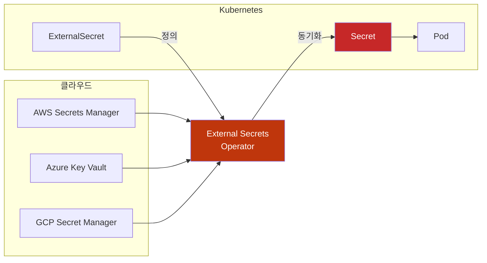
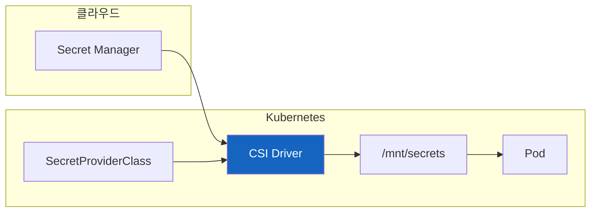

# Kubernetes Secret Delivery Integrations

외부 저장소에서 비밀번호가 바뀌면 실행 중인 모든 앱도 새 값으로 접속할까?

[ConfigMap과 Secret](Kubernetes-ConfigMap-Secret.md)에서 값의 저장·전달·앱 적용을 구분한 뒤 읽는 확장 글이다. 클러스터가 여러 개가 되거나 비밀번호 회전·감사를 중앙에서 관리해야 하면 Git에 평문을 두지 않는 것만으로 충분하지 않다. 원본을 보관할 위치, 가져오는 주체의 identity, 클러스터 안에 남는 값, 앱이 새 값을 사용하는 경로까지 선택해야 한다.

## 결론부터 말하면

ESO는 외부 값을 Kubernetes Secret으로 동기화하고, Secrets Store CSI Driver는 node plugin·provider를 통해 volume 파일로 전달한다. Sealed Secrets·SOPS는 Git에 암호화된 값을 저장하는 경로다. 어느 경로든 원본 갱신·전달·앱 반영을 따로 관찰하며 identity와 복구 수단을 준비해야 한다.

| 경로 | Git에 두는 것 | 실행 시 필요한 의존성 | 앱에 닿는 값 |
|---|---|---|---|
| ESO | 외부 항목 참조·매핑 | controller·외부 저장소·조회 identity | Kubernetes Secret |
| Secrets Store CSI Driver | SecretProviderClass·volume 참조 | 노드 plugin·provider·외부 저장소·identity | 파일, 선택적으로 Secret 동기화 |
| Sealed Secrets | 암호문 | controller private key | 복호화한 Kubernetes Secret |
| SOPS | 암호문·key metadata | 복호화 주체와 KMS·age 등 key | 복호화한 리소스·Secret |

이 글은 기존 책의 `bookstore`·가상 `order-api` 사례를 이어 쓴다. `registry.example.com` 이미지는 실제 공개 이미지가 아니며, cloud CLI와 YAML은 준비된 환경에서의 구조 발췌다. 계정·cluster·DB·인증·CA·CRD·controller 설치를 포함한 실행 실습이나 검증된 배포 기록이 아니다. 일부 설치·cloud 명령은 외부 자원을 변경하는 형식을 설명하므로 문서 작성 과정에서 실행하지 않았다.

## 1. 클라우드 Secret 관리

여기부터는 기본 ConfigMap·Secret을 이해한 뒤 읽는 선택 심화다. 외부 저장소, 인증 주체, Kubernetes Secret 또는 파일, 앱 적용으로 이어지는 책임을 비교한다. 아래 cloud CLI와 YAML은 연동 필드의 설명용 발췌이며 전체 설치·권한·네트워크 절차가 아니다. 예제만 복사해 적용할 수 있는 검증된 실행 가이드로 읽지 않는다.

외부 서비스의 회전 기능은 종류마다 다르다. 새 값을 만드는 주체, 외부 저장소의 버전, ESO 또는 CSI의 동기화, 앱의 재로딩이 차례로 맞아야 실제 접속 자격 증명이 바뀐다. 저장소에 회전 일정을 등록했다는 사실만으로 DB 비밀번호와 모든 앱 연결이 자동 교체되지는 않는다.

### 1.1 External Secrets Operator (ESO)

**External Secrets Operator** 는 외부 Secret 관리 서비스의 값을 자동으로 Kubernetes Secret으로 동기화한다.



**설치 명령의 형태:**

```bash
# Helm으로 설치
helm repo add external-secrets https://charts.external-secrets.io
helm install external-secrets external-secrets/external-secrets \
  -n external-secrets --create-namespace
```

이 발췌는 설치 흐름만 보여 준다. 실제로는 검토한 chart·controller·CRD 버전과 values를 고정하고 권한·업그레이드 호환성을 확인한다. ESO의 reconcile·갱신·소유 정책과 완전한 연결 예는 기존 [External Secrets Operator](Kubernetes-External-Secrets-Operator.md) 원고를 함께 읽는다.

> 2026-10-23에 확인한 ESO 공식 예제는 `external-secrets.io/v1`을 사용한다. 실제 설치한 controller·CRD 버전에서 이 API와 provider 필드가 지원되는지는 별도로 확인한다. 최신 버전 번호를 추정해 설치 기준으로 사용하지 않는다.

### 1.2 AWS EKS + Secrets Manager

AWS에서는 **IRSA(IAM Roles for Service Accounts)** 또는 **Pod Identity** 로 인증한다. 아래는 IRSA 경로이며 EKS OIDC provider·Role trust의 subject/audience, ESO의 토큰 요청 권한이 준비되어야 한다. IAM 정책 발췌만으로 신뢰 연결이 생기지는 않는다. customer managed KMS key를 사용하는 값에는 필요한 `kms:Decrypt` 권한도 확인한다.

**Step 1: IAM 정책 생성**

```json
{
  "Version": "2012-10-17",
  "Statement": [
    {
      "Effect": "Allow",
      "Action": [
        "secretsmanager:GetSecretValue",
        "secretsmanager:DescribeSecret"
      ],
      "Resource": "arn:aws:secretsmanager:ap-northeast-2:*:secret:order-api/*"
    }
  ]
}
```

**Step 2: IRSA 설정**

```bash
# Service Account에 IAM Role 연결
# SecretStore(namespaced)의 serviceAccountRef는 SecretStore와 같은 네임스페이스의 SA를 가리킨다
eksctl create iamserviceaccount \
  --name external-secrets-sa \
  --namespace bookstore \
  --cluster my-cluster \
  --attach-policy-arn arn:aws:iam::123456789012:policy/SecretsManagerReadOnly \
  --approve
```

**Step 3: SecretStore 생성**

```yaml
apiVersion: external-secrets.io/v1
kind: SecretStore
metadata:
  name: aws-secrets-manager
  namespace: bookstore
spec:
  provider:
    aws:
      service: SecretsManager
      region: ap-northeast-2
      auth:
        jwt:
          serviceAccountRef:
            name: external-secrets-sa    # IRSA Service Account
```

**Step 4: ExternalSecret 생성**

```yaml
apiVersion: external-secrets.io/v1
kind: ExternalSecret
metadata:
  name: order-api-secret
  namespace: bookstore
spec:
  refreshInterval: 1h                    # 동기화 주기
  secretStoreRef:
    name: aws-secrets-manager
    kind: SecretStore
  target:
    name: order-api-secret                  # 생성될 K8s Secret 이름
    creationPolicy: Owner
  data:
  - secretKey: DB_PASSWORD               # K8s Secret의 키
    remoteRef:
      key: order-api/database               # AWS Secret 이름
      property: password                 # JSON 내 필드
```

> **IRSA vs Pod Identity:** 두 방식 모두 ServiceAccount 토큰을 사용하지만 임시 AWS 자격 증명을 얻는 경로가 다르다. IRSA는 SDK가 web identity token으로 STS `AssumeRoleWithWebIdentity`를 호출한다. EKS Pod Identity는 cluster·namespace·ServiceAccount에 IAM Role을 연결하며, `pods.eks.amazonaws.com` audience의 토큰과 노드의 Pod Identity Agent를 사용한다. Agent가 EKS Auth API의 `AssumeRoleForPodIdentity`로 자격 증명을 받고 앱 SDK는 container credential provider를 통해 이를 읽는다. trust 설정·SDK 지원 조건을 확인해 선택한다. ([AWS 공식 동작 설명](https://docs.aws.amazon.com/eks/latest/userguide/pod-id-how-it-works.html))
>
> **ESO에서 Pod Identity를 쓸 때 주의 (2026-10-23 공식 문서 확인):** 위 예시의 `auth.jwt.serviceAccountRef`는 IRSA 전용이다. Pod Identity는 ESO **컨트롤러** Service Account(예: `external-secrets` 네임스페이스의 `external-secrets`)에 `aws eks create-pod-identity-association`으로 Role을 연결하고, SecretStore에는 `auth` 섹션을 **아예 쓰지 않는다**. ESO는 Pod Identity로 Role이 묶인 SA를 가장(impersonate)할 수 없어서 `serviceAccountRef`와 함께 쓰면 `an IAM role must be associated with service account` 오류가 난다. ([ESO — AWS Access](https://external-secrets.io/latest/provider/aws-access/))

### 1.3 Azure AKS + Key Vault

Azure에서는 **Workload Identity** 로 인증한다.

**Step 1: Workload Identity 설정**

다음은 활성화 명령의 발췌다. Azure 예제에는 별도로 Kubernetes ServiceAccount와 annotation, OIDC issuer·subject·audience가 맞는 federated identity credential, Key Vault 인가가 필요하다. 아래 명령만으로 신뢰 연결이 완성되지 않는다.

```bash
# AKS 클러스터에 Workload Identity 활성화
az aks update \
  --resource-group myResourceGroup \
  --name myAKSCluster \
  --enable-oidc-issuer \
  --enable-workload-identity

# Managed Identity 생성
az identity create \
  --name external-secrets-identity \
  --resource-group myResourceGroup
```

**Step 2: Key Vault 접근 권한 부여**

아래 `set-policy`는 access policy 권한 모델에서의 발췌다. Azure RBAC 권한 모델의 vault에는 알맞은 data plane role assignment가 필요하므로 둘을 혼용하지 않는다.

```bash
# Key Vault에 접근 권한 부여
az keyvault set-policy \
  --name myKeyVault \
  --object-id "<identity-principal-id>" \
  --secret-permissions get list
```

**Step 3: SecretStore 생성**

```yaml
apiVersion: external-secrets.io/v1
kind: SecretStore
metadata:
  name: azure-keyvault
  namespace: bookstore
spec:
  provider:
    azurekv:
      tenantId: "xxxxxxxx-xxxx-xxxx-xxxx-xxxxxxxxxxxx"
      vaultUrl: "https://mykeyvault.vault.azure.net"
      authType: WorkloadIdentity
      serviceAccountRef:
        name: external-secrets-sa
```

**Step 4: ExternalSecret 생성**

```yaml
apiVersion: external-secrets.io/v1
kind: ExternalSecret
metadata:
  name: order-api-secret
  namespace: bookstore
spec:
  refreshInterval: 1h
  secretStoreRef:
    name: azure-keyvault
    kind: SecretStore
  target:
    name: order-api-secret
  data:
  - secretKey: DB_PASSWORD
    remoteRef:
      key: database-password             # Key Vault Secret 이름
```

### 1.4 GCP GKE + Secret Manager

GKE에서는 **Workload Identity Federation for GKE** 로 인증하며, 아래 ESO 예제의 필드는 `auth.workloadIdentity`다. ESO의 `auth.workloadIdentityFederation`은 GKE 밖의 클러스터 등에서 외부 identity pool을 연결하는 별도 경로이므로 이름만 보고 바꾸지 않는다.

**Step 1: Workload Identity 설정**

```bash
# GKE 클러스터 생성 시 Workload Identity 활성화
gcloud container clusters create my-cluster \
  --workload-pool=my-project.svc.id.goog \
  --zone=asia-northeast3-a

# GCP Service Account 생성
gcloud iam service-accounts create external-secrets-sa

# Secret Manager 접근 권한 부여
gcloud projects add-iam-policy-binding my-project \
  --member="serviceAccount:external-secrets-sa@my-project.iam.gserviceaccount.com" \
  --role="roles/secretmanager.secretAccessor"
```

**Step 2: Kubernetes SA와 GCP SA 연결**

```bash
# Workload Identity 바인딩
gcloud iam service-accounts add-iam-policy-binding \
  external-secrets-sa@my-project.iam.gserviceaccount.com \
  --role="roles/iam.workloadIdentityUser" \
  --member="serviceAccount:my-project.svc.id.goog[bookstore/external-secrets-sa]"

# KSA(SecretStore와 같은 네임스페이스)에 GSA 연결 annotation
kubectl -n bookstore annotate serviceaccount external-secrets-sa \
  iam.gke.io/gcp-service-account=external-secrets-sa@my-project.iam.gserviceaccount.com
```

**Step 3: SecretStore 생성**

```yaml
apiVersion: external-secrets.io/v1
kind: SecretStore
metadata:
  name: gcp-secret-manager
  namespace: bookstore
spec:
  provider:
    gcpsm:
      projectID: my-project
      auth:
        workloadIdentity:
          clusterLocation: asia-northeast3-a
          clusterName: my-cluster
          serviceAccountRef:
            name: external-secrets-sa
```

**Step 4: ExternalSecret 생성**

```yaml
apiVersion: external-secrets.io/v1
kind: ExternalSecret
metadata:
  name: order-api-secret
  namespace: bookstore
spec:
  refreshInterval: 1h
  secretStoreRef:
    name: gcp-secret-manager
    kind: SecretStore
  target:
    name: order-api-secret
  data:
  - secretKey: DB_PASSWORD
    remoteRef:
      key: database-password             # Secret 이름만 (projectID는 SecretStore에서)
      version: latest
```

> ESO는 `projects/{projectID}/secrets/{key}/versions/{version}` 경로를 직접 조립하므로 `key`에 전체 리소스 경로를 넣으면 경로가 중복돼 조회에 실패한다. ([ESO GCP provider 소스](https://github.com/external-secrets/external-secrets/blob/main/providers/v1/gcp/secretmanager/client.go), [ESO — Google Secret Manager](https://external-secrets.io/latest/provider/google-secrets-manager/))

### 1.5 클라우드 비교

| 항목 | AWS EKS | Azure AKS | GCP GKE |
|---|---|---|---|
| 저장소 예 | Secrets Manager | Key Vault | Secret Manager |
| identity 연결 예 | IRSA·EKS Pod Identity | Workload Identity | Workload Identity Federation for GKE (ESO `auth.workloadIdentity`) |
| ESO provider key | `aws` | `azurekv` | `gcpsm` |

같은 “Workload Identity”라는 표현이 있어도 토큰의 신뢰 대상과 provider 구성은 서로 다르다. 가격·회전 지원·감사 정책은 서비스와 옵션별로 확인한다. 프로젝트 전체 read 권한을 부여하는 발췌는 개념을 보여 주기 쉽지만 실제 환경에서는 필요한 Secret에만 접근하도록 범위를 좁힌다.

---

## 2. Secrets Store CSI Driver

**Secrets Store CSI Driver** 는 외부 Secret을 **Pod 볼륨으로 직접 마운트**하는 방식이다. ESO와 달리 Kubernetes Secret을 거치지 않을 수 있다.



### 2.1 ESO vs CSI Driver

| 비교 | External Secrets Operator | Secrets Store CSI Driver |
|------|---------------------------|-------------------------|
| **동작 방식** | K8s Secret으로 동기화 | 볼륨으로 직접 마운트 |
| **Secret 저장 경로** | Kubernetes Secret이 저장소에도 남음 | Secret 동기화를 켜지 않으면 Kubernetes Secret 객체를 만들지 않을 수 있음 |
| **환경변수 사용** | ✅ 가능 | ⚠️ secretObjects로 동기화 후 가능 |
| **실행 주체** | controller가 외부 값을 조회·동기화 | Node CSI plugin·provider가 mount를 준비 |
| **실행 환경 제약** | controller 실행 위치·권한·통신 확인 | Node plugin 설치를 허용하는 환경인지 확인 |

> 환경변수가 필요한지, Kubernetes Secret 저장을 허용하는지, Node plugin을 설치할 수 있는지, 외부 저장소 장애 시 새 Pod가 시작 가능한지를 기준으로 선택한다. CSI auto rotation은 별도 활성화·provider 지원이 필요하며, 파일 갱신 뒤 앱 재로딩과 Secret 기반 환경변수의 Pod 교체도 여전히 필요하다.

### 2.2 Azure AKS 예시 (CSI Driver)

AKS에는 CSI Driver와 Azure provider를 설치하는 add-on이 있다. 아래 활성화 명령만으로 Key Vault의 데이터 접근 권한까지 생기지는 않는다. 예제는 앞 절의 ESO Workload Identity와 달리 **노드의 user-assigned managed identity** 를 사용하는 경로다. 해당 identity의 노드 연결, client ID, vault 인가·네트워크를 별도로 준비해야 한다.

```bash
# CSI Driver 애드온 활성화
az aks enable-addons \
  --addons azure-keyvault-secrets-provider \
  --name myAKSCluster \
  --resource-group myResourceGroup
```

**SecretProviderClass 생성:**

```yaml
apiVersion: secrets-store.csi.x-k8s.io/v1
kind: SecretProviderClass
metadata:
  name: azure-keyvault-secrets
  namespace: bookstore
spec:
  provider: azure
  parameters:
    usePodIdentity: "false"
    useVMManagedIdentity: "true"         # Managed Identity 사용
    userAssignedIdentityID: "<client-id>"
    keyvaultName: "myKeyVault"
    tenantId: "<tenant-id>"
    objects: |
      array:
        - |
          objectName: database-password
          objectType: secret
  secretObjects:                          # K8s Secret으로도 동기화 (선택)
  - secretName: order-api-secret
    type: Opaque
    data:
    - objectName: database-password
      key: DB_PASSWORD
```

`SecretProviderClass`는 소비 Pod와 같은 namespace에 둔다. `secretObjects`를 사용하려면 해당 driver 설치에서 Kubernetes Secret 동기화 기능과 권한이 활성화되어야 한다. 동기화할 `objectName`은 실제 mount 파일명·alias와 맞아야 하며, 생성되는 Secret은 `bookstore`에 놓인다. 아래 Pod spec 역시 `bookstore` namespace의 workload에 넣는 발췌다.

**Pod에서 사용:**

```yaml
spec:
  containers:
  - name: order-api
    image: registry.example.com/book/order-api:1.0.0
    volumeMounts:
    - name: secrets-store
      mountPath: "/mnt/secrets"
      readOnly: true
  volumes:
  - name: secrets-store
    csi:
      driver: secrets-store.csi.k8s.io
      readOnly: true
      volumeAttributes:
        secretProviderClass: "azure-keyvault-secrets"
```

---

## 3. GitOps에서 Secret 관리

GitOps 환경에서는 Secret을 Git에 평문으로 저장할 수 없다. 대표적인 두 접근은 다음과 같다:

| 접근법 | 설명 | 도구 |
|--------|------|------|
| **암호화 저장** | Git에 암호화된 Secret 저장 | Sealed Secrets, SOPS |
| **참조 저장** | Secret 참조만 Git에 저장 | External Secrets Operator |

### 3.1 Sealed Secrets

**Sealed Secrets** 는 controller가 가진 private key에 대응하는 공개 certificate로 Secret을 암호화해 Git에 저장할 수 있게 한다. 암호문을 만들었다고 key 백업·복구·권한 관리 책임이 사라지지는 않는다.


**암호화 흐름의 설명용 발췌:** 아래 literal은 가짜 값이다. 실제 비밀번호를 CLI 인자로 넣어 shell history·프로세스 인자에 남기는 전달 방법으로 사용하지 않는다.

```bash
# controller 설치 manifest는 릴리스 버전·권한·대상 namespace를 별도로 검토한다.
# 공개 certificate를 확보한 뒤 offline sealing하는 형식은 아래와 같다.

# kubeseal CLI 설치 (Mac)
brew install kubeseal

# Secret 암호화
kubectl -n bookstore create secret generic my-secret \
  --from-literal=password=EXAMPLE-ONLY-NOT-A-REAL-PASSWORD \
  --dry-run=client -o yaml | \
  kubeseal --cert controller-public-cert.pem --format yaml > sealed-secret.yaml
```

**생성된 SealedSecret:**

```yaml
apiVersion: bitnami.com/v1alpha1
kind: SealedSecret
metadata:
  name: my-secret
  namespace: bookstore
spec:
  encryptedData:
    password: AgBy3i4OJSWK+...  # 클러스터 공개키로 암호화됨
```

> **주의:** 복호화 가능 여부는 private key와 sealing scope에 달려 있다. 기본 strict scope에서는 namespace와 이름도 맞아야 한다. 여러 클러스터에 key를 공유하는 설계도 가능하지만 격리와 장애 영향이 달라진다. key 복구 계획 없이 원본 Secret과 controller key를 잃으면 암호문만으로 복구할 수 없다.

### 3.2 SOPS (Secrets OPerationS)

**SOPS** 는 YAML·JSON 등의 민감 값을 암호화하며, cloud KMS 외에도 age·PGP 등 여러 key backend를 지원한다. 복호화할 GitOps 실행 주체에게 필요한 key 접근 권한을 주고 평문이 로그·캐시에 남는 경로를 확인한다.

```bash
# SOPS 설치 (Mac)
brew install sops

# AWS KMS로 암호화
sops --encrypt --kms arn:aws:kms:ap-northeast-2:123456789012:key/EXAMPLE-KEY-ID \
  --encrypted-regex '^(data|stringData)$' \
  secret.yaml > secret.enc.yaml
```

`--encrypted-regex`는 `data`·`stringData` 아래 값만 암호화하도록 범위를 정한다. 이 옵션이나 동등한 `.sops.yaml` 규칙이 없으면 기본적으로 다른 필드의 값도 암호화되므로 아래 결과와 달라진다. 다음은 암호문·metadata를 줄인 구조 발췌다.

**암호화된 파일:**

```yaml
apiVersion: v1
kind: Secret
metadata:
  name: my-secret
stringData:
  password: ENC[AES256_GCM,data:...,tag:...,type:str]
sops:
  kms:
  - arn: arn:aws:kms:ap-northeast-2:123456789012:key/EXAMPLE-KEY-ID
```

**Flux에서 AWS KMS 기반 SOPS 사용:**

위와 같은 KMS key로 암호화했다면 복호화 주체인 `flux-system`의 `kustomize-controller` ServiceAccount에 해당 key를 사용할 IAM 권한과 identity 연결이 필요하다. 다음은 그 권한 구성이 이미 준비되었다고 가정한 Kustomization 발췌다. age private key를 담은 Secret 참조는 이 KMS 예제에 넣지 않는다.

```yaml
# Flux Kustomization에 SOPS 설정
apiVersion: kustomize.toolkit.fluxcd.io/v1
kind: Kustomization
metadata:
  name: order-api
  namespace: flux-system
spec:
  decryption:
    provider: sops
```

### 3.3 GitOps Secret 관리 비교

| 항목 | Sealed Secrets | SOPS | External Secrets |
|------|----------------|------|------------------|
| **변환 경로** | kubeseal로 암호화·controller로 복호화 | 로컬/CI 암호화·인가된 주체가 복호화 | 외부 값을 controller가 조회 |
| **Git에 저장** | 암호화된 값 | 암호화된 값 | 참조만 |
| **멀티 클러스터** | key·scope 설계 필요 | 각 실행 주체에 key 접근 필요 | 각 클러스터에 외부 조회 identity 필요 |
| **key·권한 관리** | controller private key·백업 | KMS·age 등 선택한 backend | 저장소 identity·IAM·접근 정책 |
| **Flux 연결** | controller가 SealedSecret을 변환 | kustomize-controller의 SOPS 복호화 | ESO controller가 참조를 reconcile |
| **Argo CD 연결** | controller·CRD 별도 설치 | 복호화 plugin 등 별도 통합 검토 | ESO controller·CRD 별도 설치 |

복구 시 무엇에 접근할 수 있어야 하는지로 선택한다. ESO는 외부 저장소·identity 접근, SOPS는 복호화 key 접근, Sealed Secrets는 controller private key 복구가 필요하다. Git 저장소가 있다는 사실만으로 이 의존성이 해결되지는 않는다.

---

## 4. Rotation은 원본부터 앱까지의 절차다

비밀번호 rotation은 새 문자열을 저장하는 것보다 길다. 먼저 DB 같은 인증 대상이 새 자격 증명을 받아야 하고, 외부 저장소 버전이 바뀌어야 한다. 그다음 ESO·CSI가 조회하여 Secret·파일을 바꾸고, 마지막으로 앱이 이를 읽어 새 연결을 만들어야 한다. 저장소의 자동 회전 지원 범위는 서비스·자격 증명 종류마다 다르므로 회전 일정만 등록했다고 이 전체가 완성되었다고 판단하지 않는다.

ESO의 `refreshInterval`은 주기적 조회의 조건이지 앱 반영의 완료 기한이 아니다. 갱신 정책·소유·삭제 정책의 자세한 동작은 기존 [External Secrets Operator](Kubernetes-External-Secrets-Operator.md) 원고에서 이어 읽는다. 이 글은 provider 비교와 전달 경로 선택에 초점을 둔다.

CSI에서도 auto rotation을 별도로 활성화하고 provider 지원을 확인해야 한다. 2026-10-23에 확인한 upstream 문서는 `--enable-secret-rotation` 활성화를 요구하며, `requiresRepublish`만 켜서는 rotation이 켜지지 않는다고 명시한다. 사용 중인 driver·관리형 add-on 버전의 동작을 확인하고 polling 설정을 종단 완료 시간으로 약속하지 않는다. [CSI Auto Rotation](https://secrets-store-csi-driver.sigs.k8s.io/topics/secret-auto-rotation)

CSI의 `secretObjects`를 선언했다고 독립적인 상시 동기화 controller가 생기지는 않는다. 실제 CSI volume을 mount하는 Pod가 있어야 동기화가 시작되며, 소비 Pod가 모두 삭제되면 동기화된 Secret도 삭제될 수 있다. 환경변수만 필요해서 mount 소비자를 없애는 설계나, scale-to-zero 뒤 기동 순서를 검토할 때 중요한 차이다. [Sync as Kubernetes Secret](https://secrets-store-csi-driver.sigs.k8s.io/topics/sync-as-kubernetes-secret)

| 소비 방식 | 값 전달 뒤 남는 단계 |
|---|---|
| Kubernetes Secret의 env·envFrom | 새 컨테이너가 읽도록 통제된 Pod 교체 등 수행 |
| Secret 일반 volume·CSI volume 파일 | 앱의 파일 재조회·설정 reload와 실제 적용 확인 |
| subPath | 기존 마운트에 자동 갱신이 반영되지 않는 제약 확인 |
| DB connection pool | 이전 연결 수명·새 연결 인증·풀 교체 확인 |

새·이전 자격 증명의 중첩 유효 시간, replica 순차 교체, 실패 시 복구할 원본 버전을 함께 정한다. 모든 앱의 새 연결 성공을 확인하기 전에 이전 자격 증명을 폐기하면 오래 살아 있는 replica나 연결 풀이 장애를 만들 수 있다. 이 순서는 전달 방식의 제약에서 도출한 운영 설계이며 특정 DB에서 실행 검증한 결과가 아니다.

## 5. 장애를 값 출력 없이 좁히기

아래는 전제를 갖춘 개인 실습 context에서의 읽기 전용 관찰 형식이다. controller·provider 로그에도 민감 값이 남을 수 있으므로 지원 요청이나 원고에 원문을 그대로 붙이지 않는다.

```bash
kubectl -n bookstore get secretstore,externalsecret
kubectl -n bookstore describe secretstore aws-secrets-manager
kubectl -n bookstore describe externalsecret order-api-secret
kubectl -n bookstore get externalsecret order-api-secret \
  -o jsonpath='{.status.refreshTime}{"\n"}'
kubectl -n bookstore describe secret order-api-secret
kubectl -n bookstore get secretproviderclass,secretproviderclasspodstatus
kubectl -n bookstore describe pod order-api-pod
```

Store가 준비되지 않았으면 identity·권한·DNS·TLS·endpoint를 먼저 본다. Store가 준비되었어도 항목별 조회 권한이나 `remoteRef.key`·property가 다르면 ExternalSecret은 실패할 수 있다. `Ready=True`와 최근 동기화 시각은 전달 계층의 증거이며 앱의 DB 로그인 성공은 별도로 확인한다. Secret이 존재하는 것만으로 최근 rotation이 반영되었다고 판단하지 않는다.

CSI의 `FailedMount`라면 Pod Events에서 node plugin·provider·SecretProviderClass·외부 조회 단계를 나눈다. 해당 노드의 plugin 실행, namespace와 참조 이름, 외부 identity, 파일 생성 상태·버전을 확인한다. 파일 갱신이 보이면 그 뒤는 앱 reload·연결 풀의 상태를 관찰한다. ESO 문제를 node plugin으로, CSI mount 문제를 ESO 상태만으로 판단하지 않는 것이 중요하다.

**에어갭 환경에서 짚어볼 점:** ESO controller가 나가는 경로와 CSI node provider가 나가는 경로는 다를 수 있다. 실제 실행 위치에서 저장소와 STS·토큰 교환 endpoint, DNS·CA 신뢰·사설 연결을 확인한다. CRD·이미지 반입은 이 연결의 증거가 아니다. 폐쇄망에서 cloud KMS를 사용할 수 없다면 SOPS의 age 같은 offline key 경로를 검토할 수 있지만, key 반입·보관·복구·권한 분리라는 책임이 새로 생긴다. Sealed Secrets도 공개 certificate를 사전 확보하면 offline sealing할 수 있으나 복호화 private key 복구는 남는다.

## 6. 정리

어디에 평문이 남는지와 장애 뒤 무엇을 복구해야 하는지로 경로를 선택한다. Kubernetes Secret 저장을 허용하고 기존 env 소비를 유지하려면 ESO가 자연스럽다. 파일 계약과 node plugin 운영이 가능하면 CSI를 검토한다. Git에 암호문을 남기는 방식은 클러스터의 복호화 key와 실행 주체의 접근 경로를 배포·복구 계획에 넣어야 한다. 어느 쪽이든 앱의 자격 증명 전환을 마지막 확인 단계로 둔다.

## 생각해 볼 질문

1. **ESO의 IRSA 예제에서 auth.jwt.serviceAccountRef만 남긴 채 EKS Pod Identity로 전환해도 될까?**
   해설: 두 인증 경로는 다르다. 이 글에서 확인한 ESO Pod Identity 경로는 controller ServiceAccount에 association을 만들고 Store의 auth를 생략한다. 신뢰 정책·agent·SDK와 외부 조회 권한까지 맞춰야 한다.
2. **CSI secretObjects만 선언하면 Pod가 하나도 없어도 Secret을 계속 유지할까?**
   해설: mount 소비 Pod가 동기화 수명과 연결된다. scale-to-zero와 새 Pod 시작 순서, Secret을 다른 workload가 참조하는 경우의 의존성을 확인한다.
3. **Git에 암호문이 남으면 재해 복구가 가능할까?**
   해설: Sealed Secrets는 private key·scope, SOPS는 복호화 key 접근, ESO는 원본 저장소와 identity가 필요하다. Git 복원과 민감 값 복원은 별도의 확인이다.

## 출처

2026-10-23 기준 공식 자료로 provider 필드·인증 경계·CSI 회전·GitOps 복호화 흐름을 확인했다. 실제 cloud identity·회전·mount·앱 로그인과 재해 복구는 실행 검증하지 않았다.

- [Kubernetes Documentation - Secrets](https://kubernetes.io/docs/concepts/configuration/secret/) - 공식 문서
- [Kubernetes Documentation - Encrypting Secret Data at Rest](https://kubernetes.io/docs/tasks/administer-cluster/encrypt-data/) - 공식 문서
- [External Secrets Operator](https://external-secrets.io/) - ESO 공식 문서
- [External Secrets - AWS Secrets Manager](https://external-secrets.io/latest/provider/aws-secrets-manager/) - AWS 연동
- [External Secrets - Google Secret Manager](https://external-secrets.io/latest/provider/google-secrets-manager/) - GCP 연동
- [Azure Key Vault Provider for Secrets Store CSI Driver](https://azure.github.io/secrets-store-csi-driver-provider-azure/docs/) - Azure CSI Driver
- [Bitnami Sealed Secrets](https://github.com/bitnami-labs/sealed-secrets) - GitOps Secret 암호화
- [Mozilla SOPS](https://github.com/getsops/sops) - Secret 파일 암호화
- [Flux - Manage Kubernetes secrets with SOPS](https://fluxcd.io/flux/guides/mozilla-sops/) - Flux SOPS 연동

- [Secrets Store CSI Driver Concepts](https://secrets-store-csi-driver.sigs.k8s.io/concepts)
- [Secrets Store CSI Driver Auto Rotation](https://secrets-store-csi-driver.sigs.k8s.io/topics/secret-auto-rotation)
- [External Secrets AWS Access](https://external-secrets.io/latest/provider/aws-access/)
- [External Secrets Azure Key Vault](https://external-secrets.io/latest/provider/azure-key-vault/)

- [AWS — Understand how EKS Pod Identity works](https://docs.aws.amazon.com/eks/latest/userguide/pod-id-how-it-works.html) — 토큰과 자격 증명 교환 경로
- [ESO — SecretStore](https://external-secrets.io/latest/api/secretstore/) — namespaced store 참조 범위

- [CSI Sync as Kubernetes Secret](https://secrets-store-csi-driver.sigs.k8s.io/topics/sync-as-kubernetes-secret) — mount 소비자와 동기화 수명
- [AKS CSI identity access](https://learn.microsoft.com/en-us/azure/aks/csi-secrets-store-identity-access) — node managed identity·Workload Identity 경로
- [SOPS Documentation](https://getsops.io/docs/) — key backend·암호화 범위
