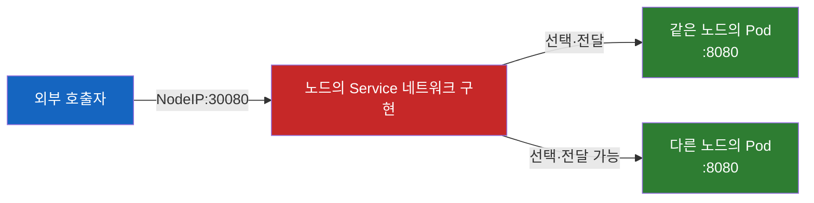

# Kubernetes Service: ClusterIP, NodePort, LoadBalancer

> **개발자를 위한 쉬운 쿠버네티스 · 8장** | [전체 목차](./Kubernetes-Introduction.md#이-시리즈의-읽는-순서) · [이전 장](./Kubernetes-Service-Object.md) · [다음 장](./Kubernetes-Service-Internals.md)

**같은 주문 API를 어디에서 호출할 것인가 — 내부 주소, 노드 진입점, 외부 로드밸런서**

[앞 장](./Kubernetes-Service-Object.md)에서 Service가 Pod를 소유하지 않고 라벨로 선택한다는 점을 배웠다. 이제 `order-api`를 내부 결제 서비스만 부를지, 클러스터 밖의 호출자도 부를지 정해야 한다. Service 타입은 앱의 종류가 아니라 이 접속 경로의 요구를 표현한다.

## 결론부터 말하면

**ClusterIP는 클러스터 통신용 주소를, NodePort는 노드 주소의 포트를, LoadBalancer는 별도 구현체가 제공하는 LB 진입점을 사용한다.** NodePort와 LoadBalancer도 보통 ClusterIP를 함께 갖는다. 다만 선언이 저장되었다는 사실과 외부에서 실제 접근할 수 있다는 사실은 다르다. 라우팅·방화벽과 담당 controller의 동작까지 있어야 한다.

| 선언 | 호출자가 사용하는 대표 주소 | 추가로 필요한 조건 |
|---|---|---|
| ClusterIP | `order-api:80` 또는 서비스 IP | 클러스터 DNS와 Service·Pod 네트워크 |
| NodePort | `<도달 가능한 NodeIP>:30080` | 노드 주소까지의 경로, 허용된 인터페이스·포트 |
| LoadBalancer | LB의 IP 또는 hostname | 해당 Service를 처리하는 controller·LB 구현과 네트워크 |
| ExternalName | 별칭을 따라 찾은 외부 DNS 이름 | 외부 이름 해석, 외부 서버 연결, 프로토콜 호환 |

Headless는 `type`의 다섯 번째 값이 아니다. `clusterIP: None`으로 가상 IP를 생략하는 구성이다. 왜 이 경우 DNS와 호출자의 책임이 달라지는지도 뒤에서 살펴본다.

## 1. 먼저 고정할 것: 앱 포트와 호출 포트

이 장은 가상의 주문 API가 `bookstore` namespace에서 `app: order-api` 라벨을 갖고, Pod의 `8080`에서 HTTP를 받는다고 가정한다. 공통 이미지 `registry.example.com/book/order-api:1.0.0`은 설명용 자리표시자이며 실제 공개 이미지가 아니다. 이 장의 manifest는 관계를 보여 주는 **완전한 설명용 manifest** 또는 명시한 발췌이며 실행 검증 결과를 뜻하지 않는다.

Service 타입을 바꿔도 앱 프로세스는 여전히 `8080`에서 listen한다. 내부 호출자가 쓰는 Service 포트는 `80`이다. NodePort를 추가하면 노드 진입점의 `30080`이 하나 더 생긴다. 세 숫자를 순서대로 읽는 연습이 타입 이름을 외우는 것보다 유용하다.

| 필드 | 누가 이 포트를 사용하는가? | 공통 예제 |
|---|---|---|
| `targetPort` | 선택된 Pod의 앱 | `8080` |
| `port` | Service 주소로 연결하는 호출자 | `80` |
| `nodePort` | NodeIP로 연결하는 호출자 또는 외부 LB | `30080` |

이 숫자들은 같아도 되지만 같아야 할 이유는 없다. 방화벽을 열 때도 어느 구간의 포트인지 구별해야 한다. 외부에서 `30080`이 차단되었는데 앱의 `8080`만 확인하거나, 내부 호출에서 `order-api:8080`을 사용하면 서로 다른 경로를 검사하게 된다.

### 1.1 이름이 있는 targetPort

숫자 대신 Pod가 선언한 포트 이름을 참조할 수도 있다. 다음은 **Service와 Pod 템플릿의 구조 설명용 발췌** 다.

```yaml
# Service의 spec
ports:
  - name: http
    port: 80
    targetPort: http
---
# Deployment의 spec.template.spec
containers:
  - name: order-api
    image: registry.example.com/book/order-api:1.0.0
    ports:
      - name: http
        containerPort: 8080
```

`targetPort: http`는 대상 Pod에서 `http`라는 이름의 포트를 찾으라는 뜻이다. 새 Pod 템플릿이 같은 이름을 유지한 채 번호를 바꾸면 Service를 고치지 않고 서로 다른 실제 포트를 대상으로 삼을 수 있다. 그러나 포트 이름은 HTTP 서버를 자동 실행하는 명령이 아니다. 앱 listen 주소·포트가 선언과 맞아야 하고, 각 대상 Pod에서 이름이 해석되는지도 확인해야 한다.

<a id="3-service-타입-clusterip"></a>

## 2. Service 타입: ClusterIP

### 2.1 내부 호출의 기본 주소

다른 Pod가 주문 API를 호출할 때 노드 주소나 개별 Pod IP를 알 필요는 없다. 다음 Service가 유지되는 동안 내부 주소와 이름을 사용하고, 뒤의 Pod 교체는 endpoint 목록에 반영되도록 맡긴다.

```yaml
apiVersion: v1
kind: Service
metadata:
  name: order-api
  namespace: bookstore
spec:
  type: ClusterIP
  selector:
    app: order-api
  ports:
    - name: http
      port: 80
      targetPort: 8080
```

`ClusterIP`는 기본 타입이므로 `type`을 생략할 수도 있다. API server가 할당한 서비스 IP는 해당 오브젝트의 수명 동안 안정적인 호출 주소가 된다. Service를 삭제하고 다시 만들면 같은 이름이어도 같은 IP가 보장되지는 않는다.

클러스터 DNS를 사용하는 같은 namespace의 Pod는 `http://order-api:80`으로 호출할 수 있다. 다른 namespace라면 `order-api.bookstore`처럼 namespace를 포함해 구별한다. DNS suffix와 실제 이름 해석 과정은 [다음 장](./Kubernetes-Service-Internals.md)에서 설명한다.

### 2.2 내부 주소가 곧 보안 경계는 아니다

ClusterIP는 보통 클러스터 내부 통신을 위한 가상 주소이며 외부 공개 주소를 자동 생성하지 않는다. 그렇다고 "어떠한 외부 네트워크에서도 절대 접근 불가"라는 보안 보장은 아니다. 관리망의 라우팅, VPN, 프록시나 터널 등 별도 경로가 있는 환경에서는 접근 조건이 달라진다.

또한 다른 namespace라고 자동으로 차단되지 않는다. namespace는 리소스 이름과 관리의 범위이고, Pod 간 네트워크 격리는 별도 정책이다. Service 타입 선택과 접근 제어를 같은 설정으로 이해하면 내부 시스템의 노출 범위를 놓치기 쉽다. 어떤 호출자만 허용할지는 [NetworkPolicy](./Kubernetes-Egress-NetworkPolicy.md), 앱 인증·인가, 네트워크 설계와 함께 정한다.

### 2.3 브라우저에서 실행되는 프론트엔드는 어디에 있을까?

프론트엔드 서버가 Pod 안에 있다고 해서 브라우저의 JavaScript도 클러스터 안에서 실행되는 것은 아니다. 브라우저가 `http://order-api`를 요청하면 사용자의 DNS와 네트워크에서 그 이름을 찾는다. 일반적으로 클러스터 내부 Service 이름을 해석하거나 접속할 수 없다.

반면 프론트엔드의 서버 코드나 reverse proxy가 요청을 대신 보낸다면 그 서버가 ClusterIP를 호출할 수 있다. 같은 "프론트엔드 → 백엔드" 그림이라도 실행 위치에 따라 필요한 진입점이 달라진다. Service 타입을 선택하기 전에 실제 TCP 연결을 누가 시작하는지부터 정해야 하는 이유다.

<a id="5-service-타입-nodeport"></a>

## 3. Service 타입: NodePort

### 3.1 노드에 접속하는 경로를 추가한다

외부 호출자가 노드 IP까지 접근할 수 있다면 NodePort가 진입점을 제공할 수 있다. 다음은 **완전한 설명용 manifest** 다. 앞의 ClusterIP 예제에 추가로 적용하는 별도 Service가 아니라 같은 Service의 다른 타입 구성이다.

```yaml
apiVersion: v1
kind: Service
metadata:
  name: order-api
  namespace: bookstore
spec:
  type: NodePort
  selector:
    app: order-api
  ports:
    - name: http
      port: 80
      targetPort: 8080
      nodePort: 30080
```

ClusterIP 호출 경로를 유지하면서 노드의 `30080` 포트로 들어오는 연결도 같은 Service의 대상으로 전달하도록 요청한다. 대상 Pod가 연결을 받은 노드에 반드시 있어야 하는 것은 아니다. 기본적인 클러스터 전체 전달 정책에서는 다른 노드의 Pod도 선택할 수 있다.

다음 그림은 **통신 경로의 한 예** 다. Service라는 중간 서버를 한 번 더 거치는 것으로 그리지 않고, 노드의 Service 네트워크 구현이 목적지 Pod를 선택하는 위치를 표시했다.



### 3.2 모든 노드의 모든 주소에서 된다고 가정하지 않는다

NodePort는 클러스터의 노드에 같은 포트를 구성하는 모델이지만, 실제 접근 가능한 노드 주소는 Service 구현과 설정에 따라 다르다. kube-proxy의 `nodePortAddresses`, 선택한 proxy mode, 노드 방화벽과 외부 라우팅을 확인해야 한다. 예를 들어 현재 공식 문서는 nftables 모드에서 기본 NodePort 주소 선택이 iptables 모드와 다르다고 설명한다. 따라서 노드의 여러 NIC나 loopback 중 아무 주소에 접속해도 된다는 전제로 진단하면 안 된다. [Virtual IPs and Service Proxies](https://kubernetes.io/docs/reference/networking/virtual-ips/)에 모드별 차이가 있다.

NodePort 범위의 기본값은 `30000–32767`이고 클러스터 설정으로 바꿀 수 있다. `nodePort`를 생략하면 범위 안의 포트가 할당된다. 직접 지정하면 충돌과 범위 제약을 확인해야 한다. 이 범위는 노드 진입점의 제약이지 Service `port`나 앱 `targetPort`를 같은 범위에 두라는 규칙이 아니다.

### 3.3 개발용인가, 운영용인가?

NodePort를 "개발 전용"이라고 분류하면 실제 LB 구성을 설명할 수 없다. 외부 LB가 노드를 대상으로 삼고 그 NodePort로 전달하는 운영 구성도 있다. 반대로 사용자에게 노드 하나의 IP를 직접 배포하면 그 노드 장애와 주소 변경에 노출된다.

따라서 중요한 질문은 "운영이니까 금지인가?"보다 "노드 앞에서 주소 안정성·장애 감지·접근 통제를 누가 맡는가?"다. NodePort만으로 사용자용 도메인, TLS 인증서, 여러 노드의 건강 판단이 자동 완성되지는 않는다. 기존 외부 LB의 backend로 쓰는 경우에는 그 외부 장치와 Kubernetes 양쪽의 책임을 나누어 설계한다.

<a id="6-service-타입-loadbalancer"></a>

## 4. Service 타입: LoadBalancer

### 4.1 LB를 요청하는 선언과 구현을 구별한다

LoadBalancer 타입은 클러스터 밖의 진입점을 담당하는 구현체에 LB 구성을 요청한다. 클라우드에서는 cloud controller나 제공자별 controller가 이를 처리하고, 온프레미스에서는 설치된 다른 구현이 처리할 수 있다.

```yaml
apiVersion: v1
kind: Service
metadata:
  name: order-api
  namespace: bookstore
spec:
  type: LoadBalancer
  selector:
    app: order-api
  ports:
    - name: http
      port: 80
      targetPort: 8080
```

이 **완전한 설명용 manifest** 만 저장했다고 LB가 반드시 생성되는 것은 아니다. 누가 이 Service를 맡는지, 주소 풀·클라우드 권한·할당량·네트워크 준비가 있는지에 따라 결과가 달라진다. 설치된 구현에 따라 비용이 발생할 수도 있으므로 이 예제는 적용 지시가 아니다.

### 4.2 일반적인 노드 대상 경로와 직접 Pod 대상 경로

전통적인 경로에서는 controller가 LB를 구성하고, LB가 노드의 NodePort로 연결을 전달하며, 그 노드의 Service 구현이 Pod를 선택한다. 이 경우 LoadBalancer 타입은 보통 ClusterIP와 NodePort도 함께 갖는다.


하지만 모든 구현이 이 경로를 쓰는 것은 아니다. LB가 Pod IP를 backend로 사용해 직접 전달하는 구성도 있다. 지원되는 구현에서는 `spec.allocateLoadBalancerNodePorts: false`로 NodePort 할당을 생략할 수 있다. 기존에 할당된 NodePort를 이 옵션 하나로 자동 정리해 준다고 기대해서도 안 된다. 설정의 지원 여부와 전환 동작은 사용하는 controller와 공식 API 문서에서 확인해야 한다.

`loadBalancerClass`는 다른 LB 구현을 지정하는 데 사용하는 필드다. 특정 값을 임의로 넣으면 구현체가 생기는 것이 아니라, 그 class를 처리하는 controller가 있어야 한다. cloud annotation 역시 Kubernetes 공통 계약과 제공자 확장 설정을 구분해 읽는다. [LoadBalancer 확장 읽기](./Kubernetes-Service-LoadBalancer-Cloud.md)에서 이 경계와 제공자별 예를 다룬다.

### 4.3 EXTERNAL-IP를 읽는 방법

다음은 **설명용 출력** 이다. IP는 실제 할당 결과가 아니다.

```text
NAME        TYPE           CLUSTER-IP   EXTERNAL-IP    PORT(S)
order-api   LoadBalancer   10.96.0.10   203.0.113.20   80:31234/TCP
```

`80:31234/TCP`는 Service 포트 `80`과 할당된 NodePort `31234`를 보여 준다. 앱의 `targetPort: 8080`은 이 한 줄에 나오지 않으므로 YAML에서 확인한다. `EXTERNAL-IP` 열에는 IP 대신 hostname이 보일 수도 있다. 주소가 표시되었다는 것은 controller가 상태를 보고했다는 증거이며, 호출자의 DNS·방화벽·TLS·backend 응답 성공까지 확인한 결과는 아니다.

`<pending>`이면 우선 담당 controller가 존재하는지, 그 controller가 해당 Service를 처리하는지, Events와 controller 로그에 무엇이 남는지 살펴본다. "온프레미스라 원래 안 된다"나 "클라우드니까 기다리면 된다"로 단정하지 않는다. 온프레미스에도 LB 구현이 있을 수 있고 클라우드에도 권한·주소 할당 문제가 있을 수 있다.

### 4.4 외부 주소가 반드시 인터넷 공개 주소는 아니다

LoadBalancer라는 타입명은 인터넷 공개 여부를 결정하지 않는다. 구현체의 설정에 따라 사설 내부 LB가 될 수도 있다. 반대로 외부 공개가 필요하다면 LB 주소 외에 라우팅과 보안 규칙도 그 요구에 맞아야 한다.

에어갭 환경에서도 같은 원칙이 적용된다. 인터넷이 차단되었다는 사실만으로 LB controller나 내부 주소 공급 기능의 유무를 알 수 없다. 이미지 반입, controller 설치, 주소 광고 방식, 사내 네트워크 경로를 별도로 확인한다.

<a id="4-service-타입-headless-service"></a>

<a id="5-service-타입-headless-service"></a>

## 5. Headless Service 구성

### 5.1 하나의 가상 주소를 생략하면 누가 선택할까?

일반 Service는 호출자에게 서비스 주소를 제공해 개별 Pod 목록을 숨긴다. 그런데 DB 복제 구성처럼 특정 인스턴스를 구별하거나, 클라이언트가 직접 여러 서버 연결을 관리해야 하는 경우에는 그 숨김이 필요하지 않을 수 있다. Headless Service는 이때 가상 IP 기반 분산을 생략한다.

다음은 **완전한 설명용 manifest** 다. 일반 `order-api`와 비교하기 위해 이름을 `order-api-headless`로 구분했다.

```yaml
apiVersion: v1
kind: Service
metadata:
  name: order-api-headless
  namespace: bookstore
spec:
  clusterIP: None
  selector:
    app: order-api
  ports:
    - name: http
      port: 8080
      targetPort: 8080
```

selector가 있는 Headless Service에서는 DNS가 준비된 endpoint의 IP를 응답할 수 있다. 호출자는 그 IP의 앱 포트로 직접 연결한다. 위에서 `port`와 `targetPort`를 모두 `8080`으로 둔 이유는 일반 ClusterIP처럼 `80 → 8080`을 변환하는 경로가 없음을 드러내기 위해서다. DNS A/AAAA 조회 결과는 포트 변환 기능이 아니다.

### 5.2 일반 Service와 비교

| 질문 | 일반 ClusterIP Service | selector 있는 Headless Service |
|---|---|---|
| DNS A/AAAA는 무엇을 알려 주나? | 할당된 서비스 주소. dual-stack이면 두 family가 있을 수 있음 | endpoint의 IP 주소들 |
| 가상 IP 기반 Service 분산이 있나? | 있음 | 없음 |
| 호출 대상 선택은 누가 하나? | Service 네트워크 구현 | 클라이언트의 DNS·연결 처리 정책 |
| 적합한 요구는? | 복제본을 하나의 서비스로 호출 | 개별 인스턴스 식별, 클라이언트 측 분산 |

DNS가 주소 여러 개를 반환한다고 요청이 자동으로 균등 분산되지는 않는다. 클라이언트가 첫 주소만 사용하거나 오래 캐시할 수도 있다. gRPC 같은 장기 연결에서는 DNS 결과와 클라이언트의 load balancing 정책을 함께 보아야 한다. 이 연결 문제는 [내부 동작 장](./Kubernetes-Service-Internals.md)에서 이어 간다.

### 5.3 StatefulSet과의 연결

StatefulSet은 각 Pod의 식별자를 유지하는 워크로드다. Headless Service를 함께 사용하면 `mysql-0.mysql.bookstore.svc.cluster.local`처럼 특정 Pod를 가리키는 이름을 구성할 수 있다. 여기서 `mysql`은 별도의 DB 역할을 설명하는 이름이며 주문 API와 같은 앱이라고 가정하지 않는다.

다음은 **StatefulSet 연결 필드만 보여 주는 발췌** 다. 완전한 DB 배포 manifest가 아니다.

```yaml
# Headless Service
metadata:
  name: mysql
  namespace: bookstore
spec:
  clusterIP: None
---
# StatefulSet
metadata:
  name: mysql
  namespace: bookstore
spec:
  serviceName: mysql
```

이름을 안정적으로 제공하는 것과 DB 복제·리더 선출·백업을 구현하는 것은 다른 문제다. 개별 Pod 이름이 언제 DNS에 게시되는지와 준비 상태 예외도 [StatefulSet](./Kubernetes-StatefulSet.md)에서 함께 다룬다.

<a id="7-service-타입-externalname"></a>

## 6. Service 타입: ExternalName

### 6.1 외부 서버를 내부로 옮기는 대신 별칭을 준다

개발 환경에서는 외부 DB를 사용하고 앱 설정에는 일정한 이름을 남기고 싶을 수 있다. ExternalName은 클러스터 DNS에 별칭을 제공한다.

```yaml
apiVersion: v1
kind: Service
metadata:
  name: catalog-db
  namespace: bookstore
spec:
  type: ExternalName
  externalName: db.example.com
```

이 **완전한 설명용 manifest** 에서 `db.example.com`은 가상 목적지다. `catalog-db.bookstore.svc...`를 조회하면 DNS는 외부 이름을 가리키는 CNAME을 응답한다. 서비스 IP를 할당하거나 Pod를 고르거나 외부 DB로 프록시하지 않는다. 실제 연결은 호출자가 외부 이름을 해석한 뒤 직접 만든다.

그러므로 외부 DB까지의 라우팅, 방화벽, 인증서 신뢰와 접속 자격 증명은 그대로 필요하다. 인터넷 차단 환경에서는 외부 이름을 사내 DNS가 해석하는지와 대상 주소에 접근 가능한지도 분리해서 보아야 한다. DNS 별칭 자체가 네트워크 경로를 만들어 주지는 않는다.

### 6.2 HTTP Host와 TLS 이름은 자동으로 바뀌지 않는다

앱이 `https://catalog-api`라는 내부 별칭으로 외부 HTTP 서버를 부른다고 생각해 보자. DNS의 CNAME이 `api.example.com`을 가리켜도 HTTP `Host`와 TLS 서버 이름은 앱이 사용한 이름에 영향을 받는다. 외부 서버가 기대한 이름이나 인증서의 이름과 다르면 요청이 거절되거나 인증서 검증이 실패할 수 있다.

따라서 ExternalName을 "앱 코드를 손대지 않고 어떤 외부 서비스든 교체하는 기능"이라고 일반화하면 안 된다. DB driver가 사용하는 hostname 검증이나 프로토콜의 대상 이름도 확인해야 한다. 특정 IP 목록을 Service 주소 뒤에 두려는 요구라면 앞 장의 selector 없는 Service와 수동 EndpointSlice가 더 가까운 모델일 수 있다.

## 7. 접속 범위를 선택하는 순서

타입을 환경 이름으로 고르기보다 실제 호출자와 구현의 책임으로 판단한다.

1. 연결을 시작하는 곳을 찾는다. Pod 내부 서버인지, 사용자 브라우저인지, 사내 시스템인지에 따라 접근 가능한 주소가 다르다.
2. 외부 진입점이 필요한지 정한다. 내부 Pod 간 통신이면 일반 ClusterIP가 출발점이다.
3. 외부에서 들어온다면 노드 주소·기존 LB를 사용할지, 설치된 controller에 LB 공급을 맡길지 정한다.
4. HTTP host·path 라우팅과 TLS가 필요하면 [Ingress](./Kubernetes-Ingress.md)나 [Gateway API](./Kubernetes-Gateway-API.md)의 역할을 검토한다.
5. 인증·인가, 네트워크 정책, DNS·인증서와 실제 가용성을 따로 검증한다.

Service마다 LB를 만들면 주소·비용·운영 대상이 늘 수 있지만, "Service가 여러 개면 무조건 Ingress"라는 규칙은 없다. TCP/UDP, 독립적인 보안 경계, LB 구현의 공유 기능 등 요구가 다르다. L7 진입점은 HTTP 경로를 표현하는 데 적합하며 Kubernetes Service와 다른 책임을 맡는다.

## 8. 노출 문제를 증거로 좁히기

### 8.1 내부 성공과 외부 성공을 나누어 본다

외부에서 주문 API가 호출되지 않는다고 바로 Service 타입을 바꾸면 원인을 잃기 쉽다. 먼저 같은 대상에 대해 어디까지 성공하는지 나눈다.

| 관찰 | 확인하는 범위 | 아직 남는 질문 |
|---|---|---|
| Pod 내부의 앱 포트 응답 | 앱의 그 listen 경로 | Pod IP로 외부 인터페이스에서도 받는가? |
| 다른 Pod에서 대상 Pod IP 응답 | 그 출발지의 Pod 네트워크와 대상 listen | Service 주소 변환은 되는가? |
| 다른 Pod에서 ClusterIP:80 응답 | 그 출발지의 Service 경로 | DNS 이름으로 찾을 수 있는가? |
| Service 이름으로 응답 | DNS와 해당 Service 경로 | 노드·LB 진입점은 되는가? |
| 외부 주소로 응답 | 관찰한 외부 경로 | 다른 노드·호출자·장기 연결도 같은가? |

각 행은 특정 출발지와 시점에 대한 결과다. 네트워크 정책이나 라우팅이 다르면 한 Pod의 성공을 모든 호출자의 성공으로 확대할 수 없다. DNS와 실제 주소 변환은 [9장](./Kubernetes-Service-Internals.md)의 주제다.

### 8.2 관찰 명령과 예상되는 해석

다음은 **해당 환경에서 실행할 때 참고할 조회 명령** 이며 이 장에서 실행한 결과가 아니다.

```bash
kubectl -n bookstore get svc order-api -o wide
kubectl -n bookstore describe svc order-api
kubectl -n bookstore get pods -l app=order-api -o wide
kubectl -n bookstore get endpointslices \
  -l kubernetes.io/service-name=order-api -o yaml
```

Service의 타입·port·targetPort·selector를 먼저 읽고, endpoint 주소가 예상한 Pod IP와 맞는지 대조한다. `ready: false`이면 Pod 준비 조건과 종료 상태로 들어간다. endpoint가 없다고 무조건 라벨 오류로 단정하지는 않는다. Pod가 아직 생성되지 않았거나 IP가 없거나 controller 반영 중일 수 있다.

LoadBalancer라면 주소 할당 상태와 Events를 추가로 보고, 그 다음 외부 LB의 backend·health check와 방화벽을 본다. ClusterIP 실패의 원인을 NetworkPolicy 하나로 단정할 수도 없다. 앱 bind, 대상 포트, endpoint 조건, Pod 라우팅, Service 구현 문제를 함께 후보로 둔다.

### 8.3 port-forward가 알려 주는 것

`kubectl port-forward -n bookstore service/order-api 18080:80`으로 로컬에서 앱 응답을 볼 수 있다. 하지만 이 도구는 Service selector를 이용해 선택한 Pod로 API 기반 터널을 만든다. 일반 호출자가 DNS를 조회하고 ClusterIP·NodePort·LB를 거치는 경로를 검증하지 않는다.

따라서 "port-forward 성공 → Service 네트워크 정상"이라는 결론은 나오지 않는다. 앱 응답과 실제 네트워크 경로를 분리하는 진단 도구로 사용한다. 또한 선택된 Pod 하나의 응답이 모든 복제본의 정상 상태를 뜻하지도 않는다.

## 생각해 볼 질문

### 사내 외부 LB가 NodePort로 전달하는 구성은 운영에 부적절할까?

타입 이름만으로 판단할 수 없다. 외부 LB가 주소 안정성·건강 판단·접근 통제를 맡고 NodePort가 노드 진입점 역할을 한다면 운영 경로가 될 수 있다. 책임과 장애 경계를 검증해야 한다.

### LoadBalancer 주소가 표시되면 사용자 요청 성공도 확인된 것일까?

controller가 주소를 상태에 기록했다는 뜻이다. 사용자의 DNS·네트워크·방화벽, LB backend 상태, 앱 응답은 별도 증거가 필요하다. LB가 인터넷 공개인지 사설 진입점인지도 구현 설정에 달려 있다.

### Headless Service가 여러 IP를 알려 주면 일반 Service와 똑같이 분산될까?

아니다. 가상 IP 기반 분산이 없으므로 클라이언트의 DNS 캐시와 연결 선택 방식이 결과를 결정한다. 직접 대상 선택이 필요한 요구에서는 장점이지만, 아무 설정 없이 균등 분산된다는 보장은 없다.

접속 주소를 선택했으면 그 주소가 어떻게 실제 Pod 연결로 바뀌는지 알아볼 차례다. [Service 내부 동작](./Kubernetes-Service-Internals.md)은 DNS와 EndpointSlice, Pod 네트워크와 Service 구현을 연결한다.

## 출처

2026-10-23 기준 공식 문서를 확인했다. 예제는 클러스터에 적용하지 않았으며 설명용 출력은 실제 관찰 결과와 구별했다.

- [Kubernetes — Service](https://kubernetes.io/docs/concepts/services-networking/service/): 타입, 포트, Headless·ExternalName, LB NodePort 생략 조건.
- [Kubernetes API — Service v1](https://kubernetes.io/docs/reference/kubernetes-api/service-resources/service-v1/): `allocateLoadBalancerNodePorts`, `loadBalancerClass` 등 필드 계약.
- [Kubernetes — Virtual IPs and Service Proxies](https://kubernetes.io/docs/reference/networking/virtual-ips/): 모드별 NodePort 주소 선택과 실제 전달 구현.
- [Kubernetes — DNS for Services and Pods](https://kubernetes.io/docs/concepts/services-networking/dns-pod-service/): 일반·Headless Service의 DNS 응답.
- [Kubernetes — Use Port Forwarding to Access Applications in a Cluster](https://kubernetes.io/docs/tasks/access-application-cluster/port-forward-access-application-cluster/): API 기반 포트 전달과 Service 대상 선택.
- [Kubernetes — Network Policies](https://kubernetes.io/docs/concepts/services-networking/network-policies/): namespace와 별도인 네트워크 접근 정책.
