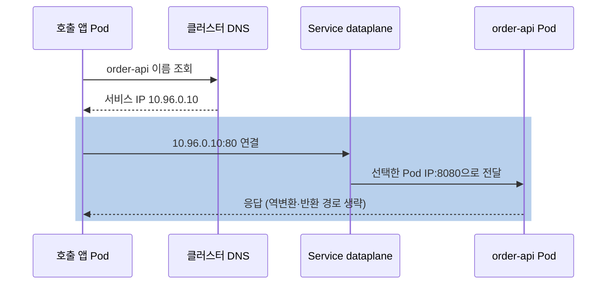
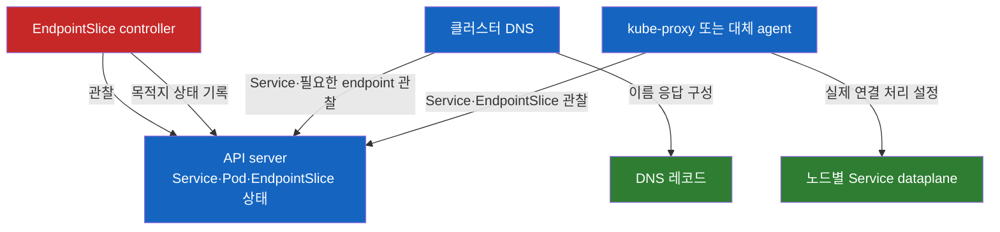
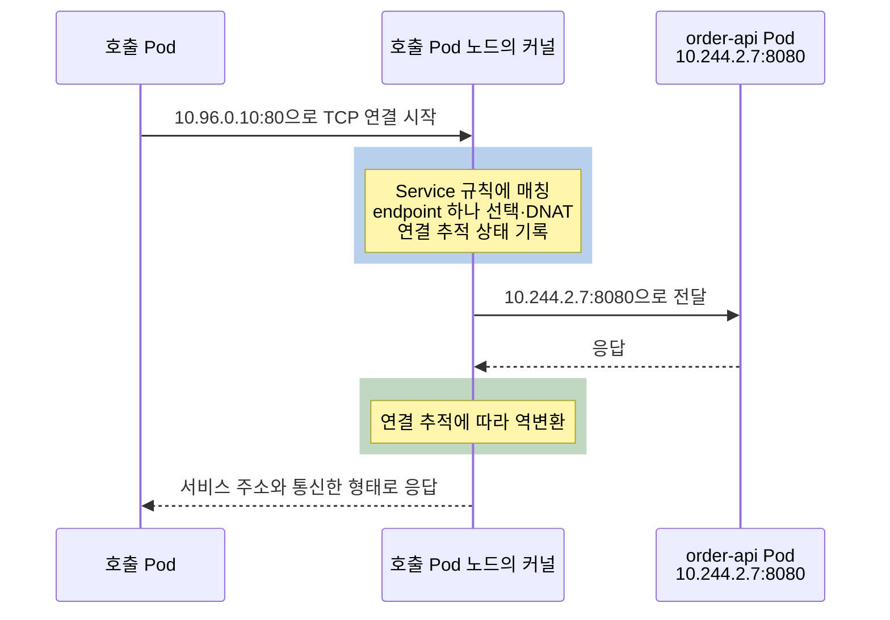

# Kubernetes Service Internals

> **개발자를 위한 쉬운 쿠버네티스 · 13장** | [전체 목차](./Kubernetes-Introduction.md#이-시리즈의-읽는-순서) · [이전 장](./Kubernetes-Service-ClusterIP-NodePort-LoadBalancer.md) · [다음 장](./Kubernetes-Probe-Liveness-Readiness-Startup.md)

**Service 이름을 호출했는데, 실제로는 누가 어떤 Pod에 연결하는가**

[앞 장](./Kubernetes-Service-ClusterIP-NodePort-LoadBalancer.md)에서는 호출자가 사용할 주소를 골랐다. 이제 같은 namespace의 앱이 `http://order-api:80`을 호출한다고 생각해 보자. DNS가 이름을 IP로 바꾸는 것과 그 IP로 보낸 연결이 주문 API의 Pod에 도착하는 것은 서로 다른 일이다. 이 두 단계를 나누면 이름 해석 장애, 대상 상태 문제, 네트워크 전달 문제를 구별할 수 있다.

## 결론부터 말하면

**일반 Service에서 DNS는 서비스 주소를 알려 주고, Service 네트워크 구현은 그 주소로 온 연결을 실제 endpoint로 전달한다.** EndpointSlice는 주소와 준비 상태를 공유하는 API 기록이고, kube-proxy는 이를 관찰하여 Linux 커널 규칙을 만드는 대표적인 구현이다. eBPF 기반 대체 구현도 있으므로 모든 클러스터에 동일한 iptables 경로가 있다고 가정하지 않는다.

| 단계 | 풀어야 하는 질문 | 대표적인 담당 |
|---|---|---|
| 이름 해석 | `order-api`의 서비스 주소는 무엇인가? | 클러스터 DNS, Pod의 resolver |
| 대상 상태 공유 | 어떤 Pod IP·포트를 지금 사용할 수 있는가? | EndpointSlice controller와 EndpointSlice |
| Service 전달 | 서비스 주소를 어떤 endpoint에 연결할까? | kube-proxy가 설정한 규칙 또는 대체 dataplane |
| Pod 간 전달 | 선택한 Pod IP까지 어떻게 도달할까? | 클러스터 Pod 네트워크 구현 |
| 앱 처리 | 도착한 연결을 어떤 프로세스가 받을까? | Pod에서 listen하는 앱 |

여기서 **dataplane** 은 실제 패킷·연결을 처리하는 부분을 뜻한다. 상태를 API에서 관찰해 그 동작을 설정하는 제어 과정과 구별하기 위한 용어다.

## 1. 먼저 Pod IP까지 가는 길이 필요하다

### 1.1 Service 이전의 Pod 네트워크

주문 API Pod가 `10.244.2.7:8080`에서 요청을 받고 있다고 가정한다. 다른 노드의 Pod가 이 주소에 연결하려면 그 노드 사이에 Pod IP를 전달할 수 있는 네트워크가 있어야 한다. Service가 이름과 가상 주소를 제공하기 전부터 필요한 바탕이다.

Kubernetes는 Pod마다 네트워크 공간을 제공하며, 같은 Pod의 컨테이너는 IP와 포트 공간을 공유한다. 서로 다른 Pod의 통신은 클러스터 네트워크가 구현한다. Linux 환경에서는 보통 **CNI(Container Network Interface)** 규약을 사용하는 plugin이 Pod의 네트워크 인터페이스·주소·경로 구성을 맡는다. 실제 노드 간 전달이 직접 라우팅인지 encapsulation인지, 어떤 정책·암호화를 적용하는지는 구현과 설정에 따라 다르다.

따라서 CNI를 "Service 이름을 DNS로 바꾸는 기능"이나 "모든 Service를 분산하는 프로그램"으로 정의하면 범위가 어긋난다. Pod 네트워크와 Service 기능은 서로 다른 책임이지만 하나의 제품이 둘 다 제공할 수 있다. 그 경우에도 장애를 좁힐 때는 두 질문을 따로 던져야 한다. [Kubernetes 네트워크 모델](https://kubernetes.io/docs/concepts/services-networking/)이 이 구분의 출발점이다.

### 1.2 직접 Pod IP가 된다고 Service도 되는 것은 아니다

직접 Pod IP로 요청이 성공했다면 그 출발지에서 해당 Pod까지의 경로와 그 포트의 앱 응답을 확인한 것이다. 아직 Service 주소의 대상 선택이나 DNS가 확인된 것은 아니다. 반대로 Service 이름 호출이 실패해도 앱이 죽었다고 바로 결론 내릴 수 없다. 이름 해석부터 실패했을 수 있다.

이 장의 IP와 출력은 모두 **설명용 예시** 다. 앱은 `bookstore` namespace, label `app: order-api`, container name `order-api`, Pod 포트 `8080`, Service 포트 `80`을 사용한다고 가정한다. `registry.example.com/book/order-api:1.0.0`은 공개 실행 이미지가 아니라 가상 이미지다.

## 2. DNS는 주소를 알려 주고 빠진다

### 2.1 짧은 이름을 namespace 안에서 해석한다

일반적인 Pod는 클러스터 DNS를 사용하도록 설정된 resolver 정보를 갖는다. 같은 namespace에서 `order-api`를 조회하면 search suffix를 이용하여 `order-api.bookstore.svc.<cluster-domain>` 같은 이름을 찾을 수 있다. 흔히 `<cluster-domain>`이 `cluster.local`이지만 클러스터마다 고정된 표준값은 아니다.

다른 namespace에서 부른다면 `order-api.bookstore`처럼 namespace를 포함하거나 실제 cluster domain까지 넣은 이름을 사용한다. resolver의 search·ndots 설정, 앱 DNS 라이브러리와 캐시에 따라 실제 질의 횟수와 갱신 시점이 달라질 수 있다.

```text
# 이름 해석의 설명용 예시, 실제 nslookup 출력이 아님
order-api.bookstore.svc.cluster.local  →  10.96.0.10
```

일반 Service의 A/AAAA 레코드는 서비스 IP를 가리킨다. IPv4 single-stack 예제에서는 하나지만 dual-stack Service에서는 family에 따라 주소가 둘일 수 있다. DNS 서버가 이 순간 Pod 하나를 골라 HTTP 요청을 대신 보내는 것은 아니다. 이름 해석이 끝나면 앱은 받은 IP의 `80` 포트로 연결한다.

### 2.2 DNS 이름과 앱 요청은 다른 경로다

아래 그림은 **DNS 조회와 앱 연결을 구분한 통신 흐름** 이다. CoreDNS는 대표적인 클러스터 DNS 구현이며 반드시 그 제품만 사용해야 한다는 뜻은 아니다.



DNS 응답을 받았는데 TCP 연결이 안 되는 경우 DNS 레코드를 지우거나 CoreDNS를 재시작할 이유는 아직 없다. 서비스 주소가 맞는지 확인한 뒤 endpoint와 전달 경로를 보아야 한다. 반대로 IP로는 되고 이름으로만 안 된다면 DNS·resolver 경로를 우선 분리해서 본다.

### 2.3 Headless와 환경 변수라는 다른 발견 방식

selector가 있는 Headless Service는 가상 IP 대신 준비된 endpoint 주소들을 DNS로 제공할 수 있다. 이때 클라이언트가 목록에서 연결 대상을 선택하고 재조회·재연결을 관리한다. DNS만 바꾸어도 클라이언트가 항상 모든 주소를 사용한다고 기대해서는 안 된다.

Service 정보는 환경 변수로도 전달될 수 있다. 기본적인 service links가 켜져 있으면 kubelet은 컨테이너 환경을 구성할 때 같은 namespace에 존재하는 Service의 정보를 넣는다. `order-api`라면 `ORDER_API_SERVICE_HOST`, `ORDER_API_SERVICE_PORT` 같은 형태다. 이미 실행 중인 컨테이너의 환경은 새 Service를 만들었다고 갱신되지 않는다. `enableServiceLinks: false` 같은 설정도 영향을 준다.

이 생성 순서 의존성을 피하고 서비스 발견을 일관되게 하려면 보통 DNS 이름을 사용한다. DNS도 캐시와 TTL이 있으므로 삭제·재생성의 변화가 모든 클라이언트에 즉시 반영된다는 뜻은 아니다. 에어갭 환경에서는 클러스터 내부 이름을 처리하는 DNS와 사내·외부 이름을 처리하는 상위 DNS의 책임을 구별한다. 내부 Service 조회 성공이 외부 의존성 이름의 조회 성공을 뜻하지 않는다.

## 3. EndpointSlice가 전달하는 것은 주소와 조건이다

### 3.1 서비스 주소와 대상 주소를 나누어 저장한다

Service에는 selector와 port가 있고, EndpointSlice에는 실제 endpoint 주소·포트와 조건이 있다. EndpointSlice controller는 Service와 Pod 변경을 API로 관찰하여 목록을 갱신한다. Pod 교체로 IP가 바뀌면 Service IP를 바꾸는 대신 대상 목록이 바뀐다.

하나의 Service에 EndpointSlice가 여러 개 있을 수 있다. 기본적으로 slice당 최대 100개의 endpoint를 관리하며 주소 family, 포트 조합 등에 따라 나뉜다. 모든 대상을 보려면 같은 namespace에서 `kubernetes.io/service-name=order-api`인 slice를 모두 읽어야 한다. 한 slice만 골라 읽으면 정상인 대상 일부를 빠뜨릴 수 있다.

```bash
# 관찰 명령 예시. 이 장에서 실행한 결과가 아니다.
kubectl -n bookstore get endpointslices \
  -l kubernetes.io/service-name=order-api -o yaml
```

**구조 설명용 발췌** 로 보면 다음처럼 준비된 Pod와 준비되지 않은 Pod가 함께 기록될 수 있다.

```yaml
ports:
  - name: http
    port: 8080
    protocol: TCP
endpoints:
  - addresses: ["10.244.2.7"]
    conditions:
      ready: true
      serving: true
      terminating: false
  - addresses: ["10.244.3.8"]
    conditions:
      ready: false
      serving: false
      terminating: false
```

두 번째 주소가 보인다는 사실만으로 Service가 그 주소로 일반 트래픽을 보낸다고 해석하면 안 된다. `ready` 같은 조건을 함께 읽어야 한다. 준비되지 않은 이유도 곧바로 Probe 실패라고 단정할 수 없다. Pod의 컨테이너 상태와 readiness gate 등 다른 조건이 영향을 줄 수 있다.

### 3.2 ready, serving, terminating

| 조건 | Pod 기반 endpoint에서 읽는 의미 |
|---|---|
| `serving` | Pod의 Ready 조건에 대응하는, 응답 가능한 상태 |
| `terminating` | 삭제 시각이 설정되어 종료 중인 상태 |
| `ready` | 일반적으로 `serving`이고 종료 중이 아닌지 나타내는 사용 편의 조건 |

종료 중에도 앱이 기존 연결을 마무리하고 있다면 `serving: true`, `terminating: true`, `ready: false`일 수 있다. 대부분의 새 트래픽에서는 종료 대상을 피하지만, 사용 가능한 endpoint가 모두 종료 중인 경우 등에는 구현·트래픽 정책에 따라 serving 상태의 종료 endpoint를 사용할 수 있다. 이것을 "모든 Pod가 종료해도 무중단" 보장으로 확대하지 않는다.

또한 Service의 `publishNotReadyAddresses: true`는 준비되지 않은 주소도 게시하도록 요청하는 예외다. controller가 Ready와 무관하게 `ready`를 true로 취급할 수 있으므로, 이 경우 endpoint의 ready만 보고 앱의 실제 준비 여부를 판단하면 안 된다. 상태 필드가 생략되었을 때의 API 의미도 있다. 일반적으로 `ready`·`serving`의 nil은 true, `terminating`의 nil은 false로 해석한다. 상세 계약은 [EndpointSlice API](https://kubernetes.io/docs/reference/kubernetes-api/discovery/endpoint-slice-v1/)를 따른다.

### 3.3 오래된 Endpoints 자료를 읽을 때

레거시 Endpoints API는 모든 주소를 하나의 오브젝트에 담는 방식이다. EndpointSlice는 큰 목록을 나누어 갱신하고 IPv4·IPv6와 topology 정보를 표현하기 더 적합하다. Endpoints API는 Kubernetes v1.33에서 deprecated되었으므로 새 도구와 관찰에는 EndpointSlice를 우선 사용한다. 이는 2026-10-23 확인한 [공식 deprecation 안내](https://kubernetes.io/blog/2025/04/24/endpoints-deprecation/) 기준이다.

Endpoints의 주소 목록은 1,000개를 초과하면 잘릴 수 있고, 준비되지 않은 주소는 별도 필드에 들어간다. 오래된 `kubectl get endpoints` 예제를 현재 endpoint 전체 목록으로 오해하지 않는 것이 중요하다. API를 읽는 모니터링·자동화도 deprecated 경고가 없다는 이유만으로 전환 완료라고 판단할 수는 없다.

## 4. Service는 선언이고, 여러 주체가 동작을 만든다

앞의 두 단계가 어떻게 협력하는지 **제어 관계** 로 그리면 다음과 같다. 이 그림의 화살표는 패킷 전달이 아니라 관찰과 결과 기록이다.



Service를 저장하면 API server가 DNS와 kube-proxy를 순서대로 직접 호출하는 것이 아니다. 각 주체는 API 상태를 독립적으로 관찰하며 자기 결과를 수렴시킨다. 그래서 EndpointSlice 갱신과 DNS·규칙 반영 사이에 시간이 있고, 일부 노드에만 오래된 규칙이 남는 장애도 가능하다.

Spring Cloud의 서비스 레지스트리를 아는 독자라면 EndpointSlice를 인스턴스 목록처럼 생각할 수 있다. 다만 일반 Service 클라이언트가 API의 EndpointSlice를 직접 읽는 것은 아니다. Kubernetes에서는 앱 외부의 DNS와 네트워크 구현이 이 정보를 사용하므로 호출 앱마다 별도 Kubernetes SDK를 넣을 필요가 없다. 이 차이를 빼면 클라이언트 측 discovery와 동일한 구조로 오해하게 된다.

<a id="3-패킷은-어디서-바뀌는가"></a>

## 5. 패킷은 어디서 바뀌는가

### 5.1 Linux kube-proxy iptables 경로의 예

이 절은 **Linux kube-proxy의 iptables 모드에서, 클라이언트 Pod가 ClusterIP로 TCP 연결하는 대표 경로** 다. 모든 구현에 같은 커널 hook과 변환 위치를 적용하지 않는다.

kube-proxy는 이름과 달리 이 모드에서 모든 앱 바이트를 자기 프로세스로 받아 중계하지 않는다. API에서 읽은 상태를 바탕으로 커널의 패킷 처리 규칙을 설정한다. 클라이언트가 보낸 첫 연결 패킷이 Service IP와 포트에 일치하면 규칙이 endpoint 하나를 선택하고 목적지 IP·포트를 바꾼다. 이것을 **DNAT(Destination NAT)** 라고 한다.



커널의 **conntrack** 은 연결 상태와 주소 변환을 추적한다. 이후 같은 TCP 연결의 패킷은 같은 변환 결과를 사용하고, 반환 패킷도 그 연결에 맞게 역변환한다. 실제 프레임과 라우팅·반환 경로는 네트워크 구현에 따라 더 많은 단계를 포함하지만, 이 모델만으로도 "Service가 요청마다 앱 서버를 다시 고르는가?"라는 질문에 답할 수 있다.

### 5.2 연결 단위 선택과 HTTP 요청 단위 분산

TCP 연결 하나가 정해진 Pod에 연결되어 있으면, 그 안의 여러 HTTP 요청은 같은 Pod로 간다. HTTP/1.1 keep-alive도 연결을 재사용할 수 있고 HTTP/2는 한 연결에 여러 stream을 다중화한다. 따라서 Service를 호출한다고 HTTP 요청 수가 복제본 수에 맞춰 균등 분산되는 것은 아니다.

특히 gRPC는 긴 HTTP/2 연결을 유지할 수 있어 Pod를 늘려도 기존 클라이언트의 부하가 새 Pod로 이동하지 않을 수 있다. 해결책은 요구에 따라 연결 수·수명을 관리하거나, Headless와 지원되는 gRPC client load balancing 정책을 사용하거나, 요청을 이해하는 L7 proxy를 사용하는 것이다. Headless만 만들고 클라이언트 정책을 그대로 두면 첫 주소에 계속 연결할 수도 있다.

마찬가지로 readiness 실패나 Service selector 변경이 이미 열린 연결을 자동으로 다른 Pod로 옮겨 주지는 않는다. endpoint 갱신은 주로 이후 대상 선택에 영향을 주며 기존 연결의 지속 여부는 앱 종료, 연결 추적과 구현 정책에 달린다.

<a id="4-clusterip는-어디에도-없는-ip다"></a>

## 6. ClusterIP는 어떤 인터페이스에 있는가

### 6.1 구현을 먼저 확인해야 하는 이유

iptables·nftables 방식에서는 서비스 주소가 전달 규칙의 매칭 대상으로 사용된다. 그 IP의 별도 앱 서버가 listen하는 구조가 아니다. 반면 IPVS 모드에서는 `kube-ipvs0` 같은 dummy 인터페이스에 서비스 IP를 붙인다. 그러므로 "ClusterIP는 어떤 인터페이스에도 절대 없다"는 문장은 구현 범위를 빠뜨린 설명이다.

2026-10-23 확인한 [Virtual IPs 공식 문서](https://kubernetes.io/docs/reference/networking/virtual-ips/)는 Kubernetes v1.37의 명시하지 않은 Linux kube-proxy 모드를 iptables로 설명하며, IPVS는 v1.35부터 deprecated라고 표시한다. 문서에 적힌 기본값이 모든 배포판이나 현재 운영 클러스터 설정을 뜻하지는 않는다. nftables 모드를 선택하려면 커널과 사용자 공간 도구 요구도 확인해야 한다.

| 구현 | 살펴볼 차이 |
|---|---|
| iptables kube-proxy | netfilter 규칙과 연결 추적. 기본 선택은 무작위이며 요청 수 균등 보장 아님 |
| nftables kube-proxy | nftables 규칙. NodePort 주소·방화벽 등의 모드 차이 확인 |
| IPVS kube-proxy | IPVS와 iptables, dummy interface. deprecated 상태와 마이그레이션 계획 확인 |
| eBPF 기반 대체 구현 | 제품이 Service 처리까지 맡는지, socket·packet 처리 지점과 설정 확인 |

IPVS 제거의 미래 버전 계획을 현재 동작처럼 외우기보다 실제 사용하는 버전 문서와 배포 설정을 확인해야 한다. Service API의 의미가 같아도 구현을 전환하면 연결 상태·정책 세부 동작에 영향이 있을 수 있다.

### 6.2 eBPF도 같은 명령으로 보이는 것은 아니다

Cilium 같은 구현은 kube-proxy replacement를 제공한다. eBPF는 커널 안의 검증된 프로그램을 통해 동작을 확장하는 기술이며, Cilium의 socket load balancing은 연결 시점에 서비스 주소를 실제 backend 주소로 변환할 수 있다. 이런 경로에서 iptables의 `KUBE-SERVICES`만 찾으면 아무것도 없다는 잘못된 결론에 이를 수 있다.

다만 Cilium을 설치했다는 사실만으로 모든 연결이 socket 수준에서 처리된다고 단정하지 않는다. replacement 활성화 여부, socket과 packet 경로의 설정·조건을 확인해야 한다. 구현별 설명은 [Cilium 공식 문서](https://docs.cilium.io/en/stable/network/kubernetes/kubeproxy-free/)를 따른다.

<a id="5-같은-원리로-읽는-traffic-policy"></a>

## 7. 같은 원리로 읽는 Traffic Policy

### 7.1 externalTrafficPolicy와 출발지 IP

NodePort나 노드 대상으로 구성한 LB는 외부 연결을 먼저 어떤 노드로 전달한다. `externalTrafficPolicy: Cluster`에서는 다른 노드의 endpoint도 사용할 수 있다. kube-proxy의 대표적인 외부 전달 경로에서는 반환 경로를 유지하기 위해 출발지 주소를 노드 주소로 바꾸는 **SNAT(Source NAT)** 가 적용될 수 있다. 그 경우 앱 로그에는 원래 클라이언트 대신 노드 IP가 보인다.

`externalTrafficPolicy: Local`은 해당 노드의 로컬 대상에 한정하고, 이 경로에서 원래의 출발지 주소를 보존하는 데 쓰인다. 아래는 **Service spec의 구조 설명용 발췌** 다.

```yaml
type: LoadBalancer
externalTrafficPolicy: Local
selector:
  app: order-api
ports:
  - port: 80
    targetPort: 8080
```

Local을 설정했다고 앱에 최종 사용자 IP가 반드시 보이는 것은 아니다. 앞의 LB가 연결을 종료하고 새 연결을 만들었다면 노드에 도착한 출발지부터 LB IP일 수 있다. 직접 Pod target을 사용하는 LB나 다른 dataplane 경로도 따로 보아야 한다. HTTP `X-Forwarded-For` 같은 헤더와 네트워크 패킷의 source IP는 서로 다른 정보이며, 신뢰 가능한 proxy 범위도 정해야 한다.

Local에는 가용성과 분산의 대가가 있다. 로컬 대상이 없는 노드에 들어오면 다른 노드로 무조건 넘겨 주지 않는다. LB가 사용하는 `healthCheckNodePort` 같은 노드 건강 판단과 target 제외가 필요할 수 있으며, 실제 LB 연동은 구현이 맡는다. 노드별 Pod 수가 다르면 노드 단위의 균등 분산이 Pod 단위 균등 분산으로 이어지지 않는다. 종료 중 로컬 endpoint의 fallback 동작도 있으므로 단순히 "Pod가 있으면 언제나 성공"으로 해석하지 않는다.

### 7.2 internalTrafficPolicy: 같은 노드로 제한하기

내부 Service 호출에서 `internalTrafficPolicy: Local`은 호출이 시작된 노드의 endpoint만 사용하도록 한다. 노드를 건너는 전달을 피하려는 목적이지만, 지연이 항상 감소한다는 보장은 없다. 로컬 용량 부족이나 부하 편중이 더 큰 영향을 줄 수 있다.

```yaml
# Service spec의 구조 설명용 발췌
internalTrafficPolicy: Local
```

이 정책에서 해당 노드에 사용 가능한 대상이 없으면 다른 노드에 정상 Pod가 있어도 호출이 실패할 수 있다. DaemonSet처럼 노드별 대상이 있는 요구와 연결해 검토할 수 있지만, 실제 배치 조건과 Ready 상태까지 확인해야 한다. 로컬 우선 선호와 로컬만 허용하는 제약은 다르다. 세부 정책은 [Service Internal Traffic Policy](https://kubernetes.io/docs/concepts/services-networking/service-traffic-policy/)에 정리되어 있다.

<a id="6-같은-원리로-읽는-session-affinity"></a>

## 8. 같은 원리로 읽는 Session Affinity

열린 TCP 연결 하나는 원래 같은 대상에 붙어 있다. `sessionAffinity: ClientIP`는 이 한 연결을 유지하는 옵션이 아니라, 같은 클라이언트 IP의 여러 새 연결에서도 같은 backend를 선택하도록 하는 옵션이다.

```yaml
# Service spec의 구조 설명용 발췌
sessionAffinity: ClientIP
sessionAffinityConfig:
  clientIP:
    timeoutSeconds: 10800
```

기본 affinity는 `None`이며 `ClientIP`의 기본 timeout은 10,800초다. 이 옵션을 쓰면 앱의 메모리 세션이 안정적으로 보존된다는 결론은 나오지 않는다. Pod가 교체되면 그 메모리는 사라진다. NAT 뒤의 여러 사용자는 같은 IP로 보일 수 있고, 중간 proxy를 거치면 그 proxy의 IP가 기준이 될 수도 있다.

따라서 세션의 내구성이 필요하면 외부 저장소와 앱 설계를 검토한다. 사용자·쿠키 단위의 고정이 필요하면 해당 L7 구현의 지원을 확인한다. Session affinity는 분산 정책이고 세션 복제나 장애 복구 기능은 아니다.

## 9. 원리를 이용해 장애를 나누어 보기

### 9.1 ping보다 실제 프로토콜·포트

ClusterIP로 `ping`이 실패해도 HTTP Service가 고장났다는 뜻은 아니다. ICMP는 Service에 선언한 TCP `80` 포트를 검사하지 않는다. iptables·nftables 경로에는 그 IP로 ICMP를 처리할 별도 서버가 없는 것이 자연스럽다. 구현에 따라 ping에 응답할 수도 있으므로 성공 역시 앱 정상의 증거가 아니다.

호출자가 사용하는 프로토콜과 포트로 검증해야 한다. 실제 앱 이미지에 curl이나 shell이 있을지도 전제하지 않는다. 필요하다면 허용된 진단 도구를 갖춘 Pod를 별도로 준비하고 출발지와 실행 조건을 기록한다. 진단 이미지를 새로 받을 수 없는 환경에서는 사전 반입과 정책 허용도 필요하다.

### 9.2 일부 노드에서만 실패한다면

kube-proxy가 멈췄다고 커널의 기존 규칙이 즉시 모두 사라지는 것은 아니다. 한동안 기존 대상에는 연결되지만 Pod가 교체되었을 때 갱신되지 않은 주소로 보내는 문제가 생길 수 있다. API의 EndpointSlice가 올바르더라도 각 노드의 dataplane이 같은 상태라는 증거는 아니다.

노드별 실패가 확인되면 그 노드의 Service 구현 agent 상태·로그·규칙을 실제 구현에 맞게 조사한다. kube-proxy를 사용하지 않는 환경에서 kube-proxy Pod가 없다는 사실을 장애로 해석하지 않는다. 노드 커널 규칙의 직접 확인은 권한과 구현을 아는 관리자의 진단 범위이며, 이 장에서는 수정 명령을 제시하지 않는다.

### 9.3 관찰 순서는 이름 → 상태 → 전달을 분리한다

| 관찰 | 다음에 좁힐 곳 |
|---|---|
| 이름만 실패하고 ClusterIP는 성공 | 클러스터 DNS, Pod resolver, 앱 캐시 |
| 이름은 맞고 endpoint가 없거나 준비되지 않음 | selector·Pod 실행 상태·Ready·종료 조건 |
| 직접 Pod IP는 되는데 ClusterIP는 실패 | Service port·정책·dataplane과 그 출발지의 적용 상태 |
| Pod IP도 실패 | 앱 listen, 대상 포트, Pod 간 라우팅·정책 |
| 새 연결은 정상인데 기존 연결만 실패 | 교체된 Pod, 앱 종료 처리, 장기 연결·연결 추적 상태 |

이 표는 확정 원인 목록이 아니라 다음 증거를 고르는 기준이다. `port-forward`나 Pod 내부 localhost 응답만으로 이 전체 경로를 통과했다고 판단하지 않는다. 종합 진단은 [apply에서 요청까지](./Kubernetes-Troubleshooting-From-Apply-to-Request.md)에서 다시 연결한다.

## 생각해 볼 질문

### DNS 응답에 ClusterIP가 보이면 endpoint 선택도 검증된 것일까?

아니다. DNS는 이름에 해당하는 서비스 주소를 알려 준다. endpoint의 존재·준비 상태와 dataplane의 대상 선택, Pod IP 전달은 이후 단계다. 이 구분이 DNS를 불필요하게 수정하지 않게 해 준다.

### Pod를 두 배로 늘렸는데 gRPC 부하가 그대로라면 어떤 연결 상태를 볼까?

기존의 긴 HTTP/2 연결이 이전 Pod에 고정되어 있을 수 있다. 새 Pod 수만 볼 것이 아니라 클라이언트의 연결 수·재연결 정책·분산 정책을 확인해야 한다. Service는 각 gRPC 메시지를 보고 다른 Pod로 나누는 L7 proxy가 아니다.

### EndpointSlice가 정확한데 한 노드에서만 실패할 수 있을까?

가능하다. API 상태의 갱신과 노드별 네트워크 규칙 반영은 다르다. 그 노드 agent의 동작, 규칙 갱신, Pod 라우팅·정책을 확인해야 하며 API 기록만으로 모든 dataplane의 수렴을 증명할 수 없다.

이제 남은 질문은 endpoint의 준비 상태가 어디서 오는가다. [Probe](./Kubernetes-Probe-Liveness-Readiness-Startup.md)에서는 프로세스 실행과 앱 준비, 재시작 판단을 구별한다.

## 출처

2026-10-23 기준 공식 자료를 확인했다. IP·출력·경로도는 설명용이며 실제 클러스터 패킷을 관찰한 기록이 아니다.

- [Kubernetes — Services, Load Balancing, and Networking](https://kubernetes.io/docs/concepts/services-networking/): Pod 네트워크 모델과 역할 구분.
- [Kubernetes — DNS for Services and Pods](https://kubernetes.io/docs/concepts/services-networking/dns-pod-service/): 일반·Headless DNS와 이름 구조.
- [Kubernetes — EndpointSlices](https://kubernetes.io/docs/concepts/services-networking/endpoint-slices/): 분할·주소 family·상태와 소비자.
- [Kubernetes API — EndpointSlice v1](https://kubernetes.io/docs/reference/kubernetes-api/discovery/endpoint-slice-v1/): 조건의 nil 의미와 endpoint 구조.
- [Kubernetes — Service](https://kubernetes.io/docs/concepts/services-networking/service/): 환경 변수·Service discovery와 정책.
- [Kubernetes — Virtual IPs and Service Proxies](https://kubernetes.io/docs/reference/networking/virtual-ips/): proxy mode, 선택과 연결 추적, 정책·affinity.
- [Kubernetes — Service Internal Traffic Policy](https://kubernetes.io/docs/concepts/services-networking/service-traffic-policy/): 로컬 대상 제한.
- [Kubernetes — Using Source IP](https://kubernetes.io/docs/tutorials/services/source-ip/): source NAT와 외부 트래픽 정책.
- [Kubernetes Blog — Continuing the transition from Endpoints to EndpointSlices](https://kubernetes.io/blog/2025/04/24/endpoints-deprecation/): v1.33 Endpoints deprecation.
- [Kubernetes Blog — gRPC Load Balancing on Kubernetes without Tears](https://kubernetes.io/blog/2018/11/07/grpc-load-balancing-on-kubernetes-without-tears/): 장기 연결과 L7·클라이언트 분산.
- [Cilium — Kubernetes Without kube-proxy](https://docs.cilium.io/en/stable/network/kubernetes/kubeproxy-free/): kube-proxy replacement와 socket load balancing.
