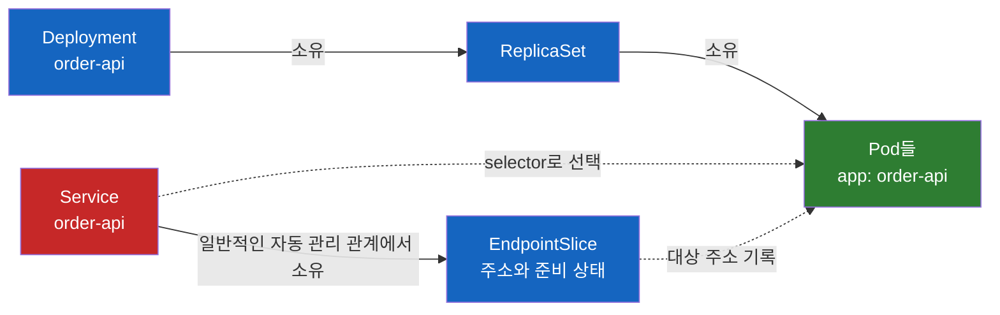

# Kubernetes Service Object

> **개발자를 위한 쉬운 쿠버네티스 · 7장** | [전체 목차](./Kubernetes-Introduction.md#이-시리즈의-읽는-순서) · [이전 장](./Kubernetes-ConfigMap-Secret.md) · [다음 장](./Kubernetes-Service-ClusterIP-NodePort-LoadBalancer.md)

**Service를 지워도 Pod는 왜 그대로일까 — 실행을 유지하는 관계와 호출 대상을 고르는 관계**

[Deployment](./Kubernetes-ReplicaSet-Deployment.md)는 주문 API의 Pod를 원하는 개수로 유지한다. 그런데 호출하는 앱은 Pod가 교체될 때마다 새 IP를 알아내야 할까? 여기에 Service가 등장한다. 이 장에서는 네트워크 패킷보다 먼저, Service가 어떤 정보를 기록하고 다른 오브젝트와 어떤 관계를 맺는지 살펴본다.

## 결론부터 말하면

**Service는 Pod를 만들거나 소유하지 않고, 호출할 이름·포트와 대상 선택 조건을 기록한다.** 같은 namespace에서 selector에 맞는 Pod를 찾으면, EndpointSlice controller가 그 주소와 준비 상태를 별도 오브젝트에 기록한다. 그래서 Service를 삭제해도 Deployment와 Pod는 남지만, 그 Service를 통한 호출 경로는 사라진다.



이것은 오브젝트의 관계를 그린 그림이다. HTTP 요청이 Deployment와 EndpointSlice를 차례로 거쳐 Pod로 전달된다는 뜻은 아니다. 실제 통신 경로는 [Service 내부 동작](./Kubernetes-Service-Internals.md)에서 다룬다.

## 1. 실행할 앱과 호출할 대상은 다른 기록이다

### 1.1 Pod IP를 배포 설정처럼 다룰 수 없는 이유

주문 API를 두 개의 Pod로 실행한다고 생각해 보자. Deployment가 새 버전을 배포하거나 장애가 난 Pod를 교체하면, 새 Pod는 이전 것과 다른 오브젝트다. IP도 달라질 수 있다. 컨테이너만 같은 Pod 안에서 재시작되는 것과 Pod 자체가 교체되는 것은 구분해야 한다.

호출하는 앱에 Pod IP를 고정하면 실행을 복구할 때마다 호출 설정도 수정해야 한다. 복제본을 늘리는 순간에는 어느 IP를 선택할지도 클라이언트의 문제가 된다. 일반적인 Service는 이 변화를 호출자로부터 감춘다. 이 예제의 호출자도 `bookstore` namespace에 있으며, `order-api`라는 짧은 DNS 이름과 `80`번 포트를 사용하고, 클러스터는 그 뒤의 대상 목록을 갱신한다.

이때 Service가 Pod를 복구하는 것은 아니다. Pod가 하나도 없더라도 Service 오브젝트는 존재할 수 있다. 주소는 있는데 응답할 앱은 없는 상태다. 반대로 호출받지 않는 배치 작업은 Service 없이도 실행할 수 있다. 네트워크로 호출받는 앱에서 Deployment와 Service를 함께 사용하는 이유는 서로 다른 문제를 맡기기 위해서다.

### 1.2 앱 하나를 둘러싼 오브젝트 지도

앞에서 배운 오브젝트를 질문으로 다시 연결해 보면 Service의 자리가 분명해진다.

| 오브젝트 | 기록하는 질문 | 실행 또는 후속 처리를 담당하는 주체 |
|---|---|---|
| Deployment | 어떤 Pod 템플릿을 몇 개 유지할까? | Deployment controller, ReplicaSet controller |
| Pod | 이 실행 단위에 어떤 컨테이너가 필요한가? | scheduler, kubelet, container runtime 등 |
| Service | 어떤 이름·포트로 어떤 대상을 호출할까? | EndpointSlice controller, DNS와 Service 네트워크 구현 등 |
| ConfigMap / Secret | 앱에 어떤 설정을 전달할까? | kubelet의 주입·마운트와 앱의 설정 읽기 |
| PersistentVolumeClaim | 어떤 저장 공간이 필요한가? | 스토리지 controller, provisioner, CSI 구현 등 |
| Ingress | HTTP 요청을 어느 Service로 보낼까? | 설치된 Ingress controller와 그 데이터 경로 |

리소스를 저장하는 API와 그것을 해석해 일하는 주체를 나누어 보아야 한다. Service도 저장된 YAML만으로 패킷을 전달하지 않는다. 그렇다고 모든 구성 요소를 배워야 Service를 읽을 수 있는 것은 아니다. 먼저 호출 주소와 선택 조건을 이해하면 다음 장의 타입과 내부 동작을 연결할 수 있다.

<a id="2-service-오브젝트-해부-내가-쓴-10줄-저장된-30줄"></a>

## 2. Service 오브젝트 해부: 무엇을 적고 무엇을 받는가

### 2.1 주문 API를 가리키는 최소 선언

다음은 **완전한 설명용 Service manifest** 다. `bookstore` namespace와 `app: order-api` 라벨의 Pod가 준비되어 있다고 가정한다. 앱은 Pod IP의 `8080`에서 HTTP를 받는다. 책의 `order-api`와 이미지 `registry.example.com/book/order-api:1.0.0`은 가상 사례이며 공개 실행 이미지를 제공한다는 뜻이 아니다.

```yaml
apiVersion: v1
kind: Service
metadata:
  name: order-api
  namespace: bookstore
spec:
  type: ClusterIP
  selector:
    app: order-api
  ports:
    - name: http
      port: 80
      targetPort: 8080
      protocol: TCP
```

`metadata.name`은 Service 자신의 이름이다. `selector.app`은 Pod의 라벨을 검색하는 조건이다. 이름이 둘 다 `order-api`라서 연결되는 것이 아니다. Service 이름을 `orders`로 바꾸어도 selector가 같으면 같은 Pod를 선택한다. 반대로 이름이 같은 Deployment가 있어도 Pod 라벨이 다르면 선택하지 못한다.

포트도 두 대상을 나누어 읽는다. `port: 80`은 호출자가 Service에 접속할 때 쓰고, `targetPort: 8080`은 선택된 Pod의 앱에 연결할 때 쓴다. 컨테이너 안 프로세스가 실제로 `8080`에서 listen해야 한다. Service 선언이나 Pod의 `containerPort` 필드가 앱 프로세스의 리스너를 만들어 주지는 않는다.

### 2.2 저장된 오브젝트가 더 길어지는 이유

이 manifest를 API로 저장하고 다시 조회하면 사용자가 쓰지 않은 필드도 보인다. API server는 기본값을 적용하고, 일반 Service에는 서비스 주소 대역에서 ClusterIP를 할당한다. 고유 ID와 생성 시각 같은 메타데이터도 추가한다.

다음은 **저장 형태를 설명하기 위한 발췌** 다. IP는 예시이며 실제 실행 출력이 아니다.

```yaml
metadata:
  name: order-api
  namespace: bookstore
spec:
  clusterIP: 10.96.0.10
  clusterIPs:
    - 10.96.0.10
  ipFamilies:
    - IPv4
  ipFamilyPolicy: SingleStack
  type: ClusterIP
  sessionAffinity: None
  internalTrafficPolicy: Cluster
  selector:
    app: order-api
  ports:
    - name: http
      port: 80
      targetPort: 8080
      protocol: TCP
status:
  loadBalancer: {}
```

`spec`을 모두 사용자가 직접 채운다고 생각하면 이 결과가 이상해 보인다. `spec`은 원하는 상태의 기록이지만, 일부 필드는 생략한 기본값이나 시스템의 할당 결과를 포함한다. `clusterIP`가 `spec`에 있는 것이 그 예다. 반면 LoadBalancer 주소처럼 외부 controller의 처리 결과는 `status.loadBalancer`에서 확인한다.

| 필드 | 읽는 관점 |
|---|---|
| `metadata.name`, `namespace` | 어느 범위의 어떤 Service인가? |
| `spec.selector` | 어떤 라벨의 Pod를 대상으로 삼는가? |
| `spec.ports` | 호출자가 쓰는 포트와 앱 포트는 무엇인가? |
| `spec.type` | 어떤 접속 범위를 요청했는가? |
| `spec.clusterIP`, `clusterIPs` | 어떤 서비스 주소가 할당되었는가? |
| `metadata.uid` | 같은 이름으로 다시 만들기 전후를 구별하는 ID는 무엇인가? |
| `metadata.resourceVersion` | API 변경 감시에 사용하는 불투명한 버전 값은 무엇인가? |
| `status.loadBalancer` | 담당 controller가 보고한 LB 주소는 무엇인가? |

`resourceVersion`은 앱 배포 버전이나 사용자가 계산할 순번이 아니다. API의 동시성 제어와 watch에 쓰는 값으로 취급해야 한다. 조회 결과가 길다는 이유로 그대로 새 manifest에 복사하면 시스템 관리 필드까지 설정 파일에 섞이기 쉽다.

## 3. Service는 Pod를 소유하지 않는다

### 3.1 소유 관계와 선택 관계

Kubernetes의 소유 관계는 자식의 `metadata.ownerReferences`에 기록된다. 일반적인 Deployment의 Pod는 ReplicaSet을 소유자로 가리키고, 그 ReplicaSet은 Deployment를 가리킨다. 이 관계는 garbage collector가 종속 오브젝트를 정리하는 근거다. 기본적인 연쇄 삭제에서는 Deployment 삭제 후 ReplicaSet과 Pod가 정리된다. orphan 같은 삭제 정책을 명시한 경우까지 무조건 같다고 해석하지는 않는다.

Service의 selector는 이 소유 관계와 별개다. `app: order-api`라는 라벨은 "이 Service의 소유물"이라는 표식이 아니라 검색할 수 있는 속성이다. 하나의 Pod를 여러 Service가 선택해도 되고, 어느 Service에도 선택되지 않아도 된다. [Owners and Dependents 공식 문서](https://kubernetes.io/docs/concepts/overview/working-with-objects/owners-dependents/)도 Service의 선택 관계를 소유 관계와 구별한다.

| 삭제하는 것 | 기본적인 영향 | 그대로 남는 것 |
|---|---|---|
| Deployment | 소유된 ReplicaSet·Pod가 정리됨 | Service. 대상 Pod가 없어지면 endpoint 목록도 수렴하여 비게 됨 |
| Service | 해당 Service의 DNS·네트워크 구성이 정리되고, 소유된 EndpointSlice도 정리됨 | Deployment, ReplicaSet, Pod |
| Pod 하나 | 그 Pod는 종료됨. ReplicaSet은 부족한 복제본을 보충함 | Service와 다른 Pod |

표의 각 변화는 비동기적이다. 삭제 요청의 응답과 DNS 캐시, endpoint 목록, 노드의 네트워크 규칙이 모두 바뀌는 순간이 같지는 않다. Service를 다시 만들면 같은 라벨의 Pod를 다시 선택할 수 있지만 이전 ClusterIP나 이미 열린 연결의 연속성까지 보장되는 것은 아니다.

### 3.2 라벨이 맞으면 다른 Deployment도 선택된다

Service는 Deployment 이름이나 ReplicaSet 소유자를 선택 조건으로 사용하지 않는다. 같은 `bookstore` namespace에서 테스트 Pod에 `app: order-api`를 붙이면 그 Pod도 대상 후보가 된다. `dev` namespace의 같은 라벨은 선택하지 않는다. selector의 범위가 Service와 같은 namespace이기 때문이다.

따라서 "Deployment는 정상인데 일부 요청만 엉뚱한 버전으로 간다"면 복제본 개수만 볼 것이 아니라 실제 선택 결과를 확인해야 한다. 다음 명령은 **직접 실행할 때 사용할 관찰 예시** 다. 이 장에서 실행한 결과는 아니다.

```bash
kubectl -n bookstore get svc order-api -o yaml
kubectl -n bookstore get pods -l app=order-api --show-labels
kubectl -n bookstore get endpointslices \
  -l kubernetes.io/service-name=order-api -o yaml
```

첫째 명령으로 조건을 읽고, 둘째로 일치하는 Pod를 찾고, 셋째로 실제 주소와 상태를 대조한다. 한 개의 EndpointSlice만 있다고 가정하지 말고 Service 이름 라벨에 맞는 전체 목록을 보아야 한다.

운영에서는 앱 이름 외에 instance·component 같은 라벨을 조합하여 충돌 범위를 줄일 수 있다. 예를 들어 `app.kubernetes.io/name`과 `app.kubernetes.io/instance`를 팀 규칙으로 사용하는 방식이다. 다만 label과 selector는 권한 경계가 아니다. 다른 주체가 그 라벨을 붙이지 못하게 하는 권한 제어는 별도 문제다.

### 3.3 선택과 준비는 두 번의 질문이다

라벨이 일치했다고 곧바로 정상적인 트래픽 대상이 되지는 않는다. EndpointSlice에는 선택된 Pod의 주소와 함께 `ready`, `serving`, `terminating` 같은 조건이 들어간다. "주문 API의 일원인가?"와 "지금 새 연결을 받을 상태인가?"를 따로 기록하는 것이다.

일반적인 자동 관리에서는 Pod가 Ready가 아니면 endpoint가 `ready: false`로 남을 수 있다. 목록에서 주소가 완전히 지워져야 제외되는 것은 아니다. Service 네트워크 구현은 이 조건과 트래픽 정책을 해석해 사용할 대상을 정한다. `publishNotReadyAddresses`처럼 준비 상태를 다르게 취급하도록 요청하는 예외도 있다. 상태 필드의 세부 의미는 [9장](./Kubernetes-Service-Internals.md), 앱의 준비 상태를 만드는 방법은 [10장 Probe](./Kubernetes-Probe-Liveness-Readiness-Startup.md)로 이어진다.

## 4. EndpointSlice는 선택 결과를 공유하는 기록이다

### 4.1 모든 호출자가 Pod를 검색하지 않도록

각 호출자가 API server에 접속해 Service selector를 읽고 Pod를 검색한다면 호출 코드가 Kubernetes API와 권한에 의존하게 된다. 대신 EndpointSlice controller가 Service와 Pod의 변화를 관찰하고, 현재 목적지 정보를 공통 형식으로 기록한다. DNS와 Service 네트워크 구현은 필요한 API 정보를 관찰해 각자 자기 결과를 만든다.

아래는 **EndpointSlice의 구조 설명용 발췌** 다. 주소와 이름은 예시이며 적용용 manifest가 아니다.

```yaml
kind: EndpointSlice
metadata:
  name: order-api-example
  namespace: bookstore
  labels:
    kubernetes.io/service-name: order-api
    endpointslice.kubernetes.io/managed-by: endpointslice-controller.k8s.io
  ownerReferences:
    - apiVersion: v1
      kind: Service
      name: order-api
      uid: example-service-uid
      controller: true
addressType: IPv4
ports:
  - name: http
    port: 8080
    protocol: TCP
endpoints:
  - addresses: ["10.244.1.7"]
    conditions:
      ready: true
      serving: true
      terminating: false
    targetRef:
      kind: Pod
      namespace: bookstore
      name: order-api-example-pod
```

`kubernetes.io/service-name`은 어느 Service에 연결되는 slice인지 찾는 라벨이고, `ownerReferences`는 삭제 시 종속 관계를 표현한다. `managed-by`는 누가 관리하는 목록인지 구별한다. 이 세 필드는 목적이 다르다. 일반 controller가 만든 slice는 Service를 소유자로 갖지만, 모든 EndpointSlice가 반드시 이렇게 생성되는 것은 아니다.

### 4.2 selector가 없는 Service

클러스터 밖의 DB를 서비스 주소 뒤에 둘 수도 있다. 이때 Service에서 `selector`를 생략하면 기본 EndpointSlice controller가 Pod 목록을 자동 생성하지 않는다. 관리자가 직접 또는 별도 controller가 EndpointSlice를 관리하고 실제 서버 주소를 기록할 수 있다.

이는 뒤에서 배울 `ExternalName`과 다르다. selector 없는 일반 Service와 수동 EndpointSlice는 서비스 IP 뒤에 주소 목록을 두는 방식이고, ExternalName은 DNS 별칭을 돌려주는 방식이다. 어느 쪽도 외부 서버를 배포하거나 방화벽·라우팅을 해결하지 않는다.

수동 EndpointSlice를 관리한다면 Service 이름 라벨, endpoint port, 주소의 유효성, 주소 변경 시 갱신 책임까지 가져가야 한다. 자동 생성이 아니므로 owner reference를 생략하면 Service 삭제 시 slice가 남을 수도 있다. 잘못된 목적지로 다른 Service를 중첩하는 방식도 지원되는 일반 해법이 아니다. 공식 Service 문서의 endpoint 주소 제한을 확인해야 한다.

또한 selector가 없는 Service에 `kubectl port-forward service/...`를 사용해 외부 주소로 터널을 만들 수 있다고 기대해서는 안 된다. API server는 Pod에 매핑되지 않은 endpoint로의 프록시를 허용하지 않는다. Service라는 이름이 있다고 모든 API 기반 접속 도구가 같은 방식으로 동작하는 것은 아니다.

<a id="5-service의-일생-만들-때-고칠-때-지울-때"></a>

## 5. Service의 일생: 바뀌는 것과 유지되는 것

### 5.1 생성과 반영 사이

Service 생성 요청은 API 검증, 기본값 처리, 주소 할당과 저장을 거친다. 그 뒤 EndpointSlice controller, DNS, Service 네트워크 구현이 각각 변경을 관찰한다. API server가 이들을 하나씩 동기 호출해 모든 네트워크 구성을 완성한 뒤 `created`를 돌려주는 방식은 아니다.

그래서 저장 직후 Service는 보이는데 endpoint가 아직 없거나 DNS·네트워크 반영이 진행 중일 수 있다. 기다리면 해결될 일과 selector 오류로 영원히 대상이 없는 상태를 구분하려면 의도와 후속 결과를 함께 보아야 한다.

### 5.2 selector 변경은 Pod 배포와 독립적이다

Service의 selector를 `version: v1`에서 `version: v2`로 바꾸면, 이미 존재하는 신버전 Pod를 선택하도록 바꿀 수 있다. 이 변경이 Deployment 이미지를 수정하거나 v2 Pod를 만들어 주지는 않는다. 새 대상의 Ready 상태와 실제 endpoint 전파를 확인해야 한다.

이 독립성이 Blue/Green 배포의 재료가 된다. 그렇지만 selector 변경이 모든 노드와 기존 연결을 한순간에 전환하는 트랜잭션은 아니다. [배포 전략](./Kubernetes-Deployment-Strategy.md)에서는 이 경계와 종료 처리를 함께 다룬다.

### 5.3 주소와 이름의 제약

일반 Service의 기본 ClusterIP는 오브젝트가 유지되는 동안 안정적인 주소다. 임의의 다른 IP로 바꾸는 필드는 아니다. 주소를 바꾸기 위해 삭제·재생성하면 DNS 이름은 같아도 오브젝트 UID와 할당 IP가 달라질 수 있어 호출자 캐시와 연결에 영향을 준다. `ExternalName`으로의 타입 전환이나 single-stack/dual-stack 전환에는 별도 규칙이 있으므로 모든 IP 관련 필드가 영구히 불변이라고 외우는 것도 정확하지 않다.

이름은 DNS에 사용되므로 길이와 문자 규칙을 지켜야 한다. 여러 버전에서 사용할 예제로는 `order-api`처럼 영문 소문자로 시작하고 소문자·숫자·하이픈을 쓰는 63자 이하 이름이 안전하다. 숫자로 시작하는 이름의 허용 여부는 대상 버전과 `RelaxedServiceNameValidation` 동작을 확인한다. 이 장은 그 기능의 활성화를 전제로 하지 않는다. [Object Names and IDs](https://kubernetes.io/docs/concepts/overview/working-with-objects/names/)에서 적용 규칙을 확인할 수 있다.

## 6. 관찰 사례: 별도 로컬 환경에서 본 관계

다음은 `docker-desktop`, Kubernetes `v1.36.1`, namespace `til-svc-demo`에서 남긴 별도 관찰 기록의 발췌다. 리소스명은 `my-app`과 `my-svc`를 그대로 사용한다. 앞의 `bookstore/order-api` 설명용 예제를 실행한 출력이 아니며, 현재 클러스터 상태를 보여 주는 자료도 아니다.

Service를 조회한 기록에는 사용자가 넣지 않은 할당값이 보인다.

```yaml
# kubectl get svc my-svc -o yaml 결과 중 발췌
metadata:
  creationTimestamp: "2026-10-05T04:01:25Z"
  name: my-svc
  namespace: til-svc-demo
  resourceVersion: "157817"
  uid: 771191c7-e912-4ed4-93fe-7fb97ee01b19
spec:
  clusterIP: 10.104.220.35
  clusterIPs:
    - 10.104.220.35
  selector:
    app: my-app
  ports:
    - port: 80
      protocol: TCP
      targetPort: 80
  type: ClusterIP
```

이 사례의 앱 포트는 `80`이었다. `order-api` 예제의 `8080`과 섞어 읽으면 안 된다. 다음 기록은 라벨 선택이 소유 관계와 다름을 보여준다. 별도로 띄운 `stray` Pod가 같은 `app=my-app` 라벨을 가지자 대상에 포함되었다.

```text
$ kubectl get endpointslice -l kubernetes.io/service-name=my-svc \
    -o jsonpath='{range .items[*].endpoints[*]}{.targetRef.name}{"\n"}{end}'
my-app-546cc564b5-bmjwj
my-app-546cc564b5-d42b8
stray
```

이 출력은 slice의 `targetRef` 목록이다. 그 자체만으로 각 대상의 준비 상태나 HTTP 응답 성공까지 증명하지는 않는다. Pod 이름을 확인한 뒤 `conditions`와 실제 요청을 별도로 봐야 한다는 점도 함께 읽어야 한다.

## 생각해 볼 질문

### Service와 Deployment 이름이 같으면 자동으로 연결될까?

아니다. Service selector와 같은 namespace의 Pod 라벨이 연결 기준이다. Deployment 이름이 달라도 Pod 라벨이 맞으면 선택되고, 이름이 같아도 라벨이 다르면 선택되지 않는다.

### Service를 지웠다가 다시 만들면 Pod와 호출 주소는 각각 어떻게 될까?

Pod는 Service의 소유물이 아니므로 그대로 남을 수 있다. 새 Service는 selector로 다시 대상을 찾지만 UID와 ClusterIP가 달라질 수 있고 DNS·네트워크 반영도 비동기적이므로 접속 연속성까지 보장하지 않는다.

### EndpointSlice에 주소가 있는데 연결이 실패한다면 무엇이 더 필요할까?

주소의 존재 외에 준비·종료 조건, port, Service 트래픽 정책, 실제 앱 listen, 네트워크 경로가 필요하다. EndpointSlice는 공유되는 상태 기록이며 요청 성공의 인증서가 아니다.

이제 선택 관계가 마련되었다. 다음 [Service의 접속 범위](./Kubernetes-Service-ClusterIP-NodePort-LoadBalancer.md)에서는 같은 대상을 클러스터 내부 이름, 노드 포트, 외부 LB 중 어떤 경로로 부를지 살펴본다.

## 출처

2026-10-23 기준 공식 문서를 확인했다. 별도 관찰 기록과 설명용 예제의 실행 여부는 본문에서 구분했다.

- [Kubernetes — Service](https://kubernetes.io/docs/concepts/services-networking/service/): selector, selector 없는 Service, 포트와 주소 제약.
- [Kubernetes — EndpointSlices](https://kubernetes.io/docs/concepts/services-networking/endpoint-slices/): 자동 관리, 소유·관리 라벨, endpoint 상태.
- [Kubernetes — Owners and Dependents](https://kubernetes.io/docs/concepts/overview/working-with-objects/owners-dependents/): 소유 관계와 Service selector의 차이.
- [Kubernetes — Recommended Labels](https://kubernetes.io/docs/concepts/overview/working-with-objects/common-labels/): 앱 이름·instance·component 라벨 관례.
- [Kubernetes — Object Names and IDs](https://kubernetes.io/docs/concepts/overview/working-with-objects/names/): 이름 검증과 Service 이름의 예외 조건.
- [Kubernetes API — Service v1](https://kubernetes.io/docs/reference/kubernetes-api/service-resources/service-v1/): 기본값과 `clusterIP`, `clusterIPs` 변경 제약.
- [Kubernetes API Concepts — Resource versions](https://kubernetes.io/docs/reference/using-api/api-concepts/#resource-versions): `resourceVersion`의 의미.
