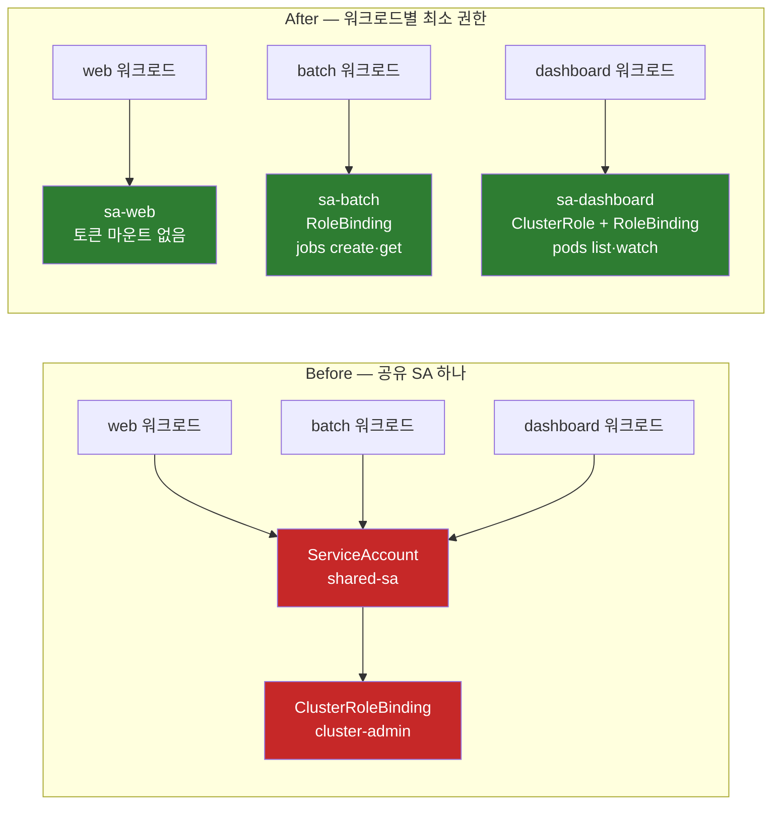

# Kubernetes ServiceAccount, RBAC

> **개발자를 위한 쉬운 쿠버네티스 · 26장** | [전체 목차](./Kubernetes-Introduction.md#이-시리즈의-읽는-순서) · [이전 장](./Kubernetes-Logging-and-Events.md) · [다음 장](./Kubernetes-Workload-Security.md)

**Pod는 어떻게 쿠버네티스 API에 자기를 증명할까 — ServiceAccount와 RBAC**

[관측과 확장](Kubernetes-Metrics-Server-Prometheus.md)에서는 여러 컴포넌트가 API의 상태를 읽는 모습을 보았다. 이제 주문 앱 `order-api`가 같은 일을 한다고 생각해 보자. HTTP로 주문을 받는 것과 Pod 목록을 읽는 것은 서로 다른 요청이다. 전자는 앱 서버로 가고, 후자는 Kubernetes API server로 간다.

사람이 `kubectl`을 쓸 때는 kubeconfig 안의 인증서나 토큰으로 자기를 증명한다. 그런데 클러스터 **안에서** 도는 프로그램 — Pod 목록을 읽어 대시보드를 그리는 앱, 커스텀 리소스를 감시하는 컨트롤러 — 은 무엇으로 자기를 증명할까? 그리고 증명만 되면 무엇이든 할 수 있는 걸까?

---

## 결론부터 말하면

ServiceAccount는 Pod가 Kubernetes API를 호출할 때 사용할 수 있는 워크로드 신원이다. 토큰은 그 신원을 증명하는 자격 증명이고, RBAC은 해당 신원에 어떤 API 작업을 허용할지 정한다. 따라서 ServiceAccount를 만들었다고 Pod 목록 조회나 Secret 읽기가 허용되는 것은 아니다.

이 장의 경계는 **Kubernetes API 접근** 이다. `order-api`가 결제 서버에 HTTP 요청을 보내거나 DB에 로그인하는 권한은 RBAC만으로 정해지지 않는다. Pod 간 패킷은 NetworkPolicy, 앱 인증은 앱 정책, 클라우드 접근은 IAM 연동처럼 별도의 경로에서 다룬다. 같은 ServiceAccount 이름을 외부 IAM이나 서비스 메시가 신원의 재료로 쓰더라도, 그 연동을 따로 구성해야 한다.

```mermaid
flowchart TD
    req["Pod가 API 서버에 요청<br>토큰을 Authorization 헤더에 담아"]
    req --> authn{"인증<br>이 토큰은 누구인가?"}
    authn -->|"유효하지 않은 토큰"| e401["401 Unauthorized<br>신원 확정 실패"]
    authn -->|"신원 확정"| id["system&#58;serviceaccount&#58;bookstore&#58;order-api<br>그룹&#58; system&#58;serviceaccounts 등"]
    id --> authz{"인가<br>이 신원이 그 동작을 해도 되나?"}
    authz -->|"허용 규칙 없음<br>RBAC은 기본 거부"| e403["403 Forbidden<br>신원은 맞지만 권한 없음"]
    authz -->|"Role·ClusterRole 규칙 매칭"| ok["요청 처리 계속<br>이후 관문은 별도 노트"]

    style req fill:#1565C0,color:#fff
    style id fill:#455A64,color:#fff
    style e401 fill:#C62828,color:#fff
    style e403 fill:#BF360C,color:#fff
    style ok fill:#2E7D32,color:#fff
```



| 구분 | 사람(User) | 워크로드(ServiceAccount) |
|------|-----------|--------------------------|
| 쿠버네티스 리소스인가 | **아니다** (`kind: User`가 없다) | **그렇다** (`kind: ServiceAccount`, 1급 리소스) |
| 누가 관리하나 | 외부 — 인증서 CA, OIDC, 인증 프록시 | **클러스터 자신** (API로 만들고 지운다) |
| 자격증명 배포 | 사람이 kubeconfig를 들고 다닌다 | kubelet이 Pod 안에 파일로 마운트 |
| 인가 방식 | **RBAC (동일)** | **RBAC (동일)** |

마지막 줄이 중요하다. **인증 방식은 다르지만 인가 방식은 같다.** RBAC은 "누가"를 신원 문자열로만 볼 뿐, 그게 사람인지 프로그램인지 신경 쓰지 않는다. 이 비대칭에서 이야기를 시작하자.

---

## 1. 쿠버네티스에는 `kind: User`가 없다

처음 RBAC을 배울 때 가장 이상한 지점이 여기다. `kubectl get serviceaccounts`는 되는데 `kubectl get users`는 없다. Role을 만들 때 `subjects`에 `kind: User`라고 쓰기는 하는데, 그 User라는 오브젝트를 클러스터 어디서도 찾을 수 없다.

빠뜨린 게 아니다. **쿠버네티스는 사람 계정을 의도적으로 관리하지 않는다.** 사람 계정은 이미 조직에 존재한다 — 사내 IdP, Google Workspace, LDAP, GitHub 조직. 쿠버네티스가 여기에 자체 사용자 테이블을 하나 더 만들면, 퇴사자 계정 정리를 두 곳에서 해야 하고 비밀번호 정책이 갈라진다. 그래서 쿠버네티스는 "이 요청을 보낸 게 누구인가"를 판정하는 일을 **외부에 위임** 한다. 클라이언트 인증서의 CN, OIDC 토큰의 클레임, 인증 웹훅의 응답 — 어느 경로로 오든 API 서버는 그 결과로 **사용자 이름과 그룹 목록이라는 문자열만** 얻는다. RBAC은 그 문자열을 받아 규칙과 대조할 뿐이다.

반면 워크로드는 사정이 다르다. `bookstore` 네임스페이스에 배포된 컨트롤러는 조직의 구성원이 아니라 **클러스터의 구성물** 이다. 클러스터와 함께 태어나고 함께 사라진다. Helm 차트로 배포되고, 네임스페이스를 지우면 같이 지워지고, GitOps 저장소에 선언으로 남아야 한다. 이런 신원을 외부 IdP에 등록하라고 하면 배포가 두 시스템에 걸친 절차가 된다.

> **사람은 조직의 것이고, 워크로드는 클러스터의 것이다.** 그래서 사람 계정은 외부에 위임하고, 워크로드 계정은 클러스터 안의 1급 리소스로 만들었다.

이 한 줄이 `kind: User`는 없지만 `kind: ServiceAccount`는 있는 이유다.

---

## 2. ServiceAccount는 "신원"일 뿐이다

ServiceAccount 자체는 놀랄 만큼 단순하다. 만드는 데 필요한 건 이름 하나다.

```yaml
apiVersion: v1
kind: ServiceAccount
metadata:
  name: order-api
  namespace: bookstore
```

`spec`이 없다. 권한 필드도 없다. **ServiceAccount는 권한을 담는 그릇이 아니라 이름표** 이기 때문이다. 이 오브젝트가 하는 일은 딱 하나 — API 서버가 인식할 수 있는 신원 문자열을 하나 만들어 두는 것이다. 그 문자열의 정규 형태는 이렇다.

```
system:serviceaccount:<namespace>/<name>  ← 이렇게 쓰지 않는다
system:serviceaccount:<namespace>:<name>  ← 콜론으로 구분한다
```

`bookstore` 네임스페이스의 `order-api`라면 `system:serviceaccount:bookstore:order-api`가 된다. 그리고 이 신원은 자동으로 몇 개의 **그룹** 에도 속한다.

| 그룹 | 의미 |
|------|------|
| `system:serviceaccounts` | 클러스터의 모든 ServiceAccount |
| `system:serviceaccounts:bookstore` | `bookstore` 네임스페이스의 모든 ServiceAccount |
| `system:authenticated` | 인증에 성공한 모든 주체 (사람 포함) |

그룹도 RBAC의 `subjects`에 쓸 수 있으니, "이 네임스페이스의 모든 워크로드에게 이 권한을"이라는 규칙을 그룹 하나로 표현할 수 있다. 다만 그건 광범위한 부여라서 나중에 8절에서 다룰 함정과 같은 방향임을 기억해 두자.

여기서 초보자를 가장 자주 놀라게 하는 사실이 하나 있다. **아무 ServiceAccount도 지정하지 않은 Pod에도 신원이 붙는다.** 클러스터를 만들면 쿠버네티스는 모든 네임스페이스에 `default`라는 이름의 ServiceAccount를 자동으로 만든다. Pod에 `spec.serviceAccountName`을 적지 않으면 그 네임스페이스의 `default`가 배정된다. 심지어 `default` ServiceAccount를 지우면 컨트롤 플레인이 새로 만들어 넣는다.

자동 마운트가 활성화되어 있다면 API를 쓰지 않는 Pod에도 토큰이 들어갈 수 있다. `automountServiceAccountToken: false`인 Pod는 SA 이름이 있어도 자동 토큰 파일이 없다.

---

## 3. 토큰은 어떻게 Pod 안으로 들어오는가

신원 문자열이 있다고 Pod가 그걸 주장할 수는 없다. 자기가 `system:serviceaccount:bookstore:order-api`라는 **증거** 가 필요하다. 그 증거가 토큰이고, 토큰이 Pod에 들어오는 방식은 역사적으로 한 번 크게 바뀌었다.

### 3-1. 옛 방식 — 만료 없는 Secret

레거시 Secret volume이 기본이던 시기에는 ServiceAccount를 만들면 컨트롤러가 **자동으로 Secret을 하나 만들어** 토큰을 넣어 두고 Pod에 그 Secret을 마운트했다. projected token 방식은 v1.22에 GA가 되었고, 토큰 Secret의 기본 자동 생성이 중단된 시점은 v1.24다. 따라서 v1.22~v1.23의 자동 생성 Secret과 Pod의 기본 마운트 방식을 같은 것으로 읽으면 안 된다. 연혁은 3-3절에서 구분한다.

편했지만 위험했다. 이 토큰은 **만료가 없었다.** 그래서 세 가지 성질을 동시에 가졌다.

- **영구적이다.** 한 번 발급되면 무한히 유효하다.
- **어디서든 쓸 수 있다.** 특정 Pod에 묶여 있지 않다. 노트북에 복사해 붙여도 그대로 동작한다.
- **회수 수단이 사실상 Secret 삭제뿐이다.** 유출을 알아차렸을 때 "이 토큰만 무효화"하는 방법이 없다. Secret이나 ServiceAccount를 지워야 하고, 그 자격 증명으로 API를 호출하는 워크로드가 영향을 받는다.

로그에 토큰이 한 줄 찍혔거나, 디버깅용으로 복사한 값이 이슈 트래커에 남았다고 상상해 보자. 그것만으로 영구 자격증명이 클러스터 밖으로 나간 것이다.

### 3-2. 현재 방식 — TokenRequest API + projected volume

v1.22부터 쿠버네티스는 다른 길을 택했다. Pod에 `spec.serviceAccountName`을 지정하면, 쿠버네티스는 **TokenRequest API로 짧은 수명의 토큰을 발급받아 projected volume으로 마운트** 한다. 이 토큰은 만료되기 전에 kubelet이 **알아서 갱신** 한다.

```mermaid
flowchart LR
    pod["Pod<br>spec.serviceAccountName&#58; order-api"]
    kubelet["kubelet<br>노드 에이전트"]
    api["API Server<br>TokenRequest API"]
    file["컨테이너 안 파일<br>/var/run/secrets/kubernetes.io/serviceaccount/token"]

    pod -->|"1&#46; 이 SA로 띄워달라"| kubelet
    kubelet -->|"2&#46; 토큰 요청<br>audience·Pod에 바인딩"| api
    api -->|"3&#46; 수명 있는 JWT 발급"| kubelet
    kubelet -->|"4&#46; projected volume으로 주입"| file
    kubelet -->|"5&#46; 만료 전 갱신하여 같은 경로에 덮어쓰기"| file

    style pod fill:#1565C0,color:#fff
    style api fill:#6A1B9A,color:#fff
    style file fill:#2E7D32,color:#fff
    style kubelet fill:#455A64,color:#fff
```



이 토큰이 옛 토큰과 다른 점을 하나씩 보면 설계 의도가 보인다.

- **수명이 있다.** projected token의 `expirationSeconds` 기본 요청값은 **3,600초**, 최소 요청값은 600초다. 실제 발급 수명은 API server의 최대 수명·연장 설정에 영향을 받는다.
- **자동 갱신된다.** kubelet은 토큰이 **수명의 80%를 넘거나 24시간을 넘으면** (둘 중 먼저 오는 쪽) 갱신을 시도한다. 갱신은 **같은 파일 경로에 덮어쓰는 방식** 이므로 Pod를 다시 띄우지 않는다.
- **audience에 바인딩된다.** JWT의 `aud` 클레임에 대상이 박힌다. 쿠버네티스 API용 토큰을 다른 서비스에 그대로 제출할 수 없다.
- **특정 Pod에 바인딩된다.** JWT 안에 그 Pod의 이름과 UID가 들어간다. 참조된 오브젝트가 사라지거나 UID가 다르면 그 토큰으로는 인증되지 않는다.

아래는 TokenRequest에 **1시간 수명을 요청하고 그대로 발급받았다고 가정한 설명용 JWT 클레임**이다. 실제 자동 주입 토큰의 만료 시각은 API server 설정에 영향을 받으므로, 요청 수명만으로 단정하지 말고 발급된 토큰의 `iat`·`exp` 클레임을 확인한다.

```jsonc
{
  "aud": ["https://kubernetes.default.svc"],
  "exp": 1729605240,                      // 만료 시각 — 옛 토큰에는 없던 필드
  "iat": 1729601640,
  "kubernetes.io": {
    "namespace": "bookstore",
    "pod":  { "name": "bookstore-7c9d", "uid": "5e0bd49b-..." },   // Pod에 바인딩
    "serviceaccount": { "name": "order-api", "uid": "14ee3fa4-..." }
  },
  "sub": "system:serviceaccount:bookstore:order-api"   // 이 문자열이 RBAC이 보는 "누구"
}
```

kubelet이 토큰 파일을 회전해도 시작 시 읽은 문자열을 앱이 영구 보관하면 새 토큰을 쓰지 못한다. 그 토큰이 실제로 만료된 뒤 인증이 실패할 수 있다. 먼저 갱신을 지원하는 공식 클라이언트의 in-cluster 설정을 사용한다. 직접 HTTP 클라이언트를 작성한다면 파일 재읽기와 캐시 갱신을 설계한다. 매 요청마다 디스크를 읽는 방법만 가능한 것은 아니다.

### 3-3. 자동 Secret 생성은 언제 사라졌나

옛 방식의 잔재는 단계적으로 정리됐다. 시점 의존 정보라 버전을 명확히 짚어 둔다.

| 버전 | 변화 |
|------|------|
| **v1.22** | Pod에 TokenRequest 기반 projected token을 기본 주입 (`BoundServiceAccountTokenVolume`) |
| **v1.24** | `LegacyServiceAccountTokenNoAutoGeneration` 게이트가 beta로 **기본 활성** — ServiceAccount를 만들어도 토큰 Secret이 더 이상 자동 생성되지 않는다 |
| **v1.26** | 이 기능이 GA로 승격되어 기본 동작으로 고정 |
| **v1.28** | 레거시 토큰 추적 컨트롤러 stable — 자동 생성된 토큰 Secret에 `kubernetes.io/legacy-token-last-used` 라벨로 마지막 사용 시각을 기록 |
| **v1.29** | 해당 feature gate 제거 |
| **v1.30** | 레거시 토큰 청소기(cleaner) stable — v1.29부터, 일정 기간(기본 1년) 미사용인 **자동 생성** 토큰을 무효 표시하고 이후 삭제 |

여기서 정확히 구분해야 할 점이 있다. 청소기는 **"자동 생성된" Secret이면서 어떤 Pod도 마운트하지 않은 것** 만 대상으로 한다. 아래처럼 **손으로 만든** 장수명 토큰 Secret은 청소 대상이 아니고 만료도 없다.

```yaml
# 여전히 만들 수 있다 — 그리고 여전히 만료가 없다
apiVersion: v1
kind: Secret
metadata:
  name: order-api-token
  namespace: bookstore
  annotations:
    kubernetes.io/service-account.name: order-api   # 이 SA의 토큰을 채워달라
type: kubernetes.io/service-account-token
```

클러스터 외부 CI가 API에 접근해야 할 때 이 방식을 쓰는 사례가 아직 많다. 쓸 수는 있지만, **이 토큰의 일반적인 개별 회수 수단은 Secret(또는 ServiceAccount) 삭제** 임을 알고 써야 한다. 외부에서 접근할 자격증명이 필요하다면 `kubectl create token order-api --duration=1h`처럼 TokenRequest로 수명 있는 토큰을 그때그때 발급하는 쪽이 훨씬 안전하다. (Secret 자체의 보안 — base64는 암호화가 아니라는 점, etcd 암호화, 외부 Secret 관리 도구 — 는 [Kubernetes ConfigMap Secret](Kubernetes-ConfigMap-Secret.md)에서 다룬다.)

### 3-4. 토큰을 아예 넣지 않기

2절에서 본 사실을 다시 떠올리자. 쿠버네티스 API를 전혀 쓰지 않는 워크로드에도 토큰이 들어간다. 웹 서버, 배치 스크립트, 정적 파일 서버 — 이런 Pod 안의 토큰은 **쓰이지 않으면서 공격 표면만 넓히는 자격증명** 이다. 컨테이너에 침투한 공격자가 가장 먼저 찾는 파일이기도 하다.

일반 주문 HTTP 서버가 Kubernetes API를 쓰지 않는다면 자동 마운트를 끄는 편이 좋다. 아래는 구조 설명용 manifest다. `bookstore` namespace는 이미 있다고 가정하며, 이미지는 가상 자리표시자이므로 실제 공개 이미지처럼 실행할 수 없다.

```yaml
# ServiceAccount 수준 — 이 SA를 쓰는 Pod 전부에 기본 적용
apiVersion: v1
kind: ServiceAccount
metadata:
  name: order-api
  namespace: bookstore
automountServiceAccountToken: false
---
# Pod 수준 — SA 설정을 덮어쓴다 (Pod 쪽이 이긴다)
apiVersion: v1
kind: Pod
metadata:
  name: order-api
  namespace: bookstore
  labels:
    app: order-api
spec:
  serviceAccountName: order-api
  automountServiceAccountToken: false   # 토큰 파일이 마운트되지 않는다
  containers:
  - name: order-api
    image: registry.example.com/book/order-api:1.0.0
    ports:
    - containerPort: 8080
```

Pod 쪽 설정이 ServiceAccount 쪽을 덮어쓰므로, **SA 기본값을 `false`로 두고 API가 필요한 워크로드만 Pod에서 `true`로 켜는** 구성이 자격 증명 노출을 줄인다. 외부 IAM이나 메시 등이 토큰을 사용하는지도 확인한 뒤 적용한다. 공식 RBAC 권장 사항도 불필요한 자동 마운트 비활성화를 권한다.

---

## 4. 여기가 전환점 — 증명됐으면 뭐든 할 수 있을까

이제 Pod는 자기를 증명할 수 있다. 그럼 API를 마음대로 호출할 수 있을까? 토큰 자동 마운트가 켜진 기본 SA의 Pod에서 허용되지 않은 Pod 목록 조회를 했다고 가정해 보자. 아래 응답은 설명용 예시이며 이 문서에서 실행한 기록이 아니다. 앞의 미마운트 Pod에서는 토큰 파일 자체가 없으므로 같은 검사를 할 수 없다.

```bash
# Pod 안에서, 마운트된 토큰으로 Pod 목록을 요청
$ TOKEN=$(cat /var/run/secrets/kubernetes.io/serviceaccount/token)
$ curl -s --cacert /var/run/secrets/kubernetes.io/serviceaccount/ca.crt \
       -H "Authorization: Bearer $TOKEN" \
       https://kubernetes.default.svc/api/v1/namespaces/bookstore/pods

# 응답
# 401이 아니다 — 토큰은 유효하다 (인증 통과)
{
  "kind": "Status", "code": 403,
  "message": "pods is forbidden: User \"system:serviceaccount:bookstore:default\"
              cannot list resource \"pods\" in API group \"\" in the namespace \"bookstore\""
}
```

`401`이 아니라 `403`이라는 점이 핵심이다. **API 서버는 이 요청자가 누구인지 정확히 알고 있다.** 에러 메시지에 신원 문자열까지 그대로 찍혀 있다. 그런데 거절했다. 신원 확인과 권한 판정이 별개 단계라는 증거다.

이건 예외적 상황이 아니라 기본값이다. 공식 문서의 표현대로, **`default` ServiceAccount는 RBAC이 켜진 클러스터에서 "모든 인증된 주체에게 주어지는 기본 API 디스커버리 권한" 외에는 아무 권한도 갖지 않는다.** 즉 API 서버가 어떤 API 그룹을 제공하는지 목록을 조회하는 정도가 전부다.

> 쿠버네티스의 기본 자세는 **"너를 알아보긴 하지만, 그래서 뭘 해도 된다는 뜻은 아니다"** 다.

참고로 API 요청이 통과해야 하는 관문은 인증과 인가에서 끝나지 않는다. 인가 뒤에는 mutating admission, 스키마 검증, validating admission이 이어지고 그다음에야 etcd에 저장된다. **그 전체 수명주기는** [Kubernetes Admission Webhook](Kubernetes-Admission-Webhook.md) **가 다룬다.** 이 노트는 앞의 두 관문만 본다.

---

### 4-1. 주문 앱에 Pod 조회 기능을 추가한다면

평범한 주문 처리는 Kubernetes API가 필요 없지만, 운영 화면에서 같은 namespace의 Pod 상태를 보여주는 기능을 추가했다고 가정하자. 이때 필요한 것은 관리자 권한이 아니라 Pod 목록·변경 관찰이다. 앞의 자동 토큰 미마운트 예제와 조건이 달라졌으므로, 이 변형에서는 전용 SA와 토큰을 사용한다.

아래는 `bookstore` namespace와 `order-api` ServiceAccount가 존재한다는 전제의 완전한 설명용 Role·Binding이다. namespace 밖의 Pod나 Secret 읽기는 허용하지 않는다.

```yaml
apiVersion: rbac.authorization.k8s.io/v1
kind: Role
metadata:
  name: order-api-pod-reader
  namespace: bookstore
rules:
- apiGroups: ['']
  resources: [pods]
  verbs: [get, list, watch]
---
apiVersion: rbac.authorization.k8s.io/v1
kind: RoleBinding
metadata:
  name: order-api-pod-reader
  namespace: bookstore
subjects:
- kind: ServiceAccount
  name: order-api
  namespace: bookstore
roleRef:
  apiGroup: rbac.authorization.k8s.io
  kind: Role
  name: order-api-pod-reader
```

기존 Deployment에서는 아래 위치를 바꾼다. 이 코드는 Pod template의 구조 설명용 발췌이며 전체 Deployment가 아니다.

```yaml
spec:
  template:
    spec:
      serviceAccountName: order-api
      automountServiceAccountToken: true
```

RoleBinding 생성은 이미 실행 중인 Pod의 신원을 바꾸지 않는다. Pod의 SA 선택은 template으로 결정하고, API 호출 때 그 신원에 연결된 현재 권한을 평가한다. 그러므로 신원 선택이 잘못된 문제와 Binding 누락은 서로 다른 수정이 필요하다. 아래 절에서는 이 예제를 일반화해 네 RBAC 리소스의 관계를 살펴본다.

## 5. RBAC의 네 오브젝트를 2×2로 이해하라

인가를 담당하는 것이 **RBAC(Role-Based Access Control)** 이고, 등장하는 오브젝트는 네 개다. 이름이 비슷해서 처음엔 뒤엉키지만, **두 개의 축** 으로 보면 정리된다.

- **무엇을 할 수 있나** → `Role` / `ClusterRole` (권한 규칙의 정의)
- **누구에게 주나** → `RoleBinding` / `ClusterRoleBinding` (정의를 신원에 연결)

권한은 **정의와 부여가 분리** 되어 있다. Role을 만들어도 아무 일도 일어나지 않는다. Binding으로 신원에 연결해야 효력이 생긴다. 그리고 여기서 네 가지 조합이 나오는데, **namespaced resource 권한의 범위는 Role과 Binding의 조합으로 결정된다.**

| Role 쪽 | Binding 쪽 | 실제 적용 범위 | 언제 쓰나 |
|---------|-----------|----------------|-----------|
| `Role` | `RoleBinding` | 그 네임스페이스 안 | 한 네임스페이스에서만 쓰는 일회성 권한 |
| **`ClusterRole`** | **`RoleBinding`** | **namespaced resource 규칙만 Binding의 네임스페이스 안** (Namespace 오브젝트 예외는 아래) | **권한 정의를 클러스터에 한 번 만들고 네임스페이스별로 재사용** |
| `ClusterRole` | `ClusterRoleBinding` | 클러스터 전체 (모든 네임스페이스 + 클러스터 범위 리소스) | 노드·PV 같은 클러스터 리소스, 전 네임스페이스 감시 |
| `Role` | `ClusterRoleBinding` | **불가능** | — (Role은 네임스페이스 리소스라 클러스터 범위로 승격되지 않는다) |

두 번째 줄이 처음 배울 때 가장 안 보이는 조합이다. **ClusterRole은 "클러스터 전체에 권한을 준다"는 뜻이 아니다.** 그냥 "네임스페이스에 속하지 않는 권한 **정의**"일 뿐이다. 이 정의를 `RoleBinding`으로 연결하면, **namespaced resource 규칙만 그 RoleBinding의 네임스페이스에** 적용된다. Node·PV 같은 cluster-scoped resource 규칙은 이 Binding으로 부여되지 않으며, namespace 권한으로 변환되는 것도 아니다. 예외는 그 Namespace 오브젝트 자체다. 공식 문서는 `cluster-admin`을 RoleBinding으로 주면 그 네임스페이스의 모든 리소스를 "네임스페이스 자체를 포함해" 완전히 제어한다고 설명한다. Namespace는 cluster-scoped 리소스지만, 이 경우 해당 Namespace를 수정하거나 삭제할 권한까지 생긴다. 반면 기본 `admin` 역할은 Namespace 자체에 대한 쓰기를 허용하지 않는다.

```yaml
# 권한 정의는 클러스터에 딱 한 번 (네임스페이스 없음)
apiVersion: rbac.authorization.k8s.io/v1
kind: ClusterRole
metadata:
  name: secret-reader
rules:
- apiGroups: [""]
  resources: ["secrets"]
  verbs: ["get", "watch", "list"]
---
# 부여는 네임스페이스별로 반복 — 정의를 복제하지 않는다
apiVersion: rbac.authorization.k8s.io/v1
kind: RoleBinding
metadata:
  name: read-secrets
  namespace: bookstore       # ← 이 줄이 적용 범위를 결정한다
subjects:
- kind: ServiceAccount
  name: order-api
  namespace: bookstore
roleRef:
  kind: ClusterRole            # ClusterRole을 참조하지만
  name: secret-reader          # 권한은 bookstore 네임스페이스에만 유효하다
  apiGroup: rbac.authorization.k8s.io
```

왜 유용한가. 팀 네임스페이스가 30개인 클러스터에서 "각 팀은 자기 네임스페이스의 Secret을 읽을 수 있다"를 구현해야 한다면, `Role`을 쓰면 **똑같은 규칙을 30번 복제** 해야 한다. 규칙을 하나 고칠 때 30곳을 고쳐야 하고, 한 곳을 빠뜨리면 조용히 어긋난다. `ClusterRole` 하나 + `RoleBinding` 30개면 **정의는 한 곳** 이다. 쿠버네티스 기본 제공 역할(`admin`, `edit`, `view`)이 정확히 이 방식으로 쓰이도록 설계되어 있다.

반대로 `ClusterRoleBinding`은 **네임스페이스를 무시한다.** 이걸로 부여하면 그 신원은 모든 네임스페이스에서 그 권한을 갖는다. 네임스페이스별로 다르게 주려는 의도였다면 조용히 반대 결과를 얻는다. 뒤의 8절과 10절이 모두 이 지점에서 출발한다.

한 가지 실무 함정. **한번 만든 Binding의 `roleRef`는 바꿀 수 없다.** 다른 Role을 가리키게 하려면 Binding을 지우고 새로 만들어야 한다. 수정을 시도하면 validation 에러가 난다.

---

## 6. rule 문법 읽기 — `apiGroups: [""]`는 오타가 아니다

`rules`의 한 항목은 세 축의 곱집합이다.

```yaml
apiVersion: rbac.authorization.k8s.io/v1
kind: Role
metadata:
  namespace: bookstore
  name: pod-reader
rules:
- apiGroups: [""]                  # "" = 코어 API 그룹 (오타가 아니다)
  resources: ["pods", "pods/log"]  # 서브리소스는 슬래시로
  verbs: ["get", "list", "watch"]
- apiGroups: ["apps"]              # Deployment 등은 apps 그룹
  resources: ["deployments"]
  verbs: ["get", "list"]
```

**`apiGroups: [""]`** 를 처음 보면 값을 빼먹은 것처럼 보인다. 그렇지 않다. 쿠버네티스 초기 리소스(Pod, Service, ConfigMap, Secret, Node, Namespace...)는 API 그룹이 도입되기 전에 만들어져 **그룹 이름이 없는 "코어 그룹"** 에 있다. URL도 `/api/v1/...`이고 `/apis/<group>/v1/...`이 아니다. 그 "이름 없음"을 빈 문자열로 표현한 것이다. Deployment는 `apps`, Ingress·NetworkPolicy는 `networking.k8s.io`, Role 자신은 `rbac.authorization.k8s.io`에 있다.

`resources`에 적는 이름은 **API URL에 나타나는 그 이름** 이다(`Pod`가 아니라 `pods`). 그리고 URL 경로가 한 단계 더 들어가는 **서브리소스** 는 슬래시로 구분한다. Pod 로그 요청은 `GET /api/v1/namespaces/{ns}/pods/{name}/log`이므로 RBAC에서는 `pods/log`다.

이 서브리소스 규칙이 보안에서 중요한 이유가 있다. **`pods`에 대한 권한과 `pods/exec`에 대한 권한은 완전히 별개다.**

```yaml
rules:
- apiGroups: [""]
  resources: ["pods", "pods/log"]
  verbs: ["get", "list"]
- apiGroups: [""]
  resources: ["pods/exec"]         # 이건 사실상 "컨테이너 셸 접근 권한"이다
  verbs: ["create"]                # 대표적인 POST exec 요청은 create 동사다
```

`pods/exec`를 허용하면 그 주체는 임의 컨테이너 안에서 명령을 실행할 수 있다. 그 컨테이너의 파일시스템, 환경변수, 그리고 **마운트된 ServiceAccount 토큰까지** 전부 접근 가능하다. 즉 `pods/exec` 하나가 그 네임스페이스 워크로드들의 신원을 전부 빌려 쓸 수 있는 권한으로 번진다. `pods/attach`, `pods/portforward`도 같은 급이다. 읽기 권한처럼 뭉뚱그려 주면 안 된다.

`resourceNames`로 특정 오브젝트만 지정할 수도 있다.

```yaml
rules:
- apiGroups: [""]
  resources: ["configmaps"]
  resourceNames: ["my-configmap"]   # 이 이름의 ConfigMap만
  verbs: ["get", "update"]
```

다만 한계가 있다. **`create`는 이름으로 제한할 수 없다** — 인가 시점에 새 오브젝트의 이름을 모르기 때문이다. `deletecollection`도 마찬가지다. 그리고 `list`/`watch`를 `resourceNames`로 제한하면 클라이언트가 `metadata.name` field selector를 함께 보내야 인가된다(`kubectl get configmaps --field-selector=metadata.name=my-configmap`). 그냥 `kubectl get configmaps`를 하면 거절된다. "이름으로 좁혔는데 왜 목록 조회가 안 되지?"의 답이 여기 있다.

마지막으로 `subjects`에 ServiceAccount를 쓰는 형태를 확인해 두자. 사람과 달리 `apiGroup`을 적지 않고 `namespace`를 적는다.

```yaml
subjects:
- kind: ServiceAccount
  name: order-api
  namespace: bookstore        # SA는 네임스페이스에 속하므로 필수
# 참고 — 사람이나 그룹은 형태가 다르다
- kind: User
  name: jane               # 대소문자를 구분한다
  apiGroup: rbac.authorization.k8s.io
```

---

## 7. RBAC은 순수 가산적이다 — deny 규칙이 없다

방화벽이나 클라우드 IAM을 다뤄본 사람은 여기서 한 번 걸린다. 공식 문서의 표현은 짧고 단호하다.

> Permissions are purely additive (there are no "deny" rules).

**RBAC에는 거부 규칙이 없다.** 규칙은 오직 "허용"을 더할 뿐이고, 여러 Binding이 겹치면 결과는 그 **합집합** 이다. "`pods`는 다 되지만 `secrets`만 빼고"를 표현하는 문법이 존재하지 않는다.

이 설계 자체는 이해하기 쉽다는 장점이 크다. 평가 순서나 우선순위 규칙을 따질 필요 없이 "허용하는 규칙이 하나라도 있으면 허용"이면 끝이다. IAM의 deny 정책이 얼마나 헷갈리는지 겪어봤다면 이 단순함의 가치를 안다.

하지만 결과가 하나 따라온다. **넓게 준 권한을 "이것만 빼기"로 좁힐 수 없다.** 좁히려면 그 넓은 Binding을 **지우고 좁은 것을 새로 만들어야** 한다. 문법상 "차집합"이 불가능하기 때문이다.

실무에서 어려운 이유는 문법 때문이 아니다. **넓은 Binding을 지우는 순간 무엇이 깨지는지 아무도 모른다는 것** 이 문제다. `cluster-admin`이 붙은 ServiceAccount를 여러 워크로드가 공유하고 있다면, 그중 어느 워크로드가 실제로 어떤 API를 호출하는지 그 Binding 안에는 아무 정보가 없다. Binding은 **허용 범위만 표현하고 사용 이력은 담지 않는다.** 허용된 요청도 audit policy·backend 설정에 따라 감사 로그에 기록된다. 관리자 권한은 감사 면제가 아니다. 그래서 이 상태는 "고치기 어려운" 게 아니라 **"관측 없이는 고칠 수 없는"** 상태다.

즉 좁히기의 첫 단계는 YAML 편집이 아니라 **"실제로 쓰이는 권한이 무엇인지 알아내기"** 다. 이게 8절의 마이그레이션 순서를 결정한다.

---

## 8. 안티패턴 — 공유 `cluster-admin` ServiceAccount

가장 자주 보는 잘못된 구성은 이렇다. **여러 워크로드가 `cluster-admin`에 바인딩된 ServiceAccount 하나를 공유한다.**

```yaml
# 이 조합을 클러스터에서 발견하면 경보로 받아들이라
apiVersion: rbac.authorization.k8s.io/v1
kind: ClusterRoleBinding
metadata:
  name: shared-sa-admin
subjects:
- kind: ServiceAccount
  name: shared-sa
  namespace: bookstore
roleRef:
  kind: ClusterRole
  name: cluster-admin        # 모든 리소스에 모든 동작
  apiGroup: rbac.authorization.k8s.io
```

### 8-1. 왜 이렇게 되는가

악의가 아니라 **경로의 최소 저항** 때문이다. 새 컨트롤러를 붙이는데 `403`이 뜬다. 어떤 verb와 resource가 필요한지 문서에 정확히 안 적혀 있다. 데모가 오후에 있다. 이때 `cluster-admin`을 붙이면 `403`이 즉시 사라진다. 다음 워크로드가 또 `403`을 만나면, 이미 잘 되는 SA가 있으니 그걸 재사용한다. 세 번째, 네 번째도 같은 길을 간다.

각 결정은 국지적으로 합리적이었다. 문제는 이 결정들이 **누적되면서 되돌릴 수 없어진다** 는 데 있다(7절의 이유 그대로).

### 8-2. 무엇이 위험한가

핵심은 3절에서 확인한 사실이다. **ServiceAccount 토큰은 컨테이너 안의 파일이다.**

컨테이너 하나에 RCE(원격 코드 실행) 취약점이 있다고 하자. 보통 그 피해는 그 컨테이너 안에서 시작된다. 그런데 그 컨테이너 안에 `cluster-admin` 토큰 파일이 있으면 이야기가 달라진다. 공격자는 파일 하나를 읽어 **클러스터 전체의 관리자** 가 된다. 모든 네임스페이스의 Secret을 읽고, 아무 노드에나 특권 Pod를 띄우고, 감사 로그를 남기며 무엇이든 한다. **한 컨테이너의 취약점이 곧 클러스터 전체 장악** 이다.

공유가 이걸 증폭시킨다. `cluster-admin` 토큰이 워크로드 3개에 마운트되어 있으면, 그중 **가장 약한 하나** 가 클러스터의 보안 수준이 된다. 게다가 감사 로그에 남는 신원은 모두 `system:serviceaccount:bookstore:shared-sa` — 신원 문자열만으로는 워크로드 구분이 어렵다. 다만 Pod-bound token의 Pod 이름·UID와 감사 설정에 따른 추가 인증 정보를 추적 단서로 쓸 수 있다. 공유 SA가 항상 추적 불가능하다는 뜻은 아니다.

여기서 **혼동하기 쉬운 두 가지를 구분** 해 두자.

| | `cluster-admin` ClusterRole | `system:masters` 그룹 |
|---|---|---|
| 정체 | 모든 동작을 허용하는 기본 ClusterRole | RBAC **검사 자체를 우회** 하는 특수 그룹 |
| 기본 연결 | `system:masters` 그룹에 ClusterRoleBinding으로 연결됨 | 보통 관리자 클라이언트 인증서의 그룹 |
| 회수 방법 | **Binding을 지우면 회수된다** | **RoleBinding·ClusterRoleBinding을 지워도 회수되지 않는다** |

공식 권장 사항의 경고가 여기 있다. `system:masters` 멤버는 모든 RBAC 검사를 우회하며, 인가 웹훅조차 타지 않는다. 그래서 **사용자를 `system:masters`에 넣지 말라** 고 명시한다. 반대로 `cluster-admin` 바인딩은 과하긴 해도 **지울 수 있다** — 그래서 아래 마이그레이션이 가능하다.

### 8-3. 어떻게 빠져나오는가



한 번에 갈 수 없다. 넓은 Binding을 먼저 지우면 무엇이 깨질지 모르기 때문이다(7절). 그래서 **순서를 뒤집는다 — 좁은 권한을 먼저 쌓고, 넓은 것을 마지막에 뺀다.**

**1단계. 실제로 필요한 권한을 관측한다.** 추측하지 않는다. 감사 로그(audit log)를 켜서 그 ServiceAccount가 어떤 resource에 어떤 verb를 실제로 호출하는지 수집한다. 컨트롤러라면 프로젝트 문서에 필요한 RBAC 규칙이 예제로 제공되는 경우가 많으니 그것부터 확인한다. 이 단계 없이 진행하면 반드시 되돌아온다.

**2단계. 새 신원과 최소 권한을 함께 준비한다.** 워크로드별 ServiceAccount, Role, Binding을 먼저 만든다. 새 SA는 자신의 신원·그룹에 연결된 권한을 합산할 뿐, 기존 `shared-sa`의 `cluster-admin`을 물려받지 않는다. `kubectl auth can-i`로 필요한 작업과 금지할 작업을 각각 확인한다. 이것은 현재 허용 범위 검사이며 사용 이력은 아니다.

**3단계. 일부 워크로드부터 새 신원으로 전환한다.** Deployment의 정확한 필드는 `.spec.template.spec.serviceAccountName`이다. 새 Pod부터 새 신원을 사용하므로 정상 처리뿐 아니라 재시도·복구·정리 경로도 확인한다. 권한이 빠지면 새 Pod는 403을 받을 수 있다. 기존 공유 SA의 넓은 권한은 새 SA의 안전망이 되지 않는다. 문제가 생기면 누락된 최소 권한을 보완하거나 이전 Pod template으로 되돌린다.

**4단계. 공유 SA와 `cluster-admin` 바인딩을 제거한다.** 새 SA로 다 옮겨졌고 좁은 권한으로 정상 동작하는 것을 확인한 뒤에야 마지막으로 지운다. 이때 비로소 "이 컨테이너가 털리면 클러스터가 털린다"는 조건이 사라진다.

**5단계(권장). API를 안 쓰는 워크로드는 토큰을 아예 뺀다.** 3-4의 `automountServiceAccountToken: false`. 최소 권한의 최종 형태는 "권한 없음"이 아니라 **"자격증명 없음"** 이다.

이 순서의 핵심은 **넓은 권한을 마지막에 지운다** 는 것이다. 반대로 하면 장애를 겪고 되돌리게 되고, 되돌린 상태가 영구화된다.

---

## 9. 권한을 추측하지 말고 물어보라

RBAC 디버깅에서 가장 흔한 시간 낭비는 YAML을 눈으로 읽으며 "이 정도면 되겠지"라고 추정하는 것이다. Binding이 여러 개 겹치고 그룹까지 얽히면 사람 머리로 합집합을 계산하기 어렵다. **API 서버에 직접 물어보는 명령이 있다.**

```bash
# 이 ServiceAccount가 실제로 할 수 있는 모든 것을 나열
$ kubectl auth can-i --list \
    --as=system:serviceaccount:bookstore:order-api \
    -n bookstore
Resources          Non-Resource URLs   Resource Names   Verbs
pods               []                  []               [get list watch]
pods/log           []                  []               [get]
...

# 특정 동작 하나만 확인 (yes / no)
$ kubectl auth can-i create pods/exec \
    --as=system:serviceaccount:bookstore:order-api -n bookstore
no
```

`--as`는 **impersonation(가장)** 이므로, 이 명령을 실행하는 계정에 `impersonate` 권한이 있어야 한다. 권한이 없으면 SA 권한 문제가 아니라 자기 권한 문제로 `403`이 난다 — 명령이 틀린 게 아니다. 참고로 `impersonate` verb 자체가 다른 신원의 권한을 빌리는 강력한 권한이니 아무에게나 주면 안 된다.

반대로 **"지금 이 요청은 누구로 인식되는가"** 를 확인하려면 이 명령을 쓴다. 인증 프록시나 OIDC를 거치면 최종 신원이 무엇인지 사람이 알기 어려운데, 이걸로 API 서버가 인식한 신원과 그룹을 그대로 볼 수 있다.

```bash
$ kubectl auth whoami
ATTRIBUTE   VALUE
Username    system:serviceaccount:bookstore:order-api
Groups      [system:serviceaccounts system:serviceaccounts:bookstore system:authenticated]
```

`kubectl auth whoami`와 그 뒤의 `SelfSubjectReview` API는 **v1.28에서 GA** 가 되어 `authentication.k8s.io/v1`에 자리 잡았다(그 이전 버전에서는 alpha/beta 경로였다). 안심하고 써도 되는 도구다.

그리고 권한을 처음 설계할 때는 **기본 제공 ClusterRole 네 개** 를 먼저 알아 두는 게 좋다. 직접 Role을 쓰기 전에 이걸로 충분한지 검토하라는 뜻이다.

| ClusterRole | 기본 바인딩 | 무엇을 허용하나 |
|-------------|-------------|-----------------|
| `cluster-admin` | `system:masters` 그룹 | 모든 리소스에 모든 동작. `RoleBinding`으로 주면 해당 namespace 안의 리소스와 그 Namespace 자체 |
| `admin` | 없음 | `RoleBinding`으로 네임스페이스에 부여하는 용도. 그 네임스페이스 대부분 리소스 읽기·쓰기 + **Role·RoleBinding 생성 가능**. ResourceQuota와 네임스페이스 자체에는 쓰기 불가 |
| `edit` | 없음 | 대부분 리소스 읽기·쓰기. Role·RoleBinding은 보거나 수정 못 함. **단 Secret 접근과 "그 네임스페이스의 아무 SA로 Pod 실행"이 가능** → 사실상 그 네임스페이스 모든 SA의 권한을 얻을 수 있다 |
| `view` | 없음 | 대부분 리소스 읽기 전용. Role·RoleBinding은 못 봄. **Secret도 못 봄** — Secret을 읽으면 SA 자격증명을 얻어 권한 상승이 되기 때문 |

Secret 읽기는 단순한 메타데이터 조회가 아니다. 앱 비밀번호·키, 수동으로 만든 장수명 SA 토큰 등이 들어 있을 수 있어 다른 시스템이나 신원으로 접근하는 경로가 된다. 현대의 projected token이 모두 Secret에 저장된다는 뜻은 아니지만, Secret은 여전히 민감한 자격 증명의 저장소다. list·watch 응답도 Secret 데이터를 포함하므로 get과 마찬가지로 신중하게 부여한다.

`admin`·`edit`·`view`는 **ClusterRole aggregation** 을 쓰므로, CRD 같은 커스텀 리소스를 `rbac.authorization.k8s.io/aggregate-to-edit: "true"` 라벨을 붙인 ClusterRole로 이 역할들에 얹을 수 있다. 커스텀 리소스를 도입할 때 `edit`/`view` 사용자가 그것도 다룰 수 있게 하는 표준 방법이다. (컨트롤러가 **왜** 넓은 권한을 요구하게 되는지는 [쿠버네티스는 어떻게 자기 자신을 확장할까 — CRD와 컨트롤러 그리고 Operator](Kubernetes-CRD-Controller-Operator.md)에서 다룬다.)

---

## 10. 네임스페이스는 보안 경계가 아니다

마지막으로 RBAC을 배우면 흔히 생기는 오해를 정리하자. "팀별로 네임스페이스를 나눴으니 격리됐다"는 생각이다.

5절의 규칙을 다시 보면 왜 아닌지 바로 보인다. **`ClusterRoleBinding` 하나면 네임스페이스 구분이 무의미해진다.** 그 신원은 모든 네임스페이스에서 그 권한을 갖는다. 네임스페이스를 30개로 나눠도 `cluster-admin` ClusterRoleBinding이 붙은 SA 하나가 전부를 관통한다.

네임스페이스 **안쪽** 도 생각만큼 단단하지 않다. 공식 문서의 표현대로, 그 네임스페이스에 워크로드를 만들 수 있는 권한은 **거기서 마운트 가능한 Secret·ConfigMap·PV에 대한 접근을 암시적으로 부여** 한다. 게다가 Pod는 그 네임스페이스의 **아무 ServiceAccount로도 실행될 수 있으므로**, 워크로드 생성 권한은 그 네임스페이스 모든 SA의 API 권한을 암시적으로 부여하는 것과 같다. 그래서 문서는 이렇게 못 박는다 — **"네임스페이스 안쪽의 경계는 약한 것으로 간주해야 한다."**

그럼 네임스페이스는 무엇인가. **이름 충돌을 막고 리소스를 논리적으로 구획하는 단위** 다. 그 자체로 보안 경계가 아니다. 격리는 여러 통제를 **겹쳐야** 시작된다.

| 통제 축 | 도구 | 없으면 뚫리는 것 |
|---------|------|------------------|
| API 접근 | **RBAC** (+ 워크로드별 SA, 토큰 미마운트) | 다른 네임스페이스의 리소스를 API로 읽고 쓴다 |
| 네트워크 | **NetworkPolicy** (기본 거부부터) | Pod 네트워크는 기본이 전부 연결이라 네임스페이스를 그냥 넘나든다 |
| 자원 | **ResourceQuota / LimitRange** | 한 네임스페이스가 노드 자원을 고갈시켜 다른 팀을 죽인다 |
| 워크로드 특권 | **Pod Security Admission** (Baseline·Restricted) | 특권 Pod로 노드를 장악해 위의 모든 통제를 우회한다 |

네트워크 축이 왜 `NetworkPolicy` 하나로 끝나지 않는지는 [Kubernetes Egress NetworkPolicy](Kubernetes-Egress-NetworkPolicy.md)에 정리돼 있다. 요점은 같다 — **격리는 단일 리소스가 아니라 겹쳐 쌓는 통제의 결과** 다.

---

## 정리

### 핵심 포인트

1. **인증과 인가는 다른 단계다 — 신원이 있어도 기본 권한은 없다**
   - ServiceAccount는 신원(`system:serviceaccount:<ns>:<name>`)만 만든다. `default` SA는 모든 인증된 주체에게 주는 API 디스커버리 권한 외에는 아무것도 갖지 않는다. 유효한 신원으로 허용되지 않은 작업을 요청하면 **`403`** 이다. 토큰이 없는 요청은 anonymous 인증 설정에 따라 익명 신원으로 처리되어 403일 수도 있다.

2. **토큰은 컨테이너 안의 파일이고, 지금은 수명이 있다**
   - v1.22부터 TokenRequest API + projected volume 방식이 기본이다. 기본 요청 수명 1시간, kubelet이 수명의 80% 또는 24시간 중 먼저 오는 시점부터 갱신하며, audience와 특정 Pod에 바인딩된다. 만료 없는 Secret 자동 생성은 v1.24부터 기본 중단되고, v1.26 GA 이후 v1.29에 게이트가 제거됐다. **손으로 만든 장수명 토큰은 여전히 만료가 없고 회수 수단이 삭제뿐이다.**

3. **RBAC은 권한 정의와 Binding의 조합으로 범위를 정한다**
   - `ClusterRole` + `RoleBinding`은 namespaced resource 규칙을 네임스페이스별로 재사용한다. cluster-scoped 규칙까지 부여하는 조합은 아니다. 단, `cluster-admin`을 RoleBinding으로 주면 그 Namespace 자체도 제어할 수 있다. `ClusterRoleBinding`은 반대로 네임스페이스를 무시한다.

4. **deny가 없다는 것은 "좁히려면 지워야 한다"는 뜻이다**
   - RBAC은 순수 가산적이라 넓게 준 권한에서 일부만 뺄 수 없다. 실제 사용은 감사 로그로, 현재 허용 범위는 `kubectl auth can-i --list`로 확인한다. 두 증거를 혼동하지 않는다.

5. **공유 `cluster-admin` SA는 컨테이너 하나의 취약점을 클러스터 장악으로 바꾼다**
   - 토큰은 파일이므로 RCE 하나면 끝난다. 빠져나오는 순서는 관측 → 워크로드별 SA 분리 → 최소 권한 부여·검증 → **마지막에** 공유 SA와 `cluster-admin` 바인딩 제거. 넓은 권한을 먼저 지우면 장애를 겪고 되돌아온다.

6. **네임스페이스는 보안 경계가 아니다**
   - `ClusterRoleBinding` 하나면 구분이 무의미해지고, 네임스페이스 안쪽 경계도 약하다(워크로드 생성 권한이 그 네임스페이스 모든 SA의 권한을 암시한다). 격리는 RBAC + NetworkPolicy + ResourceQuota + Pod Security를 겹쳐야 시작된다.

---

## 생각해 볼 질문

1. **SA를 붙인 주문 앱이 결제 API를 호출하지 못한다. RoleBinding이 답일까?** Kubernetes API와 앱 HTTP 통신은 다른 경로다. 목적지와 실제 응답을 확인한 뒤 네트워크·앱 인증·외부 IAM 중 해당 경계를 조사한다.
2. **ClusterRole을 만들었는데 Pod 목록 조회가 403인 이유는 무엇일까?** 규칙 정의만으로 권한이 생기지 않는다. 요청 namespace의 Binding과 SA·그룹 참조를 확인한다.
3. **공유 관리자 SA를 남겨 두면 새 SA의 권한 누락을 보완할까?** SA끼리 Binding을 상속하지 않는다. 권한 준비, 일부 전환, 정상·복구 경로 관찰, 기존 template으로의 롤백 순서가 필요하다.

다음 [워크로드 보안](Kubernetes-Workload-Security.md)에서는 API를 호출하는 신원과 구별하여, 실행 중인 프로세스의 권한과 파일·커널 접근을 제한한다. 그 뒤 CRD·Controller·Operator에서 API 권한을 가진 프로그램이 새 리소스의 의미를 실행하는 과정을 연결한다.

## 출처

- [Service Accounts | Kubernetes](https://kubernetes.io/docs/concepts/security/service-accounts/) — 공식 문서. `default` SA 자동 생성과 권한 없음, v1.22 projected token, `automountServiceAccountToken`, 토큰 자동 생성 중단(세부 gate 연혁은 아래 제거된 gate 표·tagged source 대조)
- [제거된 feature gate 표](https://kubernetes.io/docs/reference/command-line-tools-reference/feature-gates-removed/)와 [Kubernetes v1.28 feature 소스](https://github.com/kubernetes/kubernetes/blob/v1.28.0/pkg/features/kube_features.go), [v1.29 소스](https://github.com/kubernetes/kubernetes/blob/v1.29.0/pkg/features/kube_features.go) — 2026-10-23 대조: LegacyServiceAccountTokenNoAutoGeneration 기본 활성 1.24, GA 1.26, gate 제거 1.29
- [Managing Service Accounts | Kubernetes](https://kubernetes.io/docs/reference/access-authn-authz/service-accounts-admin/) — 공식 문서. 신원·그룹 문자열, 바운드 토큰 JWT 클레임, 레거시 토큰 추적(v1.28 stable)·청소기(v1.30 stable)
- [Using RBAC Authorization | Kubernetes](https://kubernetes.io/docs/reference/access-authn-authz/rbac/) — 공식 문서. Role/ClusterRole/Binding, 순수 가산성, `apiGroups: [""]`, 서브리소스와 `resourceNames`, 기본 ClusterRole 표와 aggregation
- [RBAC Good Practices | Kubernetes](https://kubernetes.io/docs/concepts/security/rbac-good-practices/) — 공식 문서. 최소 권한, `system:masters` 우회, 워크로드 생성 권한의 암시적 권한, `automountServiceAccountToken: false`
- [Authenticating | Kubernetes](https://kubernetes.io/docs/reference/access-authn-authz/authentication/) — 공식 문서. `SelfSubjectReview` v1.28 stable, `system:basic-user`
- [KEP-1205: Bound Service Account Tokens](https://github.com/kubernetes/enhancements/blob/master/keps/sig-auth/1205-bound-service-account-tokens/README.md) — `expirationSeconds` 기본 1시간·최소 10분, kubelet의 80%/24시간 갱신 규칙
- [KEP-2799: Reduction of Secret-based Service Account Tokens](https://github.com/kubernetes/enhancements/blob/master/keps/sig-auth/2799-reduction-of-secret-based-service-account-token/README.md) — 레거시 토큰 추적·청소 기능의 알파/베타/GA 버전
- [Kubernetes v1.28 릴리스 노트 (SelfSubjectReview 승격)](https://groups.google.com/a/kubernetes.io/g/dev/c/BO8Ivx9z3lw) — `kubectl auth whoami` GA

- [ServiceAccount token projection](https://kubernetes.io/docs/tasks/configure-pod-container/configure-service-account/) — 요청 수명과 갱신, 2026-10-23 확인
- [Auditing](https://kubernetes.io/docs/tasks/debug/debug-cluster/audit/) — audit policy·backend
- [kubectl auth can-i](https://kubernetes.io/docs/reference/kubectl/generated/kubectl_auth/kubectl_auth_can-i/) — 현재 허용 권한 검사
