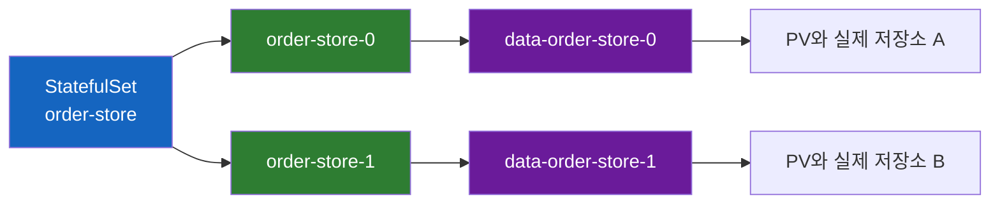

# Kubernetes StatefulSet

> **개발자를 위한 쉬운 쿠버네티스 · 19장** | [전체 목차](./Kubernetes-Introduction.md#이-시리즈의-읽는-순서) · [이전 장](./Kubernetes-Volume-PersistentVolume.md) · [다음 장](./Kubernetes-DaemonSet-Job-CronJob.md)

주문 API Pod는 교체되어도 같은 Service 뒤에서 같은 요청을 처리하면 된다. 하지만 DB의 두 번째 인스턴스를 교체할 때는 첫 번째 인스턴스의 디스크를 붙여서는 안 된다. 이전 장에서 배운 [PV와 PVC](Kubernetes-Volume-PersistentVolume.md)는 저장소의 수명을 분리했고, 이번 장은 여러 인스턴스와 저장소의 대응을 유지하는 문제를 다룬다.

## 결론부터 말하면

StatefulSet은 각 인스턴스에 ordinal이라는 순번을 부여하고, 이를 Pod 이름·네트워크 이름·개별 PVC와 연결해 유지하는 controller다. Pod를 교체해도 같은 논리적 인스턴스로 다시 찾을 수 있지만, 새 Pod는 새 UID와 새 프로세스이며 IP도 바뀔 수 있다.

이 기능만으로 DB 복제, Primary 선출, failover, 백업이 구현되지는 않는다. `replicas: 3`인 MySQL StatefulSet을 만드는 것과 데이터를 복제하는 MySQL 클러스터를 구성하는 것은 별개의 일이다.

| 유지하려는 것 | StatefulSet의 역할 | 별도로 필요한 것 |
|---|---|---|
| 인스턴스 이름 | `order-store-0` 같은 이름 재사용 | 실제 앱의 인스턴스 구성 |
| 연결 주소 | Headless Service를 통한 개별 DNS 이름 | DNS·readiness·앱의 재접속 |
| 디스크 대응 | ordinal별 PVC 생성과 재참조 | CSI, 저장소 상태, backup/restore |
| DB 역할과 데이터 복제 | 직접 구현하지 않음 | DB 설정 또는 DB Operator |

## 1. 모든 복제본이 서로 바뀌어도 되는가

Deployment도 PVC를 참조할 수 있다. 따라서 데이터를 쓰면 반드시 StatefulSet을 써야 한다거나 Deployment로 DB를 띄우면 반드시 유실된다는 설명은 정확하지 않다. 단일 인스턴스와 명시적 PVC, 적절한 교체 전략으로 운영할 수도 있다. 중요한 차이는 여러 복제본 각각의 정체성을 controller가 관리해야 하는가다.

일반 Deployment는 Pod template 하나를 복제한다. 어느 Pod가 사라져도 동일한 역할의 다른 Pod로 보충하면 된다. 반면 분산 저장 시스템에서는 멤버별 디스크와 이름이 구성에 포함될 수 있다. `replicas` 숫자만 복구하면 된다는 모델로는 이전 멤버의 상태를 찾아 연결하기 어렵다.

StatefulSet은 이 문제를 ordinal로 푼다. 기본 시작 ordinal이 0이고 replicas가 3이면 `order-store-0`, `order-store-1`, `order-store-2`라는 이름을 사용한다. 두 번째 Pod가 없어지면 controller는 아무 새 이름 대신 `order-store-1`을 다시 만든다. 그러나 UID는 달라지므로 삭제된 Pod가 되살아나는 것이 아니다. 같은 이름의 새 실행 인스턴스다.

이름 재사용은 container restart와도 다르다. 같은 Pod 안에서 kubelet이 컨테이너를 재시작하면 Pod UID는 그대로다. Pod 교체라면 논리 이름은 같아도 UID와 IP, 시작 시각을 다시 읽어야 한다. 장애 타임라인에서 이 차이를 놓치면 재시작과 재배치의 원인을 섞게 된다.

## 2. 이름, DNS, PVC가 같은 ordinal에 모인다

### Headless Service는 개별 인스턴스를 찾게 한다

일반 Service는 Service의 가상 IP를 제공한다. Headless Service는 `clusterIP: None`으로 그 가상 IP를 만들지 않고 endpoint를 DNS로 찾게 한다. StatefulSet의 `serviceName`은 이 네트워크 이름을 관리할 Service를 가리킨다. StatefulSet이 Headless Service 자체를 대신 생성하는 것은 아니므로 함께 준비해야 한다.

클러스터 도메인이 `cluster.local`이라면 다음과 같은 이름을 사용할 수 있다.

```text
order-store-0.order-store.bookstore.svc.cluster.local
order-store-1.order-store.bookstore.svc.cluster.local
order-store-2.order-store.bookstore.svc.cluster.local
```

Pod IP가 바뀌어도 앱은 같은 DNS 이름으로 다시 찾을 수 있다. 다만 DNS가 모든 인스턴스를 항상 즉시 반환한다는 뜻은 아니다. endpoint readiness, `publishNotReadyAddresses`, DNS negative cache와 클러스터 도메인 설정이 응답에 영향을 준다. 멤버들이 Ready가 되기 전에 서로를 발견해야 하는 앱이라면 discovery와 readiness 사이의 순환 의존성을 설계해야 한다. `publishNotReadyAddresses`를 켜는 것은 준비되지 않은 멤버도 발견하도록 허용하는 선택이므로, 일반 사용자 트래픽용 Service와 분리하는 것이 관계를 명확하게 한다.

### PVC는 순번별로 만들어진다

`volumeClaimTemplates`는 모든 Pod가 공유할 PVC 하나의 참조가 아니다. 각 ordinal에 대해 claim을 생성하는 템플릿이다. 이름이 `data`인 템플릿이라면 `data-order-store-0`, `data-order-store-1`처럼 대응한다. replacement Pod는 이 기존 claim을 다시 참조한다.



두 PVC에 같은 데이터가 복제되는 화살표는 없다. StatefulSet은 대응을 유지할 뿐 그 사이의 데이터 전송을 구현하지 않기 때문이다.

## 3. 최소 구성으로 관계를 읽는다

공통 주문 API는 여전히 `order-api` Deployment로 실행한다고 가정한다. 다음 `order-store`는 그 API와 별개의, 가상 저장 서비스다. 이미지와 `/ready`, `/var/lib/order-store` 동작은 설명용이고 실제 DB 제품이나 복제 클러스터 설치 예제가 아니다. `bookstore` namespace와 동적 provisioning을 지원하는 `book-disk` StorageClass가 준비되어 있어야 한다.

```yaml
apiVersion: v1
kind: Service
metadata:
  name: order-store
  namespace: bookstore
spec:
  clusterIP: None
  selector:
    app: order-store
  ports:
  - name: peer
    port: 8080
    targetPort: peer
---
apiVersion: apps/v1
kind: StatefulSet
metadata:
  name: order-store
  namespace: bookstore
spec:
  serviceName: order-store
  replicas: 3
  podManagementPolicy: OrderedReady
  selector:
    matchLabels:
      app: order-store
  template:
    metadata:
      labels:
        app: order-store
    spec:
      terminationGracePeriodSeconds: 60
      containers:
      - name: order-store
        image: registry.example.com/book/order-store:1.0.0
        ports:
        - name: peer
          containerPort: 8080
        readinessProbe:
          httpGet:
            path: /ready
            port: peer
        volumeMounts:
        - name: data
          mountPath: /var/lib/order-store
  volumeClaimTemplates:
  - metadata:
      name: data
    spec:
      storageClassName: book-disk
      accessModes: [ReadWriteOnce]
      resources:
        requests:
          storage: 10Gi
```

Headless Service의 selector와 Pod label이 맞고, StatefulSet의 `serviceName`이 그 Service 이름과 맞는다. 컨테이너의 `volumeMounts.name`은 claim template 이름 `data`와 맞는다. 각각 다른 관계이므로 Service가 endpoint를 못 찾는 문제를 PVC 이름 변경으로 해결할 수는 없다.

예제를 MySQL로 바꾸려면 이미지 교체 외에도 초기 인증 Secret, readiness의 의미, 복제 설정, 데이터 디렉터리 초기화 조건이 필요하다. MySQL 세 개를 실행했다고 `mysql-0`이 자동 Primary가 되는 것도 아니다. 역할을 ordinal에 연결하는 것은 앱 구성의 선택이며, 장애 이후에도 같은 역할을 영원히 맡는다는 뜻은 아니다.

## 4. 순서는 어떤 작업에 적용되는가

기본 `OrderedReady`는 scale-up 때 앞선 ordinal이 Running/Ready가 되기를 기다리며 다음 Pod를 만든다. scale-down은 높은 ordinal부터 줄인다. 앞선 인스턴스가 Ready가 되지 못하면 뒤의 인스턴스 생성도 지연되므로, readiness가 과도한 의존성을 검사하면 배포가 막힐 수 있다.

`podManagementPolicy: Parallel`은 scaling 때 다른 Pod의 Ready나 종료를 순서대로 기다리지 않게 한다. 이름과 PVC 대응은 유지된다. 병렬 기동을 지원하는 앱에는 유용하지만, 초기화 순서가 필요한 제품이라면 그 프로토콜을 먼저 확인해야 한다. 이 필드는 RollingUpdate 전략까지 모두 병렬로 바꾸는 스위치가 아니다.

또한 scale-down 순서를 StatefulSet 오브젝트 삭제에 그대로 확대하면 안 된다. StatefulSet 삭제 시 Pod의 순차 종료는 보장되지 않는다. 종료 순서가 중요한 경우 먼저 replicas를 0으로 줄이는 절차를 고려하되, DB 역할과 복제 상태, graceful shutdown, PVC retention 정책을 함께 판단한다. 순서가 있다는 사실만으로 DB가 안전하게 종료되는 것은 아니다.

### RollingUpdate와 partition

StatefulSet의 기본 RollingUpdate는 높은 ordinal부터 Pod를 교체하고 새 Pod가 Running/Ready가 되기를 기다린다. 다음은 StatefulSet spec의 발췌다.

```yaml
updateStrategy:
  type: RollingUpdate
  rollingUpdate:
    partition: 2
```

0부터 시작하는 세 인스턴스에서 partition이 2이면 ordinal 2 이상만 새 template을 적용한다. 2→1→0으로 partition을 낮추며 관찰하는 방식은 일부 인스턴스부터 검증할 때 유용하다. 그러나 어느 ordinal을 시험 대상으로 삼아도 DB 복제 프로토콜이 신·구 버전 혼합을 지원하는지 확인해야 한다.

`OnDelete`는 template을 바꾼 뒤 기존 Pod를 자동 교체하지 않는다. 운영자가 삭제한 Pod가 새 template으로 다시 만들어진다. DB별 순서를 사람이 통제할 수 있지만 직접 수행할 절차와 검증 책임이 늘어난다.

Ready가 되지 않는 잘못된 template 때문에 rollout이 막히면 정상 template으로 되돌리는 것만으로 항상 진행되지 않을 수 있다. 공식 문서의 forced rollback 절차처럼 잘못 만들어진 Pod를 별도로 제거해야 하는 경우가 있다. 이 역시 storage·DB 상태와 기존 인스턴스 종료를 확인하고 수행할 작업이다.

## 5. Pod를 줄이는 것과 디스크를 버리는 것은 별개다

기본적으로 StatefulSet의 PVC는 scale-down이나 StatefulSet 삭제 후에도 남는다. 다시 늘릴 때 이전 데이터를 연결할 수 있게 하는 선택이다. 따라서 Pod 개수가 0이어도 저장소 비용과 데이터 관리 책임은 남을 수 있다.

Kubernetes 1.32 stable인 `persistentVolumeClaimRetentionPolicy`는 이 결정을 명시한다. 다음은 삭제와 축소 모두 데이터를 보존하는 spec 발췌다.

```yaml
persistentVolumeClaimRetentionPolicy:
  whenDeleted: Retain
  whenScaled: Retain
```

`whenScaled: Delete`이면 scale-down에서 불필요해진 ordinal의 PVC를 controller가 삭제하는 경로가 생긴다. `whenDeleted: Delete`는 StatefulSet 삭제에 따른 정리를 선택한다. 그 뒤 실제 디스크까지 지워지는지는 PV reclaim policy와 provisioner의 처리에 달려 있다. 따라서 PVC retention과 PV reclaim을 함께 읽어야 한다.

이 차이는 앞의 scale-to-zero 종료 절차에서도 중요하다. `whenScaled: Delete`인 환경에서 순차 종료를 위해 replicas를 0으로 줄이면 PVC 삭제까지 유발할 수 있다. 종료 순서를 원했을 뿐인데 저장소를 잃는 결과가 되지 않도록 먼저 정책과 복구 수단을 확인해야 한다.

기존 StatefulSet의 `volumeClaimTemplates`는 자유롭게 수정할 수 있는 필드가 아니다. 이미 생성된 PVC의 용량 변경과 앞으로 생성할 claim template 관리도 별개다. 스토리지 변경은 이전 장의 확장·이동 절차와 연결해서 계획한다.

## 6. 심화: 네트워크 단절은 프로세스 종료 증거가 아니다

StatefulSet은 같은 논리적 인스턴스를 중복 생성하지 않도록 보수적으로 동작한다. 그런데 Node와 control plane 사이의 통신이 끊겨도 그 Node에서 DB 프로세스는 계속 실행 중일 수 있다. API에서 `NotReady`가 보인다는 사실만으로 DB가 죽었다고 단정할 수 없다.

강제 Pod 삭제는 이 차이를 드러낸다. API 오브젝트를 즉시 제거하면 controller가 같은 이름의 새 Pod를 만들 수 있지만, 이전 Node의 프로세스를 확실히 종료하는 명령은 아니다. 두 인스턴스가 같은 정체성으로 DB나 외부 시스템에 쓰면 split-brain과 손상이 생길 수 있다. API 이름의 유일성만으로 물리적 프로세스의 유일성이 보장되지는 않는다.

그러므로 `--force --grace-period=0`이나 Node 오브젝트 삭제를 고장 난 Pod의 일반 복구 명령으로 삼지 않는다. 기존 Node가 다시 쓰지 못하도록 전원·스토리지·네트워크 수준에서 차단하는 fencing, DB의 멤버십과 quorum 처리, driver의 detach/attach 절차가 검증되어야 한다. [StatefulSet Pod 강제 삭제 문서](https://kubernetes.io/docs/tasks/run-application/force-delete-stateful-set-pod/)는 바로 이 운영 책임을 설명한다.

복구 시간은 단계별 조건에 따라 달라진다. Node 상태 감지, taint/toleration, eviction controller, Pod 오브젝트 삭제, volume detach/attach, 재스케줄링, DB recovery가 따로 진행된다. 클러스터 설정과 장애 형태에 따라 어느 단계가 멈추는지 확인해야 한다.

```bash
kubectl get statefulset order-store -n bookstore
kubectl get pods -n bookstore -l app=order-store -o wide
kubectl describe pod order-store-1 -n bookstore
kubectl get pvc -n bookstore
```

이 관찰로 어느 ordinal이 어떤 Node·UID·PVC와 연결되어 있는지 추적한다. replica가 셋이라는 숫자는 DB의 복제 지연이나 quorum 건강 상태를 알려주지 않는다. 그 부분은 DB의 관리 도구와 지표로 확인한다.

## 7. 심화: zone 분산과 DB의 고가용성

세 Pod를 만들었는데 같은 Node나 zone에 모이면 한 장애로 함께 영향을 받을 수 있다. Pod anti-affinity나 topology spread는 실패 도메인에 분산하는 데 쓰인다. 하지만 `DoNotSchedule` 조건이 엄격하면 다른 zone의 자원 부족으로 Pod가 Pending이 될 수도 있다. 이때 무조건 제약을 완화하기보다 가용성 목표와 실제 확보한 capacity를 함께 본다.

Pod가 여러 zone에 있다는 사실과 데이터가 zone 사이에 복제된다는 사실도 별개다. 각 Pod가 zonal disk를 쓰면 앱의 복제 프로토콜이 데이터를 복제해야 한다. GKE의 regional disk 같은 스토리지 복제도 별도 제품 구성이고, class 이름이 `premium-rwo`라는 이유로 생기지 않는다. 디스크 복제만으로 DB의 Primary 선출과 client 재연결이 자동 해결되는 것도 아니다.

EKS standard EBS CSI와 Auto Mode의 provisioner 차이, GKE disk class와 regional disk, AKS block/file class 선택은 [Volume 장의 클라우드 절](Kubernetes-Volume-PersistentVolume.md#7-심화-클라우드-이름보다-실제-class를-읽는다)에서 이어 읽을 수 있다. StatefulSet은 그 인프라 위에 인스턴스 대응을 더하는 계층이다.

## 8. Database Operator가 맡는 별도의 문제

DB를 운영하려면 Primary/Replica 구성, 복제 상태 관찰, failover, backup/restore, 업그레이드와 client 접속 전환을 관리해야 한다. Operator는 이 DB 운영 지식을 reconciliation으로 구현한다. 새 API 종류를 등록하는 CRD와 실제 동작을 수행하는 controller의 차이는 [CRD, Controller, Operator](Kubernetes-CRD-Controller-Operator.md)에서 다룬다.

여기서 Operator가 언제나 StatefulSet을 만든다고 가정해서는 안 된다. CloudNativePG는 자체 Pod controller를 사용하며 StatefulSet에 의존하지 않는다. 다음은 CNPG Operator와 CRD가 설치된 별도 PostgreSQL 구성의 형태다. 앞의 가상 `order-store`에 적용하는 StatefulSet patch가 아니다.

```yaml
apiVersion: postgresql.cnpg.io/v1
kind: Cluster
metadata:
  name: book-postgres
  namespace: bookstore
spec:
  instances: 3
  storage:
    storageClass: book-disk
    size: 10Gi
```

이 선언의 `instances`는 CNPG가 해석하는 DB 클러스터의 목표다. DB replication과 failover는 CNPG의 구현·설정에 의해 수행되며, Kubernetes StatefulSet의 공통 기능이 아니다. 스토리지, 네트워크, 인증, 애플리케이션의 재접속 정책이 맞아야 실제로 서비스할 수 있다.

백업도 별도 구성이다. CNPG의 in-tree `barmanObjectStore`는 1.26부터 deprecated이며 2026-10-23 기준 공식 문서는 Barman Cloud Plugin 경로를 안내한다. object store 위치만 적는다고 정기 base backup이 예약되는 것은 아니다. 지원 plugin 구성과 자격 증명, `Backup`/`ScheduledBackup`, WAL 보관, 복원 테스트를 함께 설계해야 한다. 자동 failover가 있어도 연결이 끊길 수 있으므로 업그레이드를 무조건 무중단이라고 표현할 수 없다.

MySQL Operator나 Percona 계열 등 다른 제품도 같은 기준으로 평가한다. 어느 리소스를 생성하는지보다 지원 DB topology·버전, 장애 때의 동작, restore 절차, 보안과 유지보수 책임이 중요하다. Operator를 설치하면 DBA의 책임이 사라지는 것은 아니다.

관리형 DB도 선택지다. DB 운영 일부를 서비스 제공자에게 위임할 수 있지만, HA·backup·PITR은 선택한 상품과 옵션·보존 기간에 달려 있다. 네트워크 접근, 인증, 스키마 변경과 앱 복구 책임은 여전히 남는다. Kubernetes 직접 운영과 비교할 때는 디스크 가격 외에도 온콜, 복구 훈련, 업그레이드 시간과 허용 가능한 데이터 손실·복구 시간을 함께 계산해야 한다.

## 생각해 볼 질문

### 1. `order-store-1`을 교체했을 때 같은 것과 달라질 수 있는 것은 무엇인가?

논리적 이름과 ordinal, 기존 PVC에 대한 대응은 유지할 수 있다. UID·IP·프로세스는 달라질 수 있다. 이름이 같다는 사실은 이전 프로세스가 메모리에 갖고 있던 상태까지 복구되었다는 뜻이 아니다.

### 2. replicas를 3으로 늘리면 DB가 고가용성이 되는가?

Pod 세 개와 개별 PVC가 생길 뿐이다. DB 복제, 역할 선출, quorum, 실패 도메인 분산, client 재접속과 검증된 복구 수단이 추가로 필요하다. 실제 DB 상태를 관찰해야 HA를 평가할 수 있다.

### 3. NotReady Node의 Pod를 강제 삭제하면 왜 데이터가 손상될 수 있는가?

통신 단절 때문에 보이지 않을 뿐 기존 프로세스가 쓰기를 계속할 수 있기 때문이다. API에서 이름을 비우고 새 Pod를 만드는 것과 기존 writer를 차단하는 것은 다른 작업이다. 강제 교체에는 fencing과 스토리지·DB 절차가 필요하다.

## 다음 장으로

StatefulSet도 기본 목표는 인스턴스를 계속 실행하는 것이다. 완료되면 멈춰야 하는 DB migration이나 매일 수행할 backup에는 다른 실행 모델이 필요하다. [DaemonSet, Job, CronJob](Kubernetes-DaemonSet-Job-CronJob.md)에서 Node별 실행과 유한 작업의 수명을 연결한다.

## 출처

- [Kubernetes StatefulSets](https://kubernetes.io/docs/concepts/workloads/controllers/statefulset/) — identity, 순서, 전략, PVC retention
- [Kubernetes Headless Services](https://kubernetes.io/docs/concepts/services-networking/service/#headless-services) — Service와 DNS의 역할
- [Force Delete StatefulSet Pods](https://kubernetes.io/docs/tasks/run-application/force-delete-stateful-set-pod/) — 중복 인스턴스와 데이터 위험
- [Kubernetes Persistent Volumes](https://kubernetes.io/docs/concepts/storage/persistent-volumes/) — PVC·PV 수명과 확장
- [CloudNativePG controller](https://cloudnative-pg.io/docs/devel/controller/) — custom Pod controller
- [CloudNativePG backup](https://cloudnative-pg.io/docs/current/backup/) — backup 구성과 책임
- [Barman Cloud Plugin migration](https://cloudnative-pg.io/plugin-barman-cloud/docs/migration/) — in-tree backup에서 plugin으로의 전환
- [MySQL Operator](https://github.com/mysql/mysql-operator) — 별도 DB Operator의 예
