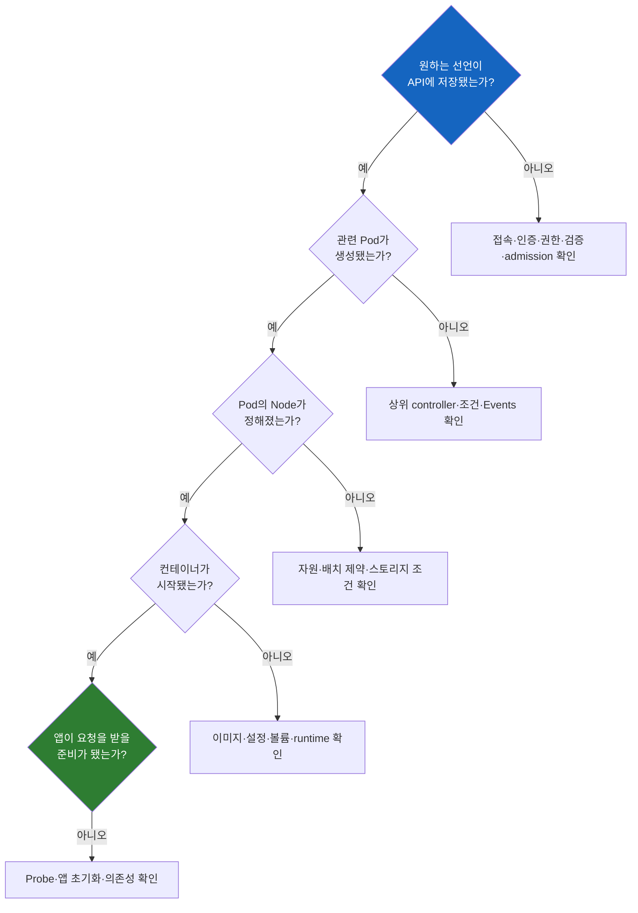

# Kubernetes Troubleshooting From Apply to Request

> **개발자를 위한 쉬운 쿠버네티스 · 22장** | [전체 목차](./Kubernetes-Introduction.md#이-시리즈의-읽는-순서) · [이전 장](./Kubernetes-Admission-Webhook.md)

배포부터 접속까지 — 하나의 장애를 끝까지 설명하는 법

지금까지는 시스템을 구성하는 역할을 나눠 살펴봤다. 실제 장애에서는 그 역할들이 한꺼번에 눈앞에 나타난다. Deployment에는 세 개를 원한다고 쓰여 있고, Pod는 두 개만 준비되어 있으며, 브라우저에는 503이 나온다. 어디서부터 읽어야 할까?

이 장에서는 가상의 주문 API `order-api`를 통해 앞의 개념들을 다시 연결한다. 아래 출력과 메시지는 설명을 위해 구성한 예시이며 특정 고객 환경의 실측 기록이 아니다. 한 클러스터에 모든 문제가 동시에 생겼다는 이야기도 아니다. 같은 애플리케이션의 조건을 하나씩 바꿔, 관찰 결과에 따라 확인 경로가 어떻게 달라지는지 살펴본다.

## 결론부터 말하면

**장애를 설명한다는 것은 실패한 명령의 이름을 나열하는 것이 아니라, 원하는 상태와 관찰한 상태가 어느 경계에서 달라졌는지 증거로 좁히는 일이다.** 먼저 배포를 관리하는 경로와 앱을 사용하는 요청 경로를 구분한다. 그런 다음 마지막으로 확인된 성공과 아직 확인하지 못한 부분을 연결한다.

`Running`, `Ready`, HTTP 200, Helm의 성공 메시지는 각각 다른 범위를 설명한다. 어느 하나도 모든 경로의 정상 동작을 증명하지 않는다. 이 장의 핵심은 명령어의 수보다 각 결과가 **무엇을 알려 주며 무엇까지는 말해 주지 않는지** 읽는 데 있다.

## 1. 상황을 설명할 기준부터 고정한다

주문 API는 `bookstore` namespace의 Deployment로 관리된다. Pod label은 `app: order-api`, 앱의 HTTP 포트는 `8080`이다. 같은 namespace의 `order-api` Service는 `80` 포트로 받아 Pod의 `8080`에 연결한다고 가정한다. 외부 주소를 사용하는 경우에는 별도로 구성된 HTTP 진입점이 앞에 있다.

장애 제보를 받으면 가장 먼저 “어떤 환경에서, 누가, 언제, 어떤 요청을 했는가”를 맞춘다. 개발자 노트북의 curl, 클러스터 안 다른 앱의 호출, 외부 사용자의 브라우저는 출발점부터 다르다. 같은 URL을 썼더라도 DNS 응답이나 경로가 다를 수 있다. 배포 직후에만 실패하는지, 특정 Node에 있는 Pod에서만 실패하는지도 중요하다.

다음은 조사 대상을 읽는 명령 예시다. 자신의 허용된 환경과 namespace를 확인한 뒤 사용한다. 이 글은 실제 운영 리소스를 삭제하거나 재시작하는 절차를 포함하지 않는다.

```bash
kubectl config current-context
kubectl get deployment order-api -n bookstore
kubectl get pods -n bookstore -l app=order-api -o wide
kubectl get service order-api -n bookstore
```

여기서 현재 context를 확인하는 이유는 단순한 실수 방지 이상이다. “내가 본 상태가 제보된 환경의 상태인가”라는 증거의 전제를 맞추기 위해서다. 리소스가 보이지 않을 때 namespace를 잘못 본 것인지, 조회 권한이 없는 것인지, 정말 존재하지 않는지부터 구분해야 한다.

## 2. 배포 경로에서 마지막으로 진행된 지점을 찾는다

[아키텍처 장](./Kubernetes-Architecture.md)의 흐름을 조사 질문으로 바꾸면 다음과 같다.



실제 시스템은 이 질문을 한 번만 통과하는 직선이 아니다. 실행되던 앱이 다시 실패할 수 있고, 일부 복제본만 새 버전일 수도 있다. 그림은 조사 범위를 좁히는 출발점이다. 상태를 연속해서 관찰하며 가설을 갱신해야 한다.

### 2.1 apply부터 실패했다면

`Forbidden`이라는 응답과 `connection refused`라는 오류는 같은 실패가 아니다. 앞의 것은 해당 API 요청을 처리하는 과정에서 권한 문제가 드러났을 수 있고, 뒤의 것은 목적지의 TCP 연결부터 확인해야 하는 상황이다. `x509` 오류라면 TLS 신뢰나 인증서 이름·유효기간 등이 조사 대상이 된다. 모든 경우를 RBAC 변경으로 해결하려고 하면 원인과 관계없는 권한만 늘어날 수 있다.

서버가 반환한 오류에서 리소스 종류, namespace, 동작, 관련 정책 이름을 읽는다. 예를 들어 Deployment 생성 권한이 없다는 응답과 특정 admission webhook이 요청을 거절했다는 응답은 다음에 확인할 주체가 다르다. 권한 문제의 가설은 다음과 같이 자신의 권한을 조회해 보강할 수 있다.

```bash
kubectl auth can-i create deployments.apps -n bookstore
kubectl auth can-i patch deployments.apps -n bookstore
```

`yes`는 해당 권한 질의에 대한 답이다. 이미지의 존재, admission 통과, 이후 Pod 생성과 실행을 보장하지 않는다. 또한 apply가 필요한 작업은 대상의 존재와 적용 방식에 따라 달라질 수 있으므로 두 질의만으로 모든 apply 권한을 검증했다고 말해서는 안 된다.

### 2.2 Deployment는 있는데 Pod가 없다면

이때 앱 로그부터 찾으려 해도 아직 앱이 만들어지지 않았을 수 있다. 사용자가 작성한 선언과 이를 처리하는 controller 사이를 살펴야 한다.

```bash
kubectl describe deployment order-api -n bookstore
kubectl get replicasets -n bookstore -l app=order-api
kubectl get events -n bookstore --sort-by=.metadata.creationTimestamp
```

원하는 복제본 수가 정말 3인지, Deployment의 조건과 Events에 어떤 이유가 기록됐는지 본다. ReplicaSet이 있다면 그 리소스도 `describe`해 Pod 생성 실패 이유를 확인한다. Quota나 admission 때문에 Pod 생성이 거절된 경우에는 Pod 자체의 Events를 기다릴 수 없다. 생성 요청이 성공하지 않아 대상 Pod가 없기 때문이다.

리소스 목록을 label로 좁히는 것은 편리하지만 label은 소유 관계 자체가 아니다. 같은 label을 다른 리소스에 붙일 수 있으므로 실제 관리 관계가 필요하면 `metadata.ownerReferences`도 확인한다. 새 ReplicaSet이 생겼는지와 기존 ReplicaSet이 얼마나 남아 있는지도 함께 보면 진행 중인 업데이트를 Pod 유실로 오해하지 않을 수 있다.

## 3. Pending은 원인이 아니라 아직 준비되지 않은 상태다

`Pending`이라는 글자를 보자마자 CPU를 늘리는 것은 성급하다. Pod가 아직 Node를 배정받지 못했을 수도 있고, 배정은 받았지만 이미지나 볼륨 등 실행 준비가 끝나지 않았을 수도 있다. 먼저 Node 배치 여부를 구분한다.

아래 `order-api-7b9c-example`은 설명용 이름이다. 실제 조사에서는 앞의 `get pods` 결과에서 선택한 Pod 이름으로 바꾼다.

```bash
kubectl get pod order-api-7b9c-example -n bookstore -o wide
kubectl describe pod order-api-7b9c-example -n bookstore
```

Node가 정해지지 않았다면 scheduling 관련 Events를 읽는다. `Insufficient cpu`와 맞지 않는 node affinity, 허용되지 않은 taint, 해결되지 않은 저장소 조건은 서로 다른 제약이다. Node의 현재 CPU 사용률이 낮더라도 이미 선언된 requests와 Pod가 요구하는 양을 기준으로 배치할 자리가 부족할 수 있다. “사용률은 낮으니 scheduler 버그다”라는 결론은 그 차이를 빠뜨린다.

Node가 이미 정해졌다면 실행 준비 쪽으로 내려간다. 이 경우 같은 Pod의 Events에서 이미지 다운로드 실패, Secret이나 ConfigMap 참조 오류, 볼륨 연결 실패 같은 구체적인 이유를 찾을 수 있다. 상태의 짧은 이름보다 그 상태로 남아 있는 이유가 중요하다.

### 3.1 이미지 다운로드 실패: 접속 주체를 바꾸어 생각한다

`ImagePullBackOff`는 이미지 준비가 실패한 뒤 재시도 간격을 두고 있다는 신호다. 문자열 자체가 인증 실패인지 네트워크 단절인지 알려 주지는 않는다. Events의 원인 메시지와 이미지 주소를 함께 읽는다.

| 관찰한 단서 | 우선 세울 가설 | 추가로 필요한 증거 |
|---|---|---|
| 저장소나 manifest를 찾지 못했다는 응답 | 이미지 경로·태그·아키텍처가 맞지 않음 | 레지스트리의 실제 artifact, 이미지 참조, Node 플랫폼 |
| 인증 또는 권한 관련 응답 | 자격 증명 전달·권한이 맞지 않음 | Pod의 imagePullSecrets 참조, Secret 존재·타입, registry 권한 |
| DNS 또는 연결 timeout | Node에서 이름 해석·접속이 되지 않음 | 해당 Node의 DNS·라우팅·proxy·방화벽 조건 |
| 인증서 신뢰 관련 오류 | Node runtime이 registry의 인증서를 신뢰하지 못함 | 인증서 체인·호스트 이름·Node 신뢰 구성 |

이 표는 진단 후보이며 메시지와 원인을 일대일로 확정하는 규칙은 아니다. 레지스트리나 중간 proxy가 보안을 위해 다른 응답을 돌려줄 수도 있다.

에어갭 환경에서 특히 중요한 점은 이미지 다운로드를 수행하는 위치다. 개발자 PC에서 pull이 됐다는 결과만으로 Node의 pull을 검증할 수 없다. 반대로 앱 컨테이너의 CA 파일을 수정해도 그 컨테이너가 만들어지기 전의 이미지 다운로드에는 적용되지 않을 수 있다. 신뢰 설정과 자격 증명의 전달 경로를 각각 확인해야 한다.

### 3.2 볼륨이 준비되지 않았다면

Pod가 PVC를 참조한다면 저장소 요청도 함께 살핀다. 다음 `order-data`는 해당 사례에서 사용한다고 가정한 PVC 이름이다.

```bash
kubectl get pvc order-data -n bookstore
kubectl describe pvc order-data -n bookstore
kubectl get storageclass
```

PVC가 Pending이면 지정한 StorageClass가 있는지, provisioner가 동작하는지, 용량이나 접근 모드 조건을 만족하는지 본다. `WaitForFirstConsumer`를 사용하는 경우에는 소비할 Pod의 배치와 저장소 선택이 연결되므로 PVC가 곧바로 Bound가 되지 않는 것만으로 장애라고 단정하지 않는다. 이때 Pod와 PVC가 함께 Pending으로 보일 수 있다. 두 상태를 독립적인 선후 단계로만 보지 말고 scheduler가 선택하려는 위치와 저장소의 배치 조건을 함께 읽어야 한다.

PVC가 Bound인데 Pod가 실행되지 않는다면 연결·마운트 단계의 Events를 확인한다. 바인딩, Node에 대한 연결, 파일시스템 마운트, 앱의 실제 파일 접근은 서로 다른 단계다. Bound라는 상태는 DB가 정상적으로 데이터를 읽고 쓴다는 보증도 아니고, 삭제 후 복구 가능하다는 보증도 아니다. 조사 중 PVC를 지우는 행동은 진단을 넘어 데이터 수명에 영향을 주므로, 이 장의 확인 절차에 포함하지 않는다.

## 4. 컨테이너가 시작됐지만 앱이 준비되지 않은 경우

컨테이너가 반복해서 종료된다면 시작 전의 scheduling보다 앱 프로세스와 종료 이유에 관심을 옮긴다. 다만 Pod에는 여러 컨테이너가 있을 수 있으므로 어느 컨테이너의 상태와 로그인지 지정해야 한다.

```bash
kubectl logs order-api-7b9c-example -n bookstore -c order-api --tail=100
kubectl logs order-api-7b9c-example -n bookstore -c order-api --previous --tail=100
```

`--previous`는 같은 Pod에서 이전에 종료된 컨테이너 인스턴스의 로그를 요청한다. 이미 삭제된 다른 Pod의 로그나 모든 재시작 이력을 복원하는 기능은 아니다. 로그가 없다고 앱이 정상이라는 뜻도 아니다. 프로세스가 로그를 남기기 전에 종료됐거나, 로그 수집·보존 조건이 맞지 않을 수 있다.

`CrashLoopBackOff`는 반복 실패 후 재시도 대기라는 현상을 나타내며 원인은 그 아래에 있다. 설정 누락으로 시작 직후 종료됐는지, 메모리 제한 때문에 종료됐는지, liveness 실패로 재시작됐는지에 따라 봐야 할 증거가 다르다. `describe`의 컨테이너 상태·이전 종료 상태·Events를 앱 로그와 함께 연결한다. 단순히 메모리 값을 늘리거나 liveness를 끄기 전에 어떤 증거가 그 변경을 지지하는지 확인한다.

### Running인데 READY가 0/1이면

프로세스가 실행 중이어도 readiness가 통과하지 않으면 요청을 받을 준비가 되지 않은 것으로 취급될 수 있다. 앱이 DB 연결을 기다리는지, health 경로가 잘못됐는지, Probe의 port가 앱이 실제로 듣는 port와 다른지 확인한다. Probe가 실패했다는 사실과 앱이 업무 요청을 처리할 수 없다는 사실을 무조건 같게 취급해서는 안 된다. 검사 자체가 잘못 구성됐을 수도 있다.

반대도 마찬가지다. health endpoint가 항상 200을 반환한다면 Ready 상태이면서 실제 주문 요청은 실패할 수 있다. 준비 상태 검사는 앱의 어떤 능력을 대표하는지 설계되어야 한다. [Probe 장](./Kubernetes-Probe-Liveness-Readiness-Startup.md)에서 배운 liveness, readiness, startup의 목적을 구분하는 이유가 여기에 있다.

## 5. 앱은 준비됐는데 Service로 연결되지 않는 경우

여기서부터는 앱의 실행 경로와 실제 통신 경로를 나눠 본다. 먼저 Service가 어떤 Pod를 대상으로 삼는지 확인한다.

```bash
kubectl get service order-api -n bookstore -o yaml
kubectl get pods -n bookstore --show-labels
kubectl get endpointslices -n bookstore \
  -l kubernetes.io/service-name=order-api -o yaml
```

공통 사례의 Service는 다음 구조다. 전체 배포용 파일이 아니라 비교할 필드만 발췌했다.

```yaml
spec:
  selector:
    app: order-api
  ports:
    - port: 80
      targetPort: 8080
```

Pod의 `app` label이 `orders`인데 Service selector는 `order-api`라면 앱 자체가 정상이어도 선택되지 않는다. 이름이 비슷하거나 Deployment와 Service의 이름이 같다는 사실은 선택 조건을 대신하지 않는다. EndpointSlice는 이 관계가 실제 backend 정보로 반영되었는지 살펴보는 자료다. 주소만 보지 말고 port와 readiness 등 endpoint 조건도 함께 읽는다.

EndpointSlice에 예상한 주소가 없다면 selector, namespace, Pod 상태와 관련 controller의 반영 상태를 확인한다. 주소가 있고 조건도 적절하다면 이제 실제 네트워크 경로와 앱의 listen 상태를 구분할 차례다. 앱이 `localhost`에만 바인딩되어 있으면 Pod 외부에서 Pod IP로 접속하는 경로와 결과가 다를 수 있다. `containerPort: 8080`을 적었다고 애플리케이션이 자동으로 그 주소와 port에서 listen하는 것은 아니다.

### 이름, Service 주소, Pod 주소를 나누어 확인한다

허용된 진단용 Pod나 기존 앱 환경에서 조회 도구를 사용할 수 있다면 이름 해석, Service 주소 접속, Pod 주소 접속을 나누어 확인할 수 있다. 각 검사는 출발 Pod와 목적지, port, 프로토콜을 기록해야 비교가 된다. Node에서 한 검사와 Pod에서 한 검사를 같은 경로로 취급하지 않는다.

예를 들어 Service 이름 해석만 실패하고 확인한 ClusterIP 접속은 성공했다면 DNS 쪽으로 범위를 좁힐 근거가 된다. Pod 주소로는 연결되는데 Service 주소로 연결되지 않는다면 Service의 port 설정과 endpoint 조건, 해당 환경의 Service dataplane을 살필 이유가 생긴다. 다만 한 번의 성공·실패만으로 모든 Node나 모든 복제본의 상태를 확정할 수는 없다.

### port-forward의 성공을 어디까지 읽을 것인가

Pod로 직접 port-forward해서 응답을 받으면 앱 자체가 요청을 처리하는지 분리해 보는 데 도움이 된다. 그러나 이 연결은 일반적인 클러스터 네트워크와 외부 진입 경로를 그대로 통과하지 않는다.

따라서 “port-forward로 된다”는 사실은 “Ingress, Service dataplane, DNS가 모두 정상”이라는 결론을 지지하지 않는다. Service를 대상으로 port-forward하더라도 선택된 Pod로 연결하는 방식이므로 일반 Service 주소를 통한 load balancing 검증과 같지 않다. 우회 경로를 이용한 관찰은 유용하지만 그 우회가 무엇을 생략했는지 함께 말해야 한다.

## 6. 클러스터 안에서는 되는데 외부에서만 실패한다면

내부 Service 호출이 성공했다는 증거를 확보했다면 외부 경로의 구성 요소를 살핀다. DNS가 기대한 주소를 가리키는지, 외부 로드 밸런서나 proxy에 도달하는지, TLS가 어느 위치에서 종료되는지, HTTP host와 path가 어느 규칙과 일치하는지 순서대로 연결한다.

Ingress를 사용하는 환경이라면 리소스 자체와 그것을 처리하는 Ingress controller를 함께 봐야 한다. Gateway API를 사용한다면 Gateway와 Route가 연결되는 조건 및 status도 본다. Istio의 자체 API를 사용하는 경우도 있으므로 `get ingress` 결과가 비었다고 진입점이 없다고 결론짓지 않는다.

다음 명령들은 환경이 해당 API를 사용하는 경우에만 의미가 있다. Gateway API가 설치되지 않은 환경에서 resource type을 모른다는 오류가 나면 먼저 구현과 설치 여부를 확인해야 한다.

```bash
kubectl get ingress -n bookstore
kubectl get gateways.gateway.networking.k8s.io -n bookstore
kubectl get httproutes.gateway.networking.k8s.io -n bookstore
```

Istio의 자체 Gateway를 확인할 때는 `kubectl get gateways.networking.istio.io -n bookstore`처럼 API 그룹까지 적는다. 두 API가 모두 설치되어 있으면 `Gateway`라는 이름이 겹치므로, 짧은 이름만 보고 어느 리소스를 조사했는지 추측하지 않는 편이 좋다.

리소스가 존재한다는 결과만으로 controller가 그 선언을 받아 처리했다고 볼 수 없다. controller class 선택, Route의 참조 대상, namespace 경계, backend Service와 port, 인증서 참조 등을 이어서 확인한다. 외부 HTTP 503도 그 응답을 누가 만들었는지가 중요하다. edge proxy가 연결할 backend를 찾지 못한 것인지, backend 앱이 503을 반환한 것인지에 따라 다음 증거가 달라진다.

TLS 문제라면 인증서 검증을 끈 요청이 성공했다는 결과를 원래 요청의 정상화로 보고하지 않는다. 그것은 신뢰 검사를 생략했을 때의 별도 결과다. 내부 CA를 사용하는 환경에서는 어느 클라이언트가 어떤 인증서 체인을 신뢰해야 하는지 확인해야 한다.

## 7. 새 배포 직후 일부 요청만 실패한다면

전체 장애보다 일부 실패가 더 혼란스러울 수 있다. Pod 세 개 중 하나만 새 이미지라면 요청마다 다른 버전이 응답할 수 있다. 새 버전이 정상 시작했더라도 이전 버전과 다른 설정을 받거나 다른 Node에서 외부 의존성에 접근하지 못할 수도 있다.

이때는 요청을 처리한 Pod와 버전, 시간의 대응이 필요하다. 앱 로그나 응답 식별 정보, 트래픽 관리 도구의 관찰을 통해 어느 복제본에서 실패했는지 좁힌다. Deployment의 image 필드만 보고 모두 같은 코드라고 결론짓지 않는다. 가변 태그, Node별 캐시, 실행된 imageID의 관계는 [이미지 장](./Kubernetes-Image-Tag-Digest.md)에서 다뤘다.

```bash
kubectl get pods -n bookstore -l app=order-api \
  -o jsonpath='{range .items[*]}{.metadata.name}{"\t"}{.spec.nodeName}{"\t"}{range .status.containerStatuses[*]}{.name}{"="}{.imageID}{" "}{end}{"\n"}{end}'
```

imageID가 같아도 환경변수, 마운트한 설정, 외부 서비스 상태까지 같다는 뜻은 아니다. 반대로 여러 플랫폼용 이미지에서는 식별자를 해석할 때 manifest와 플랫폼별 이미지의 관계도 고려해야 한다. 하나의 관찰을 모든 동작 차이의 원인으로 확대하지 않는 것이 중요하다.

배포 시점에만 끊긴다면 readiness가 너무 일찍 통과하는지, 종료 중인 앱이 진행 중 요청을 어떻게 처리하는지, 연결과 endpoint 변경이 전파되는 시간을 함께 본다. 새 Pod 수가 늘었다는 사실만으로 실제 요청이 안전하게 넘어갔다고 볼 수 없다. 데이터베이스 migration을 되돌리지 않은 채 이미지만 rollback하는 일도 전체 상태 복원과 다르다.

## 8. 원인을 찾은 뒤의 설명은 어떻게 달라지는가

운영 보고를 “Pod를 재시작해서 해결했다”로 끝내면 다음 장애에서 같은 판단을 반복해야 한다. 재시작 전 무엇을 관찰했는지, 어떤 원인을 가정했는지, 변경이 어느 단계에 영향을 줬는지까지 연결하면 재사용할 수 있는 지식이 된다.

예를 들어 다음은 앞의 가상 사례를 정리한 설명이다.

> Deployment와 Pod 생성은 정상적으로 진행되었다. 새 Pod 세 개 중 두 개는 Ready였고, 한 개는 image pull에 실패했다. 실패한 Pod는 특정 Node에 배치되었으며 Events에는 사설 레지스트리 인증서 신뢰 오류가 기록되었다. 따라서 앱의 시작 코드보다 해당 Node의 runtime에서 사용하는 registry 신뢰 설정을 먼저 조사할 근거가 있다. 아직 다른 Node의 설정과 실제 인증서 체인은 대조하지 않았으므로 원인을 확정하지는 않았다.

이 설명은 관찰한 사실, 그 사실에서 세운 가설, 남은 확인을 구분한다. 후속 담당자는 어디부터 이어서 조사해야 할지 알 수 있다. 원인을 검증한 뒤에는 수정 범위와 확인한 결과를 덧붙이면 된다.

기억할 질문은 많지 않다. 무엇을 원했는가, 실제로 무엇을 보았는가, 둘 사이에서 어느 구성 요소의 작업이 아직 설명되지 않는가. 이 세 질문에 답하면서 필요할 때 원래 장으로 돌아가면, 명령어를 외우는 것보다 오래 남는 운영 모델을 만들 수 있다.

## 생각해 볼 질문

**Service의 EndpointSlice에는 준비된 Pod 주소가 있는데 외부 호출이 실패한다. “Kubernetes 네트워크가 정상이다”라고 말할 수 있을까?** EndpointSlice는 backend 정보의 관찰이지 실제 경로의 통신 성공 검사가 아니다. 출발점, Service dataplane, 외부 proxy, DNS와 TLS 등 남은 경로를 확인해야 한다.

**Pod를 지웠더니 문제가 사라졌다. 원인이 해결됐다고 볼 수 있을까?** 새 Pod가 다른 Node나 다른 이미지·설정 조건으로 실행되었을 수 있다. 증상은 사라졌지만 무엇이 달라져 해결됐는지 확인하지 않으면 재발 가능성을 설명할 수 없다.

**앱 로그가 비어 있고 Pod는 Pending이다. 무엇부터 볼까?** Node 배치 여부와 Pod Events부터 확인한다. 앱이 아직 실행되지 않았다면 앱 로그가 없는 것이 자연스럽고, scheduling·이미지·설정·스토리지 준비 단계의 증거가 더 유용하다.

## 출처

- [Troubleshooting Applications](https://kubernetes.io/docs/tasks/debug/debug-application/) — 앱 상태에서 리소스별 조사로 내려가는 공식 가이드.
- [Debug Pods](https://kubernetes.io/docs/tasks/debug/debug-application/debug-pods/) — scheduling과 Pod 실행 이전 단계의 확인.
- [Debug Running Pods](https://kubernetes.io/docs/tasks/debug/debug-application/debug-running-pod/) — 컨테이너 상태, 로그, 이전 실행 확인.
- [Debug Services](https://kubernetes.io/docs/tasks/debug/debug-application/debug-service/) — Service·selector·EndpointSlice와 실제 접속 확인.
- [Use Port Forwarding](https://kubernetes.io/docs/tasks/access-application-cluster/port-forward-access-application-cluster/) — 리소스 선택과 Pod 연결.
- [Persistent Volumes](https://kubernetes.io/docs/concepts/storage/persistent-volumes/) — 저장소 바인딩과 사용 단계.
- [Storage Classes](https://kubernetes.io/docs/concepts/storage/storage-classes/#volume-binding-mode) — WaitForFirstConsumer와 배치 조건.
- [Images](https://kubernetes.io/docs/concepts/containers/images/) — 이미지 다운로드, 정책, 캐시와 인증.
