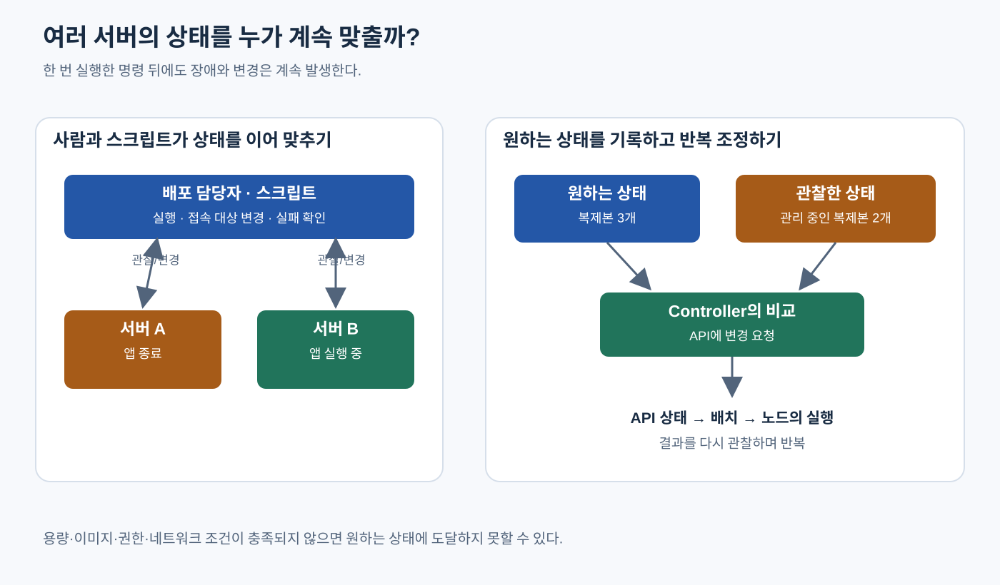

# Kubernetes — 여러 서버의 컨테이너를 누가 계속 관리할까

> **개발자를 위한 쉬운 쿠버네티스 · 4장** | [전체 목차](./Kubernetes-Introduction.md#이-시리즈의-읽는-순서) · [이전 장](./Kubernetes-Image-Build-Ship-Run.md) · [다음 장](./Kubernetes-First-Deployment.md)

이미지를 전달해 실행한 다음에도 남는 배치·복구·접속·배포 전환의 문제를 따라간다. [이미지의 생성과 전달](./Kubernetes-Image-Build-Ship-Run.md)에서 이어지는 기초 장이다.

## 결론부터 말하면

**컨테이너가 앱을 실행할 환경을 일정하게 다루도록 돕는다면, Kubernetes는 여러 서버에서 그 앱의 실행 상태를 계속 관리하도록 돕는다.** 어느 서버에서 몇 개를 실행하고, 장애나 새 버전 배포로 실행 대상이 바뀔 때 어떻게 연결할지를 공통된 관리 방식으로 표현한다. 이때 중심은 한 번의 명령 실행보다 원하는 상태와 실제 상태의 차이를 계속 줄이는 데 있다.

다만 모든 앱이 이 관리 체계를 필요로 하는 것은 아니다. 서버가 적고 운영 요구가 단순하면 기존의 프로세스 관리, Compose, 관리형 앱 실행 서비스로도 충분할 수 있다. Kubernetes의 필요성은 기술의 인지도보다 반복해서 해결할 운영 문제와 그 체계를 유지할 비용을 함께 놓고 판단해야 한다.

## 1. 서버가 한 대일 때는 보이지 않던 질문

앱을 이미지로 만들고 서버에서 실행했다. 실행 환경의 설치 차이를 줄였고, 새 서버에도 같은 이미지와 설정을 전달할 수 있게 되었다. 이 상태라면 서버 한 대에서 컨테이너 실행 도구와 재시작 정책을 사용하고, 배포 스크립트로 버전을 바꾸는 구성이 충분할 수 있다. 서버를 점검하는 동안 서비스 중단을 허용할 수 있다면 요구도 비교적 단순하다.

그런데 서버 한 대가 멈춰도 서비스를 제공해야 한다는 요구가 생겼다고 해 보자. 이제 다른 서버에도 앱을 실행하고, 사용자의 요청을 정상인 실행 대상으로 보내야 한다. 요청이 늘면 필요한 실행 개수를 늘리고, 일부 서버의 자원이 부족하면 다른 서버를 골라야 한다. 앱의 파일을 일정하게 만드는 문제에서 여러 실행 대상의 관계를 관리하는 문제로 범위가 넓어진다.

여러 서버에서 앱의 배치와 실행, 연결 등을 조율하는 일을 보통 **오케스트레이션(orchestration)** 이라고 부른다. 여기서는 도입 이유를 설명하는 넓은 의미로 쓴다. Kubernetes 공식 문서는 이를 정해진 순서를 한 번 수행하는 작업과도 구분한다. Kubernetes의 핵심은 독립적인 구성 요소들이 상태를 계속 관찰하고 조정하는 방식에 있기 때문이다. [Kubernetes Overview](https://kubernetes.io/docs/concepts/overview/)

이미지를 만들었다고 오케스트레이션까지 해결되는 것은 아니다. 컨테이너를 실행할 수 있다는 사실과, 앞으로 생길 변화에 대응하는 체계가 있다는 사실을 나누어야 한다. 이 장에서는 같은 앱을 여러 곳에서 운영하며 그 차이가 드러나는 상황을 하나씩 살펴본다.

## 2. 첫 번째 문제: 어느 서버에 실행할까

서버 세 대 중 한 대는 여유가 많고, 다른 한 대는 이미 메모리를 거의 사용하고 있다고 생각해 보자. 새 앱을 실행할 위치를 고를 때 단순히 순서를 돌리거나 이름만 보고 고르면 필요한 메모리를 확보하지 못할 수 있다. 특정 장치나 저장소가 연결된 서버에서만 실행할 수 있는 앱도 있다. 배치는 “남는 서버에 올린다”보다 여러 조건을 함께 보는 결정이다.

이처럼 실행할 대상을 적절한 서버에 배정하는 일을 **스케줄링(scheduling)** 이라고 한다. Kubernetes에서 실행 서버를 **Node** 라고 부르며, 스케줄러는 아직 배치되지 않은 실행 단위를 어느 Node에 둘지 결정한다. 상세한 단위와 알고리즘은 뒤에서 다룬다. 지금은 앱의 자원 요구와 서버의 조건을 함께 표현해야 자동으로 위치를 정할 수 있다는 점이 중요하다. [Kubernetes Scheduler](https://kubernetes.io/docs/concepts/scheduling-eviction/kube-scheduler/)

앱을 세 개 실행했다는 사실만으로 서버 한 대의 장애에 대비한 것도 아니다. 세 개가 모두 같은 서버에 있다면 그 서버와 함께 영향을 받는다. 장애에 대비하려면 실행 위치를 분산하는 정책과 실제로 나누어 놓을 여유 자원이 필요하다. 스케줄러가 있다는 사실이 사용자의 가용성 요구를 자동으로 알아낸다는 뜻은 아니다.

이 단계부터 운영 정보도 공통으로 필요해진다. 어떤 서버가 어떤 역할을 하며, 앱이 무엇을 요구하고, 어느 실행 대상이 어디에 배치되었는지를 알아야 한다. 앱별 배포 스크립트가 서로 다른 서버 목록을 갖고 있으면 변경할 때마다 목록을 맞추는 일이 추가된다. 규모가 커질수록 공통된 상태 관리의 가치가 드러난다.

## 3. 두 번째 문제: 무엇이 실패했으며 어디에서 복구할까

앱 프로세스 하나가 오류로 종료된 경우와 서버 전체에 접근할 수 없게 된 경우를 나누어 보자. 전자는 같은 서버에서 다시 시작할 수 있을지 확인하면 된다. 후자는 그 서버의 재시작 기능을 믿고 기다릴 수만은 없다. 다른 서버에 대체 실행을 준비하고 서비스가 연결될 대상도 바꾸어야 한다.

Kubernetes는 컨테이너의 재시작, 원하는 복제본을 채우기 위한 실행 단위의 교체, 요청을 받을 준비가 된 대상의 관리 등 여러 복구 기능을 조합한다. 하지만 이를 “고장 난 프로세스가 다른 서버로 그대로 이동한다”라고 받아들이면 안 된다. 다른 서버에서 새 실행을 시작하는 경우 메모리와 연결 상태가 자동으로 이어지는 것이 아니다. 이전 프로세스의 메모리에만 있던 정보나 로컬 쓰기 영역의 파일이 새 실행에 그대로 나타나지는 않는다. [Kubernetes Self-Healing](https://kubernetes.io/docs/concepts/architecture/self-healing/)

따라서 앱이 교체되어도 필요한 데이터는 어디에 남는지, 처리 중이던 요청은 실패할 수 있는지, 다시 시도해도 중복 처리가 생기지 않는지 앱 관점에서 설계해야 한다. 예를 들어 요청을 받은 직후 메모리에만 작업을 저장했다면, 새 컨테이너가 실행되었다고 그 작업이 복원되지는 않는다. 실행 개수의 복구와 업무 상태의 복구는 서로 다른 조건이다.

복구에 걸리는 시간도 0이 아니다. 장애를 관찰하고, 대체 실행을 만들고, 이미지를 받아 앱을 준비하는 시간이 필요하다. 실행 가능한 다른 서버나 저장 공간이 없으면 원하는 상태에 도달하지 못한다. 오케스트레이션의 의미는 실패를 없애는 데 있지 않고, 실패를 관찰해 정해진 의도에 따라 대응하는 구조를 만드는 데 있다.

## 4. 세 번째 문제: 실행 대상이 바뀌면 어디로 접속할까

다른 서버에서 앱을 다시 시작할 수 있어도 호출하는 쪽이 이전 주소만 알고 있으면 서비스는 회복되지 않는다. 실행 대상의 주소는 재생성이나 배치 변경으로 달라질 수 있다. 그러므로 “앱을 살린다”와 “그 앱으로 요청을 보낸다”를 연결해야 한다. 복구 기능과 네트워크 기능을 서로 무관한 설정으로 외우면 놓치기 쉬운 지점이다.

일반적인 해법은 실제 실행 대상 앞에 비교적 안정적인 접속 지점을 두는 것이다. 호출자는 그 이름이나 주소를 사용하고, 뒤에서는 현재 사용할 수 있는 실행 대상 목록을 갱신한다. 여러 대상으로 요청을 나누는 **로드 밸런싱(load balancing)** 과 대상의 위치를 찾는 **서비스 발견(service discovery)** 이 이 과정에 관련된다. 개별 앱이 모든 상대 앱의 현재 위치를 수동으로 관리할 부담을 줄이는 것이다.

Kubernetes의 **Service** 는 선택한 앱 실행 대상에 접근할 수 있도록 제공하는 네트워크 API다. 구체적인 오브젝트 구조와 트래픽 경로는 첫 배포와 Service 장에서 살펴본다. 여기서는 앱의 수명과 호출자가 사용하는 접속 정보를 나눌 수 있다는 점을 기억하면 된다. Service의 접속 정보가 있다는 것만으로 외부 인터넷에서 바로 접근할 수 있다는 뜻은 아니며, 외부 연결 방식은 별도의 선택이다. [Kubernetes Service](https://kubernetes.io/docs/concepts/services-networking/service/)

또한 프로세스가 시작되었다는 사실만으로 요청을 받아도 되는 것은 아니다. 초기 설정을 읽고 DB에 연결하는 데 시간이 걸릴 수 있기 때문이다. 언제 대상 목록에 넣고 언제 빼야 할지도 준비 상태와 연결된다. 안정적인 이름 하나를 만든 뒤에도 앱의 준비 조건과 네트워크 구현을 확인해야 하는 이유다.

## 5. 네 번째 문제: 새 버전으로 바꾸는 중간 상태를 누가 관리할까

새 버전을 배포할 때 모든 기존 앱을 내린 다음 새 앱을 올리면 중단 시간이 생긴다. 서비스를 유지하며 바꾸려면 기존 실행을 일부 남긴 채 새 실행을 준비하고, 준비 상태를 확인한 뒤 점진적으로 교체하는 방법을 생각할 수 있다. 이런 교체 방식을 **롤링 업데이트(rolling update)** 라고 한다. 한 번에 실행할 추가 수량과 기존 실행을 줄이는 조건이 중요해진다.

이 과정은 이미지 참조 한 줄을 바꾸는 것보다 길다. 새 이미지를 받았어도 앱이 잘못된 설정 때문에 시작되지 않을 수 있다. 일부는 새 버전이고 일부는 이전 버전인 채로 교체가 멈출 수도 있다. Kubernetes의 **Deployment** 는 원하는 실행 개수와 버전 교체를 관리하는 API이며, 이런 중간 상태를 관찰하며 변경을 진행한다. 이 장에서는 배포 의도를 기록하는 도구라는 수준에서 이해하고 구체적인 필드는 뒤에서 읽는다. [Kubernetes Deployments](https://kubernetes.io/docs/concepts/workloads/controllers/deployment/)

그렇다고 롤링 업데이트를 사용했다는 이유만으로 업무가 무중단이라고 결론 내릴 수는 없다. 새 버전이 준비되기 전에 요청을 받으면 실패할 수 있고, 종료하는 앱이 진행 중인 연결을 바로 끊어도 오류가 난다. 새 버전만 사용할 수 있는 DB 구조로 바꾸었다면 교체 중에 남아 있는 이전 버전이 실패할 수 있다. 데이터 스키마와 API 호환성, 요청 종료 동작은 앱의 설계와 배포 순서에서 다루어야 한다.

이 사례가 보여 주는 것은 작업 사이의 관계다. 버전을 바꾸는 도중에도 실행 개수와 접속 대상을 관리해야 하고, 복구가 필요하면 같은 조건을 다시 적용해야 한다. 각 명령을 따로 자동화하는 것에 더해, 현재 어디까지 진행되었는지를 계속 판단하는 체계가 필요해진다.

## 6. “세 개를 실행했다”보다 “세 개가 필요하다”를 남긴다

배포 스크립트에는 보통 수행할 명령을 순서대로 적는다. 이미지를 받고, 컨테이너를 시작하고, 연결 대상을 바꾸고, 이전 컨테이너를 내리는 식이다. 이런 **명령형(imperative)** 표현은 구체적인 작업 순서를 직접 지정한다. 작업 도중 실패하면 재실행할 지점과 이미 수행한 작업을 함께 고려해야 한다. 한 번 끝난 뒤 새 장애가 생기면 이를 발견해 다시 실행할 주체도 필요하다.

**선언적(declarative)** 표현은 그 시점에 필요한 상태를 기록한다. “이 버전의 앱이 세 개 필요하다”라는 의도를 남기고 시스템이 현재 상태를 관찰해 차이를 줄이게 한다. 이 관찰과 조정을 반복하는 프로그램을 **controller**, 그 조정 과정을 **reconciliation** 이라고 부른다. Kubernetes는 여러 controller가 각자의 책임을 맡는 구조다. 하나의 거대한 프로그램이 모든 앱과 네트워크를 한 번에 완성하는 방식으로 이해하면 안 된다. [Kubernetes Controllers](https://kubernetes.io/docs/concepts/architecture/controller/)

예를 들어 필요 수량은 세 개인데 관리 중인 실행 대상 자체가 두 개로 줄었다면, 시스템은 부족분을 채우기 위한 작업을 요청하고 그 결과를 다시 관찰한다. 실행 대상은 세 개지만 그중 하나가 요청을 받을 준비가 되지 않은 상황과는 구분해야 한다. 준비되지 않았다는 이유만으로 언제나 네 번째 실행 대상을 추가하는 것은 아니다. 서버가 부족하거나 이미지를 받을 수 없다면 차이가 남는다. 선언적이라는 말은 성공을 보장한다는 뜻이 아니다. 원하는 의도와 관찰 결과가 남아 있어, 재시도와 원인 확인의 기준으로 사용할 수 있다는 의미다.

선언적 방식에서도 실제로는 명령과 API 호출이 실행된다. 운영 스크립트도 감시 루프와 복구 규칙을 갖출 수 있다. 따라서 두 방식은 자동화가 가능한지 여부로 나누는 구분이 아니다. 무엇을 사용자가 기록하고, 누가 계속 관찰하며, 실패 뒤의 상태를 어떻게 판단할지를 기준으로 이해해야 한다. Kubernetes는 이 공통 구조를 팀의 앱마다 새로 작성할 부담을 줄여 주지만, 올바른 의도와 실행 조건은 여전히 운영자가 정해야 한다.

그림 4-1. controller의 반복 조정은 API에 남긴 의도와 관찰 상태를 비교하는 과정이다. 실제 배치와 실행은 다른 구성 요소가 맡으며 자원·이미지·권한 조건에 따라 목표에 도달하지 못할 수도 있다.

## 7. 운영을 줄이는 시스템도 운영해야 한다

Kubernetes를 도입하면 앱별 스크립트의 일부 책임을 공통 플랫폼에 맡길 수 있다. 그 대신 그 플랫폼을 유지해야 한다. 클러스터 관리 API와 상태 저장, 실행 서버, 네트워크와 저장소, 이미지 공급 경로를 이해하고, 업데이트와 장애 대응을 계획해야 한다. 누구에게 어떤 설정 변경 권한을 줄지도 정해야 한다. 앱이 정상인지에 더해 이 공통 기반이 정상인지 관찰하는 일도 생긴다.

관리형 Kubernetes는 제공자가 일부 관리 계층을 맡도록 해 부담을 줄일 수 있다. 그렇다고 앱 설정과 이미지, 데이터 보관, 접근 권한, 외부 연결의 책임이 모두 사라지지는 않는다. 구체적인 분담은 서비스마다 다르므로 “관리형”이라는 이름만으로 추정하지 않아야 한다. Kubernetes가 제공하는 공통 API와 그 아래에서 실제 네트워크·저장소를 제공하는 구현을 나누어 보는 것이 도움이 된다.

에어갭 환경에서는 운영 비용에 공급 경로가 더 뚜렷하게 포함된다. 앱 이미지뿐 아니라 클러스터와 추가 구성 요소가 사용할 이미지, 설치 자료, 업데이트 파일도 내부에서 확보해야 한다. 사내 레지스트리·DNS·인증서·저장소가 준비되어 있는지, 장애 때 누가 복구하는지 정해야 한다. 이미지를 복사해 첫 실행에 성공했다는 사실만으로 이후 보안 업데이트와 복구 절차가 확인된 것은 아니다.

이 비용은 특정 도구의 단점 목록으로 외우기보다 도입 판단에 넣어야 한다. 앱이 많고 여러 팀이 공통 운영 규칙을 필요로 한다면 기반을 한 번 만들어 재사용하는 이득이 커질 수 있다. 반면 단순한 앱을 위해 새 기반 전체를 운영해야 한다면 이득보다 부담이 클 수 있다. 이는 공식 기능 목록에서 자동으로 나오는 결론이 아니라, 서비스 요구와 팀 역량에 따른 선택이다.

## 8. 언제 시작하고, 언제 다른 방법으로 충분할까

앱 하나가 서버 한 대에서 안정적으로 동작하고, 계획된 중단을 허용하며, 기존의 배포와 모니터링으로 요구를 충족한다면 Kubernetes를 서둘러 추가할 이유는 작다. 프로세스 관리 도구나 Compose를 사용한 운영도 유효하다. 서버 관리 자체를 줄이는 것이 목표라면 앱을 직접 배포할 수 있는 관리형 실행 서비스를 검토할 수 있다. 이미 팀의 표준 플랫폼이 있다면 그 기능을 사용하는 편이 더 단순할 수도 있다.

반대로 여러 서버에 걸친 배치와 복구, 반복적인 버전 교체, 팀별 권한과 공통 운영 규칙이 계속 필요하다면 Kubernetes를 검토할 근거가 생긴다. 이때도 “서버가 몇 대 이상이면 무조건” 같은 숫자로 결정하기보다, 지금 반복해서 만드는 자동화가 무엇인지와 이를 운영할 담당자가 있는지를 확인해야 한다. 소수 앱이라도 기존 클러스터를 안전하게 사용할 수 있는 팀과, 같은 앱을 위해 새 클러스터를 처음 운영할 팀의 비용은 다르다.

이 책은 다른 방식을 버리고 Kubernetes를 택해야 한다는 경로를 제시하지 않는다. VM은 실행 호스트와 격리 경계를 제공할 수 있고, Docker는 빌드와 개발 환경에 계속 쓰이며, Compose는 단일 서버 앱 구성을 정리하는 데 유용하다. Kubernetes는 그중 여러 서버의 실행 상태를 공통으로 관리해야 하는 문제에 초점을 둔다. 각 기술의 역할을 구분하면 함께 쓰는 구성도 이해할 수 있다.

이제 [첫 배포](./Kubernetes-First-Deployment.md)에서 작은 앱을 직접 준비하고, 선언과 실행 결과가 어떻게 연결되는지 확인할 차례다. 처음에는 여러 서버 장애를 모두 재현할 필요가 없다. 실행할 이미지를 공급하고, 원하는 상태를 기록하고, 앱까지 요청이 도달하는지 차례로 확인하면 된다. 이 작은 경험을 바탕으로 [클러스터의 동작 구조](./Kubernetes-Architecture.md)를 읽으면 각 구성 요소의 책임을 실제 관찰과 연결할 수 있다.

## 생각해 볼 질문

**컨테이너에 재시작 정책이 있으면 서버 전체 장애에도 대응할 수 있을까?** 같은 서버의 실행 도구가 작동한다는 조건이 필요하다. 서버에 접근할 수 없는 장애에서는 다른 서버의 대체 실행과 접속 대상 갱신이 필요하며, 실행 가능한 여유 자원과 데이터 접근 조건도 갖춰야 한다.

**원하는 개수를 세 개로 적었는데 두 개만 준비되었다면 선언적 관리가 실패한 것일까?** 아직 원하는 상태에 도달하지 못한 것이다. 남는 서버 자원, 이미지 공급, 앱 시작 조건 등에 문제가 있을 수 있다. 선언은 성공 보장이 아니라 시스템의 조정과 운영자의 확인이 공유하는 기준이다.

**Kubernetes의 롤링 업데이트를 사용하면 업무 중단이 없다고 말할 수 있을까?** 새 앱의 준비 상태, 기존 요청을 마무리하는 종료 동작, 버전 간 DB·API 호환성을 함께 확인해야 한다. 실행 대상의 교체가 진행된다는 사실과 사용자의 작업이 안전하게 이어진다는 사실은 같은 검증이 아니다.

## 출처

공식 문서 확인 기준일: 2026-10-23. 도입 여부에 관한 판단은 본문의 가정에 따른 설명이며 특정 제품 간 성능·비용 비교 결과가 아니다.

- [Kubernetes Overview](https://kubernetes.io/docs/concepts/overview/) — 제공하는 기능과 범위, 지속적인 제어 과정이라는 특징.
- [Kubernetes Scheduler](https://kubernetes.io/docs/concepts/scheduling-eviction/kube-scheduler/) — 실행 위치를 고르는 스케줄링의 책임.
- [Kubernetes Self-Healing](https://kubernetes.io/docs/concepts/architecture/self-healing/) — 재시작과 교체, 복구의 조건과 한계.
- [Kubernetes Service](https://kubernetes.io/docs/concepts/services-networking/service/) — 바뀌는 실행 대상 앞의 접속 추상화.
- [Kubernetes Deployments](https://kubernetes.io/docs/concepts/workloads/controllers/deployment/) — 원하는 상태와 버전 교체 관리.
- [Kubernetes Controllers](https://kubernetes.io/docs/concepts/architecture/controller/) — 원하는 상태와 현재 상태를 관찰하고 조정하는 반복.
- [Docker: Use Compose in production](https://docs.docker.com/compose/how-tos/production/) — 단일 서버 운영 대안의 범위.
