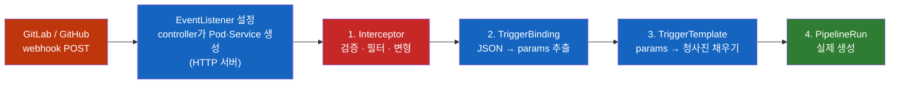
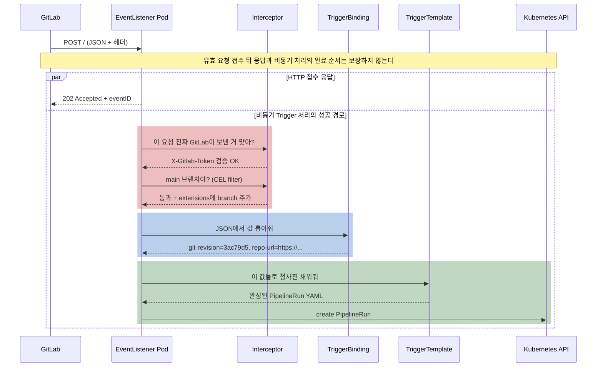
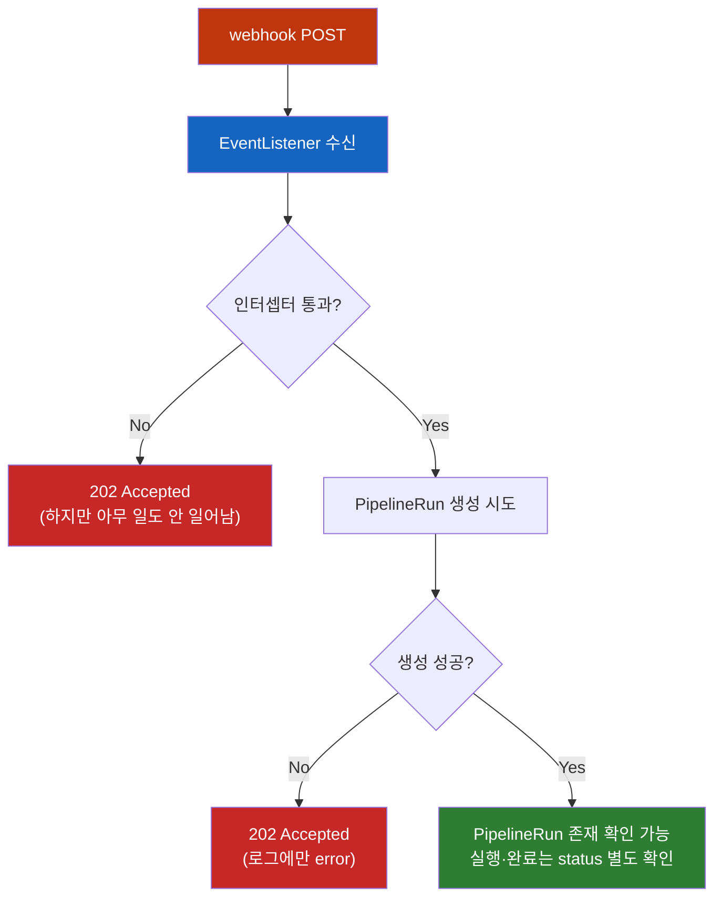

# Tekton Triggers는 어떻게 git push를 PipelineRun으로 바꿀까?

> **개발자를 위한 쉬운 쿠버네티스 · 확장 읽기** | [전체 목차](./Kubernetes-Introduction.md#이-시리즈의-읽는-순서)

Pipeline을 만들어놨다. PipelineRun도 만들 줄 안다. 그런데 개발자가 커밋할 때마다 내가 손으로 `kubectl create -f pipelinerun.yaml`을 칠 수는 없다. GitLab이 push webhook을 쏴주면 그게 알아서 PipelineRun이 되어야 한다. 그 사이의 빈칸은 누가 채울까?

## 결론부터 말하면

**Tekton Triggers는 클러스터 안에 HTTP 서버 Pod를 하나 띄우고, 거기로 들어온 JSON을 PipelineRun YAML로 번역해주는 조립 라인이다.** `EventListener` object를 본 controller가 만드는 event sink Pod가 그 서버이고, 번역 공정은 네 단계로 쪼개져 있다.

핵심은 **왜 하나가 아니라 네 개로 쪼갰나** 다. 각 단계가 다른 이유로 바뀌기 때문이다. 검증 규칙은 Git 호스팅 종류가 바뀔 때, 추출 규칙은 payload 형태가 바뀔 때, 청사진은 파이프라인이 바뀔 때 각각 손대게 된다. 한 덩어리였다면 GitHub에서 GitLab으로 옮길 때 전부 다시 써야 한다.



| 리소스 | 한 줄 역할 | 바뀌는 이유 | 비유 |
|--------|-----------|------------|------|
| `EventListener` | HTTP 서버를 만들고 구성하는 CR | 노출 방식이 바뀔 때 | 우편함 |
| `Interceptor` | 이 요청 진짜 맞아? 처리할 값어치 있어? | Git 호스팅이 바뀔 때 | 경비실 |
| `TriggerBinding` | JSON에서 필요한 값만 뽑기 | payload 구조가 바뀔 때 | 서식 작성 |
| `TriggerTemplate` | 뽑은 값으로 PipelineRun 완성 | 파이프라인이 바뀔 때 | 도장 찍기 |
| `Trigger` | 위 셋을 하나로 묶은 단위 | — | 결재 라인 |

`Pipeline`·`PipelineRun`의 관계를 먼저 이해하는 게 순서다. 아직이라면 [Tekton의 Pipeline과 PipelineRun은 왜 따로 존재할까](Tekton의-Pipeline과-PipelineRun은-왜-따로-존재할까.md)를 먼저 읽는 것을 권한다. 이 글은 그 문서가 끝난 지점 — "PipelineRun을 만들면 실행된다"에서 시작한다.

## 1. 왜 필요할까? PipelineRun을 손으로 만드는 고통

Triggers 없이 CI를 굴린다고 상상해보자. 개발자가 `feature/login` 브랜치에 커밋을 푸시했다. 이제 그 커밋을 빌드해야 한다. 내가 해야 할 일은 이렇다.

```bash
# 1. 커밋 해시를 알아낸다
git rev-parse HEAD    # 0123456789abcdef0123456789abcdef01234567

# 2. PipelineRun YAML을 손으로 쓴다
cat <<EOF | kubectl create -f -
apiVersion: tekton.dev/v1
kind: PipelineRun
metadata:
  generateName: ci-run-
spec:
  pipelineRef:
    name: ci-pipeline
  params:
    - name: git-revision
      value: 0123456789abcdef0123456789abcdef01234567   # 매번 손으로 갈아끼움
    - name: repo-url
      value: https://gitlab.com/team/app.git
EOF
```

하루에 커밋이 50번이면 이걸 50번 한다. 명백히 자동화 대상이다.

그런데 **무엇을 자동화해야 하는지** 를 정확히 보자. 위 과정에서 실제로 변하는 건 `git-revision` 값 하나뿐이다. 나머지 YAML 구조는 매번 똑같다. 그리고 그 변하는 값은 이미 GitLab이 webhook payload 안에 담아서 보내주고 있다.

```json
{
  "object_kind": "push",
  "ref": "refs/heads/feature/login",
  "checkout_sha": "0123456789abcdef0123456789abcdef01234567",
  "user_name": "seongseob",
  "repository": {
    "name": "app",
    "git_http_url": "https://gitlab.com/team/app.git"
  }
}
```

그러니까 필요한 건 딱 두 가지다. **(a) 이 JSON을 받아줄 HTTP 엔드포인트** 와 **(b) JSON의 특정 필드를 PipelineRun의 특정 자리에 꽂아 넣는 규칙** . Tekton Triggers는 정확히 이 두 가지를 Kubernetes 리소스로 제공한다.

### 그런데 왜 굳이 CRD로?

"그냥 웹 서버 하나 짜서 `kubectl create` 호출하면 되는 거 아닌가?" 맞다. 실제로 그렇게 하는 팀도 있다. 하지만 그 서버를 직접 만들면 따라오는 숙제가 있다.

Git 호스팅이 사용하는 토큰·서명 검증을 구현하거나 재사용해야 하고, 브랜치·이벤트 타입 필터링 로직을 코드로 짜야 하고, 그 서버에 PipelineRun을 만들 RBAC 권한을 붙여야 하고, 그 서버 자체를 배포·모니터링·업그레이드해야 한다. Triggers는 이 전부를 선언적 YAML로 대체한다. Tekton이 CRD 기반이라 [Pipeline이 그랬듯](Kubernetes-CRD-Controller-Operator.md) Triggers의 구성요소도 전부 `kubectl get`으로 조회되는 평범한 Kubernetes 오브젝트다.

설치에는 Pipelines와 호환되는 Triggers release, 기본 interceptor 배포가 필요하다. 아래 명령은 **설치 파일의 관계를 설명하는 형식** 이며 `<검증한-version>`을 실제 검증한 release로 바꿔야 한다. `latest` URL을 그대로 저장해 두면 같은 설치 파일을 나중에 재현할 수 없다.

```bash
# 선택한 격리 실습 context와 호환성·이미지 반입을 먼저 확인한다.
kubectl --context <실습-context> apply -f https://infra.tekton.dev/tekton-releases/triggers/previous/<검증한-version>/release.yaml
kubectl --context <실습-context> apply -f https://infra.tekton.dev/tekton-releases/triggers/previous/<검증한-version>/interceptors.yaml
```

두 번째 파일은 `gitlab`·`github`·`cel` 같은 기본 interceptor를 제공한다. CRD가 등록된 것과 controller·interceptor가 실제 요청을 처리할 준비가 된 것은 다르다. 설치 버전의 status·Deployment 준비 상태·Service endpoint·이미지 pull을 확인한다. 본문의 예제는 이 구성을 이미 준비한 환경에서 구조를 읽기 위한 것이며, 여기서 클러스터에 설치해 검증한 기록은 아니다.

## 2. EventListener: 클러스터 안에 떠 있는 HTTP 서버

가장 먼저 이해할 것은 `EventListener`의 정체다. 이름 때문에 "이벤트를 듣는 추상적인 설정"처럼 느껴지지만, EventListener 자체는 CRD로 정의된 API object다. 이를 처리하는 controller가 Deployment와 Service를 생성하고, 실제 Pod가 HTTP 요청을 받는다.

```yaml
apiVersion: triggers.tekton.dev/v1beta1
kind: EventListener
metadata:
  name: gitlab-listener
  namespace: ci
spec:
  serviceAccountName: tekton-triggers-sa   # 이게 없으면 PipelineRun을 못 만든다
  triggers:
    - triggerRef: build-on-push
```

이걸 `apply`하면 Tekton Triggers 컨트롤러가 실제 워크로드를 만든다.

```bash
kubectl get all -n ci -l eventlistener=gitlab-listener

# NAME                                    READY   STATUS
# pod/el-gitlab-listener-6bf78d7884-mkzgj  1/1     Running
#
# NAME                          TYPE        CLUSTER-IP     PORT(S)
# service/el-gitlab-listener    ClusterIP   10.96.31.204   8080/TCP
```

**이름 규칙이 핵심이다. `EventListener`가 `foo`면 Service와 Deployment는 `el-foo`가 된다.** 기본 타입은 `ClusterIP`, 포트는 `8080`이다. 이 두 가지를 기억하면 Ingress를 붙일 때 헤매지 않는다.

이 서버는 클러스터 안에만 있으므로, GitLab이 접근하려면 외부로 노출해야 한다.

```yaml
apiVersion: networking.k8s.io/v1
kind: Ingress
metadata:
  name: tekton-webhook
  namespace: ci
  annotations:
    cert-manager.io/cluster-issuer: example-issuer
spec:
  ingressClassName: example-ingress
  tls:
    - hosts: ["webhook.example.com"]
      secretName: webhook-tls
  rules:
    - host: webhook.example.com
      http:
        paths:
          - path: /
            pathType: Prefix
            backend:
              service:
                name: el-gitlab-listener    # el- 접두사 주의
                port:
                  number: 8080
```

위 Ingress는 설명용 manifest다. `example-ingress`를 처리하는 controller, TLS Secret 또는 별도 cert-manager issuer가 있어야 한다. Ingress object만 만들어서는 외부 경로와 인증서가 생기지 않는다. 외부 webhook에서 공유 토큰을 전송할 때는 신뢰할 수 있는 TLS 종단과 검증이 필요하다. 뒤에서 보겠지만 **GitLab은 webhook 시크릿을 평문으로 헤더에 실어 보내기 때문에** , HTTPS가 아니면 토큰이 그대로 노출된다.

### 먼저 짚고 갈 것: ServiceAccount와 RBAC

`serviceAccountName`을 빠뜨리거나 권한이 모자라면, webhook은 잘 도착하는데 PipelineRun이 안 만들어지는 상태가 된다. 게다가 **호출한 쪽에는 성공 응답이 간다** (5.1절에서 다룬다). 그래서 초기 셋업에서 가장 많이 시간을 잡아먹는 지점이다.

HTTP 요청자의 토큰과 EventListener가 API를 호출할 때의 ServiceAccount는 다른 자격이다. 앞의 토큰 검증을 통과해도 뒤의 RBAC이 부족하면 Run을 생성하지 못한다. 다음은 `ci` namespace에 Trigger 관련 object를 읽고 PipelineRun을 만드는 권한을 분리한 설명용 예제다. namespace `ci`는 CI 인프라용이며 본편 앱의 `bookstore`와 다르다.

```yaml
apiVersion: v1
kind: ServiceAccount
metadata:
  name: tekton-triggers-sa
  namespace: ci
---
apiVersion: rbac.authorization.k8s.io/v1
kind: Role
metadata:
  name: eventlistener-local
  namespace: ci
rules:
  - apiGroups: ["triggers.tekton.dev"]
    resources: ["eventlisteners", "triggers", "triggerbindings", "triggertemplates", "interceptors"]
    verbs: ["get", "list", "watch"]
  - apiGroups: ["tekton.dev"]
    resources: ["pipelineruns"]
    verbs: ["create"]
  - apiGroups: [""]
    resources: ["configmaps"]
    verbs: ["get", "list", "watch"]
  - apiGroups: [""]
    resources: ["secrets"]
    resourceNames: ["gitlab-webhook-secret"]
    verbs: ["get"]
---
apiVersion: rbac.authorization.k8s.io/v1
kind: RoleBinding
metadata:
  name: eventlistener-local
  namespace: ci
subjects:
  - kind: ServiceAccount
    name: tekton-triggers-sa
    namespace: ci
roleRef:
  kind: Role
  name: eventlistener-local
  apiGroup: rbac.authorization.k8s.io
---
apiVersion: rbac.authorization.k8s.io/v1
kind: ClusterRole
metadata:
  name: book-eventlistener-interceptor-reader
rules:
  - apiGroups: ["triggers.tekton.dev"]
    resources: ["clusterinterceptors", "clustertriggerbindings"]
    verbs: ["get", "list", "watch"]
---
apiVersion: rbac.authorization.k8s.io/v1
kind: ClusterRoleBinding
metadata:
  name: book-eventlistener-interceptor-reader
subjects:
  - kind: ServiceAccount
    name: tekton-triggers-sa
    namespace: ci
roleRef:
  kind: ClusterRole
  name: book-eventlistener-interceptor-reader
  apiGroup: rbac.authorization.k8s.io
```

공식 설치물의 `tekton-triggers-eventlistener-roles`·`tekton-triggers-eventlistener-clusterroles`를 참조하는 예제도 있다. 그러나 넓은 ClusterRoleBinding은 해당 role의 Secret 읽기 규칙까지 모든 namespace에 허용할 수 있다. 실제 사용하는 API뿐 아니라 설치 버전 sink의 informer 조회 권한도 확인한다. 2026-10-23 확인한 upstream sink는 ClusterTriggerBinding을 참조하지 않아도 informer를 시작하므로, 위 ClusterRole은 해당 object의 get/list/watch도 허용한다. 미참조 TaskRun 생성이나 다른 ServiceAccount impersonation은 이 예제에서 허용하지 않는다. Trigger에는 serviceAccountName을 따로 지정하지 않고 EventListener의 ServiceAccount를 사용한다. 같은 이름을 Trigger에도 적으면 별도의 impersonation 경로가 선택되므로 두 곳에 반복해서 적지 않는다.

Secret을 읽는 주체도 경로별로 확인한다. core interceptor 서비스의 ServiceAccount가 이미 폭넓은 Secret 권한을 가진 설치라면 EventListener의 Role만 좁혀도 전체 권한이 좁아지는 것은 아니다. 공유 interceptor의 설치 RBAC·Secret 접근 경로를 함께 검토해야 한다. 이 예제는 static 구조 설명이며 최소 권한의 실환경 동작을 검증한 결과는 아니다.

## 3. 조립 라인 네 단계

EventListener가 구성한 Pod가 요청을 받았다. 이제 JSON 한 덩어리를 PipelineRun으로 바꿔야 한다. 그 공정을 순서대로 따라가보자.



그림은 검증·필터·생성이 성공하는 경로다. `202`는 비동기 처리 완료를 기다리지 않으며, 응답이 항상 모든 처리보다 먼저 온다는 보장도 없다. interceptor 거부·필터 제외·생성 실패와 접수 전 오류의 구분은 5.1절에서 확인한다.

### 3.1 Interceptor: 경비실

첫 관문은 `Interceptor`다. 하는 일은 세 가지 — **검증(이 요청 진짜야?), 필터(처리할 값어치 있어?), 변형(쓰기 좋게 가공)** .

인터셉터는 `ClusterInterceptor`라는 클러스터 범위 리소스로 미리 설치돼 있고, 우리는 이름으로 참조만 한다. 2026-10-23 확인한 upstream core 설치물에는 `github`, `gitlab`, `bitbucket`, `cel`, `slack`이 포함된다. 실제 사용 가능 목록은 설치한 release의 `interceptors.yaml`에서 확인한다.

**검증부터 보자.** GitLab 인터셉터는 이렇게 쓴다.

```yaml
interceptors:
  - name: "GitLab이 보낸 게 맞는지 확인"
    ref:
      name: "gitlab"
      kind: ClusterInterceptor
    params:
      - name: "secretRef"
        value:
          secretName: gitlab-webhook-secret    # 이 Secret에 담긴 값과
          secretKey: token                     #  요청 헤더를 비교
      - name: "eventTypes"
        value: ["Push Hook"]                   # X-Gitlab-Event 헤더로 필터
```

여기서 **GitHub과 GitLab의 검증 방식이 근본적으로 다르다는 점** 이 중요하다. 이 차이를 모르면 나중에 디버깅할 때 헤맨다.

| 항목 | GitHub | GitLab |
|------|--------|--------|
| 검증 헤더 | `X-Hub-Signature-256` | `X-Gitlab-Token` |
| 담긴 값 | 시크릿으로 body를 **HMAC-SHA256 서명한 다이제스트** | **시크릿 원문 그대로** |
| 검증 방법 | 서버가 같은 방식으로 재계산해 비교 | 문자열 직접 비교 |
| body 변조 감지 | **가능** (서명이 body를 덮음) | **불가능** (토큰은 body와 무관) |
| 이벤트 타입 헤더 | `X-GitHub-Event` | `X-Gitlab-Event` |

secret token은 요청 body 자체를 서명하지 않으며, 토큰만으로 replay를 판별하지 못한다. HTTPS는 전송 중 내용을 보호하지만 수신 후 토큰 유출·재전송·허용 소스 정책까지 모두 해결하지 않는다. 2026-10-23 확인한 GitLab 공식 문서는 **signing token** 경로도 설명한다. 서명 헤더는 `webhook-signature`이며 `webhook-id`, `webhook-timestamp`와 body를 포함한 메시지를 검증해야 한다. 설치된 GitLab 버전의 지원 여부도 확인한다.

**그런데 여기 함정이 있다.** Tekton의 `gitlab` 인터셉터 소스를 보면, 읽는 헤더는 `X-Gitlab-Token` 하나뿐이고 검증은 이렇게 한다.

```go
// pkg/interceptors/gitlab/gitlab.go (요지)
header := req.Header.Get("X-Gitlab-Token")
// ... 시크릿 조회 ...
if subtle.ConstantTimeCompare([]byte(header), secretToken) == 0 {
    return interceptors.Fail(codes.InvalidArgument, "Invalid X-GitLab-Token")
}
```

`subtle.ConstantTimeCompare` — 타이밍 공격은 막지만, **어디까지나 평문 문자열 비교** 다. 2026-10-23 확인한 upstream main의 이 내장 interceptor는 `webhook-signature`를 검증하는 경로가 아니다. signing token만 설정하면 이 예제의 secret token 검증과 맞지 않는다. 여기서는 내장 `gitlab` interceptor에 맞춰 secret token과 HTTPS를 사용한다. 서명 검증이 필요한 구성에서는 앞단 verifier나 별도 ClusterInterceptor에서 원문 body·timestamp·재전송 정책을 검증할 수 있다. 모든 GitLab·Tekton 연동이 secret token만 가능하다는 뜻은 아니다.

**다음은 필터다.** 인터셉터는 순서대로 체이닝되며, 앞 단계를 통과한 요청만 다음으로 넘어간다. 세밀한 조건에는 `cel` 인터셉터를 쓴다. CEL(Common Expression Language)은 Google이 만든 작은 표현식 언어로, payload를 대상으로 불리언 판정을 한다.

```yaml
interceptors:
  - ref:
      name: "gitlab"
      kind: ClusterInterceptor
    # secretRef·eventTypes는 앞의 블록과 동일한 위치에 둔다
    params:
      - name: secretRef
        value: { secretName: gitlab-webhook-secret, secretKey: token }
      - name: eventTypes
        value: ["Push Hook"]

  - ref:
      name: "cel"
      kind: ClusterInterceptor
    params:
      - name: "filter"
        value: >
          body.ref == 'refs/heads/main' &&
          body.after != '0000000000000000000000000000000000000000' &&
          has(body.checkout_sha) && type(body.checkout_sha) == string &&
          body.checkout_sha.matches('^[0-9a-f]{40}$') &&
          body.user_name != 'renovate-bot'
```

main 선택·삭제 제외·SHA 형식·봇 제외는 서로 다른 정책이다. 첫째는 main 브랜치만 빌드하겠다는 뜻. 둘째가 재미있는데, **브랜치를 삭제할 때도 GitLab은 push 이벤트를 보낸다** . 이때 `after` 필드가 0으로 가득 찬 값이 되므로, 이걸 걸러내지 않으면 존재하지 않는 커밋을 빌드하려다 실패한다. SHA 검증은 다음 overlay에 잘못된 입력이 가는 것을 막고, 마지막 조건은 봇이 만든 커밋을 제외하는 예다.

**마지막은 변형이다.** CEL 인터셉터의 `overlays`는 계산한 값을 payload에 덧붙인다. 자주 쓰는 예가 브랜치 이름 추출이다. GitLab이 주는 `body.ref`는 `refs/heads/main`처럼 전체 참조 경로라서, 브랜치 이름만 필요할 때 불편하다. 아래 overlay 발췌는 앞의 필터가 SHA 타입과 형식을 검증한 뒤에 실행하는 부분이다.

```yaml
  - ref:
      name: "cel"
      kind: ClusterInterceptor
    params:
      - name: "overlays"
        value:
          - key: branch_name
            expression: "body.ref.replace('refs/heads/', '')"  # refs/heads/main → main
          - key: short_sha
            expression: "body.checkout_sha.truncate(7)"        # 3ac79d5c3a1d... → 3ac79d5
```

**여기서 `split('/')[2]`를 쓰는 예제를 인터넷에서 자주 보게 되는데, 이건 반쪽짜리다.** `refs/heads/main`은 슬래시로 잘라 세 번째 조각을 꺼내면 `main`이 맞다. 그런데 실무의 브랜치 이름에는 슬래시가 흔하다.

| `body.ref` | `split('/')[2]` | `replace('refs/heads/', '')` |
|-----------|-----------------|------------------------------|
| `refs/heads/main` | `main` | `main` |
| `refs/heads/feature/login` | **`feature`** (잘림) | `feature/login` |
| `refs/heads/release/2026/q1` | **`release`** (잘림) | `release/2026/q1` |

`feature/login`을 빌드했는데 이미지 태그가 `feature`로 찍히는 식의 버그가 여기서 나온다. 접두사만 떼는 `replace`가 안전하다. Tekton의 CEL 인터셉터는 cel-go의 Strings 확장을 포함하므로 `replace`, `startsWith`, `endsWith`, `lowerAscii` 등을 그대로 쓸 수 있다.

**그리고 중요한 규칙 하나 더.** overlay가 만든 값은 body를 덮어쓰지 않고 **`extensions`라는 별도의 최상위 필드에 담긴다** . 그래서 다음 단계에서는 `$(body.branch_name)`이 아니라 `$(extensions.branch_name)`으로 꺼내야 한다. 이걸 헷갈려서 값이 안 넘어오는 경우가 자주 생긴다.

### 3.2 TriggerBinding: 서식 작성

경비실을 통과했다. 이제 JSON 덩어리에서 필요한 값만 뽑아 이름표를 붙인다. 그게 `TriggerBinding`이다.

```yaml
apiVersion: triggers.tekton.dev/v1beta1
kind: TriggerBinding
metadata:
  name: gitlab-push-binding
  namespace: ci
spec:
  params:
    - name: git-revision
      value: $(body.checkout_sha)                  # JSON body에서
    - name: repo-url
      value: $(body.repository.git_http_url)       # 중첩 필드는 점으로
    - name: branch
      value: $(extensions.branch_name)             # CEL overlay가 만든 값
    - name: short-sha
      value: $(extensions.short_sha)
    - name: triggered-by
      value: $(body.user_name)
    - name: event-type
      value: $(header.X-Gitlab-Event)              # HTTP 헤더에서
    - name: event-id
      value: $(context.eventID)                    # Tekton 내부 컨텍스트
```

접근 가능한 네임스페이스가 네 개다. 이 구분이 TriggerBinding의 전부라고 해도 된다.

| 표현식 | 출처 | 예시 |
|--------|------|------|
| `$(body.x)` | HTTP 요청 body(JSON) | `$(body.checkout_sha)` |
| `$(header.X)` | HTTP 헤더 (아래 정규화 조건 참고) | `$(header.X-Gitlab-Event)` |
| `$(extensions.x)` | 인터셉터가 덧붙인 값 | `$(extensions.branch_name)` |
| `$(context.x)` | EventListener 내부 데이터 | `$(context.eventID)` |

2026-10-23 확인한 [upstream `jsonpath.go`](https://github.com/tektoncd/triggers/blob/main/pkg/template/jsonpath.go)는 MIME header key를 canonicalize한다. 공식 TriggerBinding 문서의 대소문자 구분 안내와 구현이 다르므로 설치 버전 소스를 확인하고, 예제는 `X-Gitlab-Event` 같은 canonical spelling을 유지한다.

JSON 키에 `.`이나 `/`가 들어 있으면 백슬래시로 이스케이프해야 한다. 그리고 재사용 범위에 따라 두 종류가 있다 — `TriggerBinding`은 네임스페이스 범위, `ClusterTriggerBinding`은 클러스터 범위다. 후자를 참조할 때는 `kind: ClusterTriggerBinding`을 명시해야 한다(기본값이 `TriggerBinding`이므로).

재사용할 일이 없다면 별도 리소스를 만들지 않고 Trigger 안에 인라인으로 적어도 된다.

```yaml
bindings:
  - name: git-revision
    value: $(body.checkout_sha)      # ref: 없이 name/value 직접 기술
```

### 3.3 TriggerTemplate: 도장 찍기

값이 준비됐다. 이제 그 값을 꽂아 넣을 청사진이 필요하다. `TriggerTemplate`은 **params를 선언하고, 그 params를 사용하는 리소스 템플릿을 담는다.**

```yaml
apiVersion: triggers.tekton.dev/v1beta1
kind: TriggerTemplate
metadata:
  name: build-template
  namespace: ci
spec:
  params:
    - name: git-revision
      description: 빌드할 커밋 해시
    - name: repo-url
      description: 클론할 저장소 URL
    - name: branch
      description: 브랜치 이름
      default: main                          # binding에서 못 찾으면 이 값
    - name: short-sha
      description: 이미지 태그용 짧은 해시

  resourcetemplates:
    - apiVersion: tekton.dev/v1
      kind: PipelineRun
      metadata:
        generateName: build-                 # name이 아니라 generateName
        labels:
          app: order-api
        annotations:
          ci.example.com/git-branch: $(tt.params.branch)
      spec:
        pipelineRef:
          name: ci-pipeline
        params:
          - name: repo-url
            value: $(tt.params.repo-url)     # tt. 접두사 주의
          - name: revision
            value: $(tt.params.git-revision)
          - name: image-tag
            value: $(tt.params.short-sha)
        workspaces:
          - name: shared
            volumeClaimTemplate:
              spec:
                accessModes: ["ReadWriteOnce"]
                resources:
                  requests:
                    storage: 1Gi
```

여기서 **가장 많이 틀리는 지점이 `$(tt.params.x)`** 다. 왜 `$(params.x)`가 아니고 `tt.`가 붙을까?

`resourcetemplates` 안에 들어 있는 것은 **PipelineRun YAML** 이다. 그리고 PipelineRun은 그 자체로 `params`라는 필드를 가진다. 위 예시를 보면 `spec.params`에 `repo-url`이 있고, 이 값은 나중에 Pipeline 안에서 `$(params.repo-url)`로 참조된다. 즉 **같은 문서 안에 두 종류의 params가 공존한다** — TriggerTemplate이 webhook에서 받은 params와, PipelineRun이 Pipeline에게 넘길 params다.

둘 다 `$(params.x)`라면 누가 누구를 가리키는지 구분할 방법이 없다. 그래서 Triggers는 자기 것에 `tt.`(TriggerTemplate) 접두사를 붙여 네임스페이스를 분리했다.

```yaml
# 같은 파일 안에서 두 params가 공존한다
params:
  - name: revision
    value: $(tt.params.git-revision)   # ← Triggers가 지금 치환 (webhook 값)
# 그리고 이 값을 받은 Pipeline 안에서는
#   script: git checkout $(params.revision)   ← Tekton Pipelines가 나중에 치환
```

`generateName`을 쓰는 이유도 짚고 가자. 이 템플릿은 커밋마다 반복 실행된다. `name`으로 고정하면 두 번째 커밋에서 "이미 존재하는 이름"이라며 생성이 실패한다. `generateName`은 뒤에 랜덤 접미사를 붙여 매번 유일한 이름을 만든다.

### 3.4 Trigger: 셋을 묶기

인터셉터, 바인딩, 템플릿이 각각 준비됐다. `Trigger`는 이 셋을 하나의 처리 단위로 묶는다.

```yaml
apiVersion: triggers.tekton.dev/v1beta1
kind: Trigger
metadata:
  name: build-on-push
  namespace: ci
spec:
  interceptors:
    - name: "GitLab 검증"
      ref: { name: "gitlab", kind: ClusterInterceptor }
      params:
        - name: "secretRef"
          value: { secretName: gitlab-webhook-secret, secretKey: token }
        - name: "eventTypes"
          value: ["Push Hook"]
    - name: "main 브랜치만 + 브랜치명 추출"
      ref: { name: "cel", kind: ClusterInterceptor }
      params:
        - name: "filter"
          value: >
            body.ref == 'refs/heads/main' &&
            has(body.after) && body.after != '0000000000000000000000000000000000000000' &&
            has(body.checkout_sha) && type(body.checkout_sha) == string &&
            body.checkout_sha.matches('^[0-9a-f]{40}$')
        - name: "overlays"
          value:
            - key: branch_name
              expression: "body.ref.replace('refs/heads/', '')"
            - key: short_sha
              expression: "body.checkout_sha.truncate(7)"
  bindings:
    - ref: gitlab-push-binding
  template:
    ref: build-template
```

**EventListener가 여러 Trigger를 가질 수 있다는 점이 실무에서 중요하다.** 하나의 webhook URL로 push는 빌드 파이프라인을, merge request는 테스트 파이프라인을 돌리고 싶을 때, Trigger를 두 개 두고 각각 다른 인터셉터 조건을 걸면 된다. 들어온 요청은 **모든 Trigger를 거치며, 인터셉터를 통과한 Trigger만 실행** 된다.

```yaml
apiVersion: triggers.tekton.dev/v1beta1
kind: EventListener
metadata:
  name: gitlab-listener
  namespace: ci
spec:
  serviceAccountName: tekton-triggers-sa
  triggers:
    - triggerRef: build-on-push      # Push Hook + main → 빌드
    - triggerRef: test-on-mr         # Merge Request Hook → 테스트
```

## 4. 전체를 한 번에: Trigger 구성의 관계 읽기

지금까지 조각을 따로 봤으니, 한 파일로 이어 붙여 보자. GitLab main push를 `ci-pipeline`의 입력으로 변환하는 설명용 구성이다. `ci` namespace·앞 절의 ServiceAccount/RBAC·core interceptor, `repo-url`·`revision`·`image-tag`와 `shared` workspace를 받는 Pipeline 및 Task, StorageClass·Git·registry 자격증명이 별도로 필요하다. 앞 글의 DAG 예시는 이 완성된 빌드 Pipeline을 제공한 것이 아니다.

```yaml
# 0. 설명용 토큰; 실행 시 새 난수를 생성해 양쪽에 설정
apiVersion: v1
kind: Secret
metadata:
  name: gitlab-webhook-secret
  namespace: ci
type: Opaque
stringData:
  token: "REPLACE_WITH_A_RANDOM_TOKEN"
---
# 1. 값 추출
apiVersion: triggers.tekton.dev/v1beta1
kind: TriggerBinding
metadata:
  name: gitlab-push-binding
  namespace: ci
spec:
  params:
    - name: git-revision
      value: $(body.checkout_sha)
    - name: repo-url
      value: $(body.repository.git_http_url)
    - name: short-sha
      value: $(extensions.short_sha)
---
# 2. 청사진
apiVersion: triggers.tekton.dev/v1beta1
kind: TriggerTemplate
metadata:
  name: build-template
  namespace: ci
spec:
  params:
    - name: git-revision
    - name: repo-url
    - name: short-sha
  resourcetemplates:
    - apiVersion: tekton.dev/v1
      kind: PipelineRun
      metadata:
        generateName: build-
      spec:
        pipelineRef:
          name: ci-pipeline
        params:
          - name: repo-url
            value: $(tt.params.repo-url)
          - name: revision
            value: $(tt.params.git-revision)
          - name: image-tag
            value: $(tt.params.short-sha)
        workspaces:
          - name: shared
            volumeClaimTemplate:
              spec:
                accessModes: ["ReadWriteOnce"]
                resources: { requests: { storage: 1Gi } }
---
# 3. 묶기
apiVersion: triggers.tekton.dev/v1beta1
kind: Trigger
metadata:
  name: build-on-push
  namespace: ci
spec:
  interceptors:
    - ref: { name: "gitlab", kind: ClusterInterceptor }
      params:
        - name: "secretRef"
          value: { secretName: gitlab-webhook-secret, secretKey: token }
        - name: "eventTypes"
          value: ["Push Hook"]
    - ref: { name: "cel", kind: ClusterInterceptor }
      params:
        - name: "filter"
          value: >
            body.ref == 'refs/heads/main' &&
            has(body.after) && body.after != '0000000000000000000000000000000000000000' &&
            has(body.checkout_sha) && type(body.checkout_sha) == string &&
            body.checkout_sha.matches('^[0-9a-f]{40}$')
        - name: "overlays"
          value:
            - key: short_sha
              expression: "body.checkout_sha.truncate(7)"
  bindings:
    - ref: gitlab-push-binding
  template:
    ref: build-template
---
# 4. 서버
apiVersion: triggers.tekton.dev/v1beta1
kind: EventListener
metadata:
  name: gitlab-listener
  namespace: ci
spec:
  serviceAccountName: tekton-triggers-sa
  triggers:
    - triggerRef: build-on-push
```

### GitLab 쪽 설정과 로컬 테스트

GitLab에서는 **Settings → Webhooks** 에서 URL(`https://webhook.example.com`), Secret token(위 Secret과 **같은 값**), Trigger(Push events)를 설정한다.

준비된 격리 실습 환경에서 GitLab 대신 요청을 보내고 싶다면 port-forward를 사용할 수 있다. 이때도 실제 PipelineRun이 만들어질 수 있으므로 단순한 읽기 전용 연결 검사가 아니다. 다음은 가상 payload와 예상 응답이며 이 글의 실측 기록이 아니다. 토큰을 명령행·verbose 로그에 남기지 않도록 헤더 파일을 준비한 예다. 파일은 권한을 제한하고 사용 후 삭제한다.

```bash
kubectl port-forward -n ci svc/el-gitlab-listener 8080:8080

curl --fail --silent --show-error http://localhost:8080 \
  -H 'Content-Type: application/json' \
  -H 'X-Gitlab-Event: Push Hook' \
  -H @gitlab-token-header.txt \
  -d '{
    "ref": "refs/heads/main",
    "after": "0123456789abcdef0123456789abcdef01234567",
    "checkout_sha": "0123456789abcdef0123456789abcdef01234567",
    "repository": { "git_http_url": "https://gitlab.com/team/app.git" }
  }'
```

응답은 이렇게 온다.

```
< HTTP/1.1 202 Accepted
{"eventListener":"gitlab-listener","namespace":"ci",
 "eventListenerUID":"c2905e72-...","eventID":"8747199c-b96e-488c-9c44-d43b368b877b"}
```

그리고 확인.

```bash
kubectl get pipelineruns -n ci
# NAME          SUCCEEDED   REASON      STARTTIME
# build-r4qg4   Unknown     Running     5s
```

## 5. 실전에서 물리는 것들

### 5.1 202 Accepted는 "파이프라인이 시작됐다"는 뜻이 아니다

가장 위험한 오해다. 위 curl 응답의 `202 Accepted`를 보면 당연히 성공이라고 읽게 된다. 그런데 공식 문서의 정의는 미묘하게 다르다.

> EventListener는 **요청을 처리할 수 있었고, 설정에 따라 적절한 Trigger들을 선별했을 때** `202 ACCEPTED`로 응답한다.

"선별했을 때"까지다. 그 이후에 벌어지는 일은 응답 코드에 반영되지 않는다. 실제로 Tekton Triggers 이슈 #1183에 보고된 대로, **TriggerTemplate에 오류가 있어 PipelineRun 생성이 실패해도 202가 나간다.** EventListener 로그에는 error가 찍히지만, 호출한 쪽은 성공으로 안다.

CEL filter가 요청을 걸러낸 경우도 마찬가지다. "이 이벤트는 처리 대상이 아님"은 정상적인 판정이므로 2xx가 나간다. 즉 **202는 "우편함에 잘 도착했다"는 뜻이지, "파이프라인이 돈다"는 뜻이 아니다.**



**그럼 진짜 확인은 어떻게 하나?** 응답에 담긴 `eventID`를 쓴다. EventListener는 생성 리소스에 요청을 연결할 label을 붙인다. 다음 이름은 2026-10-23 upstream 소스로 확인한 값이며 실제 설치 버전에서도 확인해야 한다.

| Label | 값 |
|-------|-----|
| `triggers.tekton.dev/eventlistener` | EventListener 이름 |
| `triggers.tekton.dev/trigger` | 실행된 Trigger 이름 |
| `triggers.tekton.dev/triggers-eventid` | **이 요청의 eventID** |

**세 번째 label 이름을 특히 조심해야 한다.** 앞의 둘은 `/eventlistener`·`/trigger`로 규칙적인데, eventID만 유독 `/triggers-eventid`로 `triggers-`가 한 번 더 붙는다. 게다가 확인한 공식 문서의 label 표에는 `triggers.tekton.dev/eventid`라고 적혀 있다 — 소스와 다르다.

```go
// pkg/apis/triggers/register.go
GroupName             = "triggers.tekton.dev"
EventListenerLabelKey = "/eventlistener"
EventIDLabelKey       = "/triggers-eventid"   // ← 문서와 불일치
TriggerLabelKey       = "/trigger"
```

문서를 그대로 믿고 `-l triggers.tekton.dev/eventid=...`로 조회하면 **PipelineRun이 정상 생성됐는데도 다른 키로 조회해 결과가 비어서** "생성 실패"로 오판하게 된다. 확신이 안 서면 실제 오브젝트에서 직접 확인하는 게 가장 빠르다.

```bash
kubectl get pipelinerun -n ci -o jsonpath='{.items[0].metadata.labels}' | jq
```

따라서 POST 응답에서 `eventID`를 뽑아 그 label로 조회하면, 이 요청에 대응하는 PipelineRun이 있는지 찾을 수 있다. 비동기 처리 지연이 있으므로 조회 직후 빈 목록이면 정해 둔 timeout까지 기다린다. 그 후에도 없으면 EventListener·interceptor 로그와 API 권한·템플릿 오류를 확인한다.

```bash
# POST 응답을 response.json에 저장한 뒤 셸 종료 상태와 JSON을 확인한다.
EVENT_ID=$(jq -er '.eventID | select(type == "string" and length > 0)' response.json)
case "$EVENT_ID" in
  *[!A-Za-z0-9_.-]*|'') echo "잘못된 eventID" >&2; exit 1 ;;
esac
kubectl get pipelineruns -n ci \
  -l "triggers.tekton.dev/triggers-eventid=$EVENT_ID"

# 직후 빈 결과만으로 실패를 확정하지 않는다. 유한 timeout으로 반복 조회한다.
```

호출하는 쪽에서 "정말 돌았는지" 확인해야 한다면 이 패턴이 정답이다. 다음 문서에서 Jenkins로 이걸 구현한다.

### 5.2 EventListener 로그가 1차 디버깅 창구다

202만 보고는 아무것도 알 수 없으니, 문제가 생기면 곧바로 Pod 로그를 본다.

```bash
kubectl logs -n ci -l eventlistener=gitlab-listener -f
```

자주 만나는 메시지와 원인이다.

| 로그 메시지 | 원인 |
|------------|------|
| `no X-Gitlab-Token header set` | GitLab에 Secret token 미설정, 또는 signing token만 설정 |
| `Invalid X-GitLab-Token` | Secret 리소스의 값과 GitLab 설정값 불일치 |
| `event type ... is not allowed` | `eventTypes`에 없는 이벤트 (정상 필터링) |
| `expression ... failed to evaluate` | CEL 표현식이 참조한 필드가 payload에 없음 |
| `is forbidden: User "system:serviceaccount:..."` | RBAC 부족 — RoleBinding 확인 |
| `couldn't find ClusterInterceptor` | `interceptors.yaml`을 설치하지 않음 |

### 5.3 apiVersion이 두 군데 나온다 — 서로 다른 것이다

문서와 블로그를 돌아다니다 보면 `v1alpha1`과 `v1beta1`이 섞여 나와 혼란스럽다. 정리하면 이렇다.

**EventListener, Trigger, TriggerBinding, TriggerTemplate은 `triggers.tekton.dev/v1beta1`을 쓰면 된다.** 공식 문서 일부에 아직 `v1alpha1` 예제가 남아 있지만, `enable-api-fields` 같은 기능 플래그가 v1beta1에만 적용된다는 점에서 v1beta1이 현재의 기준선이다.

그리고 **인터셉터 `ref:` 블록 안에 나오는 `apiVersion`은 완전히 다른 필드다.**

```yaml
apiVersion: triggers.tekton.dev/v1beta1   # ← 이 리소스(Trigger) 자신의 버전
kind: Trigger
spec:
  interceptors:
    - ref:
        name: "gitlab"
        kind: ClusterInterceptor
        apiVersion: triggers.tekton.dev   # ← 참조 대상의 API 그룹 (버전 없음)
```

바깥쪽은 "이 YAML을 어떤 스키마로 해석할지", 안쪽은 "어느 API 그룹의 ClusterInterceptor를 찾을지"를 가리킨다. 같은 이름이지만 하는 일이 다르다. `ref` 안의 `apiVersion`과 `kind`는 생략해도 기본값(`ClusterInterceptor`)이 적용되므로, 대부분 `name`만 써도 동작한다.

참고로 `interceptors` 아래에 `ref:` 없이 `webhook:`을 직접 쓰는 형태를 오래된 예제에서 볼 수 있는데, 이는 `v1beta1`에도 필드와 validation 경로가 남아 있는 legacy 방식이다. 외부 Service로 payload를 넘겨 커스텀 검증을 하는 용도이며, legacy라는 분류가 `v1alpha1` 전용이라는 뜻은 아니다. 새 구성에서는 `ref`로 `ClusterInterceptor` 또는 namespaced `Interceptor`를 참조하는 방식을 우선 검토한다.

### 5.4 overlay 값은 body가 아니라 extensions에 있다

3.1절에서 언급했지만 반복할 만하다. CEL overlay로 만든 값을 `$(body.branch_name)`으로 꺼내려다 실패하는 경우가 정말 많다.

```yaml
# overlays 값에 들어갈 구조 발췌
- key: branch_name
  expression: "body.ref.replace('refs/heads/', '')"
```

잘못된 참조 `$(body.branch_name)` 대신 binding의 `value`에 `$(extensions.branch_name)`을 넣는다. 두 대안을 같은 YAML mapping에 `value` 키로 연달아 적으면 중복 key가 되므로, 실제 설정에는 올바른 참조 하나만 둔다.

overlay는 원본 payload를 건드리지 않고 `extensions`라는 별도 최상위 필드에 결과를 쌓는다. 원본 보존이 원칙이기 때문이다.

### 5.5 브랜치 삭제 이벤트를 걸러내지 않으면 빌드가 깨진다

이미 예제에 넣었지만 왜 필요한지 다시 짚는다. **브랜치를 삭제해도 Push Hook이 발사된다.** "푸시"라는 이름과 달리, Git 입장에서 브랜치 삭제는 "빈 값을 푸시하는 것"이기 때문이다.

이때 payload의 두 필드가 각각 다른 방식으로 그 사실을 알린다. 역할을 나눠서 기억하는 게 좋다.

| 필드 | 평소 push | 브랜치 삭제 시 | 용도 |
|------|-----------|---------------|------|
| `body.after` | 새 커밋 해시 | `0000000000000000000000000000000000000000` | **삭제 감지용 필터** |
| `body.checkout_sha` | 새 커밋 해시 | `null` | 빌드할 커밋 (바인딩에서 추출) |

즉 **삭제 판정은 `after`로 하고, `checkout_sha`는 그 판정을 통과한 뒤에 꺼내 쓴다.** 순서가 중요하다. 필터 없이 바로 바인딩으로 넘어가면 `checkout_sha`가 `null`인 채로 파이프라인에 들어가고, 존재하지 않는 커밋을 체크아웃하려다 실패한다. 그리고 그 실패 알림이 팀 채널에 나간다.

```yaml
interceptors:
  # 1단계: 걸러내기만 한다
  - name: "빌드 대상인지 판정"
    ref: { name: "cel", kind: ClusterInterceptor }
    params:
      - name: "filter"
        value: >
          body.ref == 'refs/heads/main' &&
          body.after != '0000000000000000000000000000000000000000' &&
          has(body.checkout_sha) && type(body.checkout_sha) == string &&
          body.checkout_sha.matches('^[0-9a-f]{40}$')

  # 2단계: 위 filter로 타입·형식까지 확인한 뒤 가공한다
  - name: "값 가공"
    ref: { name: "cel", kind: ClusterInterceptor }
    params:
      - name: "overlays"
        value:
          - key: short_sha
            expression: "body.checkout_sha.truncate(7)"
```

CEL 인터셉터 하나에 `filter`와 `overlays`를 함께 넣어도 동작한다 — 인터셉터 내부적으로 `filter`를 먼저 평가하고 통과한 경우에만 `overlays`를 적용하기 때문이다. 다만 **위처럼 둘로 나누면 순서가 YAML에 눈으로 보인다.** 인터셉터는 배열에 적힌 순서대로 체이닝되고 앞 단계를 통과한 요청만 다음으로 넘어가므로, "검증·필터를 앞에, 변형을 뒤에"라는 원칙이 구조 자체로 드러난다.

순서가 왜 중요한지는 반대로 해보면 안다. 삭제 이벤트에서 `checkout_sha`는 `null`이고, `null`에 `truncate()`를 호출하면 CEL 평가 오류가 난다. **필터가 먼저 걸러주지 않으면 변형 단계가 터진다.**

"우리 CI가 가끔 이유 없이 빨간불"의 흔한 원인 중 하나다.

## 6. 정리

Triggers는 이벤트를 실행 요청 object로 바꾸는 층이다. EventListener object와 실제 HTTP Pod, interceptor 검증·필터, Binding의 값 추출, Template의 API 요청을 구분하면 실패한 위치를 설명할 수 있다. 그 뒤의 TaskRun·Pod와 실제 빌드는 Pipelines controller와 Node의 일이다.

`body`·`header`·`extensions`·`context`는 서로 다른 입력 공간이고 `tt.params`는 TriggerTemplate이 치환할 입력이다. branch 원문에는 `/`가 있을 수 있으므로 label에 바로 넣지 않고 annotation으로 보존한다. 단축 SHA도 삭제 이벤트의 null을 처리하기 전에 계산하면 안 된다.

202 응답, Run 존재, Run 완료는 차례로 다른 증거다. webhook 재전송은 같은 commit의 Run을 여러 번 만들 수도 있다. `generateName`은 이름 충돌을 피하지만 중복 실행을 제거하지는 않는다. 빌드·push·배포의 멱등성과 요청 식별자 보존이 필요한 이유다.

**에어갭 환경에서 짚어볼 점.** EventListener로 들어오는 경로뿐 아니라 interceptor Service, API server, 빌드 Pod의 Git·registry 연결도 필요하다. 외부 서명 검증이나 resolver 의존성을 사용한다면 내부 공급·검증 경로까지 포함해 설치 목록을 만든다.

## 생각해 볼 질문

1. **Secret 검증을 통과했는데 PipelineRun이 없는 이유는 무엇일까?** CEL filter에서 제외됐거나 Binding·Template·RBAC·admission에서 실패했을 수 있다. 처리 지연을 기다린 뒤 eventID와 로그를 연결한다.
2. **main 브랜치를 삭제하는 이벤트도 왜 필터해야 할까?** Push Hook에는 삭제도 포함된다. `after`와 `checkout_sha`의 타입·형식을 검증한 뒤에만 truncate·checkout 입력으로 쓴다.
3. **Run을 찾았으면 빌드가 성공한 것일까?** API 생성만 확인한 것이다. Pipelines controller가 child TaskRun·Pod를 만들었는지, 각 Step과 최종 condition이 성공인지까지 봐야 한다.

---

## 출처

- [Tekton Triggers 공식 문서](https://tekton.dev/docs/triggers/) - 구성요소 개요와 전체 흐름
- [Tekton EventListeners](https://tekton.dev/docs/triggers/eventlisteners/) - `el-` 네이밍, 8080 포트, 202 응답 정의, 자동 부착 label, RBAC
- [Tekton Interceptors](https://tekton.dev/docs/triggers/interceptors/) - github/gitlab/bitbucket/cel 파라미터, overlays와 extensions
- [Tekton TriggerTemplates](https://tekton.dev/docs/triggers/triggertemplates/) - `$(tt.params.x)` 문법과 그 이유
- [Tekton TriggerBindings](https://tekton.dev/docs/triggers/triggerbindings/) - body/header/extensions/context 접근
- [Tekton Triggers 설치 가이드](https://tekton.dev/docs/triggers/install/) - release.yaml + interceptors.yaml
- [tektoncd/triggers - gitlab.go 소스](https://github.com/tektoncd/triggers/blob/main/pkg/interceptors/gitlab/gitlab.go) - `X-Gitlab-Token` 평문 비교 구현 확인
- [tektoncd/triggers Issue #1183](https://github.com/tektoncd/triggers/issues/1183) - PipelineRun 생성 실패 시에도 202 반환
- [GitLab Webhooks 문서](https://docs.gitlab.com/user/project/integrations/webhooks/) - `X-Gitlab-Token` 평문 전달, signing token 권고
- [GitHub webhook 검증 문서](https://docs.github.com/en/webhooks/using-webhooks/validating-webhook-deliveries) - `X-Hub-Signature-256` HMAC-SHA256
- [Filtering Tekton trigger operations (Red Hat)](https://www.redhat.com/en/blog/filtering-tekton-trigger-operations) - CEL 필터와 overlay 실전 예제
- [Tekton upstream RBAC](https://github.com/tektoncd/triggers/blob/main/config/200-clusterrole.yaml) — 2026-10-23 확인, Secret 접근 scope
- [Tekton event label constants](https://github.com/tektoncd/triggers/blob/main/pkg/apis/triggers/register.go) — eventID label의 실제 문자열
- [Kubernetes labels](https://kubernetes.io/docs/concepts/overview/working-with-objects/labels/) — label value 문법
- [Tekton sink resource creation](https://github.com/tektoncd/triggers/blob/main/pkg/sink/sink.go) — Trigger ServiceAccount 지정 시 authentication override
- [Tekton authentication override](https://github.com/tektoncd/triggers/blob/main/pkg/sink/auth_override.go) — impersonation 경로
- [Tekton sink adapter](https://github.com/tektoncd/triggers/blob/main/pkg/adapter/adapter.go) — ClusterTriggerBinding informer 의존
- [Tekton core interceptors](https://github.com/tektoncd/triggers/blob/main/config/interceptors/core-interceptors.yaml) — slack을 포함한 설치 목록
- [Tekton v1beta1 interceptor validation](https://github.com/tektoncd/triggers/blob/main/pkg/apis/triggers/v1beta1/trigger_validation.go) — legacy webhook 지원 경로
