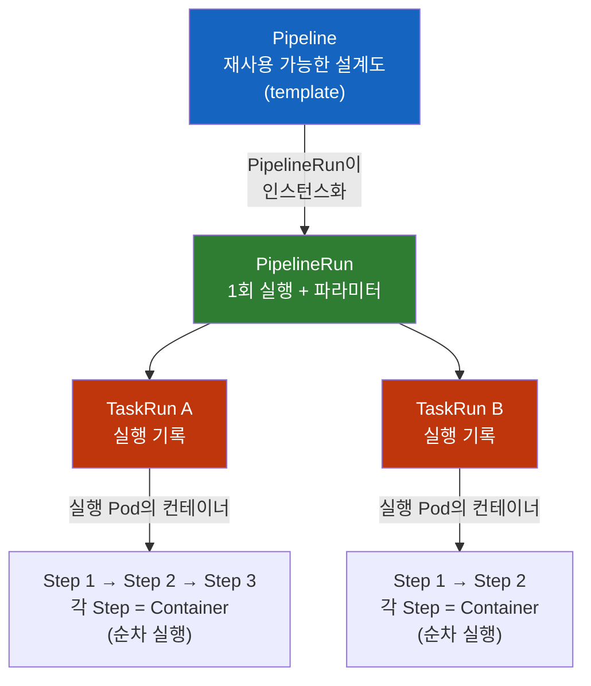
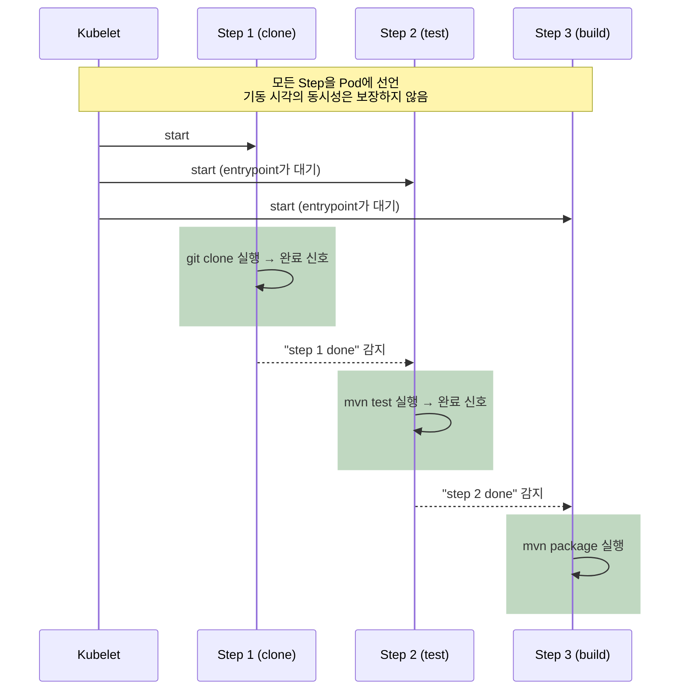
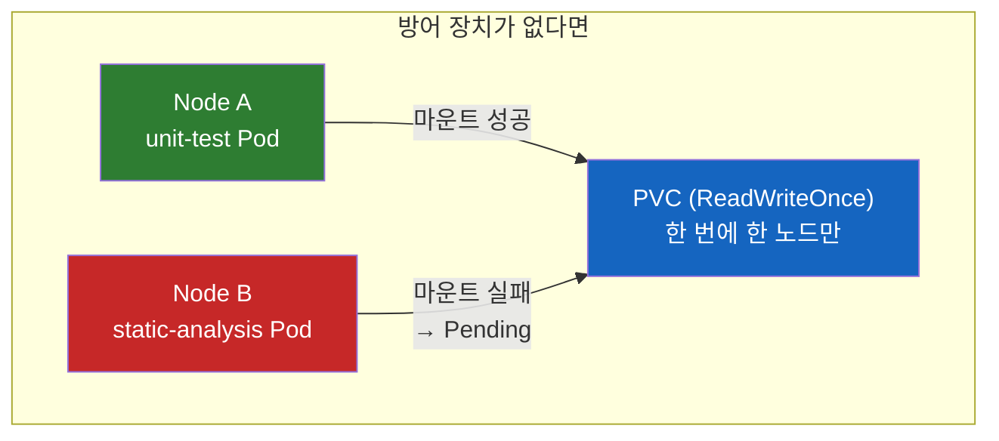

# Tekton의 Pipeline과 PipelineRun은 왜 따로 존재할까?

> **개발자를 위한 쉬운 쿠버네티스 · 확장 읽기** | [전체 목차](./Kubernetes-Introduction.md#이-시리즈의-읽는-순서)

Kubernetes 위에서 CI/CD를 굴리는 Tekton. 그런데 Pipeline을 만들어놔도 아무 일도 일어나지 않는다. 왜 실행하려면 PipelineRun이라는 걸 또 만들어야 할까? 그리고 그 안의 Step은 순차 실행인데, 왜 Pod에는 처음부터 여러 컨테이너가 선언될까?

[Jenkins와 Tekton의 역할 분담](Jenkins가-있는데-왜-Tekton이-빌드할까.md)에서 본 빌드 Pod를 API object 수준으로 내려가 본다. [CRD와 controller](Kubernetes-CRD-Controller-Operator.md), [볼륨과 PVC](Kubernetes-Volume-PersistentVolume.md)를 먼저 읽으면 실행과 데이터 전달의 경계가 더 잘 보인다.

## 결론부터 말하면

**Tekton에서 `Pipeline`·`Task`는 실행되지 않는다. 실행되는 것은 `PipelineRun`·`TaskRun`이다.** Pipeline은 Java의 **클래스(설계도)** 이고, PipelineRun은 그 클래스를 `new`한 **인스턴스(실행)** 다. 클래스 정의만으로는 아무 일도 안 일어나는 것과 똑같다.

계층은 이렇게 맞물린다. 파라미터를 넣어 `PipelineRun`을 만들면 → Tekton이 각 `Task`마다 `TaskRun`을 만들고 → 일반적인 Task 실행에서는 controller가 `TaskRun`에 대응하는 Kubernetes **Pod** 를 만들며 → 그 안의 `Step` 하나하나가 Pod 안의 **컨테이너 하나** 가 된다.



| Tekton 리소스 | 역할 | Kubernetes 대응 | Java 비유 |
|---------------|------|-----------------|-----------|
| `Task` | Step들의 묶음 (설계도) | — | 클래스(메서드) |
| `Pipeline` | Task들의 순서·의존 관계 (설계도) | — | 클래스 |
| `TaskRun` | Task 1회 실행의 입력과 상태 | 보통 대응 Pod를 controller가 생성 | 인스턴스 |
| `PipelineRun` | Pipeline 1회 실행 | Pod 여러 개 | 인스턴스 |
| `Step` | Task 안의 명령 1개 | **Container** | 메서드 안의 한 줄 |

## 1. 왜 "설계도"와 "실행"을 굳이 나눴을까?

Jenkins도 Jenkinsfile의 정의와 매번의 Build 기록을 구분한다. Tekton은 이 구분을 Kubernetes API에서 직접 다루는 두 종류의 object로 드러낸다. 처음 보면 번거롭다. "그냥 Pipeline 만들면 실행되면 안 돼?"라는 생각이 든다.

이유는 Tekton이 **Kubernetes-native** 하기 때문이다. Tekton은 controller·webhook 서버를 설치하고, Kubernetes에 `Task`·`Pipeline`·`TaskRun`·`PipelineRun`이라는 **CRD(Custom Resource Definition)** 를 등록하고, 컨트롤러가 이 리소스들을 감시하는 구조다. 즉 Tekton의 모든 것은 `kubectl get pipelinerun`으로 조회되는 평범한 Kubernetes 오브젝트다.

Kubernetes의 세계에서 오브젝트는 **선언적(declarative)** 이다. `Deployment`(원하는 상태)와 `Pod`(실제 실행)가 분리돼 있듯, Tekton도 **"무엇을 할지"(Pipeline)** 와 **"지금 이 파라미터로 한 번 실행"(PipelineRun)** 을 분리한다. 이 분리가 주는 이점은 분명하다.

- **재사용**: 하나의 `Pipeline`을 브랜치마다, 환경마다 다른 파라미터로 몇 번이고 실행한다.
- **감사·이력**: `PipelineRun`은 실행 기록 그 자체다. 언제 어떤 커밋으로 돌았고 성공/실패했는지가 오브젝트로 남는다.
- **실행 입력의 보존**: 일반적인 실행 정의는 생성 후 바꿔 재사용하는 대신 새 Run으로 기록한다. 취소·timeout 같은 허용된 제어 변경은 별개다. 또한 참조 Task·소스 revision·실행 이미지가 가변이면 Run 하나만으로 재현성을 보장하지 못한다.

그래서 Pipeline만 `apply`하면 아무 일도 안 일어난다. 클래스를 컴파일해놓고 `main()`에서 `new` 하지 않은 것과 같다. 실행하려면 반드시 Run 오브젝트를 만들어야 한다.

## 2. Task와 Step: Pod와 Container로 내려가기

이제 한 단계 더 내려가자. `Task`는 Tekton의 최소 실행 단위이고, 그 안은 `Step`들로 채워진다.

보통의 TaskRun이 실행되면 controller가 Pod를 만들고, 각 Step은 그 Pod의 컨테이너로 표현된다. TaskRun과 Pod는 서로 다른 API object이며 검증 실패로 Pod가 생기지 않을 수도 있다. Pipeline의 skipped Task는 실행되지 않고, 재시도는 추가 실행을 만들 수 있다. CustomRun은 별도 실행 모델이므로 이 대응을 모든 확장에 일반화하지 않는다.

```yaml
apiVersion: tekton.dev/v1
kind: Task
metadata:
  name: build-task
spec:
  workspaces:
    - name: source          # Step들이 공유할 볼륨 (Pod 레벨)
  steps:
    - name: clone           # Step 1 → Container 1
      image: alpine/git
      script: |
        git clone https://github.com/example/app /workspace/source
    - name: test            # Step 2 → Container 2
      image: maven:3.9
      script: |
        cd /workspace/source && mvn test
    - name: build           # Step 3 → Container 3
      image: maven:3.9
      script: |
        cd /workspace/source && mvn package
```

`Step`은 위에서 아래로 **정의된 순서대로** 실행된다. 그리고 세 Step이 **같은 Pod 안** 에 있기 때문에, `clone`이 받아온 소스를 `test`·`build`가 그대로 이어서 쓸 수 있다. 같은 Pod의 컨테이너는 **네트워크 네임스페이스** 를 공유하고, **마운트된 볼륨** 을 함께 볼 수 있다. 그래서 `clone`이 볼륨에 써둔 소스 파일이 다음 Step에도 그대로 보이는 것이다.

주의할 점은 **환경변수는 공유되지 않는다** 는 것이다. 환경변수는 컨테이너별 설정이라, 한 Step에서 `export`한 값이 다음 Step 컨테이너로 자동 전파되지 않는다. 따라서 **Step 사이의 데이터 전달은 공유 Workspace(볼륨)에 파일로 쓰거나 Result로 넘기는 방식** 이 원칙이다. 파일 기반 공유가 Task 안에서 데이터를 넘기는 가장 자연스러운 방법이다.

### Task는 입력을 어떻게 받을까: params 선언

위 예제는 저장소 URL이 하드코딩돼 있어 재사용이 불가능하다. 설계도가 설계도이려면 **바깥에서 값을 받아야** 한다. 그게 `params`다.

받는 쪽(Task)이 먼저 선언하고, 주는 쪽(PipelineRun)이 값을 채운다. 자바 메서드의 시그니처와 호출을 떠올리면 정확히 맞는다.

```yaml
apiVersion: tekton.dev/v1
kind: Task
metadata:
  name: build-task
spec:
  params:
    - name: repo-url
      type: string                    # 기본값이라 생략 가능
      description: 클론할 저장소 URL
    - name: revision
      type: string
      default: main                   # 안 주면 이 값이 쓰인다
    - name: build-flags
      type: array                     # 배열 타입
      default: ["-DskipTests=false"]
    - name: registry
      type: object                    # 객체 타입 — properties 필수
      properties:
        host: { type: string }
        namespace: { type: string }
  workspaces:
    - name: source
  steps:
    - name: clone
      image: alpine/git
      env:
        - name: REPO_URL
          value: $(params.repo-url)
        - name: REVISION
          value: $(params.revision)
      script: |
        #!/bin/sh
        set -eu
        git clone --no-checkout -- "$REPO_URL" "$(workspaces.source.path)"
        cd "$(workspaces.source.path)"
        git checkout --detach "$REVISION"
    - name: build
      image: maven:3.9
      workingDir: $(workspaces.source.path)
      command: ["mvn"]
      args: ["package", "$(params.build-flags[*])"]
      env:
        - name: OUTPUT_REGISTRY
          value: $(params.registry.host)/$(params.registry.namespace)
```

위 예제는 params와 workspace의 대응을 설명하는 Task다. private Git 인증과 실제 Maven 프로젝트는 별도 준비한다. `git clone --branch`는 브랜치·tag 선택용이므로 임의 commit SHA를 받는 입력과 혼동하지 않는다. clone 후 받은 ref 범위에 commit이 있어야 checkout할 수 있고, 서버 fetch 정책에 따라 추가 fetch가 필요할 수 있다. 공개 실행 이미지의 tag도 설명용 선택이며 재현성·반입을 위해 검증한 digest로 고정한다.

params를 script 본문에 직접 넣으면 셸 코드로 해석될 수 있다. 위에서는 외부 문자열을 env로 전달하고 셸에서 인용했다. 이것은 허용 저장소·revision 검사를 대신하지 않는다.

타입별로 참조 문법이 다르다는 게 포인트다.

| 타입 | 선언 | 참조 |
|------|------|------|
| `string` | 기본값 | `$(params.repo-url)` |
| `array` | `type: array` | `$(params.build-flags[*])` — 인자 목록으로 펼쳐짐 |
| `object` | `type: object` + `properties` | `$(params.registry.host)` |

이름에 점(`.`)이 들어간 파라미터는 대괄호 표기법으로 접근한다 — `$(params['foo.bar'])`. 점이 객체 멤버 접근으로 해석되기 때문이다.

`default`가 있으면 그 파라미터는 선택 사항이 되고, 없으면 필수가 되어 값을 안 주면 검증에서 거부된다.

### Step 공통 설정을 한 번에: stepTemplate

Step마다 같은 환경변수나 보안 설정을 반복해서 쓰게 되는 경우가 많다. `stepTemplate`은 모든 Step에 적용될 기본값을 한 곳에 모은다.

```yaml
spec:
  stepTemplate:
    env:
      - name: MAVEN_OPTS
        value: "-Xmx2g"
    securityContext:
      runAsNonRoot: true
  steps:
    - name: test
      image: maven:3.9
      script: mvn test              # MAVEN_OPTS 자동 적용
    - name: build
      image: maven:3.9
      env:
        - name: MAVEN_OPTS
          value: "-Xmx4g"           # 개별 Step이 덮어쓴다
      script: mvn package
```

겹치는 항목은 **개별 Step의 설정이 이긴다.**

### Step과 나란히 도는 컨테이너: sidecars

Step은 순차 실행이지만, **Step이 도는 내내 옆에서 계속 떠 있어야 하는 컨테이너** 가 필요할 때가 있다. 테스트용 데이터베이스, Docker-in-Docker 데몬 같은 것들이다. 이건 `sidecars`로 선언한다.

```yaml
spec:
  steps:
    - name: integration-test
      image: maven:3.9
      script: |
        # localhost로 접근 가능 — 같은 Pod라 네트워크를 공유한다
        mvn verify -Dtest.db.url=jdbc:postgresql://localhost:5432/testdb
  sidecars:
    - name: postgres
      image: postgres:16
      env:
        - name: POSTGRES_PASSWORD
          value: test
      readinessProbe:                    # 준비될 때까지 Step이 기다리게
        exec:
          command: ["pg_isready", "-U", "postgres"]
```

**sidecar는 마지막 Step이 끝나면 Tekton이 자동으로 종료** 시킨다. 그래서 Pod가 영원히 Running으로 남지 않는다. 3.1절에서 "Step은 병렬 실행이 안 된다"고 했는데, sidecar는 그 규칙의 예외가 아니라 **다른 범주** 다 — 작업을 나눠 하는 게 아니라 작업에 필요한 환경을 제공하는 쪽이다.

### 그런데 여기서 이상한 점이 있다

"Step은 순차 실행"이라고 했다. 그렇다면 `test` Step의 컨테이너는 `clone`이 끝난 **다음에** 생성돼야 자연스럽다. 그런데 Pod를 뜯어보면 — **Pod spec에는 세 Step 컨테이너가 처음부터 함께 선언되어 있고, 뒤 Step의 실제 명령은 앞 Step 완료 전까지 대기할 수 있다.**

어떻게 여러 Step 컨테이너가 선언되어 있는데 실제 명령은 순서대로 실행될까? 일반 앱 컨테이너의 기동 시각은 Kubernetes가 정확히 동시에 맞춰 주거나 Step 순서에 따라 직렬화하지 않는다. init container·native sidecar와도 다른 문제다. Tekton은 이 제약을 **entrypoint 주입(injection)** 이라는 트릭으로 우회한다.

Tekton은 각 Step 컨테이너의 진짜 명령 앞에 자신의 `entrypoint` 바이너리를 끼워 넣는다. 컨테이너가 시작되더라도, 이 entrypoint가 **"내 앞 Step이 끝났다"는 신호를 감지할 때까지 대기** 한다. Step 1이 명령을 마치고 완료 표시를 남기면, 대기하던 Step 2의 entrypoint가 그걸 감지하고 그제서야 진짜 명령을 실행한다.



이 트릭은 눈에 보이지 않는 곳에서 두 가지 중요한 제약을 만든다. 하나는 **리소스 예약**, 다른 하나는 **결과(Result) 크기 제한** 이다. 다음 절에서 다룬다.

## 3. 제약: 문서에는 잘 안 보이지만 반드시 물리는 것들

### 3.1 Step은 Task 안에서 병렬 실행이 안 된다

`Step`은 **오직 순차** 다. 한 Task 안에서 두 Step을 동시에 돌리는 문법은 없다. 병렬이 필요하면 **Task를 나눠서** Pipeline 레벨에서 병렬화해야 한다(뒤의 3.5). "무거운 정적 분석과 유닛 테스트를 같이 돌리고 싶다" → 같은 Task의 두 Step이 아니라, 두 개의 Task로 쪼갠다.

<a id="32-모든-step-컨테이너가-동시에-뜬다--리소스-예약-함정"></a>

### 3.2 순차 명령과 Pod 자원 예약은 계산 방식이 다르다

Step의 명령이 순서대로 실행된다고 해서 scheduler가 가장 무거운 Step 하나만큼 예약하는 것은 아니다. 기본 Pod 자원 계산에서는 일반 컨테이너들의 requests 합계와 init container 요구량 등을 고려한다. sidecar·Pod overhead와 Kubernetes 버전별 자원 모델도 영향을 준다. 예를 들어 세 Step에 각각 CPU request를 주면 실제 명령은 하나씩 돌아도 Pod의 예약량은 세 request를 포함할 수 있다.

`LimitRange`는 namespace의 기본·최소·최대 자원 제약이고, `ResourceQuota`는 namespace 전체 사용량 제한이다. Tekton이 LimitRange를 고려해 Step 값을 조정하는 동작이 있어도, 이것이 모든 Step의 합계를 자동으로 한 Step의 최대값으로 바꾼다는 뜻은 아니다. 설치된 버전에서 생성된 Pod의 requests와 Run 실패 메시지를 확인해야 한다.

Tekton에는 Task-level compute resources를 지정하는 별도 방식도 있다. 적용 가능한 API·필드·설정과 Step-level 지정의 관계는 [공식 compute resources 문서](https://tekton.dev/docs/pipelines/compute-resources/)에서 사용 버전에 맞게 확인한다. YAML 입력만 보고 자원 예약량을 추측하기보다 생성된 Pod spec, quota 이벤트, Node의 allocatable을 연결해 보는 이유다.

<a id="33-result는-4096-byte-step이-많을수록-더-작아진다"></a>

### 3.3 Result는 작은 값을 전달하는 경로다

Task는 다음 Task로 작은 값(커밋 해시, 이미지 태그 등)을 넘길 때 **Result** 를 쓴다. 기본적인 termination-message 수집 방식에서 Tekton은 이 값을 **Kubernetes 컨테이너의 termination message** 로 실어 나른다. Kubernetes의 한도는 **컨테이너당 최대 4096 bytes**, 그리고 **Pod 전체 최대 12 KiB**다. Pod 전체 한도는 init container와 일반 container를 포함한 컨테이너들에 균등 분할되므로, 각 컨테이너가 언제나 4096 bytes를 독립적으로 쓸 수 있는 것은 아니다.

**그전에 Result를 실제로 어떻게 쓰는지부터 보자.** 여기가 처음 보면 가장 낯선 부분이다. Result는 `return` 문 같은 게 아니라 **약속된 경로에 파일을 쓰는 방식** 이다.

```yaml
apiVersion: tekton.dev/v1
kind: Task
metadata:
  name: git-clone
spec:
  workspaces:
    - name: source
  params:
    - name: repo-url
  results:
    - name: commit                       # 먼저 선언하고
      description: 체크아웃한 커밋 해시
    - name: image-tag
  steps:
    - name: clone
      image: alpine/git
      env:
        - name: REPO_URL
          value: $(params.repo-url)
      script: |
        #!/bin/sh
        set -eu
        git clone -- "$REPO_URL" /workspace/source
        cd /workspace/source

        # $(results.commit.path)가 파일 경로로 치환된다
        # 실제로는 /tekton/results/commit 같은 경로
        git rev-parse HEAD | tr -d '\n' > $(results.commit.path)

        git rev-parse --short HEAD | tr -d '\n' > $(results.image-tag.path)
```

**`tr -d '\n'`을 눈여겨보라.** Tekton은 파일 내용을 **가공 없이 그대로** 읽는다. `echo`가 붙이는 개행 문자까지 값의 일부가 되므로, 이걸 지우지 않으면 다음 Task에서 `abc123\n`을 이미지 태그로 쓰려다 실패한다. **Result 값에서 개행을 제거하는 것은 선택이 아니라 관례다.** `echo -n`을 쓰거나 위처럼 `tr -d '\n'`으로 자르면 된다.

값을 꺼내 쓰는 쪽은 이렇다.

```yaml
tasks:
  - name: clone
    taskRef: { name: git-clone }
  - name: build
    taskRef: { name: image-build }
    params:
      - name: tag
        value: $(tasks.clone.results.image-tag)   # 앞 Task의 Result 참조
```

이 참조 하나가 **자동으로 실행 순서를 만든다.** `runAfter`를 안 써도 `build`는 `clone` 뒤에 돈다 — 데이터 의존성이 곧 순서 의존성이기 때문이다.

여기서 Step 수가 발목을 잡는다. **Step이 늘면 Pod의 컨테이너 수도 늘고, 12 KiB를 더 많은 컨테이너가 나누므로 각 termination message의 상한이 줄어들 수 있다.** 예를 들어 init container를 포함해 12개면 각 메시지는 최대 1024 bytes다. Tekton은 이 공간의 일부를 내부 메타데이터에도 쓰므로 전부를 사용자 Result에 쓸 수 없다. 따라서 Step 증가에 따라 Result 여유도 줄어들 수 있으며, 정확한 사용자 Result 한도는 컨테이너 수뿐 아니라 Tekton 버전·수집 방식·설정에 따라 확인해야 한다. **실용적인 기준은 "Result는 수백 byte 규모의 짧은 값으로 제한한다"** 정도다. 한도를 넘으면 TaskRun이 이 메시지와 함께 실패한다:

```
Termination message is above max allowed size 4096, caused by large task result
```

**그래서 대용량 데이터는 Result가 아니라 Workspace(볼륨)로 넘긴다.** Result는 "포인터·식별자" 용도, Workspace는 "덩어리 데이터" 용도로 나눠 쓰는 게 원칙이다. (한도 자체를 늘리고 싶다면, termination message 대신 Result를 별도 저장소에 담는 `results-from: sidecar-logs`와 `max-result-size` 같은 수집 설정을 검토하는 방법도 있지만, 큰 산출물은 Workspace나 artifact 저장소로 전달하고 Result에는 그 식별자·digest·URI를 담는 편이 낫다.)

| 구분 | Result | Workspace |
|------|--------|-----------|
| 실체 | 기본은 termination message; sidecar-logs 수집도 가능 | Volume (PVC, emptyDir 등) |
| 크기 | 수집 backend와 설정의 제약; termination message는 컨테이너당 최대 4096 bytes 및 Pod 전체 12 KiB 분할 | 볼륨 용량만큼 |
| 용도 | 커밋 해시, 태그, 짧은 문자열 | 소스 코드, 빌드 산출물, 캐시 |
| 전달 범위 | Task → Task | Task ↔ Task (Pipeline 내 공유) |

### 3.4 재시도는 Task 단위, Timeout은 여러 층에 걸린다

두 개를 섞어서 기억하면 안 된다. **재시도(retry)의 단위는 Task** 다. 실패했을 때 특정 Step만 골라 다시 돌릴 수는 없고, Pipeline에서 `retries: 2`를 주면 그 Task(=Pod) 전체가 처음부터 다시 돈다. 그래서 Task를 어떻게 쪼갰는지가 곧 "실패 시 어디까지 되돌아가는지"를 결정한다.

반면 **timeout은 Step 수준까지 지정할 수 있다.** `steps[].timeout`으로 개별 Step에 상한을 걸 수 있고, 그 위로 Task·TaskRun·PipelineRun 수준의 timeout이 계층적으로 얹힌다. 개별 Task에 선택된 timeout과 PipelineRun 전체의 실행 deadline은 구분해야 한다. 개별 Task에 큰 값을 주었다고 Run의 남은 시간을 넘어 실행할 수 있는 것은 아니다.

```yaml
apiVersion: tekton.dev/v1
kind: PipelineRun
spec:
  timeouts:
    pipeline: "1h"        # 전체 상한
    tasks: "45m"          # 일반 tasks 단계의 시간 상한; 병렬 Task 시간의 단순 합이 아님
    finally: "15m"        # finally Task 상한
```

개별 Task의 timeout 값을 고를 때는 `taskRunSpecs[].timeout` override가 Pipeline의 `tasks[].timeout`보다 우선하고, 명시 값이 없으면 Run 제약과 기본값을 따른다. 그러나 이 값 선택 순위가 전체 deadline을 무효화하지는 않는다. 예를 들어 PipelineRun이 1시간이고 Pipeline의 `tasks[].timeout`이 3시간이면, 그 이유만으로 항상 validation에서 거절되는 것이 아니라 전체 Run이 먼저 시간 초과되어 Task도 1시간 안에 종료될 수 있다.

반면 `taskRunSpecs[].timeout` override에는 Run의 해당 tasks/finally 구간 timeout을 넘지 않아야 하는 validation 제약이 있다. PipelineRun 안의 `timeouts.pipeline`·`tasks`·`finally`도 유한한 값을 지정할 때 `pipeline >= tasks + finally` 관계를 충족해야 한다. 무제한을 뜻하는 0과 생략 값의 계산 규칙은 사용 버전의 공식 문서를 확인한다. API가 입력을 거절한 것인지, 승인된 실행이 deadline에 도달한 것인지는 다른 실패다.

### 3.5 Pipeline에서 순서·병렬·조건은 이렇게 제어한다

다음은 DAG를 설명하는 Pipeline이다. `git-clone`·`maven-test`·`sonar-scan`·`image-build` Task와 workspace·Result 계약을 별도로 준비해야 하며, 이 블록만으로 실행되지 않는다.

```yaml
apiVersion: tekton.dev/v1
kind: Pipeline
metadata:
  name: ci-pipeline
spec:
  workspaces:
    - name: shared          # Task들이 공유할 워크스페이스
  params:
    - name: repo-url
      type: string
  tasks:
    - name: clone
      taskRef: { name: git-clone }
      params:
        - name: repo-url
          value: $(params.repo-url)
      workspaces:
        - name: source
          workspace: shared
    - name: unit-test
      taskRef: { name: maven-test }
      runAfter: ["clone"]   # clone 다음에 실행 (순차)
      workspaces:
        - name: source
          workspace: shared
    - name: static-analysis
      taskRef: { name: sonar-scan }
      runAfter: ["clone"]   # clone 다음, unit-test와 병렬
      workspaces:
        - name: source
          workspace: shared
    - name: build
      taskRef: { name: image-build }
      runAfter: ["unit-test", "static-analysis"]  # 둘 다 끝나야
      when:                 # 조건부 실행
        - input: "$(tasks.unit-test.results.passed)"
          operator: in
          values: ["true"]
```

- **`runAfter`**: 명시적 순서. 지정 안 하면 Tekton은 의존이 없다고 보고 **병렬** 로 돌린다. `unit-test`와 `static-analysis`는 둘 다 `clone`만 기다리므로 서로 동시에 실행된다.
- **`results` 참조**: `$(tasks.clone.results.commit)`처럼 앞 Task의 Result를 뒷 Task 입력으로 쓰면, 데이터 의존성 때문에 **자동으로 순서가 생긴다**(`runAfter` 없이도).
- **`when`**: 조건이 false면 그 Task는 **Skip**. 실패가 아니라 건너뛴 것으로 기록된다.
- **`finally`**: 일반 `tasks`가 끝난 뒤 정리·알림 등을 실행한다. 일반 Task 실패에도 실행할 수 있지만 무조건 실행을 보장하는 장치는 아니다. 유효하지 않은 Run·일부 취소 방식·전체 timeout·스케줄링 실패·존재하지 않는 Result 참조 때문에 알림도 실행되지 못할 수 있다.

### 3.6 Workspace에 무엇을 꽂느냐가 병렬 실행을 좌우한다

방금 `unit-test`와 `static-analysis`를 병렬로 돌렸다. 그런데 둘 다 `shared`라는 같은 workspace를 쓴다. **여기서 조용히 위험한 일이 벌어질 수 있다.**

먼저 workspace에 꽂을 수 있는 볼륨 종류부터 정리하자. 설계도는 "workspace가 필요하다"고 선언만 하고, 실제 볼륨은 Run 시점에 바인딩한다.

| VolumeSource | 수명 | 용도 |
|--------------|------|------|
| `emptyDir` | TaskRun 하나 (Pod와 함께 소멸) | 단일 Task 안에서만 쓰는 임시 공간 |
| `volumeClaimTemplate` | PipelineRun 하나 (Run 삭제 시 PVC도 삭제) | **Task 간 파일 공유의 기본 선택** |
| `persistentVolumeClaim` | 영구 (Tekton이 만들지도 지우지도 않음) | 빌드 캐시처럼 Run을 넘어 남겨야 할 것 |
| `configMap` | — (읽기 전용) | 설정 파일 주입 |
| `secret` | — (읽기 전용) | 인증서·키 주입 |
| `projected` | — (항상 읽기 전용) | 여러 소스 결합 |
| `csi` | driver·volume 설정에 따름 | 외부 저장소 연동. 읽기 전용 여부는 `readOnly` 설정과 driver 지원 조건을 확인 |

`volumeClaimTemplate`과 `persistentVolumeClaim`의 차이가 실무에서 가장 자주 헷갈린다. **전자는 Run마다 새 PVC를 만들고 Run이 지워질 때 함께 지운다. 후자는 이미 존재하는 PVC를 가리키기만 한다.** 매 빌드마다 깨끗한 작업 공간이 필요하면 전자, Maven 로컬 저장소처럼 누적돼야 이득인 것은 후자다.

```yaml
# 매 실행마다 새 볼륨 — 소스 코드 작업 공간
workspaces:
  - name: shared
    volumeClaimTemplate:
      spec:
        accessModes: ["ReadWriteOnce"]
        resources: { requests: { storage: 1Gi } }
  # 실행을 넘어 유지되는 볼륨 — 의존성 캐시
  - name: maven-cache
    persistentVolumeClaim:
      claimName: maven-repo-cache
  # 읽기 전용 주입
  - name: registry-creds
    secret:
      secretName: docker-config
```

**이제 위험한 지점이다.** 위 `accessModes: ["ReadWriteOnce"]`(RWO)는 **볼륨을 한 번에 한 노드에만 마운트할 수 있다** 는 뜻이다. 그런데 `unit-test`와 `static-analysis`는 각각 별도의 Pod이고, Kubernetes 스케줄러는 이 둘을 얼마든지 다른 노드에 배치할 수 있다. 그러면 두 번째 Pod는 볼륨을 마운트하지 못하고 `Pending`에 걸린 채 멈춘다.



Tekton의 **Affinity Assistant** 와 `coschedule` 설정은 관련 TaskRun Pod를 같은 Node에 배치하도록 돕는다. 다만 설치 버전·기능 설정과 affinity 조건에 따라 적용 방식이 다르므로, PVC가 있다는 이유만으로 항상 같은 배치가 만들어진다고 가정하지 않는다. Node 자원이 부족하거나 여러 볼륨의 zone 제약이 충돌하면 co-location을 요청해도 실행하지 못할 수 있다.

| 구성 | 해결하는 문제 | 해결하지 않는 문제 |
|------|---------------|-------------------|
| RWO와 co-location | 같은 Node에서 여러 Pod가 볼륨을 사용할 배치 조건 | 동시에 같은 파일에 쓰는 충돌 |
| RWX 스토리지 | 여러 Node에서의 동시 mount 조건 | 앱·빌드 도구의 파일 정합성 |
| Task별 복사본·artifact 전달 | 작업 디렉토리 충돌과 mount 의존 줄이기 | 복사·네트워크·저장 비용 |

`unit-test`와 `static-analysis`가 같은 소스를 읽기만 하는지, `target/` 같은 빌드 디렉토리를 함께 수정하는지도 봐야 한다. Affinity Assistant는 파일 잠금 장치가 아니다. 순서를 직렬화하거나 서로 다른 작업 디렉토리·snapshot을 쓰는 설계가 필요할 수 있다. Run 삭제로 PVC가 삭제되어도 실제 PV·데이터의 삭제는 reclaim policy와 storage 구현에 달려 있다.

## 4. Task를 매번 새로 쓰지 않는 법: Resolver

여기까지 `taskRef: { name: git-clone }`처럼 **같은 클러스터에 미리 `apply`해둔 Task** 를 이름으로 참조했다. 그런데 `git clone`이나 `kaniko build` 같은 Task는 전 세계 모든 팀이 똑같이 필요로 한다. 이걸 팀마다 새로 쓰는 건 낭비다.

그래서 Tekton은 **Remote Resolution** 을 제공한다. 클러스터 밖에 있는 Task 정의를 실행 시점에 가져오는 기능이다.

```yaml
tasks:
  # (1) git resolver — 저장소에서 직접 가져온다
  - name: clone
    taskRef:
      resolver: git
      params:
        - name: url
          value: https://github.com/tektoncd/catalog.git
        - name: revision
          value: main
        - name: pathInRepo
          value: /task/git-clone/0.9/git-clone.yaml

  # (2) hub resolver — Artifact Hub의 공개 카탈로그에서
  - name: build
    taskRef:
      resolver: hub
      params:
        - name: kind
          value: task
        - name: name
          value: kaniko
        - name: version
          value: "0.6"

  # (3) bundles resolver — OCI 이미지에 담아 배포한 Task
  - name: deploy
    taskRef:
      resolver: bundles
      params:
        - name: bundle
          value: registry.example.com/tekton-tasks@sha256:abc123...
        - name: name
          value: kubectl-deploy
        - name: kind
          value: Task
```

세 방식의 성격이 다르다.

| Resolver | 가져오는 곳 | 장점 | 주의 |
|----------|------------|------|------|
| `git` | Git 저장소의 특정 경로 | 사내 저장소로 Task를 버전 관리 | `revision`을 브랜치로 두면 재현성이 깨진다 — 태그나 커밋 해시 권장 |
| `hub` | Artifact Hub 공개 카탈로그 | 공용 Task를 재사용; 자체 검토 필요 | 외부 의존. 폐쇄망에서는 불가 |
| `bundles` | OCI 레지스트리 | Task 정의 artifact를 digest로 고정 | 별도 빌드·푸시 파이프라인 필요 |
| `cluster` | 다른 네임스페이스 | 사내 표준 Task를 한 곳에서 관리 | 클러스터 밖으로는 못 나감 |

Task 정의를 고정하려면 OCI bundle digest나 Git commit처럼 내용에 대응하는 참조를 사용한다. 둘 중 하나가 전체 실행의 재현성을 더 강하게 보장한다고 순위를 매길 필요는 없다. Step 이미지·소스·의존성도 각각 고정해야 한다. 브랜치 이름(`main`)은 참조 내용이 바뀔 수 있다. 어제 성공한 파이프라인이 오늘 실패하는데 우리 코드는 안 바뀐 상황 — 원인이 여기일 수 있다.

resolver의 설치 여부와 활성화 flag는 구분해야 한다. 2026-10-23 확인한 upstream main의 `resolvers-feature-flags`는 bundles·hub·git·cluster·http를 `true`로 둔다. 이것이 모든 배포판·기존 설치에 resolver가 설치되어 있다는 뜻은 아니다. 사용하는 필드의 기능 단계·`enable-api-fields`·resolver 배포·개별 enable flag·네트워크 접근을 함께 확인한다. 클러스터 운영자가 어떤 resolver를 설치·활성화했는지에 따라 쓸 수 있는 것이 달라지므로, 문서만 보고 되는 줄 알았다가 막히는 경우가 있다.

## 5. 실제로 돌려보기: PipelineRun 하나로 시작된다

설계도(`Task`, `Pipeline`)를 `apply`해도 아무 일이 없다는 걸 다시 확인하자. 이 예제 경로에서는 Run object를 생성해야 실행을 요청할 수 있다. 아래 Run은 앞의 DAG에 맞춰 repo-url과 shared workspace를 전달하지만 참조 Task 구현은 별도로 준비해야 한다. 완성된 빌드 시스템 설치 파일은 아니다.

```yaml
apiVersion: tekton.dev/v1
kind: PipelineRun
metadata:
  generateName: ci-run-       # 실행마다 유니크한 이름 자동 생성
spec:
  pipelineRef:
    name: ci-pipeline         # 어떤 설계도를 실행할지
  params:
    - name: repo-url
      value: https://github.com/example/app
  workspaces:
    - name: shared            # 설계도의 workspace에 실제 볼륨을 바인딩
      volumeClaimTemplate:
        spec:
          accessModes: ["ReadWriteOnce"]
          resources:
            requests:
              storage: 1Gi
```

```bash
# 실행 (kubectl 또는 tkn CLI)
kubectl create -f pipelinerun.yaml
# 대안: 아래 tkn 명령을 쓰면 또 다른 Run이 만들어진다
tkn pipeline start ci-pipeline    # tkn CLI가 PipelineRun을 대신 만들어줌

# 관찰 — PipelineRun이 TaskRun을, TaskRun이 Pod를 만든다
kubectl get pipelinerun
kubectl get taskrun
kubectl get pods              # taskrun 하나당 pod 하나
tkn pipelinerun logs -f       # 실행 로그 스트리밍
```

`PipelineRun`을 만드는 순간 컨트롤러가 `Pipeline` 설계도를 읽어, 각 Task마다 `TaskRun`을 만들고, 그 `TaskRun`이 다시 Pod를 띄운다. `params`로 이번 실행의 값을 주입하고, `workspaces`로 설계도가 선언만 해둔 볼륨에 실제 스토리지를 **바인딩** 한다. 설계도는 "workspace가 필요하다"고 선언만 하고, 실제 볼륨은 실행 시점에 붙이는 것 — 이것도 설계도/실행 분리의 연장선이다.

## 6. 정리

Pipeline·Task는 재사용할 정의이고, Run은 이번 입력과 관찰 결과를 담는다. controller가 실행 object를 만들고 Node가 명령을 실행하므로, Run 생성 성공에서 곧바로 이미지가 만들어졌다고 결론 내릴 수 없다. `status.conditions`, child TaskRun, 실행 Pod와 Step 로그를 따라가면 어디서 멈췄는지 나눠 볼 수 있다.

데이터도 용도에 맞게 넘긴다. Result는 작은 식별자, Workspace는 파일을 연결하는 계약이다. Workspace의 PVC·권한·배치·동시 쓰기 조건은 Run을 만드는 쪽과 Task 구현이 함께 책임진다. Task·이미지·소스의 고정 참조는 그 실행을 나중에 다시 설명할 근거가 된다.

**에어갭 환경에서 짚어볼 점.** git/hub resolver의 외부 Task 조회와 그 Task가 쓰는 Step 이미지 pull은 서로 다른 의존성이다. Task 정의를 내부 Git이나 OCI bundle에 고정해 반입한 뒤에도, Node의 실행 이미지·빌드 중 dependency·registry push 경로가 준비되어야 한다.

### 다음 단계

여기까지는 전부 **사람이 `PipelineRun`을 만드는** 이야기였다. 실제 CI/CD에서는 git push가 그 일을 대신해야 한다. 그 빈칸을 채우는 것이 Tekton Triggers다 — [Tekton Triggers는 어떻게 git push를 PipelineRun으로 바꿀까](Tekton-Triggers는-어떻게-git-push를-PipelineRun으로-바꿀까.md)에서 이어진다. Jenkins처럼 Git 호스팅이 아닌 시스템에서 파이프라인을 트리거하는 방법은 [Jenkins Job에서 Tekton EventListener로 webhook을 쏠 수 있을까](Jenkins-Job에서-Tekton-EventListener로-webhook을-쏠-수-있을까.md)에서 다룬다.

---

## 생각해 볼 질문

1. **Pipeline을 바꿨는데 기존 Run을 다시 실행하는 버튼이 없는 이유는 무엇일까?** Run은 한 번의 실행 입력과 결과를 남기는 object다. 새 입력·정의로 실행하려면 새 Run을 만들며, 참조 자료까지 고정해야 비교 가능성이 높아진다.
2. **Step은 순차 실행인데 CPU quota 오류가 생길 수 있는 이유는 무엇일까?** 명령의 순서와 Pod의 자원 예약 방식이 다르다. 생성된 Pod의 Step·init 자원과 namespace quota를 실제 값으로 확인한다.
3. **RWO PVC와 Affinity Assistant가 있으면 병렬 빌드가 안전할까?** mount할 수 있는 배치와 파일 동시 쓰기의 정합성은 다른 문제다. 같은 `target/` 디렉토리를 쓰는지와 각 Task의 접근 방식을 확인해야 한다.

## 출처

- [Kubernetes termination message 한도](https://kubernetes.io/docs/tasks/debug/debug-application/determine-reason-pod-failure/) — 컨테이너 4096 bytes와 init container를 포함한 Pod 전체 12 KiB 균등 분할
- [Tekton Tasks 공식 문서](https://tekton.dev/docs/pipelines/tasks/) - params 타입 선언, Result 파일 쓰기, stepTemplate, sidecars
- [Tekton PipelineRuns 공식 문서](https://tekton.dev/docs/pipelines/pipelineruns/) - LimitRange, timeouts 우선순위, TaskRun 자동 생성
- [Tekton Workspaces 공식 문서](https://tekton.dev/docs/pipelines/workspaces/) - VolumeSource 종류, RWO 병렬 제약, Affinity Assistant와 `coschedule`
- [Tekton TaskRuns 공식 문서](https://tekton.dev/docs/pipelines/taskruns/) - git·bundles resolver 문법
- [Tekton Hub Resolver](https://tekton.dev/docs/pipelines/hub-resolver/) - hub resolver 파라미터와 feature flag
- [Tekton Pipelines v1.9.0 LTS 릴리스 노트 (2026-02)](https://tekton.dev/blog/2026/02/02/tekton-pipelines-v1.9.0-lts-continued-innovation-and-stability/) - v1.0.0~v1.9.0 기능·변경 이력
- [Tekton Concept Model: Steps, Tasks, Pipelines and How They Actually Run](https://dev.to/jamesli/tekton-concept-model-steps-tasks-pipelines-and-how-they-actually-run-5gje) - entrypoint 주입 메커니즘
- [A Guide to Tekton and Resource Quotas (Red Hat)](https://www.redhat.com/en/blog/a-guide-to-tekton-and-resource-quotas) - Step 컨테이너 동시 시작과 ResourceQuota/LimitRange 함정
- [How to Create Tekton Tasks and Pipelines (OneUptime)](https://oneuptime.com/blog/post/2026-01-27-tekton-tasks-pipelines/view) - Task/Step 실행 모델 예제
- [Tekton compute resources](https://tekton.dev/docs/pipelines/compute-resources/) — Step-level·Task-level resource 계산
- [Tekton Pipelines](https://tekton.dev/docs/pipelines/pipelines/) — DAG·finally·timeout·취소
- [Tekton Affinity Assistants](https://tekton.dev/docs/pipelines/affinityassistants/) — co-location 설정과 제약
- [Upstream resolver flags](https://github.com/tektoncd/pipeline/blob/main/config/resolvers/config-feature-flags.yaml) — 2026-10-23 확인, 배포 설정과 구분
- [Git clone](https://git-scm.com/docs/git-clone) — branch 옵션의 의미
