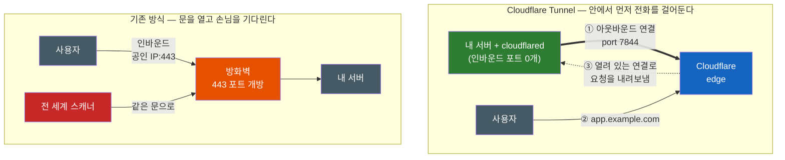
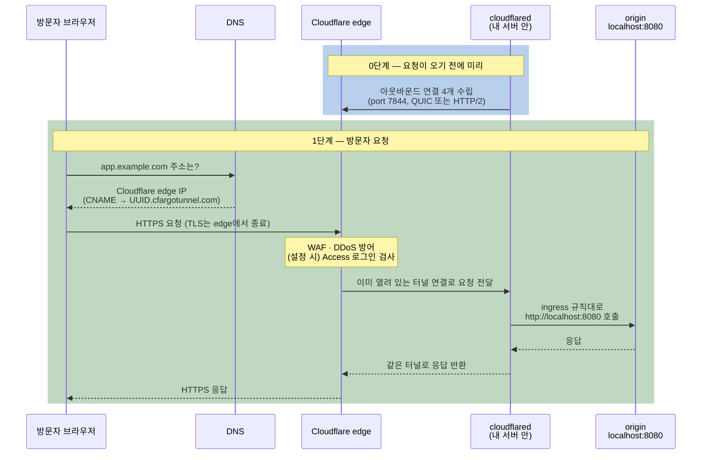

# Cloudflare Tunnel — 포트를 하나도 안 열었는데 어떻게 외부에서 접속될까

집에 있는 NAS, 사내망의 개발 서버, 노트북에서 띄운 `localhost:3000`. 이걸 바깥 사람에게 보여주려면 보통 공인 IP를 구하고, 공유기에 포트포워딩을 걸고, 방화벽에 인바운드 규칙을 뚫어야 한다. 그런데 Cloudflare Tunnel을 쓰면 이 중 어느 것도 하지 않았는데 `https://app.example.com`으로 접속이 된다. 문을 하나도 열지 않았는데 손님은 대체 어디로 들어오는 걸까?

## 결론부터 말하면

**Cloudflare Tunnel은 연결의 방향을 뒤집는다.** 외부 사용자가 내 서버로 "들어오는" 연결을 받는 대신, 내 서버 안에서 돌아가는 `cloudflared`라는 작은 프로그램이 Cloudflare 쪽으로 **먼저 나가서 연결을 맺어둔다.** 이후 사용자는 내 서버가 아니라 Cloudflare에 접속하고, Cloudflare는 그 요청을 이미 열려 있는 연결 위로 거꾸로 내려보낸다. 방화벽 입장에서는 "안에서 밖으로 나간 대화가 계속 이어지는 것"일 뿐이라 인바운드 포트를 하나도 열 필요가 없다.



| 구분 | 포트 열기 (포트포워딩) | Cloudflare Tunnel |
|------|------------------------|-------------------|
| 연결을 시작하는 쪽 | 외부 사용자 → 내 서버 | 내 서버(`cloudflared`) → Cloudflare |
| 필요한 것 | 공인 IP, 포트포워딩, 인바운드 방화벽 규칙 | 아웃바운드 인터넷 연결 (정식 터널은 Cloudflare에 연결된 도메인도) |
| 서버 IP 노출 | 노출됨 (DNS가 서버 IP를 가리킴) | 노출 안 됨 (DNS는 Cloudflare를 가리킴) |
| 앞단 보호 | 직접 구성 | Cloudflare의 WAF(웹 방화벽)·DDoS 방어·Access 로그인 |
| 공인 IP가 없는 환경 (CGNAT 등) | 불가능 | 가능 |

한 문장으로 줄이면, Cloudflare Tunnel은 **"내 서버 → Cloudflare" 방향으로 깔아둔 상시 연결** 과 그 앞에 붙은 Cloudflare 리버스 프록시의 조합이다.

## 1. 왜 서버 하나 공개하는 게 이렇게 번거로웠나

### 1.1 인바운드 연결을 받으려면 넘어야 할 세 관문

먼저 방향을 나타내는 두 단어부터 정리하자. **인바운드(inbound)** 는 밖에서 안으로 들어오는 연결, **아웃바운드(outbound)** 는 안에서 밖으로 나가는 연결이다. 데이터 자체는 한 연결 안에서 양방향으로 흐르기 때문에, 방향은 "누가 연결을 먼저 시작했느냐"로 정한다([Ingress와 Egress 용어 정리](./Network-Direction-Upstream-Downstream-Ingress-Egress-용어-정리.md) 참고). 웹 서버를 외부에 공개한다는 건 곧 인바운드 연결을 받겠다는 뜻이고, 그러려면 관문 세 개를 넘어야 한다.

첫 번째 관문은 **공인 IP** 다. 인터넷에서 누군가 나를 찾아오려면 전 세계에서 유일한 주소가 있어야 한다. 가정용 회선은 이 주소가 수시로 바뀌는 유동 IP라서 DDNS 같은 장치를 덧대야 하고, 더 나쁜 경우도 있다. 통신사가 공인 IP 하나를 여러 가입자가 나눠 쓰게 하는 **CGNAT(Carrier-Grade NAT)** 환경에서는 우리 집 공유기조차 공인 IP를 받지 못한다. 이때는 바깥에서 나를 찾아올 주소 자체가 없다.

두 번째 관문은 **NAT와 포트포워딩** 이다. 공유기나 회사 라우터 뒤의 서버는 `192.168.x.x` 같은 사설 IP를 쓰는데, [VPN 문서](./VPN은-어떻게-나를-회사망-안으로-데려가는가.md)에서 본 것처럼 이 대역은 인터넷에서 라우팅되지 않는다. 그래서 공유기에 "443 포트로 들어온 연결은 `192.168.0.10`으로 넘겨라"라는 포트포워딩 규칙을 직접 넣어줘야 한다.

세 번째 관문은 **방화벽의 인바운드 규칙** 이다. 사내망이라면 보안팀에 포트 개방을 신청해야 하고, 클라우드라면 Security Group에 규칙을 추가해야 한다. 세 관문 중 하나만 막혀도 서비스는 바깥에서 보이지 않는다.

### 1.2 문을 열면 손님만 들어오지 않는다

설령 세 관문을 다 통과했다고 해도 문제는 남는다. 443 포트를 연다는 건 **전 세계 누구나 그 문을 두드릴 수 있다는 뜻** 이다. 인터넷에는 모든 IP의 열린 포트를 쉬지 않고 훑는 스캐너가 돌고 있어서, 포트를 여는 순간부터 무차별 대입과 취약점 탐색이 시작된다.

"그럼 Cloudflare를 앞에 세우면 되지 않나?"라고 생각할 수 있다. [Reverse Proxy 문서](../proxy/Forward-Proxy와-Reverse-Proxy-누구의-대리인인가.md)에서 본 것처럼 Cloudflare를 리버스 프록시로 두면 DNS는 내 서버 대신 Cloudflare의 IP를 가리킨다. 하지만 Cloudflare 뒤에서 실제 응답을 만드는 서버, 즉 **origin** 의 포트는 여전히 열려 있다. 공격자가 과거 DNS 기록 같은 경로로 origin IP를 알아내면 Cloudflare를 건너뛰고 문을 직접 두드릴 수 있다. 그래서 전통적으로는 "Cloudflare IP 대역에서 온 연결만 허용한다"는 allowlist를 방화벽에 유지해야 했다.

### 1.3 그런데 이상한 점이 있다

같은 서버에서 `apt update`나 `curl https://github.com`은 아무 설정 없이 잘 된다. 인바운드는 그렇게 깐깐하게 막던 방화벽이 왜 이건 통과시킬까? 대부분의 방화벽은 **아웃바운드를 기본 허용** 하고, 연결 상태를 기억하는 stateful 방식으로 동작하기 때문이다. 안에서 시작한 연결에 대한 응답은 "내가 시작한 대화의 답장"으로 인식해서 그대로 들여보낸다.

여기서 발상을 뒤집어 볼 수 있다. **서버가 바깥의 믿을 만한 상대에게 먼저 연결을 걸어두고, 외부 요청을 그 연결 위로 받으면 어떨까?** 방화벽 입장에서는 서버가 시작한 아웃바운드 대화가 계속 이어지는 것뿐이니 인바운드 규칙이 필요 없다.

사실 이 아이디어 자체는 새롭지 않다. SSH의 리버스 포트 포워딩(`ssh -R`)이 정확히 이 구조다. 내부 서버가 외부의 SSH 서버에 접속하면서 "네 쪽 8080 포트로 들어오는 요청은 이 연결을 타고 나한테 보내줘"라고 부탁하는 방식이다. 다만 SSH 리버스 터널은 바깥에 SSH 서버를 직접 운영해야 하고, 연결이 끊기면 다시 붙는 것도 `autossh` 같은 도구로 직접 챙겨야 한다.

Cloudflare Tunnel은 이 "바깥의 믿을 만한 상대" 역할을 Cloudflare의 전 세계 네트워크가 맡고, 연결 유지·이중화·도메인 연결·보안 필터까지 한데 묶어 제공하는 서비스다. 2018년 Argo Tunnel이라는 이름으로 나왔을 때는 Argo Smart Routing의 대역폭 과금에 묶인 유료 기능이었다. 2021년 4월 무료로 풀리면서 지금의 Cloudflare Tunnel로 이름이 바뀌었다. 도메인 레코드에 아직 `argotunnel.com`, `cfargotunnel.com` 같은 흔적이 남아 있는 이유다.

## 2. Cloudflare Tunnel은 어떻게 동작하는가

### 2.1 등장인물

본격적인 동작을 보기 전에 등장하는 구성 요소를 정리하자.

| 용어 | 정체 |
|------|------|
| **origin** | 실제로 응답을 만드는 내 서비스. `localhost:8080`의 웹앱, SSH 서버, 원격 데스크톱 등 |
| **`cloudflared`** | origin 근처에 설치하는 오픈소스 데몬. Cloudflare로 아웃바운드 연결을 맺고, 받은 요청을 origin에 전달한다. **connector** 라고도 부른다 |
| **tunnel** | UUID로 식별되는 논리적 객체. "이 origin과 Cloudflare 사이의 통로" 그 자체다. 프로세스가 아니라 Cloudflare에 등록된 설정 단위다 |
| **replica** | 같은 tunnel에 붙은 두 번째, 세 번째 `cloudflared` 프로세스. 서버 한 대가 죽어도 서비스가 유지되게 한다 |
| **Cloudflare edge** | 전 세계에 흩어진 Cloudflare 데이터센터. 사용자 요청을 가장 먼저 받는 앞단이다 |
| **public hostname** | 외부에 공개할 도메인(`app.example.com`). DNS CNAME으로 tunnel을 가리킨다 |

핵심은 tunnel과 `cloudflared`를 구분하는 것이다. tunnel은 Cloudflare 쪽에 등록된 "이름표"이고, `cloudflared`는 그 이름표를 들고 실제로 연결을 맺는 "일꾼"이다. 그래서 하나의 tunnel에 일꾼(`cloudflared`)을 여러 명 붙일 수 있고, 그게 replica다.

### 2.2 터널이 열리는 순간 — 아웃바운드 연결 4개

`cloudflared`를 실행하면 가장 먼저 Cloudflare로 **아웃바운드 연결 4개** 를 맺는다. 이 4개는 서로 다른 서버 4대로 향하고, 서버들은 적어도 2곳의 데이터센터에 나뉘어 있다. 연결 하나, 서버 하나, 심지어 데이터센터 하나가 통째로 내려가도 남은 연결로 트래픽이 흐르게 하려는 설계다. 여기에 다른 머신에서 같은 tunnel로 replica를 하나 더 띄우면 그 replica도 4개의 연결을 새로 맺는다. `cloudflared`를 돌리는 서버 자체가 죽는 경우까지 대비하는 것이다.

연결의 목적지 포트는 **7844** 이고, 전송 방식은 QUIC(UDP 위에서 동작하는 전송 프로토콜로, HTTP/3의 기반이다) 또는 HTTP/2(TCP) 중 하나다. 방화벽이 UDP를 막는 환경이라면 HTTP/2로, TCP를 막는 환경이라면 QUIC로 붙는다. 결국 방화벽에 요구하는 것은 **"아웃바운드 7844 허용"** 하나뿐이고, 대부분의 방화벽은 이미 아웃바운드를 기본 허용하므로 대개 아무 설정도 필요 없다. 2026년 5월에 나온 `cloudflared` 2026.5.2부터는 시작할 때 DNS 해석과 7844 포트 연결성을 스스로 점검해서, 막힌 곳이 있으면 어떤 규칙을 열어야 하는지 알려준다.

### 2.3 요청 한 번의 여정

이제 방문자가 `https://app.example.com`을 열었을 때 무슨 일이 일어나는지 따라가 보자.



이 그림에서 가장 중요한 건 **0단계가 1단계보다 먼저 일어난다는 사실** 이다. 요청이 올 때마다 Cloudflare가 내 서버로 새 연결을 여는 게 아니라, `cloudflared`가 미리 열어둔 연결을 재사용한다. 그래서 Cloudflare에서 내 서버로 들어오는 인바운드 연결이 한 번도 생기지 않는다.

또 하나 눈여겨볼 점은 origin이 받는 요청의 출발지다. origin 입장에서 요청을 보낸 상대는 방문자가 아니라 바로 옆의 `cloudflared`다. 같은 머신에서 돌고 있다면 모든 요청이 `127.0.0.1`에서 온 것처럼 보인다. 실제 방문자 IP가 필요하면 Cloudflare edge가 붙여주는 `CF-Connecting-IP` 헤더를 읽어야 한다.

### 2.4 DNS — 내 도메인을 tunnel에 연결하는 법

tunnel을 만들면 Cloudflare는 `<UUID>.cfargotunnel.com`이라는 서브도메인을 하나 만들어준다. 내 도메인 `app.example.com`을 이 주소로 향하는 CNAME 레코드로 등록하면, 그 도메인으로 들어온 요청이 해당 tunnel로 흘러간다.

그런데 이상하지 않은가? UUID만 알면 다른 사람이 자기 도메인을 내 tunnel에 연결해서 내 서비스를 대신 노출시킬 수 있을 것 같다. 실제로는 불가능하다. `cfargotunnel.com` 서브도메인은 **같은 Cloudflare 계정에 있는 DNS 레코드에 대해서만** 트래픽을 프록시하기 때문이다. UUID는 비밀이 아니다.

진짜 비밀은 따로 있다. 대시보드에서 만든 tunnel은 **token** 하나만 있으면 실행되는데, 공식 문서 표현 그대로 "token을 가진 사람은 누구나 tunnel을 실행할 수 있다." token이 유출되면 공격자가 자기 머신에서 내 tunnel의 replica를 띄울 수 있고, 그러면 내 도메인으로 오는 트래픽 일부가 공격자 쪽 `cloudflared`로 흘러갈 수 있다. token은 비밀번호처럼 다루고 주기적으로 교체해야 한다.

### 2.5 ingress 규칙 — cloudflared는 작은 리버스 프록시다

tunnel 하나로 서비스 하나만 내보낼 수 있는 건 아니다. `cloudflared`는 들어온 요청의 hostname(필요하면 path까지)을 보고 어느 로컬 서비스로 보낼지 고르는데, 이 매핑 목록을 **ingress 규칙** 이라고 부른다. Kubernetes의 Ingress와 이름이 같은데 개념도 같다. "외부 hostname → 내부 서비스"를 연결하는 라우팅 표다.

```yaml
# ~/.cloudflared/config.yml (locally-managed tunnel의 경우)
tunnel: 6ff42ae2-765d-4adf-8112-31c55c1551ef
credentials-file: /root/.cloudflared/6ff42ae2-765d-4adf-8112-31c55c1551ef.json

ingress:
  - hostname: app.example.com        # 웹앱
    service: http://localhost:8080
  - hostname: grafana.example.com    # 같은 tunnel로 두 번째 서비스
    service: http://localhost:3000
  - hostname: ssh.example.com        # HTTP가 아닌 프로토콜도 가능
    service: ssh://localhost:22
  - service: http_status:404         # catch-all: 반드시 맨 마지막에 있어야 한다
```

규칙은 위에서부터 차례로 비교되고, 어떤 hostname에도 맞지 않는 요청은 마지막 catch-all 규칙이 받는다. 이 catch-all이 없으면 설정 파일이 유효하지 않다. 한 가지 주의할 점은 `ssh://`처럼 HTTP가 아닌 서비스다. 이런 트래픽은 WebSocket 연결에 실어 보내기 때문에, 평소 쓰던 `ssh` 클라이언트로 접속하려면 접속하는 사람의 PC에도 `cloudflared`를 설치해 `cloudflared access ssh`를 거쳐야 한다. 클라이언트 설치가 부담스럽다면 Cloudflare Access(요청이 origin에 닿기 전에 Cloudflare에서 로그인을 요구하는 기능, 4.2절)의 browser rendering을 켜서 브라우저 안의 터미널로 접속하는 방법도 있다. 결국 `cloudflared`는 **내 네트워크 안쪽에 사는 작은 리버스 프록시** 인 셈이다. 바깥의 Cloudflare edge가 1차 리버스 프록시, 안쪽의 `cloudflared`가 2차 라우터 역할을 나눠 맡는다.

대시보드에서 관리하는 tunnel이라면 같은 내용을 파일 대신 tunnel의 Routes 탭에서 "Published application" 라우트로 등록한다. 설정이 Cloudflare에 저장되므로 서버에는 token만 있으면 된다.

## 3. 실제로 써보기 — 세 가지 방식

Cloudflare Tunnel을 띄우는 방법은 용도에 따라 세 가지로 나뉜다.

| 방식 | 계정·도메인 | 설정이 저장되는 곳 | 주 용도 |
|------|-------------|-------------------|---------|
| **Quick Tunnel** | 불필요 | 없음 (명령 한 줄) | 로컬 개발 서버 잠깐 공유, 웹훅 수신 테스트, 데모 |
| **Remotely-managed** | 필요 | Cloudflare (대시보드·API·Terraform) | Cloudflare 권장 방식. 운영 환경 대부분 |
| **Locally-managed** | 필요 | 서버의 `config.yml` | 로컬 개발·테스트, 기존 구성 유지 |

### 3.1 Quick Tunnel — 계정 없이 명령 한 줄

가장 빠르게 체험하는 방법이다. Cloudflare 계정도, 도메인도 필요 없다.

```bash
cloudflared tunnel --url http://localhost:3000
# 출력된 https://<랜덤>.trycloudflare.com 주소를 공유하면 끝
# 프로세스를 끄면 주소도 사라진다
```

편한 만큼 제약도 분명하다. 실행할 때마다 hostname이 바뀌고, 가용성 보장이 없으며, tunnel 하나당 동시에 처리 중인 요청이 200개를 넘으면 `429` 응답을 돌려준다. 그리고 **SSE(Server-Sent Events)를 지원하지 않는다.** LLM 스트리밍 응답처럼 [SSE](../web/Server-Sent-Events-SSE.md)를 쓰는 서비스를 Quick Tunnel로 시연하려다 응답이 한 번에 몰려오거나 끊기는 걸 보게 된다면 이 제약을 의심하면 된다.

원래 Quick Tunnel은 URL을 아는 사람이면 누구나 접속할 수 있었는데, 2026년 10월부터 `--allowed-mail` 옵션으로 접근자를 제한할 수 있게 되었다. 지정한 이메일로 일회용 PIN을 받아 인증한 사람만 들어온다.

```bash
# example.com 도메인 메일을 가진 사람만 접속 허용 (와일드카드는 셸 확장을 막도록 따옴표로 감싼다)
cloudflared tunnel --url http://localhost:3000 --allowed-mail '*@example.com'
```

### 3.2 Remotely-managed tunnel — 운영의 기본값

Cloudflare가 권장하는 방식이다. 대시보드의 **Networking > Tunnels** 에서 tunnel을 만들면 token이 발급되고, 서버에서는 그 token으로 `cloudflared`를 실행하기만 하면 된다.

```bash
docker run cloudflare/cloudflared:latest tunnel --no-autoupdate run --token <TUNNEL_TOKEN>
```

그다음 대시보드의 Routes 탭에서 Published application으로 `app.example.com → http://localhost:8080` 같은 라우트를 추가하면, 설정한 hostname으로 바로 접속된다. ingress 규칙이 Cloudflare에 저장되므로 서버에 설정 파일을 둘 필요가 없고, 여러 서버의 replica를 한 화면에서 관리할 수 있다.

### 3.3 Locally-managed tunnel — CLI와 설정 파일로 전부

모든 걸 명령줄과 파일로 관리하고 싶다면 이 방식을 쓴다.

```bash
cloudflared tunnel login                                 # 브라우저로 계정·도메인 인증
cloudflared tunnel create my-tunnel                      # UUID와 credentials 파일 생성
cloudflared tunnel route dns my-tunnel app.example.com   # CNAME → <UUID>.cfargotunnel.com 생성
cloudflared tunnel run my-tunnel                         # config.yml(2.5절)을 읽어 실행
```

`tunnel create`가 만든 credentials JSON 파일이 이 방식에서의 "비밀"이다. remotely-managed의 token과 마찬가지로 유출되지 않게 관리해야 한다.

### 3.4 공개가 아니라 "사내망 접속"에도 쓴다

지금까지 본 건 public hostname, 즉 인터넷 누구나 접속하는 경로였다. 하지만 tunnel에 사설 IP 대역(예: `10.0.0.0/8`)을 CIDR 라우트로 등록하고 직원 PC에 Cloudflare One Client(WARP)를 설치하면, VPN처럼 사내 IP에 직접 접속하는 용도로도 쓸 수 있다.

[VPN 문서](./VPN은-어떻게-나를-회사망-안으로-데려가는가.md)의 FortiGate 방식과 비교하면 차이가 선명하다. 전통적인 VPN은 직원이 회사 방화벽의 **열린 포트로 들어가는** 구조라서 회사는 VPN 포트를 인바운드로 열어둬야 한다. Cloudflare Tunnel 방식에서는 회사망 안의 `cloudflared`가 먼저 Cloudflare로 나가 있고, 직원도 Cloudflare로 나가서 둘이 Cloudflare 위에서 만난다. 회사 방화벽에는 여전히 열린 인바운드 포트가 없다. 이 영역은 Cloudflare의 Zero Trust 제품군(Cloudflare One)으로 이어지는 별도 주제라서 여기서는 이런 용도도 있다는 것만 짚어둔다.

## 4. 언제 쓰고, 무엇을 조심해야 하나

### 4.1 비슷한 도구들과 나란히 놓기

| 구분 | 포트포워딩 | SSH 리버스 터널 (`ssh -R`) | VPN | Cloudflare Tunnel |
|------|-----------|---------------------------|-----|-------------------|
| 연결 방향 | 외부 → 내부 | 내부 → 외부 SSH 서버 | 사용자 → 회사 VPN 장비 | 내부 → Cloudflare |
| 내부망에 열어야 할 인바운드 포트 | 서비스 포트 | 없음 | VPN 포트 (예: 443) | 없음 |
| 바깥 중계 서버 | 없음 | 직접 운영 | VPN 장비 직접 운영 | Cloudflare가 운영 |
| 사용자 쪽 준비 | 없음 | 없음 | VPN 클라이언트 | HTTP(S)는 브라우저만. SSH·RDP는 클라이언트 쪽 `cloudflared` 또는 Access browser rendering |
| 접근 제어 | 서비스가 직접 | 서비스가 직접 | VPN 인증 | Cloudflare Access 정책 |

[Bastion Host](../infra/Bastion-Host.md)도 같은 축에 놓고 보면 이해가 쉽다. Bastion은 "SSH 포트 하나만 인바운드로 열어두고 그 문을 철저히 지키는" 전략이고, Cloudflare Tunnel은 "그 하나의 문마저 닫고 안에서 밖으로 나가는" 전략이다.

비용 측면에서 tunnel 자체는 무료 플랜을 포함한 모든 플랜에서 쓸 수 있다. 2026년 10월 기준으로 계정마다 tunnel 1,000개가 포함되고, 그 이상이 필요하면 tunnel당 월 $4.50에 추가로 구매한다. 고객·기기마다 tunnel을 하나씩 만드는 플랫폼 사업자가 아니라면 이 한도에 닿을 일은 거의 없다.

### 4.2 흔한 함정

1. **"포트를 안 열었다"는 "비공개"가 아니다.** public hostname으로 내보낸 서비스는 인터넷 전체에 공개된다. 문이 닫혀 있어도 Cloudflare라는 대리인이 누구의 요청이든 받아서 전달해주기 때문이다. Grafana나 관리자 페이지 같은 내부 도구를 내보낼 때는 **Cloudflare Access** 를 붙여야 한다. Access는 요청이 origin에 닿기 전에 Cloudflare에서 SSO나 이메일 인증을 요구하는 로그인 관문이다. tunnel 설정에서 Protect with Access를 켜면 `cloudflared`가 Access 토큰까지 대신 검증해준다.

2. **TLS는 Cloudflare edge에서 풀린다.** 방문자와 Cloudflare 사이의 HTTPS는 edge에서 종료되고, Cloudflare는 복호화된 요청을 보고 WAF를 적용한 뒤 tunnel로 내려보낸다. 리버스 프록시의 본질이 원래 그렇다. 규제나 계약상 제3자가 평문을 볼 수 없는 데이터라면 이 구조가 허용되는지 먼저 확인해야 한다.

3. **origin이 보는 클라이언트 IP는 `cloudflared`다.** 접속 로그와 IP 기반 rate limit이 전부 `127.0.0.1` 하나로 찍힌다. 웹 서버 로그 포맷과 애플리케이션이 `CF-Connecting-IP` 헤더를 읽도록 바꿔야 한다.

4. **Docker 안의 `localhost`는 컨테이너 자신이다.** `cloudflared`를 컨테이너로 띄우고 라우트를 `http://localhost:8080`으로 잡으면, 호스트의 8080이 아니라 `cloudflared` 컨테이너 자신의 8080으로 요청이 간다. 같은 Compose 네트워크에 두고 서비스 이름으로 가리키는 게 정석이다.

   ```yaml
   services:
     app:
       image: nginx
     cloudflared:
       image: cloudflare/cloudflared:latest
       command: tunnel --no-autoupdate run --token ${TUNNEL_TOKEN}
   # 라우트의 service는 http://localhost:80 이 아니라 http://app:80
   ```

5. **아웃바운드까지 막힌 환경도 있다.** 보안이 엄격한 사내망은 아웃바운드도 허용 목록으로만 통과시키는 경우가 많다. 이때는 7844 포트(UDP·TCP 중 최소 하나)와 `region1.v2.argotunnel.com`, `region2.v2.argotunnel.com`에 대한 DNS 해석이 가능해야 한다. 최신 `cloudflared`의 시작 시 점검 결과를 그대로 보안팀에 전달하면 협의가 빨라진다.

## 5. 정리

### 핵심 포인트

1. **Cloudflare Tunnel의 본질은 연결 방향의 역전이다**
   - 서버 안의 `cloudflared`가 Cloudflare로 먼저 아웃바운드 연결을 맺고, 외부 요청은 그 연결을 타고 내려온다.
   - 그래서 공인 IP·포트포워딩·인바운드 방화벽 규칙 없이 서비스를 공개할 수 있고, origin IP도 드러나지 않는다.

2. **구성은 `cloudflared` + tunnel(UUID) + DNS CNAME이다**
   - `cloudflared`는 데이터센터 2곳 이상에 연결 4개를 맺어 이중화하고, replica를 더해 서버 장애까지 대비한다.
   - `app.example.com` → `<UUID>.cfargotunnel.com` CNAME으로 도메인을 잇고, ingress 규칙으로 hostname별 로컬 서비스를 고른다.

3. **용도에 따라 세 가지 방식을 고른다**
   - 잠깐 공유는 Quick Tunnel(계정 불필요, SSE 미지원), 운영은 remotely-managed(token), 파일 기반 관리는 locally-managed(`config.yml`).

4. **문이 닫혔다고 비공개는 아니다**
   - public hostname은 인터넷 공개이므로 내부 도구에는 Cloudflare Access를 붙인다.
   - TLS가 edge에서 풀린다는 점, origin이 보는 IP가 `cloudflared`라는 점, token이 곧 비밀번호라는 점을 기억하자.

---

## 출처

- [Cloudflare Tunnel · Cloudflare Docs](https://developers.cloudflare.com/tunnel/) - 공식 제품 문서 (동작 방식, 연결 4개, 용도, 요금제)
- [Cloudflare Tunnel · Cloudflare One docs](https://developers.cloudflare.com/cloudflare-one/networks/connectors/cloudflare-tunnel/) - outbound-only 연결 모델, tunnel·connector 정의
- [Tunnel availability and failover](https://developers.cloudflare.com/cloudflare-one/networks/connectors/cloudflare-tunnel/configure-tunnels/tunnel-availability/) - 서버 4대·데이터센터 2곳 이상, replica
- [Connectivity pre-checks](https://developers.cloudflare.com/cloudflare-one/networks/connectors/cloudflare-tunnel/troubleshoot-tunnels/connectivity-prechecks/) - port 7844, QUIC·HTTP/2, 필요한 DNS 엔드포인트
- [Useful terms](https://developers.cloudflare.com/cloudflare-one/networks/connectors/cloudflare-tunnel/get-started/tunnel-useful-terms/) - remotely-managed와 locally-managed 정의
- [Locally-managed tunnels](https://developers.cloudflare.com/cloudflare-one/networks/connectors/cloudflare-tunnel/do-more-with-tunnels/local-management/) - remotely-managed 권장 근거
- [Create a locally-managed tunnel](https://developers.cloudflare.com/cloudflare-one/networks/connectors/cloudflare-tunnel/do-more-with-tunnels/local-management/create-local-tunnel/) - CLI 절차
- [Configuration file](https://developers.cloudflare.com/tunnel/advanced/local-management/configuration-file/) - ingress 규칙, catch-all 필수
- [Routing](https://developers.cloudflare.com/tunnel/concepts/routing/) - `cfargotunnel.com` CNAME, 같은 계정 제한, 지원 프로토콜
- [Tunnel tokens](https://developers.cloudflare.com/tunnel/reference/tunnel-tokens/) - token 보안, 교체
- [Quick Tunnels](https://developers.cloudflare.com/tunnel/get-started/quick-tunnels/) - 제약(200 in-flight, SSE 미지원), `--allowed-mail`
- [Set up Cloudflare Tunnel](https://developers.cloudflare.com/tunnel/get-started/) - Docker 실행 예시
- [Connect an IP/CIDR](https://developers.cloudflare.com/cloudflare-one/networks/connectors/cloudflare-tunnel/private-net/cloudflared/connect-cidr/) - 사설망 라우팅
- [Connect to SSH in the browser](https://developers.cloudflare.com/cloudflare-one/networks/connectors/cloudflare-tunnel/use-cases/ssh/ssh-browser-rendering/) - Access browser rendering으로 브라우저에서 SSH 접속
- [Publish a self-hosted application to the Internet](https://developers.cloudflare.com/cloudflare-one/access-controls/applications/http-apps/self-hosted-public-app/) - Access 연동, Protect with Access
- [Tunnels FAQ](https://developers.cloudflare.com/cloudflare-one/faq/cloudflare-tunnels-faq/) - origin이 보는 방문자 IP
- [Cloudflare HTTP headers](https://developers.cloudflare.com/fundamentals/reference/http-headers/) - `CF-Connecting-IP`
- [Protect your origin server](https://developers.cloudflare.com/fundamentals/security/protect-your-origin-server/) - origin 보호 방식 비교
- [Cloudflare Tunnel Changelog](https://developers.cloudflare.com/cloudflare-one/changelog/tunnel/) - 2026년 변경사항 (시작 시 점검, `--allowed-mail`, tunnel 1,000개 포함·추가 $4.50)
- [A Boring Announcement: Free Tunnels for Everyone](https://blog.cloudflare.com/tunnel-for-everyone/) - 2021-04-15 무료화와 Argo Tunnel 개명
